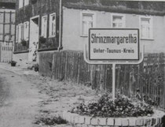

# Einleitung und Ortsname

## Einleitung

Chronik von Strinz-Margarethä

---

## Vorwort

Im Strinzer Lied, welches im Jahre 1945 vom damaligen Rektor Richard Weißer geschrieben wurde heißt es in der 1. Strophe:

---

## Darstellung

Weitere Ortsnamensformen

Wohl kaum ein Ortsname hat sich im Laufe der Jahrhunderte so verändert wie der von Strinz-Margarethä. Dies liegt wohl hauptsächlich daran, dass eine Unterscheidung zwischen dem gleichnamigen Strinz (später Trinitatis) hermusste.

---

## Am Kreuzweg von Strinz-Margareth,

Es ist wohl eigen, wenn rot der Komet

---

## Am Kreuzweg von Strinz-Margareth.

Ein warmer Glanz geht von ihr aus,

---

## Dies war Anlass genug, dass die ganze Bevölkerung des Ortes auf den Beinen war, aber auch viele Gäste aus den Nachbarorten nahmen an diesem feierlichen Akt teil.

Zunächst nahmen die Einwohner von der alten Schule, wo die meisten von ihnen die Schulbank gedrückt haben, Abschied. In feierlichem Zug begaben sich die zahlreichen Anwesenden, an der Spitze der Spielmannszug des Turnvereins, zur neuen Schule. Als Einleitung der offiziellen Feier sangen alle gemeinsam das Heimatlied "Strinz-Margarethä".

---

## Jacob Schichtling (Schichtel), Müller auf der Mühle untig Strinz-Margareth verkauft seine Mühle nebst zugehörigen Gütern an Johann Philipp Schiffmann für 600 Gulden.

(Quelle: HStA: W 133, VIIIe,1)

