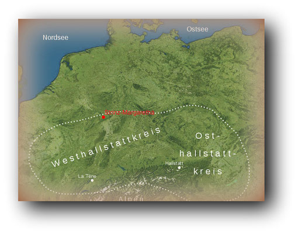

# Vorgeschichte und Antike

## Volksschule

Chronik nach Jahren

Hier geht es zur umfangreichen Strinzer Chronik. StM wurde ja bereits im Jahre 1184 urkundlich erwähnt. Auch davor gab es den kleinen Taunusort sicher schon. Und davor gab es die Chatten und die Römer in unserer Region. Ja sogar vor Christi Geburt sind hier schon Menschen nachweisbar, die zumindest durch unsere Gegend gezogen sind. Viele Hügelgräber zeugen davon.

---

## Aus diesem Grund beginnt die Chronik schon vor Christi Geburt. Schaut einfach mal rein, in die spannende Geschichte meines Heimatortes.

Und nun: Viel Spaß mit der Dorfchronik!!!"

---

## Chronik vor Christi Geburt

Vor 300.000.000 Jahren

---

## Der Taunus, der bis dahin vom Meer bedeckt war erhebt sich noch vor den Alpen aus dem Meer. Er soll seinerzeit sogar höher gewesen sein als die heutigen Alpen.

500 vor Christi Geburt

Unsere Region gehört zum sogenannten Hallstattkreis. Die Hallstattzeit bezeichnete einen Zeitabschnitt der älteren Eisenzeit. Sie wird nach den Funden des Ortes Hallstatt im Salzkammergut bezeichnet. Unsere Region liegt im nördlichen Bereich des Hallstattkreises.

In Oberlibbach ist eine Ansiedlung aus dieser Zeit nachweisbar. Ob auch in der Strinzer Gemarkung solch eine Siedlung bestand ist nicht bekannt, allerdings ist davon auszugehen, dass sich die Menschen der damaligen Zeit auch in unserer Gemarkung beim Jagen, Fischen etc. aufhielten.

Ein weiterer Beweis für menschliche Aktivitäten in unserer Region sind die Hügelgräber in unserem Gebiet. Eines davon, welches in Karten fälschlicherweise als "Römergrab" bezeichnet wird, befindet sich an der Grenze nach Hennethal an der Eisenstraße.

