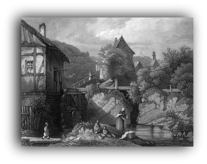
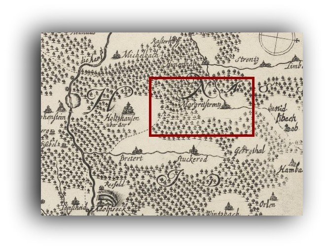
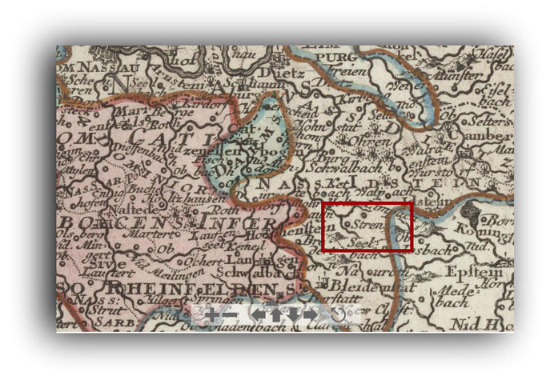
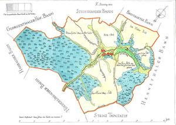
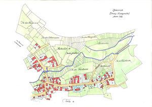
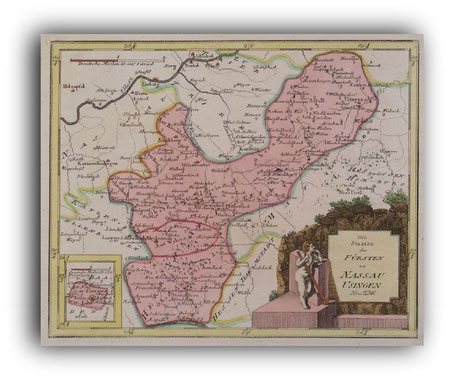

# Frühe Neuzeit (1500-1800)

## 7.7Chronik von 1500 - 159960

7.8Chronik von 1600 – 169975

---

## 1500 - Margarethenstrenz

1521 - Strintz Margarethe

---

## 1559 - Margreten Strincz

1609 - Strintz San Margarete****

---

## 1653 - Strinz Margaretha

1658 - Strenß

---

## 1669 - Strensensis Nassoico*****

1703 - Strintz - Margretha****

---

## **** Siegel-Stempel

***** Album Academiae Vitebergensis / 1660-1710 / Band 2

---

## Margareta in einem Siegel von 1703

Margareta von Antiochia wurde in Pisidien (in der heutigen Türkei) um 305 als Jungfrau und Märtyrin hingerichtet.

Die hl. Margareta ist die Schutzpatronin der Bauern, bei Schwangerschaft und Geburt, der Jungfrauen, Ammen und der Gebärenden. Sie wird gegen Unfruchtbarkeit, bei Wunden und Gesichtskrankheiten und zum Schutz „gegen Unholde aus der Tiefe des Wassers“ angerufen.

---

## von 1609 (Abdruck 1626) und dem

STRINZMARGRETHA AVROFF U(ND) LIEBACHER GERICHTSSIEG(EL)

---

## 1500

StM gehört vermutlich zum Amt Idstein.

---

## 1501

Ereignisse

---

## 1503

Ereignisse

---

## 1505

Ereignisse

---

## Ereignisse

Johann von Stockheim, Propst des S. Ferrutius Stiftes zu Bleidenstadt, belehnt (verpachtet) den Grafen Adolf von Nassau, Herrn zu Wiesbaden und Idstein, mit Substituierung des Wilhelm Judden von Eltville, Amtmanns zu Wiesbaden mit den Lehen die Graf Philipp von Nassau-Idstein (Bruder des Graf Adolf) vom Stift innegehabt hatte, den zwei Vogteien zu Würges ("Wedriges") und Kirberg ("Kirppurg") und den Dörfern Strinz-Margarethä, den beiden Libbach ("Lydbach") und Hambach ("Hambach"). G. uff Montag nach dem achtzehenten tag = 14. Januar 1510.(Quelle: Hessisches Staatsarchiv, Wiesbaden, Abt. 131 Nr. U 240)

Graf Adolf von Nassau, Herr zu Wiesbaden und Idstein, reversiert (verpflichtet) sich durch Wilhelm Judden von Eltville, Amtmann zu Wiesbaden, dem Propst Johann von Stockheim des S. Ferrutius Stiftes zu Bleidenstadt über Empfang der früher dem Grafen + Philipp von Nassau-Idstein (Bruder Adolfs) verliehenen Lehen, der zwei Vogteien zu Würges ("Wedriges") und Kirberg ("Kirppurg") und der Dörfer Strinz-Margarethä, der beiden Libbach (Lidbach) und Hambach (Hambach). G. uff Montag nach dem achtzehenten tag = 14. Januar 1510.(Quelle: Hessisches Staatsarchiv, Wiesbaden, Abt. 131 Nr. U 241)

Lehen von Nassau-Idstein, Burglehen zu Idstein, 6 Malter Weizengülte von der Vogtei Würges, 6 Gulden zu Niederseelbach, 3 3/4 Gulden aus der Herbstbede zu Strinz-Margarethae und die Rietspach bei Idstein: Friedrich von Stockheim, + Philipps Sohn, Revers gegen Adolf Graf zu Nassau-Wiesbaden-Idstein.(Quelle: HHStAW 121 Nr. U von Stockheim)

---

## 1513

Ereignisse

Johann von Stockheim, Propst des S. Ferrutius Stiftes zu Bleidenstadt, bestätigt dem Grafen Philipp von Nassau, Herrn zu Wiesbaden und Idstein die vom Stift herrührenden und zuvor dem Grafen Adolf von Nassau verliehenen Lehen (Verpachtung) , die zwei Vogteien zu Würges ("Wedriges") und Kirberg (Kirppurg) und die Dörfer Strinz-Margarethä, die beiden Libbach ("Lidbach") und Hambach ("Hannbach"). G. uff Sampstag nechst nach dem Sontag Quasimodogeniti = 09. April 1513(Quelle: Hessisches Staatsarchiv Wiesbaden, Abt. 131 Nr. U 251)

Graf Philipp von Nassau, Herr zu Wiesbaden und Idstein, reversiert (verpflichtet) sich dem Propst Johann von Stockheim des S. Ferrutius Stiftes zu Bleidenstadt über Empfang der zuvor dem Grafen Adolf von Nassau etc. verliehenen Stiftischen Lehen, der zwei Vogteien zu Würges ("Wedriges") und Kirberg (Kirppurgk) und der Dörfer Strinz-Margarethä, der beiden Libbach ("Lidbach") und Hambach ("Hannbach"). G. uff Sampstag nechst nach dem Sontag Quasimodogeniti = 09. April 1513(Quelle: Hessisches Staatsarchiv Wiesbaden, Abt. 131 Nr. U 252)

Lehen von Nassau-Idstein, Burglehen zu Idstein, 6 Malter Weizengülte von der Vogtei Würges, 6 Gulden zu Niederseelbach, 3 3/4 Gulden aus der Herbstbede zu Strinz-Margarethae und die Rietspach bei Idstein: Friedrich von Stockheim, + Philips Sohn, Revers zugleich für seine Brüder, gegen inserierten Lehnbrief des Grafen Philipp von Nassau-Wiesbaden-Idstein.(Quelle: HHStAW 121 Nr. U von Stockheim)

---

## 1514

Obrigkeiten

---

## Schultheiß: Hans Reich(HStA W Cop.VIII,1514)

Ereignisse

Philipp Graf zu Nassau-Wiesbaden-Idstein gestattet, nachdem der bisherige Mühlenzwang der Hintersassen zu Strinz-Margarethä nach der Mühle zu Adolfseck zu Unzuträglichkeiten geführt hat, seinem Hintersassen Philipps zu String-Margarethä die Anlage einer Mühle daselbst mit Mühlenzwang der Hintersassen des Dorfes und unter der Bedingung der Leistung eines Erbpachtzinses von 3 Malter Korn Limburger Maß und 50 Eier zu dessen Sicherung. Privilegierter verpfändet eine Wiese in der Ribsbach, 3/4 Landes am Bleidenstädter Weg und einen an die Formwiese stoßende Wiese(Quelle: HHStAW 3001 Nr. 8 fol. 31)

Für die nassauischen Eigenleute (Leibeigenen) gilt bis 1514 der Adolfsecker Mühlenbann. Bisher waren Strinzer Bürger gezwungen ihr Getreide in der Adolfsecker Mühle malen zu lassen. Graf Phillipp von Idstein gestattet seinem Untersaßen Philipp zu Strinz-Margarethen an diesem Ort (StM) eine Mühle zu bauen, in welcher die Bewohner malen zu lassen verpflichtet sein sollen. Der Müller muss dafür eine jährliche Pacht von 3 Malter Korn und 50 Ostereier (!) geben, aber mit Rücksicht auf die Kosten des Neubaus im ersten Jahr frei sein.

---

## (siehe auch unter Zinkenmühle)

Aus dem Jahre 1514 ist ein N. Enders (Emmerichs) bekannt der Schöffe in StM ist.(Quellen: Gemeindearchiv Hünstetten)

---

## Im Jahre 1514 wird eine Heusen Stoffel als Güterbesitzer in StM erwähnt.

1520

---

## Ereignisse

Bei der Verrechnung der Einnahmen der Herrschaft Idstein vom Weinschank auf "Kirben", vom "Kirchweingeld" und der Weinlieferung zu "Kirben" wird die Kirchweihe zu Strinz-Margarethä am 13. Juli 1520 (uff Freitag nach Margaretha) erwähnt.(Quelle: Nassauische Analen)

---

## 1521

Bekannte Namensform

---

## 1524

Obrigkeiten

---

## Am 26.04.1524 erhält Pfarrer Johannes Schiffer vom Domkapitel zu Mainz, die Erlaubnis die Pfarrei mit Nicolaus Calciator zu permutieren (Red.: nachzubesetzen).

Pfarrer: Johannes Schiffer wird daraufhin erster luth. Pfarrer zu Usingen. Pfarrer Schiffer wurde in Elz bei Limburg geboren und heiratete 1528 Margaretha Chun (?). 1535 (jetzt schon Pfarrer in Usingen) fiel er dadurch auf, dass er beim Buchdrucker Christian Egenolff in Frankfurt eine Bibel kaufte und sie im Chor der Usinger Kirche anschmieden ließ.

---

## "Uff dass jeder, wer Lust hat darinnen zu lesen sie findet"

1525

---

## Ereignisse

Die Eheleute Contz Peter, Mollers Sohn zu StM, verkaufen für 10 fl. der Kirche zu Idstein eine Rente von 1/2 fl. auf spezifische Ländereien in der Gemarkung StM am Dienstag nach Martini 1525.(Quelle: Hessisches Staatsarchiv, Abt. 133/101)

Philipp Graf zu Nassau-Wiesbaden-Idstein verleiht seinen Hintersassen Weyners Henn zu Strinz-Margarethä die Mühle zu Adolfseck auf 3 Jahre gegen einen jährlichen Pachtkanon von 50 Malter Korn Mainzer Maßes(Quelle: HHStAW 3001 Nr. 8 fol. 47)

---

## Maller Philips, erster Müller von StM bürgt für Weyners Henn bei der Adolfsecker Mühlenpachtung.(Quelle Gemeindearchiv Hünstetten)

1527

---

## 1528

Ereignisse

Im Streit zwischen dem Stift Bleidenstadt und dem Pfarrer Camberger einerseits und der Gemeinden StM, Hambach und den beiden Libbach anderseits, wollen die Gemeinden 16 Säcke Hafer jährlichen Zinses dem Pfarrer verweigern. 1528 das Urteil gefällt, dass sie ihm 16 Säcke Hafer entrichten müssen.(Quelle: HStAW, 14, 840)

---

## 1529

Ereignisse

Lehen von Nassau-Idstein, Burglehen zu Idstein, 6 Malter Weizengülte von der Vogtei Würges, 6 Gulden zu Niederseelbach, 3 3/4 Gulden aus der Herbstbede zu Strinz-Margarethae und die Rietspach bei Idstein: Philipp von Stockheim, + Friedrichs Sohn, Revers gegen Graf Philipp von Nassau-Wiesbaden-Idstein. Siegler: Aussteller.

---

## (Quelle: HHStAW 121 Nr. U von Stockstein)

1536

---

## 1539

Ereignisse

---

## 1544

Ereignisse

Graf Philipp von Nassau-Wiesbaden-Idstein beurkundet, daß vor seinem Amtmann Philipp von Grorod zu Idstein der Streit des Stifts Bleidenstadt gegen die Gemeinden des Strintzer Grundes: Strintz-Margarethae, Ober- und Niederlibbach und Hambach wegen der von den letzteren verweigerten 16 Sack Hafer für den Pfarrer von Bleidenstadt so geschlichtet worden sei, daß die Gemeinden nun jährlich 12 Sack zu liefern verpflichtet seien.(Quelle: HHStAW 14 Nr. U220 und 842)

---

## 1545

Ereignisse

---

## Quittung aus 1545 über 6 fl. Manngeld

1546

---

## Ereignisse

Bei der Verrechnung der Einnahmen der Herrschaft Idstein vom Weinschank auf "Kirben", vom "Kirchweingeld" und der der Weinlieferung zu "Kirben" wird die Kirchweihe zu Strinz-Margarethä am 18. Juli 1546 (Sonntag nach Margaretha) erwähnt.(Quelle: Nassauische Analen)

---

## 1559

Bekannte Namensformen

---

## Margreten Strincz

Ereignisse

Aus diesem Jahr ist ein Hilmer Kremers erwähnt. Dieser muss in Wiesbaden eine Zeugenaussage machen. Es geht um eine Forderung von Johan Engelmann (Schultheiß von Rauenthal) von 14 Gulden, die er dem "abgebrannten" Joachim Gaifpiczen geliehen hatte. Da Gaifpiczen mittlerweile gestorben war, ging die Forderung an seine Witwe über. Hier die Zeugenaussage von Hilmer Kremers im damaligen Wortlaut:Item sagt Kremes Hilmer von Margreten Strincz uf gethanen aid, das sichs begeben uf den Wißbader Kirbmontag des LVII ten jars, sei er sampt Kun Thomas mit Johann Engelmann in junker Joachim Gaispiczen haus kommen, sei er Gaißpicz seliger tot gewesen, doch noch unbegraben aldo gelegen; hab er Engelman an ihr gefordert 14 gulden, darauf sie ihme geantwort, sie hab ihm etliche stroe (Stroh) geben, sie bitte ihnen, er solt gedult gegen ihr tragen, sie wolte ihnen gutlich bezalen, sie wisse wol, das sie es ihm schuldig sei; weiter ihme nit wißlichen. Hier ein Übersetzungsversuch: Auf Eid sagte Kremes Hilmer aus Strinz-Margarethe, dass er am Wiesbadener Kerbemontag (10. Mai 1557) mit Kun Thomas und Johan Engelmann in das Haus von Joachim Gaispiczen gekommen ist. Gaißpicz sei tot aber noch nicht begraben dagelegen. Engelmann hat von der Witwe die 15 Gulden gefordert. Darauf antwortete sie ihm, sie habe ihm schon etliches Stroh gegeben (Anmerkung der Red.: Das Stroh war aber faul und nicht zu gebrauchen). Sie bitte ihn, dass er Geduld haben soll. Sie weiß, was sie ihm schuldig sei und sie will es auch bezahlen. Weiter ist ihm (Red.: Hilmer Kremer) nichts bekannt. (Quelle: Ältestes Gerichtsbuch der Stadt Wiesbaden)

---

## 1560

Statistik

---

## Caspar Zimmermann zahlt 1 Gulden Pension an die Martinskirche von Idstein.(Quelle: HStA: Abt 36,5)

1565

---

## Ereignisse

Lehen von Nassau-Idstein, Burglehen zu Idstein, 6 Malter Weizengülte von der Vogtei Würges, 6 Gulden zu Niederseelbach, 3 3/4 Gulden aus der Herbstbede zu Strinz-Margarethae und die Rietspach bei Idstein: Philipp von Stockheim, + Philipps Sohn. (Quelle: HStAW, 121, U von Stockheim 1565 Juli 9 b)

---

## 1566

Obrigkeiten

---

## 1568

Obrigkeiten

---

## 1570

Obrigkeiten

---

## 1574-1577

Obrigkeiten

---

## Pfarrer: Adam Dornfelder (Dorfenthaler; Durffendal)

1578

---

## 1579

Obrigkeiten

---

## Pfarrer: Adam Dornfelder (Dorfenthaler; Durffendal)

1580

---

## 1581

Obrigkeiten

---

## Pfarrer: Adam Dornfelder (Dorfenthaler; Durffendal)

1582

---

## 1583

Obrigkeiten

---

## Adam Dornfelder befasst sich mit der Frage, ob ein Christ der Pest entfliehen darf und verneint sie.(Quelle: Abhandlung: Seuchen suchten Idstein heim)

1584

---

## 1585

Obrigkeiten

---

## Pfarrer: Adam Dornfelder (Dorfenthaler; Durffendal)

1586

---

## Ereignisse

Der Dechant Gerhard Köth von Wanscheidt und das Kapitel des S. Ferrutius-Stiftes zu Bleidenstadt bestätigen dem Grafen Albrecht von Nassau-Saarbrücken etc. als Vormund des Grafen Johann Ludwig von Nassau, Herrn zu Wiesbaden und Idstein, die vom Stift herrührenden und zuvor dem Grafen Philipp von Nassau-Idstein verliehenen Lehen (Verpachtung), die zwei Vogteien zu Würges und Kirberg (Kyrburgk) und die Dörfer Strinz Margarethä, die beiden Libbach ("Liedbach") und Hambach. 15. September 1586(Quelle: Hessisches Staatsarchiv Wiesbaden, Abt. 131 Nr. U 338)

Graf Albrecht von Nassau-Saarbrücken etc. (-Weilburg) reversiert (verpflichtet) sich als Vormund des Grafen Johann Ludwig von Nassau Herrn zu Wiesbaden und Idstein dem Dechanten und Kapitel des S. Ferrutius Stifts zu Bleidenstadt über Empfang der von diesem zu Lehen rührenden, vormals dem Grafen Philipp von Nassau-Idstein verliehenen zwei Vogteien zu Würges und Kirberg und der Dörfer Strinz-Margarethä, der beiden Libbach ("Liedbach") und Hambach. 15. September 1586(Quelle: Hessisches Staatsarchiv Wiesbaden, Abt. 131 Nr. U 339)

---

## 1587

Obrigkeiten

---

## Pfarrer: Adam Dornfelder (Dorfenthaler; Durffendal)

1588

---

## Lehrer:

Um 1588 bis 1590 nimmt der Schulmeister Stein Abschied vom Schuldienst. Für seine Nachfolge bewirbt sich Petrus Biedenkopf. Die genaue Jahreszahl ist nicht bekannt.(Quelle: HStA W14 / 488)

---

## Außerdem hatte sich der Pfarrer von Kettenbach, Heinrich Müller, auf die Stelle beworben. Er wurde aber wegen Bedenken abgelehnt.

1589

---

## Um 1588 bis 1590 nimmt der Schulmeister Stein Abschied vom Schuldienst. Für seine Nachfolge bewirbt sich Petrus Biedenkopf. Die genaue Jahreszahl ist nicht bekannt.(Quelle: HStA W14 / 488)

1590

---

## Um 1588 bis 1590 nimmt der Schulmeister Stein Abschied vom Schuldienst. Für seine Nachfolge bewirbt sich Petrus Biedenkopf. Die genaue Jahreszahl ist nicht bekannt.(Quelle: HStA W14 / 488)

1591 -1593

---

## 1594

Obrigkeiten

---

## (Alte Strinzer Chronik, Teil 1, Seite 36)

Außerdem wird festgelegt, dass der Strinzer Pfarrer jährlich 6 fl (fl=Flosin=Gulden) und 6 Stück Sandhafer, wofür er in Ansehung der geringen Salarii (Gehälter) das Pfarrhaus, das 1564 neu erbaut ist in Dach und Fach zu halten hat. Die Stiftsherren lösten also ihr Pflicht, das Pfarrhaus zu unterhalten, durch Haferlieferung ab.(Alte Strinzer Chronik, Teil 1, Seite 36)

An Einnahmen hat der Pfarrer die Opfer an den hohen Festtagen, für jede Taufe ein Huhn, für eine Beerdigung 1 Maß Wein. Dem Glöckner muss er an den hohen Festtagen eine Mahlzeit geben.(Alte Strinzer Chronik, Teil 1, Seite 36)

---

## 1595

Obrigkeiten

---

## Pfarrer: Hieremias Leo

1596

---

## Schultheiß: Martin Rhull

1597

---

## 1598

Obrigkeiten

---

## Hieremias Leo stirbt an der Pest, nachdem er sich um die pesterkrankten Gemeindemitglieder gekümmert hat, ihm folgte Johann Papa, ein Hesse.

1599

---

## Chronik von 1600 – 1699

1600

---

## 1601

Obrigkeiten

---

## Doch auch ein Gnadengesuch hilft nichts, es bleibt bei der Absetzung. Als Schulmeister

scheint er in 1603 in Kettenbach wieder in Dienst gekommen zu sein.(Alte Strinzer Chronik, Teil 1, Seite 35)

---

## 1602 - 1603

Obrigkeiten

---

## Pfarrer: Georg Gleyberger (Gleyppurgio)

1604

---

## Ereignisse

Der weite Weg, die Dunkelheit, der Winter mit Eis und Schnee und die Wolfsplagen erwiesen sich für den Strinzer Pfarrer, der seinen Dienst auch in Neuhof versah (siehe auch 1601) als nicht mehr durchführbar. Gräfin Elisabeth von Nassau-Weilburg verfügt daraufhin, dass der Wehener, für den Schuldienst verpflichtete Kaplan, zugleich den Pfarrdienst in Neuhof versehen soll. Der Strinzer Pfarrer war erlöst.

---

## 1605 – 1608

Obrigkeiten

---

## 1610

Obrigkeiten

---

## Pfarrer: Georg Gleyberger (Gleyppurgio)

1611

---

## 1612

Obrigkeiten

---

## Pfarrer: Georg Gleyberger (Gleyppurgio)

1613

---

## Allgemeine Ereignisse

Pfarrer Geory Gleyberger stirbt im Jahre 1613.  In dem Buch "Historisches Lexikon Evangelischer Jubel-Priester" aus dem Jahr 1727 wird folgendes über ihn berichtet:

Herrn Georg Gleyppurgio damaliger Pfarrer in Strinz.Margarethä in Francken, das öffentliche Zeugnis bekommen, dass er ein ernstlicher Eyferrer und Liebhaber des Göttlichen Worts gewesen, und dasselbe 18 Jahre zu Breithardt und 32 Jahre zu Michelbach mit allen Fleiß geprediget, und einen solchen Priester-Wandel geführet, dass manniglich ein sonderbares Wohlgefallen daran getragen. Er ist den 4. Oct. Anno 1613 gestorben in 75ten Jahr seines Alters und 50. des Predig-Amts. Davon Wolf Silber in Triade Exequiarum Christanarum ein mehrers mittheilet.

---

## (Quelle: Historisches Lexikon Evangelischer Jubel-Priester" / Seite 71 / 1727)

Neue Pfarrer in StM wird Johann Heiger. Wie lange er hier seinen Dienst versehen hat ist nicht überliefert.

---

## (Quelle: Nassauischen Annalen)

1615

---

## 1618

Allgemeine Ereignisse

---

## Gräueltaten im 30jährigen Krieg (Bildquelle: Wikipedia)

1619

---

## 1621

Allgemeine Ereignisse

Im November besetzt der ligistische General Tilly unser Region. Diese Besetzung hält acht Monate lang an. Graf Gustav von Nassau muss das Heer Tillys verköstigen, was ihn täglich 20.000 Gulden kostet.

---

## Neuer Pfarrer wird der Schulmeister Georg Pistorius.

1625

---

## Allgemeine Ereignisse

Das Jahr 1625 zeichnet sich durch seine abnormen Witterungsverhältnisse aus. Der Monat Januar beginnt mit ungewöhnlich heftigen Stürmen, denen Mitte des Monats sommerliche Hitze folgt. So kommt es, dass Ende Januar die Blumen, Mandelbäume und die frühen Obstsorten in voller Blüte stehen. Ende Februar tritt eine äußerst harte Kälteperiode auf, sodass sogar das Pfingstfest in tiefen Schnee gefeiert werden muss. Der Fruchtansatz der Bäume ist dahin. Nach gelindem Wetter, das bis Ende Juni anhält, erfolgt eine neue Kälteperiode, die den ganzen Sommer anhält. Stürme und Hagelwetter wechselten einander ab.

---

## Allgemeine Ereignisse

Im Frühjahr 1626 wird unsere Region von Wallensteins Offizier Oberst Freiherr von Görzenich besetzt. Für die Bewohner unserer Gegend beginnt nun eine Leidenszeit, die sich fortgesetzt steigern wird.Oberst Görzenich ist der gefürchtete Heerführer des Krieges. Wo er mit seinen Soldaten hinkommt, wird alles in Grund und Boden vernichtet. Seine Soldaten benehmen sich der Bevölkerung gegenüber wie die Bluthunde. Sie haben Methoden ausgearbeitet, die geeignet sind, die Bevölkerung bis aufs Blut auszunehmen.

Wer Hab und Gut nicht freiwillig hergibt, wer erklärte, nichts zu besitzen, der wird gebunden und es wird mit Füßen auf ihm herumgetrampelt. Hände und Finger werden den Bauern zusammengeschraubt, bis das Blut herausspritzt. Wenn das nichts hilft, werden die Bedauernswerten zusammengebunden und mit dem Kopf nach unten in den Rauchfang gehängt.

---

## 1627

Obrigkeiten

---

## 1629

Obrigkeiten

---

## StM gehört zu Nassau-Idstein

Durch eine Erbteilung wird 1629 unter Graf Johann eine neue Linie Nassau-Idstein gegründet. Zu dem Besitz gehörten Idstein, Wiesbaden, Sonnenberg, der Weher Grund und Burg Schwalbach.

---

## 1630

Obrigkeiten

---

## 1631

Obrigkeiten

---

## 1632

Obrigkeiten

---

## 1633

Obrigkeiten

---

## 1634

Obrigkeiten

---

## Allgemeine Ereignisse

Im Jahre 1635 ist unsere Region von den kaiserlichen Truppen besetzt. Die spanischen Truppen, die die Kaiserlichen unterstützen, sind enttäuscht darüber, dass es in unser Region nichts mehr zu plündern gibt. Auch sie scheuen nicht vor Gräueltaten an den wenigen noch verbliebenen Einwohnern zurück. Besonders kroatischen Regimenter durchschweifen den ganzen Taunus, um Beute zu machen. Die letzten noch verbliebenen Einwohner fliehen in den Wald und verstecken sich. Wölfe bevölkern die zum Teil noch stehengebliebenen Höfe und es sind immer wieder verwilderte Hunde anzutreffen, die vor Hunger zuerst die Leichen dann sich gegenseitig zerfleischen.

---

## Ereignisse

Am Sonntag den 25. Januar 1635 wird Breithardt von schwedischen Soldaten heimgesucht. Die Hilfe aus StM kommt zu spät. Einige Breithardter Bürger werden von den Schweden erschossen.

---

## 1636

Obrigkeiten

---

## Ereignisse

Der 30jähirge Krieg hat unsere Region fast leergefegt. Auch Pfarrer gibt es in der Region nicht mehr, sodass der einzig verbliebene Pfarrer "Georg Pistorius" aus StM etlichemal bis nach Wehen seinen Dienst verrichten muss. Doch auch diesen hat der Druck der Zeit hinweggerafft und der Verstorbene wird am 21. Oktober 1636 von Pfarrer Plebanus aus Wehen begraben.

---

## 1637

Obrigkeiten

---

## 1638

Obrigkeiten

---

## 1639

Obrigkeiten

---

## 1640

Obrigkeiten

---

## Pfarrer: Johann Buttenius (Vertretung aus Auroff); Johann Meinhard Midieus (Vertretung aus Trinitatis)

Allgemeine Ereignisse

Das Jahr 1640 lädt manchen Flüchtling zur Rückkehr ein, nachdem bekannt wird, dass sich die Hessen anständig benehmen. Die Rückkehrer richten sich recht und schlecht in den Trümmerhaufen ein und beginnen wieder das Feld zu bestellen.

---

## Allgemeine Ereignisse

Das Jahr 1641 ist sehr fruchtbar. So kann die Bevölkerung den Anforderungen der hessischen Truppen nachkommen und es kommt zu keinen Auseinandersetzungen.

---

## 1645

Obrigkeiten

---

## 1647

Obrigkeiten

---

## 1648

Obrigkeiten

---

## 1649

Obrigkeiten

---

## Pfarrer: Vertretung aus Breithardt

Ereignisse

Leopold Friedrich Reichserbtruchseß etc. Dechant und das Kapitel des S. Ferrutius Stiftes zu Bleidenstadt belehnen (verpachten) den Grafen Johann von Nassau(-Idstein) zugleich für (seinen Bruder) Graf Ernst Casimir und die Grafen (seine Neffen) Johann Ludwig, Gustav Adolf und Walrad von Nassau mit den zwei Vogteien zu Würges und Kirberg und den Dörfern Strinz-Margarethä, den beiden Libbach und Hambach (Heymbach). 1. Juli 1649(Quelle: Hessisches Staatsarchiv Wiesbaden, Abt. 131 Nr. U 391)

Graf Johann von Nassau-Saarbrücken(-Idstein) reversiert sich zugleich im Namen (seines Bruders) Ernst Casimir und (seiner Neffen) Johann Ludwig, Gustav Adolf und Walrad dem Dechanten Leopold Friedrich, Reichserbtruchseß etc., und dem Kapitel des S. Ferrutius Stiftes zu Bleidenstadt über Empfang der von demselben herrührenden Lehen, der zwei Vogteien zu Würges und Kirberg und den Dörfern Strinz-Margarethae, der beiden Libbach und Hambach. 1 Juli 1649.(Hessisches Staatsarchiv Wiesbaden, Abt. 131 Nr. U 392)

---

## 1650

Obrigkeiten

---

## Pfarrer: Vertretung aus Breithardt

1651

---

## 1653

Obrigkeiten

---

## Aus dem Jahre 1653 ist eine Caspar-Müller-Mühle (wahrscheinlich die heute Zinkenmühle) überliefert.

(Quelle: Nassauische Analen)

---

## 1654

Obrigkeiten

---

## Pfarrer: Vertretung aus Breithardt

1655

---

## Gegenseitige Zollfreiheit für die Hofhaltungen von Nassau-Diez, Nassau-Idstein und Nassau-Weilburg an den Zöllen zu Strinz-Margarethae und Camberg(Quelle: HHStAW 171 Nr. Z 122)

1656

---

## 1657

Obrigkeiten

---

## Pfarrer: Vertretung aus Breithardt

1658

---

## Kartenausschnitt von 1658

1659 – 1662

---

## 1663

Obrigkeiten

---

## Pfarrer: Johann Albert Steinbach

Ereignisse

Anselm Franz Friedrich von Ingelheim, Dechant, und das Kapitel des S. Ferrutius Stiftes zu Bleidenstadt belehnen (verpachten) den Grafen Johann von Nassau-Saarbrücken etc. zugleich für seine Neffen, die Grafen Johann Ludwig, Gustav Adolf, Walrad und Friedrich von Nassau etc. mit den zwei Vogteien zu Würges und Kirberg und den Dörfern Strinz Margarethä, den beiden Libbach und Hambach (Heimbach). 31. Juli 1663(Hessisches Staatsarchiv Wiesbaden, Abt. 131 Nr. U 399)

Graf Johann von Nassau-Saarbrücken etc. reversiert (verpflichtet) sich zugleich im Namen (seiner Neffen) den Grafen Johann Ludwig Gustav Adolf, Wolrad und Friedrich von Nassau etc. dem Dechanten Anselm Franz Friedrich und dem Kapitel des S. Ferrutius Stiftes zu Bleidenstadt über Empfang der von diesem zu Lehen rührenden zwei Vogteien zu Würges und Kirberg und der Dörfer Strinz-Margarethae, der beiden Libbach und Hambach. 31. Juli 1663(Hessisches Staatsarchiv Wiesbaden, Abt. 131 Nr. U 400)

---

## 1664

Obrigkeiten

---

## Pfarrer: Johann Albert Steinbach

1665

---

## 1666 – 1671

Obrigkeiten

---

## Pfarrer: Johann Albert Steinbach

1672

---

## Allgemeine Ereignisse

Beginn des Holländischen Krieg, auch Niederländisch-Französischer Krieg genannt, der auch Auswirkungen auf StM haben wird. Dieser war ein gesamteuropäischer militärischer Konflikt, der von 1672 bis 1679 dauerte.

---

## 1673

Obrigkeiten

---

## Pfarrer: Johann Albert Steinbach; Johannes Neumann

Ereignisse

Aus dem Kirchenbuch: Anno 1673 am 5. Oktober Philipp Michael Enders ein junges Söhnlein geboren. Johann Wilhelm getauft. Ist in der Kriegsflucht bei Hohenstein (heutiges Burg-Hohenstein) bei der Mühle an der Aar gestorben und auffem Kirchhof daselbst christlich begraben. (Quelle: Alte Strinzer Chronik, Band 1, Seite 43)

Weiterer Eintrag: Anno 73, als man begann des Krieges zu hassen bei der Mühl an der Aar eine Zeitlang mit dem Vieh und anderen Mobilien sich uffgehalten, ist Philipp Enderßen ein Söhnlein Johann Wilhelm derselbst gestorben, liegt auf dem Kirchhof zu Hohenstein christliche begraben.

---

## (Quelle: Alte Strinzer Chronik, Band 1, Seite 43)

1674

---

## (Quelle: Alte Strinzer Chronik, Teil 1, Seite 125)

1675 – 1677

---

## 1678

Obrigkeiten

---

## (Siehe auch unter „Gerädert und geköpft“)

1679

---

## Allgemeine Ereignisse

Ende des holländischen Krieges (siehe auch 1672).

---

## 1680

Obrigkeiten

---

## Die der Landesherrschaft heimgefallenen Güter der Martin Borns Erben und ein dem Joh. Enders von diesen Gütern abgetretenes Stück(Quelle: HHStAW 133 Nr. Strinz-Margarethae 16)

1681

---

## In einer Urkunde werden die Strinzer Bürger aus dem Jahre 1681 aufgeführt.

(siehe auch unter Die Strinzer von 1681)

---

## Urkunde von 1681

1685

---

## (Alte Strinzer Chronik, Teil 1, Seite 111)

1686

---

## 1687

Obrigkeiten

---

## Pfarrer: Johannes Neumann / Lehrer: Schuldiener Johannes Nicolei

Ereignisse

Dem Schuldiener Johannes Nicolei wird 1687 ein Töchterlein geboren. Unter den Taufpaten sind. Die Tochter des Pfarrers Johannes Neumann, Anna Elisabetha und Johannes Enders, Kirchen und Gerichts Verwandter (Schultheiß) zu StM.

---

## (Alte Strinzer Chronik, Teil 1, Seite 111)

1688

---

## 1689

Obrigkeiten

---

## 1690

Obrigkeiten

---

## Pfarrer: Johannes Neumann

1691

---

## 1693

Obrigkeiten

---

## Pfarrer: Johannes Neumann

1694

---

## Ereignisse

12. Juni 1694Wallrad Fürst zu Nassau-Usingen bekundet, daß er 1693 Friederich Wilhelm Löner von Laurenburg eine Anwartschaft auf die Stockheimischen Mannlehen erteilt hat und, nachdem diesem Friedrich Wilhelm von Stockheim, der auf Lebzeit noch Vasall und Besitzer ist, für eine namhafte Summe am 10.3. den Besitz eingeräumt, dessen Bevollmächtigten Johann Martin Stein mit 6 Malter Weizengülte auf seine Vogtei Würges (Werges) mit 60 Gulden ablösbar als Burgmann zu Idstein mit 6 Gulden, Martini, vom Schultheiß zu Seelbach, mit 60 Gulden ablösbar, die vorzeiten Heinrich Kornigel hatte, und 3 1/2 Gulden 1 Ort auf der Herbstbede zu Strinz Margarethae (Hindern Strintz) vom Schultheiß daselbst, Martini und mit der Hälfte der 'Richtspach' bei Idstein belehnt. Siegler: Aussteller.(Quelle HHStAW; 121 Nr. U Loener von Laurenburg)

---

## 1695

Obrigkeiten

---

## 1696

Obrigkeiten

---

## (Siehe auch unter: „Das Leid des Pfarrer Neumann“)

1697

---

## Ende des pfälzischen Erbfolgekrieges (siehe auch 1688).

Ereignisse

---

## Der Strinzer Lehrer Börner zieht 1667 nach Niederlibbach und wird dort der Lehrer in der neuen Schule.

(Alte Strinzer Chronik, Teil 1, Seite 111)

---

## 1698

Obrigkeiten

---

## Pfarrer: Johannes Neumann

1699

---

## Margretstrentz

Karte von 1699

---

## Chronik von 1700 - 1799

1700

---

## (Quelle: Nassauische Analen)

1701 – 1702

---

## 1703

Obrigkeiten

---

## Das Backhaus (weiß umrandet)

1704

---

## 1705

Obrigkeiten

---

## Pfarrer: Johannes Neumann

Ereignisse

Franz Emmerich Wilhelm von Bubenheim, Dechant, und das Kapitel des S. Ferrutius Stiftes zu Bleidenstadt belehnen den Grafen Friedrich Ludwig von Nassau und zugleich für die Fürsten und Grafen Georg August, Heinrich Wilhelm, Ludwig Crafft, Johann Ernst und Carl Ludwig von Nassau etc. mit den zwei Vogteien zu Würges und Kirberg und den vier Dörfern Strinz-Margarethä, den beiden Libbach und Hambach.25. September 1705(Hessisches Staatsarchiv Wiesbaden, Abt. 131 Nr. U 413)

Graf Friedrich Ludwig von Nassau etc. reversiert sich, zugleich im Namen der Fürsten und Grafen Georg August, Heinrich Wilhelm, Ludwig Crafft, Johann Ernst und Carl Ludwig von Nassau etc., dem Dechanten Franz Emmerich Wilhelm von Bubenheim und dem Kapitel des S. Ferrutius Stiftes zu Bleidenstadt über Empfang der von diesem zu Lehen rührenden zwei Vogteien zu Würges und Kirberg und den Dörfern Strinz-Margarethae, den beiden Libbach und Hambach. 25. September 1705.

---

## 1706

Ereignisse

Früher unter der Kollatur des Stifts Bleidenstadt gestandene Pfarreien (Kloppenheim, Bierstadt, Schierstein, Bleidenstadt, Wehen, Michelbach, Strinz-Margarethae, Strinz-Trinitatis und Dörsdorf) und Übernahme der Besoldung der Pfarrer

---

## (Quelle: HHStAW 131 Nr. X a 35)

1707

---

## 1708

Obrigkeiten

---

## Pfarrer: Johannes Neumann

Karte von 1708

---

## 1709

Obrigkeiten

---

## Pfarrer: Johannes Neumann

Ereignisse

Zu Anfang des Jahres 1709 wird die ganze Gemeinde durch einen Unglückfall in Aufregung versetzt. Am 9. Januar 1709 macht sich der Sohn des Conrad Boths auf den Weg nach Steckenroth und hat sich dabei verirrt. Zwischen dem Bleidenstädter Weg und dem "Lustschloß" Georgenthal versucht er sich vor der Kälte zu schützen, ist aber nach ausgestandenen schmerzlichen Todeskämpfen in der Kälte erfroren. Und nach vielem Suchen durch die ganze Gemeinde wurde er nachmittags gefunden und Tod nach Hause gebracht.(Alte Strinzer Chronik, Band 2, Seite 53)

Extrem langer Winter. Ein Zeichen des damaligen Notstandes ist die Tatsache, dass Pfarrer Neumann die Pfarrbesoldungsfrucht aus dem Libbacher Grund lange nicht bekommen hat.(Alte Strinzer Chronik, Teil 1, Seite 125)

---

## 1710

Obrigkeiten

---

## 1711

Obrigkeiten

---

## Irrungen zwischen Steckenroth und Strinz-Margarethae, streitige Grenze und Lieferung von Gültfrüchten betreffend.(Quelle: HStAW, 133, Steckenroth 2)

1712

---

## Ereignisse

Pfarrer Johannes Neumann, der in kurzer Zeit Frau (1696) und beide Söhne (1699) verloren hat, verstirbt im Alter von 76 Jahren. Neuer Seelsorger in StM wird Heinrich Rhod.(Alte Strinzer Chronik, Band 1)

---

## 1714

Ereignisse

---

## (Quelle: HHStAW 133 Nr. Strinz-Margarethae 19)

1715

---

## 1716

Obrigkeiten

---

## Die Pfarrei von StM überlässt ihren Zehnten im Rothenfeld an das Stift Bleidenstadt gegen Befreiung der Pfarrgüter von den Zehntabgaben.(Quelle: Alte Strinzer Chronik)

1717

---

## 1718

Obrigkeiten

---

## Pfarrer: Heinrich Rhod / Schultheiß: Johann Peter Rücker

1719

---

## Ereignisse

1719 stirbt der Lehrer Johann Niedhorn, der in der hiesigen Gegend an mehreren Orten als Lehrer tätig war, im Alter von 70 3/4 Jahren. Dass unter den verschiedenen Orten auch StM war, ist zwar nicht ausdrücklich vermerkt, aber umso wahrscheinlicher, als 1705 Niedhorns 8jähriges Enkelkind Johanetta hier gestorben ist.(Quelle: Alte Strinzer Chronik, Teil 1, Seite 111)

---

## 1720

Obrigkeiten

---

## Pfarrer: Heinrich Rhod

1721

---

## 1722

Obrigkeiten

---

## Streitigkeiten in Sachen der Gemeinde Hambach contra die Gemeinde Strinz-Margarethae, die streitige Gemarkung auf dem sogenannten alten Stuhl betreffend.(Quelle: HHStAW 133 Nr. Strinz-Margarethae 21)

Gemarkungskarte von 1722

---

## 1723

Obrigkeiten

---

## Streitigkeiten in Sachen der Gemeinde Strinz-Margarethae contra die Gemeinde Steckenroth, puncto Beitrags zur Burgfrucht.(Quelle: HHStAW 133 Nr. Strinz-Margarethae 20)

1724 – 1725

---

## 1726

Obrigkeiten

---

## (Quelle: HHStAW, 131 Nr. U 418)

5. August 1726

Der Dechant Wildericus Marsilius Freiher von Hoheneck und das Kapitel des S. Ferrutius Stiftes zu Bleidenstadt belehnen den Grafen Friedrich Ludwig von Nassau etc. (-Ottweiler) zugleich für die Fürsten und Grafen Carl, Wilhelm Heinrich und Carl August von Nassau etc. mit den zwei Vogteien zu Würges und Kirberg und den vier Dörfern Strinz-Margarethae, Libbach, Libbach und Hambach.(Quelle: HHStAW, 131 Nr. U 420)

Streitigkeiten zwischen der Hessischen Gemeinde Holzhausen über Aar und den Nassauischen Gemeinden Strinz-Margarethae, Breithardt, Hennethal und Steckenroth wegen des 'Breitenlohe' und Verteilung desselben (3 Faszikel).(Quelle: HHStAW 133 Nr. XIX a 95 a)

---

## 1727

Obrigkeiten

---

## Am 12. November zahlt Philipp Christian von Strinz-Margarethä das Besthaupt seines verstorbenen Schwiegervaters Jokob Klein mit 4 Gulden 15 Albus.(Quelle: HStA.: W133, VIII e, 2)

1728

---

## Allgemeine Ereignisse

StM gehört ab sofort zu Nassau Usingen

Das Haus Nassau-Usingen ist eine Linie des Hauses Nassau und ging 1659 neben den Linien Nassau-Saarbrücken und Nassau-Ottweiler durch Teilung aus dem Haus Nassau-Saarbrücken (walramischen Linie) hervor. Aus dem Haus Nassau-Usingen stammte Friedrich August, der erste Herzog von Nassau. (Quelle: Wikipedia)

---

## 1728 kommen die Ämter Idstein, Wiesbaden, Saarbrücken, Ottweiler und Lahr hinzu. Die bisherigen Länder werden neu in die Ämter Usingen, Wehen und Burgschwalbach gegliedert.(Quelle: Wikipedia)

Ereignisse

---

## 1729

Obrigkeiten

---

## 1730

Obrigkeiten

---

## Schultheiß Johann Peter Enders wird im Jahre 1730 und 1750 als herrschaftlicher Schultheiß und Gerichtsmann von StM erwähnt. Er ist Bauer und besitzt 2 Häuser, 2 Scheunen und 2 Ställe in StM.

Bekannte Namensform

---

## Strentz Marg.

Karte von 1730

---

## 1731

Obrigkeiten

---

## Auf Anstiftung Ihrer Eltern, verweigert sich die Schulknaben, das Geläut zur Kirche und zum Vaterunser zu versehen.(Quelle. Strinzer Chronik, Teil 1, Seite 128)

1732

---

## 1733

Obrigkeiten

---

## Irrungen zwischen Nassau und dem Stift Bleidenstadt über ein Novalzehnt zu Strinz-Margarethae und Hennethal. (Quelle: HStAW, 14, 844)

1734

---

## 1735

Obrigkeiten

---

## Pfarrer: Johannes Kaspar Becker

Ereignisse

Erst jetzt wird ein förmlicher Vertrag über die Abtretung von Gebieten der Gemeinden Steckenrodt, Strinz-Margarethä und Wingsbach an den Georgenthaler Hof geschlossen (siehe auch 1692).(Quelle: Kleine Chronik des Ortes Hohenstein-Steckenroth mit Hofgut Georgenthal / Pfarrer Weinberger)

---

## Die Kirche bezahlt eine Rechnung an den Orgelmacher Weißhaupt aus Idstein(Quelle: HStA: W133, R3188, StM Kirchenrechnungen)

1736

---

## 1737

Obrigkeiten

---

## 25. Juni 1737

Revers des Grafen Carl August von Nassau-Saarbrücken (Weilburg) ausgestellt zugleich namens der Fürsten Carl und Wilhelm Heinrich von Nassau etc. für den Dechanten Josephus Franciscus Freiherrn von Kesselstadt und des Kapitels des S. Ferrutius Stiftes zu Bleidenstadt über Empfang der von diesem zu Lehen rührenden zwei Vogteien zu Würges und Kirberg, sowie der vier Dörfer Strinz-Margarethae, Libbach, Libbach und Hambach.(Quelle: HHStAW, 131 Nr, U 426)

25. Juni 1737Der Dechant Josephus Franciscus Freiherr von Kesselstadt und das Kapitel des S. Ferrutius Stiftes zu Bleidenstadt belehnen den Grafen Carl August von Nassau etc. (Weilburg) zugleich für die Fürsten Carl und Wilhelm Heinrich von Nassau etc. mit den zwei Vogteien zu Würges und Kirberg, sowie mit den vier Dörfern Strinz-Margarethae, den beiden Libbach und Hambach.(Quelle: HHStAW, 131, Nr. U 425)

---

## 1738

Obrigkeiten

---

## (Quelle: HHStAW: 133 Nr. XIX a 108)

1739

---

## Die Kirche zahlt 60 Gulden für den Kirchenbau.(HStA: W133, R3188, StM Kirchenrechnungen)

1740

---

## Karte von 1740

1741 – 1742

---

## 1743

Obrigkeiten

---

## Beschwerde der Gemeinde Strinz-Margarethae gegen das Forstamt wegen Beeinträchtigung ihrer Gerechtsame in dem 'Steinwald' oder 'Staude'.(Quelle: HHSTAW 133 Nr. Steckenroth 38)

1744

---

## Streitigkeiten vor dem Appelationsgericht der Gemeinde Niederlibbach contra den Pfarrer zu Strinz-Margarethae, puncto einer Waldecke.(Quelle: HHStAW 133 Nr. Strinz-Margarethae 3)

1745

---

## Karte von 1745

1746

---

## 1747

Obrigkeiten

---

## 1748

Obrigkeiten

---

## „Durch Gottes Hilfe und Gnade dieses Haus erbaut hat Adam Bausmanns Wittwe Anna-Elisabeta 1748.“

Ereignisse

---

## 1749

Obrigkeiten

---

## Pfarrer: Johann Peter Freyberger

1750

---

## Schultheiß: Johann Peter Enders

Schultheiß Johann Peter Enders wird im Jahre 1730 und 1750 als herrschaftlicher Schultheiß und Gerichtsmann von StM erwähnt. Er ist Bauer und besitzt 2 Häuser, 2 Scheunen und 2 Ställe in StM.

---

## 1751

Pfarrer: Johann Peter Freyberger

---

## Ereignisse

15. November 1751

Der Dechant Johann Franz Freiherr von Hoheneck und das Kapitel des S. Ferrutius Stiftes zu Bleidenstadt belehnen den Fürsten Carl August von Nassau(-Weilburg) zugleich für die Fürsten Carl und Wilhelm Heinrich von Nassau etc. mit den zwei Vogteien zu Würges und Kirberg sowie den Dörfern Strinz-Margarethae, den beiden Libbach und Hambach.(Quelle: HHStAW, 131, U 433)

15. November 1751Revers des Fürsten Carl August von Nassau (Weilburg) ausgestellt zugleich namens der Fürsten Carl und Wilhelm Heinrich von Nassau etc. für den Dechanten Johann Franz Freiherrn von Hoheneck und das Kapitel des S. Ferrutius Stiftes zu Bleidenstadt über Empfang der von diesen zu Lehen rührenden zwei Vogteien zu Würges und Kirberg, sowie der vier Dörfer Strinz-Margarethae, der beiden Libbach und Hambach.(HHStAW, 131, U434)

---

## 1752

Pfarrer: Johann Peter Freyberger

---

## 1753

Pfarrer: Johann Peter Freyberger

---

## 1754

Obrigkeiten

---

## 1755

Pfarrer: Johann Peter Freyberger / Lehrer: Daniel Bachmann

---

## Ereignisse

Revers über die vom Stift Bleidenstadt lehnsrührigen zwei Vogteien zu Würges und Kirberg sowie vier Dörfer Strinz-Margarethae, die beiden Libbach und Hambach.(Quelle: HHStAW 150 Nr. U 680)

Karl, Fürst zu Nassau, Graf zu Saarbrücken und zu Saarwerden, bestätigt - auch im Namen der Fürsten Wilhelm Heinrich und Karl zu Nassau - den Empfang der Vogteien zu Würges und Kirberg (Kirburg) und der vier Dörfer Strinzmargarethä, Ober- und Niederlibbach und Heimbach, die ihm Johann Franz Freiherr von Hoheneck, Dechant, und Kapitel des Ritterstifts Bleidenstadt laut inserierter Urkunde vom gleichen Tag als Lehen übertragen haben. Mainz den 25. Juni 1755.

---

## 1756

Obrigkeiten

---

## Pfarrer: Johann Peter Freyberger / Lehrer: Bachmann

Allgemeine Ereignisse

Beginn des "Siebenjährigen Krieges" der auch Auswirkungen auf StM hat. Im Siebenjährigen Krieg (1756–1763) kämpften mit Preußen und Großbritannien/ Kurhannover auf der einen und der kaiserlichen österreichischen Habsburgermonarchie, Frankreich und Russland sowie dem Reich auf der anderen Seite alle europäischen Großmächte dieser Zeit. Auch mittlere und kleine Staaten waren an den Auseinandersetzungen beteiligt.

---

## Anstellung des Johann Martin Joch aus Breithardt als Lehrer in StM.

Im Siebenjährigen Krieg (1756 -1763) wird die Registraturkiste im hiesigen Pfarrhaus durch französische Einquartierung geplündert.

---

## 1757

Obrigkeiten

---

## Strenz

Karte von 1757

---

## 1758

Obrigkeiten

---

## Pfarrer: Johann Peter Freyberger; Philipp Karl Freyberger

1759

---

## Ereignisse

Franz Ludwig Freiherr von Kesselstadt, Dechant, und das Kapitel des Ritterstifts zu Bleidenstadt verleihen dem Fürsten Karl zu Nassau - auch für die Fürsten Wilhelm Heinrich und Karl zu Nassau - die Vogteien zu Würges und Kirberg (Kirburg) und die vier Dörfer Strinzmargarethä, Ober- und Niederlibbach und Heimbach zu Lehen. Mainz, 15 Mai 1759.(Quelle: Hessisches Staatsarchiv Wiesbaden, Abt. 131 Nr. U 438 a)

Karl, Fürst zu Nassau, Graf zu Saarbrücken und Saarwerden, bestätigt - auch im Namen der Fürsten Wilhelm Heinrich und Karl zu Nassau - den Empfang der Vogteien zu Würges und Kirberg (Kirburg) sowie der vier Dörfer Strinz-Margarethä, Ober- und Niederlibbach und Heimbach, die ihm Franz Ludwig Freiherr von Kesselstadt, Dechant, und das Kapitel des Ritterstifts zu Bleidenstadt laut inserierter Urkunde von gleichen Tage als Lehen übertragen haben.(Quelle: HHStAW 131 Nr. U 438 b)

---

## Die Kirche bezahlt die Rechnung des Orgelbauers Köhler aus Frankfurt für die Stimmung der Orgel durch den Gesellen Johann Sf Lück.(Quelle: HStA: W 133, R 3188 / Kirchenrechnungen)

1760

---

## 1761

Obrigkeiten

---

## Martin Joch hat das Schulgut (Morgen Land) frei zu benutzen und ist zehntfrei.(Quelle: Alte Strinzer Chronik, Teil 1, Seite 119)

1762

---

## Der Orgelmachergeselle Joh. Friedrich Steche erhält zwei Gulden für die Reparatur und Stimmung der Orgel.(Quelle: HStA: W 133, R 3188 / Kirchenrechnungen)

1763

---

## 1764

Obrigkeiten

---

## 1765

Obrigkeiten

---

## Die Kirche zahlt an Schultheiß Enders für Stahl, Arbeitslohn und Eisen für die Reparatur der Glocke 22 Gulden.(Quelle: HStA: W 133, R 3188 / Kirchenrechnungen)

1766

---

## 1767

Pfarrer: Philipp Karl Freyberger

---

## Die Kirche zahlt an den Hof Mechanicum Mahr zu Wiesbaden, wegen Reparatur der Orgel 8 Gulden 25 Albus.(Quelle: HStA: W 133, R 3188 / Kirchenrechnungen)

1768

---

## Lehrer: Johann Martin Joch

Ereignisse

1768 zieht der Rektor Ernst Gottlob Stritter, nachdem er 1766 als Rektor des Idsteiner Gymnasiums wegen eines auffallenden Rückgangs in der Frequenz der Schule entlassen wurde, mit seinem Sohn nach StM. Dort verbringt er seine Zeit mit Predigten und Unterweisung der Schullehrer der gesamten Umgegend.

---

## 1769

Obrigkeiten

---

## 1770

Obrigkeiten

---

## 1771

Obrigkeiten

---

## (Quelle: HStA  15 / 30 u. 20/40 u. 16 / 32)

1772

---

## 1773

Obrigkeiten

---

## Gesuch der Gemeinde Strinz-Margarethae um eine Beisteuer zur Aufbauung ihrer Kirchhofsmauer (Quelle: HHStAW Nr. Strinz-Margarethae 6)

1774

---

## Aussteinung (Red.: Grenzsteinsetzung) der Grenze zwischen dem Hof Georgenthal und Strinz-Margarethae. (Quelle: HStA, 133, Steckenroth 39)

1775

---

## 1776

Obrigkeiten

---

## 1. Juli 1776

Revers des Fürsten Carl (Christian) von Nassau (Weilburg) ausgestellt zugleich namens der Fürsten Carl Wilhelm, Ludwig, Friedrich August und Johann Adolf von Nassau etc. für den Dechanten Franz Ludwig Freiherrn von Kesselstadt und das Kapitel des S. Ferrutius Stiftes zu Bleidenstadt über Empfang der von diesen zu Lehen rührenden zwei Vogteien zu Würges und Kirberg, sowie der Dörfer Strinz-Margarethae, den beiden Libbach und Hambach.(HHStAW, 131 Nr. U 450)

---

## 1777

Obrigkeiten

---

## 1778

Obrigkeiten

---

## Vergleich zwischen dem Hof Georgenthal und der Gemeinde Strinz-Margarethae wegen der Koppelweide(Quelle: HHStAW 133 Nr. Steckenroth 40)

1779

---

## 1780

Obrigkeiten

---

## 1781

Obrigkeiten

---

## Das Ritterstift zu Bleidenstadt lässt zur Begrenzung seiner Güter Grenzsteine in der Strinzer Gemarkung aufstellen.(Quelle: HStA, 14, 845)

1782

---

## Aussteinung der Grenze zwischen Steckenroth und Strinz-Margarethae an der 'Struth'.(Quelle: HStA, 133, Steckenroth 3)

Karten der Strinzer Gemarkung aus dem Jahre 1782

---

## (Siehe auch unter: Strinz im Jahre 1782)

1783

---

## 1784

Obrigkeiten

---

## 1785

Obrigkeiten

---

## Durchführung einer Güter- und Schatzungsrenovatur zu Strinz-Margarethae, in specie Notizzettel und Adjudikationsprotokoll.(Quelle: HHStAW 133 Nr. Strinz-Margarethae 41)

1786

---

## 1787

Obrigkeiten

---

## Lehrer: Johann Martin Joch

1788

---

## 1789

Obrigkeiten

---

## 1790

Obrigkeiten

---

## Pfarrer: Johann Gottfried Wex / Schultheiß: Joh. Enders / Lehrer: Philipp Ferdinand Sauer

Karte von 1790

---

## Ereignisse

Fürst Wilhelm von Nassau ratifiziert die Aufteilung der 207 Morgen Viehweide (Breiteloh) zwischen den anliegenden Gemeinden an. Auf Strinz entfielen 27 Morgen. Grund war, dass sich die Gemeinden nicht um die gemeinsam genutzten Viehweiden kümmerten. Mangels Pflege war z.B. der Weidebrunnen verfallen.(Quellen: Kleine Chronik des Ortes Hohenstein-Breithardt / Pfarrer WeinbergerHessisches Staatsarchiv, Abt. 133/649)

Gottfried Eberhard Freyberger, Sohn des ehemaligen Strinzer Pfarrers Freyberger , geboren am 21. April 1764 entfernt sich im Jahre 1790 von seiner Heimat, ohne seitdem von seinem Leben oder von seinem Aufenthalt irgend eine Nachricht zu geben(Siehe auch unter: Pfarrerssohn verschwindet spurlos)

---

## 1791

Obrigkeiten

---

## Der Schullehrer Joch hat "das Schulhaus samt 5 Morgen Schulgut frei zu benutzen und das Schulgut ist Zehnten frei".

1792

---

## (Quelle: Alte Strinzer Chronik, Teil 1, Seite 129)

1793

---

## Während des harten Winters von 1794/95 (das Wasser fror in den Brunnen), liegen die Kürassiere vom kurfürstlich-sächsischen Reichskontingent in Strinz.

(Quelle: Alte Strinzer Chronik, Teil 1, Seite 125)

---

## 1795

Obrigkeiten

---

## 1797

Bekannte Namensform

---

## 1798

Obrigkeiten

---

## Allgemeine Ereignisse

Bürger unserer Region werden immer noch zu Schanzarbeiten nach Mainz abgeführt. Außerdem müssen weiterhin Schanzholz und Lebensmittel geliefert werden. Fast von allen Lebensmitteln entblößt, müssen die Taunusbewohner im Winter 1797/98 für die Franzosen arbeiten und hungern.

---

## Ende der französischen Revolution

In 1799 werden die Bewohner immer noch zu Frondearbeiten für die Franzosen in Anspruch genommen. Die Bewohner haben kaum Zeit, um Ihre Felder zu bestellen. Wer nicht in Mainz arbeiten muss, der muss mit Pferd und Wagen Holz abfahren. Das Holz für die Bevölkerung wird so rar, dass es kaum noch Brennholz zu kaufen gibt. Die Folge ist eine sprunghafte Preissteigerung auf dem Holzmarkt, sodass viele das Geld für Brennholz nicht mehr haben. Sie sehen sich gezwungen, mit Leseholz und Reisern, die massenhaft den Waldboden bedecken, vorlieb zu nehmen.

---

## In der Rheinbundakte werden die Fürstentümer Nassau-Weilburg und Nassau-Usingen, zu dem seit 1728 das Oberamt Idstein gehört, vereinigt und zum Herzogtum Nassau erhoben.

Ereignisse

---

## Ablösung der radizierten Holzabgaben aus den Waldungen der Gemeinden durch Abtretung von Grund und Boden an den Domänenfiskus.

(Quelle: HHStAW 244 Nr. 1627)

---

## Abriss der alten Kirche die bei einem Unwetter so stark beschädigt (Kirchendach) wurde, dass sie nicht mehr zu reparieren war.(Quelle: Alte Strinzer Chronik)(Siehe auch unter: Kirchenneubau)

Aus der Kirchenchronik

Beginn des neuen Kirchenbaues. Provisorische Verlegung des Begräbnisplatzes auf den Schulgarten. Feierliche Legung des Grundsteines zur neuen Kirche am 31. October. Nach dem Abgang des bisherigen Decanatsverwalters Schneider von Bleidenstadt nach Igstadt erhielt die Decanatsverwaltung Albrecht Erlenmayer, Pfarrer zu Wehen (geb. d. 12. Feb. 1794 zu Herborn). Ziemlich ergiebiges Jahr, nachdem die Brodfrucht vor der Erndte rar gewesen war.

---

## “Soleanu i miei pensien Soaremente Di lon obietto ragionar insieme”

Begräbniß des Bischofs Müller (geboren zu Löhnberg im July 1766, achtungswert durch Wohlwollen, geistlichen Tact und edlen Charakter) zu Wiesbaden d. 12. Dec., bei welchem ich von den hiesigen Diöcesen allein gegenwärtig war.

---

## Aus der Kirchenchronik

Die baufällige Stallung der Pfarrei suche ich für die nächste Zeit durch Reparaturen (auf Kosten der Kirchencasse) zu erhalten. Später Frühling: ab 11.März noch kahler Wald. Der neue Landesbischoff: Aug. Ludv. Christ. Heydrich (geb. 1773 zu Wiesb., bisher Professor am theolog. Seminar zu Herborn; vorhin Pfarrer zu Usingen u. Dotzheim) Verlauf des Jahres ohne besonders merkwürdige Ereignisse.

---

## Ereignisse

Vergleich zwischen der Domänendirektion und der Witwe des Johann Emmerich Enders von Strinz-Margarethä, jetzige Ehefrau des Leonhard Conradi von Strinz-Margarethä, Anna Christina, geborene Diefenbach, und ihren Kindern erster Ehe bezüglich Zehntleistung und Lasten auf dem sogenannten Ochsengut in der Gemarkung Strinz-Margarethä.(Quelle: HHStAW 244 Nr. 1673)

---

## Ablösung der Zehntberechtigungen des Domänenfiskus in den Gemarkungen.(Quelle: HHStAW 244 Nr. 1684)

Ablösung der Lasten des Domänenfiskus für die evangelische Pfarrei Strinz-Margarethä(Quelle: HHStAW 244 Nr. 1678)

---

## Grenzregulierung zwischen dem Domanialwald Kohlhau und den Gemeindewaldungen von Hennethal, Strinz-Trinitatis und Strinz-Margarethä. (Quelle: HStAW, 244, 1697)

Aus der Kirchenchronik

Harter Winter. Andauernd strenge Kälte vom 28. Januar bis zum 2. Ostertag, d. 24. März, an welchem der Schnee zu schmelzen begann. Heimfall des verpachteten Pfarrguts. Meine Reclamation gegen die Pächter wegen unterlassener Düngung des Saatfeldes. Großer Gerichtstermin d. 28. März nachmittags. Dauer der prozess. Verhandlungen über ein Jahr lang. Verschiedene Resultate; Ich empfange einigen Ersatz. Pensionirung des Schullehrers Friedrich mit 100 Gulden nach drei u. vierzigjähriger Dienstzeit. Harte Behandlung desselben. Seine Gegner in der Gemeinde, das demokratische Element in Kirchen- und Schulvorstand. Debatte wegen des neuen Stallbaues auf der Kirchenvisitation im July; Vorlegen des Baurisses. Der Bau wird von der Mehrzahl des Kirchenvorstandes gebilligt. Fortwährende Opposition von Seiten einiger Mitglieder (Misere u. Grund). Protocoll derselben am 17. Septemb. vor dem Decanat. Der Bau wird von der L.Regierung endlich genehmigt. Fäulniß der Kartoffeln im Feld und in den Kellern. Krankhafte Erscheinungen an dieser Frucht seit mehr als 10 Jahren.

---

## 1741 \Acker/ Aufm Alberg (HStA, Abt. 360, StM Nr. 1., pag. 34)

Alte Kehre

---

## IM, OBER DEM ALTEN KOERR

1719 / auff de alten Kohr (HStA, Abt. 14, Akten Nr. 671 II., pag. 80)

---

## 1719 / dem alten Karch (HStA, Abt. 14, Akten Nr. 671 II., pag. 80)

1741 \Acker/Aufm alte Kar (HStA, Abt. 360, StM Nr. 1., pag. 148)

---

## 1780 / untig dem Altenkerr (HStA, Abt. 14a, Akten Nr. 846., pag. 1)

Ander-Woche

---

## 1741 \Acker/ Aufm Anderwocher Weg (HStA, Abt. 360, StM Nr. 1., pag. 76)

1741 \Acker/ Aufm Anderwoher Weg (HStA, Abt. 360, StM Nr. 1., pag. 8)

---

## 1780 / der Anderwocher Weeg (HStA, Abt. 14, Akten Nr. 846., pag. 3)

Angenbach

---

## 1697-1698/ von angenbach den libacher weg (HStA, Abt. 133, Akten Nr. 846., pag. 3)

Ankerts

---

## AUF, HINTER DER ANKERTS

1741 \Acker/ Auf der Anckerts (HStA,  Abt. 360, StM Nr. 1., pag. 7)

---

## 1741 \Acker/ Obig Ober Aßbach (HStA, Abt. 360, StM Nr. 1., pag. 13)

Bach

---

## OBERE, UNTERE BAH

1525 \Wiese / vff ba (HStA, Abt. 133, Urkunden Nr. 101)

---

## 1719 / auff die bach (HStA, Abt. 14, Akten Nr. 671 II., pag. 84)

Bangert

---

## HINTER, MITTEN, VORN, IN, OBER, AUF DER BEUN

1741 \Acker/ Auf der Bäun (HStA, Abt. 360, StM Nr. 1., page. 8)

---

## 1780 \Acker/ Auf der Bäun (HStA, Abt. 14, Akten Nr. 846., pag. 3)

Die Beun ist ein Privatgrundstück im Gegensatz zur Gemeindeweide.

---

## RECHTS DES BLEIDENSTAEDTER WEGES

1780: dem Bleidenstadter Weeg (HStA, Abt. 14, Akten Nr. 846., page 3)

---

## Bleidenstadt-Weg-Feld

1719 / Daß Bleystadter Weger Feld (HStA, Abt. 14, Akten Nr. 671 II., pag. 82)

---

## 1741 \Acker/ Jm Bodem (HStA, Abt. 360, StM Nr. 1., pag. 103)

Böhms

---

## 1741 \Acker/ Auf Boehms (HStA, Abt. 360, StM Nr. 1., pag. 148)

Born-Wiese

---

## VOR BREITLOH

1741 \Acker/ Vor breith Loch (HStA, Abt. 360, StM Nr. 1., pag 26)

---

## Breithardt-Berg-Feld

1741 \Acker/ Das Braythardter Berger Feldt (HStA, Abt. 360, StM Nr. 1., pag. 1)

---

## 1741 \Acker/ Am Breydtharder Pfadt (HStA, Abt. 360, StM Nr. 1., pag. 3)

Breme

---

## 1719 \Acker/ auff Brehms (HStA, Abt. 14, Akten Nr. 671 II., pag. 82)

1741 \Acker/ auf Brehms (HStA, Abt. 360, StM Nr. 1., pag 82)

---

## Brombeere-Baum

1741 \Acker/ Am Brau Bier Baum (HStA, Abt. 360, StM Nr. 1., pag.82)

---

## Bruch

1719 \Acker/ auffm Bruch (HStA, Abt. 14, akten Nr. 671 II., pag.82)

---

## 1741 \Acker/ am bruderstein (HStA, Abt. 360, StM Nr. 1., pag. 29)

Brümmel-Hecke

---

## AN DER BRUEMMELHECK

1741 \Acker/ Auf der Bräumel Heck (HStA, Abteilung 360, StM Nr. 1., pag. 3)

---

## Dorf

1697-1698 / durch das Dorff (HStA, Abt. 133, Akten StM Nr. 17)

---

## 1719 / am Dorff (HStA, Abt. 14a, Akten Nr. 671 II., pag. 84)

Dorn

---

## 1697-1698 / An Eckertsbach (HStA, Abt. 133, Akten StM Nr. 17.)

Eiche-Bühl

---

## 1741 \Acker/ Stöst nach dem Eichen Bügel (HStA, Abt. 360, StM Nr. 1., pag. 38)

Eiche-holz

---

## AUF DEM EICHHOLZ / EICHHOLZ

1719 / hinterm Eich holtz (HStA, Abt. 14, Akten Nr. 671 II., pag. 82)

---

## 1780 \Acker/ Hinter dem Eichholz (HStA, Abt. 1, Akten Nr. 846., pag. 5)

Eichel-Stück

---

## AUF DER EISENSTRASSE

1741 \Acker/ Stöst in die Eißen Straaß (HStA, Abt. 360, StM  Nr. 1., pag.140)

---

## Feld

1782 \Acker/ Das kleine Feld (Gemarkungskarte von 1782)

---

## 1782 \Acker/ Das niedere Feld (Gemarkungskarte von 1782)

Feldchen-Stück

---

## 1741 \Acker/ In den Filcke Stücker (HStA, Abt. 360, StM Nr. 1., pag. 27)

Flut-Grabe

---

## HINTER DEM FLUTGRABEN

1719 / untig dem fluthgraben (HStA, Abt. 14, Akten 671 II., pag. 84)

---

## 1741 \Acker/ am Fluth Graben (HStA, Abt. 360, StM Nr. 1., pag. 27)

Fron-Wiese

---

## 1719 \Wiese/ in der froh wieß (HStA, Abt. 14a, Akten Nr. 671 II., pag. 84)

1780 \Wiese/ in der Frohn wies (HStA, Abt. 14a Nr. 846., pag. 1)

---

## Frosch-Wiese

1782 \Wiese/ In der Froschwiese (Gemarkungskarte von 1782)

---

## 1741 \Acker/ Im Gehrn (HStA, Abt. 360, StM Nr. 1., pag. 14)

Gewann

---

## IN DEN GRAEBEN

1719 / auff dem graben (HStA, Abt. 14a Nr. 671 II., pag. 82)

---

## 1719 \Wiese/ im grundt (HStA, Abt. 14, Akten Nr. 671 II., pag. 84)

1780 \Wiese/ Im Grund (HStA, Abt. 14, Akten Nr. 846., pag. 2)

---

## 1741 \Acker/ Jm Guden Stück (HStA, Abteilung 360, StM Nr. 1. pag. 19)

Haarebach

---

## OBER / IN DER HAHN

1741 \Acker/ Vntig der Hahn (HStA, Abteilung 360, StM Nr. 1., pag. 12)

---

## 1741 \Acker/ Aufm Höllerche (HStA, Abt. 360, StM Nr. 1, pag.15)

Halde-Berg

---

## HINTER DEM, AM HOELLBERG

1741 \Acker/ Aufm Hell Berg (HStA, Abt. 360, StM Nr. 1., pag. 30)

---

## 1741 \Acker/ Aufm groß Hannß (HStA, Abt. 360, StM Nr. 1., pag. 9)

Hasel-Garten

---

## 1741 \Acker/ Auf Hassels Garten (HStA, Abt. 360, StM Nr. 1., pag. 15)

1741 \Acker/ Auf Haßels Garten (HStA, Abt. 360, StM Nr. 1., pag. 52)

---

## Heer-Bels

1741 \Acker/ Auff der Heerbeltz (HStA, Abt. 360, StM Nr. 1., pag. 140)

---

## Heilige-Kreuz

1571-1572 /  beim helgen Creutz (HStA, Abt. 36, Rechnungen (=III) Nr. 5.)

---

## 1719 \Acker/ auff dem Henthaler Weeg (HStA, Abt. 14, Akten Nr. 671 II., pag. 80)

1719 \Acker/ untig dem henethaler weeg (HStA, Abt. 14, Akten Nr. 671 II., pag. 79)

---

## 1741 \Acker/ Untig dem Henethaler Weg (HStA, Abt. 360 StM Nr. 1., pag. 18)

1780 / auf dem Hentaler Weeg (HStA, Abt. 14, Akten Nr. 846., pag. 1)

---

## 1780 / der Henthaler Weeg (HStA, Abt. 14, Akten Nr. 846., pag. 4)

Hennethal-Bach

---

## 1697-1678 / den henethaler Bach hinab (HStA, Abt. 133, StM Nr. 1., pag. 17)

Hermann-Weg

---

## AM HERMANNSWEG

1697-1698 / am hermes weg (HStA, Abt. 133, StM Nr. 1., pag. 17)

---

## Höfchen

1780 \Wiese/ im Höfgen (HStA, Abt. 14, akten Nr. 846., pag. 2)

---

## Hohe-Gewann

1697-1698 / von der hohengewan (HStA, Abt. 133, StM Nr. 17)

---

## 1741 \Acker/ Auf der Hohe Gewann (HStA, Abt. 360, StM Nr. 1., pag. 40)

Hohl

---

## AUF DER HOHL

1719 \Acker/ auf der Hohl (HStA, Abt. 14, Akten Nr. 671 II., pag. 80)

---

## 1741 \Acker/ Auf der Hohl (HStA, Abt. 360, StM nr. 1., pag. 13)

1780 / auf die Hohl (HStA, Abt. 14, Akten Nr. 846., pag. 3)

---

## Hohle-Stein

1741 \Acker/ Aufm Hohl stein (HStA, Abt. 360, StM Nr. 1., pag. 37)

---

## 1741 \Acker/ Untig dem Holtzhäßer Pfad (HStA, Abt. 360, StM Nr. 1., pag. 50)

Katharine-Wiese

---

## IM KESSEL

1741 \Acker/ Jm Keßel (HStA, Abt. 360, StM Nr. 1., pag. 50)

---

## 1741 \Acker/ Aufm Kirche Berg (HStA, Abt. 360, StM Nr. 1., pag. 103)

Köppel

---

## Kraut-Acker

1719 / auf die Krauth Acker (HStA, Abt. 14, Akten Mr. 671 II., pag. 80)

---

## Kreuz

1741 \Acker/ Aufm Creutz (HStA Wiesbaden, Abt. 360, StM Nr. 1., pag. 21)

---

## Krumme-Weg-Feld

1719 / Das Krum:e weger Feld (HStA, Abt. 14, Akten Nr. 671 II., pag. 82)

---

## 1741 \Acker/ Das Krumme Weger Feldt

1782 \Acker/ Das Kämme Weg Feld (Gemeindekarte)

---

## OBER DER, AN DER LAMPERTSBACH

1741 \Acker/ Auf Lamperts Bach (HStA, Abt. 360, StM Nr. 1., pag. 35)

---

## 1741 \Acker/ Jn Laufers Wies (HStA, Abt. 360, StM Nr. 1., pag. 67)

Lehl

---

## AUF DEM LEHL

1719 \Acker/ auffm Legel (HStA, Abt. 14, Akten Nr. 671 II., pag. 80)

---

## 1741 \Acker/ Aufm Leel (HStA, Abt. 360, StM Nr. 1., pag. 18)

1780 \Acker/ Untig der Lehl (HStA, Abt. 14, Skten Nr. 846., pag.4)

---

## 1780 / Leimen-Grube (HStA, Abt. 14, akten Nr. 846., pag. 3)

Leimen-kaute

---

## 1719 \Acker/ die Lehme Kauth genandt (HStA, Abt. 14, Akten Nr. 671 II., pag. 81)

Lenters-Grube

---

## HINTERSTE, VORDERSTE LÄNDERSGRUBE

1741 \Acker/ Jn der vorderst Lenters Grub (HStA, Abt. 360, StM Nr. 1., pag. 9)

---

## 1697-1698 / von angenbach den libacher weg (HStA, Abt. 133, Akten StM Nr. 17)

Linde-Baum

---

## AM, OBER DEM LINDENBAUM

1741 \Acker/ Am Line Baum (HStA, Abt. 360, StM Nr. 1., pag. 39)

---

## Loh

1697-1698 / in das loh (HStA, Abt. 133, StM Nr. 17)

---

## 1741 \Acker/ auf der Maßholler (HStA, Abt. 360, StM Nr. 1., pag. 2)

Matze-Tal-Gang

---

## IM MATZETALGANG

1741 \Acker/ Jm Matze Dahl Gang (HStA, Abt. 360, StM Nr. 1., pag. 34)

---

## Merz-Born

1525 \Wiese/ Im mirtz born (HStA Abt. 133, Urkunden Nr. 101.)

---

## Molt-Haufe

1525 \Wiese/ off dem molt hauffen (HStA, Abt. 133, Urkunden Nr. 101.)

---

## Morsen-Wiese

1525 \Wiese/ in mors: wiese (HStA, Abt. 133, Urkunden 101)

---

## Mühle

1525 \Wiese/ by der moln (HStA, Abt. 133, Urkunden Nr. 101)

---

## 1741 \Acker/ Obig den Naßland (HStA, Abt. 360, StM Nr. 1., pag. 37)

Neue Wiese

---

## IN DER NEUWIESE

1741 \Acker/ Auf der Neu Wies (HStA, Abt. 360, StM Nr. 1., pag. 113)

---

## OBER DEM PFAFFENSODER

1741 \Acker/ Jm Pfaffen Soter (HStA, Abt. 360, StM nr. 1., pag.8)

---

## Pfarr-Garten

1780 / im Pfarr garten (HStA, Abt. 14, Akten Nr. 846., pag. 2)

---

## 1741 \Acker/ Jm Raders Bodem (HStA, Abt. 360, StM Nr. 1., pag. 51)

Ramstadt

---

## 1741 \Acker/ Jenseits der Ramstadter Dell (HStA, Abt. 360. StM Nr. 1, pag. 26)

Reiffert

---

## 1697-1698 / über roth (HStA, Abt. 133, Akten StM Nr. 17)

1741 \Acker/ aufm Roth (HStA, Abt. 360, StM Nr. 1., pag. 2.)

---

## 1782 / Rübenlande (Gemeindekarte von 1782)

Schaf-Brücke

---

## 1741 \Acker/ Jenseits der Schaaf Brück (HStA, Abt. 360, StM Nr. 1., pag. 69)

Schaf-hecke

---

## AM SCHEELGRABEN

1741 \Acker/ Ahm Schehl Graben (HStA, Abt. 360, StM Nr. 1., pag. 21)

---

## 1741 \Acker/ Obig dem Schel Graben (HStA, Abt. 360, StM Nr. 1., pag. 89)

Spann-Weide

---

## 1571-1572 \Wiese/ in der Spannweidt (HStA, Abt. 36, Rechnungen (=III) Nr. 5.)

Steckenroth-Berg

---

## 1741 \Acker/ Aufm Steckenröther Berg (HStA, Abt. 360, StM Nr. 1., pag. 13)

Steckenroth-Boden

---

## 1697-1698 / am stecken röder walt (HStA, Abt. 133, Akten StM Nr. 17.)

1741 \Acker/ auf den Steckenröther Waldt (HStA. Abt.360, StM nr. 1., pag. 30)

---

## 1741 \Acker/ Jm Stein Flohr (HStA, Abt. 360, StM Nr. 1., pag. 20)

Stein-Flur-Feld

---

## 1719 / Daß Stein Flohrer Feld (HStA, Abt. 14, Akten Nr. 671 II., pag 79)

1741 \Acker/ Das Stein Flohr Feldt (HStA, Abt. 360, StM Nr. 1., pag. 18)

---

## Steinbach-Weg

1741 \Acker/ Obig dem Steinmacher Weg (HStA, Abt. 360, StM Nr. 1., pag.19)

---

## 1780 / der Steinbacher Weg (HStA, Abt. 14a, Akten Nr. 846., pag. 4)

Stift-Acker

---

## 1741 \Acker/ Obig dem Öbersten Stiffts Acker (HStA, Abt. 360, StM Nr. 1., pag. 68)

Strinz-Weg

---

## LINKS DEM, RECHTS DES STRINZER WEGS

1719 / auffn strentzer weeg (HStA, Abt. 14, Akten Nr. 671 II., pag. 80)

---

## 1741 \Acker/ im Strintzer Weg (HStA, Abt. 360, StM Nr. 1., pag. 38)

Strutchen

---

## 1741 \Acker/ Aufm Teich (HStA, Abt. 360, StM Nr. 1., pag 18)

Teich-Hosten

---

## 1782 \Wiese/ In der Teichhosten (Gemarkungskarte von 1782)

Teufel-Berg

---

## OBER DEM TIERGARTEN

1741 \Acker/ Aufm Thier Garten (HStA, Abt. 360, StM Nr. 1., pag. 148)

---

## Under

1719 \Acker/ auff der unter (HStA, Abt. 14, Akten Nr. 671 II., pag. 82)

---

## 1741 \Acker/ Auf der Vnter (HStA, Abt. 360. StM Nr. 1., pag. 67)

1780 \Acker/ Hinter der Unner (HStA, Abt. 14, Akten Nr. 846., pag. 6)

---

## Welgers-Born-berg

1741 \Acker/ am Welgers Borner Berg (HStA, Abt. 360, StM Nr. 1., pag. 28)

---

## AUF DEM WIEDEHOPF

1741 \Acker/ Aufm Wiedthob (HStA, Abt. 360, StM Nr. 1., pag 3)

---

## 1741 \Acker/ Jn der Kleine Wies Lath (HStA, Abt. 360, StM Nr. 1., pag. 1 und pag. 72)

Wingert-Hostert

---

## 1719 / auf die wingerts hustert (HStA, Abt. 14. Akten Nr. 671 II., pag 79)

1741 \Acker/ Auf der Wingerts Hostert (HStA, Abt. 360, StM Nr. 1., pag. 18)

---

## 1741 \Acker/ Auff Wolffers Born (HStA, Abt. 360, StM Nr. 1., pag. 37)

1741 \Acker/ Lincker Hand Wolfers Born (HStA, Abt. 360, StM Nr. 1., pag. 38)

---

## AM ZIEGENBERG

1741 \Acker/ Am Ziegen Berg (HStA, Abt. 360, StM Nr. 1., pag. 8)

---

## Nachfolgend ein Auszug aus der Infotafel:

Die Eisenstraße ist ein Teil eines mindestens eisenzeitlichen Fernweges von der Lahn bis Mainz. Zu dem Namen Eisenstraße ist zu bemerken, dass dieser nicht nur von der Michelbacher Hütte herrührt. Diese nahm erst im Jahre 1655 ihren Betrieb auf, während im Begang der Grenze der Herrschaft Idstein von Beuerbach bis Breithardt vom 07. bis 10. November 1653 bereits zweimal der Name Eisenstraße erwähnt wurde.

---

## Im Jahre 1741 findet die Eisenstraße Erwähnung in einem Strinzer Gemarkungsnamen. Dieser lautet:

„Stöst an die Eißen Straaß“

---

## In dem Buch „Schriften der Berlinischen Gesellschaft Naturforschender Freunde“, Band 1 aus dem Jahre 1740 gibt es einen Hinweis auf Bergbau in unserer Region aus noch früherer Zeit.

Dort heißt es:

---

## Aus der Borner Kirchenordnung

Aus dem Jahre 1609 finden sich in der Borner Kirchenordnung Regelungen des Grafen Ludwig zu Nassau, die die Hochzeiten regelten:

---

## Schon im Jahre 1609 hieß es:

Wer sich heimlich verlobt und unzüchtig lebt, darf nicht mit dem Kranz zur Kirche gehen.

---

## Auch aus dem Jahre 1521 ist überliefert, dass die gräfliche Rentei in Idstein 600 Wiesbadener „Doppen" für die Strinzer Kirmes vom 21. Mai zum Gesamtpreis von anderthalb Gulden ersteht.

Im Jahre 1609 wurde seitens der Regierung in Idstein die Kirmessen mit nachfolgendem Wortlaut verboten:

"Die Kirmessen sollen abgeschafft werden und jeder Pfarrer der sie zulässt bestraft werden, weil "übermäßiges Fressen, Saufen, Spielen, Schlägern und sonstige geschieht. Der Pfarrer, der es duldet, soll mit 20 Gulden bestraft und seines Amtes entsetzt werden."

---

## Aus dem Jahre 1609 finden sich in der Borner Kirchenordnung Anweisungen des Grafen Ludwig zu Nassau, die auch für StM galten.

Der Graf fordert darin:

... Abschaffung allerhand Aberglaubens, Rotten und ärgerlichen Lebens, auf Befürderung christlicher Zucht und Erbarkeit und Erhaltung guter polizeydienlichen Stücken als mit Kristallsehern, Zauberern, Widertäufern, Kirmessen, Sonntagstänzen, Gotteslästern und Vollsäufern und mit straft der Unzucht und Ehebruchs.

An Leib und Leben soll bestraft werden, wer zu einem Wahrsager oder Kristallenseher läuft; 12 Meilen Weges weit sollen die Wiedertäufer außer Landes verwiesen werden und ihr Gut von den Beamten eingezogen werden.

Die Kirmessen sollen abgeschafft werden und jeder Pfarrer, der sie duldet, bestraft werden, weil auf ihnen viel "übermäßiges Fressen, Saufens, Spielen, Schlägerung und sonst viel geschieht. Der Pfarrer, der es duldet, soll mit 20 Gulden bestraft und seines Amtes entsetzt werden.

Wenn aber Hochzeiten sind, mag man ziemlich tanzen, doch nicht unter der Predigt. Verboten ist das Nackttanzen, das Herumwerfen und alles unzüchtige Wort und Gebarde, und ein Ortsvorsteher soll beim Tanzen sein, dass zu rechter Zeit anzufangen und aufgehört werde.

Ein Gotteslästerer und Vollsäufer soll bei Wasser und Brot in den Turm (Hexenturm in Idstein) gesetzt und wenn dies nicht hilft, außer Landes verwiesen werden, nach dem Tode soll er nicht wie anderen in geweihter Erde ruhen.

---

## Die Schweden bedrohen Breithardt

Als sich am Sonntag den 25. Januar 1635 die Bürger von Breithardt eben in die Kirche begeben wollen, kommt ein schwedischer Oberst mit Dragonern zu Pferd vor dem Schlage des Ortes an. Derselbe verlangt, dass der Schlag geöffnet wird und fordert Brot für die Soldaten und Futter für die Pferde. Schultheis und Gericht bitten inständig nichts Feindliches gegen sie zu unternehmen, indem sie sich zur Herbeischaffung alles Gewünschten ganz bereitwillig erklären. Mittlerweile haben die jungen Leute ein Signal mit den Glocken gegeben, um den benachbarten Ortschaften die drohende Gefahr, worin sie schweben, anzuzeigen. Zugleich treten sie selbst unter das Gewehr, um sich wenigstens gegen einen möglichen Angriff zu schützen.

---

## (Quelle: Die Drangsale des Nassauischen Volkes und die angrenzenden Nachbarländer in den Zeiten des dreißigjährigen Krieges, seine Helden, Staatsmänner und andere berühmte Zeitgenossen)

Strinzer Pfarrer der Letzte der Region

Der 30jähirge Krieg hat unsere Region fast leergefegt. Diejenigen, die bis dahin den 30jährigen Krieg überlebt haben, sind den steten feindlichen Angriffen, Raufen, Schlagen, Plündern und Hungern ausgewichen und halten sich im Rheingau, Langenschwalbach, Diez, Hohenstein (heute Burg Hohenstein) und auch in Idstein auf. Viele Zurückgebliebene sind dem Hungertod geweiht. Auch Pfarrer gibt es in der Region nicht mehr, sodass der einzig verbliebene Pfarrer "Georg Pistorius" etlichemal bis nach Wehen seinen Dienst verrichten muss. Doch auch diesen hat der Druck der Zeit hinweggerafft und der Verstorbene wird am 21. Oktober 1636 vom einzig verbleiben Geistlichen der Region Pfarrer Plebanus aus Wehen begraben. Dieser berichtete vom Begräbnis:

"Bei diesem Leichenbegräbnis ist es fast erbärmlich zugegangen; denn auch so viele Mannspersonen aus dem Grund zusammenzubringen waren, dass sie das Grab machen und ihren toten Pfarrer zu seinem Grabe, nur etlichen Schritt aus dem Pfarrhaus in die Kirche tragen konnten. Mussten auch die armen Leute bei dem Ausgang aus der Kirche wegen einer ankommenden hungrigen Partei auf dem Kirchhof entlaufen. Kam ich kaum ohngeplündert und das durch Hilf einer schriftlichen Salven Quartier davon. Ist nun auf diesem ganzen Strich kein einziger Pfarrer mehr"

---

## Es sind:

1571-1552 / beim helgen Creutz (HStA, Abteilung 36, Rechnungen (=III) Nr. 5.)

---

## Kreuz

1741 \Acker/ Aufm Creutz (HStA, Abt. 360, StM Nr. 1., pag.82)

---

## Viele Dörfer hatten kaum noch Einwohner, so auch geschehen in StM.

Im Jahre 1658 wurde von Pfarrer Steinbach, der hier in diesem Jahr seinen Dienst antrat, eine kleine Volkszählung durchgeführt, die die Nachbarn (Einwohner) der einzelnen Orte aufführt.

---

## Demnach lebten in StM nur noch 70 Personen. Namen die heute hier noch vorkommen sind Klein, Heiler, Rückert und Enders.

Es ist wohl auch noch der Name Puff dazu zu zählen, denn 1684 ist Wilhelm Puff im Alter von 81 Jahren gestorben. Margaretha Pfuin folgte ihrem Ehemann bald nach. Da das Ehepaar im Verzeichnis der "Nachbarn" von 1658 nicht genannt wird, muss man annehmen, dass es entweder von auswärts zuzog, oder dass es eine Zeitlang, noch infolge des Krieges, einen anderen Wohnsitz hatte.

---

## Kartenausschnitt von 1658

Nachfolgend die Aufzählung der Nachbarn von StM. Es fällt auf, dass es damals noch keine Namensvielfalt für Vornamen gab. Viele Vornamen wiederholen sich dauerhaft.

---

## Eheleute

Johann Albrecht Steinbach * 1630 (Eltern Johann Steinbach (Pfarrer zu Idstein) / Elisabeth Hummel)

---

## Eheleute (sind aus Niederlibbach nach StM gezogen)

Adam Lotz (* 1593 oder 1595)

---

## Maria Pomgen (Nachname schlecht lesbar) * 1611 oder 1616

Kinder

---

## Maria Margaretha, Johann Philipp, Johann Laurenz, Maria Catharina, Anna Margaretha

Andreaß Fuchs (*1619)

---

## Kinder

Philipp Nikolaus, Anna Margaretha (* 1656), Anna Maria, Johann Albertus

---

## Die Strinzer von 1681

Im hessischen Staatsarchiv Wiesbaden ist eine Urkunde erhalten geblieben, die die männlichen Bürger von StM aufgelistet hat.

---

## Jahr Verzeichnisß der Mannschaft auch lediger Leut wie folget

1681

---

## Wir schreiben das Jahr 1678.

Die in der Geschichte 'Die letzten Strinzer' als Tochter von Andreas Fuchs aufgeführte Anna Margaretha (*1656) ist mit einem Schultheißen (Bürgermeister) Jon (Johann?) B (Nachname nicht vollständig erwähnt) verheiratet. Sie hat mit Ihrem Ehemann zwei Jungen.

In den Aufzeichnungen von Pfarrer Johannes Neumann wird berichtet, dass sie wohl mit einem ledigen Kerl ein Verhältnis hatte und mit dessen Hilfe ihren Mann nachts im Bett umgebracht und verscharrt hat.

Beide sind aber überführt worden und wurden in Bärstadt hingerichtet. Anna Margarethä wurde mit dem Schwert geköpft und der Kerl "aufs Rad gelegt". (Quelle: Alte Strinzer Chronik, Teil 1, Seite 83 / Kirchenchronik)

---

## Der letzte Delinquent, der dort 1727 gehängt wurde, war ein Dieb. (Quelle: Wikipedia)

Das Leid des Pfarrer Neumann

Ende des 17., Anfang des 18. Jahrhundert war Pfarrer Johannes Neumann für die Seelsorge in StM zuständig. Dieser Pfarrer hatte sehr viele persönliche Schicksalsschläge zu ertragen, von denen nachfolgend berichtet wird.

---

## Tod der Ehefrau

Im Jahre 1696 stirbt die Ehefrau von Pfarrer Neumann, Anna Elisabetha, geb. Hießin, Tochter eines Schultheißen (Bürgermeisters). Sie wird im Kirchenchor der damaligen Strinzer Kirche begraben.

---

## Grabstein von Anna Elisabetha Neumann von 1696

Tod eines Sohnes in 1699

Ein Sohn des Pfarrers, Johann Andreas (Schulmeister und Organist in Breithardt), verstarb im Jahre 1699 mit 20 Jahren, kurz vor seiner geplanten Hochzeit. Zum Gedenken an seinen Sohn lies Pfarrer Neumann die neben abgebildete Gedenktafel erstellen, die noch heute in der Kirche zu Breithardt hängt.

---

## Gedenktafel in der Kirche zu Breithardt

Ermordung des jüngsten Sohnes 1704

Der jüngste Sohn von Pfarrer Neumann, Johann Philipp, studierte in Wittenberg Rechtswissenschaften. Am 23. April 1704 zur Abendzeit wird dieser von 6 - 8 Besoffenen, teils von Hamburger teils von Holsteinischen Studenten attackiert. Ein Messerstich eines Wittenbergers verletzt ihn so sehr, dass er nach 4 Tagen an den Verletzungen stirbt. Die Aufzeichnungen in den Kirchenunterlagen enden mit den Worten:

---

## Tod des ältesten Sohnes in 1704

Sein älterer Sohn, Johann Peter, hatte seinen Bruder in Wittenberg besucht und wohlbehalten zurückgelassen. Als er die Post von der Ermordung seines Bruders erhielt, verfällt dieser in Melancholie. Er, der bis dahin frisch und schön geraten, nahm immer mehr ab, bekam Fleckfieber und verstarb schließlich bei seinem alten Vater. Er wurde 22 Jahre alt.

---

## Pfarrer Neumann selbst verstarb im Jahre 1712 im Alter von 76 Jahren.

Aus der Strinzer Chronik geht hervor, dass der Pfarrer auch noch Töchter mit namens Anna Catharina und Anna Elisabetha hatte.

---

## Dabei wird das Grab (Abbildung Grabstein siehe oben) im Kirchenchor, in dem die Ehefrau von Pfarrer Neumann beerdigt wurde, geöffnet.

Bei der Öffnung stellt man fest, dass auch der Pfarrer Neumann im Jahre 1712 in diesem Grab beigesetzt wurde. Außerdem noch andere Personen, die dort mit wollenen Kleidern begraben lagen.

---

## In Strinz-Margarethä stand dafür das Obergeschoss des Backhauses zur Verfügung.

Das Backhaus gibt es leider nicht mehr, aber dafür noch Hinweise in den Kirchenbüchern, wer damals im Backhaus aufgenommen wurde.

Das Backhaus bestand schon 1707, wie Eintragungen aus dem Kirchenbuch belegen. Leider wurde es in den 50ern, nachdem es nicht mehr genutzt wurde, abgerissen. Noch heute nennt man das Grundstück auf dem das Backhaus stand "Backeswiese". Vom Backes existieren nur noch wenige Aufnahmen.

---

## Die Strinzer Kirchenchronik gibt noch heute Zeugnis über einige vorübergehende Bewohner des Backhaus.

Eintrag vom 24. Martii (März) 1703

Einen armen, uff der Bettelfahrt krank hingebrachten und 2 Tag im Backhaus gelegenen Mann, des jetzigen Kuhhirten zu Hambach Vatter, Pantificium (katholisch) christlich begraben aetatis (seines Alters) 70 Jahre.

---

## Gott verleihe ihm die gnädige Auferstehung.

Eintrag von 1707

1707 uff S(ankt) Marie Lichtmeß zu Abends ein fremdes Ehepaar ins Backhaus kommen und das Weib sogleich die erste Nacht ein Töchterlein genesen, sobaldigst zur heiligen Tauff befördert worden, wozu als Gothen (Patentante) gedienet Annamaria Bestin. Der Kindes Vather konnte sehr wenig Teutsch (Deutsch) ließ die Kindesbetterin mir sagen: Sie wolle so bald sie könnte ausgehen zu mir kommen, ihrer beyde Namen und patrium (Vaterland, Heimat) deutlich aussagen - ist aber insalutato hospite (als ungegrüßter Gast) mit Mann und Kindern stillschweigend fortgegangen. Und weil Sie wenig Pathen (Paten) angegeben hatten - erwählte ich selber dem Kind den Namen, mit dem Zusatz eines männlichen Namens, jedoch uffs weibliche getragen. Damit ward das Kind Johanna Maria oder wann man wollte Johanete Maria getaufft. Ist bayder einerlay. GGG (Gott gebe Gnade)

---

## Randbemerkung: Er (bzw.es) ist uns gestorben, offenbar von „anderer Hand“ (Mord?).

Weiterer Eintrag von 1707

Anno 1707. Einen fremden Mann, Hans Georg Meyer, gebürtig aus Frankfurt, ein blassierter, abgedankter Soldat, so mit seinem Waib Catharina gebürtig zu Bernburg Sachsen Land, sein logiment im hiesigen Backhaus genommen, aber das Waib den 1. Martii (März) nachts zwischen 11 und 12 Uhr eines Söhnlein geneßen, so den 4. Martii (März) Johann Philipp getauft worden. Pathen (Paten) sind Johann Philipp Enders, Jakob Klein. Den 90. Psalm gelesen und darüber einen kurzen Sermon (Predigt) gehalten.

---

## (Quellen: Kirchenchronik / Alte Strinzer Chronik / Wikipedia / Helmut Hartwig)

Strinz im Jahre 1782

---

## Im Archiv der Gemeinde Hohenstein habe ich eine Karte von StM gefunden, in die die einzelnen Gebäude des Jahres 1782 eingezeichnet sind.

Mittels eines speziellen Architekturprogramms wurde das Strinz von 1782 wiederaufleben lassen.

---

## Hier die alte Karte, auf die die damaligen Gebäude eingezeichnet wurden. Die Gebäudehöhen sind nicht maßstabsgerecht, da die meisten Gebäude heute nicht mehr existieren.

Die Karte von 1782

---

## Bevor wir uns mit dieser Frage beschäftigen, sollten wir uns die Geschichte aller bisherigen (bekannten)Brücken über die Aubach einmal näher betrachten:

Aus dem Jahre 1782

---

## Eine Gretchentragödie in Strinz

Im Jahre 1704 hatte sich im Strinzer Pfarrhaus eine Gretchentragödie abgespielt.

Die Gretchentragödie ist ein offenes Drama, das Johann Wolfgang Goethe in den Urfaust von 1772 einfügte und überarbeitet in sein Hauptwerk Faust I übernahm. Sie beschreibt das Auseinanderbrechen des Liebesverhältnisses zwischen Faust und Margarete (Grete). (Quelle: Wikipedia)

---

## Der streitsame Pfarrer Stritter

Im Jahre 1768 bekam StM einen neuen Pfarrer. Sein Name: Ernst Gottlob Stritter. Dieser ging als durchaus streitbarer Geselle in die Geschichte des Herzogthums Nassau ein.

Stritter war Rektor am Gymnasium in Idstein. Laut Überlieferung brach er mit mancher hergebrachten Einrichtung. So schaffte er die frühen Morgenstunden und die späten Abendstunden des Unterrichtes ab. Als dagegen die Regierung im Jahre 1778 in den Schulen neue, einheitliche Regelungen für deutsche und lateinische Schrift einführen wollte, wusste er es durchzusetzen, dass die im Jahre 1735 von ihm eingeführten hallischen (= deutschen) Vorschriften in Idstein beibehalten werden durften.

---

## Stritter machte sich durch sein herrschsüchtiges und rechthaberisches Wesen viele Gegner, namentlich scheint er sich mit dem Superintendenten Droosten überworfen zu haben.

Als sich ein auffälliger Rückgang in der Frequenz der Schule zeigte, schrieb man dies dem Alter und der Kränklichkeit Stritters zu.Die Regierung, die den Gegnern glaubte, entließ Stritter im Jahre 1766 aus dem Amte und betraute den Konrektor J. G. Schellenberg mit der Leitung der Schule.

Der an Tätigkeit gewöhnte Stritter hielt es aber nur zwei Jahre im Ruhestand aus. Im Jahre 1768 zog er mit seinem Sohn als Pfarrer nach StM und verbrachte seine Zeit mit Predigen und Unterweisung der Schullehrer der ganzen Umgebung.

Er verstand es aber, sich bei der Regierung in Idstein wieder so in Szene zu setzen, dass er im Jahre 1771 nicht nur wieder als Rektor nach Idstein berufen wurde, sondern auch, um allen Streitigkeiten mit der Geistlichkeit vorzubeugen, die Stelle des Scholarchen (= Schuloberhaupt) erhielt, von welcher der Superindendent Drossten entbunden wurde.

Aber er scheint unterdessen nicht ruhiger und friedfertiger geworden zu sein. Schon nach zwei Jahren wurde er wieder, diesmal für immer, entlassen.Den Rest seines Lebens verbrachte er in Idstein, wo er am 30. Januar 1781 starb.

---

## Das Diezer Zuchthaus

Seit 1785 bestand in Diez - im Grafenschloss - ein Zuchthaus. In diesem wurde eine Zuchthaus-Marmor-Verarbeitungsstätte eingerichtet. Unter Anleitung und Aufsicht fertigten die Zuchthäusler, auch noch zu der Zeit, in der der Strinzer Bürger einsaß, z.B. die Säulen für den Saal des Gasthauses „Adler" in Wiesbaden.

Dass ein reibungsloser Ablauf anstehender Steinbearbeitungen durch die meist ungelernten Häftlinge nicht immer leicht war, ist verständlich. Diese waren übrigens an einem Fuß mit einer 1.65 Meter langen Kette gefesselt, an der eine 20 Pfund schwere Eisenkugel befestigt war.

---

## In einer Karte aus dem Jahre 1782 ist der Grundriss der alten Kirche noch zu sehen. Diese Kirche war 70 Schuh lang und 30 Schuh tief.

Im Kirchenchor waren mehrere Personen begraben, unter anderem der ehemalige Pfarrer, seine Frau Neumann und weitere Personen, die wollene Kleidung trugen und nicht näher zugeordnet werden konnte.

---

## Den Abriss der Kirche übernimmt ein Mann namens Trog aus Laufenselden mit seinen Söhnen.

Dabei wird ein Grab im Kirchenchor, in dem die Ehefrau des damaligen Pfarrers Neumann 1696 beerdigt wurde, geöffnet. Bei der Öffnung stellt man fest, dass auch der damalige Pfarrer Neumann im Jahre 1712 in diesem Grab beigesetzt wurde. Außerdem noch andere Personen, die dort mit wollenen Kleidern begraben liegen.

---

## Die große Glocke

Die im Jahre 1609 von Johann Klapperbach/Mainz gegossene Glocke wog 653 Kilogramm; nach früherer Berechnungen waren nur 600 kg angenommen. Sie war von den Gemeindemitgliedern wegen ihres vollen, weitreichenden Klanges sehr ins Herz geschlossen und wäre gerne zurückgehalten worden; aber diesbezügliche Bemühungen bleiben ohne Erfolg. Das Wohl des Vaterlandes überwog die Wünsche der Gemeindemitglieder.

---

## Zahl der landwirtschaftlichen Betriebe: 54

Viehbestand des Dorfes: Pferde (40), Rindvieh (385), Schafe (3), Schweine (469), Ziegen (52), Hühner (1529), Truthühner (8), Bienenstöcke (47)

---

## Großvieh je Morgen Nutzland

1784 Morgen Nutzland = 262 Stück Großvieh

---

## In den 50er Jahren wurden die Dörfer mit dem "Brotauto", einem umgebauten LKW, von der Wehener Walzenmühle und Brotfabrik (Herdlingbrot genannt) angefahren, wo man sein Brot erwerben konnte.

Nachdem es heute in StM keine Bäckerei mehr gibt, erlebte das "Brotauto" eine Renaissance. Es hält täglich in den Morgenstunden bei der Gastwirtschaft Schneider, neben der Stelle, an der früher das Backhaus stand.

---

## Den ältesten Hinweis auf Köhlereien oder Kohlemeiler in unserer Region erhalten wir aus dem Jahre 1727.

Am Freitag, dem 18. Juli 1727, beschweren sich die Abgesandten aus Ehrenbach, Görsroth, StM und Bechtheim bei der Verwaltung in Idstein, daß sie in der vergangenen Woche 5 Tage bei Hahn auf der Jagd liegen mussten. Sie konnten deswegen kein Heu machen und kein Korn schneiden. Doch nicht nur mit ihrer eigenen Feldarbeit blieben sie gewaltig zurück, auch die Frondefahrten, zu denen sie ebenfalls verpflichtet sind, blieben ungetan. Sie hätten Hafer nach Biebrich und (Holz-)Kohle zu einer (Eisen-)Schmelze fahren müssen. Da wegen der unterlassenen Zulieferung ein Ofen ausgegangen war, sprach nun die zuständige Rentkammer von Bestrafung.

Bereits im Altertum wurde Holzkohle in Meilern hergestellt. Hierbei werden Holzscheite in kegelförmige Haufen (Meiler) um Pfähle gesetzt, ein mit Reisig und Spänen gefüllter Feuerschacht angelegt und eine luftdichte Decke aus Gras, Moos und Erde geschaffen.

---

## Die Zinkenmühle in den 1980er Jahren

Graf Phillpp von Idstein gestattet 1514 seinem Untersaßen Philipp zu Strinz-Margarethen an diesem Ort (StM) eine Mühle zu bauen, in welcher die Bewohner malen zu lassen verpflichtet sein sollen. Der Müller muss dafür eine jährliche Pacht von 3 Malter Korn und 50 Eier geben, aber mir Rücksicht auf die Kosten des Neubaus im ersten Jahr frei sein

---

## Anno 1514

Nachfolgend der originale Urkundentext:

Wir, Phillipp, Graf zu Nassau, Herr zu Wiesbaden und Idstein, bekennen öffentlich in diesem Brief gen allermenniglich für uns, unsere Erben und Nachkommen als zuvor unsere Angehörigen und Untersassen zu Strinz Margarethä zur Mühlen gen Adolfseck fahren müssen ins Mahlwerk, derselbst zu pflege, aber ferne des Weges, auch samt Ungeschicklichkeit halber sich oft begeben, daß den Armen nit allerwege, als ihr Notdurft erfordert gehabt hat, mögen gemahlen werden, haben wir betracht und angesehen solch Gerechtigkeit und Maller Philipsen, unseren Untersassen zu Strinz obgemelt gnädiglich vergunnt und zugelassen, eine Mühle daselbst hin gen Strinz zu bauen, dies er also vollführt und ihm dieselbige Mühle, fürder von uns, unseren Erben und Nachkommen zu Erblehen zu empfhelen, für sich und seine Erben verlehen haben  und verleihen mit Kraft dieses Briefes, also daß der genannte Phillip uns, unseren Erben und Nachkommen und solches von unseres wegen Befolch haben wird, jährlich und eines jeden Jahrs besonders von gemelter Mühlen zu Pacht und Gült liebern und bezahlen soll dry Malter Korn Limburger Maß zwischen den zweien unserer lieben Frauen Tagen, Assumptiois und Nativitatis gen Itzstein oder, wo sie von den unsern hin beschieden werden und darzu 1/2 Hundert Eier zu Ostern; auch die Mühle in ziemlichem Bau und Besserung zu halten, dargeben sollen die zu Strinz bei ihm also zu mahlen gedrungen und pflichtig sein, und inhalten, wie einem Müller gebührt.

Desgleichen soll er  die Nachbarn ihrer Gebühr anhalten, daß keine Partei die andere zu beklagen geursacht werde, und soll solche Lieferung der Pacht für das erste Ziel angehen zwischen den zweien unserer lieben Frauen Tagen obgemelt im Jahr wann man zählen wird nach Christi Geburt 1500 und im fünfzehnten aus Ursachen, daß die Mühle erst von neuem gebauen, darumb wir ihm das erste Ziel aus Gnaden nachgelassen und erstreckt haben, und damit wir unsere Erben und Nachkommen solcher Pacht und Steuern, auch die Mühle in Bau und Besserung zu haben, von gedachtem Philpsen oder seinen Erben desto sicherer sein mögen, so hat er uns für sich und seine Erben im Beiwesen des Reichen Hansen, z. Zt. unsers Schulthessen zu Strinz Margarethä und Emmerichs, Schöffen derselbst, zu rechten unverschiedlichen Unterpfändung zwentzig Wert gelegt ung gesetzt, nemlich eine Wiese in der Rypspach unter dem Schulthessen und auf Heusern Stoffeln, geschätzt für 10 Gulden, item 3 Viertel Landes im Bleidenstädter Wege, geschätzt auf 5 Gulden. Obsach wäre, daß der obgemelte Philips oder seine Erben solchen Pacht und Eier nit liefern auf Zeit und Ziele auch die Mühle in Bau und Besserung nit halten, wie obsteht, so sollen und mögen wir wir, unsere Erben und Nachkommen, solche Güter zu unseren ohne des gedachten Philipsen, seinen Erben oder männiglich von ihretwege Intrag. Wir haben uns, unsere Erben und Nachkommen herzu auch vorbehalten, solch Pacht nach Vermögen und Aufkommen der Mühlen zu mehren und zu mindern nach Gelegenheit der Sachen, ohn all Gefährte.

---

## Des zu Urkund haben wir unser Insiegel heran tun hencken auf Donnerstag nach St. Martinstag, als man zählt nach Christi Geburt 1500 und im 14.

Philipp Graf zu Nassau-Wiesbaden-Idstein gestattet, nachdem der bisherige Mühlenzwang der Hintersassen zu Strinz-Margarethä nach der Mühle zu Adolfseck zu Unzuträglichkeiten geführt hat, seinem Hintersassen Philipps zu String-Margarethä die Anlage einer Mühle daselbst mit Mühlenzwang der Hintersassen des Dorfes und unter der Bedingung der Leistung eines Erbpachtzinses von 3 Malter Korn Limburger Maß und 50 Eier zu dessen Sicherung. Privilegierter verpfändet eine Wiese in der Ribsbach, 3/4 Landes am Bleidenstädter Weg und einen an die Formwiese stoßende Wiese(Quelle: HHStAW 3001 Nr. 8 fol. 31)

---

## Anno 1525

Im Jahre 1525 erscheint eine Mühle in einem Gemarkungsnamen:

---

## Anno 1578

In diesem Jahr wird die Mühle erblich verliehen an Philipp Müllern gegen eine Jahrespacht von 3 Limburger Malter Korn und 100 Eier.

---

## Anno 1592

Item Strinz Margreten (von der Mühle) 3 Malter (Korn)

---

## (Quelle: HStA: W 131, R 6, Idsteiner Kellerei-Rechnungen, unter "Innahm von der Mühlenpfacht)

Anno 1619-1626

---

## Um 1634

Undig Strintz Margretha, eigent.(ümlich) 1 G. (ang).

---

## (Quelle: HStA: W 133, III, 7, Verzeichnis aller Mühlen der Herrschaft Idstein)

Anno 1653

---

## Aus dem Jahre 1653 ist eine Caspar-Müller-Mühle überliefert.

(Quelle: Nassauische Analen)

---

## Anno 1688

Der nachfolgende Mühlenbrief aus dem Jahre 1688 verdeutlicht, dass die Mühle zu diesem Zeitpunkt leer stand. Wahrscheinlich wurde sie in den Wirren des 30jährigen Krieges verlassen.

Fürst Georg August von Nassau etc. hat Bernhardt Burgmann jetziger Schäffer aus Hennethal auf gnädiges Bitten um Erlaubnis auf dem untig Strinz Margarethä gelegenen verwaisten Mühlenplatz, so gnädige Herrschaft vorlängst heim gefallen wieder aufzubauen, angewiesen und überlassen worden, dergestalt, dass derselbe solchen Mühlenplatz nebst noch einem Wiesenplacken daran, so jetzo Ehren Herrn Pfarrer daselbst inne hat und ihn künftigen Müller, so es mit Stallung zu verbauen nötig hat um ein billiges cediren soll vor eigentümlich und erblich haben und behalten, die Mühle sobald aufzubauen und solche fernershin sowohl er als seine Erben und Nachkomende in gutem wesentlichen Stand und Gang erhalten und zumal in keiner Ruin kommen lassen.

Und soll derselbe an gebannten Mahlwerk dabei haben dasig von alters her dazugehöriges Dorf Strinz-Margarethä, dahingegen nun gnäd. Herrschaft er Müller an jährlicher Pacht auf Michaelis oder längstens Martini, in guter sauberer und annehmlicher Frucht anhero auf dero Speicher oder wohin er sonsten damit angewiesen werden wird 6 Mainzer Malter Korn und im übrigen aller herrschaftlichen und gemeinen Beschwerden gänzlich befreit sein, und darin gleich anderen das Mahlwerk und Mahlgäste soll er also führen und halten und dabei niemand mit unerlaubter Malter beschweren, gleichwie es die Lands- und Mühlordnung ausweiset und mit sich bringet oder dafern er oder seine Nachkommen sich der Gebühr nach nicht verhalte, und den Pacht nicht zu rechten Zeit liefern und entrichten wird, die Mühle alle Zeit zur Kaution stehen Urkunden hierbei gedruckten hochgräflichen Kanzlei-Sekret.

---

## So geschehen Idstein, den 9.August 1688

(Quelle: HStA: W 131, VIIIb, 7a, S.38 Copia Strinz Margarethä, Bernhard Burmanns Mühlenbrief)

---

## Anno 1697

Johann Wilhelm Löhn, Müller zu Strinz mit 1 Gulden Strafe belegt, wegen unbescheidenen Redens.

---

## (Quelle: HStA. W 133, VIIIe, 1)

Anno 1704

---

## Aus dem Jahre 1704 wird ein Müller mit dem Namen Franz Klein erwähnt.

Um 1713/14

---

## Anno 1721

Andreas Müller, Müller zu Strinz-Margarethä, besitzt einen Mühlenbrief.

---

## (Quelle: HStA: W133, V3; VI1)

Anno 1724

---

## Ferner seien noch an Mühlen im Oberamt Idstein befindlich, so keine Erbleihe, sondern den Possessoriey eigentümlich zustehen:

Nr. 25

Die Strinz Margarether Mühl ist anno 1578 (Red.: richtig 1514) durch Mahlen Philips erbauet und in Erbleihe genommen worden, 1688 aber hat solche Bernhard Burgmann von neu erbauet und ist dermaliger Possessor Anreas Müller, der aber keine Erbleihe agnotiret (anerkennt), gibt Pacht 7 Mainzer Malter 5 Sömmer (Korn, jährlich).

---

## (Quelle: HStA: W 131, VIIb, 7a, S.53)

Anno 1732, 23. März

---

## Anno 1733

Andreas Müller ins Strinz Margarethä, "jetzt Philipp Horn die Mühle gelehnt, jetzt Philibus Horn die mil gelehnt, gibt Schatzung 1 alb 4 Pfg.

---

## (Quelle: HStA: W 133, VIIIc, 81)

Anno 1738, 15. November

---

## (Quelle: HStA: W 133, XVIIb, 38-3)

Anno 1746

---

## Er müsste zwischen 1720 und 1730 geboren sein. Er starb 1796. Er hatte drei Töchter.

Seine Tochter Maria Margaretha (od. Philippina) heiratet um 1783 den Johann (Philipp?)  Ludwig Bender, der vermutlich ab 1789 als Müller in Strinz erwähnt wird.

---

## Der Müller Zink ist insofern interessant, da die Mühle noch heute Zinkenmühle genannt wird.

Anno 1789

---

## Anno 1798, 29. Oktober

Die Zinken-Mühle wird auf 400 Gulden taxiert "angeschlagen". Die Mühle nebst Scheuer und Stallung, einerseits der Mühlenteich, andererseits die Wiesen, stößt oben auf das Ackerland und unten auf den Mühlenteich.

---

## (Quelle: HStA: W244/496)

Anno 1798

