# Neuzeit (1800-1914)

## 7.9Chronik von1700 - 1799105

7.10Chronik von 1800 - 1899140

---

## 7.11Chronik von 1900 – 1914 (Kriegsbeginn)220

7.12Chronik des Ersten Weltkrieges (1914 – 1918)238

---

## 7.13Chronik von 1918 (Kriegsende) bis 1933263

7.14Chronik von 1933 bis 1945294

---

## 7.15Chronik von 1946 - 2000316

8Strinzer Chronisten405

---

## Ihr Frank Schwarzer

Strinz-Margarethä im Jahre 1945

---

## (Quelle: Ansiedlungen und Wanderungen deutscher Stämme / 1875)

Bedeutung von Margarethä

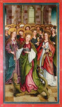

---

## Ortseingang 1972

Die Entwicklung des Dorfnamens zeigt folgende (nicht abschließende) Aufzählung auf:

---

## 18. Jahrh. Strentsmargreta****

1898 - Strinzmargarethae

---

## 1972 - Strinzmargarethä

Aktuell - Strinz-Margarethä

---

## ** Weisthümer gesammelt von Jacob Grimm, Vierter Theil / 1863

*** Nassauische Analen

---

## (Quelle: Geschichte Thorns aus Urkunden, Dokumenten und Handschriften/1842)

Sonstige Begriffe

---

## Der Bauer wollt no Wißborn mer`m Gaul. De Bauer ist möns schun frui uffgestiege, un wiere in de Gäulsstall is, do horre uwwe in säner Stubb Licht geseh.

Do ist de Bauer nuff gunge, un wiere in de Stubb ku, do wor de Schinnerhannes mit säner Röwerbande do.

Se harre schun die Better un sonstige Sache em Finster nunner geworfe. Su hot de Schinnerhannes met säner Bande alles ausgeraubt un geplünnert, bisse im Johr 1803 in Meenz met 22 säner Spießgeselle geköpt wore is.

---

## Der Bauer wollte nach Wiesbaden mit dem Pferd. Der Bauer ist morgens schon früh aufgestanden, und wie er in den Pferdestall ist, da hat er oben in seiner Stube Licht gesehen.

Da ist der Bauer hochgegangen, und wie er in die Stube kam, da war der Schinderhannes mit seiner Räuberbande da.

Sie hatten schon die Betten und sonstige Sachen zum Fenster hinuntergeworfen. So hat der Schinderhannes mit seiner Bande alles ausgeraubt und geplündert, bis er im Jahre 1803 in Mainz mit 22 seiner Spießgesellen geköpft worden ist.

---

## von 1703 (Abdruck bis 1806, Siegelstempel erhalten, siehe unten) und dem im Laufe des 18. Jahrhunderts unbeholfen nachgeschnittenen

GERICHSTSSIEGEL LIBBACHER GRVND V(ND) STRENTS-MARGRETA

---

## Die Gemeindesiegel seit 1816 enthalten kein Bild mehr.(Quelle: Hessisches Wappenbuch)

Entstehungsgeschichte des heutigen Wappens

---

## Am 17. Febr. 1969 beantragt der Bürgermeister von StM das Hess. Hauptstaatsarchiv in Wies-baden im Namen der Gemeinde Strinz-Margarethä 5 Wappenentwürfe, Größe nicht unter

18 x 2 cm, auf Rechnung der Gemeinde in Auftrag zu geben.

---

## Gemeinde

1951

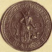

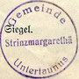

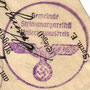

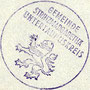

---

## Ereignisse

Für das Jahr 1312 ist ein Adelsgeschlecht in StM belegt, das wohl zum Wehener Adelsgeschlecht "von Wyhne" gehört. (Quelle: Wehen und sein Grund, Dr. Eduard Wilhelmi, 1957)

---

## 1323

Ereignisse

Wehen erhält vom Kaiser die Stadtrechte. Wehen, das auch zur Terminei des Klosters Bleidenstadt gehört, wurde vom Grafen Gerlach deshalb ausgewählt, weil alle Wege innerhalb der Terminei in Wehen zusammentreffen. So auch der Ritter- oder heute Riddelweg, der die Verbindung nach StM herstellt. (Quelle: Wehen und sein Grund, Dr. Eduard Wilhelmi, 1957)

---

## StM gehört ab sofort zu Nassau-Weilburg.

Bei der nassauischen Landesteilung 1355 fallen die Zehntrechte über Bleidenstadt und die dazugehörigen Dörfer an die Weilburger Linie, während Idstein und Wiesbaden an die Idsteiner Linie gehen.

Durch die Teilung wird das Klostergebiet in zwei Teile zerrissen und durch zwei weltliche Obrigkeiten regiert. Es sind die Brüder Johann und Adolf von Nassau.  Graf Adolf erhält die Orte StM, Ober- und Niederlibbach und Haymbach (Hambach).  (Quelle: Wehen und sein Grund, Dr. Eduard Wilhelmi, 1957)

---

## (Quelle: Wehen und sein Grund, Dr. Eduard Wilhelmi, 1957)

1359

---

## Ereignisse

1385 erhielt Reinhard von Schönborn aus StM 5 Gulden Burglehen zu Adolfseck.(Quelle: H. Gensicke; Die von Schönborn. Nass. Analen, Bd. 91, 1980, S. 259 ff.)

---

## (Quelle: Weisthümer gesammelt von Jacob Grimm, Vierter Theil / 1863, Nassauer Analen)

Ereignisse

---

## Gilbrecht der Jüngere von Schönborn, Kurmainzer Amtmann, erhält aus StM 5 Gulden Burglehen zu Adolfseck.

(Quelle: H. Gensicke; Die von Schönborn. Nass. Analen, Bd. 91, 1980, S. 259 ff.)

---

## Überlieferte Zahlung (an die Herrschaft in Idstein?)Knipp Hen 12 Gulden(Gemeindearchiv Hünstetten)

Gilbrecht der Jüngere von Schönborn, Kurmainzer Amtmann, erhält aus StM 5 Gulden Burglehen zu Adolfseck.(H. Gensicke; Die von Schönborn. Nass. Analen, Bd. 91, 1980, S. 259 ff.)

---

## Hilmann Strinz mit seinem Kirspel, 16 Pfluge von Hilmann Strinz(Quelle: Gemeindearchiv Hünstetten)

Gilbrecht der Jüngere von Schönborn, Kurmainzer Amtmann, erhält aus StM 5 Gulden Burglehen zu Adolfseck.(H. Gensicke; Die von Schönborn. Nass. Analen, Bd. 91, 1980, S. 259 ff.)

---

## Ereignisse

Gilbrecht der Jüngere von Schönborn, Kurmainzer Amtmann, erhält aus StM 5 Gulden Burglehen zu Adolfseck.(H. Gensicke; Die von Schönborn. Nass. Analen, Bd. 91, 1980, S. 259 ff.)

---

## Gilbrecht der Jüngere von Schönborn, Kurmainzer Amtmann, erhält aus StM 5 Gulden Burglehen zu Adolfseck.(H. Gensicke; Die von Schönborn. Nass. Analen, Bd. 91, 1980, S. 259 ff.)

1458

---

## Gilbrecht der Jüngere von Schönborn, Kurmainzer Amtmann, erhält aus StM 5 Gulden Burglehen zu Adolfseck.(H. Gensicke; Die von Schönborn. Nass. Analen, Bd. 91, 1980, S. 259 ff.)

1459

---

## Ereignisse

Für StM ist die Existenz von Zinsern nachgewiesen.(Quelle: Hessisches Jahrbuch der Landesgeschichte - Band 4 / 1990)(Siehe hierzu auch unter: Strinzer Zinser)

---

## Gilbrecht der Jüngere von Schönborn, Kurmainzer Amtmann, verzichtet auf sein Burglehen von StM.(H. Gensicke; Die von Schönborn. Nass. Analen, Bd. 91, 1980, S. 259 ff.)

1460 - 1461

---

## (Quelle: Regesten der Grafen von Katzenelnbogen, Karl E. Demandt, 1954, Seite 1625)Anmerkung: Es ist nicht bekannt, aus welchem Strinz Adelheid kam.

Nachfolgend ein paar überlieferte Zahlungen (an die Herrschaft in Idstein?) (Quelle: Gemeindearchiv Hünstetten)

---

## 1477

Ereignisse

Der Amtskeller in Wiesbaden kauft eine größere Zahl von Wiesbadener Doppen (Tonbecher) für die Kirmes von StM. Diese waren wahrscheinlich für den dortigen Ausschank des Bannweines bestimmt.(Quelle: Wiesbaden im Mittelalter / Otto Renkhoff / 1980 / Seite 255 - 256)

---

## Ereignisse

Die Rödel zu Reifenberg haben in StM ein Lehen von Nassau Idstein.(Quelle. H. Gensicke; Die Rödel von Reifenberg / Nass. Analen, Bd. 96, 1985, S. 240)

Henne Rödel von Reifenberg bekundet, daß Philipp Graf zu Nassau ihn, laut inseriertem Lehnsbrief, mit 8, statt 6 Gulden auf seine und seiner Frau Katharina Lebzeit von Gefällen und Renten vom Schultheissen zu Strinz-Margarethae, Weihnachten fällig, belehnt hat.(Quelle: HHStAW 121 Nr. U von Reifenberg)

Lehen von Nassau-Idstein, Burglehen zu Idstein, 6 Malter Weizengülte von der Vogtei Würges, 6 Gulden zu Niederseelbach, 3 3/4 Gulden aus der Herbstbede zu Strinz-Margarethae und die Rietspach bei Idstein: Philipp von Stockheim, Revers gegen Graf Philipp von Nassau.(Quelle: HHStAW Bestand 121 Nr. U von Stockstein)

---

## Die Rödel zu Reifenberg haben in StM ein Lehen von Nassau Idstein.(Quelle: H. Gensicke; Die Rödel von Reifenberg / Nass. Analen, Bd. 96, 1985, S. 240)

1486

---

## Ereignisse

Die Rödel zu Reifenberg haben in StM ein Lehen von Nassau Idstein.(Quelle: H. Gensicke; Die Rödel von Reifenberg / Nass. Analen, Bd. 96, 1985, S. 240)

---

## Die Rödel zu Reifenberg haben in StM ein Lehen von Nassau Idstein.(Quelle: H. Gensicke; Die Rödel von Reifenberg / Nass. Analen, Bd. 96, 1985, S. 240)

1488

---

## Ereignisse

Die Rödel zu Reifenberg haben in StM ein Lehen von Nassau Idstein.(Quelle: H. Gensicke; Die Rödel von Reifenberg / Nass. Analen, Bd. 96, 1985, S. 240)

---

## Die Rödel zu Reifenberg haben in StM ein Lehen von Nassau Idstein.(Quelle: H. Gensicke; Die Rödel von Reifenberg / Nass. Analen, Bd. 96, 1985, S. 240)

1490

---

## Ereignisse

Die Rödel zu Reifenberg haben in StM ein Lehen von Nassau Idstein.(Quelle: H. Gensicke; Die Rödel von Reifenberg / Nass. Analen, Bd. 96, 1985, S. 240)

---

## Die Rödel zu Reifenberg haben in StM ein Lehen von Nassau Idstein.(Quelle: H. Gensicke; Die Rödel von Reifenberg / Nass. Analen, Bd. 96, 1985, S. 240)

1492

---

## Ereignisse

Die Rödel zu Reifenberg haben in StM ein Lehen von Nassau Idstein.(Quelle: H. Gensicke; Die Rödel von Reifenberg / Nass. Analen, Bd. 96, 1985, S. 240)

---

## Die Rödel zu Reifenberg haben in StM ein Lehen von Nassau Idstein.(Quelle: H. Gensicke; Die Rödel von Reifenberg / Nass. Analen, Bd. 96, 1985, S. 240

1494

---

## Ereignisse

Die Rödel zu Reifenberg haben in StM ein Lehen von Nassau Idstein.(Quelle: H. Gensicke; Die Rödel von Reifenberg / Nass. Analen, Bd. 96, 1985, S. 240)

---

## Die Rödel zu Reifenberg haben in StM ein Lehen von Nassau Idstein.(Quelle: H. Gensicke; Die Rödel von Reifenberg / Nass. Analen, Bd. 96, 1985, S. 240)

1496

---

## Die Rödel zu Reifenberg haben in StM ein Lehen von Nassau Idstein.(Quelle: H. Gensicke; Die Rödel von Reifenberg / Nass. Analen, Bd. 96, 1985, S. 240)

1497

---

## Ereignisse

Die Rödel zu Reifenberg haben in StM ein Lehen von Nassau Idstein.(Quelle: H. Gensicke; Die Rödel von Reifenberg / Nass. Analen, Bd. 96, 1985, S. 240)

---

## Die Rödel zu Reifenberg haben in StM ein Lehen von Nassau Idstein.(Quelle: H. Gensicke; Die Rödel von Reifenberg / Nass. Analen, Bd. 96, 1985, S. 240)

1499

---

## (Quelle: Hessisches Jahrbuch der Landesgeschichte / Band 4 / 1990)

Statistik

---

## Einwohner: 97 davon 53 männlich, 44 weiblich, 4 Kinder über 15 Jahren, 1 Magd

(Quelle: Hessisches Jahrbuch der Landesgeschichte / Band 4 / 1990)

---

## Die Rödel zu Reifenberg haben in StM ein Lehen von Nassau Idstein.(Quelle: H. Gensicke; Die Rödel von Reifenberg / Nass. Analen, Bd. 96, 1985, S. 240)

Chronik von 1500 - 1599

---

## Ereignisse

Die Rödel zu Reifenberg haben in StM ein Lehen von Nassau Idstein.(Quelle: H. Gensicke; Die Rödel von Reifenberg / Nass. Analen, Bd. 96, 1985, S. 240)

---

## Die Rödel zu Reifenberg haben in StM ein Lehen von Nassau Idstein.(Quelle: H. Gensicke; Die Rödel von Reifenberg / Nass. Analen, Bd. 96, 1985, S. 240)

1502

---

## Ereignisse

Die Rödel zu Reifenberg haben in StM ein Lehen von Nassau Idstein.(Quelle: H. Gensicke; Die Rödel von Reifenberg / Nass. Analen, Bd. 96, 1985, S. 240)

---

## Die Rödel zu Reifenberg haben in StM ein Lehen von Nassau Idstein.(Quelle: H. Gensicke; Die Rödel von Reifenberg / Nass. Analen, Bd. 96, 1985, S. 240)

1504

---

## Ereignisse

Die Rödel zu Reifenberg haben in StM ein Lehen von Nassau Idstein.(Quelle: H. Gensicke; Die Rödel von Reifenberg / Nass. Analen, Bd. 96, 1985, S. 240)

---

## Die Rödel zu Reifenberg haben in StM ein Lehen von Nassau Idstein.(Quelle: H. Gensicke; Die Rödel von Reifenberg / Nass. Analen, Bd. 96, 1985, S. 240)

1510

---

## Stich von der Adolfsecker Mühle

(Quellen: Geschichte von Nassau, Dr. Schiepke, K. Menzel, 1879, Band 6, Seite 526 - 527 / Urkunde vom 27.4.1514 im Cop. VIII. fol. 32 / Nassauische Analen)

---

## Ereignisse

1521 ersteht die gräfliche Rentei in Idstein 600 Wiesbadener „Doppen" für die Strinzer Kirmes vom 21. Mai zum Gesamtpreis von anderthalb Gulden.(Quelle: Wiesbaden im Mittelalter/Seite 256/Otto Renkoff/1980)

---

## 1538

Ereignisse

Das Klosterstift Bleidenstadt hat 205 Gulden 6 Pfennige Einkünfte zu Dörsdorf, Eisighofen, Berghausen, Mudershausen, Allendorf, Berntrod, Kettenbach, Limbach, Berod, Wolmenbach, Bleidenstatt, Wehen, Strinztrinitatis und Strinz-Margarethä.(Quelle: Studien und Mitteilungen zur Geschichte des Benediktinerordens und seiner Zweige, Bände 38-39, 1917)

---

## Strinz-Margarethä zahlt dem Stift St. Martin in Idstein 2 1/2 Goldgulden(Quelle: Die Stifte St. Walpurgis in Weilburg und St. Martin in Idstein / Neuauflage 1980)

Die Stiftskirche St. Martin Idstein (Foto: Schwarzer)

---

## 1550

Ereignisse

Die Kirchbaumeister des Stift St. Martin in Idstein kaufen am 11. November in Strinz 1 Gulden Gülte (Grundsteuer).(Quelle: Die Stifte St. Walpurgis in Weilburg und St. Martin in Idstein / Neuauflage 1980)

Die Eheleute Kaspar Zimmermann zu Strinz-Margarethä verschreiben dem Stift Idstein unter Vorbehalt der Wiederlösung für 20 Gulden eine Rente von jährlich einem Gulden und stellen dafür benannte Immobilien zum Unterpfand.

---

## (Quellen: Die Stifte St. Walpurgis in Weilburg und St. Martin in Idstein / Neuauflage 1980 / HStA Bestand 36 Nr. U 65)

Karte aus dem Jahre 1550

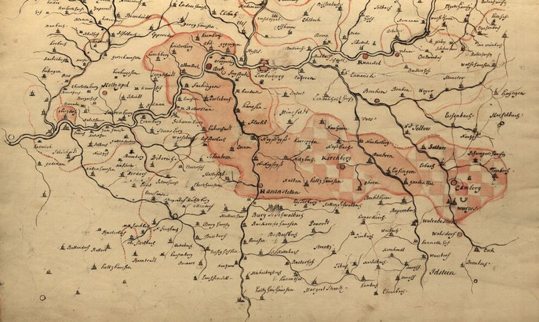

---

## 1558

Ereignisse

Im Register der Baumeister des Stiftskirche St. Martin in Idstein erscheinen die Einnahmen der Himmelskirche an ständigen Pensionen in Höhe von 21 Gulden, 8 1/2 Albus aus neun Gemeinden, u.a. Strinz-Margarethä.(Quelle: Die Stifte St. Walpurgis in Weilburg und St. Martin in Idstein / Neuauflage 1980)

---

## Einwohner 180, davon 40 Untertanen

(Quelle: Hessisches Jahrbuch der Landesgeschichte / Band 4 / 1990)

---

## Pfarrer: Peter

Ereignisse

Das Jahr 1570 ist außerordentlich heiß. Nach dem ersten Grasschnitt kann kein Hälmchen mehr hervorsprießen, so trocken sind schon die Wiesen. Niemand der lebenden Leute kann sich auf solch eine schlechte Heuernte besinnen.(Quelle: Wehen und sein Grund, Dr. Eduard Wilhelmi, 1957)

Pfarrer Peter wird in einer Kirchenvisitation des Jahres 1594 als evangelischer Pfarrer in StM erwähnt. Dies ist der erste Nachweis von ev. Gottesdiensten in Strinz. Ob der im Jahre 1566 erwähnte Pfarrer Jacob Hauenstein schon ev. Glaubens war ist nicht bekannt.(Quelle: 800 Jahre StM, Horst Witt)

---

## StM leistet 15 Malter für den Altar St. Hieronymus des Stift St. Martin Idstein.(Quelle: Die Stifte St. Walpurgis in Weilburg und St. Martin in Idstein / Neuauflage 1980)

1573

---

## IN DER EIR GOTTES LUDEN ICH VIGAND KALWORT GOS

(Quelle: Inschriften des Rheingau-Taunus-Kreises / 1997)

---

## Neuer Pfarrer in StM wird Georg Gleyberger (Gleyburg) aus Gonzenheim.(siehe auch unter 1613)

Neuhof weigert sich zu den Erneuerungsbauten der Wehener Kirche beizutragen. Daraufhin stieß Gräfin Anna von Nassau-Weilburg aus dem Wehener Kirchenverband aus. Da die Neuhofener nun nicht mehr in der Lage waren einen eigenen Pfarrer zu besolden, baten sie den Pfarrer von Strinz-Margarethä wenigstens den Sonntagsgottesdienst zu übernehmen. Nach langem Zureden willigte der Pfarrer ein.(Quelle: Wehen und sein Grund, Dr. Eduard Wilhelmi, 1957)

---

## (Quelle: Wehen und sein Grund, Dr. Eduard Wilhelmi, 1957)

1609

---

## (Quelle: Hessisches Wappenbuch / 1956)

Graf Ludwig zu Nassau erlässt drastische Verhaltensvorschriften im Umgang mit den Kirmessen, Ehebrechern, Säufern etc.

---

## Beginn des 30jährigen Krieges, der auch erhebliche Auswirkungen auf StM hatte.

(Quelle: Wehen und sein Grund, Dr. Eduard Wilhelmi, 1957)

---

## Ligistische Söldner durchqueren den Taunus. Trotz des strengen Befehls, nicht zu plündern, kommt es zu Gräueltaten.

(Quelle: Wehen und sein Grund, Dr. Eduard Wilhelmi, 1957)

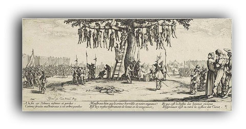

---

## (Quelle: Wehen und sein Grund, Dr. Eduard Wilhelmi, 1957)

1620

---

## Allgemeine Ereignisse

Das Jahr zeichnet sich durch mehrere Erdbeben aus. (Wehen und sein Grund, Dr. Eduard Wilhelmi, 1957)

Der spanische Feldherr Spinola lässt sich mit seinen Truppen in unserem Gebiet nieder. Die Menschen staunen über das große gut ausgerüstete spanische Heer, das 16 große Geschütze und 1000 Wagen Munition mitführt. Jedes Geschütz wird von 15 Pferden gezogen. Von Orlen ist bekannt, dass dieses komplett von den Spaniern ausgeplündert wird. Auch Wehen hat schwer unter den Spaniern zu leiden. Es kommt wieder zu unzähligen Gräueltaten.

---

## (Quelle: Wehen und sein Grund, Dr. Eduard Wilhelmi, 1957)

Ereignisse

18. März 1620Lehen von Nassau-Idstein, Burglehen zu Idstein, 6 Malter Weizengülte von der Vogtei Würges, 6 Gulden zu Niederseelbach, 3 3/4 Gulden aus der Herbstbede zu Strinz-Margarethae und die Rietspach bei Idstein: Ludwig Graf zu Nassau-Saarbrücken, Lehnbrief für Johann Burckhardt von Stockheim, anstelle seines Vaters Johann Friedrich sowie für Joh. Henrich, + Eberhards Sohn, Joh. Niclaus und Phil. Eberhard und Friedrich und Joh. Adolph, alle von Stockheim. Siegler: Aussteller.(HHStAW, 121, U von Stockheim)

---

## (Wehen und sein Grund, Dr. Eduard Wilhelmi, 1957)

1622

---

## (Quelle: Wehen und sein Grund, Dr. Eduard Wilhelmi, 1957)

1623

---

## (Quelle: Wehen und sein Grund, Dr. Eduard Wilhelmi, 1957)

1624

---

## (Quelle: Wehen und sein Grund, Dr. Eduard Wilhelmi, 1957)

Ihnen folgen die Truppen von Herzog Georg von Sachsen-Lauenburg die durch unser Gebiet ziehen.

---

## (Quelle: Wehen und sein Grund, Dr. Eduard Wilhelmi, 1957)

Ihnen wiederum folgt am 19. Januar das Regiment Johanns des Jüngeren von Nassau-Siegen.

---

## (Wehen und sein Grund, Dr. Eduard Wilhelmi, 1957)

Am 13. Februar folgt die Reiterei des Cratz von Scharfenstein.

---

## (Quelle: Wehen und sein Grund, Dr. Eduard Wilhelmi, 1957)

Ende 1624 wird unsere Region wiederbesetzt, und zwar von den Truppen des bayrischen Oberst Adam Philipp von Cronberg, unter dessen Besatzung es wieder zu Gräueltaten kommt.

---

## (Quelle: Wehen und sein Grund, Dr. Eduard Wilhelmi, 1957)

Ereignisse:

---

## (Quelle: Wehen und sein Grund, Dr. Eduard Wilhelmi, 1957)

Am 25. September quartiert sich Rittmeister König in Bleidenstadt mit einer Kompanie Reiter ein und saugt die ganze Umgebung aus.

---

## (Quelle: Wehen und sein Grund, Dr. Eduard Wilhelmi, 1957)

Im Dezember liegen die Truppen von Oberst Cratz von Scharfenstein in Strinz.

---

## (Quelle: Rund um Dauborn / heimatgeschichtlicher Beitrag / Julius Gustav Wagner / Camberger Verlag / 1987)

1626

---

## Reichere Leute werden fortgeschleppt und nur gegen entsprechendes Lösegeld freigelassen. Die Mädchen und Frauen werden entehrt und Männern und Kindern die Schuhe geraubt.

(Wehen uns sein Grund, Dr. Eduard Wilhelmi, 1957)

Im September 1626 ziehen die Truppen Görzenichs ab. Ihm folgen sofort die Truppen Wallensteins, unter dem Herzog von Lauenburg, in die ausgepressten Taunusorte. Seine Horden benehmen sich zwar etwas besser als Görzenichs Scharen, aber sie sind immer noch viel teuflischer als Tillys Ligaheer. Schlimm ist zusätzlich, dass die Soldaten noch die Pest mitbringen.

---

## (Quelle: Wehen uns sein Grund, Dr. Eduard Wilhelmi, 1957)

Der ganze Winter 1626/27 war für die Nassauischen Lande sehr traurig. Das Hauptquartier des Herzog Maximilian von Sachsen-Lauenburg war zu Offenheim in der Wetterau, von wo aus seit September die sämtlichen nassauischen Lande mit Truppen überzogen wurden. Das Land war hohen Contributionen (Abgaben) ausgesetzt. 8.000 Reichstaler Constribution wurden gefordert. Das Drückendste war die Willkür, wonach man sich an gar keine Bestimmung band, sondern abpresste, wozu man Lust hatte.

Konnten die Dorfschaften die angesetzten Contributionen nicht entrichten, so wurden Menschen und Vieh eingesperrt und nicht zur Weide und Arbeit gelassen, wie das u.a. auch in Strinz-Margarethä vorkam. Die Schultheiße (Bürgermeister) wurden misshandelt und deren Wohnungen ausgeplündert. Und dabei wurden tausend andere Plackereien den Einwohnern zugemutet, die keineswegs gering anzuschlagen waren.

---

## (Quelle: Wehen uns sein Grund, Dr. Eduard Wilhelmi, 1957)

Noch immer treiben die Truppen Görzenichs und Freysings ihr Unwesen in unserer Region.

Zahlreiche Beschwerden bei Wallenstein und dem Kaiser führen letztendlich dazu, dass Görzenich von diesen fallen gelassen wird und der Befehl erteilt wird, dass Görzenich in keinem Land mehr geduldet werden darf. Daraufhin verlässt er im September mit seinen Truppen unsere Region, kehrt aber am 6. Oktober wieder nach Idstein zurück, weil ihm überall der Durchmarsch verweigert wird. Er bleibt erneut bis 21. Oktober in der er überall plündern lässt und sogar befehlt die Kirchen nicht zu verschonen.(Quelle: Wehen uns sein Grund, Dr. Eduard Wilhelmi, 1957)

---

## Görzenich wird 1627 erneut zur Werbung nach Idstein beordert und Herzog Maximilian von Bayern beauftragt, ihn besonders zu schützen. Nun beginnen die Bedrückungen der vorangegangenen Jahre von neuem.

Es hagelt wieder Beschwerden bei Wallenstein und dem Kaiser. Die Aufforderung sich zurück- und seine Truppen in Zaum zu halten werden von Görzenich ignoriert.(Quelle: Wehen uns sein Grund, Dr. Eduard Wilhelmi, 1957)

Die Grausamkeiten mehren sich von Tag zu Tag. Da erscheint auf kaiserlichen Befehl der kaiserliche Kommissar und Notar aus Frankfurt am Main in Görzenichs Lager und schickt sein Regiment nach Holstein ins Hauptquartier Wallensteins. Ende August rücken die Blutsauger endlich aus unserer Region ab.

Wegen seiner Gräueltaten und Ungehorsamkeit militärischer Befehle gegenüber wird Görzenich am 09. Oktober zum Tode verurteilt. Er wird mit dem Schwert enthauptet, sein Körper aufs Rad geflochten und sein Kopf auf einer Stange zur Warnung für alle im Lager aufgesteckt. (Quelle: Wehen uns sein Grund, Dr. Eduard Wilhelmi, 1957)

Die Unsicherheit im Taunus hat durch den Abzug der Wallensteiner aber nicht abgenommen. Allein kann sich niemand aufs Feld wagen. Nicht nur die hungrigen Wölfe, sondern hauptsächlich die Überfälle durch Räuberbanden und versprengte Soldaten, sind ständig zu befürchten. Aber auch Flüchtlinge aus allen Herren Ländern irren durch die Wälder und Dörfer

---

## (Quelle: Wehen uns sein Grund, Dr. Eduard Wilhelmi, 1957)

1628

---

## Allgemein wird geglaubt, dass all dieses Elend von Hexen verursacht wird, was zum Beginn der Hexenverfolgung führt, die bis zum Jahre 1632 anhält.

(Wehen und sein Grund, Dr. Eduard Wilhelmi, 1957)

---

## Pfarrer: Georg Pistorius

Allgemeine Ereignisse

Das Jahr 1630 ist endlich wieder ein Jahr mit einer guten Ernte. Die ausgehungerte Bevölkerung, oder das was von ihr übriggeblieben ist, kann sich endlich mal wieder satt essen. (Quelle: Wehen und sein Grund, Dr. Eduard Wilhelmi, 1957)

Nun greift auch das protestantische Schweden in den 30jährigen Krieg ein und besiegt am 17. September Tillys Truppen bei Breitenfeld. Sie treiben Tillys Truppen vor sich her bis sich diese versuchen in Mainz und Wiesbaden festzusetzen. Wieder soll das nassauische Volk Kriegskontributionen an die ligistischen Truppen unter von Eckstädt leisten.

---

## (Quelle: Wehen und sein Grund, Dr. Eduard Wilhelmi, 1957)

Karte von 1630

---

## Pfarrer: Georg Pistorius

Allgemeine Ereignisse

Die Ende 1630 von den ligistischen Truppen geforderten Kriegskontributionen müssen nicht entrichtet werden, denn kaum haben die Truppen von von Eckstädt die Kontributionen gefordert, müssen sie sich in die Mainzer Festung zurückziehen, da sie von den Truppen Gustav Adolfs bedrängt werden. Dafür wüten die Truppe Tillys wieder besonders roh und verabscheuungswürdig bis zu dem Zeitpunkt, da die Schweden unsere Region erreichen. (Quelle: Wehen und sein Grund, Dr. Eduard Wilhelmi, 1957)

Am 01. September 1631 fällt Mainz in schwedische Hände.Um die Festung Mainz gegen Angriffe widerstandsfähig zu machen brauchen die Schweden Holz aus dem Taunus. Der ganze Taunus wird durch die Schweden besetzt. Die Schweden verhalten sich, im Gegensatz zu den bisher durchziehenden Truppen, mustergültig und werden von der Landbevölkerung gerne mit allem versehen.(Quelle: Wehen und sein Grund, Dr. Eduard Wilhelmi, 1957)

Wilhelm Ludwig Graf von Nassau-Saarbrücken etc. reversiert (verpflichtet) sich zugleich für seine Brüder Johann, Ernst Casimir und Otto dem Dechanten Philipp von Mauwel genannt Meuchen und dem Kapitel der S. Ferrutius Stiftes zu Bleidenstadt über Empfang der von demselben herrührenden (eigentlich bzw. ursprünglich der Linie Nassau-Idstein zustehenden) Lehen (Pacht), der zwei Vogteien zu Würges und Kirberg und der Dörfer Strinz-Margarethä, der beiden Libbach und Hambach ("Haymbach"). 25. Februar 1631(Quelle: Hessisches Staatsarchiv Wiesbaden, Abt. 131 Nr. U 380)

---

## (Quelle: Wehen und sein Grund, Dr. Eduard Wilhelmi, 1957)

Im Februar schließen die Nassauer Grafen einen Vertrag mit Schweden, nachdem sie so lange wie der Krieg dauert, Verbündete der Schweden sein wollen.(Quelle: Wehen und sein Grund, Dr. Eduard Wilhelmi, 1957)

Im März verlassen die Schweden unserer Region und wenden sich gegen die Truppen Tillys, die in Süddeutschland stehen. Tillys Truppen werden von den Schweden besiegt. Tilly selbst stirbt an einer Verwundung.(Quelle: Wehen und sein Grund, Dr. Eduard Wilhelmi, 1957)

---

## Pfarrer: Georg Pistorius

Allgemein Ereignisse

Im Jahr 1633 kann keine fremde Macht unsere Region besetzen. Es gibt Bestrebungen dazu, allerdings können die feindlichen Truppen von schwedischen und nassauischen Truppen daran gehindert werden. (Quelle: Wehen und sein Grund, Dr. Eduard Wilhelmi, 1957)

Um die schwedischen Truppen versorgen zu können, müssen nassauische Gemeinden an diese Kontributionen zahlen. Die Schweden drohen damit, dass Plünderungen nicht verhindert werden können, wenn die Unterstützung aus der Region nicht erfolgt.

---

## (Quelle: Wehen und sein Grund, Dr. Eduard Wilhelmi, 1957)

Kaplan Großmann erhielt 1633 die Pfarrei zu StM.

---

## (Quelle: Wehen und sein Grund, Dr. Eduard Wilhelmi, 1957, Seite 141)

Ereignisse

Johann Georg Schrumpf und Konsorten verkaufen das sog. Rühlsche Gut zu StM der Landesherrschaft zur Vergrößerung des Georgenthaler Hofguts für 600 fl.. Die letztere aber vertauscht diese Güter zum Teil wieder an die Gemeinde StM gegen den Rebersbacher Wiesengrund, wobei die Gemeinde 225 fl. bar herauszahlt und verkauft davon Haus und Hof mit Gärten an die Geschwister Metern für 200 fl.(Quelle: Hessisches Staatsarchiv, Abt. 133/403)

---

## (Quelle: Wehen und sein Grund, Dr. Eduard Wilhelmi, 1957)

1635

---

## (Quelle: Wehen und sein Grund, Dr. Eduard Wilhelmi, 1957)

Nachdem es im Frühjahr etwas ruhiger wird und einige Bauern wieder notdürftig ihr Feld bestellen können, erscheinen die Kaiserlichen wieder, diesmal unter General Holzappel, die auch wieder plündern wollen aber nichts mehr vorfinden und ihre Wut darüber an der Bevölkerung auslassen. (Quelle: Wehen und sein Grund, Dr. Eduard Wilhelmi, 1957)

---

## Nach General Holzappel versuchen noch andere Kaiserliche ihr Glück, aber auch diese finden nichts mehr vor was es wert gewesen ist geplündert zu werden.

(Quelle: Wehen und sein Grund, Dr. Eduard Wilhelmi, 1957)

---

## Der Winter 35/36 ist äußerst kalt und streng. Er bringt vielen Tod und Verderben. (Quelle: Wehen und sein Grund, Dr. Eduard Wilhelmi, 1957)

An der Lahn hat sich Hauptmann Hass, der im Taunus für den leibhaftigen Teufel gehalten wird, sein Quartier inne und sendet seine Soldaten auf schreckliche Plünderungszüge in den Taunus.

---

## (Quelle: Wehen und sein Grund, Dr. Eduard Wilhelmi, 1957)

Immer wieder streifen kroatische Reiter durch unsere Region auf der Suche nach Beute.

Die Hungersnot wird immer größer. Viele Menschen sterben, insbesondere an der Pest. Niemand wagt es die Pestleichen anzufassen, so werden diese einfach liegengelassen und verwesen oder werden von wilden Hunden gefressen.

Die Leute essen Gras und Wurzeln, dürre und grüne Laubblätter. Brot gibt es keines mehr. Auch Salz nicht. Die hungrigen Menschen fallen über die Häute und Felle der Tiere her, essen halbverweste Pferde, Hunde, Katzen, Ratten, Heuschrecken und allerlei Käfer. Auch Kannibalismus tritt immer mehr zu Tage. So erschlagen sich die Leute und essen sich dann auf. Sogar die Friedhöfe werden nach frischen Leichen durchwühlt um diese zu verzehren. Ja selbst Kinder werden geschlachtet und gegessen.(Wehen und sein Grund, Dr. Eduard Wilhelmi, 1957)

---

## (Quelle: Den Drangsalen des Nassauischen Volkes und der angrenzenden Nachbarländer in den Zeiten des dreißigjährigen Krieges, seine Helden, Staatsmänner und andere berühmte Zeitgenossen / 1854)

(siehe auch unter „Strinzer Pfarrer der Letzte der Region“)

---

## Pfarrer: Johann Buttenius (Vertretung aus Auroff); Johann Meinhard Midieus (Vertretung aus Trinitatis)

Allgemeine Ereignisse

Das Jahr 1637 beginn unter sehr unglücklichen Umständen und verspricht noch schlimmer zu werden. Ein schwerer Sturm im Januar bringt zusätzliches Leid. (Quelle: Wehen uns sein Grund, Dr. Eduard Wilhelmi, 1957)

---

## Noch immer wird unsere Region von Kroatischen und kaiserlichen Truppen drangsaliert. (Quelle: Wehen uns sein Grund, Dr. Eduard Wilhelmi, 1957)

Die Monate Mai und Juni sind ungewöhnlich trocken. Es herrscht glühende Hitze. Die wenige Sommerfrucht der Bauern verdorrt in der Hitze. (Quelle: Wehen uns sein Grund, Dr. Eduard Wilhelmi, 1957)

---

## Zu allem Elend kommt es noch zu einer Mäuseplage. (Quelle: Wehen uns sein Grund, Dr. Eduard Wilhelmi, 1957)

Als nächstes durchstreifen die Truppen von Johann von Wert unser ausgeplündertes Gebiet. Die vergeblich suchenden Soldaten, die sich in ihren Erwartungen auf fette Beute getäuscht sehen, lassen ihre Wut an den wehrlosen Einwohnern aus. Was da mancher Mann, manche Frau und manches Mädchen ausgestehen müssen spottet jeder Beschreibung, und die kühnste Fantasie ist nicht imstande, sich in die Lage der Gemarterten zu versetzen. Frauen und Mädchen werden systematisch vergewaltigt, ja sogar 70jährige werden nicht verschont.(Quelle: Wehen uns sein Grund, Dr. Eduard Wilhelmi, 1957)

---

## Infolge Saatgutmangel muss die Aussaat unterbleiben. Die wenigen Überlebenden sehen sich gezwungen die Region zu verlassen. (Quelle: Wehen uns sein Grund, Dr. Eduard Wilhelmi, 1957)

Das ganze Jahr über wagt es sogar kein Soldat mehr, diesen Landstrich zu betreten. Jeder der diese Wüste betritt, glaubt nicht, dass sich dort jemals wieder Menschen niederlassen werden.(Quelle: Wehen und sein Grund, Dr. Eduard Wilhelmi, 1957)

---

## Pfarrer: Johann Buttenius (Vertretung aus Auroff); Johann Meinhard Midieus (Vertretung aus Trinitatis)

Allgemeine Ereignisse

1639 drohen die Franzosen und die Schweden, dieses Gebiet wieder zu besetzen. Da schließt sich Nassau-Idstein an Amalie von Hessen an. Sie schickt ihren General Geisse in den Taunus. Alle Grafschaften stehen nunmehr unter hessischem Schutz. Dafür müssen sie monatlich zusammen 900 Reichsthaler Kriegssteuer zahlen. (Quelle: Wehen uns sein Grund, Dr. Eduard Wilhelmi, 1957)

Anfänglich benehmen sich die hessischen Truppen recht anständig, werden aber auch roh und hart, wenn die Gelder nicht rechtzeitig eingehen oder Lieferungen ausbleiben.(Quelle: Wehen uns sein Grund, Dr. Eduard Wilhelmi, 1957)

---

## (Quelle: Wehen uns sein Grund, Dr. Eduard Wilhelmi, 1957)

1641

---

## (Quelle: Wehen und sein Grund, Dr. Eduard Wilhelmi, 1957)

1644

---

## Allgemeine Ereignisse

In Hofheim lagern 1200 bayrische Reiter. Von dort aus unternehmen sie Plünderungszüge in die Taunusorte, versetzen die ganze Landschaft in Schrecken und verüben die schrecklisten Grausamkeiten. (Quelle: Wehen uns sein Grund, Dr. Eduard Wilhelmi, 1957)

---

## Auch Französische Soldaten aus Mainz kommen zum Plündern in den Taunus.

(Quelle: Wehen uns sein Grund, Dr. Eduard Wilhelmi, 1957)

---

## Da in unserer Region mal wieder nichts mehr zu holen ist, bleiben in 1645 die Plünderungen überwiegend aus. Flüchtlinge kehren zurück. (Quelle: Wehen uns sein Grund, Dr. Eduard Wilhelmi, 1957)

Erzherzog Leopold Wilhelm dringt in das nassauische Gebiet vor, um die Verbündeten von Süddeutschland abzudrängen. Er schlägt sein Lager in Dehrn an der Lahn auf.

---

## (Quelle: Wehen uns sein Grund, Dr. Eduard Wilhelmi, 1957)

1646

---

## (Quelle: Wehen uns sein Grund, Dr. Eduard Wilhelmi, 1957)

Ereignisse

---

## Pfarrer: Vertretung aus Breithardt

Allgemeine Ereignisse

Im Juni zieht der Niederländer Caspar Cornelius Mortaigne de Portalis, der von Amalie von Kassel in Dienst gestellt wird in unsere Region. Der wilde Kriegsmann, der manche zerstörte Gegend gesehen hat, ist entsetzt über die Zerstörungen in unserer Heimat. Er findet nichts als niedergebrannte Ortschaften, wüste Felder, eingestürzte und verbrannte Häuser, menschenleere Dörfer und Städtchen vor. Er befiehlt daraufhin seinen Soldaten, die verbliebene Bevölkerung zu schonen. Trotzdem kann er nicht verhindern, dass seine Soldaten den übriggebliebenen Leuten von Steckenroth und seinen Nachbarorten, deren 20 Stück Vieh, die sie in den Wäldern verborgen haben, abzunehmen. Als ihm das gemeldet wird, lässt er die Übeltäter gehörig bestrafen.(Quelle: Wehen und sein Grund, Dr. Eduard Wilhelmi, 1957)

---

## Ende des 30jährigen Krieges.

Noch immer liegen schwedische Besatzungstruppen in unserer Region. Es handelt sich um das Hammersteinsche und Badische Regiment, da den Schweden in den Friedensverhandlungen Satisfaktion Gelder zugestanden werden, die sie, bevor sie abziehen, erst eintreiben wollen. Für die Eintreibung ist ein Oberst Mohr, ein geborener Nassauer, zuständig. Erst im Jahre 1951 werden die Schweden unsere Region verlassen.(Quelle: Wehen uns sein Grund, Dr. Eduard Wilhelmi, 1957)

---

## (Quelle: Wehen uns sein Grund, Dr. Eduard Wilhelmi, 1957)

1652

---

## Allgemeine Ereignisse

Ein starkes Erdbeben erschüttert unsere Region, welches die Glocken in den Kirchentürmen zum Leuten bringen.(Wehen und sein Grund, Eduard Wilhelmi, 1957)

---

## (Quelle: Wehen und sein Grund, Dr. Eduard Wilhelmi, 1957)

1692

---

## (Wikipedia / Beiträge zur Geschichte Hohenstein-Breithardt, -Steckenroth und - Burg Hohenstein / Weinberger / 1992)

Heutige Ansicht vom Hofgut Georgenthal

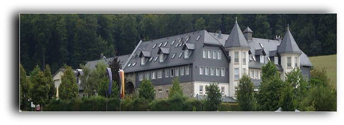

---

## Die Kinder aus Niederlibbach, Oberlibbach und Hambach werden ab sofort nicht mehr in Strinz, sondern in der neuen Schule in Niederlibbach unterrichtet.

(Die Drangsalen des Nassauischen Volkes und der angrenzenden Nachbarländer in den Zeiten des dreißigjährigen Krieges, seine Helden, Staatsmänner und andere berühmte Zeitgenossen / 1854)

---

## Ereignisse

Der Jude Girsin (Gerson / Kirvin) beantragt eine Umschreibung seines Bestandsbriefes auf Strinz-Margarethä und begründet es damit, dass in Strinz zwei Häuser leer stehen. Er findet in Breithardt kein Haus zu kaufen und auch nicht zur Miete und muss sich deshalb bei einem Christen aufhalten.(Quelle: Judentoleranz im Territorialstaat der frühen Neuzeit / 1999)

---

## Aus diesem Jahr ist das Siegel: STRINZMARGRETHA AVROFF U(ND) LIEBACHER GERICHTSSIEG(EL) bekannt.

(Quelle:Hessisches Wappenbuch / 1956)

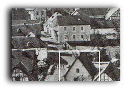

---

## Pfarrer: Heinrich Rhod

Ereignisse

Am Freitag, dem 18. Juli 1727, beschweren sich die Abgesandten aus Ehrenbach, Görsroth, StM und Bechtheim bei der Verwaltung in Idstein, dass sie in der vergangenen Woche 5 Tage bei Hahn auf der Jagd liegen mussten. Sie konnten deswegen kein Heu machen und kein Korn schneiden. Doch nicht nur mit ihrer eigenen Feldarbeit blieben sie gewaltig zurück, auch die Frondefahrten, zu denen sie ebenfalls verpflichtet sind, blieben ungetan. Sie hätten Hafer nach Biebrich und (Holz-)Kohle zu einer (Eisen-)Schmelze fahren müssen. Da wegen der unterlassenen Zulieferung ein Ofen ausgegangen war, sprach nun die zuständige Rentkammer von Bestrafung.Die Amtsverwaltung hat ein Einsehen und hilft den frondepflichtigen Untertanen aus der Zwickmühle, die durch die an sich berechtigten Forderungen der verschiedenen Behörden entstanden ist. Der Oberforstmeister wird angewiesen, die Leute "so viel möglich bey dieser kostbaren Erndte Zeit gäntzlich und durchauß zu verschonen".(Quelle: Walsdorfer Bürgerbrief Nr. 22 / Rund um den Hutturm / 1983)

---

## (Quelle: Geschichte von Nassau, Dr. Schiepke, K. Menzel, 1879, Seite 438 - 439)

Neuer Pfarrer in StM wird Ernst Gottlob Stritter

---

## Ereignisse

Der Wehener Philipp Weiß möchte den früheren Kuhhirten und Tagelöhner von StM, Christoph Graf, in sein Haus aufnehmen, weil er Arbeit für ihn hat. Das fürstliche Amt Wehen gibt dazu nur seine Einwilligung unter der Bedingung, dass die Entfernung von Graf nach getaner Arbeit sofort erfolge. Dies ist u.a. eine Maßnahme um das Bettelunwesen in Wehen einzudämmen. (Quelle: Wehen und sein Grund, Dr. Eduard Wilhelmi, 1957)

---

## Als sich die französischen Revolutionstruppen anschicken, den Rhein als Frankreichs Grenze in Besitz zu nehmen, stellen sich ihnen 1792 Österreicher und Preußen entgegen.

(Quelle: Wehen und sein Grund, Dr. Eduard Wilhelmi, 1957)

Am 02. Juli passieren Teile der 5. preußischen Marschkolonne unserer Region dem Rhein entgegen. Ihr folgt einige Tage später die 4. Kolonne, die in unserer Region einquartiert wird. Von da ab reißen die Durchmärsche der Preußen bis zum 21. Juli nicht mehr ab. (Quelle: Wehen und sein Grund, Dr. Eduard Wilhelmi, 1953)

Die Preußen, die ohne Grund nach der gewonnenen Schlacht bei Valmy den Rückzug angetreten haben überlassen den nachfolgenden französischen Heeren den deutschen Boden. Viele Mainzer fliehen vor den herannahenden Franzosen in unsere Region. Auch viele Wiesbadener fliehen in die Taunushöhen. (Quelle: Wehen und sein Grund, Dr. Eduard Wilhelmi, 1953)

Nachdem die Franzosen den Rhein überschritten haben ist es der französische Befehlshaber und Oberst Houchard, der den Taunus mit seinen Truppen durchstreift und überall brandschatzt. (Quelle: Wehen und sein Grund, Dr. Eduard Wilhelmi, 1953)

Im Dezember gelingt es den Preußen, die Franzosen wieder über den Rhein zurückzudrängen. Unsere Region wird zur Operationsbasis der Preußen. Häuser und Scheunen liegen voll Krieger, in manchen Scheunen bis zu 50 Mann.

---

## (Quelle: Wehen und sein Grund, Dr. Eduard Wilhelmi, 1953)

Ereignisse

---

## Allgemeine Ereignisse

Zu Beginn des Jahres liegen die Preußen noch in Ihren Stellungen hier im Taunus. Die Bauern müssen Fronfahrten nach Limburg machen. Dort müssen sie Nachschub für die hier liegenden Truppen holen. (Quelle: Wehen und sein Grund, Dr. Eduard Wilhelmi, 1953)

---

## Am 27. Februar beschießen die Franzosen Biebrich, was wieder zu Flüchtlingsströmen in die Taunushöhen führt. (Quelle: Wehen und sein Grund, Dr. Eduard Wilhelmi, 1953)

In der zweiten Jahreshälfte ziehen sich die Preußen aus unserer Region zurück. Von da an sind für ein Jahr lang keine Auswirkungen der Revolutionskriege in unserer Region zu verspüren.

---

## (Quelle: Wehen und sein Grund, Dr. Eduard Wilhelmi, 1953)

1794

---

## (Quelle: Wehen und sein Grund, Dr. Eduard Wilhelmi, 1953)

1796

---

## Bis September ist unsere Region wieder von Franzosen besetzt, die dann wieder über den Rhein zurückgetrieben werden können.

(Quelle: Wehen und sein Grund, Dr. Eduard Wilhelmi, 1953)

---

## Strenz Margaret

Allgemeine Ereignisse

Der inzwischen besiegte General Jourdan wird durch den französischen General Hoche ersetzt, der kurz vor dem endgültigen Frieden 1797 noch einmal durch den Taunus streift. Hierbei kommt es in unserer Region zu Kämpfen zwischen Österreichern und Franzosen, die die Franzosen gewinnen. Daraufhin besetzen die Franzosen wieder unser Gebiet. Die Bewohner werden zu Schanzarbeiten bei Mainz gezwungen. Hierzu wurden viele Bäume gefällt, unsere Wälder wurden stark gelichtet. (Quelle: Wehen und sein Grund, Dr. Eduard Wilhelmi, 1953)

---

## Mit dem Frieden von Campo Formio wird der Rheinstrom Frankreichs Grenze. Die Franzosen ziehen sich aus dem Taunus zurück.

(Quelle: Wehen und sein Grund, Dr. Eduard Wilhelmi, 1953)

---

## (Quelle: Wehen und sein Grund, Dr. Eduard Wilhelmi, 1953)

1799

---

## (Quelle: Wehen und sein Grund, Dr. Eduard Wilhelmi, 1953)

Chronik von 1800 - 1899

---

## 1800

Obrigkeiten

---

## Strinz Margaretha

Karte aus 1800

---

## Aus der der Zeit um 18oo ist das Wappen einer Strinzer Familie mit dem Namen Gruber bekannt.

Hier die offizielle Beschreibung:

Ältester bekannter Vorfahr im Mannesstamm: Johann Philipp Gruber, Landwirt, * Strinz-Margarethä um 1800. In Rot ein goldenes Hirschgeweih mit Grind, an den zehn Enden und aus der Schädeldecke hervorkommend je mit einer goldenen Rose besetzt. Auf dem rot-golden bewulsteten Helm mit rot-goldenen Decken ein wachsender, mit einem roten Strick um den Hals gefesselter goldener Drache.

---

## Führungsberechtigt sind: Eingereicht bzw. neu angenommen am 20. Februar 1981 von Wilhelm Gruber, Forstamtsrat, * Wambach 7.4.1927, für sich und seine ehelichen Nachkommen im Mannesstamm.

(Quelle: Deutsche Wappenrolle der "Deutsche Heraldische Gesellschaft e.V.")

---

## Ereignisse

Aus dem Jahre 1800 ist einen Urkunde erhalten geblieben, die die Zehntverpflichtung von von StM gegenüber dem Ritterstift Bleidenstadt zum Inhalt hat.(Siehe auch unter: Der Zehnte ging ans Kloster)

---

## Urkunde zur Zehntverpflichtung

1801

---

## Lehrer: Philipp Ferdinand Sauer

1802

---

## StM zahlt 20,19 Gulden "Herrngeld" an die Renthei in Idstein.(Quelle: Auszug aus den Rechnungen der Renthei Idstein der Jahre 1802 - 1806)

Weigerung der Gemeinde Strinz-Margarethae zur unentgeltlichen Verabfolgung von Bauholz aus ihrer Gemeindewaldung zum Scheunenbau des Schultheißen Enders zu Strinz-Margarethae. (Quelle: HStA, 133, Strinz-Margarethae 33)

---

## 1803

Obrigkeiten

---

## StM zahlt 20,19 Gulden "Herrngeld" an die Renthei in Idstein.(Quelle: Auszug aus den Rechnungen der Renthei Idstein der Jahre 1802 - 1806)

1804

---

## Lehrer: Philipp Ferdinand Sauer

Ereignisse

Der als österreichischer Soldat tätige Strinzer Tobias Enders meldet sich letztmalig bei seiner Ehefrau aus Carlstadt. 20 Jahre später klagt diese auf Scheidung wegen böslicher Verlassung.(Quelle: Allgemeiner Anzeiger und Nationalzeitung der Deutschen / 2663 / 1824)

---

## StM zahlt 20,19 Gulden "Herrngeld" an die Renthei in Idstein.(Auszug aus den Rechnungen der Renthei Idstein der Jahre 1802 - 1806)

Beginn einer Untersuchung wegen der von dem ehemaligen Bleidenstadter Stiftsgut zu Strinz-Margarethae zu tragenden Kriegskosten.(Quelle: HStA, 133)

---

## Streitigkeiten zwischen Philipp Wendel Kugelstatt zu Wingsbach und Georg Philipp Enders zu Strinz-Margarethä wegen Herausgabe des Vermögens aus erster Ehe. (Quelle: HStAW, 293, 984)

1805

---

## StM zahlt 20,19 Gulden "Herrngeld" an die Renthei in Idstein.(Quelle: Auszug aus den Rechnungen der Renthei Idstein der Jahre 1802 - 1806)

1806

---

## Allgemeine Ereignisse

StM gehört ab sofort zum Rheinbund und somit zum Herzogthum Nassau (Amt Idstein).

Der Rheinbund (Confédération du Rhin) war eine auf Initiative Napoleons I. 1806 in Paris gebildete Konföderation deutscher Staaten, die mit der Gründung dieses Staatenbundes aus dem Verband des Heiligen Römischen Reiches Deutscher Nation austraten. Durch die Rheinbundakte war die Konföderation als Militärallianz mit dem Kaiserreich Frankreich gegründet worden. Napoleon fungierte in diesem Gebilde als „Protektor“. Frankreich selbst gehörte der Konföderation aber nicht an, sondern war ihr Alliierter. Das Ziel, den Rheinbund von 1806 zu einem Staatenbund mit gemeinsamen Verfassungsorganen auszubauen, scheiterte am Widerstand der größeren Mitgliedsstaaten. Faktisch blieb der Rheinbund im Wesentlichen ein Militärbündnis deutscher Staaten mit Frankreich.(Quelle: Wikipedia)

---

## StM zahlt 20,19 Gulden "Herrngeld" an die Renthei in Idstein.(Quelle: Auszug aus den Rechnungen der Renthei Idstein der Jahre 1802 - 1806)

1807

---

## 1808

Obrigkeiten

---

## Abschaffung der Leibeigenschaft im Herzogthum Nassau und Einführung eines neuen Steuerrechts.

Friedrich August, Herzog von Nassau und Friedrich Wilhelm, Fürst zu Nassau teilen 1808 in der Sammlung der "Landesherrlichen Edicten und anderen Verordnungen" die Aufhebung der älteren und direkten Abgaben (Zehnten) nach Einführung eines neuen direkten Steuersystems, beginnend am 01. Januar 1808, mit. Für die einzelnen Ämter und Ortschaften werden die einzelnen Abgaben aufgeführt, die nicht mehr zu entrichten sind.Für das Oberamt Idstein (zu dem auch StM gehört):- die ordinäre Schatzung- die Extrasteuern- die Additionalsteuer der ehemaligen Freigüter- die Servicegelder- die zur Landesunkostenkasse sowie die zur alten Constributionscasse erhobenen  Schätzungsimpeln- die nach dem Schatzungsfuß bisher erhobenen Beiträge des Oberamtsphvficus in Idstein- das Dienstgeld, die Diensthafer und das Dienstheu- das Hofdienstgesindegeld- die mit dem Dienstgeld bisher erhobene Leibbeet- Fastnachtshübner und Sommerhahnen.Speziell für StM:- das Bereiter-Jossengeld- das Herrengeld- das Weidhammelgeld- die Frohnd-Rodemtisensgelder wegen Befreiung von den Natural-Erndtefrohnden auf  dem Georgenthaler Hof- die Frohnden auf der Brühlwiese- die Rauchhafer- das Kirmesweingeld- die ständigen Abgabe von den Krämereien- das Landwachtgeld

---

## 1809

Obrigkeiten

---

## 1810

Pfarrer: Ludwig Imanuel Snell / Lehrer: Philipp Ferdinand Sauer

---

## (Quelle: Alte Strinzer Chronik, Teil 1, Seite 129)

1811

---

## (Quelle: HHStAW 133 Nr. 11646)

1812

---

## Familien: 51

(Quelle: Beiträge zur Statistik des Herzogthums Nassau / 1863 / Seite 167)

---

## 1813

Obrigkeiten

---

## Der geschlagene Napoleon Bonaparte beim Rückzug aus Russland

Ereignisse

Gemeindesteuer-Ausschreibung der Gemeinden des Oberamts Idstein:Zur Bestreitung gemeinheitlicher Aufgaben des laufenden Jahres 1813 ist den benannten Gemeinden des herzoglichen Oberamts Idstein die Ausschlagung und bis zum November des Jahres zu bewerkstelligende Erhebung der benannten Grund- und Gewerbesteuer-Simpeln erlaubt worden: Strinz-Margarethä zwei Simplum.Wiesbaden den 2. August 1813(Quelle: Verordnungsblatt des Herzogtums Nassau, Band 5 / 1813)

Der Wehrpflichtige Philipp Peter Enders wird im Verordnungsblatt des Herzogthums Nassau aufgefordert seiner Wehrpflicht nachzukommen und sich binnen 4 Wochen zu melden. Im Falle, dass er dieser Aufforderung nicht nachkommt, droht ihm die Aberkennung seiner Untertanenrechte und der Verlust seines Vermögens.(Quelle: Verordnungsblatt Herzogthum Nassau / 16.12.1813)

---

## Ein erfolgt ein Vergleich zwischen den Gemeinden Strinz-Margarethae und Niederlibbach wegen des Weidgangs. (Quelle: HStA, 133, Strinz-Margarethae 24)

Während des Befreiungskrieges gegen das napoleonische Frankreich stehen die Füsiliere des 1. ostpreußischen Infanterieregiments, die zur Streitmacht von Blücher gehören, am 13. November in Strinz-Margarethä. Das Dorf ist in einer Nacht so stark besetzt, dass in den einzelnen Häusern 40 Mann und darüber Quartier nehmen.Der Prinz Wilhelm von Preußen (der spätere Kaiser Wilhelm der I.) hält Nachtlager im Pfarrhaus.Die Truppen kochen sich meist selbst, furagieren in den Scheunen und ziehen mehreren Leuten die brauchbaren Schuhe aus. Am 14. ziehen sie weiter.(Quelle: Geschichte des koeniglich preußischen ersten Infanterie-Regiments / 1855)

---

## Am 30. November befindet sich das königliche preußische Garde-Husaren-Regiment in StM.(Quelle: Das königlich preußisches Garde-Husaren-Regiment und sein Abstammung 1811 -1869)

Gesuch des Amt Bender zu Strinz-Margarethä um Erteilung eines Mühlenbriefes.(Quelle: HHStAW: 210 Nr. 3917)

---

## 1814

Obrigkeiten

---

## Ereignisse

Absetzung des Ludwig Imanuel Snell als Pfarrer in StM aufgrund seiner Trinksucht. Zuvor wurde der Sonntagsgottesdienst bereits Vertretungsweise von Konrektor Philippi aus Idstein gehalten.

Die Haltung und die Gewohnheiten von Pfarrer Snell, der als lediger Mann in einem gesetzten Alter nach StM kam waren während seiner Amtszeit keineswegs zuträglich; zuletzt trat in mehrfacher Rücksicht ein übler Zustand ein. Snell, der einer berühmten Familie angehörig und anfangs selbst Schriftsteller war, war der Stelle des Pfarrers nicht gewachsen und war einer der Charaktere wie sie in der damaligen Zeit nicht selten vorkommt (rationalistische Behaglichkeit, Indifferenz und Frivolität, neben der noch fortbestehenden altkirchlichen  Lebensordnung).(Quelle: Alte Strinzer Chronik, Teil 1, Seite 130)

In der Frankfurter Ober-Post-Amtszeitung wird neben weiteren 6 Constributionspflichtigen (Steuerpflichtigen) auch der Strinzer Philipp Peter Enders aufgefordert, sich zur Erfüllung seiner Militärpflichtigkeit binnen 4 Wochen a dato so gewiss im Herzoglich Nassauischen Oberamt Idstein einzufinden, als er im Ausbleibungsfalle nach der Vorschrift der Gesetze behandelt, in Betretungsfalle an das Militär abgegeben und seines Unterthanenrechts und Vermögens verlustig erklärt werden soll.(Quelle: Frankfurter Ober-Post-Amtszeitung, 1814)

---

## 1815

Obrigkeiten

---

## Lehrer: Philipp Ferdinand Sauer

Ereignisse

Absetzung des Pfarrers Snell zu Strinz-Margarethä vom Pfarramt. Nach der Absetzung stellt Pfarrer Snell ein Gesuch um Wiederanstellung, was nicht bestätigt wurde. Im Jahre 1837 wird ihm ein Gnadengehalt bewilligt.(Quelle: HHStAW 210 Nr. 2158)

---

## Feier anlässlich des Sieges bei Waterloo.(Quelle: Alte Strinzer Chronik, Teil 1, Seite 130)

Aus der Kirchenchronik

Meine erste Hierherkunft u. Einsicht von der Stelle, montags d. 8. May 1815. Mein Überzug von Retterd hierher d. 25. May. Meine Antrittspredigt d. 28. May über das Evang. am 1. Sonntage n. Trinitatis. Ich stellte mich der hier versammelten Gemeinde Selber vor. Manche Reparaturen an den Pfarrgebäuden. Übernahme der seit dem 30. Januar 1810 verpachtet gewesenen und theilweise ausser baulichen Stand gekommenen Pfarrguts. Schwierigkeit der Verwaltung des Guts wegen dessen geringer Qualität u. Unzulänglichkeit der Wiesen, welche ich zuvörderst nicht ahnete. Feier wegen des Sieges bei Waterloo. Beginn der Organisation der öffentlichen Verwaltung u. s. w.. Kühler Sommer. Mitteljahr rücksichtlich des Ernteertrags.

---

## 1816

Obrigkeiten

---

## Aus der Kirchenchronik

Gelinder Winter. Rückkehr der Truppen aus den Feldzügen von 1815. Beginn der Friedensjahre. Gedächtnißpredigten auf die verewigten Herzoge. Aufhebung der Fornicationsstrafen u. Verbot der öffentlichen Leichenbegängnisse. Spätere Modification u. Zugeständnisse in Ansehung der Letzteren. Unaufhörlicher Regen im May und nach Johanni. Mißraten der Winterfrucht in Folge der nasskalten Witterung im Juni u. July. Späte Erndte; Reife gegen d.10. August. Versetzung des bisherigen Ephorus, Inspectors Lender, als Pfarrer nach Igstadt. An dessen Stelle: Fr. Jac. Koch (bisher Pfarrer zu Friedberg in der Wetterau, geb. 1769 zu Kettenbach, gestorben 1829). Rauhe Witterung im Spätherbst. Steigen der Fruchtpreiße.

---

## 1817

Obrigkeiten

---

## Ab dem Jahr 1817 ist Johannes Emrich Enders als Schultheiß bekannt.(Quelle: Strinzer Chronik, Teil 1, Seite 122)

Pfarrer Schmidtborn zeigt 7 Burschen an, weil sie die Katechismuslehre geschwänzt hatten. Es waren: Joh. Phil. Faust, Joh. Georg Ziß, Joh. Philipp Wahl, Joh. Adam Enders, Joh. Christian Walter und Joh. Georg Ott. Die jungen Sünder weigern sich zunächst, die auferlegte Polizeistrafe zu bezahlen, aber als die Auspfändung droht, kann Enders dem Justizrat Forst in Wehen berichten, dass sie die ihnen angesetzte Strafe bezahlen wollen, welches, wie der Kirchen Senior Kandler sagt, auch geschehen ist.(Quelle: Alte Strinzer Chronik, Teil 1)

Schultheiß Enders handhabt pflichtgemäß die Ortspolizei. Zwar erbrachte das Jahr 1817 keine Polizeistrafen, aber es flossen in die Gemeindekasse: Feldstrafen 25 fl, Waldfrevelstrafen 36 Gulden, 12 Kreuzer, Wald-Schadensersatz 18 Gulden 58 Kreuzer.

---

## 1818

Obrigkeiten

---

## Bei einer Sammlung freiwilliger Gaben für Brandbeschädigte in Michelbach beteiligen sich die Strinzer mit Korn, Hafer, Heu und Pfähle.(Quelle: Alte Strinzer Chronik, Teil 1, Seite 64)

Aus der Kirchenchronik

Im Ganzen gelinder Winter. Edict vom 8. April 1818, die Kirchenverfassung betreffend. Verbot der Pfarrökonomie. Auflösung der bisherigen Inspectionen; Einrichtungen der Decanate, die den Ämtern conformirt werden. Hiesiger Decan: Joh. Philipp Genth (geb. um 1783 zu Wallrabenstein). Die eigentliche Bedeutung des Edicts, von den Massen unverstanden. Starke Fluth zu Ende May; darauf Trockniß im Juni. Warme Witterung während des Sommers. Gute Erndte, dagegen geringe Erndte auf dem Pfarrgut, theils Nachwirkung der Pachtzeit, theils Folgen zu ausgedehnter Benutzung (Bestellung) der Brache. Merkliches Sinken der Frucht- u. Viehpreiße, letztere besonders in Folge des preußischen Mauthsystems. Vollständige Waldmast.

---

## 1819

Obrigkeiten

---

## Beginn der Schulchronik (Anmerk. d. Red.: leider verschollen)(Quelle: Alte Strinzer Chronik)

Nach 30jähriger Lehrertätigkeit geht am 01. Oktober der Lehrer Philipp Ferdinand Sauer in Ruhestand. Als Rentenzahlung bekommt er nicht, die vorgesehenen 13 Malter Korn und 6 Klafter Buchenscheitholz, sondern die Gemeinde zahlt ihm den entsprechenden Geldbetrag, was sie schon im nächsten Jahr bereuen wird (siehe 1820).

---

## Nachfolger wird Gottfried Georg, gebürtig zu Reitzenhain.(Quelle: Sulzbacher Geschichte(n), Teil 1, Seite 82)

Im Gemeindewalde werden am Dienstag den 16. Februar, vormittags 18 3/4 Klafter Buchenscheid, 10 Klafter Buchenbrügel, 1 Klafter Eichenlagerholz, dann 10 Stück Achsen, 1 Klafter Felgenholz und 500 Stück Buchenwellen versteigert.(Quelle: Herzoglich-Nassauisches Intelligenzblatt / 1819)

---

## Bestellung eines Hirten für das Zugvieh, dass durchgehend aus Ochsen besteht.(Quelle: Alte Strinzer Chronik, Teil 1, Seite 127)

Am 18. August wird das Bächlein welches bei dem Georgenthaler Hof seinen Anfang nimmt und sich bei Strinz Margaretha endet auf Lebzeit oder Wohnorts-Veränderung meistbietend versteigert.(Quelle: Herzoglich nassauisches Intelligenzblatt, Seite 442, 1819)

---

## Am 6. Dezember werden im Gemeindewald 30 starke Eichenbaustämme, 3/4 Klafter Buchenscheid, und 1/4 Klafter Eichenholz versteigert.(Quelle: Herzoglich nassauisches Intelligenzblatt, Seite 359, 1819)

Aus der Kirchenchronik

Außergewöhnlich gelinde Witterung während des Winters. Aufstellung der Pfarrinventarien. Verschiedene Ansichten bei der Aufstellung. In dem hiesigen Inventar ward der Ertrag des Pfarrguts zu hoch, derjenige der Accidenzien um Etwas zu niedrig veranschlagt. Pensionirung des Schullehrers Sauer, der seit 1789 hier stand. Die Schulstelle ward durch den Schulvicar Georg besetzt. Ziemlich späte Grasung in Folge der Mayfröste. Heißer Sommer. Versuchte Einführung der Oberländer Rindviehrasse u. der spanischen Schafrasse. Beide erwiesen sich hierorts nicht zweckmäßig. Predigerkonferenz des hiesigen Decanats auf der Hünerkirche.

---

## 1820

Obrigkeiten

---

## Strinz Margarethe

Karte von 1820

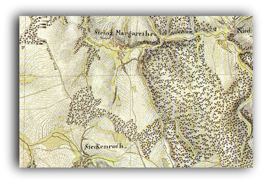

---

## Ereignisse

Den Gemeindevätern wird nach 1 Jahr Pensionszahlungen an den ehemaligen Lehrer Ferdinand Sauer bewusst, dass sie mit der Zahlung des Geldbetrages statt Holzlieferung einen erheblichen Verlust haben. Aber eine Eingabe an die Hohe Landesregierung dies wieder rückgängig zu machen, wird von dieser abgelehnt und die Gemeinde muss entsprechend ihrem früheren Wunsch (siehe 1819) die Pension abliefern.

---

## (Quelle: Alte Strinzer Chronik, Teil 1, Seite 112)

Aus der Kirchenchronik

Der erste strenge Winter seit 1813 u. 14. Heftige Kälte im Januar. Kühler Sommer. Erster Plan zur Erbauung einer neuen Kirche. Besetzung der Schulstelle zu Niederlibbach durch den Schulcandidat Staadt nach Abgang des Schullehrers Reinhard. Anschaffung der alten Orgel zu Strinz Trinitatis in die Libbacher Kirche. Kirchenvisitation sonntags d. 16. July, die erste hierorts seit der neuen Organisation (Predigttext: Joh.8, 38, 32). Ziemlicher Ertrag der Erndten. Predigerconferenz im October, im Pfarrhaus zu Strinz Trinitatis.

---

## 1821

Obrigkeiten

---

## Aus der Kirchenchronik

Gelinder Winter; einiger Frost mit Schnee in der Mitte des Februars. Zeitiger Eintritt des Frühlings. Regelmäßige Witterung. Geringer Ertrag meiner Besoldung bei den gesunkenen Preißen der Naturalien. Stille im öffentlichen Verkehr u. Leben. Predigerconferenz im Pfarrhaus zu Bechtheim, im September. Der zur Abschaffung der Pfarrökonomien gesetzte Termin, Ende 1821, geht unbeachtet vorüber.

---

## 1822

Obrigkeiten

---

## 1823

Obrigkeiten

---

## Lehrer: Johann Gottfried Georg

Aus der Kirchenchronik

Später Frühling; wenig Graswuchs vor Juni. Darauf sehr günstige Witterung. Reicher Ertrag der Erndten. Tiefstes Sinken der Naturalienpreiße. Waldmast, die letzte bis jetzt, 1847. Abgang der alten Eichen- und Buchenwaldung. Predigerconferenz im Pfarrhaus zu Michelbach.

---

## 1824

Obrigkeiten

---

## (Siehe auch unter: Kirchenneubau)

Catharine Elisabeth Enders, geb. Paul von Ketternschwalbach, herzogliches Amt Wehen klagt vor dem herzogl. nass. Appelationsgericht, gegen Ihren Ehemann Tobias Enders aus StM, herzogliches Amt Wehen, welcher zum letzten Mal als österreichischer Soldat aus Carlstadt, ungefähr im Jahre 1804 Nachricht von sich gegeben hat, auf Scheidung wegen böslicher Verlassung.

---

## (Quelle: Allgemeiner Anzeiger und Nationalzeitung der Deutschen / 2663 / 1824)

Streitigkeiten der Gemeinde Strinz-Margarethä mit dem dortigen Pfarrer Schmidtborn wegen eines über eine Pfarrwiese (Mühlwiese) gehenden Weges. (Quelle: HStAW, 211, 3698)

---

## Aus der Kirchenchronik

Kühles und feuchtes Jahr. Schließung der hiesigen Kirche wegen Baufälligkeit im July. Heftige Opposition von Seiten Vieler in hiesiger Gemeinde wegen des langen Pfades in der Mühlwiese, den ich als mißbräuchlichen abstellen wollte. Die L.Regierung entschied zu Gunsten der Opponenten. Von jetzt an bis Ende October 1834 gingen die hiesigen Ortsbewohner zur Taufe nach Niederlibbach.

---

## 1825

Obrigkeiten

---

## In StM erkranken 16 Bürger an Typhus, 4 Bürger sterben.(Quelle: Medicinische Jahrbücher für das Herzogthum Nassau / 1854)

(Siehe auch unter: Typhustod)

---

## Aus der Kirchenchronik

Heftige Kälte im Februar; sonst gelinde. Anhaltende Trockniß im Sommer. Frühe und knappe Erndte. Seit dieser Zeit sank der Fruchtpreiß nicht wieder auf den tiefen Stand von 1823/1824. Abgang des Decans Gruth als Decan und Pfarrer nach Liederbach. Die Decanatsverwaltung erhielt der bisherige Schulinspector, Pfarrer Schneider zu Bleidenstadt. Nervenfieber, das im Herbst hier grassierte. Mein Lager vom 19. Nov. Bis 5. Dezember, in Folge der Ansteckung. Meine erste Predigt nach der Genesung am 1. Weihnachtsfeiertage.

---

## 1826

Obrigkeiten

---

## Lehrer: Johann Gottfried Georg

Ereignisse

Pfarrer Schmidtborn verfasst eine geschichtliche Erörterung der Frage: "zu welchen Hoffnungen berechtigt das Streben der deutsch-protestantischen Kirche unserer Tage, sich apostolisch neu zu gestalten und was muss zur Beförderung des beabsichtigten Zweckes von unserer Seite geschehen?"(Quelle: Neues Journal für Prediger, Band 69, Seite 91 / 1826)

---

## 1827

Obrigkeiten

---

## Für einen Brand vom 13. auf den 14. Juli in StM muss die Brand Assekuranz 519 Gulden bezahlen.(Quelle: Verordnungsblatt des Herzogthum Nassau / 1827)

Im Jahr 1827 stiftet Mathias Trapp, Sergeant im 1. Infanterieregiment der Herzoglich Nassauer Armee, in Weilburg mehrere Soldaten - darunter auch den Strinzer Georg Adam Enders -  zum Mord an dem 18 Jahre alten Kadetten (Offiziersanwärter) Adolph Vigelius an.

---

## Später Eintritt des Winters mit heftiger Kälte und vielem Schnee d.15. Januar; Dauer bis 28. Februar. Heißer Sommer, mittlere Erndte.

1828

---

## 1829

Schultheiß: Johann Emrich Enders

---

## 1830

Obrigkeiten

---

## 1831

Obrigkeiten

---

## Strinz Margaretha

Ereignisse

Gesuch der Müller von der Brückmühle, Kesselmühle, Dillenbergermühle im Amt Nastätten und Reifenmühl bzgl. Anspruch der Bahnermühle bei Hennethal auf das Mahlrecht in Hennethal und Strinz-Margarethä.(Quelle: HHStAW 211 Nr. 8356 Dep.)

Der 1927 ins Diezer Zuchthaus inhaftierte Strinzer Bürger der gemeinschaftlich mit Bürgern aus Ketternschwalbach und Hennethal einen Cadetten ermordet haben soll, sitzt noch immer ohne Prozess in demselben.(Quelle: Sitzungs-Protocolle der Landständischen Deputierten-Versammlung / Seite 174 / 28.03.1831)(Siehe auch unter: Weilburger Kadettenmord)

---

## 1832

Obrigkeiten

---

## (Siehe auch unter: Prozess um das Ochsengut)

Als Mitglieder der Amtsarmencommision werden u.a. Pfarrer Schmidtborn und Schultheiß Enders (Cassirer) aufgeführt.(Quelle: Staats- und Adressbuch des Herzothums Nassau /1832/33 / Seite112)

---

## Als für StM zuständiger Oberförster wird ein Wilhelm Ludwig Haas genannt.(Quelle: Staats- und Adressbuch des Herzothums Nassau /1832/33 / Seite136)

Pfarrer Schmidtborn stellt einen Antrag auf Erbauung eines neuen Stalles. Die zuständigen Gremien lehnen ab und empfehlen dem Pfarrer später, die Ländereien zu verpachten. 13 Jahre später wird der Bau endlich genehmigt und errichtet.(Quelle: Alte Strinzer Chronik/Kirchenchronik / HHStAW 211 Nr. 3697)

---

## Aus der Kirchenchronik

Mein erster Antrag auf Erbauung neuer Stallung an der Stelle der alten abgängigen Rindvieh- und Schafställe auf dem hiesigen Pfarrhof. Die Versagung desselben von Seiten der L.Regierung u. des Decanats. Vergeblicher Versuch einer fiskalischen Verpachtung des Pfarrguts am 9.April. Meine Flucht nach Idstein. Ich behaupte den Status quo. Anstände während des Kirchenbaues. Regelmäßige Witterung. Ziemlich ergiebige Erndte; viel Klee seit 1830.

---

## 1833

Obrigkeiten

---

## Lehrer: Friederich Jakob Friederich

Ereignisse

Verlegung des neuen Totenhofes neben diesen und zwar nach dem Ort zu, da das Ochsengut/Pfaffengut auf dem der neue Totenhof angelegt wurde, wegen der Verpflichtung zur Haltung des Faselviehs, nicht bebaut werden durfte (siehe auch 1832). Es waren schon 12 Leute dahin beerdigt worden die umgebettet wurden. Der Ortsgeistliche, Pfarrer Schmidtborn, lehnt es ab, den neuen Totenhof einzuweihen.(Siehe auch unter: Kirchenneubau)

---

## Ungefähre Lage des Ochsengutes/Pfaffengutes

1834

---

## 1835

Obrigkeiten

---

## 1836

Obrigkeiten

---

## Aus der Kirchenchronik

Beginn des Jahres unter gespannten Verhältnissen. Meine Stellung den Behörden und den Gemeinden gegenüber. Meine durchaus objektive Haltung und Predigtweise. Nothwendigkeit u. Vortheil einer solchen für den Pfarrer. Meine Berechtigung als Inhaber der Pfarrei auf welche ich mich basire. Die fiskalische Ansicht derselben. Mein Rapport mit Herrn Bischof Müller. Sophistische Unterscheidung zwischen innerer und äusserer Kirchenverwaltung. Subhastation und Verpachtung des ganzen Pfarrguts am 08. April. Mein Aufenthalt in Idstein in diesen Tagen. Später wird den Pächtern auch meine Wintererndte überwiesen. Dadurch beträchtliche Mehrung meines Verlustes. Meine Reclamation beim Staatsministerium. Verweisung auf das Edict v. 8. April 1818. Meine Maßnahmungen, mich im Angesichte der Welt zu behaupten. Beibehaltung meiner Ökonomie (mit einiger Reduction), anfangs bei ungefähr 12 Morgen Land, die ich durch Pachtung und Ankauf acquirirte. Künstliche Basis dieses Betriebs. Die Vermittelungen der Vorsehung. Schwierigkeit der Existenz eines Pfarrers auf der hiesigen Stelle bei jeder Einrichtung, die er etwa treffen mag. Meine Indifferenz bei allen Vorgängen. Meine sonstigen Erlebnisse und Beziehungen. Meine Spezialität.

---

## 1837

Obrigkeiten

---

## Ereignisse

Gesuch der Gemeinde Strinz-Margarethä wegen angeblicher Zehntfreiheit von Gartenland und gerodeten Wiesen.(Quelle: HStA, 212, 6018)

Die Witib (Witwe) des 1833 verstorbenen Schultheiß Johann Adam Enders, die mittlerweile den Bauern Conradi geheiratet hat, wird im Prozess um das Ochsengut/Pfaffengut verurteilt, "alles Faselvieh, wie Faselochsen, Eber und Widder zu stellen und zu unterhalten und der klagenden Gemeinde alle verursachten Prozesskosten zu ersetzen. Gegen dieses Urteil erhebt sie Appellation und erzielt einen Teilerfolg: sie braucht den Widder nicht zu stellen, und die Prozesskosten werden geteilt.(Quelle: Alte Strinzer Chronik)(Siehe auch unter: Prozess um das Ochsengut)

---

## 1838

Obrigkeiten

---

## Pfarrer Ludwig Schmidtborn soll nach Rod an der Weil abgeordnet werden. Neuer Pfarrer soll Pfarrer Victor von Dickschied werden.(Quelle: Verordnungsblatt des Herzogthums Nassau / Nr. 10 / 1838)

Zur Bestreitung gemeinheitlicher Ausgaben für das Jahr 1938 muss StM eine Communalsteuer von ein und ein halbes Simpel zahlen.(Quelle: Verordnungsblatt des Herzogthums Nassau / Nr. 8 / 1838)

Seine Durchlaucht der Herzog haben, den für die Pfarrei Rod bestimmt gewesenen Pfarrer Schmidtborn zu StM an seiner Stelle zu belassen und den nach StM designierten Pfarrer Victor von Dickschied nach Rod an der Weil zu versetzen geruht.(Quelle: Verordnungsblatt des Herzogthums Nassau / Nr. 8 / 1838)

---

## Aus der Kirchenchronik

Große Kälte vom 8. Januar bis 19. Februar; der härteste Winter seit 1830. Versetzung des bisherigen Decanatsverwalters Erlenmayer als Decan nach Langenschwalbach. Der neue Ephorus: Keller, bisher zweiter Pfarrer zu Diez, gebürtig zu Dillenburg. Einführung der neuen Amtskleidung = Chorrock u. Barret anstatt des bisherigen Mantels mit Hut. Zweckmäßigkeit dieser Änderung.

---

## 1839

Obrigkeiten

---

## Aus der Kirchenchronik

Öffentliche Kirchenvisitation am 12.Sonntag n. Trinit., d. 18. May. Die erste wieder seit dem 16.July 1826.

---

## 1840

Obrigkeiten

---

## 1841

Obrigkeiten

---

## Ersteigerung einer Wiese der Erben des Johann Philipp Otto von Strinz-Margarethä durch die Domäne.(Quelle: HHStAW 244 Nr. 1653)

Die alte Strinzer Brücke (1841 – 1949)

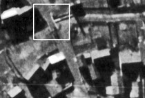

---

## 1842

Obrigkeiten

---

## Ereignisse

55 Bürger erkranken im Medicinalbezirk Wehen an Typhus, 9 sterben, insbesondere in Strinz und Panrod.(Quelle: Medicinische Jahrbücher für das Herzogthum Nassau / 1854)

---

## (Siehe auch unter Typhustod)

Ablösung der Domanialzehnten und der auf dem Domanialvermögen ruhenden Lasten im Rezepturbezirk Bleidenstadt (inkl. StM)(Quelle: HHStAW 210 Nr. 5043)

Seit dem Tod des Schultheißen Enders erhebt die Herzogliche Generaldomänendirektion von dem Ochsengut/Pfaffengut den Zehnten gegen Willen der Besitzerin Frau Conradi, bis diese 1842 die Zahlung des Zehnten "förmlich verweigert". Frau Conradi verlangt durch Prozess vor dem Hof- und Appellationsgericht in Usingen namens ihrer zwei minderjährigen Kinder erstens Entschädigung dafür, dass das Gut stärker belastet war, als beim Kauf festgesetzt wurde, zweitens wegen des wiederrechtlich erhobenen Zehnten.(Quelle: Strinzer Chronik)(Siehe auch unter: Prozess um das Ochsengut)

---

## 1843

Obrigkeiten

---

## Einwohner Zinkenmühle 10

(Quellen: Lexicon der sämtlichen Ortschaften der deutschen Staaten, 1843 / Beschreibung des Herzogthums Nassau, 1843)

---

## Aus der Kirchenchronik

Gestiegene Naturalpreiße im Frühling. Ergiebige Erndte, jedoch mehr im Stroh. Wendepunct in der Praxis der Wildschadenvergütung. Einige Minderung des Wildstandes. Mißbräuche bei der Schadenabschätzung. Bisheriger großer Kostenaufwand der Domäne. Vortheil der Inspectoren und Nachtheil der meisten Gutsbesitzer. Locale Hemmniß eines erfolgreichen ökonomischen Betriebs: Die Wildbahn; schlechtes Faselvieh; bezüglich auch des Edict. d. 1818 u. seiner bisherigen Wirkung. Ablösung des bisherigen Zehntens im December.

---

## 1844

Obrigkeiten

---

## 1845

Obrigkeiten

---

## 74 Familien / 326 Einwohner

(Hessisches Jahrbuch der Landesgeschichte / Band 4 / 1990)

---

## Ereignisse

Der Strinzer Bürger Philipp Emmerich Kilb erfährt einen zweifelhaften Ruhm, indem er im Allgemeinen Polizeianzeiger als "Gemeinschädlicher Umtreiber" aufgeführt und beschrieben wird.(Quelle: Allgemeiner Polizeianzeiger, 1845)(Siehe auch unter: Gemeinschädliche Umtreiber)

Durch sein vorgerücktes Alter und der damit vereinigten Schwächen des Körpers für den so wichtigen Lehrerberuf untauglich geworden, wird der Lehrer Friederich mit 100 Gulden Pension in den Ruhestand versetzt. Er stirbt am 2. August, nachdem er ein halbes Jahr an der Wassersucht gelitten hat.(Quelle: Alte Strinzer Chronik, Teil 1, Seite 112/113)

Neuer Schullehrer wird J. A. Stoll, der 1816 in Sechshelden bei Dillenburg geboren wurde. Das Schulgut bekommt er nicht mehr frei zur Verfügung gestellt, sondern muss dafür 15 Gulden zahlen.(Quelle: Alte Strinzer Chronik, Teil 1, Seite 113 und 119)

---

## 1846

Obrigkeiten

---

## 76 Familien / 327 Einwohner

Allgemeine Ereignisse

Am 29. Juli des Abends um 09:30 Uhr wird eine Erderschütterung gespürt, und zwar so, dass die Häuser wankten, Leute aus den Betten sprangen und eine Donner ähnliches Getöse gehört wurde.(Quelle: Beiträge zur Geschichte Hohenstein-Bretihardt, -Steckenroth und -Burg-Hohenstein / Pfarrer Weinberger / 1992)

---

## Der Schullehrer J. A. Stoll wird nach Hausen/Aar versetzt.(Quelle: Alte Strinzer Chronik, Teil 1, Seite 113)

Neuer Lehrer in StM wird Johann Adam Schmidt, geb. 1811 zu Bechtheim. Seine Besoldung beträgt 275 Gulden jährlich.(Quelle: Alte Strinzer Chronik, Teil 1, Seite 113)

---

## Es grassiert erstmalig die Kartoffelfäule, die die Ernte dezimiert.(Quelle: Wehen und sein Grund, Dr. Eduard Wilhelmi, 1953)

Aus der Kirchenchronik

Gelinder Winter. Ablegung des alten Rindviehstalles u. dessen Wegführung (nach Breihardt) d. 19. März. Bau des neuen Stalles. Heißer und trockner Sommer; ausser einigen Staubregen um Johanni während 5 Monate keine Nässe; ebenso abnorm wie der Winter des vorigen Jahres. Einfluß der Witterungsvorfällnisse auf die Production u. dadurch auf den sozialen Zustand. Karge Erndte. Oeffentliche Kirchenvisitation am 15 Sonnt. Nach Trinit., d. 20. Sept. (Text der Predigt: ?ct. 16, 35). Steigen der Fruchtpreiße und trübe Aussichten für die ärmere Classe.

---

## 1847

Obrigkeiten

---

## Es grassiert die Kartoffelfäule, die die Ernte dezimiert.(Quelle: Wehen und sein Grund, Dr. Eduard Wilhelmi, 1953)

Ereignisse

---

## 1848

Obrigkeiten

---

## 1849

Obrigkeiten

---

## Aus diesem Jahr ist ein Geometer Heinzemann bekannt.(Quelle: Annalen des Vereins für Nassauische Altertumskunde / Band 4 / Seite 283)

Am 23.07.1849 wandert der Strinzer Bürger Johann Jacob Rücker nach Amerika aus. Ziel ist New York City. Er hat fünf Kinder, der Name der Ehepartnerin ist unbekannt. Eingeschifft wird die Familie in Antwerpen.(Quelle: Die Auswanderung aus dem Herzogtum Nassau 1806 - 1866)

---

## Aus der Kirchenchronik

Mit dem Beginn dieses Jahres greifen neue Einrichtungen Platz, als Folge der Umwälzung von 1848. Die neue Existenz des Pfarrers als Gemeindebürger - eine Consequänz der Tilgung persönlicher Berechtigung u. alles Sonderlebens, um die absolute Staatskirche durchzuführen. Vortheile und Nachtheile dieses veränderten Verhältnisses. Die Exemtion des Pfarrers vom Gemeindeverband. Dessen Lasten waren dem Stande zuträglich und angemessen, solange die unbefangenen Naturverhältnisse (frei Wasser und Weide) und die Immunitäten u. die Gerechtsamen bestanden, welche dem Pfarrer an sich schon die Vortheile des Ortsbürgerthums (und in manchen Stücken mehr noch) gewährte. Die Immunitäten der Steuerfreiheit, Befreiung von Einquartierung u. Kriegsfrohnden waren vorher schon hingefallen. Die auszeichnende Gerechtsame (Freiheit vom Hirtenlohn p.p.) fielen seit dem Jahre 1818 mit der neuen Besetzung der Stellen weg. Darum muß das Ortsbürgerrecht nunmehr dasjenige ersetzen, was der Pfarrer bei den veränderten Zuständen außerdem ganz entbehren würde. Die Opposition welche sich vorher schon gegen die Exemtion und Unabhängigkeit des Pfarrers kund gab. Eifersucht und theilweise Auflehnung der Bauernschaft gegen meine Privatbegüterung. Eigenthümlicher Dünkel des Bauern als Urproducent. Die neue Verfassung erscheint darum als Ausgleichung auseinandergegangener und uneben gewordener Verhältnisse. Sinken der Autorität u. des Ansehens, die sich bisher an Amt u. Person knüpften - eine Folge der Unwirksamkeit der religiösen Motive u. des bürokratischen Unfugs. Auch die Achtung vor der dedicirten Gewalt ist in Verlust gerathen. Gleichwohl werden für die Mehrzahl die neugewährten politischen und bürgerlichen Rechte (active u. passive Wahl p.p.) mehr oder minder eine Täuschung bleiben. Fortan wird das Kapital herrschen u. allein die Verhältnisse zu bewältigen im Stande seyn. Daher neben aller politischen Gleichheit u. Berechtigung doch wieder vielfältig eine tiefe Verachtung des Individuums. Daraus ergibt sich zumal für den Geistlichen und Literaten die Nothwendigkeit, seine Spezialität – das Eigenthümliche und Auszeichnende des Berufes und der Persönlichkeit – vorzüglich auszubilden und gelten zu machen.

Wahl für die neuen Gemeindestellen = Bürgermeister, Gemeinderäthe u. s. w. . Theilweise Wahl des Gemeinderathes aus der Hefe des Proletariats, hauptsächlich motivirt durch die Opposition gegen den Pfarrer. Ich betheilige mich an keiner Wahl. Auf dem Filial behauptet sich die schlechte Bauernaristokratie der alten Schultheißenfamilien. Sehr gelinder Winter.

Große politische Aufregung im Frühling. Volksversammlung in der Nähe des hiesigen Orts (über der Schafbrücke am Saum des Waldes) am Himmelfahrtstage d. 17. May. Als Redner treten auf die Landesdeputirten Lang von L.Schwalbach u. Snell, Pfarrer v. Langenbach; sodann H. v. Eck v. Bleidenstadt u. Schullehrer Walterd, v. Idstein. Herr Pfarrer Deißmann v. Panrod hatte sich unterandern als Zuhörer eingefunden (bewaffnet mit einem Knicker, den er in Rockbrusttasche trug); ich blieb zu Hause. Die Reden waren ein Aufruf zum bewaffneten Aufstand unter dem Vorwand der Durchführung der vom Reichsparlament beschlossenen Reichsverfassung. Eine weitere Folge – der Landescongreß zu Idstein am 10. Juni, wo dieselbe Intention ganz offen und entschieden hervortrat. Wendung der Dinge nach der Mitte des Juni; Dämpfung des pfälzischen und baden’schen Aufstandes. Meine Ahnung, daß nun die Agitation vom politischen Gebiet auf das kirchliche übergehen, insbesondere daß auch hierorts die verhaltene Wuth gegen den Pfarrer sich kehren werde. Die dolose u. feindselige Haltung des Bürgermeisters u. Gemeinderaths von ihrer Bestellung an gegen meine Person. Verübte Ungebühr an meinem Besoldungssatz. Man macht mir das der Pfarrei zustehende freie Backlos streitig. Mein lavieren in dieser Sache. Meine redliche Klage am Justitzamt d. 23. Nov.. Abhaltung der Gerichtstermine mit Bürgermeister u. Gemeinderath am 7. u. 21. Dec. Nachmittags. Das Urtheil soll d. 15 Jan. 1850 publicirt werden.

Tiefer Stand der Fruchtpreiße, jedoch nicht so tief wie in 1824 f. Die Geldnoth. Schlechter Kirchengang; die Trauerstühle sind bisweilen leer. Die Kirche erhält sich nur noch als äussere Institution, ohne Erfülltsein durch den heiligen Geist. Aussichten auf die verheissene neue Kirchenverfassung, welche Einige (die Radikalen) mit Ungestüm fordern, andere, wohl nicht mit Unrecht, vor der Hand ablehnen möchten. Gegen Ende des Jahres ward der hier domiciliirte und im Jahre 1848 verjagte Oberförster Halbey in seine hiesige Stelle restituirt.

---

## 1850

Obrigkeiten

---

## Harter und kalter Winter.(Quelle: Wehen und sein Grund, Dr. Eduard Wilhelmi, 1953)

Nasser und kalter Sommer.(Quelle: Wehen und sein Grund, Dr. Eduard Wilhelmi, 1953)

---

## Erste Reichstagswahl in unserer Gegend(Quelle: Alte Strinzer Chronik)

Aus der Kirchenchronik

Die Stimmung des Gemeinderaths bez. der Gemeinde ist durch heftige Opposition u. prozeßsüchtiges Vorgehen gegen die Pfarrei resp. gegen meine Person bezeichnet. Die zurückgewiesene u. gedemüthigte Demokratie will sich durch die Bewältigung des Pfarrers Genugthuung verschaffen. Meine Maßregeln – Ich entschließe mich jeden Prozeß aufzunehmen, zumal sich seit der Trennung der Verwaltung von der Justiz keine Regierung mehr durch fiskalische Verfügungen dazwischen legen kann. Der vom Gemeinderath durch alle Instanzen hindurch getriebene Prozeß um das freie Backlos wird für die Pfarrei gewonnen. Strittung während des ganzen Jahres um das Streulaub. Man verweigert das Loos für die Pfarrei, weil ich als Gemeindeglied ein Loos beziehe. Der Gemeinderath läßt jedoch den Prozeß deshalb schon bei der ersten Instanz fallen. Ich hatte indessen namhafte Küster, da meinem Gesinde angebliche Frevel beim Laubholen zur Last gelegt wurden, wobei das Forst- u. Amtspersonal den Uebelgesinnten Vorschub leistete.

Der endliche Beginn des schweren Prozesses wegen des hiesigen Pfarrbesoldungssatzes. Die ursprüngliche Rechtsausübung u. hergebrachte Observanz: Der Pfarrer läßt das von der Forstbehörde auf dem Stamm angewiesene Besoldungsholz (welches auf dem hiesigen Gemeindewald radicirt ist) auf seine Kosten d.h. durch die von ihm angestellten und bezahlt werdenden Leute hauen, u. bezieht dieses ihm nun zuständige Competenzholz in seiner Identität. Belang dieses Verhältnisses für die Sicherheit u. das Interesse der Pfarrei. Die theilweise Ungewißheit, welche durch die fiskalischen Bestimmungen des Forstedicts v. 1806 in dieses Verhältniß gebracht wurde: „ein bestellter Holzhackermeister soll die ganze Holzfällung im Accord übernehmen, und das Amt soll das gefällte Holz verwanden.“ Zunächst machte diese Bestimmung hier (u. auch auf anderen Pfarreien) keine Aenderung. Ich ließ mein Holz nach wie vor durch meine Leute hauen, u. in der amtlichen Verwandung (eine dem Centralisationssystem eigene Einrichtung) blieb mir dasselbe jedesmal zuständlich. Es geschah unterdessen eine Wirkung des fiskalischen Geistes – daß die Oberförster die spezielle Anweisung für die Pfarrei auf dem Stamm verweigerten; zuletzt unterblieb dieselbe. Dessen ungeachtet ging die Fällung durch meine Leute von statten; die Förster supplirten mitunter die Anweisung. Zu Anfang der 1830siger Jahre erhoben sich in der Mitte des Ortsvorstandes u. der Gemeinde Stimmen, welche verlangten, der Pfarrer solle aus dem gemeinheitlich gefertigten Holzschlag sein Besoldungsholz ---------, dergestalt, daß er sein Deputat von der ersten oder letzten Nummern der Reihenfolge empfange. (Ich ließ nämlich mein Competenzholz immer gut machen und setzen, was den Neid u. das Mißtrauen erregte.) Ein Oberförster machte mir unter Versicherung reeller Bedingung den Antrag, ihm die Auswahl u. Ueberweisung des Besoldungsholzes zu überlassen. Diese verschiedenen Begehrnisse u. Ansinnen hatten keine Folgen; ich begriff jedoch ihre letzten Consequenzen. Da die spezielle Anweisung – auf dem Stamm – unterlassen wurde, was endlich zu Collisionen führen mußte, und die tauglichen Leute, die ich über der Holzarbeit selbst beköstigte, mit der Zeit abgegangen waren, so geschah es seit Ende der 1830siger Jahre, daß ich im Gemeindeaccord mein Besoldungsholz fällen ließ und dasselbe aus der fertigen Fällung nach der besseren Qualität auszog. Es geschah dies gleichsam vertragsweise u. war ein tolerirter Zustand, unter Vorbehalt der Pfarrcompetenz. Ich lavirte. Ich sah ein, daß wenn der Bezug des Besoldungsholzes einmal von seiner positiven und natürlichen Basis losgerissen ward (da es nun einmal keine freie Lieferung ist, wie auf dem Filial, wo die Abgabe unbefangen u. eingewohnt u. das Quantum ohnehin gering ist) der Pfarrer aller möglichen Betrügereien u. Verkürzungen ausgesetzt sey. Einen Bruch aber suchte ich zu vermeiden, weil ich fürchtete, die fiskalischen Bestimmungen v. 1806 möchten im Fall eines Entscheids gegen die Pfarrei gekehrt u. angewendet werden, oder die büreaukratische Verwaltung möchte rücksichtslos verfügen, u. etwa dem Ortsvorstand oder dem Forstpersonal die Auswahl u. Ueberweisung des Pfarrbesoldungsholzes heimgeben. Für einen solchen Fall war ich entschlossen, auf die Pfarrcompetenz und bestandene Observanz zurückzugehen und dieselbe um jeden Preiß zu vertheidigen.

Im Jahre 1848 bezog ich das Holz nach dem bezeichneten Modus, der bisher beibehalten war; ich merkte aber in der aufgeregten Zeit, daß dieses Verhältniß von keiner weiteren Dauer sey. Dennoch ließ ich auch für 1849 das Holz wie bisher machen. Nachdem dieses Holz im December 1848 fertig geworden war, trat die neu errichtete Gemeinde auf, u. vertauscht einige Klafter von dem für die Pfarrei von mir designirten Holz. Ich rügte dieß, that jedoch keinen Schritt, weil an sich das Holz für Rechnung (im Accord) der Gemeinde gefällt war; ich beschloß aber, mich künftig genau an die Pfarrcompetenz zu halten und zweifelte kaum mehr an dem Erfolg, da die bisherige Landesregierung aufgelöst und die Justitz von der Verwaltung getrennt worden war. Ich ging also schon im Sommer 1849 das herz. Kirnisamt an, welches das Forstamt veranlaßte, das Pfarrbesoldungsholz für das Jahr 1850 auf dem Stamm anzuweisen. (Dasselbe war auch für die Pfarrei Strinz – Trinitatis geschehen; auf den anderen Pfarreien kam meines Wissens keine Strittung vor.) Das zugewiesene Holz ließ ich im December 1849 durch meine Leute fällen.

Kaum hatte das Holz im Januar 1850 die forstamtliche Controlle passirt, so bemächtigte sich der Gemeinderath desselben u. verwandete es zu Gemeindeloosholz; der Pfarrei überwies er anderes Holz aus der Fällung. (Angeblich wurde bei der Gemeinde darüber gelooßt und zum Schein der Unparteilichkeit ein Kirchenvorsteher gebraucht um im Namen der Pfarrei das Loos zu ziehen.)Ich nahm keine Notiz von dem überwiesenen Holz, sondern erhob sofort Klage auf Ersatz des entwendeten Holzes und auf völlige Schadloshaltung.

Der erste Gerichtstermin im Justitzamt zu Wehen, d. 5. März 1850. Der Gemeinderath, an der Spitze der Bürgermeister (selbst Mitglied des Kirchenvorstandes!) erklären, daß sie die Sache an einen Advocaten übertragen wollen. Das Amtspersonal räth mir deshalb, auch meinerseits eine solchen anzunehmen. Damit begann der Prozeß. Charakteristische Aeusserungen bei dieser Gelegenheit von Seiten des (nimis plumbei) Bürgermeisters: ich habe ja keine Axt mehr in den Wald tragen dürfen; es sey so ein Ding sich das Brod in die Hand zu schneiden (das Pfarrbesoldungsholz durch einen Dritten überweisen) zu lassen. Da ich nach Gestalt der Sache u. von vorne herein für meine Person (wegen Entwendung eines mir zuständlichen Objektes) die Klage anstellte, u. auch keine Anstalt traf, daß der Prozeß auf Kosten des Kirchenfonds geführt werde, so kam es, daß ich denselben auf meine Kosten betrieb. Daß der Kirchenvorstand die Pfarrei vertrete oder eine darauf bezügliche Pflicht habe, davon keine Rede. Schon vorhin hatte das Staatsministerium in eigener Weise auf den Rechtsweg verwiesen.

In meinem Verhältnis zum Kirchspiel u. zu den einzelnen Gemeindegliedern änderte der Prozeß nichts. Ich machte kein Aufheben von der Sache und vermied, wie ich auch in anderen Fällen u. Beziehungen gewohnt bin, jede Diskussion. Bei der Instruction des Prozesses stellte ich sogleich die Sache auf die Spitze u. bezeichnete als die gründliche Meinung u. Endabsicht des Gemeinderathes (woran nicht zu zweifeln), das Pfarrbesoldungsholz in seine Hand zu nehmen u. nach seiner Auswahl u. Bestimmung an den Pfarrer gegen Entrichtung des Hauerlohns zu überweisen, und zwar eventuell Holz von solcher Qualität, dessen Werth etwa die Kosten des Hauer- und Fuhrlohnes compensire. Hiernach ließ sich das Risiko der Pfarrei bemessen. Langsamer Gang des Prozesses. Im November war der Gemeinderath genöthigt, daß mir überwiesene u. während des Jahres im Wald sitzen gebliebene Holz für Rechnung der Gemeinde zu verkaufen. Am 28. Dec. war die erste Zeugenabhör: der Gemeinderath ließ die von ihm aufgerufenen Zeugen zum ewigen Gedächtnis vernehmen. Ich selbst hielt den Termin für meinen Sachwalter (Dr. Großmann in Wiesbaden) ab.

---

## Während des Jahres wurden mehrere Predigerconferenzen im hiesigen Pfarrhaus abgehalten. Der Verlauf in Witterung u. Erträgnisse = ein gewöhnliches.

1851

---

## Familien: 79

(Quelle: Beiträge zur Statistik des Herzogthums Nassau / 1863 / Seite 167)

---

## Allgemeine Ereignisse

Nasser und kalter Sommer(Quelle: Wehen und sein Grund, Dr. Eduard Wilhelmi, 1953)

---

## Lehrer Schmidt wird nach Lohrheim versetzt.(Quelle: Verordnungsblatt des Herzogtums Nassau, Band 43, Seite 158)

Neuer Lehrer wird Johann Friedrich Demmer, geb. 1811 zu Philippstein. Der "Herzoglich Nassauische Staatsminister des Kreisamtes Langenschwalbach ernennt ihn zum Lehrer und gleichzeitig zum Organisten, Küster und Glöckner der ev. Kirche. Schulinspektor Heinzemann führt ihn in sein Amt ein.(Quelle: Alte Strinzer Chronik, Teil 1, Seite 114)

---

## In StM werden die Schmetterlingsarten Daplidice und Bellidice nachgewiesen.(Quelle: Jahrbücher des Nassauischen Vereins für Naturkunde: Bände 7-8 - Seite 111, 1851)

Rechtsstreit der Gemeinde Strinz-Margarethä gegen Pfarrer Schmidtborn daselbst wegen Anerkennung eines Beholzungsrechts. (Quelle: HStA, 293, 200)

Prozeß der Gemeinden Strinz-Margarethä, Niederlibbach und Hambach gegen das Herzogl. Staatsministerium wegen der Bauunterhaltung der Kirchen und Pfarrgebäude zu Strinz-Margarethä (Quelle: HHStAW Serie)

---

## Aus der Kirchenchronik

Sehr gelinder Winter. Aussergewöhnlicher Strohgewinn vom Wintergetreide; mitunter weniger Körner. Der Prozeß wegen des Pfarrbesoldungsholzes schwebt noch in der ersten Instanz (Justitzamt zu Wehen). Termin am 30. July: Abhör der von mir aufgerufenen Zeugen. An diesem Tage bezahlte ich 22 Gulden Zeugengebühr. Angriffe und Collision wegen meiner Tauben, deren Einsperrung Gemeinderath und Feldgericht verlangen, wodurch mir in Folge Anbringens namhafte Kosten entstehen. Es ist dieß offenbar eine Bestätigung der Feindseligkeit und Rache, da sich ohnehin Niemand um die Tauben des Pfarrers (ausser denen keine hier gehalten werden) bekümmerten; auch mag es manchen scheinen, das Halten eines Fluges Tauben auf dem Pfarrhaus sey eine aristokratische Auszeichnung. Mein Versuch im August, den Kirchenvorstand auf dem Filial zu vermögen die Prozeßkosten p.p. auf die Kirchencasse zu übernehmen, scheiterte an der Opposition der Bürgermeister von Oberlibbach und Niederlibbach. Sie erklärten ganz unverhohlen, wer den Prozeß angefangen habe, möge ihn auch ausführen. Auch die hiesigen Kirchenvorsteher hielten zu den Gegnern resp. zur Gemeinde, so daß einmal von einem Zusammentritt derselben die Rede war, um die Erklärung abzugeben, daß man von Seite des Kirchenvorstandes bez. der Kirchengemeinde in die Forderung des Gemeinderathes willige. Dieß würde jedoch in keinem Fall gelungen seyn. Meine literarischen Beschäftigungen und sonstigen Beziehungen, welche die Unbilden meiner Umgebung mich wenig anfechten ließen. Wenig Obst in diesem Jahr und Mißrathen der Kartoffeln durch die noch immer (seit 1830) anhaltende Krankheit der Trockenfäule.

---

## 1852

Obrigkeiten

---

## Der Flächengehalt des Forstes Breithardt, zudem auch der Forst von StM gehört beträgt 13,813 Morgen, 80 Ruthen.

(Quelle: Verordnungsblatt des Herzogtums Nassau, Band 44, 1852)

---

## Allgemeine Ereignisse

Der Winter ist sehr schneereich, obwohl es nicht sehr kalt ist.(Quelle: Wehen und sein Grund, Dr. Eduard Wilhelmi, 1953)

---

## Ein Hitzejahr(Quelle: Wehen und sein Grund, Dr. Eduard Wilhelmi, 1953)

Pfarrer Schmidtborn gewinnt den Prozess um das Pfarrbesoldungsholz nach 3 Instanzen (1. Instanz: Justizamt Wehen / 2. Instanz: Herzogliches Hofgericht / 3. Instanz: Oberappelationsgericht.)

---

## Aus der Kirchenchronik

Zu Anfang dieses Jahres ergriff den vereinten Orts- u. Kirchenvorstand eine dämonische Gewalt, die ihn zu einem kühnen Versuch trieb meine Entfernung zu bewirken. Der Holzprozeß war in erster Instanz für die Pfarrei gewonnen u. schwebte jetzt infolge der Appellation des Gemeinderathes an S. Hofgerichte. Im Aeusseren zeigte sich durchaus keine Animosität gegen meine Person; das Verhalten der Individuen blieb normal; im Allgemeinen verhielten sich die Gemeindeglieder in Bezug auf den Prozess indifferent, nur die Chargierten (Gemeinderath usw.) waren befangen u. gespannt u. glaubten agitiren zu müssen. Die äussere Veranlassung ihrer neuen Aufregung u. Vorschreitung war ohne Zweifel folgende: die Aufstellung der Listen behufs der Lieferung der Pfarrcompetenzfrucht u. dem Aussetz der einzelnen Beiträge hatte ich von jeher den Schultheißen überlassen. Auf Betrieb des Gemeinderathes, der in der irrigen Meinung stand, die Sache gehöre zu seinem Ressort hatte der nunmehrige in die Liste für die Lieferung der Besoldungsfrucht v. 1849, welche im Januar 1850 stattfand, meinen Namen eingetragen. Vergebens suchte ich den Leuten begreiflich zu machen, dass der Bezug des Gemeindenutzens keinen Zusammenhang mit der Verbindlichkeit des Beitrags zur Pfarrcompetenz habe; dass ich durch den Eintritt in den Verband der Civilgemeinde nicht aufgehört habe Pfarrer zu sein; und dass eine persönliche Abgabe an die eigene Person ein Unsinn sey. Den Ausfall an der Frucht trieb ich ohne Rücksicht bei. Sie wagten keinen weiteren Versuch mich zu einer Lieferung beizuziehen, urgirten es aber fortwährend u. auch jetßt als eine Forderung der Gleichheit, dass ich beitrage. Meiner Aufmerksamkeit war es entgangen, dass der Schullehrer Schmidt (im August 1851 nach Lorheim übergegangen) zu den Lieferungen der Pfarrbesoldungsfrucht v. 1849 u. 50 war beigezogen worden. Als nun der Name des neuen Schullehrers in der Liste für die Lieferung v. 1851, welche in den ersten Tagen dieses Jahres (1852) stattfand, erschien, strich ich denselben, weil der hiesige Schullehrer, der zugleich Kirchendiener ist, niemals zu der Lieferung beigetragen hat, und ein Kirchendiener nach der bestehenden und allerwärts geltenden kirchlichen Observanz von persönlichen Abgaben zum Vortheil des Kirchendienstes frei ist. Später hat sich dem Vernehmen nach der Gemeinderath wegen Beiziehung des Pfarrers u. Schullehrers zur hiesigen Competenzlieferung an herz. Staatsministerium gewandt u. ist abschlägig beschieden worden. Die Zurückweisung dieser Anmaßungen steigerte die Verbitterung. Noch im Januar verlautete, dass von hier aus eine Liste auf dem Filial umhergetragen worden sey, um Stimmen zu einer Anklage gegen den Pfarrer zu sammeln. Dieß war ohne Erfolg. Eine heftige Klage- und Schmähschrift aber ging von hier ab, die lange Zeit bei S. Staatsministerium liegen blieb; denn erst im May ging sie ans Decanat zur Verantwortung zurück. Sofortige Vernehmung des vereinigten Gemeinderathes u. Kirchenvorstandes (von deren Gesamtheit die Schmähschrift unterschrieben war) vor dem Decanat zu Wehen. Mein Protokoll von dieser Stelle am 7. Juni. Ich erklärte: die erhobene Klage sey von Seite der Beschwerdeführer ein grober Versuch, sich die Behörden dienstbar zu machen, um das, was sie auf dem Rechtswege nicht gewinnen können, auf dem Weg der Verwaltung zu erreichen. Im übrigen verwies ich auf ihre in den Prozeßverhandlungen actenmäßig vorliegenden Freveln. Dabei hatte die Sache ihr Bewenden. Denn noch jetzt (28. Februar 1853) ist kein Bescheid erfolgt. Ursachen und Motive dieser Angriffe und Beschwerden. Der unzufriedene und verwilderte Zeitgeist. Entfernung aller patriarchalischen Denk- und Lebensweise. Da der Wechsel auf den Pfarrstellen häufig ist u. überdieß bei dem neuen Wahlsystem in anderen Kreisen die Ab- und Einsetzungen an der Tagesordnung sind, so scheint ein so perennirendes geistliches Regiment wie das meinige, mit den Forderungen der Freiheit und der Volkssouveränität zu streiten. Umsichgreifen des Proletariats. Theilweise Untergrabung der pfarramtlichen Verhältnisse durch das Edict v. 8. April 1818, namentlich durch die fiskalische Bestimmung, dasß das Pfarrgut verpachtet werden muß. Daher die immer wieder kehrende Spannung und Begierde, das etwa ergiebig gewachsene Pfarrgut in Pacht zu nehmen und auszusaugen. Das Precäre und in mancher Rücksicht Unzuträgliche der Existenz eines Pfarrers auf der hiesigen Stelle wegen ihres geringen (für eine Familie schwerlich zu reichender) Ertrag.

Im März erfolgte das hofgerichtliche Urtheil im Holzprozeß wodurch der Gemeinderath in zweiter Instanz unterlag; er trieb nun den Prozeß an das Oberappellationsgericht. An meinem dießjährigen wie an dem vorjährigen Besoldungsholz, das ich der Competenz gemäß hauen ließ, ließ sich der Gemeinderath unbetheiligt.

Sonstiger Verlauf des Jahres. Sehr gelinder Winter; jedoch anfangs März, zumal d. 5., harter Frost mit Schnee. Aufschlag der Brotfrucht im Februar; dann Ermässigung der Preiße durch Beschaffung vom Auslande und Handelsconcurrenz. Starker Regen freitags vor Pfingsten, d. 28. May. Mittelerndte; besserer Ertrag der Kartoffeln als im vorigen Jahr. Außer Zwetschken kein Obst. Vollständige Einführung der Stallfütterung, hierorts selbst mit Vernachlässigung der Weide, die sonst allerwärts benutzt wird.

Als oberste kirchliche Behörde fungiert jetzt ein Kirchensenat; im Uebrigen bestehen noch die kirchlichen Verhältnisse auf Grund des Edicts v. 1818, das noch nicht ausser Kraft gesetzt ist. Manche Amtsverrichtungen seit April durch die Vacanz in Breithardt.

Freitag d.19. Nov. Elisabeth. Wegen einiger Beschickungen ging ich heute nach Wiesbaden. Seit dem 12. October hatte ich wegen des noch schwebenden Prozesses mich nicht erkundigt. Als ich um 91\2 Uhr bei Hr. Dr. Großman eintrat, verkündigte mir der Secretär, dann er selbst, daß der Prozeß entschieden und gewonnen sey. Meine Freude und Genugthuung: ich war in dem Moment mit der Welt versöhnt. Ich schrieb angesichts an meinen Bruder (Generalsuperintendent in Coblenz), der an dem Resultat immer zweifeln wollte; ging in das Gasthaus des Adlers, besorgte meine Geschäfte in der Stadt, konnte aber auf keinen Freund oder Bekannten treffen, um meine Freude zu theilen. Schweigsam kehrte ich am Abend zurück. Ob in dem Moment der Ausgang des Prozesses hierorts schon bekannt war, habe ich nicht erfahren; derselbe machte nachgerade keinen überraschenden Eindruck, weil er nicht unerwartet war. Dem Kirchspiel und Publicum gegenüber verhielt ich mich, als ob nichts geschehen sey. Ich liquidirte meinerseits 120 Gulden 27 Kreuzer ausgelegte Prozeßkosten.

---

## 1853

Obrigkeiten

---

## Der Winter ist sehr schneereich, obwohl es nicht sehr kalt ist.(Quelle: Wehen und sein Grund, Dr. Eduard Wilhelmi, 1953)

Das Frühjahr ist sehr regnerisch.(Quelle: Wehen und sein Grund, Dr. Eduard Wilhelmi, 1953)

---

## Ein Hitzejahr(Quelle: Wehen und sein Grund, Dr. Eduard Wilhelmi, 1953)

Ereignisse

---

## (Siehe auch unter: Die neue Orgel)

Aus der Kirchenchronik

Ankauf einer Orgel von der Gemeinde Niederingelheim in die hiesige Kirche, die seit ihrer Erbauung (1834) ohne Orgel war. Der Sage nach hatte das Werk in einem Nonnencloster zu Mainz gestanden, ging sodann an die französische Regierung über und wurde von dieser an die Gemeinde Niederingelheim geschenkt, die es jetst durch ein neues größeres Werk ersetßt. Die Orgel wurde durch den Orgelbauer Voigt aus Igstadt in der hiesigen Kirche aufgestellt, und am 19. Juni, 4. Sonnt. p. Trinit., zum erstenmal durch den Schullehrer Kölschenbach v. Strinz Trinit. gespielt, der dazu bestellt war, um das Werk zu prüfen. Ich predigte über Ps. 33, 1-4; das Thema der Predigt war: „Die Tonkunst im Bunde mit dem Glauben“. Mittwoch, d. 5. Oct., nachmittags, ward eine Predigerconferenz im hiesigen Pfarrhaus gehalten auf welcher die Schriften aus dem Lesecirkel versteigert wurden, und Hr. Decan Ebertz, welcher auf die Pfarrei Nordenstadt abzog, von der Decanatsgeistlichkeit Abschied nahm. Ephorus (unter dem Titel der Decanatsverwaltung) wurde Hr. Pfarrer Spieß, bisher zu Schönbach, bei Herborn, geboren zu Okriftel. Es ist der achte Ephorus, den ich hier erlebt.

---

## 1854

Obrigkeiten

---

## Harter und kalter Winter.(Quelle: Wehen und sein Grund, Dr. Eduard Wilhelmi, 1953)

Es grassiert die Kartoffelfäule, die die Ernte dezimiert.(Quelle: Wehen und sein Grund, Dr. Eduard Wilhelmi, 1953)

---

## 1855

Obrigkeiten

---

## Allgemeine Ereignisse

Harter und kalter Winter.(Quelle: Wehen und sein Grund, Dr. Eduard Wilhelmi, 1953)

---

## Es grassiert die Kartoffelfäule, die die Ernte dezimiert.(Quelle: Wehen und sein Grund, Dr. Eduard Wilhelmi, 1953)

Ereignisse

---

## Als neuer Bürgermeister wird Philipp Georg Hanson gewählt.(Quelle: Alte Strinzer Chronik, Teil 1, Seite 122)

Aus der Kirchenchronik

Ein im Ganzen nasses Jahr. Der Roggen gerieth hier schlecht, weil die Witterung im Herbst 1854 der jungen Saat durch Schnee und Frost ungünstig war. Wegen des anhaltenden Regenwetters hatte man nach der Mitte des Octobers große Noth mit der Einbringung des Hafers, der mir auf den Schwaden und in den Garben zu keimen begann, jedoch mit einigem Verlust noch gewonnen wurde.

---

## 1856

Obrigkeiten

---

## Harter und kalter Winter.(Quelle: Wehen und sein Grund, Dr. Eduard Wilhelmi, 1953)

Ereignisse

---

## Johann Adam Enders wandert am 5. August nach Amerika aus.(Quelle: Die Auswanderung aus dem Herzogtum Nassau 1806 - 1866)

Anerkennung der Nichtverpflichtung des Domänenfiskus zur Erhaltung der Kirche und der Pfarrgebäude des evangelischen Kirchspiels Strinz-Margarethä und Vergleich in der Klage der Kirchengemeinden Strinz-Margarethä, Niederlibbach und Hambach gegen den Staatsfiskus.(Quelle: 244 Nr. 1746)

---

## 1857

Obrigkeiten

---

## Lehrer: Johann Friedrich Demmer

Allgemeine Ereignisse

Vom 13.- 15. Juli ist die Hitze auf 26 Grad Reaumur gestiegen. Am 16. zeigt das Thermometerschon bei Sonnenaufgang 20,8 Grad Reaumur gestiegen, das entspricht 26 Grad Celsius.(Quelle: Wehen und sein Grund, Dr. Eduard Wilhelmi, 1953)

Auf der der 6. Sitzung der ersten Kammer der Ständeversammlung in Wiesbaden, wird über den Antrag der Gemeinden Watzhahn, Steckenrodt, Breithardt, Holzhausen über Aar und Michelbach beraten, die geplante Verbindungsstraße zwischen Aarstraße und Wehen-Bleidenstadter Chausee statt über Wingsbach, Strinz-Margarethä, Hennethal und Daisbach oder statt durch das Aartal über Adolfseck nach Hausen lieber über Watzhahn, Steckenroth, Breithardt und Holzhausen zu führen. Die Anträge wurden an die Regierung zur Entscheidung weitergegeben.

---

## 1858

Obrigkeiten

---

## Ein Hitzejahr(Quelle: Wehen und sein Grund, Dr. Eduard Wilhelmi, 1953)

Gegen Mitte September erscheint am nordwestlichen Himmel ein schöner Komet, der gegen Ende September und Anfang Oktober einen ungewöhnlichen Glanz entfaltet.(Quelle: Wehen und sein Grund, Dr. Eduard Wilhelmi, 1953)

---

## 1859

Obrigkeiten

---

## Allgemeine Ereignisse

Ein Hitzejahr(Quelle: Wehen und sein Grund, Dr. Eduard Wilhelmi, 1953)

---

## 1860

Obrigkeiten

---

## Allgemeine Ereignisse

Milder Winter.(Quelle: Wehen und sein Grund, Dr. Eduard Wilhelmi, 1953)

---

## Ein ausgesprochenes Regenjahr. Es gab keinen richtigen Sommer.(Quelle: Wehen und sein Grund, Dr. Eduard Wilhelmi, 1953)

Leichtes Erdbeben in unserer Region.(Quelle: Wehen und sein Grund, Dr. Eduard Wilhelmi, 1953)

---

## Karte Waldungen aus 1860

1861

---

## Allgemeine Ereignisse

Starker Hagel in unserer Region.(Quelle: Wehen und sein Grund, Dr. Eduard Wilhelmi, 1953)

Um Mitte des Monats Juni erscheint am westlichen Himmel ein Komet, der einen langen Schweif nach sich zieht. Man sieht ihn nicht so lange wie den Komet aus dem Jahre 1858.(Quelle: Wehen und sein Grund, Dr. Eduard Wilhelmi, 1953)

---

## 1862

Obrigkeiten

---

## Lehrer: Johann Friedrich Demmer

Ereignisse

Seine Hoheit der Herzog geruht Pfarrer Schmidtborn aus Anlass der Feier seines fünfzigjährigen Amtsjubiläums den Titel Kirchenrat zu verleihen.(Quelle: Verordnungsblatt des Herzogthums Nassau, Band 54 / 1862)

---

## 1863

Obrigkeiten

---

## Einwohner: 371 (Quelle: Beiträge zur Statistik des Herzogthums Nassau / 1863 / Seite 167)

Schülerzahl: 74

---

## Preise für Wiesen: 250 - 400 fl

(Quelle: Beiträge zur Statistik des Herzogthums Nassau / 1863 / Seite 167)

---

## (Quellen: Beiträge zur Statistik des Herzogthums Nassau / 1863 / Seite 167 / Zeitschrift zur Nassauer Kunst- und Gewerbeausstellung in Wiesbaden / 1863)

Ereignisse

Bei der nassauischen Kunst- und Gewerbeausstellung in Wiesbaden stellt der Strinzer Schmiedemeister Klein einen amerikanischen Wendepflug, einen böhmischen Schaufelpflug und einen Häufelpflug aus.(Quellen: Zeitschrift zur Nassauer Kunst- und Gewerbeausstellung in Wiesbaden / 1863)

---

## 18. Oktober: Feier zum Andenken an die Befreiungsschlacht bei Leipzig im Jahre 1813. Tagsüber Gottesdienst, abends wurden auf allen Bergen Freudenfeuer angezündet.

(Quellen: Alte Strinzer Chronik, Teil 1, Seite 97 / Schulchronik)

---

## 1864

Obrigkeiten

---

## Fest zum 25jährigen Regierungsjubiläum des Herzogs Adolf.(Strinzer Chronik)

1865

---

## Ein Hitzejahr(Wehen und sein Grund, Dr. Eduard Wilhelmi, 1953)

Ereignisse

---

## Verordnungsblatt des Herzogthums Nassau, Ausgabe 9, 5. April 1865

1866

---

## Milder Winter(Wehen und sein Grund, Dr. Eduard Wilhelmi, 1953)

Die Schlacht bei Königkrätz (Quelle: Wikipedia)

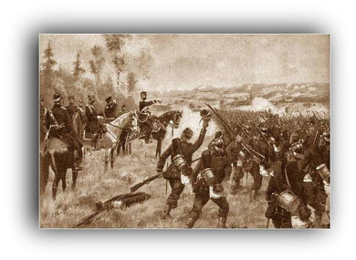

---

## 1867

Obrigkeiten

---

## Einwohner: 388(Quelle: Die Gemeinden und Gutsbesitze des preussischen Staates und ihre Bevölkerung / 1.12.1874)

Allgemeine Ereignisse

---

## Am 21. August wandert Johannes Christian Wahl nach Amerika aus.(Quelle: Die Auswanderung aus dem Herzogtum Nassau 1806 - 1866)

1868

---

## Als Förster für den Schutzbezirk Strinz-Margarethä der Oberförsterei Breithardt der königlich preußischen Forstverwaltung wird ein Hr. Bayer genannt.

Obwohl die Lehrer des Amtes Wehen bereits 1867 auf den König von Preußen vereidigt wurden, musste dieser Eid in 1868 noch einmal wiederholt werden.(Quelle: Alte Strinzer Chronik, Teil 1, Seite 105)

Am 21. September hält der 76jährige Kirchenrat Ludwig Schmidtborn in seiner Eigenschaft als königlich preußischer Schulinspektor die Herbstprüfung in StM ab. Es war zugleich die letzte Herbstprüfung, denn die preußische Regierung schaffte diese nassauische Überlieferung ab und beschränkt sich auf die Frühlingsprüfung.(Quelle: Alte Strinzer Chronik, Teil 1, Seite 100)

---

## 1869

Obrigkeiten

---

## Für einen Brand in StM. am 11. Dez. muss die Brand-Assecuranz 45 Thaler bezahlen(Quelle: Amtsblatt der Regierung in Wiesbaden / S. 81 / 1870)

Pfarrer Schmidtborn hält nach langer Krankheit (16 Wochen) am 07. März erstmalig wieder einen Gottesdienst.(Quelle: Strinzer Chronik, Teil 1, Seite 100)

Der Berginspector Card Ludwig Münster erhält die Schürfrechte für die Zechen Berthazeche und Fritz auf den Gebieten von StM, StT und Hennethal.(Quelle: Amtsblatt der Regierung in Wiesbaden, 1869)(Siehe auch unter: Die Zechen Bertha und Fritz)

---

## 1870

Obrigkeiten

---

## Nachfolger von Pfarrer Schmidtborn wird der "altpreußische Pfarrkandidat" Rudolf Osterloh aus Hohlstedt, Bezirk Merseburg.(Quelle: Alte Strinzer Chronik, Teil 1, Seite 100)

Mittwoch den 9. März, Nachmittags 3Uhr wird das Wohnhaus und ein Acker der Witwe des Johann Philipp Hies zu 450 fl (Gulden) taxiert auf Klage der Gemeinde Biebrich-Moßbach in der Rathausstube zu Strinz-Margarethä zum zweiten Mal meistbietend versteigert.(Quelle: Amtsblatt der Regierung in Wiesbaden, Seite 44, 1870)

Strinz-Margarethä stellt 7 Soldaten für den Deutsch-Französischen Krieg. Es sind: August Weidnau (dieser hat als Kavallerist einmal die Seine durchschwommen), Karl Schneider, Karl Rücker, Friedrich Hankammer und die 3 Brüder Heinrich, Adolf und August Christmann. Allerdings ging Heinrich Christmann, der, wie Karl Schneider auch schon 1866 eingezogen war, wohl über die Grenze, nahm aber nicht an Kriegshandlungen teil. Dagegen wurde sein Bruder Adolf bei Wörth verwundet. August Christmann hat nach Ausweis des Militärpasses in einem Dutzend Schlachten (darunter Weißenburg, Wörth, Sedan, Orleans) mitgekämpft.(Quelle: Alte Strinzer Chronik)

Auch August Schaus aus StM nimmt an der ersten Schlacht bei Weißenburg teil und wird dort verwundet.(Quelle: Geschichte des Füsilier-Regiments von Gersdorff Nr. 80, 1913)(Siehe auch unter: Halsdurchschuss)

Am 1. Oktober, morgens 9 Uhr, wird das Wohnhaus und das Feldgut zur Concursmasse der Witwe des Johann Philipp Baum von StM gehörig und zu 2.500 fl taxiert, in der Rathausstube zu StM versteigert.(Quelle: Amtsblatt der Regierung in Wiesbaden, Seite 247, 1870)

---

## 1871

Obrigkeiten

---

## (Quelle: Die Gemeinden und Gutsbesitze des preussischen Staates und ihre Bevölkerung / 1.12.1874)

Ereignisse

---

## Friedensfeier zum Friede zwischen Frankreich und Deutschland.(Quelle: Alte Strinzer Chronik, Teil 1, Seite 107)

(Siehe auch unter: Patriotische Feiern)

Über das Vermögen des Johann Friedrich Klein aus StM ist ein Concursprozeß rechtskräftig erkannt. Ansprüche die auf persönlichen oder dinglichen Rechten beruhen sind bis zum 04.04. um 9:00 zu stellen.(Quelle: Amtsblatt der Regierung in Wiesbaden/ Pkt 968 und 682 / 1871)

Am Dienstag den 6. Juni, morgens 10 Uhr, wird das zur Concursmasse des Johann Friedrich Klein gehörende Wohnhaus und Feldgut, zu 3118 Gulden taxiert, in dem Gemeindezimmer zu StM. zum ersten Mal meistbietend versteigert.(Quelle: Amtsblatt der Regierung in Wiesbaden/ Pkt 968 und 682 / 1871)

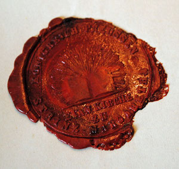

---

## Kirchensiegel von 1871

1872

---

## Am 19. August wird das Wohnhaus der Concursmasse des Christian Diefenbach in der Rathausstube derselbst zum erstenmal versteigert.

(Quelle: Amtsblatt der Regierung in Wiesbaden, Seite 272, 1872)

---

## 1873

Obrigkeiten

---

## 1874

Obrigkeiten

---

## (Quelle: Die Hessen als Reichstagswähler / 1990)

1875

---

## Ereignisse

Pfarrer Schmidtborn stirbt nach sehr kurzem Unwohlsein. Bei der Beerdigung folgen dem Sarg nur zwei der nächsten Verwandten, fast alle Geistlichen des Dekanat Kirberg und die meisten Bewohner des hiesigen Kirchenspiels. Zu seinem Andenken wird eine Sandsteinsäule aufgestellt, die um das Jahre 1935 mit der Einebnung alter Gräber beseitigt wird.(Quelle: Alte Strinzer Chronik, Teil 1, 102)

---

## Neuer Bürgermeister in StM wird Karl Wenig.(Quelle: Alte Strinzer Chronik, Teil 1, Seite 122)

Meldung des Amtsblatts der Regierung in Wiesbaden vom 28. Januar 1876Für den aus seinem Gemeindeamte geschiedene Bürgermeister Hanson in Strinz-Margarethä, ist von Seiten des königlichen Oberpräsidiums der nunmehrige Bürgermeister Carl Weinig, dortselbst zum Standesbeamten für den Standesamtsbezirk Strinz-Margarethä bestellt worden.(Quelle: Amtsblatt der Regierung in Wiesbaden vom 28. Januar 1876)

---

## 1876

Obrigkeiten

---

## Die Gemeinde StM muss dem Herzogthum Nassau 633,26 Mark an Grundschuld zahlen.(Quelle: Amtsblatt der Regierung in Wiesbaden, 1876 / Seite 197)

Nach Wegzug die Lehrerswitwe und Industrieschullehrerin Demmer wird Frau Margarethe Schäfer, Ehefrau des Theodor Schäfer die neue Industrieschullehrerin. Sie erhält für die Wintermonate eine Besoldung von 2 Mark und 70 Pfennig.(Quelle: Alte Strinzer Chronik, Teil 1, Seite 115)

---

## 1877

Obrigkeiten

---

## Lehrer: Philipp Ferger

Ereignisse

An dessen wegen Altersschwäche als Gerichtsschöffe ausgeschiedenen Johann Georg Schmidt zu Strinz-Margarethä ist der jetzige Gerichtsschöffe Adolf Walter derselbst zum Stellvertreter des Standesbeamten für den Standesamtsbezirk Strinzmargarethä ernannt worden.(Quelle: Amtsblatt der Regierung in Wiesbaden / 1. März 1877 / Seite 60)

---

## NL = 3 Stimmen / DFP = 62 Stimme

(Quelle: Die Hessen als Reichstagswähler / 1990)

---

## 1878

Obrigkeiten

---

## (Quelle: Die Hessen als Reichstagswähler / 1990)

1879

---

## 1880

Obrigkeiten

---

## 1881

Obrigkeiten

---

## (Quelle: Die Hessen als Reichstagswähler / 1990)

Kirchenstempel von 1881

---

## 1882

Obrigkeiten

---

## 1883

Obrigkeiten

---

## (Quelle: Die Hessen als Reichstagswähler / 1990)

1884

---

## DFP = 77 Stimmen / SPD = 4 Stimmen / NL = 1 Stimme

(Quelle: Die Hessen als Reichstagswähler / 1990)

---

## 1885

Obrigkeiten

---

## 1886

Obrigkeiten

---

## Stempel Standesamt und Gemeinde von 1886

1887

---

## Der Sommer 1887 geht als einer der heißesten Sommer in die Geschichte ein.

Am 1. August, einem Montag-Morgen, begibt sich der neue Strinzer Pfarrer Ernst Schilp nach StM. Er stellt fest, dass sich das Pfarrhaus in einem sehr schlechten Zustand befindet. Da er Junggeselle ist, lässt er es erst einmal so wie es ist, um die Gemeinde, die noch durch den verheerenden Hagelschlag stark beeinträchtig ist nicht schon gleich am Anfang in Anspruch zu nehmen.(Quelle: Alte Strinzer Chronik, Teil II, Seite 6)

---

## DFP = 52 Stimmen / NL = 27 Stimmen / SPD = 1 Stimme

(Quelle: Die Hessen als Reichstagswähler / 1990)

---

## 1888

Obrigkeiten

---

## Beginn eines Strafbuches der Strinzer Schule. Darin mussten die Lehrer die Strafmaßnahmen gegen Ihre Schüler verzeichnen.(Quelle: Archiv der Gemeinde Hohenstein)(Siehe auch unter: Das Strafbuch)

1889

---

## 1890

Obrigkeiten

---

## Ziegen: 58

Bienenstöcke: 7(Quelle: Viehstandslexikon für den preussischen Staat / 1.12.1892)

---

## Ereignisse

Der vom Lehrer Christian Ruff gegründete Konsumverein findet den Beifall der hiesigen Leute. Es schließen sich die Gewerbetreibende von Michelbach, Breithardt, Hennethal und Strinz-Margarethä an.(Quelle: Beiträge zur Geschichte Hohenstein-Breithardt, Steckenroth und -Burg-Hohenstein, Pfarrer Weinberger / 1992)

Durch Verfügung der königlichen Regierung wird der Handarbeitsunterricht auf das ganze Jahr ausgedehnt. Die Industrielehrerin erhält dafür ein Jahresgehalt von 36 Mark.(Quelle: Strinzer Chronik, Teil 1, Seite 115)

---

## DFP = 39 Stimmen / NL = 25 Stimmen / SPD = 14 Stimmen

(Quelle: Die Hessen als Reichstagswähler / 1990)

---

## 1891

Obrigkeiten

---

## Ereignisse

Gründung des Männergesangsvereins "Eintracht". Zu den Gründern, die noch namentlich festgestellt werden konnten, gehören Reinhard Deuser, Philipp Schauß, Julius Bott und Gustav Gräter I.(Quelle: Festschrift 100 Jahre MGV Eintracht 1891 / 1991)

---

## Aus dem Jahre 1891 existiert eine Mitgliederliste des Konsumvereins StM.(Quelle: Archiv der Gemeinde Hohenstein)

Die Annehmlichkeiten der Lehrerwohnung ist, durch den Einbau eine Pumpe auf dem Schulhof, geliefert von Pumpenmacher Matthias Westerberger aus Marschheim (für 170 Mark), viel besser geworden.(Quelle: Alte Strinzer Chronik, Teil 1, Seite 121)

---

## Feier des Gustav-Adolf-Festes am alten Sportplatz.(Quelle: Alte Strinzer Chronik, Teil 2, Seite 10)

1892

---

## Ereignisse

Am 23. Juni, morgens früh von 4:30 bis 6:00 Uhr ziehen mehrere Gewitter über die Gemarkung, wobei ein Blitzschlag in die Breithardter Schafsherde fährt, die im Strinzer Feld steht. 23 Schafe werden getötet. (Quelle: Kleine Chronik des Ortes Hohenstein-Breithardt / Pfarrer Weinberger)

Am 13. Juli 1892 kommt es zu einer blutigen Auseinandersetzung der beiden Strinzer Gesangvereine "Eintracht" und "Cecilia". (Quelle: Aarbote vom 15. Juli 1892)(Siehe auch unter: Kampf der Gesangvereine)

---

## 1893

Obrigkeiten

---

## FrVG = 63 Stimmen / AS = 43 Stimmen / SPD = 26 Stimmen / FrVP = 14 Stimmen

(Quelle: Die Hessen als Reichstagswähler / 1990)

---

## 1894

Obrigkeiten

---

## Ereignisse

August Weidnau, der im deutsch-französischen Krieg 1870-1871 einmal als Kavallerist die Seine in Frankreich durchschwommen hat, stirbt im Alter von 46 Jahren.

---

## DER STARB UNS NICHT IM HERZEN FREMD SEIN NAME EINE STATT

1895

---

## Ereignisse

Streitigkeiten im Männergesangsverein "Eintracht" führen zur Spaltung des Vereins. Ursache für diese Querelen ist, dass ein Teil der Sänger gerne den neu eingesetzten Schulleiter Julius Emil Schlicht als Chorleiter möchten, der andere Teil aber den bisherigen Chorleiter behalten wollte. Schließlich einigen sich die erhitzten Gemüter zum Wohle des Vereins und konnten unter dem Dirigenten Karl Wahl weitermusizieren.(Quelle: Festschrift 100 Jahre MGV Eintracht 1891 / 1991)



---

## 1896

Obrigkeiten

---

## (Quelle: Alte Strinzer Chronik, Teil 2, Seite 10)

Kirchensiegel von 1896

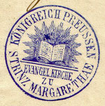

---

## 1897

Obrigkeiten

---

## FrVP = 72 Stimmen / NL = 29 Stimmen / SPD = 6 Stimmen

(Quelle: Die Hessen als Reichstagswähler / 1990)

---

## 1898

Obrigkeiten

---

## FrVP = 81 Stimmen / DRP = 30 Stimmen / SPD = 12 Stimmen

(Quelle: Die Hessen als Reichstagswähler / 1990)

---

## 1899

Obrigkeiten

---

## Chronik von 1900 – 1914 (Kriegsbeginn)

1900

---

## Ereignisse

Der MGV "Eintracht" wählt den Schmied Wilhelm Klein zum neuen 1. Vorsitzenden(Quelle: Festschrift 100 Jahr MGV Eintracht 1891 / 1991)

---

## 1901

Obrigkeiten

---

## BdL = 46 Stimmen / FrVP = 32 Stimmen / SPD = 30 Stimmen / NL = 3 Stimmen

(Quelle: Die Hessen als Reichstagswähler / 1990)

---

## 1902

Obrigkeiten

---

## Lehrer: Julius Emil Schlicht

1903

---

## (Quelle: Die Hessen als Reichstagswähler / 1990)

Einweihung der Scheidertalstraße mit Bürgermeister August Schmidt (rote Umrandung)

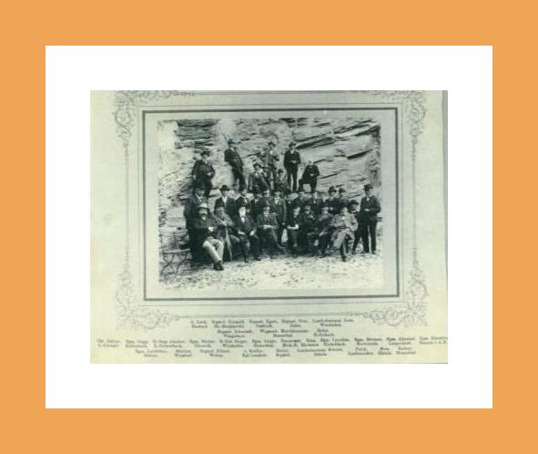

---

## 1904

Obrigkeiten

---

## Lehrer: Julius Emil Schlicht

Ereignisse

Gründung des TV 1904 Strinz-MargarethäAngeregt von den Turnvereinen der Nachbarorte erwägt man in der Strinzer Jugend, auch solch einen Turnverein zu gründen. Urheber diesen Gedanken ist der 20jährige Karl Weber. Ihnen schlägt im Ort keine größere Begeisterung entgegen, gibt es doch schon 2 Gesangsvereine und einen Kriegerverein. Man bringt im Ort der turnerischen Körperertüchtigung wenig Sympathien entgegen. Trotzdem lassen sich die jungen Leute nicht beirren. Nachdem man Zusammenkünfte abgehalten und Statuen besorgt hat, ruft man die Interessenten der Turnerei am 25.05. zur Gründungsversammlung zusammen. Der vorläufige Vorstand besteht aus Adolf Müller (1. Vorsitzender), Heinrich Wahl (Turnwart) und Reinhard Deuser (Kassenwart). Da die erforderlichen Geräte und das Geld für die Anschaffung fehlen, werden Gesuche an Gemeinde und Kreisverbände gestellt, die aber erfolglos bleiben. Das Mitglied August Schneider erklärt sich daraufhin bereit, dem Verein 150 Reichsmark zinslos zu leihen. Davon wird ein Reck, ein Barren und 10 Eisenstäbe für Stabübungen gekauft. Im gleichen Jahr werden aus eigenen Mitteln der Mitglieder einheitliche Turnhemden, Turnschuhe und Hüte gekauft.(Quelle: Vereinschronik des TV 1904)

---

## Durch das plötzliche Ableben des Dirigenten wird im MGV "Eintracht" der Schneidermeister Karl Enders zum neuen Dirigenten gewählt.(Quelle: Festschrift 100 Jahr MGV Eintracht 1891 / 1991)

Die Industrielehrerin Frau Marg. Schäfer tritt zurück. Als Nachfolgerin wird vom Schulvorstand Karoline Hartwig gewählt. Für ihre Arbeit wird sie mit 42 Mark entlohnt.(Quelle: Alte Strinzer Chronik, Teil 1, Seite 116)

Beginn von Streitigkeiten bzgl. der Übernahme des Scheiderthalweges in ständische Unterhaltung, Gemeinden: Kettenbach, Steckenroth, Daisbach, Wingsbach, Hennethal, Hahn, Strinz-Margarethä.(Quelle: HHStAW 403 Nr. 232)

Bild 1 zeigt den Strinzer Reinhard Kugelstadt auf seinem Abschiedsfoto (Reservistenbild) von der 10. Companie Königin Augusta/Berlin, Garde-Grenadier-Regiment Nr. 4, bei dem er von 1902 - 1904 diente.

Kugelstadt, der zwei Weltkriege überlebt hatte, stirbt im Jahre 1953 als er und der Landwirt und Ortsdiener Karl Gruber von einem Motorradfahrer aus Görsroth angefahren und verletzt werden. Kugelstadt stirbt auf dem Weg zum Krankenhaus.

Bild 2 zeigt den Strinzer Bürger August Fuhr auf dem Reservistenbild der Versuchskompanie der Artillerie / Prüfungskommission, Schießplatz Cummersdorf-Berlin. Dieser Einheit gehörte Fuhr von 1902 bis 1904 an.

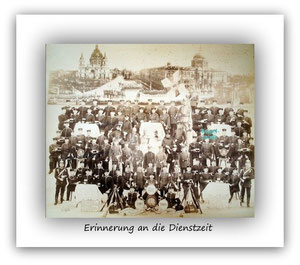

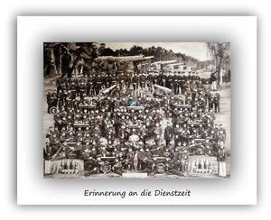

---

## (Siehe auch unter: Reserve tut Not)

1905

---

## Ereignisse

Im Laufe des Winters ist die Mauer an der Straße zwischen Schul- und Pfarrhaus heruntergebrochen. Da nun auch das Wasser einen anderen Abfluss haben muss, so werden Röhren unter der Ortsstraße gelegt, die Mauer neu aufgebaut und ein Geländer mit der Jahreszahl 1905 draufgesetzt. Angefertigt wurde letzteres von dem Schmied Wilhelm Klein, während die Mauerarbeiten von Maurer Karl Müller ausgeführt werden. Kostenpunkt: 1.000 Mark(Quelle: Alte Strinzer Chronik, Teil 1, Seite 121)

---

## Nach StM wird die erste Telegrafenleitung gelegt. StM erhält somit Telefonanschluss.(Quelle: Alte Strinzer Chronik, Teil 1, Seite 212)

Der Turnverein, der im Jahr zuvor gegründet wurde, zählt 30 Mitglieder.(Quelle: Vereinschronik des TV 1904)

Kaisermanöver in unserer Gemarkung. In StM befindet sich eine Feldbäckerei, das Proviantamt u. das Telegrafenamt.(Quelle: Alte Strinzer Chronik)Bei dem Manöver wird angenommen, dass eine feindliche Armee den Rhein bei Koblenz überquert hat. Die deutschen Truppen werfen sich dem Feind entgegen. Dabei durchquert die 21. Infanterie-Division - auf ihrem Weg nach Laufenselden - StM.(Quelle: Journal of the Royal United Services Institute for Defence Studies; Volume 50, page 182 / 1906)

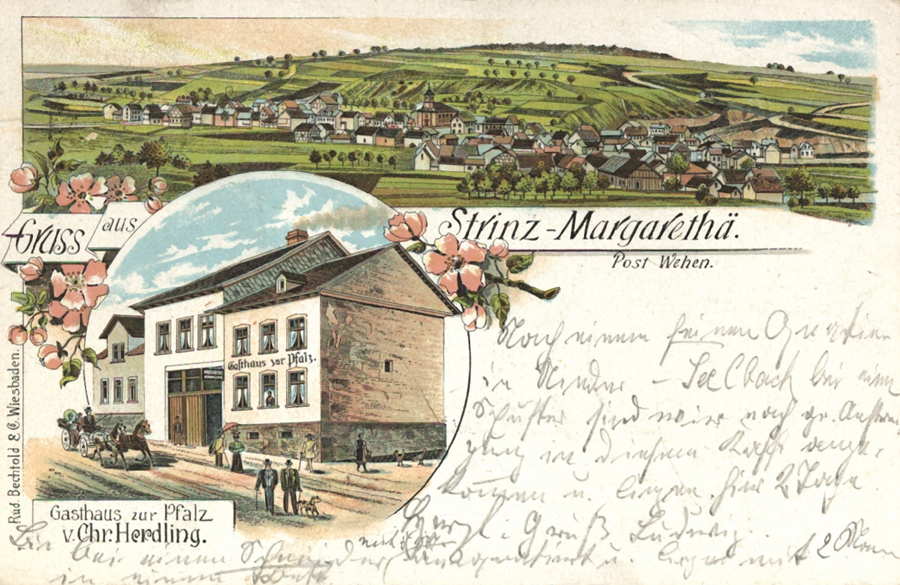

---

## Zeitgenössische Postkarte vom Kaiermanöver 1905

Zaun zur Kirche mit der Jahreszahl 1905 (rote Umrandung)

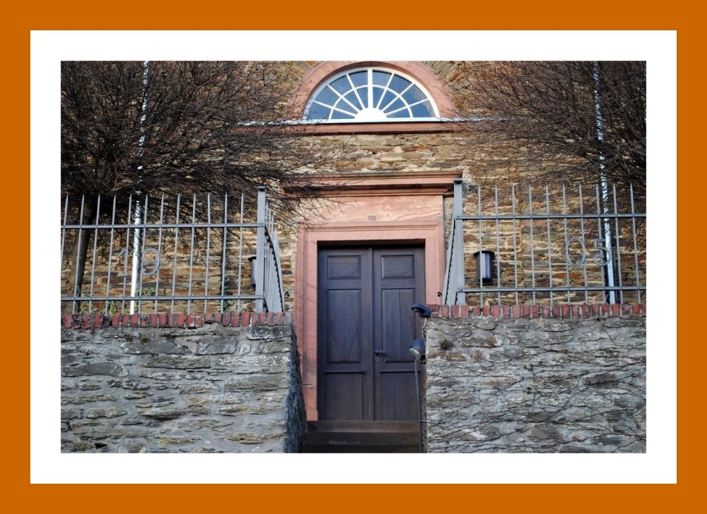

---

## 1906

Obrigkeiten

---

## 1907

Obrigkeiten

---

## NL = 164 Stimmen / SPD = 13 Stimmen / FrVP = 6 Stimmen

(Quelle: Die Hessen als Reichstagswähler / 1990)

---

## 1908

Obrigkeiten

---

## Die Halbtagsschule wird wegen Rückgang der Schülerzahl in eine einklassige Schule umgewandelt.(Quelle: Alte Strinzer Chronik, Teil 2, Seite 11, Kirchenchronik)

1909

---

## Kirchturmuhr          Hochwassermarkierung an der Brücke nach Breithardt zu

1910

---

## Strinzer Schulklasse vor der Gaststätte Weber

1911

---

## Ereignisse

Anfang 1911 gibt es wieder Bemühungen wegen der zukünftigen Eisenbahn. Entsprechende Eingaben werden an den zuständigen Minister und Abgeordneten Bartling abgesandt auf die im Mai günstige Nachrichten eingehen. Am 18.05. hat der Kommunallandtag das sogenannte Taunusquerbahnprojekt einstimmig angenommen, jedoch noch ohne Angaben einer Linienführung. Daraufhin findet am 29.10. eine von Wehen aus betriebene Eisenbahnversammlung in Langenschwalbach statt, welche den Ausbau von Langenschwalbach über Wehen nach Niedernhausen wünscht, während die Strinzer den Ausbau von Langenschwalbach, Adolfseck, Breithardt, StM, Nieder- und Oberlibbach und Ehrenbach nach Idstein unterstützen.(Quellen: Alte Strinzer Chronik, Teil 2, Seite 12, Kirchenchronik)(Siehe auch unter: Strinzer Eisenbahn)

Wahl eines neuen Vorstandes für den MGV "Eintracht".Wilhelm Klein (1. Vorsitzender) / Adolf Weber (2. Vorsitzender) / Adolf Seel (Kassierer) Dem Verein gehören u.a. noch Julius Bott, Karl Petri und Adolf Kadesch an. Die Chorleitung übernimmt nun der Landwirt und Musiker Ludwig Petri. Als Jahresendgeld für Herrn Petri werden 25 Mark vereinbart. Der Verein schließt sich dem Aartal-Sängerbund an. Die Proben werden in den Gasthäusern Hertling und Schneider abgehalten. Die Jahresmiete schwankte zwischen drei bis zehn Mark, abhängig von den Strom- und Heizkosten. Die Kosten für die Gesangsmappe und Notenblätter müssen die Sänger zusätzlich selbst tragen.(Quelle: Festschrift 100 Jahr MGV Eintracht 1891 / 1991)

Im Herbst findet in unserer Region das große Kaisermanöver des XVIII Armeekorps mit 40.000 Soldaten und 12.000 Pferden statt. Es ist auch von einem Manöver auf einem Feld bei Breithardt die Rede. In StM werden Soldaten einquartiert.(Quelle: Strinzer Chronik / Kaiserliche Kriegsspiele)

---

## Am Sonntag den 3. Dezember findet im "Gasthaus zum Löwen" eine Wahlveranstaltung der "Nationalliberalen Partei statt.(Quelle: Flugblatt der Nationalliberalen Partei vom 30.11.1911)

1912

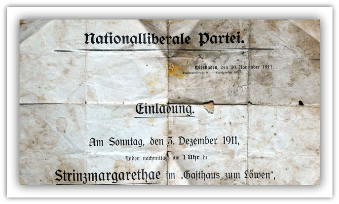

---

## Allgemeine Ereignisse

Auf ihrer Jungfernfahrt kollidiert die Titanic am 14. April 1912 gegen 23:40 Uhr etwa 300 Seemeilen südöstlich von Neufundland seitlich mit einem Eisberg und sinkt zwei Stunden und 40 Minuten nach dem Zusammenstoß im Nordatlantik.

---

## Ereignisse

Am 07.07. findet in StM eine Versammlung statt, in der über den aktuellen Status des Taunusquerbahnprojektes gesprochen wird.(Quelle: Strinzer Chronik, Teil 2, Seite 12, Kirchenchronik)(Siehe auch unter: Strinzer Eisenbahn)

Am 4.8. findet das erste Waldfest, organisiert vom MGV "Eintracht" statt. Es werden insgesamt 351,16 Mark eingenommen. Nach Abzug der Ausgaben verbleibt noch ein Überschuss von 113,65 Mark. Zum Begleichen der Bierrechnung muss sich der Vorsitzende nach Idstein begeben, wofür ihm ein Zehrgeld von zwei Mark bewilligt wird.(Quelle: Festschrift 100 Jahr MGV Eintracht 1891 / 1991)

---

## NL = 148 Stimmen / SPD = 11 Stimmen / ChrS = 5 Stimmen / FoVP = 8 Stimmen

(Quelle: Die Hessen als Reichstagswähler / 1990)

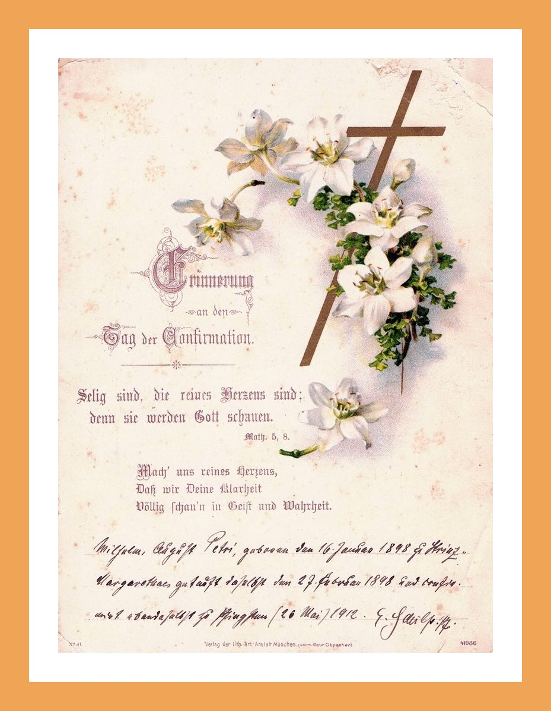

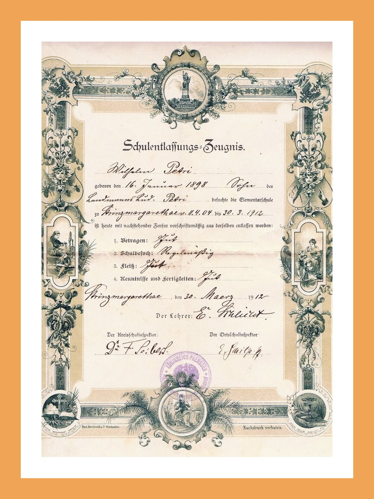

---

## Konfirmationsurkunde August Petri   Schulzeugnis von Wilhelm Petri

1913

---

## Ereignisse

Der MGV "Eintracht" nimmt am Sängerbundesfest in Laufenselden teil. Zu dieser Zeit ist es üblich, dass die Sänger mit Pferdefuhrwerken zu den Veranstaltungen anreisen. Die Fuhrleute werden aus den Reihen der Sänger ausgewählt und erhalten pro Pferd eine Vergütung von 6 Mark.(Quelle: Festschrift 100 Jahr MGV Eintracht 1891 / 1991)

Für die Konsolidation (Red.: Zusammenlegung) der Gemarkung wird am 14.08. in einer Gemeindeversammlung ein besonderer Vorstand gewählt. Wiesenbaumeister Heinz von Bleidenstadt beginnt direkt mit den Vermessungsarbeiten. Sofort nach der Kartoffelernte werden die Arbeiten am 6.10. begonnen und nach Legung des Kanalrohrs arbeitet die Gemeinde eifrig daran, die Ortsstraße wieder in Ordnung zu bringen(Quelle: Alte Strinzer Chronik, Teil 2, Seite 13, Kirchenchronik)

---

## 1914

Obrigkeiten

---

## Zu dieser Inschrift wird berichtet, dass der Baumeister der Scheune sein Werk nicht vollenden konnte, da er direkt 1914 zum Militärdienst eingezogen wurde und an der Front gefallen ist.

Allgemeine Ereignisse

---

## Das Deutsche Kaiserreich tritt am 01. August 1914 in den ersten Weltkrieg ein.

Ereignisse

---

## Die Konfirmation wird erstmalig an Ostern (13. April) statt an Pfingsten abgehalten.(Quelle: Alte Strinzer Chronik, Teil 2, Seite 13, Kirchenchronik)

Der MGV "Eintracht" nimmt am Sängerwettstreit in Hahn teil.(Quelle: Festschrift 100 Jahr MGV Eintracht 1891 / 1991)

Der TV 1904 feiert sein 10jähriges Bestehen wobei bei der Festrede der Völkerverhältnisse wegen auf die erforderliche Ertüchtigung der jungen Leute verwiesen wird. Außerdem wird der Bau einer Turnhalle seitens der Gemeinde gewünscht, da auch Nachbarorte entsprechend große Hallen eingerichtet haben.(Quelle: Strinzer Chronik, Teil 2, Seite 13, Kirchenchronik)

---

## Der TV beteiligt sich am ersten Gauturnfest des Turngaues in Holzhausen über Aar. Dabei erzielt er den 6. Vereinspreis.(Quelle: Vereinschronik des TV 1904)

Der erst Vorsitzende des TV 1904, Adolf Müller sein Amt nieder, Sein Nachfolger wird Reinhard Walter.(Quelle: Festschrift zur Sportplatzeinweihung 1990)

---

## Ab 1914 ruht das Vereinsleben des TV 1904, da die meisten Vereinsmitglieder als Soldaten eingezogen werden.(Quelle: Vereinschronik des TV 1904)

Chronik des Ersten Weltkrieges (1914 – 1918)

"Die Geschehnisse der Jahre 1914 - 1918 hier im Dorf sind sehr gut dokumentiert. Zum einen durch die Aufzeichnungen des damaligen Pfarrers Schilp, zum anderen durch die Mobilmachungsmappe von Breithardt, deren Inhalt auch für StM Gültigkeit hatte.

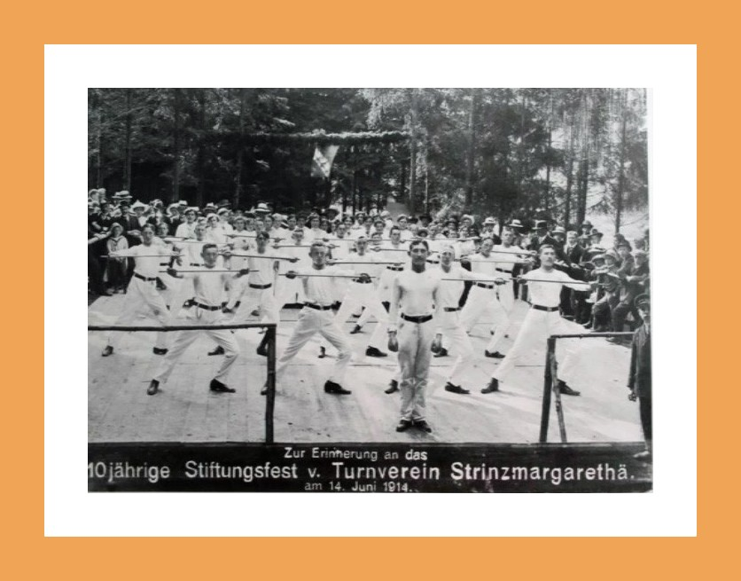

---

## 01. August 1914

Am 01. August tritt das Deutsche Kaiserreich in den ersten Weltkrieg ein und erklärt Russland den Krieg. Die Ortsvertreter werden mit geheimen Anweisungen vom königlichen Landrat in Langeschwalbach überhäuft. Jede Gemeinde ist im Besitz einer Mobilmachungsmappe in der die geheimen Anweisungen gesammelt werden. Im Gemeindearchiv ist eine Mobilmachungsmappe erhalten geblieben, die die Ereignisse der ersten Kriegstage anschaulich dokumentiert.

---

## 02. August 1914

Aus Anlass der Mobilmachung ist jeder Militärpflichtige verpflichtet, sich sofort bei der Ortspolizeibehörde seines Wohnsitzes zur Stammrolle anzumelden.(Quelle: Mobilmachungsmappe der Gemeinde Breithardt)

---

## 03. August 1914

Deutschland erklärt Frankreich den Krieg

Für den Fall, dass Luftfahrzeuge in der Gemarkung landen ist eingehend festzustellen, ob es sich um ausländische Luftfahrzeuge handelt. Stellt eine polizeiliche Untersuchung fest, dass Spionageverdacht vorliegt, dann ist das Generalkommando in Frankfurt sofort zu unterrichten. Alle Ausländer sind anzuhalten, sich binnen 24 Stunden bei den Landräten bzw. Polizeibehörden der Stadtkreise zu melden. Erscheinen sie verdächtig, so sind sie zu verhaften. Brücken, Tunnels und ähnliche Bauwerke aller wichtigeren Strecken müssen ausreichend ständig bewacht sein. Alle die Landstraßen befahrenden, nicht ohne weiteres bekannten Kraftwagen, sind in den Ortschaften anzuhalten, damit die Insassen sich ausweisen. Erscheinen diese verdächtig, so sind sie zu verhaften. Russische Sommerarbeiter sind aus besonders gefährdeten Gebieten sofort abzuschieben, als das militärische Interesse es erheischt.(Quelle: Mobilmachungsmappe der Gemeinde Breithardt)

Am 3. August, morgens 4:30 Uhr geht ein Trupp Pferde von StM nach Langenschwalbach. Nachts wird die Festung Mainz beständig von Scheinwerfern beleuchtet.Quelle: Alte (Strinzer Chronik, Teil 2, Seite 13 / Kirchenchronik)

---

## 04. August 1914

Den einstweiligen und endgültig angestellten Lehrkräften die für den Heeres- bzw. Krankenpflegedienst Verwendung finden, ist das dienstliche Einkommen unverkürzt weiter zu gewähren.(Quelle: Mobilmachungsmappe der Gemeinde Breithardt)

---

## Bewachungsvorkehrungen für das Dorf, weil mit Spionage und Brunnenvergiftung gerechnet wird.(Quelle: Alte Strinzer Chronik, Teil 2, Seite 13, Kirchenchronik)

05. August 1914

Nach 17 Uhr machen sich die Leute aus StM und umliegender Ortschaften in der Gegend des Georgentaler Hofs auf die Suche nach dem Auto, das tags zuvor gegen 22 Uhr von StM ausfahren gehört wurde. Durch die Suche klärt sich die Sache dahingehend auf, dass es sich dabei um das Auto des Kreistierarztes gehandelt hat, das nach Wingsbach gefahren ist.(Quelle: Alte Strinzer Chronik, Teil 2, Seite 13, Kirchenchronik)

---

## 06. August 1914

Nach ca. 5 Uhr wird ein Fremder an der Absperrung bei der Bürgermeisterei angehalten, ca. 30 Jahre alt, der aber wieder gehen gelassen wird. Nach seinen Papieren soll er Heymann heißen und von Holzheim bei Limburg sein. Er hat ein Hoch auf Frankreich ausgebracht.(Quelle: Alte Strinzer Chronik, Teil 2, Seite 13/14, Kirchenchronik)

---

## 08. August 1914

Die Gemeinden werden ersucht, ein Verzeichnis von Bedürftigen Familien von in Dienst eingetretenen Mannschaften der Reserve, Landwehr, Ersatzreserve, Seewehr und des Landsturmes zu erstellen, da diesen nach Reichsgesetz eine Unterstützung zusteht.(Quelle: Mobilmachungsmappe der Gemeinde Breithardt)

---

## 09. August 1914

Die Verhältnisse haben sich hier in den Ortschaften wieder ganz beruhigt, nachdem die Woche über die reinste Jagd gewesen war und Nachts die Wasserleitung und die Ortschaft bewacht worden ist, weil mit Fliegern, Autos und Spionen gerechnet wurde.(Quelle: Alte Strinzer Chronik, Teil 2, Seite 11 / Kirchenchronik, Kirchenchronik)

---

## 10. August 1914

Spionageverdächtige Personen sind der Polizeibehörde Mainz oder Wiesbaden zuzuführen und in Polizeigewahrsam zu nehmen (in Mainz im Provinzial-Arresthaus).(Quelle: Mobilmachungsmappe der Gemeinde Breithardt)

---

## 13. August 1914

Den Müllereibetrieben fällt in Kriegszeiten eine wichtige Aufgabe zu. Die Bürgermeister werden angehalten mit allen ihnen zur Verfügung stehenden Mitteln Müllereien anzuhalten, sofort nach Einbringung der Ernte, alle von der Bevölkerung zu Teil werdenden Aufträge schnellstens zu erledigen. Dies ist zur Nahrungsmittelversorgung unerlässlich und eine nationale Pflicht.(Quelle: Mobilmachungsmappe der Gemeinde Breithardt)

---

## 14. August 1914

Auf Grund des §3 des Kriegsleistungsgesetzes vom 13. Juni 1873 werden die Gemeinden aufgefordert für die Militärverwaltung Wagen und Pferde mit vollständiger Beschirrung und Gespannführer zu stellen. Die Wagenführer wollen sich auf eine längere Reise einrichten und entsprechende Futtervorräte für mehrere Tage mitbringen.(Quelle: Mobilmachungsmappe der Gemeinde Breithardt)

---

## 17. August 1914

Auf Anordnung des stellvertretenden Generalkommandos des 18. Armeekorps wird nochmals darauf hingewiesen, dass alle Benzin- und Benzolmengen für den Privatgebrauch gesperrt werden. Eine Abgabe darf nur an Heeresfahrzeuge, Krankenhäuser, Feuerwehren und Fabriken gegen amtliche Bescheinigung erfolgen.(Quelle: Mobilmachungsmappe der Gemeinde Breithardt)

---

## 18. August 1914

Die Bürgermeister werden ersucht, ohne dass unnötige Aufregung in der Bevölkerung verursacht wird, mit allen Mitteln dafür sorgen, dass die vorhandenen Hafervorräte alter Ernte für die Deckung des Kriegsbedarfes zurückgehalten und nicht in den Handel gegeben werden. Gefüttert darf werden. Eine Ausnahme bildet nur der direkte Ankauf durch die Heeresverwaltung.(Quelle: Mobilmachungsmappe der Gemeinde Breithardt)

---

## 19. August 1914

Die Gemeinden haben zu melden, wieviel kriegsbrauchbare Pferde noch vorhanden sind.(Quelle: Mobilmachungsmappe der Gemeinde Breithardt)

---

## 22. August 1914

Zur Deckung des Bedarfes an Pferden für den Krieg, haben die Gemeinden in der Reithalle 4 in Langenschwalbach Pferde vorzuführen.(Quelle: Mobilmachungsmappe der Gemeinde Breithardt)

---

## 05. Oktober 1914

Der stellvertretende Generalstab teilt mit, dass es dringend erforderlich ist, dass nicht nur die Hotels und Pensionate, sondern auch die sogenannten Zimmervermieter energisch angehalten werden, evtl. unter Androhung großer Strafen, die bei ihnen zuziehenden Fremden anzumelden. Es ist anzunehmen, dass Spionage-Agenten sich deutscher Pässe bedienen, die deutschen Staatsangehörigen in Russland fortgenommen worden sind.(Quelle: Mobilmachungsmappe der Gemeinde Breithardt)

---

## 08. Oktober 1914

Morgens gehen zwei schwere Wagen voll Kartoffeln, Gemüse, Butter, Eier und zwei Kisten Wäsche und Kleidungsstücke an das Rote Kreuz in Langenschwalbach ab, für Soldaten und die Ostpreußen.(Quelle: Alte Strinzer Chronik, Teil 2, Seite 14, Kirchenchronik)

---

## 20. Oktober 1914

Der königliche Landrat teilt mit, dass von verschiedenen örtlichen Leitern über ungenügende Beteiligung der Jugendlichen, bezüglich der militärischen Vorbereitung, berichtet wird. Dies ist in der jetzigen ernsten Zeit eine bedauerliche Erscheinung, die unbedingt aufhören muss.(Quelle: Mobilmachungsmappe der Gemeinde Breithardt)

---

## 26. Oktober 1914

Die in den Gemeinden eintreffenden oder bereits anwesenden Verwundeten sind sofort nach Urlaubspässen bzw. militärärztlichen Ausweisen zu befragen. In Fällen von Unregelmäßigkeiten ist der Betreffende dem nächstgelegenen Militärkommando bzw. Reservelazarett zuzuführen. Verwundete, die angetrunken betroffen werden oder sonst wie durch ihr Haltung und prahlerischen Reden über Kriegserlebnisse in Gastwirtschaften besonders unangenehm auffallen, sind möglichst bald unter Zuhilfenahme von anderen Soldaten in ihr Quartier zu befördern. Die Namen der betreffenden Verwundeten müssen dem Truppenteil bzw. Reservelazarett zur Kenntnis gebracht werden.(Quelle: Mobilmachungsmappe der Gemeinde Breithardt)

---

## 15. Dezember 1914

Weihnachtsgruß an die Soldaten abgeschickt.(Quelle: Alte Strinzer Chronik, Teil 2, Seite 14, Kirchenchronik)

---

## 25. Dezember 1914

Nachmittags kommt endlich der lang ersehnte Petroleumwagen, da schon eine lange Zeit lang kein Petroleum mehr zu haben war. Es sind eine ganze Anzahl von Soldaten in Urlaub hier. Beim Gottesdienst werden an die Strinzer Kinder Lebkuchen und Konfekt verteilt. Eine sonstige besondere Weihnachtsfeier kann wegen der Kriegsverhältnisse nicht veranstaltet werden.  (Quelle: Alte Strinzer Chronik, Teil 2, Seite 14, Kirchenchronik)

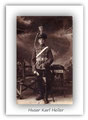

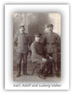

---

## Strinzer Soldaten

1915

---

## Februar 1915

Von heute ab sämtliche Getreidevorräte und Mehl beschlagnahmt.(Quelle: Alte Strinzer Chronik, Teil 2, Seite 14, Kirchenchronik)

---

## Februar 1915

Adolf Christmann fällt als erster Strinzer Soldat im 1. Weltkrieg(Siehe auch unter: Tod am Mont Tetu)

---

## 8. Februar 1915

Adolf Christmann, unser Nachbar ist in Frankreich gefallen. Großer Jammer.(Quelle: Alte Strinzer Chronik, Teil 2, Seite 14, Kirchenchronik)

---

## 23. Februar 1915

Weitere Musterungen älterer Jahrgänge. Von StM wird alles gezogen nur der Bäcker Hermann Bodenheimer wird seines Berufes wegen freigegeben.(Quelle: Alte Strinzer Chronik, Teil 2, Seite 14, Kirchenchronik)

---

## 5. März 1915

Heute ist endlich wieder einmal der Petroleum-Mann dagewesen, der schon lange erwartet war.(Quelle: Alte Strinzer Chronik, Teil 2, Seite 15, Kirchenchronik)

---

## 18. März 1915

Zwecks Erweiterung des Nachrichten- und Kundschafterwesens im Falle der Bedrohung und Einschließung der Festung Mainz wird das Gouvernement dieser Festung vorsorglich mit den Bürgermeistern in unmittelbare Verbindung treten. Die bezüglichen Verhandlungen sind streng vertraulich zu behandeln.(Quelle: Mobilmachungsmappe der Gemeinde Breithardt)

---

## 25. März 1915

Adressensammelnde Vereine, Firmen, Verbände usw. werden ersucht, über die im Felde stehenden Personen keine Angaben von den Truppenverbänden und Heereskörpern zu machen.(Quelle: Mobilmachungsmappe der Gemeinde Breithardt)

---

## 29. März 1915

Lehrer Helwig aus Hambach hält abends 8 Uhr in der Gastwirtschaft zum Löwen einen Vortrag über die Kriegsernährung.(Quelle: Alte Strinzer Chronik, Teil 2, Seite 15, Kirchenchronik)

---

## April 1915

Von heute ab schlachtfreie Schweine beschlagnahmt.(Quelle: Alte Strinzer Chronik, Teil 2, Seite 15, Kirchenchronik)

---

## 12. April 1915

3 Soldatengespanne zum Hafersäen im Ort.(Quelle: Alte Strinzer Chronik, Teil 2, Seite 15, Kirchenchronik)

---

## Mai 1915

Nachts um 2:45 Uhr fliegt ein Zeppelin über dem Pfarrhause nach Breithardt zu.(Quelle: Strinzer Chronik, Teil 2, Seite 15, Kirchenchronik)

---

## 16.Mai 1915

Moritz Heinzemann fällt.

24.06.1915

---

## 5 französische Kriegsgefangene kommen zum Arbeiten ins Dorf.(Quelle: Alte Strinzer Chronik, Teil 2, Seite 15, Kirchenchronik)

Mai 1915

---

## 18 französische Kriegsgefangene kommen zum Arbeiten ins Dorf.(Quelle: Alte Strinzer Chronik, Teil 2, Seite 15, Kirchenchronik)

Juni 1915

---

## Willi Hertling fällt (genaues Datum noch recherchieren)

16. Juli 1915

---

## A. Gräter fällt.

August 1915

Mit dem Gottesdienst das Gedächtnis für den gefallenen Moritz Heinzemann verbunden; desgleichen die Erinnerung daran, dass der Krieg nun in das 2. Jahr geht. Die Vereine sind mit ihren Fahnen in der Kirche.(Quelle: Alte Strinzer Chronik, Teil 2, Seite 14, Kirchenchronik)

---

## 18. August 1915

Kowno (Polen) gefallen. Die Fahne wird aufgehängt und vor und nach 1 Uhr mittags je einmal mit beiden Glocken geläutet; abends sind zwei der hiesigen französischen Kriegsgefangenen entwichen, von den Michelbacher Gendarmen aber wieder ergriffen.(Quelle: Alte Strinzer Chronik, Teil 2, Seite 15, Kirchenchronik)

---

## 03. Oktober 1915

Beteiligung der Schuljugend an dem Einsammeln der sogenannten Wildfrüchte, Hagebutten, Bucheckern, Eicheln und Schlehen.(Quelle: Alte Strinzer Chronik, Teil 2, Seite 14, Kirchenchronik)

---

## 21. Oktober 1915

W. Hankammer fällt.

---

## 04. November 1915

Wir (Red.: Pfarrer Schilp) erhalten heute die erste Karte unseres Sohnes Ernst (Leutnant) aus seiner Gefangenschaft in Russland.(Quelle: Alte Strinzer Chronik, Teil 2, Seite 15, Kirchenchronik)

---

## 04. Dezember 1915

Die Gemeinde liefert heute Hafer für das Heer. Es ist die 2. Lieferung für diesen Herbst.(Quelle: Alte Strinzer Chronik, Teil 2, Seite 14, Kirchenchronik)

---

## 1916

Obrigkeiten

---

## Ereignisse

03. Januar 1916

---

## Es wird wieder Petroleum verteilt.(Quelle: Alte Strinzer Chronik, Teil 2, Seite 15, Kirchenchronik)

13. Januar 1916

---

## Es wird wieder Petroleum verteilt.(Quelle: Alte Strinzer Chronik, Teil 2, Seite 15, Kirchenchronik)

23. Januar 1916

---

## Messung des Nussbaumes auf dem Friedhof zu Niederlibbach, wegen Beschlagnahme der Nussbäume.(Quelle: Alte Strinzer Chronik, Teil 2, Seite 16, Kirchenchronik)

08. Februar 1916

---

## 11. Februar 1916

Die Gemeinde liefert Kartoffeln nach Wiesbaden.(Quelle: Alte Strinzer Chronik, Teil 2, Seite 16, Kirchenchronik)

---

## 20. Februar 1916

Versammlung in der Schule. Die Leute sollen noch eine Menge Korn und Hafer liefern. Die betreffende Frucht ist teilweise gar nicht gewachsen, während vielleicht einige Leute auch Frucht verfüttert haben.(Quelle: Alte Strinzer Chronik, Teil 2, Seite 16, Kirchenchronik)

---

## 27. Februar 1916

Nachmittags vernehmen wir die Luftwellen von dem Artilleriefeuer bei Verdun.(Quelle: Alte Strinzer Chronik, Teil 2, Seite 16, Kirchenchronik)

---

## März 1916

Typhus im Ort(Quelle: Feldpostbrief)

---

## 13. März 1916

Wir bekommen einen Sack Mais für die Hühner.(Quelle: Alte Strinzer Chronik, Teil 2, Seite 15, Kirchenchronik)

---

## 24. März 1916

Mittags liefern wir unser Kupfer und Messing ab.(Quelle: Alte Strinzer Chronik, Teil 2, Seite 16, Kirchenchronik)

---

## 02. April 1916

Es findet eine Granatennagelung zu Gunsten der Kriegshinterbliebenen und -verwundeten statt.(Quelle: Sammelbuch, Archiv der Gemeinde Hohenstein)(Siehe auch unter Granatennagelung)

---

## 18. April 1916

Fast die ganze Franzosenmannschaft muss mit den Gemeindemitgliedern an den Wegen in der Gemarkung arbeiten helfen.(Quelle: Alte Strinzer Chronik, Teil 2, Seite 15, Kirchenchronik)

---

## 22. April 1916

Die Gemeinde liefert 350 Zentner Kartoffeln für Frankfurt nach Station Kettenbach.(Quelle: Alte Strinzer Chronik, Teil 2, Seite 16, Kirchenchronik)

---

## 24. April 1916

An der Konfirmationsfeier nehmen ein paar französische Kriegsgefangene teil, worüber ich (Red.: Pfarrer Schilp) mich sehr gefreut habe.(Quelle: Alte Strinzer Chronik, Teil 2, Seite 16, Kirchenchronik)

---

## 25. Mai 1916

Es werden Karten für Seife ausgegeben.(Quelle: Alte Strinzer Chronik, Teil 2, Seite 15, Kirchenchronik)

---

## 05.Juni 1916

Wilhelm Müller fällt

---

## 09. Juni 1916

Es findet wieder eine Granatennagelung zu Gunsten der Kriegshinterbliebenen und -verwundeten statt.(Quelle: Sammelbuch, Archiv der Gemeinde Hohenstein)(Siehe auch unter: Granatennagelung)

---

## 10. Juni 1916

Die Leute geben in der Schule ihre Ernteflächen an(Quelle: Alte Strinzer Chronik, Teil 2, Seite 16, Kirchenchronik)

---

## 11. Juni 1916

Französische Gefangene, die in Niederlibbach bei Gastwirt August Kimpel liegen, arbeiten an der Aufstellung der Masten für die elektrische Überlandstrom-Licht- und Kraftanlage.(Quelle: Alte Strinzer Chronik, Teil 2, Seite 16/17, Kirchenchronik)

---

## 18. Juni 1916

Die Bewohner müssen in der Schule ihre Buttererträge angeben.(Quelle: Alte Strinzer Chronik, Teil 2, Seite 15, Kirchenchronik)

---

## 19. Juni 1916

Auf dem Kirchenberg werden die Masten für die elektrische Strom- und Lichtanlage gestellt.(Quelle: Alte Strinzer Chronik, Teil 2, Seite 17, Kirchenchronik)

---

## 27. Juni 1916

Es werden Karten für Gries und Seifenersatz ausgegeben.(Quelle: Alte Strinzer Chronik, Teil 2, Seite 15, Kirchenchronik)

---

## 07. Juli 1916

Es findet wieder eine Granatennagelung zu Gunsten der Kriegshinterbliebenen und -verwundeten statt.(Quelle: Sammelbuch, Archiv der Gemeinde Hohenstein)(Siehe auch unter: Granatennagelung)

---

## 17. Juli 1916

Es wird Einmachzucker abgegeben für 2 Mark pro Person.(Quelle: Alte Strinzer Chronik, Teil 2, Seite 16, Kirchenchronik)

---

## 1. August 1916

Nachmittags Gang in die Häuser wegen Kriegsanleihen.(Quelle: Alte Strinzer Chronik, Teil 2, Seite 17, Kirchenchronik)

---

## August 1916

Der Gendarm macht die Runde im Dorf wegen Butter.(Quelle: Alte Strinzer Chronik, Teil 2, Seite 17, Kirchenchronik)

---

## August 1916

Moritz Schneider fällt.

---

## 10. August 1916

Eine Ziege wird mit 75 Mark bezahlt. Der Vorkriegspreis lag zwischen 15 - 20 Mark.(Quelle: Alte Strinzer Chronik, Teil 2, Seite 17, Kirchenchronik)

---

## Es findet wieder eine Granatennagelung zu Gunsten der Kriegshinterbliebenen und -verwundeten statt.(Quelle: Sammelbuch, Archiv der Gemeinde Hohenstein)(Siehe auch unter Granatennagelung)

28. August 1916

---

## In der Gemeinde wird Kleie für das Vieh verteilt.(Quelle: Alte Strinzer Chronik, Teil 2, Seite 16, Kirchenchronik)

8. September 1916

---

## Reinhard Wahl fällt in Frankreich bei Roy.

10. September 1916

Zum Gottesdienst und zur Christenlehre ist niemand erschienen, da die Leute wegen des sehr günstigen Wetters von heute bereits am Morgen an das Grummet gegangen sind.(Quelle: Alte Strinzer Chronik, Teil 2, Seite 16, Kirchenchronik)

---

## 21. September 1916

Es findet wieder eine Granatennagelung zu Gunsten der Kriegshinterbliebenen und -verwundeten statt.(Quelle: Sammelbuch, Archiv der Gemeinde Hohenstein)(Siehe auch unter: Granatennagelung)

---

## 28. September 1916

Es wird wieder Zucker in der Gemeinde verteilt, für 3 Mark pro Person.(Quelle: Alte Strinzer Chronik, Teil 2, Seite 16, Kirchenchronik)

---

## 10. Oktober 1916

Es wird Salz in der Gemeinde verteilt.(Quelle: Alte Strinzer Chronik, Teil 2, Seite 16, Kirchenchronik)

---

## 12. Oktober 1916

Es werden die neuen Mahlscheine ausgegeben.(Quelle: Alte Strinzer Chronik, Teil 2, Seite 16, Kirchenchronik)

---

## 25., 27., 28. Oktober 1916

Die Schulkinder sammeln unter Aufsicht des Lehrers Schlicht Bucheckern.(Quelle: Alte Strinzer Chronik, Teil 2, Seite 16, Kirchenchronik)

---

## 03. November 1916

Pro Person und Woche werden nur noch 90 Gramm Butter zugestanden.(Quelle: Alte Strinzer Chronik, Teil 2, Seite 16, Kirchenchronik)

---

## 11. Dezember 1916

Wir (Red.: Familie Schilp) bekommen von privater Seite von Wehen und Wiesbaden noch 7 und 10 Schoppen (1 Schoppen = 1/2 Liter) Petroleum, sonst hätten wir im Finsteren sitzen müssen.(Quelle: Alte Strinzer Chronik, Teil 2, Seite 16, Kirchenchronik)

---

## 15. November 1916

Die Drähte an der elektrischen Kraftstoffleitung werden angemacht. Gefangene Franzosen sind die Arbeiter dabei.(Quelle: Alte Strinzer Chronik, Teil 2, Seite 17, Kirchenchronik)

---

## 2. Dezember 1916

Die Vorräte an Kohlraben werden aufgenommen.(Quelle: Alte Strinzer Chronik, Teil 2, Seite 17, Kirchenchronik)

---

## 15. Dezember 1916

Wir erhalten abends, durch die deutsch-amerikanische Petroleum-Gesellschaft 20 Liter Petroleum zu je 20 Pfennig. Auch die Gemeinde bekommt Petroleum geliefert.(Quelle: Alte Strinzer Chronik, Teil 2, Seite 16, Kirchenchronik)

---

## 16. Dezember 1916

Das tags zuvor gelieferte Petroleum wird an die Gemeindemitglieder abgegeben.(Quelle: Alte Strinzer Chronik, Teil 2, Seite 16, Kirchenchronik)

---

## Ab sofort dürfen keine Kohlraben mehr verfüttert werden.(Quelle: Alte Strinzer Chronik, Teil 2, Seite 17, Kirchenchronik)

1917

---

## Ereignisse in chronologischer Reihenfolge

10 Januar 1917

---

## Die Zinnprospektpfeifen an den Orgeln werden beschlagnahmt.(Quelle: Alte Strinzer Chronik, Teil 2, Seite 17, Kirchenchronik)(Siehe auch unter Ausgepfiffen)

14. Januar 1917

---

## Gemeindeversammlung in der Schule. Die Leute müssen Ihren täglichen Milchertrag angeben.(Quelle: Alte Strinzer Chronik, Teil 2, Seite 17, Kirchenchronik)

16. Januar 1917

---

## Die Gemeinde liefert wieder Hafer nach Station Kettenbach.(Quelle: Alte Strinzer Chronik, Teil 2, Seite 17, Kirchenchronik)

21. Januar 1917

---

## In der Schule soll angegeben werden, was noch an Kleie geliefert werden kann.(Quelle: Alte Strinzer Chronik, Teil 2, Seite 17, Kirchenchronik)

05. Februar 1917

Wir (Red.: Pfarrer Schilp) schlachten beide Schweine, von denen das eine bloß 75 Pfd. und das andere nur 96 Pfd. wiegt, da die armen Tiere nicht besser gefüttert werden konnten, weil es an Futter fehlt und Kartoffel nicht gefüttert werden dürfen.(Quelle: Alte Strinzer Chronik, Teil 2, Seite 19, Kirchenchronik)

---

## 27. Februar 1917

Es werden 11 Zentner Zucker in der Gemeinde verteilt. Wir (Red.: Pfarrer Schilp) bekommen auf 5 Personen 14 Pfd.(Quelle: Alte Strinzer Chronik, Teil 2, Seite 17, Kirchenchronik)

---

## März 1917

Die Frühjahrsbestellung hat glücklich erledigt werden können. Das Feld hat sich gut gebaut. Das Kartoffelsetzen verzögerte sich durch Regenwetter allerdings etwas, machte sich dann aber sehr schön.(Quelle: Evangelischer Kirchenbote für den Synodalkreis Kirberg / Nr. 2, September 1917)

---

## 04. April 1917

Die Gemeinde soll noch über 800 Zentner Kartoffeln liefern, wir selbst noch 880 Pfd. Es bleibt uns fast nichts übrig.(Quelle: Alte Strinzer Chronik, Teil 2, Seite 17, Kirchenchronik)

---

## 17. April 1917

Es wird Petroleum ausgegeben. Wir bekommen 1 Liter.(Quelle: Alte Strinzer Chronik, Teil 2, Seite 17, Kirchenchronik)

---

## 12. Mai 1917

T..lieferung an die Gemeinde(Quelle: Alte Strinzer Chronik, Teil 2, Seite 17, Kirchenchronik)

---

## 16. Mai 1917

Karl Wahl hat sich mit seinem Rasiermesser den Hals tief durchgeschnitten und ist gegen 17:00 Uhr  tot aufgefunden worden.(Quelle: Alte Strinzer Chronik, Teil 2, Seite 19, Kirchenchronik)(Siehe hierzu auch unter: Die Qual der Wahl(s))

---

## 26. Juni 1917

Abends habe ich mit Schmied Wilhelm Klein die Prospektpfeifen aus der Orgel herausgenommen.(Quelle: Alte Strinzer Chronik, Teil 2, Seite 18, Kirchenchronik) (Siehe auch unter: Ausgepfiffen)

---

## 30. Juni 1917

Die Orgelpfeifen gehen morgens durch Gastwirt August Schneider ans Landratsamt in Langenschwalbach(Quelle: Alte Strinzer Chronik, Teil 2, Seite 18, Kirchenchronik) (Siehe auch unter: Ausgepfiffen)

---

## 07. Juli 1917

Das Landratsamt sendet den Auftrag zum Abbau der Kirchenglocken(Strinzer Chronik, Teil 2, Seite 18, Kirchenchronik)(Siehe auch unter: Glockenspiel 1)

---

## 08. Juli 1917

18:00, Sitzung wegen der großen Glocken, die an die Heeresverwaltung abgegeben werden müssen(Strinzer Chronik, Teil 2, Seite 18, Kirchenchronik)

---

## (Siehe auch unter: Glockenspiel 1)

13. Juli 1917

Nachmittags Gang zum Landratsamt Langeschwalbach wegen der großen Glocken. Die Gemeindemitglieder wollen dieselben nicht fortlassen. Abschlägiger Bescheid.(Quelle: Alte Strinzer Chronik, Teil 2, Seite 18, Kirchenchronik)

---

## (Siehe auch unter: Glockenspiel 1)

14. Juli 1917

Herr Bürgermeister August Schmidt geht auch noch einmal wegen der großen Glocken nach Langenschwalbach: Wieder abschlägiger Bescheid.(Strinzer Chronik, Teil 2, Seite 18, Kirchenchronik) (Siehe auch unter: Glockenspiel)

---

## 15. Juli 1917

Die beiden großen Glocken heute zum letzten Mal zum Gottesdienst geläutet.Abends 20:15 Uhr Geläut mit beiden Glocken zum Abschied(Strinzer Chronik, Teil 2, Seite 18, Kirchenchronik)  (Siehe auch unter: Glockenspiel 1)

---

## 16. Juli 1917

Schmied Wilhelm Klein mit Geselle und Zimmermann Karl Schäfert bauen morgens die großen Glocken aus. Sie wiegen 653 kg.(Quelle: Alte Strinzer Chronik, Teil 2, Seite 18, Kirchenchronik)

---

## 17. Juli 1917

Die Polizei- und Gemeindebehörden werden angewiesen, glaubwürdige Nachrichten über Fliegerangriffe sofort und ohne Innehaltung des vorgeschriebenen Dienstweges zu melden.(Quelle: Mobilmachungsmappe der Gemeinde Breithardt)

---

## Karl Baum fährt die Glocken nach Idstein.(Quelle: Alte Strinzer Chronik, Teil 2, Seite 18, Kirchenchronik) (Siehe auch unter: Glockenspiel 1)

30. Juli 1917

Für die Ernteverhältnisse war die Zeit bis zum letzten Montag, 30. Juli 1917, schließlich eine recht besorgte Zeit geworden, da nach wie vor der Regen ausblieb. Korn und Weizen konnten ja so schön ausreifen und ersteres gut gemäht und aufgebunden, zu einem kleinen Teil auch eingefahren werden; aber Hafer und Gerste wuchsen nicht entsprechend weiter und machten eine Notreife durch.Das zuletzt gesetzte Gemüse hatte Not, sich am Leben zu erhalten und allenthalben machte sich der Gedanke geltend, dass es unter diesen Umständen mit dem Gemüse dieses Jahr nichts würde.Auch für die Kartoffeln, die früher glanzvolles versprachen, wurden große Befürchtungen laut.Erfreulicherweise ist Montag, den 30. Juli, sinniger und reichlicher Regen eingetreten, sodass man wieder neue Hoffnung die Herzen zu erfüllen mag.Auch das Obst kann sich nun weiter schön entwickeln. Die Bauersleute nützen die nassen Tage fleißig aus, um die abgeernteten Äcker umzupflügen und noch für Futter für den Herbst zu sorgen, da der zweite Klee infolge der Trockenheit bis jetzt fast ganz versagt hatte.(Quelle: Evangelischer Kirchenbote für den Synodalkreis Kirberg / Nr. 2, September 1917)

---

## August 1917

Der von hier gebürtige Schlosser Adolf Deuser, z. Zt. wohnhaft gewesen mit seiner Familie in Wiesbaden, ist in der letzten Woche leider durch einen Unfall beim Heere um sein Leben gekommen. Er war von der Stadt aus reklamiert und wäre also in nächster Zeit zurückgekommen.(Quelle: Evangelischer Kirchenbote für den Synodalkreis Kirberg / Nr. 1, August 1917)

---

## Der Gefreite Adolf Kadesch von hier, z. Zt. in Rumänien, ist mit dem Eisernen Kreuz ausgezeichnet worden.(Quelle: Evangelischer Kirchenbote für den Synodalkreis Kirberg / Nr. 1, August 1917)

Für die Kreissynode wurden die beiden früheren weltlichen Mitglieder derselben aus dem hiesigen Kirchspiel, Bürgermeister Schmidt/StM und Bürgermeister a. D. Christmann/Niederlibbach wiedergewählt.(Quelle: Evangelischer Kirchenbote für den Synodalkreis Kirberg / Nr. 1, August 1917)

---

## 6. September 1917

Emil Faust fällt

---

## Oktober 1917

Das durch den Oktober niedergegangenen Schnee im Walde niedergerissene Bauwerk wurde in der Gemeinde StM den Gemeindemitgliedern zur unentgeltliche Nutzbarmachung überwiesen. So wurde eine ganze Anzahl von Tagen gemeinschaftlich von interessierten Gemeindemitgliedern im Walde gearbeitet und viel Holz heimgefahren. Gleichwohl befindet sich noch eine Menge zerbrochenen oder umgerissenen Gehölzes im Wald. Bei der bestehenden Teuerung der Brennmaterialien wird es später noch manchen guten Dienst leisten und den Gemeindemitgliedern mit über die Not der Zeit hinaushelfen können.(Evangelischer Kirchenbote für den Synodalkreis Kirberg / Nr. 6, Januar 1918 / Pfarrer Gail)

---

## 10. Oktober 1917

Wilhelm Hankammer fällt

---

## 14. Oktober 1917

Der Missionar Stahl von der Baseler Mission in Kamerun hält in der Kirche einen Gottesdienst ab, um den Gemeindemitgliedern über das Geschick der Missionare, sowie der in Kamerun ansässig gewesenen sonstigen deutschen Volksgenossen und das Missionswerk daselbst bei Ausbruch des Krieges eine orientierende Darstellung zu geben. Dabei wurden für 19,40 Mark Missionsschriften an die Gemeindemitglieder verkauft. Hoffentlich haben die Gemeindemitglieder einen rechten Segen von dem Ganzen gehabt und die Schmach und das furchtbare Leiden tief mitempfunden, das unsere Volksgenossen haben erdulden müssen.(Quelle: Evangelischer Gemeindebote für den Synodalkreis Kirberg, Nr. 6, Jan. 1918)

---

## 29. Oktober 1917

Die Wolle an den Staat abgeliefert durch einen Juden namens Meyer von Kettenbach.(Quelle: Alte Strinzer Chronik, Teil 2, Seite 18, Kirchenchronik)

---

## November 1917

Anfangs November wurde die Futtergewächse noch eingeerntet, soweit das zuvor der Witterung und der durch den Krieg bedingten Arbeitsverhältnisse wegen nicht hatte erfolgen können. Daneben setzte die Dreschmaschine ihr Werk ein, um das Brotgetreide und die für das Heer erforderliche Frucht frei zu machen. Auch wurde noch fleißig auf dem Felde geackert.(Quelle: Evangelischer Kirchenbote für den Synodalkreis Kirberg / Nr. 6, Januar 1918 / Pfarrer Gail)

Im Ganzen ist es z. Zt. eine wahre Freude, die Ländereien mit ihren Gewächsen zu sehen. Das Korn steht zum Teil wie gemalt, die Kleeacker sind dicht mit hohen Futterbeständen und die Wiesen lassen eine reiche Heuernte erhoffen. Für Hafer und Gerste wäre Regen erwünscht.(Quelle: Evangelischer Kirchenbote für den Synodalkreis Kirberg / Nr. 2, September 1917)

---

## 9. November 1917

Der Herr Landrat hält um 16:00 Uhr in der Schule Sprechstunde ab.(Quelle: Alte Strinzer Chronik, Teil 2, Seite 18, Kirchenchronik)

---

## 30. November 1917

Grenadier Wilhelm Fuhr vom Leibgrenadierregiment 109, jüngster Sohn des Wagners Fuhr, von Beruf Bäcker, geboren 4. Mai 1896, ist in den Kämpfen bei Cambrai am 30. November 1917 gefallen. Wenn möglich soll er heimgebracht und in heimatlicher Erde bestattet werden.(Quelle: Evangelischer Kirchenbote für den Synodalkreis Kirberg / Nr. 6, Januar 1918)

---

## 3. Dezember 1917

In der Nacht vom 2. auf den 3. Dezember hat der Winter mit Schneefall erneut Einzug gehalten und der Arbeit draußen auf dem Felde und in den Wiesen ein vorläufiges Ziel gesetzt.(Quelle: Evangelischer Kirchenbote für den Synodalkreis Kirberg / Nr. 6, Januar 1918 / Pfarrer Gail)

---

## 16. Dezember 1917

Die Kohlen für die Kirche sind alle geworden. Wir haben nur noch eine Kleinigkeit Petroleum und sitzen im Dunkel.(Quelle: Alte Strinzer Chronik, Teil 2, Seite 19, Kirchenchronik)

---

## 18. Dezember 1917

Abends kommt endlich der Petroleum-Wagen.(Quelle: Alte Strinzer Chronik, Teil 2, Seite 19, Kirchenchronik)

---

## 19. Dezember 1917

Petroleum-Ausgabe. Wir bekommen bloß 5 Schoppen (1 Schoppen = 1/2 Liter).Der Schmied Wilhelm Klein verteilt etwas Karbid zur Beleuchtung mit entsprechenden Lämpchen. Wir sitzen dunkel und müssen ganz früh zu Bett gehen.(Quelle: Alte Strinzer Chronik, Teil 2, Seite 19, Kirchenchronik)

---

## 28. Dezember 1917

Gemeindeversammlung in der Schule wegen Kartoffellieferung.(Quelle: Alte Strinzer Chronik, Teil 2, Seite 19, Kirchenchronik)

---

## (Quelle: Evangelischer Kirchenbote für den Synodalkreis)

Rudolf Heinzemann ist in Rumänien (Foesani-Gegend) durch ein Fliegergeschoss verwundet worden. Ihm wurde der Unterkiefer zerschmettert.(Quelle: Evangelischer Kirchenbote für den Synodalkreis Kirberg / Nr. 4, November 1917 / Pfarrer Schilp)

---

## 1918

Obrigkeiten

---

## Januar 1918

Anstelle des verstorbenen Kirchenvorstehers Adolf Weber wurde der seither der größeren kirchlichen Gemeindevertretung angehörige Landwirt Heinrich Funk zum Kirchenvorsteher gewählt.(Quelle: Evangelischer Kirchenbote für den Synodalkreis Kirberg / Nr. 6, Januar 1918)

---

## 2. Januar 1918

Die Leute im Ort und die Kriegsgefangenen müssen Holz fällen.(Quelle: Alte Strinzer Chronik, Teil 2, Seite 19, Kirchenchronik)

---

## 13. Januar 1918

Der Gottesdienst muss in der Schule abgehalten werden, da wir keine Kohle mehr für den Kirchenofen haben.(Quelle: Alte Strinzer Chronik, Teil 2, Seite 19, Kirchenchronik)

---

## 24. Januar 1918

Die Pferde müssen nach Langenschwalbach zur Musterung.(Quelle: Alte Strinzer Chronik, Teil 2, Seite 19, Kirchenchronik)

---

## 27. Januar 1918

Kaisergeburtstagsfeier(Quelle: Alte Strinzer Chronik, Teil 2, Seite 19, Kirchenchronik)

---

## 15. Februar 1918

Die Fruchtvorräte werden nachgemessen durch den Herrn Wachtmeister.(Quelle: Alte Strinzer Chronik, Teil 2, Seite 19/20, Kirchenchronik)

---

## 24. März 1918

Umfrage in der Gemeinde wegen der 8. Kriegsanleihe.(Quelle: Alte Strinzer Chronik, Teil 2, Seite 20, Kirchenchronik)

---

## 20. Juni 1918

Der letzte Hafer der Gemeinde, etwa 8 Zentner, wird heute abgeliefert(Quelle: Alte Strinzer Chronik, Teil 2, Seite 20, Kirchenchronik)

---

## 25. Juni 1918

A. Deuser fällt

---

## 20. Juli 1918

Es wird etwas Futtermehl verteilt. Wir bekommen für unsere Kuh 4 Pfd.(Quelle: Alte Strinzer Chronik, Teil 2, Seite 20, Kirchenchronik)

---

## 31. Juli 1918

Morgens , ca. 09:30 Uhr werfen feindliche Flieger nach Steckenroth zu Bomben ab, die aber keinen Schaden angerichtet haben.(Quelle: Alte Strinzer Chronik, Teil 2, Seite 20, Kirchenchronik)

---

## 6. August 1918

August Ziß ist aus der russischen Kriegsgefangenschaft zurückgekehrt. Bei den aufgelösten Verhältnissen in Russland hat er sich einfach davongemacht.(Quelle: Alte Strinzer Chronik, Teil 2, Seite 20, Kirchenchronik)

---

## 25. September 1918

Fliegeralarm in Mainz und Wiesbaden, der eine ganze Anzahl an Opfern fordert.(Quelle: Alte Strinzer Chronik, Teil 2, Seite 20, Kirchenchronik)

---

## 6. Oktober 1918

Günstiger Tag, aber politisch für uns schwarz wie die Nacht. Wir werden anscheinend einen schmachvollen Frieden bekommen. Nachmittags: Niemand zeichnet Kriegsanleihen.(Quelle: Alte Strinzer Chronik, Teil 2, Seite 20, Kirchenchronik)

---

## 9. Oktober 1918

Wir sammeln uns am Nachmittag eine Anzahl Pfd. Eicheln als Schweinefutter.(Quelle: Alte Strinzer Chronik, Teil 2, Seite 20, Kirchenchronik)

---

## 10. Oktober 1918

W. Hankammer fällt

---

## 11. November 1918

Ende des Ersten Weltkrieges.

---

## StM gehört ab sofort zur französischen Besatzungszone - Brückenkopf Mainz.

Chronik von 1918 (Kriegsende) bis 1933

Am Ende des ersten Weltkrieges besetzten die französischen Truppen das Deutsche Reich bis zum Rhein hin. Um einen Puffer zu schaffen, besetzen Sie auch die rechtsrheinische Seite, wozu auch unsere Gemarkung gehörte.

---

## Französische Besatzungszone nach dem 1. Weltkrieg

17. November 1918

---

## Gemeindeversammlung in der Schule. Es wird Bürgerwehr angefordert zur Bewachung des Dorfes.(Quelle: Alte Strinzer Chronik, Teil 2, Seite 20, Kirchenchronik)

20. November 1918

Buß- und Bettag. Nachmittags soll in der Wirtschaft von August Schneider ein Arbeiter- und Bauernrat gewählt werden, die Sache wird vertagt.(Quelle: Alte Strinzer Chronik, Teil 2, Seite 20, Kirchenchronik)

---

## 24. November 1918

Totenfest. 10 Uhr Wahl eines Arbeiter- und Bauernrates in der Wirtschaft von Schneiders. Nachmittags um halb 3 Versammlung in der Schule wegen Lieferungen und Vorbereitung für die zu erwartenden durchziehenden Truppen.(Quelle: Alte Strinzer Chronik, Teil 2, Seite 20, Kirchenchronik)

---

## 25. November 1918

Morgens gehen die kriegsgefangenen Franzosen hier weg, zunächst nach Wetzlar.(Quelle: Alte Strinzer Chronik, Teil 2, Seite 20/21, Kirchenchronik)

---

## 26. November 1918

Die Kinder schmücken die Schule für etwa durchziehende heimatsfremde Truppen.(Quelle: Alte Strinzer Chronik, Teil 2, Seite 21, Kirchenchronik)

---

## 1. Dezember 1918

Die Mannschaften vom Heer kommen hier bei uns ganz still nach Hause.(Quelle: Alte Strinzer Chronik, Teil 2, Seite 21, Kirchenchronik)

---

## 6. Dezember 1918

Petroleum-Ausgabe 3 Schoppen. Auch bekommen wir 3 Schoppen Rüböl und 2 Röllchen Garn.(Quelle: Alte Strinzer Chronik, Teil 2, Seite 21, Kirchenchronik)

---

## 14. Dezember 1918

Mittags trifft eine französische Besatzung von 14 Mann hier ein. Der Verkehr nach Hennethal und Strinz-Trinitatis wird verboten. Ich (Pfarrer Schilp) muss als Dolmetscher fungieren. Wir nehmen den Kommandanten der Besatzung zu uns ins Pfarrhaus; er hat sich bei Familie Wilhelm Heiler einquartiert, um ziemlich unmittelbar bei seinen Leuten zu sein. (Quelle: Strinzer Chronik, Teil 2, Seite 21, Kirchenchronik)

Im Hohensteiner Archiv existieren noch Abrechnungslisten mit Benennung der Bürger bei denen Truppen untergebracht waren und die Anzahl der Nächte der Unterbringung, über die ganze Zeit der Besetzung des Ortes und zwar gegliedert nach Offiziere, Unteroffiziere, Mannschaften und untergebrachten Pferden)(Quelle: Archiv der Gemeinde Hohenstein)

---

## 16. Dezember 1918

Abends Gespräch mit dem bei uns einquartierten französischen Offizier, Bernhard de Lanquesaine. Sie wollen nicht unsere Freunde sein, sondern vergelten und schrieben dem Kaiser die Schuld an dem Kriege zu.(Quelle: Alte Strinzer Chronik)

---

## 21. Dezember 1918

Jeden Tag muss ein Fuhrwerk von hier für die Franzosen Proviant in Wingsbach holen.(Quelle: Alte Strinzer Chronik)

---

## 24. Dezember 1918

2 französische Offiziere im Gottesdienst zu Niederlibbach. Die französische Besatzung zieht morgens von StM fort, nachmittags zieht ein kleiner Zug französischer Infanterie durch. Nach StM soll vorläufig keine Besatzung kommen. Die Kommandantur ist in Breithardt.(Quelle: Alte Strinzer Chronik)

---

## Für die über 12 Jahre alten Gemeindemitglieder werden Ausweispapiere angefertigt. (Quelle: Alte Strinzer Chronik)

25. Dezember 1918

---

## Ehrentafel für die Gefallenen der Gemeinde Strinz

1919

---

## Die Gemeinde liefert Holz an die französischen Besatzungstruppen(Quelle: Archiv der Gemeinde Hohenstein)

Wagnermeister Philipp Fuhr liefert an die französischen Besatzungstruppen: Holz für Hemmklötzer und Bolzen, vier Bretter, Drahtstifte, 2 Eichenbalken, Brennholz und Stroh.(Quelle: Archiv der Gemeinde Hohenstein)

Aus der Schulchronik: In den örtlichen Verhältnissen gehen große Veränderungen vor sich. Zunächst wird der Gemeinderat neu gewählt. Alle bisherigen Mitglieder, bis auf einen scheiden aus und einige Wochen später wird die Bürgermeisterwahl ausgeschrieben, bei der der bisherige Bürgermeister August Schmidt abgelöst wird.August Schmidt steht mit einer 34jährigen Amtszeit an der Spitze aller Gemeindeleiter. Dies ist umso erstaunlicher, als er kaum über den Umkreis seines Heimatdorfes hinaus kam und auch nicht als Soldat gedient hatte.(Quelle: Alte Strinzer Chronik, Teil 1, Seite 123)

Neuer Bürgermeister wird Adolf Kadesch (geb. 1876). Letztmalig wird bei der Wahl von Kadesch der Brauch ausgeübt, ein mit Kranz und Bändern geschmückten Tannenbaum vor dessen Haus zu stellen.(Quelle: Alte Strinzer Chronik, Teil 1, Seite 123)Stammvater von Kadesch ist Jonas Coltis. Die Familie Coltis wanderte um 1680 aus Böhmen nach Watzhahn aus. Die Nachkommen verzweigten sich nach Steckenroth und StM. Aus Coltis wurde später Kothes und dann Kadesch.(Quelle: Alte Strinzer Chronik, Teil 1, Seite 123 / L. Hanson, Born)

Erste Generalversammlung des MGV "Eintracht" nach dem ersten Weltkrieg. Bei der anstehenden Vorstandswahl wird die bisherige Vereinsführung bestätigt. Der neu erwachte Lebensmut wird durch die Weltwirtschaftskrise erneut gedämpft.(Quelle: Festschrift 100 Jahr MGV Eintracht 1891 / 1991)

---

## 02. Januar 1919

Oberlibbach hat noch immer französische Besatzung. Auch Hambach hat gestern eine starke französische Besatzung bekommen.(Quelle: Alte Strinzer Chronik)

---

## 04. Januar 1919

Einen Gang nach Wiesbaden und zurück musste ich (Red.: Pfarrer Schilp) zu Fuß erledigen, weil tagsüber keine Züge fahren. (Quelle: Alte Strinzer Chronik)

---

## 06. Januar 1919

Morgens von 9 ab in der Schule Personenaufnahme der Ortseinwohner durch zwei französische Offiziere. (Quelle: Alte Strinzer Chronik)

---

## 21. Januar 1919

Franzosen von Wiesbaden holen hier Butter und Eier.(Quelle: Alte Strinzer Chronik)

---

## 27. Januar 1919

Nachmittags halten eine Anzahl französischer Offiziere Versammlung in der Schule. (Quelle: Alte Strinzer Chronik)

---

## 02. Februar 1919

Beim dem Gottesdienst in Niederlibbach sind 3 französische Offiziere zugegen. Zu Niederlibbach ist ein französisches Strafkommando - seit gestern. (Quelle: Alte Strinzer Chronik)

---

## 04. Februar 1919

Morgens französische Quartiermacher da. Mittags kommen 200 Mann mit 200 Pferden. Artillerie. Bei uns wohnt der Hauptmann. Das Dorf ist voll Kanonen und Fuhrpark. Abends kommt noch ein kath. Priester und schläft bei uns. (Quelle: Alte Strinzer Chronik)

---

## 05. Februar 1919

Morgens um viertel vor acht hält der Priester in unserem guten Zimmer der Straße zu Messe, zu der nur zwei Soldaten erscheinen. (Quelle: Alte Strinzer Chronik)

---

## 07. Februar 1919

Unsere Tauben sind, bis auf eine, alle verschwunden.(Quelle: Alte Strinzer Chronik)

---

## 09. Februar 1919

Die Franzosen sind vormittags abgezogen. Dem Kaiserbild in der Schule haben die Franzosen die Augen ausgekratzt und verschiedene Wunden gemalt. (Quelle: Alte Strinzer Chronik)

---

## 14. Februar 1919

Wir müssen an die Franzosen einen jungen Hahn abgeben für 3,50 Mark. Die Franzosen bauen am Hermannsweg Verteidigungsanlagen. Sie trauen uns nicht. (Quelle: Alte Strinzer Chronik)

---

## 16. Februar 1919

In Niederlibbach ist immer noch das Strafkommando. (Quelle: Alte Strinzer Chronik)

---

## 20. Februar 1919

Es kommen wieder französische Mannschaften, die für morgen Einquartierung ankündigen. (Gelbe Truppen = Marokkaner). (Quelle: Alte Strinzer Chronik)

---

## 21. Februar 1919

Wir bekommen 1 Offizier und 4 Pferde einquartiert. 3 Soldaten schlafen in der Scheune.(Quelle: Alte Strinzer Chronik)

---

## 22. Februar 1919

Französisch katholischer Gottesdienst in der Kirche. Zu Niederlibbach sind, wie hier in StM, Marokkaner einquartiert. Das in Niederlibbach einquartierte Strafkommando ist abgezogen. (Quelle: Alte Strinzer Chronik)

---

## 11. März 1919

Unser Oberleutnant, Viktor Pavois, ein Seidenfabrikant aus Lyon geht fort nach Mainz.

---

## Nachmittags kommt ein französischer Hauptmann zu uns ins Quartier. (Quelle: Alte Strinzer Chronik / Kirchenchronik)

12 März 1919

---

## Wir bekommen wieder 1 Liter Petroleum.(Quelle: Alte Strinzer Chronik / Kirchenchronik)

16. März 1919

---

## Die französischen Besatzungstruppen (Marokkaner) rücken ab nach Bleidenstadt und Hahn. Ebenso von Niederlibbach und Strinz-Trinitatis.(Quelle: Alte Strinzer Chronik / Kirchenchronik)

1. Mai 1919

---

## Die Maifeier ist hier von den Leuten überhaupt nicht beachtet worden. (Quelle: Alte Strinzer Chronik / Kirchenchronik)

23. Mai 1919

---

## Die Franzosen haben der Gemeinde Speck geliefert. 3 Pfund per Person à 5 Mark, der mittags aufgeteilt wird. (Quelle: Alte Strinzer Chronik / Kirchenchronik)

29. Juni 1919

---

## 01. Juli 1919

Französische Einquartierung. Wir bekommen einen Major mit Frau und Tochter und 2 Pferden. (Quelle: Alte Strinzer Chronik / Kirchenchronik)

---

## 08. Juli 1919

Die Franzosen ziehen von hier nach Breithardt. Allgemeine Freude, dass sie fort sind. (Quelle: Alte Strinzer Chronik / Kirchenchronik)

---

## 30. Juli 1919

Die Franzosen fahren wieder Bauholz nach Niederlibbach. (Quelle: Alte Strinzer Chronik / Kirchenchronik)

---

## 02. August 1919

Mittags holen die Franzosen vier große Wagen voll Heu. Wir müssen 240 Pfund abgeben.(Quelle: Alte Strinzer Chronik / Kirchenchronik)

---

## 13. August 1919

Französische Artillerie kommt als Einquartierung. (Quelle: Alte Strinzer Chronik / Kirchenchronik)

---

## Vom 13. August bis zum 5. September sind Truppen des 2. französische Art.Reg. in StM stationiert.(Quelle: Archiv der Gemeinde Hohenstein)

16. August 1919

---

## Das reine Franzosenleben im Dorf. Vor Bürgermeisters stehen zwei Mann Posten.(Quelle: Alte Strinzer Chronik / Kirchenchronik)

17. August 1919

---

## Abends 8 Uhr wird durch die Schelle die gesamte Jugend zum Ball in Herdlings eingeladen. (Quelle: Alte Strinzer Chronik / Kirchenchronik)

31. August 1919

---

## Franzosenmusik in Herdlings (Gasthaus zur Pfalz).(Quelle: Alte Strinzer Chronik / Kirchenchronik)

5. September 1919

---

## Die Franzosen ziehen um Mitternacht ab. (Quelle: Alte Strinzer Chronik / Kirchenchronik)

17. September 1919

---

## K. Fuhr stirbt infolge des 1. Weltkrieges

13. Oktober 1919

---

## R. Hauser stirbt infolge des 1. Weltkrieges

5. November 1919

---

## Von heute an ist der gesamte Personenverkehr im Land eingestellt. (Quelle: Alte Strinzer Chronik / Kirchenchronik)

1920

---

## Auf Veranlassung von Karl Weber wird der TV 1904 wieder aktiviert. Der Verein zählt 50 Mitglieder.(Quelle: Vereinschronik des TV 1904)

Der Bürgermeister der Gemeinde wird von der alliierten Kommission daran erinnert, dass er oder sein Stellvertreter der anstehenden Pferdemusterung persönlich beizuwohnen habe. Er muss in der Lage sein, der Kommission, am Tage der Musterung ausreichend Auskünfte über die Pferde gegen zu können.(Quelle: Archiv der Gemeinde Hohenstein)

---

## Am 12. März wird die Gemeinde aufgefordert 10 Raummeter Holz für die französischen Besatzungstruppen in das Holzlager in Langenschwalbach anzufahren.(Quelle: Archiv der Gemeinde Hohenstein)

Die Gemeinde erhält 133,52 Mark für die Unterbringung von französischen Soldaten im Dezember 1918.(Quelle: Archiv der Gemeinde Hohenstein)

Die Gemeinde muss eine Liste aller zur Requisition geeigneten Fahrräder erstellen. Es werden 21 Fahrräder aufgeführt. Es musste angegeben werden, wer der Besitzer ist, dessen Beruf und Wohnung, sowie die Tatsache, ob diese Räder mit Voll(gummi) - oder Luftreifen ausgerüstet sind. Außerdem Baujahr und Fabrikmarke.

Als Fabrikmarken wurden aufgeführt: Brennabor / Seidel Naumann / Neckarsulm (NSU) / Aria / Deutschland / Opel / Torpedo / Suberier / Salburg / Naumann & Germania)(Quelle: Meldung an die Besatzungstruppen / Archiv der Gemeinde Hohenstein) (Siehe auch unter: Fahrräderverzeichnis)

---

## 1921

Obrigkeiten

---

## Ereignisse

Als erster Vorsitzender des TV 1904 wird August Gräter gewählt unter dessen Leitung der Verein größere Aktivitäten entwickelt.(Quelle: Vereinschronik des TV 1904)

---

## Als Vergütung für die Holzlieferung an die französischen Besatzungstruppen in 1919 erhält die Gemeinde 300,- Mark Entschädigung.(Quelle: Archiv der Gemeinde Hohenstein)

Die Gemeinde erhält 4.792,69 Mark als Entschädigung für die Belegung mit fremden Besatzungstruppen vom 4.12.1918 bis 5.9.1919.(Quelle: Archiv der Gemeinde Hohenstein)

Philipp Fuhr erhält für seine Holz- und Strohlieferungen an die französischen Besatzer, sowie seinen geleisteten Arbeitsdienst in 1919 eine Entschädigung von 494,20 Mark.(Quelle: Archiv der Gemeinde Hohenstein)

---

## StM erhält elektrischen Strom.(Quelle: Strinzer Chronik)

Weihe der neuen Glocke am 15. Mai, 1. Pfingstfeiertag.(Quelle: Programm zur Glockenweihe / Archiv der Gemeinde Hohenstein)(Siehe auch unter: Glockenspiel 1)

Durch das Gesetz zur Altersgrenze wird der Lehrer Schlicht, der mit strenger Zucht einen erfolgreichen Unterricht gewährleistete, unerwartet in den Ruhestand versetzt. Er zieht nach Breslau, wo er 1922 verstirbt.(Quelle: Alte Strinzer Chronik, Teil 1, Seite 116)

---

## Neuer Lehrer in StM wird Georg Petri, geb. 1898 zu Arnoldshain. Er ist nur Vertretungsweise in StM.(Quelle: Strinzer Chronik, Teil 1, Seite 116)

Ende der Grundstückszusammenlegungen in StM die 1913 begonnen wurden.(Quelle: Alte Strinzer Chronik, Teil 1, Seite 123)

---

## 1922

Obrigkeiten

---

## (Quelle: Meldung an die Besatzungstruppen / Archiv der Gemeinde Hohenstein)

Ereignisse

Rudolf Heinzemann und August Schneider erhalten für die im Auftrag der Besatzungstruppen am 20.02.1919 durchgeführten Wagenfahrten eine Entschädigung von 35 Mark.(Quelle: Archiv der Gemeinde Hohenstein)

---

## August Gräter übernimmt die Vereinsführung des TV 1904.(Quelle: Festschrift zur Sportplatzeinweihung 1990)

Pfarrer Schilp meldet dem Nassauischen Verein für Naturkunde das Vorkommen einer Schleiereule (Strix flammea L.) in Strinz-Margarethä .(Quelle: Jahrbücher des nassauischen Vereins für Naturkunde, J. F. Bergmann 1922)

---

## TV 1904 Strinz-Margarethä

Strinzer Schüler 1922

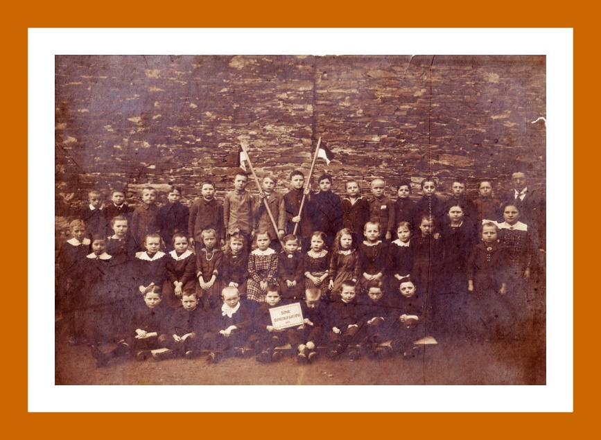

---

## 1923

Obrigkeiten

---

## Ereignisse die zeitlich nicht genau zugeordnet werden können

Lehrer Georg Petri tauscht seine Stelle mit dem Lehrer Alfred Großmann in Laubuseschbach.(Quelle: Alte Strinzer Chronik, Teil 1, Seite 117)

Erst im Jahre 1923, nach der Währungsreform, erhält der MGV "Eintracht" Unterstützung und Hilfe in Form eines Kredites, der dringend benötigt wird.(Quelle: Festschrift 100 Jahre MGV Eintracht 1891 / 1991)

---

## Ereignisse in chronologischer Reihenfolge

20. Januar 1923

---

## Das Ruhrgebiet besetzt! Die Franzosen haben gestern die Reichsbank in Wiesbaden besetzt aber alles leer vorgefunden. (Quelle: Alte Strinzer Chronik / Kirchenchronik)

22. Januar 1923

---

## Mittags eilig anberaumte Holzversteigerung in StM, weil die Franzosen in anderen Orten das Holz beschlagnahmt haben (Tags zuvor in Niederlibbach). (Quelle: Alte Strinzer Chronik / Kirchenchronik)

29. Januar 1923

---

## Landrat von Trothe ist bereits ausgewiesen. (Quelle: Alte Strinzer Chronik / Kirchenchronik)

31. Januar 1923

---

## Es kommt gar kein Briefbote. Es heißt die Eisenbahn ginge nicht. Die Wiesbadener Zeitung wird drei Tage lang verboten. (Quelle: Alte Strinzer Chronik / Kirchenchronik)

23. Februar 1923

---

## Gegen Abend gehe ich nach Wiesbaden und Erbenheim, alles zu Fuß, da die Eisenbahn wegen Streik gegen die Franzosen nicht fährt. (Quelle: Alte Strinzer Chronik / Kirchenchronik)

1924

---

## DVP = 100 Stimmen / SPD = 32 Stimmen / DNVP = 22 Stimmen / KPD = 7 Stimmen / DDP = 2 Stimmen / USPD = 2 Stimmen / WP = 1 Stimme / VöSozB = 1 Stimme

(Quelle: Die Hessen als Reichstagswähler / 1990)

---

## (Quelle: Die Hessen als Reichstagswähler / 1990)

1925

---

## Ereignisse

Im Jahre 1925 wird eine Kraftpostlinie von Idstein-Hühnerkirche-Hennethal-StM-Breithardt-Bad Schwalbach eingerichtet, die der Personenbeförderung dient. Wegen mangelnder Rentabilität ging die Linie aber wieder ein.(Quelle: Statistische Erhebung zur Standorterforschung von Strinz-Margarethä / 1935 / Archiv der Gemeinde Hohenstein)

In der Generalversammlung des MGV "Eintracht" legt der langjährige Vorsitzende Wilhelm Klein in Folge seines hohen Alters sein Amt nieder. Bei der anstehenden Neuwahl wird der Landwirt Emil Kadesch zum 1. Vorsitzende gewählt. Klein wird Ehrenvorsitzender.(Quelle: Festschrift 100 Jahre MGV Eintracht 1891 / 1991)

---

## Im Haus der Familie Christmann wird eine Nebenzweigstelle der Nassauischen Sparkasse eingerichtet, die von der Familie Christmann geführt wird.(Quelle: Hohensteiner Blättche)

Kerbegesellschaft 1925

---

## Jarres = 71 Stimmen / Braun = 13 Stimmen / Hellpach = 3 Stimmen / Held = 1 Stimme

(Quelle: Die Hessen als Reichstagswähler / 1990)

---

## (Quelle: Die Hessen als Reichstagswähler / 1990)

1926

---

## (Quelle: Die Hessen als Reichstagswähler / 1990)

Turnverein TV 1904

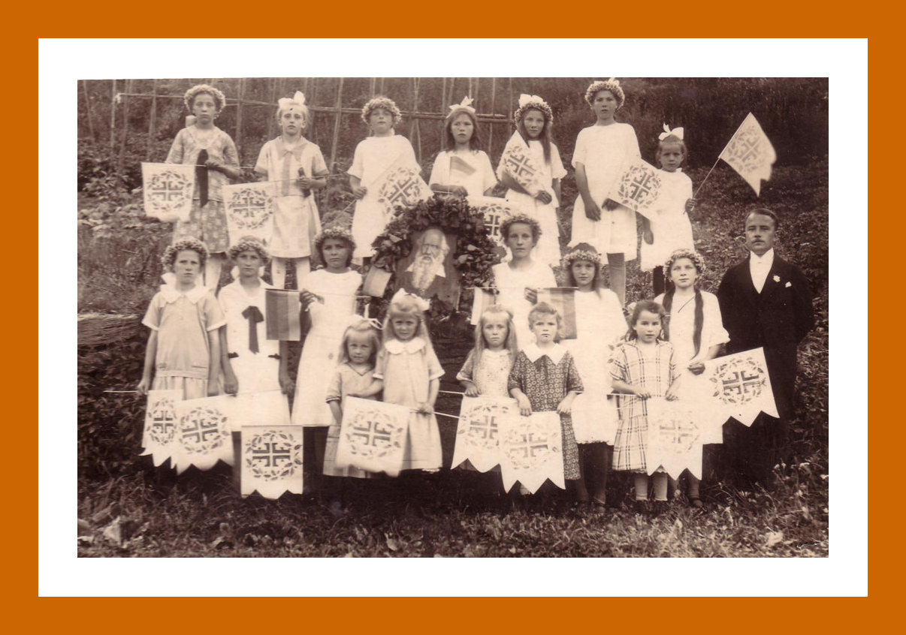

---

## 1927

Obrigkeiten

---

## 1928

Obrigkeiten

---

## Der Waldsportplatz wird in Gemeinschaftsarbeit der Mitglieder des TV 1904 ausgebaut.(Quelle: Vereinschronik des TV 1904)

Der TV 1904 schafft sich einen Tanzboden und vereinseigene Biergläser an.(Quelle: Vereinschronik des TV 1904)

---

## CNBL = 105 Stimmen / SPD = 15 Stimmen / DVP = 6 Stimmen / KPD = 5 Stimmen / DDP = 3 Stimmen / DBP = 2 Stimmen / DNVP = 1 Stimme / VöNatB = 1 Stimme

(Quelle: Die Hessen als Reichstagswähler / 1990)

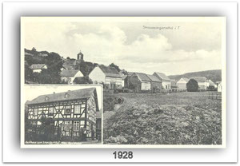

---

## Ansichtskarte 1928

1929

---

## (Quelle: Adressbuch für den Untertaunus, 1929)

Gewerbetreibende

---

## Ziß, Karl - Fleischbeschauer (Quelle: Adressbuch für den Untertaunus, 1929)

Ereignisse

Für StM wird seitens des Schulamtes eine zusätzliche Lehrerstelle beantragt. Da aber voraussichtlich erst im Jahre 1933 mit einer Schülerzahl von 60 Schülern zu rechnen ist, ist die Gemeinde zur Einrichtung einer Mehrstelle nicht bereit, da nach der geltenden Gesetzgebung diese Stelle jahrelang eine Mehrstelle sei.(Quelle: Hess. Staatsarchiv / Wiesbaden)

Im April wird dem Schulamtsbewerber Herrn Karl Renker aus Roth die Versehung einer Hilfslehrerstelle an der öffentlichen Volksschule StM übertragen. Als monatliches Gehalt erhält er 165 RM. Schon im Juni wird dem Schulamtsbewerber Wilhelm Jannssen aus Frankfurt am Main diese Stelle übertragen, der den Lehrer Fritz Schmidt als eine "gütigen, stillen und fleißigen Menschen" bezeichnete.(Quelle: Hess. Staatsarchiv, Wiesbaden / Strinzer Chronik, Band 2, Seite 30 + Band 1, Seite 117)

---

## Einrichtung eines zweiten Lehrsaals durch Teilung des gegenwärtigen Lehrsaals im Schulgehöft.(Quelle: Hess. Staatsarchiv, Wiesbaden / Schulchronik/Strinzer Chronik, Band 2, Seite 30)

Die Gemeinde ist wegen Wassermangels gezwungen, ihre Wasserleitungen weiter auszubauen. Sie nimmt hierfür einen Kredit von 13.000 RM auf. Zusätzlich beantragt sie bei der Nassauischen Brandversicherungsanstalt eine Bewilligung zur Unterstützung zwecks Verbesserung der Wasserleitungen.(Quelle: Hessisches Staatsarchiv, Wiesbaden)

Die Gemeinde erhält seitens des Landrats die Aufforderung 4.000 RM für die größeren notwendigen Unterhaltungsmaßnahmen am Aubach, festgestellt durch den Kreiswiesenbaumeister, im Rechnungsvoranschlag für 1929 bereitzustellen. Bürgermeister Weber entgegnet, dass die Gemeinde durch die ausgeführten Arbeiten zur Erweiterung und Reparatur der Wasserleitung und außerdem durch den Mindererlös bei den Holzverkäufen nicht in der Lage sei, die Summe in den Etat einzusetzen.(Quelle: Hessisches Staatsarchiv, Wiesbaden)

---

## Einstellung des Arbeiters Adolf Fuhr als Wege- und Wiesenwärter.(Quelle: Hessisches Staatsarchiv, Wiesbaden)

Der TV 1904 Strinz-Margarethä feiert sein 25jähriges Stiftungsfest und die neu erworbene Vereinsfahne wird feierlich eingeweiht. Sämtliche Gründungsmitglieder werden zu Ehrenmitgliedern ernannt.(Quelle: Vereinschronik des TV 1904)

1929 geht als der kälteste Winter seit 100 Jahren in die Annalen ein. Es werden Temperaturen bis 30° Grad unter null gemessen.(Quelle: Beiträge zur Geschichte Hohenstein-Breithardt, - Steckenroth und -Burg-Hohenstein / Pfarrer Weinberger /1992)

Der Dirigent des MGV "Eintracht" Ludwig Petri, der den Verein lange Jahre betreut hat wird zum Ehrendirigenten ernannt. Neuer Dirigent wird Ludwig Gerhardt aus Steckenroth.(Quelle: Festschrift 100 Jahre MGV Eintracht 1891 / 1991)

---

## Ja = 37 Stimmen / Nein = 2 Stimmen

(Quelle: Die Hessen als Reichstagswähler / 1990)

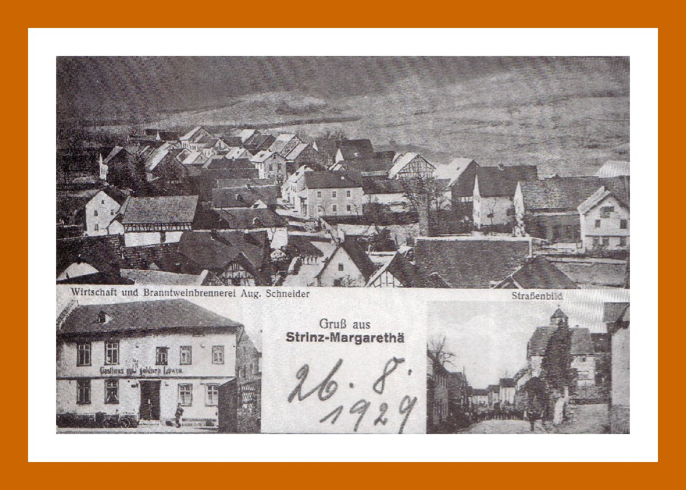

---

## Ansichtskarte von 1929

Impressionen vom 25jährigen Stiftungsfest

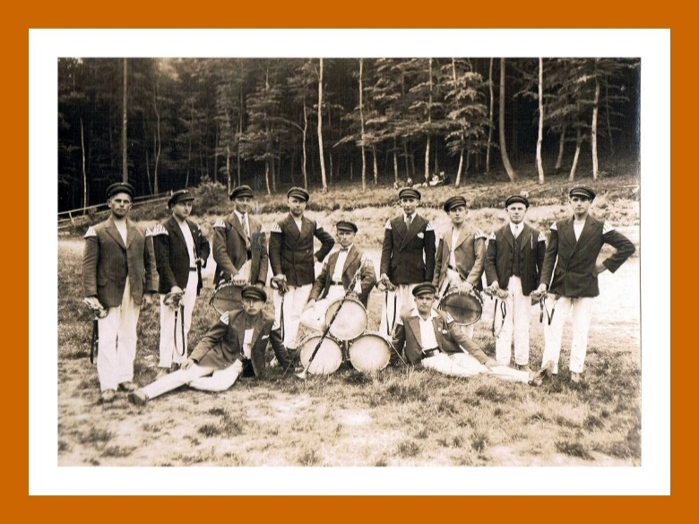

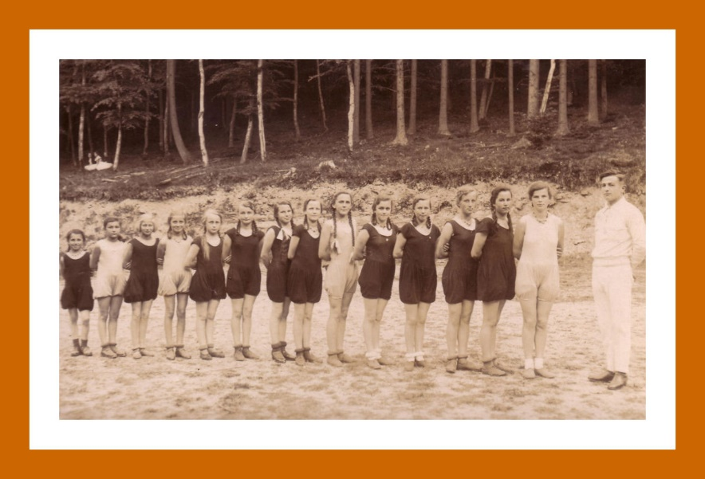

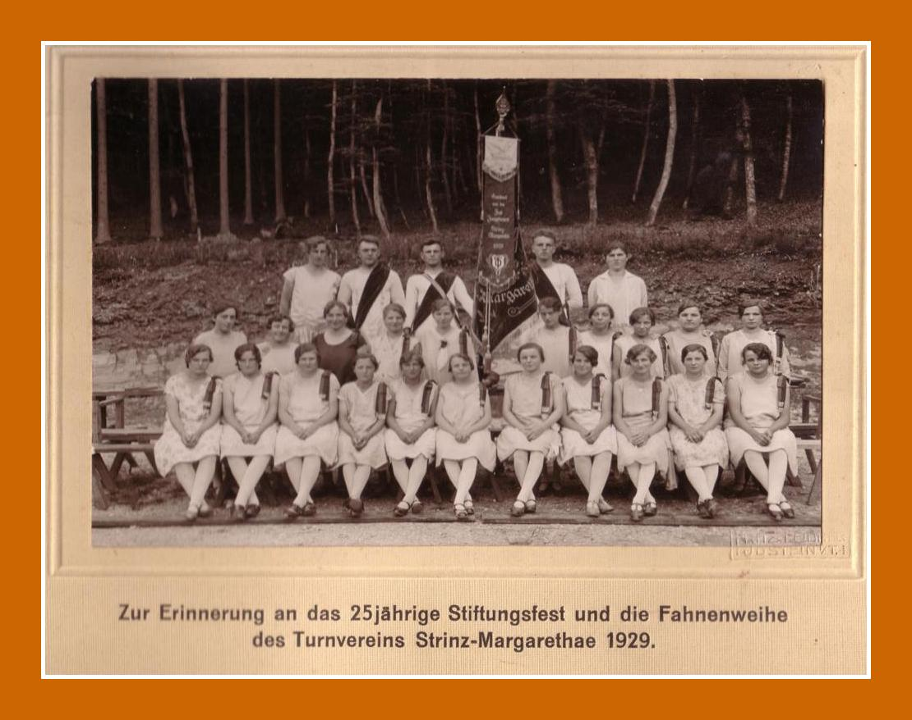

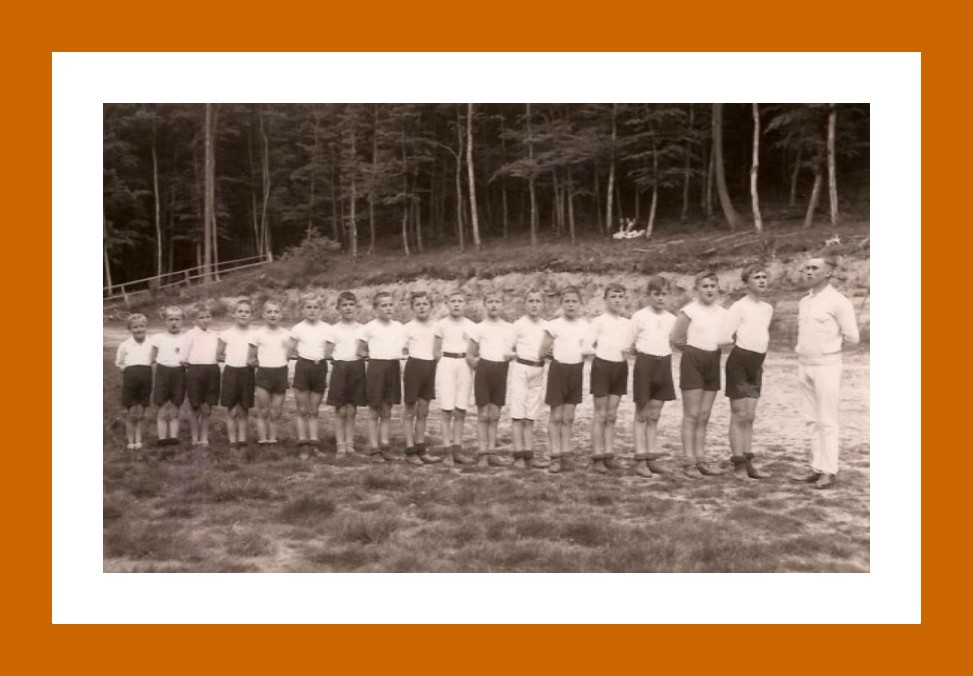

---

## 1930

Obrigkeiten

---

## Wiederwahl von Adolf Weber zum Bürgermeister von StM. Zum Stellvertreter wird Wilhelm Guckes gewählt.

Der TV 1904 führt einen Monatsbeitrag von 30 Pfennig ein. Der Verein wird gerichtlich eingetragen und die Vereinsfahne versichert.(Quelle: Vereinschronik des TV 1904)

---

## Der MGV "Eintracht" beschließt im Hinblick auf das 40jährige Gründungsfest eine neue Fahne zu weihen.(Quelle: Festschrift 100 Jahre MGV Eintracht 1891 / 1991)

Verpachtung des zur Lehrerstelle gehörenden Schulgutes für die Amtszeit von Lehrer Schmidt. Die Erlöse müssen für Schulzwecke verwendet werden.(Quelle: Hess. Staatsarchiv, Wiesbaden)

Wegen Sparmaßnahmen wird die Hilfslehrerstelle, die von W. Janssen belegt wird gestrichen. Die Bretterwand, die den Schulraum in zwei Klassen teilt wird herausgerissen und ab sofort wieder einklassiger Unterricht gehalten.(Quelle: Alte Strinzer Chronik / Teil 1, Seite 118)

---

## LP = 92 Stimmen / NSDAP = 21 Stimmen / SPD = 10 Stimmen / CSVD = 5 Stimmen / KPD = 4 Stimmen / DNVP = 2 Stimmen / StP = 2 Stimmen

(Quelle: Die Hessen als Reichstagswähler / 1990)

---

## Jagdgesellschaft 1930

1931

---

## Ereignisse

Die Gemeinde zahlt an Wohlfahrtserwerbslose einen Eigenanteil (30%) von 147,45 Mark und an sonstige Unterstützungsempfänger 187,05 Mark. Die restlichen 70% werden von UTK getragen.(Quelle: Finanzstatistik für 1931 / Archiv der Gemeinde Hohenstein)

---

## Der MGV Strinz-Margarethä feiert sein 40jähriges Bestehen.(Quelle: Festschrift 100 Jahre MGV Eintracht 1891 / 1991)

Auf dem Waldsportplatz findet ein Schauturnen statt.(Quelle: Vereinschronik des TV 1904)

---

## 1932

Obrigkeiten

---

## Anzahl der Schüler: 66

Ereignisse

Ab 1932 wird das Wasser des Lindenbrunnens mit für die Wasserversorgung genutzt. Es wird in das Pumpenhäuschen (Wasserhäuschen) geleitet, entsäuert, und dann in den Hochbehälter auf dem Kirchweg gepumpt. Der Lindenbrunnen ist 4 m tief und besteht aus 1,5 m breiten Zementrohren. Die Quellen erbringen folgende Leistungen. Wolfersborn täglich 25 cbm, Aßbach täglich 25 cbm und Lindenbrunnen 30 cbm.(Quelle: Alte Strinzer Chronik)

---

## (Quelle: Die Hessen als Reichstagswähler / 1990)

Auch wenn Hitler in StM die Wahl in StM gewonnen hat, so wurde insgesamt doch Hindenburg der Wahlsieger. "Die Enttäuschung über den Sieg Hindenburgs im Wahlkampf war außerordentlich groß"

---

## NSDAP = 154 Stimmen / SPD = 9 Stimmen / LP = 7 Stimmen / DNVP = 6 Stimmen / KPD = 4 Stimmen

(Quelle: Die Hessen als Reichstagswähler / 1990)

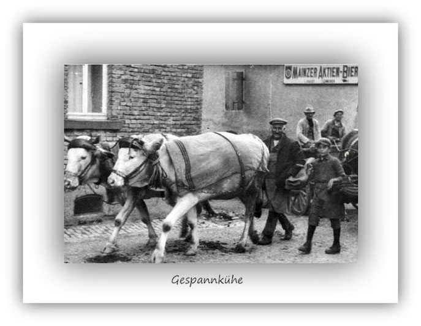

---

## Gespannkühe

Chronik von 1933 bis 1945

---

## 1933

Obrigkeiten

---

## Allgemeine Ereignisse

Es kommt vermehrt zu Diebstählen in den Landgemeinden. Aus Kostengründen wurde in den Landgemeinden vielfältig auf einen Nachtwächter verzichtet. Der Vorsitzende des Kreisausschusses, Dr. Pollak, empfiehlt diesen Gemeinden im Interesse der Sicherheit des Eigentums einen Nachtwachdienst im Wege der Fronde einzurichten.(Quelle: Schreiben des Kreisausschusses vom 16. 01.1933 / Archiv der Gemeinde Hohenstein)

---

## Ereignisse

Auf dem Waldsportplatz findet ein Gerätewettkampf zwischen den Turnvereinen Strinz-Margarethä, Hennethal und Wingsbach statt. Der TV 1904 erzielt in der Mannschaftswertung 518, die beiden anderen Vereine 464 Punkte. Die höchste Punktzahl in der Einzelwertung erzielt Karl Hanson vom TV 1904 mit 150 Punkten.(Quelle: Vereinschronik des TV 1904)

---

## Gründung eines vereinseigenen Spielmannszugs des TV 1904.(Quelle: Vereinschronik des TV 1904)

Bürgermeister Weber wird am 12. März als Spitzenkandidat der NSDAP in den Kreistag gewählt. Später erhält er noch die Ämter des Kreisbauernführers und des stellvertretenden Leiters des Wirtschaftsamtes in Bad Schwalbach. Sein Bruder Ludwig wird Ortsbauernführer, sein Sohn Richard Ortsgruppenleiter der Partei.(Quelle: Strinzer Chronik, Teil 1, Seite 124)

Der Gemeindevorstand beschließt die Anhebung der Steuern für das Rechnungsjahr 1933 wie folgt: 150 % Zuschlag zur staatlichen Grundversorgung I + II. 150% Zuschlag zur Gewerbesteuer, 300% Bürgersteuer. Sonstige Abgaben: 10 RM je Familie an Wassergeld und 1 RM Wassergeld für je Stück Großvieh.(Quelle: Beschluss des Gemeindevorstandes vom 10.09.1933 / Archiv der Gemeinde Hohenstein)

---

## NSDAP = 220 Stimmen / KSWR = 2 Stimmen

(Quelle: Die Hessen als Reichstagswähler / 1990)

---

## V.l.n.r.: Hermann Rücker, August Hankammer, August Kaiper (Kaiper`s Onkel), Karl Stößinger, August Schneider, Gustav Gräter, Wilhelm Heiler (Heilers Schuster), Karoline Schneider.

1934

---

## Strinzer Motorradgang

1935

---

## (Siehe auch unter: 1935)

Ereignisse

---

## Die Gemeinde erstellt eine statistische Erhebung zur Standorterforschung für StM.(Quelle: Stat. Erhebung, 1935 / Archiv der Gemeinde Hohenstein)

Schulklasse

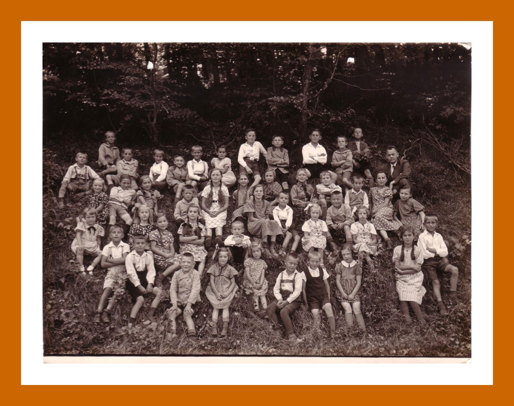

---

## Straßenbauarbeiten 1935

1936

---

## In der Satzung des TV 1904 wird festgelegt, dass bei jedem Vereinsmitglied am Hochzeittag Musik gespielt wird.(Quelle: Vereinschronik des TV 1904)

Ausbau der bestehenden Milchgenossenschaft. Zu dieser gehören jetzt alle milchabliefernden Landwirte von Holzhausen, Breithardt, Strinz-Margarethä und Steckenroth. Die Milch wird ab sofort mit dem Auto von Fricke frühmorgens abgeholt und als Frischmilch nach Wiesbaden geliefert. Damit wurde den Bürgern die Möglichkeit gegeben nach Wiesbaden mitzufahren.(Quelle: Beiträge zur Geschichte Hohenstein-Breithardt, -Steckenroth und -Burg-Hohenstein / Pfarrer Weinberger / 1992)

---

## Umbau des ehemaligen Stallgebäudes des Pfarrhofes zu einem der ersten Gemeinderäume des Untertaunus.

Ein Sturm vernichtet 1.600 rm Holz im Strinzer Wald.(Quelle: Alte Strinzer Chronik)

Bei Aufräumarbeiten auf dem Kirchenboden wird eine alte Christusfigur ohne Arme aufgefunden. Da eine Reparatur zu aufwändig erscheint, wird diese Figur dem Nassauischen Landesmuseum zum Kauf angeboten. Nach Begutachtung durch einen Spezialisten ist das Landesmuseum an einem Ankauf interessiert und bietet 100 RM für die Plastik. (Quelle: Hessisches Staatsarchiv Wiesbaden)(Siehe auch unter Strinzer Christus)

Zum ersten Mal können am 03. Oktober die Einwohner die Fahrt des aus Amerika heimkehrenden Zeppelins beobachten. Sein stahlblauer Rumpf hebt sich in Richtung Hennethal ab.(Quelle: Beiträge zur Geschichte Hohenstein-Breithardt, -Steckenroth und -Burg-Hohenstein / Pfarrer Weinberger / 1992)Anmerk. der Red:Es handelt sich dabei um das berühmte Luftschiff "Hindenburg", das vom 01. - 03. Oktober von Lakehurst (USA) nach Frankfurt unterwegs ist. Es benötigt eine Flugzeit von 58 Stunden und 2 Minuten. Die Hindenburg erlangt eine zweifelhafte Berühmtheit durch ihr Explosion im Jahre 1937 bei ihrem Landeanflug in Lakehurst (USA).

Leider war es im Schuljahr 1935/1936 nicht möglich, eine größere Schülerzahl der HJ zuzuführen, da die Eltern zu sehr die Kosten scheuen. Von dem 19 Schülern der oberen Jahrgänge gehörten an: dem Jungvolk 7 Jungen und dem BdM (Red.: Bund deutscher Mädchen) keine Schülerin.(Quelle Schulchronik / Alte Strinzer Chronik, Band 2, Seite 31)

---

## Impressionen von 1936

Bei Schneiders  Strinzer Turnerriege

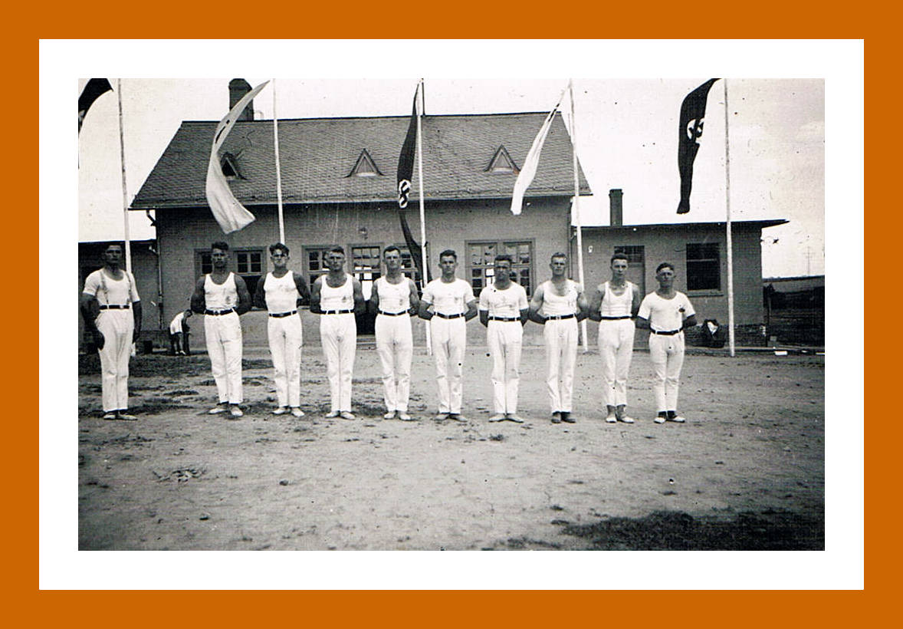

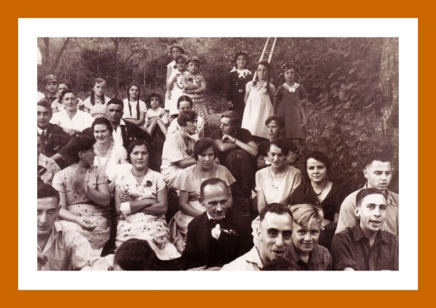

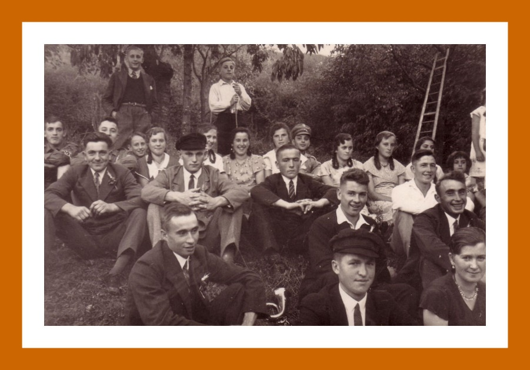

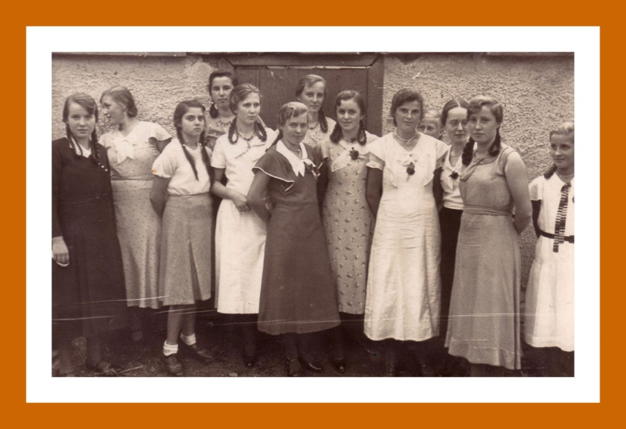

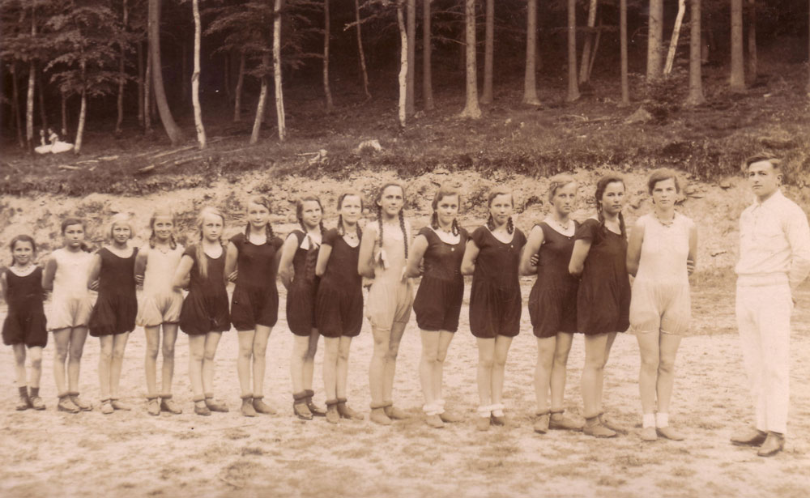

---

## 1937

Obrigkeiten

---

## Ereignisse

Lehrer Schmidt hat durch Blumenpflege, Elternabende und größere Schulausflüge schöne Erinnerungen hinterlassen. Er heiratet die Tochter des Lehrers Theo Fischer aus Hennethal und kommt 1937 nach Wiesbaden wo er mehrere Jahre lang an einer Mittelschule unterrichtete.(Quelle: Hess. Staatarchiv Wiesbaden / Alte Strinzer Chronik, Teil 1, Seite 116)Aber es wurde auch mdl. überliefert, dass er den Nationalsozialisten die Behinderten des Ortes, im Gegensatz zum Bürgermeister, zwecks Sterilisierung, gemeldet haben soll.(mdl. Überlieferung, Name bekannt)

---

## Neuer Lehrer in StM wird der Schulamtsbewerber Johannes Buse, geb. 1908 in Herrnkirch.(Quelle: Hess. Staatsarchiv, Wiesbaden)

Da Lehrer Buse als Junggeselle nicht im Schulhaus wohnt bleibt die Lehrerdienstwohnung von 1937 bis 1943 unbewohnt. Nur die Hitlerjugend hält zeitweilig ihre Zusammen-künfte  darin.(Quelle: Alte Strinzer Chronik, Teil 1, Seite 121)

---

## Ein kleines Zimmer in der Schule dient ab 1937 einquartierten Truppen als Wachstube und Amtslokal.(Quelle: Alte Strinzer Chronik, Teil 1, Seite 121)

Der Reichsregierung wird der Plan für einen Schulneubau vorgelegt, welcher von dieser aber abgelehnt wird. (Quelle: Alte Strinzer Chronik)

---

## Eine Liste aus diesem Jahr belegt, dass hier in StM Maulwürfe gejagt wurden.(Quelle: Helmut Hartwig)(Siehe auch unter: Maulwurfjagd)

1938

---

## (Quelle: Alte Strinzer Chronik, Teil 1, Seite 118)

Ereignisse

Auszug aus dem 2. Revisionsbericht des Kreisschulrates über den Schulamtsbewerber Johannes Buse vom 4.7.1938:"Als ich die Schule am 1. Oktober 1937 sah, machte die Klasse einen schlappen, äußerlich und innerlich undisziplinierten Eindruck. Haltung, Sprache, Bewegung, alles war lahm. Jetzt ist ein neuer Geist eingezogen. Die Kinder zeigen alle in ihren Bewegungen eine selbstsichere zuchtvolle Haltung.(Quelle: Hess. Staatsarchiv, Wiesbaden)

---

## Baubeginn eines Kindergartens in Strinz

Impressionen von 1938

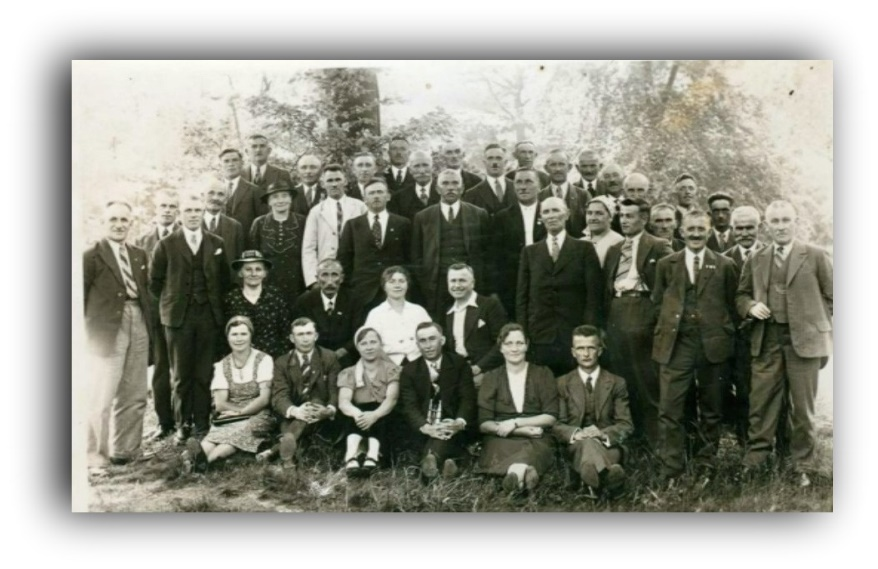

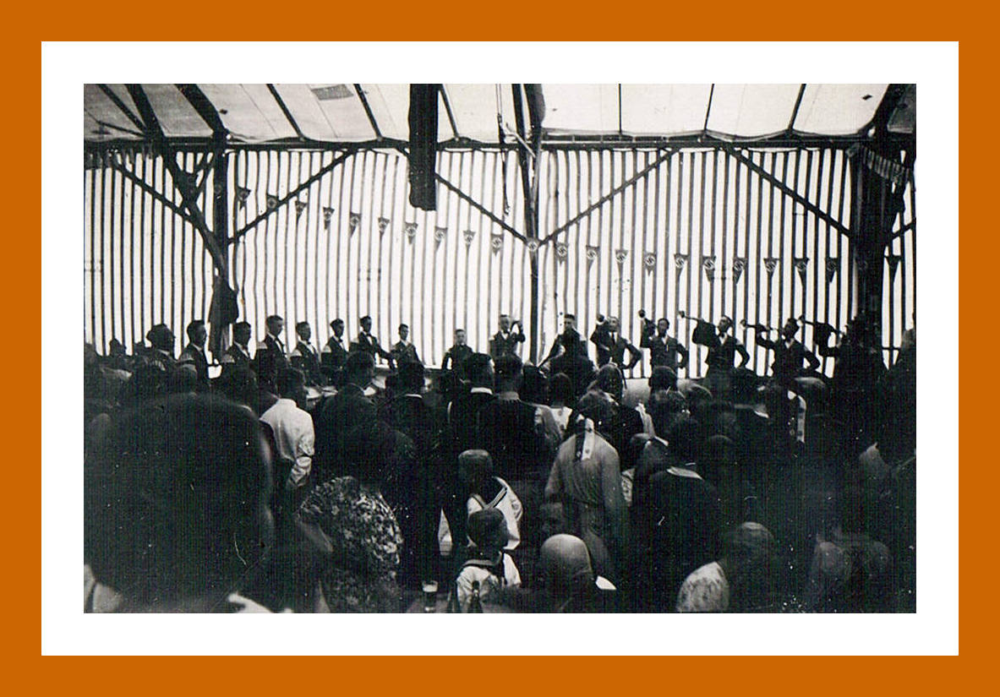

---

## 1939

Obrigkeiten

---

## StM im Jahre 1939 (Ausschnitt aus einer Schullandkarte der ehemaligen Strinzer Schule)

Ereignisse

Der Strinzer Pfarrer Walter Maus flüchtet sich schon Anfang des Krieges in die Wehrmacht. Pfarrer waren seinerzeit starken Anfeindungen durch die Nationalsozialisten ausgesetzt. Regimekritiker waren in der Wehrmacht einigermaßen sicher.(Quelle: Internetseite der ev. Kirche StM) (Siehe auch unter: Pfarrer flieht in die Wehrmacht)

---

## Der Lehrer Johannes Buse wird nach Bestehen der Prüfung am 1.4. endgültig zum Lehrer in StM ernannt.(Quelle: Hess. Staatsarchiv, Wiesbaden)

Der bisherige Vorsitzende des MGV "Eintracht" Emil Kadesch stellt sich aus persönlichen Gründen nicht mehr zu Wahl. Zum neuen Vorsitzenden wird daraufhin der Landwirt Emil Heiler gewählt.(Quelle: Festschrift 100 Jahre MGV Eintracht 1891 / 1991)

---

## 1940

Obrigkeiten

---

## Bienenhaus Faust           Wilhelm Stößinger, Erna und Hertha Guckes auf dem Weg ins Rübenfeld

1941

---

## Der Lehrer Johannes Buse wird am 21. Mai zum Heeresdienst einberufen. Seine Vertretung übernimmt der Lehrer Presser aus Steckenroth.(Quelle: Alte Strinzer Chronik, Teil 1, Seite 118)

02.10.1941 Emil Fuhr fällt

---

## 08.10.1941 Johann Jusa fällt

10.11.1941 Paul Weber fällt

---

## 11.11.1941 Adolf Fuhr fällt

02.12.1941 Willi Hies fällt

---

## 31.12.1941 Alois Habich fällt

Ein in StM einquartierter Soldat (wohl zur Gefangenenbewachung)

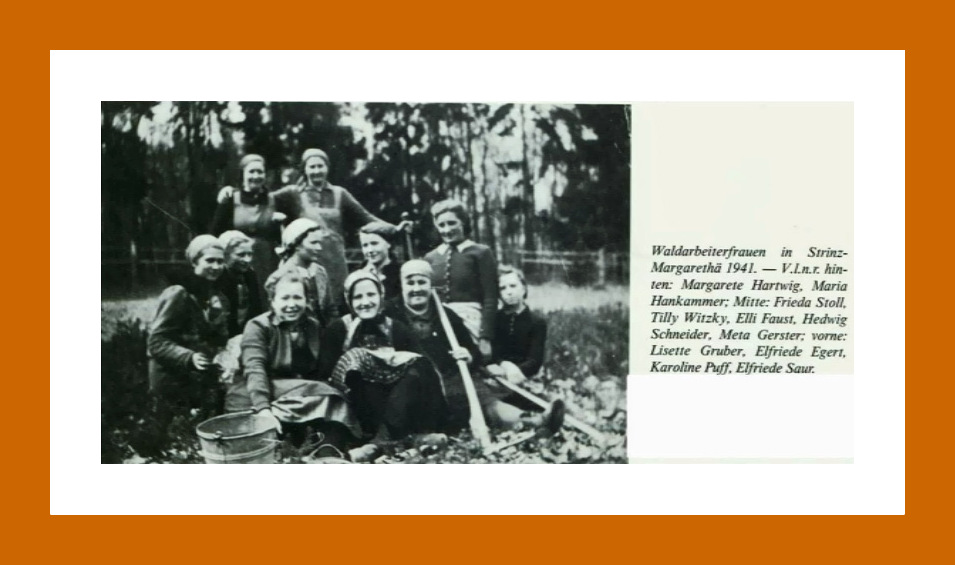

---

## Vorne: Lisette Gruber, Elfriede Egert, Karoline Puff, Elfriede Saur

1942

---

## (Quelle: Alte Strinzer Chronik, Teil 1, Seite 118)

Ereignisse

Ende des Jahres kommt das Vereinsleben des MGV "Eintracht" abermals zum Erliegen. Um der ungewissen Zukunft Vorsorge zu tragen, wurde ein Vereinstestament geschrieben, in dem festgehalten wurde, dass bei einer Auflösung des Vereins das Vermögen dem Deutschen Sängerbund e. V. zufallen soll.(Quelle: Festschrift 100 Jahre MGV Eintracht 1891 / 1991)

---

## Die Schule verzeichnet mit nur 32 Schülern die niedrigste Schülerzahl seit 100 Jahren.(Quelle: Alte Strinzer Chronik, Teil 1, Seite 118)

15.05.1942 Willi Fuhr fällt

---

## Der Lehrer Johannes Buse stirbt als Unteroffizier am 03. Juli, 3 Tage nach seiner schweren Verwundung, in einem Kriegslazarett im Osten, den Heldentod.(Quelle: Strinzer Chronik, Teil 1, Seite 118)

21.07.1942 Adolf Fuhr fällt

---

## 30.12.1942 August Deuser fällt

1943

---

## NS-Aufmarsch am 18. Januar (vermutlich handelt es sich um eine Feier zur Reichsgründung, die im Zuge der „Durchhalteparolen“ organisiert wurden)(Quelle: Rückseite Bilddokument s.u.)

03.01.1943 Franz Riedl fällt

---

## 07.01.1943 Karl Ziß fällt

03.02.1943 Emil Schneider fällt

---

## 06.02.1943 Alfred Klein fällt

01.08.1943 n.n.

---

## 18.08.1943 Karl Hankammer fällt

28.08.1943 Emil Schneider fällt

Neuer Lehrer wird Richard Weißer aus Frankfurt am Main. Nach einem erlittenen Bombenschaden wird er nach StM versetzt.(Quelle: Strinzer Chronik, Teil 1, Seite 118/119) (siehe auch unter: Rektor Richard Weißer)

---

## Am 26. November fallen Fliegerbomben in der Ortsgemarkung.(Quelle: Alte Strinzer Chronik)

06.11.1943 Emil Kugelstadt fällt

---

## Erste Hilfe-Gruppe  Zuchtsau Weber

1944

---

## 22.01.1944 Karl Hies fällt

02.02.1944 Erich Hankammer fällt

---

## 20.06.1944 Hermann Schneider fällt

03.07.1944 Hans Buse (Ortslehrer) fällt

---

## 07.07.1944 Adolf Faust fällt

09.08.1944 Adolf Wölfinger fällt

---

## 15.08.1944 Karl Bodenheimer fällt

Am 4. Dezember fallen beiderseits der Straße nach Niederlibbach Fliegerbomben.(Quelle: Alte Strinzer Chronik)

---

## 12.10.1944 Emil Gräter fällt

Behelfsheim für Flüchtlinge (Ecke Schulstraße / Pfalzstraße)

---

## 1945

StM im Jahre 1945 (Das Bild wurde von einem Aufklärungsflugzeug der Amerikaner geschossen)

---

## (Quelle: Alte Strinzer Chronik, Teil 2, Seite 1)

Ereignisse

Der Schullehrer von StM Rektor Richard Weißer beginnt am 1. Juni 1945 mit dem Schreiben einer Ortschronik. Bei den ersten Aufzeichnungen handelt es sich um Interviews mit den zurückkehrenden Frontsoldaten.

---

## Ernennung von Frl. Ursula Nissen zur Lehrerin und gleichzeitig Versetzung nach StM zum 1. Januar 1945(Quelle: Hess. Staatsarchiv, Wiesbaden)

Am 22. Februar überfliegt ein Aufklärungsflugzeug der Amerikaner Strinz und schießt eine Luftaufnahme.(Quelle: Luftbildarchiv)Am 28. März marschieren die Amerikaner in Strinz ein.(Quelle: Alte Strinzer Chronik) Der Einmarsch der Amerikaner in StM ist genauestens dokumentiert. Die Aufzeichnungen hier einzupflegen würde den Rahmen sprengen. Deshalb wurde hierzu in dieser Chronik ein extra Artikel gefertigt.

---

## Strinz gehört zur amerikanischen Besatzungszone.

Nach dem Einzug der Amerikaner verpflichtet sich Bürgermeister Weber durch Eid, alle Verbindungen mit der Nazipartei abzubrechen und den Anordnungen der Besatzungstruppen zu gehorchen. Trotzdem wird er am 23. Mai abgesetzt und am 28. Juni in Haft genommen.(Quelle: Alte Strinzer Chronik, Teil 1, Seite 124)

Neuer Bürgermeister in StM wird August Gräter, geb. am 19. Oktober 1887 in Burgschwalbach, in StM aufgewachsen, wo er sich 1922 - er ist Maurermeister - ein Haus baute. Sein Amtszimmer wird in den Kindergarten verlegt.(Quelle: Alte Strinzer Chronik, Teil 1, Seite 124)

---

## 1946

Obrigkeiten

---

## Am 15. April wird Josefine Drößler in Folge des Zweiten Weltkriegs als vermisst gemeldet.

In einer Vereinsversammlung des MGV "Eintracht" am 23. November wird die Vereinstätigkeit wiederaufgenommen. Die dabei anwesenden 24 Vereinsmitglieder wählen zum 1. Vorsitzenden den Schmiedemeister Adolf Christmann I. . Da der langjährige Dirigent Ludwig Gebhard aus Altersgründen dem Verein nicht mehr zur Verfügung steht, verpflichtet man Karl Schön aus Hausen über Aar zum neuen Chorleiter.(Quelle: Festschrift 100 Jahre MGV Eintracht 1891 / 1991)

---

## Der am 28. Juni 1945 in Haft genommene, ehemalige Bürgermeister von StM, Adolf Weber wird am 04. Juni 1946 aus der Haft entlassen.(Quelle: Alte Strinzer Chronik, Teil 1, Seite 124)

Der am 16. November 1945 in Haft genommene Wilhelm Enders kehrt am 10. August aus dem Internierungslager Darmstadt nach StM. zurück.

Beim Überqueren der Scheidertalstraße wird der 5jährige Franz Baumschabl, Sohn einer heimatvertriebenen Familie, von einem Motorrad erfasst und stirb an den Folgen des Unfalls.(Quelle. Alte Strinzer Chronik)

---

## Neugründung des TV 1904 nach dem Kriege. Den Vorsitz übernimmt Wilhelm Guckes, der diese Aufgabe bis 1956 inne haben wird.(Quelle: Festschrift zur Sportplatzeinweihung 1990)

Im Kindergarten wird ein Theaterstück aufgeführt (vermutlich "Schneewittchen und die sieben Zwerge")(Quelle: Bilddokument)

---

## Kriegsheimkehrer

07.01.1946 Otto Baum, 25.01.1946 Albert Mager, 02.02.1946 Adolf Klein, 11.03.1946 Willi Fuhr, 06.04.1946 Karl Hanson, 04.06.1946 Adolf Weber, 06.08.1946 Paul May, 10.12.1946 Georg Edinger

---

## Lebenmittelkarte

1947

---

## (Quelle: Hess. Staatsarchiv, Wiesbaden)

Allgemeine Ereignisse

Der Sommer 1947 ist einer der trockensten seit 100 Jahren. 8 Wochen lang fällt kein Tropfen Regen. Täglich steigt das Thermometer über 30 Grad Celsius. Unerträglich brennt die Sonne vom wolkenlosen Himmel. Seit dem Jahr 1887 war ein solch trockener Sommer nicht zu verzeichnen. Aufgrund der Hitze haben die Bauern nicht mehr genug Futter für ihr Vieh und sind deshalb teilweise zu Notschlachtungen gezwungen. Sie müssen das Vieh auf die Weide treiben, was sehr ungewöhnlich ist, da man in Strinz die Stallhaltung praktiziert. Die Trockenheit verschärft die vor der Währungsreform 1948 schon stark angespannte Ernährungslage nicht unerheblich.(Quellen: Strinzer Chronik / Kleine Chronik des Ortes Hohenstein-Burg-Hohenstein / Beiträge zur Geschichte Hohenstein-Breithardt, -Steckenroth und -Burg-Hohenstein / Pfarrer Weinberger / 1992)

---

## Gründung einer Schülerriege im TV 1904.(Quelle: Vereinschronik des TV 1904)

Im Saal von Klein´s wird ein Theaterstück aufgeführt.

August Hanson legt aus gesundheitlichen Gründen sein Amt als langjähriger Gemeinderechner nieder. Nach Überprüfung durch das Military Government of Germany wird Willi Hankammer als neuer Gemeinderechner eingesetzt.(Quelle: Hess. Staatsarchiv, Wiesbaden)

In den Rembacher Fichten (Wald links von der Straße nach Breithardt) bricht aus Unachtsamkeit ein Brand aus. Ein Bauer will eine Hecke abbrennen, wobei das Feuer auf den Wald übergreift.(Quelle: Alte Strinzer Chronik)

---

## Kriegsheimkehrer

07.06.1947 Richard Weber, 08.06.1947 Adolf Wahl, 10.09.1947 Erich Egert, 28.11.1947 Karl Ernst

---

## 1948

Obrigkeiten

---

## Ereignisse

Am 02 Januar 1948 beendet Rektor Richard Weißer seine Aufzeichnungen über die Geschichte von Strinz-Margarethä mit den Worten:

---

## Wahl einer Gemeindevertretung im April

Im Juni wird der Landwirt Wilhelm Guckes (geb. 15.06.1910) zum hiesigen Bürgermeister gewählt.

Durch die Aufnahme von Flüchtlingen erhöht sich die Einwohnerzahl von Rund 350 (1939) auf 600 Personen. Fast in jedem Bauernhaus ist jetzt eine Flüchtlingsfamilie untergebracht. Durch den Zuzug steigt die Schülerzahl zu Ostern auf 110 Kinder.

---

## Die Gemeinde beantragt den Neubau eines zweiklassigen Schulgebäudes in der Nähe des Kindergartens, um der gestiegenen Schülerzahl Rechnung zu tragen.

Die Strinzer Schule, organisiert von Lehrer Witt nimmt im Juni 1948 mit zwei Gruppen und zwei Seifenkisten an einem Seifenkistenrennen in Wiesbaden teil. Von über 130 Teilnehmern hat eine unserer Kisten den 13. Platz erreicht, mit dem Gewinn einer Armbanduhr, für die damalige Zeit ein ganz große Sache.(Quelle: Helmut Hartwig)

---

## Kriegsheimkehrer

29.01.1948 Wilhelm Moritz Enders, 17.02.1948 Otto Ax, 26.02.1948 Karl Rücker, 26.02.1948 Ernst Meyer, 10.08.1948 Willi Petri

---

## 3x Strinzer Schule

1949

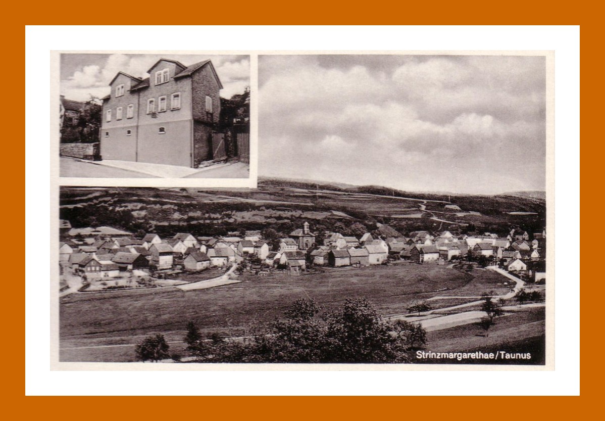

---

## Im Mai beginnt die Pflasterung der Dorfstraße durch Pflasterer aus Strinz-Trinitatis und Hennethal.

Im August findet das erste Turnfest nach dem Krieg statt. Dieses wird zum 45jährigen Jubiläum des Turnvereins auf dem Turnplatz veranstaltet. Es wird ein Tanzboden angefertigt, Tische und Bänke aufgestellt, eine Lichtleitung gelegt und alles schön geschmückt. Sonntags findet ein Umzug statt. Am Vor- und Nachmittag fanden Wettkämpfe und ein Schauturnen statt.(Quelle: Vereinschronik des TV 1904)

---

## Der Turnverein führt das Theaterstück "Der Tatzelwurm" auf.

Zum ersten Mal wird die weibliche Jugend in die sportlichen Aktivitäten des TV 1904 einbezogen(Quelle: Festschrift zur Sportplatzeinweihung 1990)

---

## 04.01.1949 Ottmar Christmann

(Siehe auch unter Erlebnisse der Heimkehrer)

---

## Wahlberechtigte 371 / 246 abgegebene Stimmen / SPD 18 / KPD 1 / FDP 130 / DWA 75

Impressionen von 1949

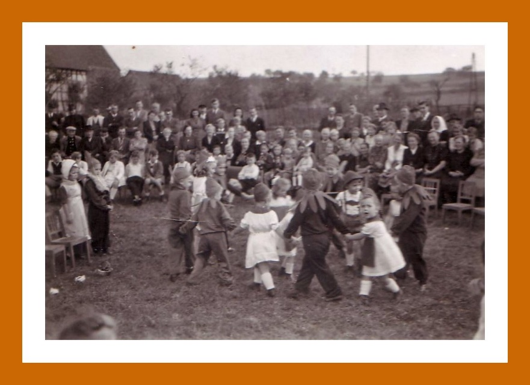

---

## 2 x Turnfest

1950

---

## Der Spielmannszug des TV 1904 wird wieder aufgestellt und es wird eine Schachgruppe gegründet.(Quelle: Vereinschronik des TV 1904)

Neuer Chorleiter des MGV "Eintracht" wird Norbert Walzik aus Elz. Dieser hat keinen fahrbaren Untersatz und kann deshalb nach den Proben nicht mehr nach Hause kommen. Der 1.Vorsitzende Adolf Christmann I. erklärt sich deshalb bereit den Dirigenten für eine vom Verein zu leistende Vergütung von 1,- DM übernachten zu lassen.(Quelle: Festschrift 100 Jahre MGV Eintracht 1891 / 1991)

---

## Baubeginn der neuen Schule neben dem Kindergarten. Die Grundsteinlegung findet am 08. Mai statt, wobei keine Urkunde eingemauert wurde(Quelle: Alte Strinzer Chronik)

Die in 1942 eingeschulten Kinder werden nach 8 Jahren in 1950 entlassen.

---

## Impressionen von 1950

Bäckerei Bodenheimer (heute Ecke Friedhofstraße/Scheidertalstraße)

---

## Konfirmation               Kindergarten

1951

---

## (Quelle: Hess. Staatsarchiv / Wiesbaden)

Ereignisse

Feier zum 60jährigen Bestehen des MGV 1891 "Eintracht". Schon zum Festkommers am Samstag werden vom damaligen Vorsitzenden Adolf Christmann zahlreiche Vereine aus nah und fern begrüßt. Das große Festzelt stand in den Bornwiesen am Ortsausgang zwischen Aubach und Hirtenpfad. Das große Freundschaftssingen und der Festumzug sind für Sonntag geplant. Die zahlreichen Gastvereine werden am Ortseingang von einer Abordnung des Gesangsvereins mit Schild und Fahne empfangen und für den Festumzug aufgestellt. Nach dem Umzug geht es ins große Festzelt, als sich auch schon ein Unheil anbahnt. Ein schweres Gewitter mit enormen Regenmengen geht über Strinz nieder. Das auf den Wiesen in Richtung Niederlibbach noch liegende Heu wird in den Aubach geschwemmt und führt an der Brücke der Scheiderthalstraße zur Verstopfung der Unterführung. Durch den Stau wird das gesamte Festgelände etwa einen halben Meter überflutet. Die Bevölkerung kann nur auf Notstegen, die aus Tischen und Stühlen zusammengesetzt werden, die überschwemmten Wiesen verlassen. So entstand ein beträchtlicher Schaden an den Einrichtungsgegenständen des Festzeltes. Das so gut geplante und fröhliche Fest ist damit zu Ende. Es sind erhebliche Schäden zu beklagen. Das Fest ging unter der Bezeichnung "Wasserfest" in die Vereinsgeschichte ein.(Quelle: Festschrift 100 Jahre MGV Eintracht 1891 / 1991)

Einweihung der neuen Schule in Anwesenheit von Landrat Dr. Viteuse und Schulrat Conrad. Es wurden zwei Lehrsäle mit je einem Gruppenraum gebaut. Außerdem wurden zwei Lehrerwohnungen eingerichtet. Das Gebäude wurde außerdem mit einer Zentralheizung versehen. Es wurde eine zentrale Dampfheizung für den Betreib mit Holz und/oder Koks eingebaut. Gleichzeitig wurden die Klassenräume mit modernen Möbeln ausgestattet. Die Gesamtkosten beliefen sich auf 105.000,- DM, von denen die Gemeinde 67.500,- DM aufbrachte. Mit dem Einzug in die neue Schule normalisieren sich die Schulverhältnisse in StM.(Quellen: Alte Strinzer Chronik / Helmut Hartwig)

---

## Weitere Impressionen von 1951

Kindergarten              60. Jubiläum Gesangsverein

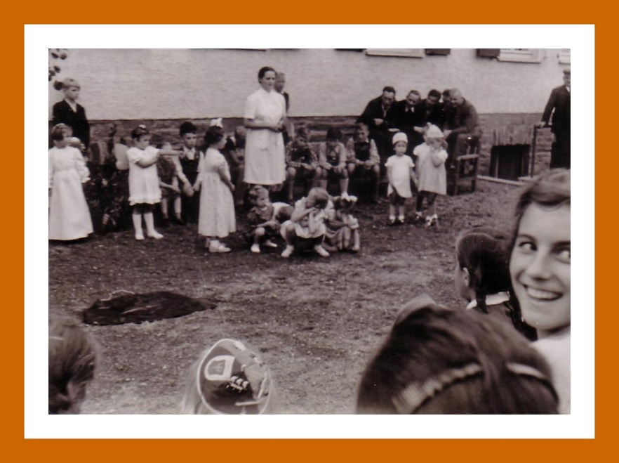

---

## Spielmannszug               Landwirt

1952

---

## Am Familienabend des TV 1904 wird die Ehrentafel für die gefallenen Soldaten geweiht. Diese hängt heute noch im Treppenaufgang der Strinzer Kirche.(Quelle: Vereinschronik des TV 1904)

Der Landwirt Wilhelm Guckes wird als Bürgermeister wiedergewählt. Ehrenamtliche Beigeordnete werden August Klein und August Schneider.

---

## Renovierungsarbeiten am Pfarrhaus(Quelle: Alte Strinzer Chronik)

Die im Aug. 1943 eingeschulten Schüler werden im April 1952, nach 8 1/2 Jahren aus der Volksschule entlassen, auch wegen der Versäumnisse in der Kriegs- und Nachkriegszeit.

---

## Schulklasse        Kerbegesellschaft

1953

---

## 340 Wahlberechtigte / 272 Stimmen / SPD 42 / CDU 52 / FDP 134 / BHE 43 / DP 1

Kerbegesellschaft 1953

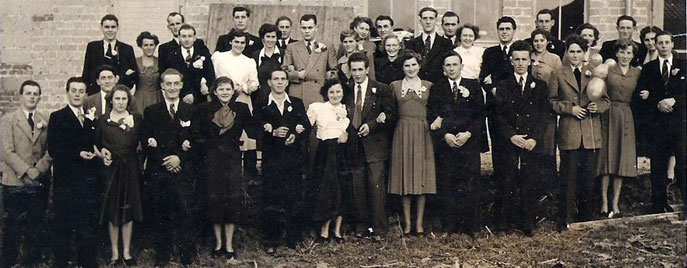

---

## 1954

Pfarrer: Fritz Roth

---

## Ereignisse

Der TV 1904 richtet einen Maskenball aus.(Quelle: Vereinschronik des TV 1904)

---

## Feier zum 50jährigen Bestehen des TV 1904.(Quelle: Vereinschronik des TV 1904)

Die Dreschgesellschaft legt sich eine neue Dreschmaschine mir Staubsauger und Körnergebläse für 27.000,- DM zu.(Quelle: Alte Strinzer Chronik)

---

## Milchsammelstelle          Schule

1955

---

## Die neue Glocke hält Einzug      Seifenkistenrennen in Wiesbaden

1956

---

## Impressionen von 1956

60 Jahre Gesangsverein                   Am Hieße Stein

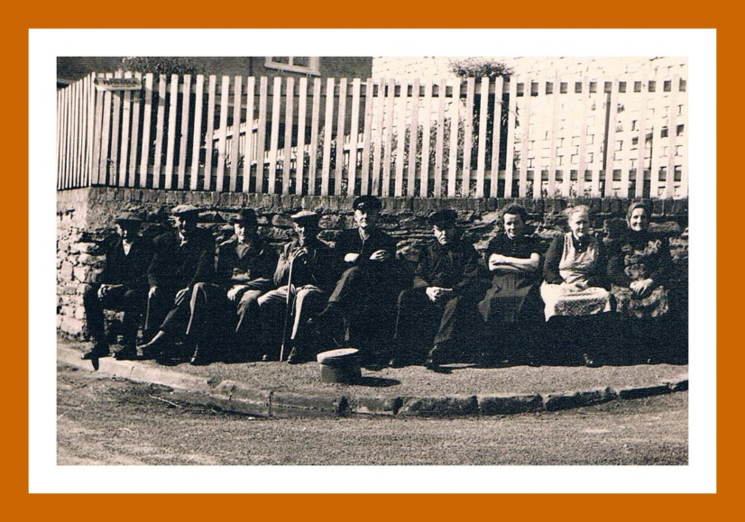

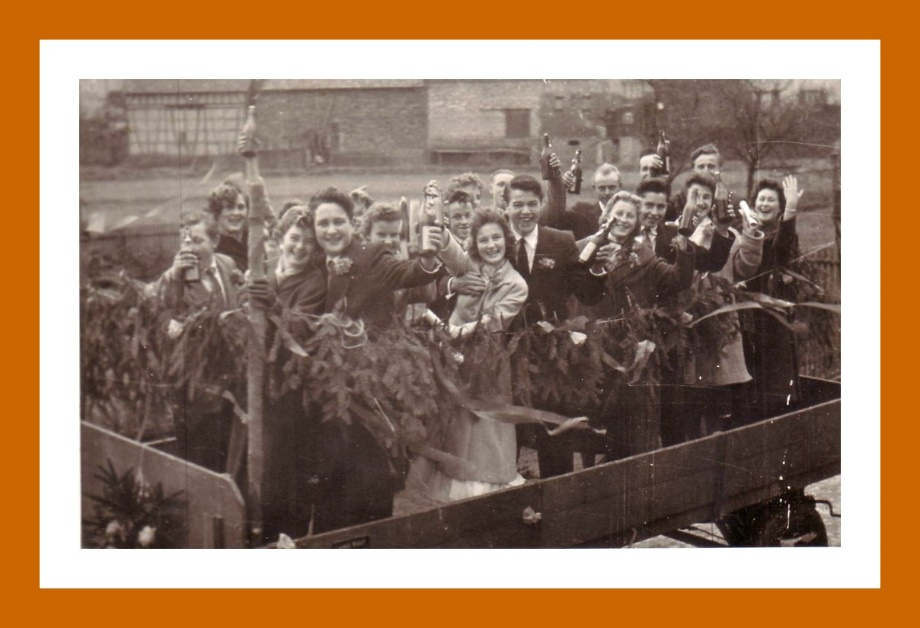

---

## KerbSchule

So sehen glückliche Strinzer Kinder im Jahre 1956 aus

---

## 1957

Pfarrer: Fritz Roth

---

## Ereignisse

Die "Landwirtschaftliche Bezugs- und Absatzgenossenschaft e.G.m.b.H." wird durch die Aufnahme des Bankgeschäftes in eine "Raiffeisenkasse e.G.m.b.H" umgewandelt.(Quelle: Helmut Hartwig)

Da sich der Dirigent des MGV "Eintracht" Herr Walzik beruflich verändern will, sollen die Übungszeiten in die frühen Abendstunden verlegt werden. Dieser Probenbeginn kann aber von vielen Sängern nicht wahrgenommen werden, sodass man sich im gegenseitigen Einvernehmen trennt. Neuer Dirigent wird Rolf Wilberg.(Quelle: Festschrift 100 Jahre MGV Eintracht 1891 / 1991)

---

## Willi Hankammer übernimmt den Vorsitz des TV 1904.(Quelle: Festschrift zur Sportplatzeinweihung 1990)

Wahlen

---

## 1958

Pfarrer: Fritz Roth; Thorwalt Fellner

---

## Willi Guckes wird zum Ehrenvorsitzenden des TV 1904 ernannt.(Quelle: Vereinschronik des TV 1904)

Durchführung eines Gaukinderturnfestes des südlichen Bezirkes auf dem Waldsportplatz mit anschließendem Waldfest.(Quelle: Vereinschronik des TV 1904)

Der TV 1904 beschließt in einer Vorstandssitzung, dass für die Verleihung des Tanzbodens außerhalb des Dorfes 1 DM und innerhalb des Dorfes 50 Pfennig erhoben werden.(Quelle: Vereinschronik des TV 1904)

---

## 300 Stimmberechtigte / 202 Stimmen / SPD 44 / CDU 35 / FDP 77 / BHE 31 / GVP 15

1959

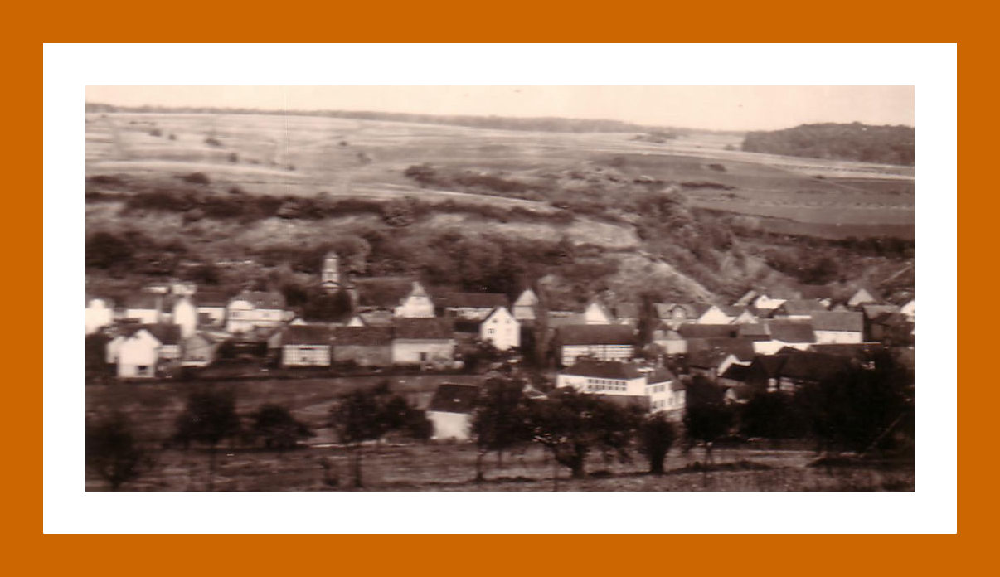

---

## (Siehe auch unter: Scheunenbrand)

Durch Grundstücksumlegungen erhält die Schule einen großen Schulgarten.(Quelle: Alte Strinzer Chronik)

Der Landwirt und Fuhrunternehmer Wilhelm Enders legt sich einen Mähdrescher zu, welcher das Getreide gleichzeitig auf dem Feld mäht und drischt und sich besonders nach der Grundstücksumlegung (1959-1960) bezahlt machen wird.(Quelle: Alte Strinzer Chronik)

---

## Adolf Guckes übernimmt den Vorsitz des TV 1904.(Quelle: Festschrift zur Sportplatzeinweihung 1990)

Evangelische Frauengruppe             Kerbegesellschaft

---

## Schulausflug     Turnfest

1960

---

## (Siehe auch unter Unser Dorf soll schöner werden)

Aufgrund des Erfolges beim Dorfverschönerungswettbewerbes veranlasst der Kreisbauernverband seine alljährliche Erntedankfeier in StM. Nach einem Festzug der Untertaunusjugend durch die Dorfstraßen halten der Landrat, der Bürgermeister und Vertreter des Bauernverbandes Ansprachen. Ein gemütliches Beisammensein schließt sich an.(Quelle: Alte Strinzer Chronik)

Der Dirigent des MGV "Eintracht" Rolf Wilberg muss wegen Arbeitsüberlastung sein Amt niederlegen. Als neuen Dirigent gelingt es dem Verein den Chordirektor Franz Schlaud aus Kelkheim zu gewinnen. Der langjährige Vorsitzende Adolf Christmann I. gibt sein Amt aus Altersgründen ab. Zum 1. Vorsitzenden wird daraufhin der Landwirt Emil Heiler gewählt.(Quelle: Festschrift 100 Jahre MGV Eintracht 1891 / 1991)

---

## Trockenlegung des Sportplatzes.(Quelle: Vereinschronik des TV 1904)

Der Landwirt Wilhelm Guckes wird als Bürgermeister wiedergewählt. Ehrenamtliche Beigeordnete werden August Schneider, Wilhelm Enders und Karl Ernst.

---

## 2 x Erntedankfest

1961

---

## Der Verband der Züchtervereine Limburg/Lahn veranstaltet in StM eine Tierzuchtausstellung mit Tierprämierung.(Quelle: Zeitungsausschnitt aus einer unbekannten Tageszeitung vom 14.09.1961)

Wahlen

---

## Pferd Rosa   Sonnenhof          Konfirmation

1962

---

## 310 Stimmberechtigte / 187 Stimmen / SPD 58 / CDU 26 / FDP 77 / GDP, BHE 21 / DFU 5

1963

---

## Die Teilnahme am Turnbetrieb des TV 1904 nimmt rapide ab.(Quelle: Vereinschronik des TV 1904)

Der 1. Vorsitzende des MGV "Eintracht" legt sein Amt nieder, neuer 1. Vorsitzender wird Karl Keis. Der MGV trennt sich von seinem Dirigenten Herrn Schlaud, weil die hohen Honorarforderungen nicht mehr getragen werden können. Die Stimmung des Vereins tendiert dahin, eher auf die Teilnahme an Wettstreiten zu verzichten, als durch die erneute Verpflichtung eines renommierten Dirigenten sich finanziell bis an die Grenzen zu belasten. Durch den persönlichen Kontakt mit einigen Vereinsmitgliedern und auf deren Anraten bewirbt sich der Studienassessor Klaus Ochs um die Stelle des Chorleiters. Nach einigen Gesangsproben entschied sich der MGV für Ochs.(Quelle: Festschrift 100 Jahre MGV Eintracht 1891 / 1991)

---

## 1964

StM mit Neubaugebiet Schulstraße (im Vordergrund)

---

## Wiederaufnahme des Turnbetriebes des TV 1904, wobei sich alle Jugendlichen im Verein bereiterklären müssen aktiv mitzuarbeiten.(Quelle: Vereinschronik des TV 1904)

Willi Fuhr übernimmt den Vorsitz des TV 1904.(Quelle: Festschrift zur Sportplatzeinweihung 1990)

---

## Ortsansicht

1965

---

## Ereignisse

Antragstellung durch den TV 1904 bei der Gemeinde um Unterstützung für den Bau einer Mehrzweckhalle.(Quelle: Vereinschronik des TV 1904)

---

## Gisela Diefenbach übernimmt die Leitung des Singkreises StM.

Unter einem goldenen Stern hielt der Singkreis gemütliche Kaffeetafel. Das aber erst, nachdem die jungen Frauen und Mädchen bei der Altenfeier des Dorfes mit schönen Liedern erfreut worden waren. Denn das ist die Aufgabe, die sich der Singkreis gestellt hat: überall mit seinen Liedern Freude spenden.(Quelle: Wiesbadener Kurier, 23.12.1965)

---

## Blumenpracht in der Scheidertalstraße             Kerb

1966

---

## Brückenbau Schulstraße/Sportplatz              Sportplatzbau

1967

---

## (Siehe auch unter: Als Kriegsgefangener in Strinz)

Die Gemeindevertretung beschließt den Flächennutzungsplan (Umwandlung von Wald, Wiese und Feld in Bauland).(Quelle: Alte Strinzer Chronik)

Als das Wasser aus dem im Jahre 1966 erstellten neuen Hochbehälter in die Rohre gelassen wird, ergeben sich viele Rohrbrüche. Früher hatten sie nur einen Druck von 2 atü zu bestehen. Mit dem neuen Hochbehälter steigt der Druck aber auf 7 atü an. Die Gemeinde ist nun gezwungen, die alten Wasserleitungsrohre im Dorf durch neue Rohre zu ersetzen. Dadurch entstehen weitere Kosten von 153.000,- DM.

---

## Richard Hieß übernimmt den Vorsitz des TV 1904.(Quelle: Festschrift zur Sportplatzeinweihung 1990)

Einweihung Feuerwehrhaus    Neue Feuerspritze

---

## Festumzug          Löschvorführung

1968

---

## 1969

Pfarrer: Beyweihs (Vertretung aus Breithardt)

---

## Die Polizeistunde in den Fastnachtstagen 1969 wird vom Regierungspräsidium Darmstadt aufgehoben.(Quelle: Rundschreiben von StM Nr. 2/69)

Das Wassergeld muss ab 1. Januar sofort beim Ablesen bezahlt werden. Früher wurde es vierteljährlich vom Gemeinderechner eingezogen.(Quelle: Alte Strinzer Chronik)

Im März findet ein Vortragsabend vom Volksbildungswerk zum Thema "Der zweite oder berufliche Bildungsweg im Untertaunus" sowie "Förderstufe und Gesamtschule" im Rathaus statt. Im Anschluss des letzten Beitrages findet eine Anhörung der Eltern statt, ob die Grundschule weiter im Ort bleiben soll, oder ob auch diese Kinder nach den Sommerferien in Hahn eingeschult werden sollen.(Quelle: Rundschreiben von StM Nr. 4 und 5/69)

Die Gemeindevertretung soll zu einem Schulentwicklungsplan Stellung nehmen. Dieser stammt von der SPD Kreistagsfraktion. Danach soll die Grundschule nach Wehen kommen. Nach Anhörung der Eltern beschließt die Gemeindevertretung, die Kinder nicht nach Wehen, sondern nach Hahn zu schicken. Damit soll vermieden werden, dass die Oberstufe und die Grundstufe in verschiedenen Orten unterrichtet werden.(Quelle: Alte Strinzer Chronik)

---

## Aus Rücksichtnahme auf das Jubiläum des MGV wird kein Waldfest gehalten.

Dieter Niederhäuser übernimmt den Vorsitz des TV 1904.(Quelle: Festschrift zur Sportplatzeinweihung 1990)

---

## Der Monatsbeitrag des TV 1904 wird auf 1 DM erhöht wobei Beitragsfreiheit für Ehefrau und Kinder unter 14 Jahren vereinbart wird.(Quelle: Vereinschronik des TV 1904)

Von Kindern werden laufend die Bachstauungen abgelassen, was bei starkem Regen zu Unannehmlichkeiten führt. Außerdem werden von Kindern an den Münzfernsprechern Streiche verübt, die zu Beanstandungen geführt haben. Die Eltern werden dazu angehalten auf Ihre Weise dazu beizutragen, dass solcher Unfug nicht mehr vorkommt.(Quelle: Rundschreiben von StM Nr. 10/69)

---

## Kindergarten              Letzte Einschulung in StM

1970

---

## (Quelle: Alte Strinzer Chronik)

Ereignisse

Die Grundschule in StM wird aufgelöst. Die Schüler müssen nun die Mittelpunktschule in Hahn besuchen. Der letzte Lehrer der Strinzer Grundschule, Horst Witt, wird ebenfalls nach Hahn versetzt. Damit schließt die Schule ihr Pforten. Sie bestand von 1685 bis 1970. Es unterrichteten insgesamt 27 Lehrer an der Schule, davon 6 als Vertreter.(Quelle: Alte Strinzer Chronik)

Beschluss des Ortsvorstandes zur geplanten Zusammenlegung kleinerer Gemeinden zu einer Großgemeinde.a) Es wurde einstimmig beschlossen, die Selbständigkeit unserer Gemeinde so lange zu erhalten, wie es der Gesetzgeber zulässt.b) Beschließt der Gesetzgeber eine Zusammenschließung, wurde mit 8 Stimmen zu 1 Stimme beschlossen, sich der Gemeindegruppe Breithardt anzuschließen.c) Falls die "Gemeindegruppe Breithardt" nicht zustande kommt, will man sich nicht - wie in einer Studie vorgeschlagen - der "Gemeindegruppe Michelbach" anschließen, sondern mit allen Mitteln versuchen, sich der "Gemeindegruppe Hahn" anzuschließen.(Quelle: Hess. Staatsarchiv, Wiesbaden)(Siehe auch unter: Wohin mit Strinz)

Inbetriebnahme des neuen Tiefbrunnens am Steckenrother Weg. Der Tiefbrunnen ist 100 m tief. Die Unterwasserpumpe wird bei 80 m Tiefe eingehängt. Sie wird elektronisch gesteuert und fördert täglich 240 cbm Wasser, was in den Hochbehälter am Strinzer Weg gepumpt wird. Der Tiefbrunnen liefert genügend Wasser, so dass der Lindenbrunnen und der Brunnen bei den Aussiedlerhöfen nicht mehr in Anspruch genommen werden müssen. Die sollen ggf. im Notfall als Ersatzbrunnen genutzt werden.(Quelle: Alte Strinzer Chronik)

---

## Der TV 1904 und der MGV richten das Waldfest aus.(Quelle: Vereinschronik des TV 1904)

Zu Beginn des 9. Jahrzehnts des Bestehens des MGV "Eintracht" findet zum 7. Mal ein Wechsel in der Person des 1. Vorsitzenden statt. Die Schwierigkeiten bei dieser Vorstandswahl waren beachtlich. Auszug aus dem Protokoll:Zur Wahl des 1. Vorsitzenden wurde aus der Versammlung Karl Keis vorgeschlagen und einstimmig gewählt. Er nahm die Wahl jedoch nicht an. Die vorgeschlagenen Gerhard Wölfinger, Paul Hahn, Albrecht Egert, Willi Fuhr, Adolf Weber, Horst Wahl und Werner Petri lehnten eine Wahl ab. Eine Abstimmung über den Vorschlag, Willi Fuhr zum 1. Vorsitzenden zu wählen, ergab für den Vorschlag 25 Ja- und 5 Gegenstimmen. Paul Hahn lehnte die Wahl ab. Da Willi Fuhr zur Bedingung gemacht hatte, dass Paul Hahn 2. Vorsitzender wird, lehnte auch er die Wahl ab. Nach erneuten Beratungen wurde Paul Hahn zum 1. Vorsitzenden vorgeschlagen und einstimmig gewählt. Er nahm die Wahl an.(Quelle: Festschrift 100 Jahre MGV Eintracht 1891 / 1991)

Am 3. Dezember erfährt der letzte Lehrer der Strinzer Schule, Horst Witt, anlässlich seines 25jährigen Lehrerjubiläums in der Gemeinde StM viele Ehrungen, darunter eine Würdigung seiner Verdienste durch die Gemeinde und durch ein Ständchen des Männergesangsvereins "Eintracht". Bürgermeister Guckes überreichte einen Geschenkkorb und einen Ehrenteller.(Quellen: Alte Strinzer Chronik / Aarbote)

---

## Männergesangsverein

1971

---

## Ereignisse

Gründung der Showtanzgruppe.(Quelle: Vereinschronik des TV 1904)

---

## Brand bei Egerts Fasching              Kindergarten

1972

---

## Am 1. Januar verstirbt der ehemalige Strinzer Pfarrer Fritz Roth. Er war von 1952 - 1958 Pfarrer in StM. Er wird in Worms beigesetzt.(Quelle: Alte Strinzer Chronik)

Der Kassenverwalter der Gemeinde, Willi Hankammer, verwaltet die Gemeindefinanzen schon ein ganzes Vierteljahrhundert. Aus diesem Anlass wird er von Bürgermeister Guckes geehrt.(Quelle: Alte Strinzer Chronik)

---

## Alfred Klein übernimmt den Vorsitz des TV 1904.(Quelle: Festschrift zur Sportplatzeinweihung 1990)

Der TV 1904 erhält eine Satzung. Demnach ist der Zweck des Vereins "die Förderung und Ausübung von Sport und Spielarten aller Altersgruppen sowie die Pflege der Geselligkeit unter seinen Mitgliedern durch Zusammenkünfte, Veranstaltungen und ähnliches.(Quelle: Festschrift zur Sportplatzeinweihung 1990)

Neue Gemeindebetreuerin wird Pfarrerin Annebärbel Hilbrig. Frau Hilbrig wurde am 15.02.1972 in einem Dorf im Vogelsberg geboren. Ihr Mann ist seit dem 08.10.1972 Pfarrer von Neuhof und Orlen. Das junge Ehepaar wohnt im Pfarrhaus von StM.(Quelle: Alte Strinzer Chronik)

Im Rahmen der Gebietsreform in Hessen wurde aus den ehemals selbständigen Gemeinden Breithardt, Hohenstein, Holzhausen über Aar, Strinz-Margarethä, Born, Hennethal und Steckenroth am 1. Juli 1972 die heutige Gesamtgemeinde Hohenstein gegründet. Der Teilort Hohenstein wurde in Burg-Hohenstein umbenannt. In Strinz gibt es fortan keinen Bürgermeister mehr. Künftig wählt jeder Ort einen Ortsvorsteher. Erster Ortsvorsteher ist Werner Petri. (Siehe auch unter: Wohin mit Strinz)

---

## Ortseingang von Breithard aus kommend Pflanzung Linde   Der Kriegsgefangen kehrt zurück (vorne rechts)

1973

---

## Ereignisse

Erstellung einer Vereinssatzung für den TV 1904.(Quelle: Vereinschronik des TV 1904)

---

## Einbeziehung der Tanzgruppe in den TV 1904 unter Berücksichtigung der tragbaren finanziellen Belastung für den Verein.(Quelle: Vereinschronik des TV 1904)

Gründung einer Faustballabteilung innerhalb des TV 1904.(Quelle: Vereinschronik des TV 1904)

Noch vor der Verschwisterung mit der Gemeinde Aube/Normandie wird der MGV "Eintracht" als erste größere Gemeinschaft aus Strinz zu einem Besuch nach Aube eingeladen. Um dem Wunsch der französischen Gastgebergemeinde, einen deutschen Abend zu veranstalten, zu erfüllen, bot es sich an, das befreundete Jagdhornbläserchor "Unter-Taunus" und die Tanzkapelle Fritz Ochs in die Einladung einzubeziehen.

Dem ehemaligen Bürgermeister von StM, Wilhelm Guckes, wir als Anerkennung für seine langjährige, ehrenamtliche Tätigkeit zum Wohle von StM ein besonderer Ehrentitel verliehen. Die Verleihung findet im Gemeindehaus von Hennethal statt.(Quelle: Alte Strinzer Chronik)

---

## 2 x Kerb

1974

---

## Kranzniederlegung am Ehrenmal

1975

---

## Gegenbesuch der Gemeinde Strinz in Aube/Normandie anlässlich der Verschwisterungsfeier des Vorjahres. Daran nehmen viele Strinzer Bürger teil.

Erwin Deuser übernimmt den Vorsitz des TV 1904.(Quelle: Festschrift zur Sportplatzeinweihung 1990)

---

## Luftbild        Das „Milchauto“ der Freiwilligen Feuerwehr

1976

---

## 1977

Pfarrer: T. Hilbrig

---

## Gründung der Damengymnastikgruppe des TV 1904.(Quelle: Festschrift zur Sportplatzeinweihung 1990)

Durchführung der Aktion "Saubere Landschaft" durch den Ortsbeirat.

---

## Der letzte Lehrer von StM, Horst Witt, feiert sein 40jähriges Dienstjubiläum.(Quelle: Wiesbadener Kurier)

1978

---

## Der TV 1904 zählt 130 Mitglieder.(Quelle: Vereinschronik des TV 1904)

Wasserverbrauch:139 cbm täglich

---

## Die Showtanzgruppe wird Hofballett der 1. Bleidenstadter Carneval Gesellschaft.(Quelle: Vereinschronik des TV 1904)

Einweihung der fertiggestellten Aubachhalle. Die Kosten für den Bau beliefen sich auf über 800.000,- DM.(Quelle: Alte Strinzer Chronik)

---

## Durch den Neubau der Aubachhalle erlebt der Turnverein einen neuen Aufschwung.(Quelle: Festschrift zur Sportplatzeinweihung 1990)

Gründung der Musikfreunde Strinz-Margarethä e.V..

---

## 1979

Pfarrer: T. Hilbrig

---

## Die Showtanzgruppe wird Hofballett beim Carneval Verein Wiesbaden.(Quelle: Vereinschronik des TV 1904)

Fertigstellung eines Baugebietes

---

## Fasching     Kerb

1980

---

## Dieter Niederhäuser übernimmt erneut den Vorsitz des TV 1904.(Quelle: Festschrift zur Sportplatzeinweihung 1990)

In der Nacht des 23. März gegen 23:30 Uhr fährt ein PKW in der Scheidertalstraße gegen den Zaun von Herrn Mayer. Die Mauer wird in einer Länge von 8 m abgerissen. Zwei Insassen kommen ins Krankenhaus, werden aber nach wenigen Tagen wieder entlassen. Wer die zusammengeschobene Mauer gesehen hatte, wunderte sich, dass die Insassen des PKWs mit so geringen Verletzungen davongekommen sind.(Quelle: Alte Strinzer Chronik)

---

## Die Raiffeisengenossenschaft feiert ihr 25jähriges Bestehen.(Quelle: Helmut Hartwig)

Im Strinzer Wald wird ein erschossener Bankräuber in seinem Fahrzeug gefunden.(Quelle: Wiesbadener Kurier)(Siehe auch unter: Toter Bankräuber im Wald)

Zusammen mit seinem Chorleiter feiert der MGV "Eintracht" die 15jährige Chorleitertätigkeit von Chordirektor ADC Klaus Ochs in der Aubachhalle. Neben Ehrungen, die Herrn Ochs aus allen Schichten des öffentlichen Lebens zuteilwerden, bietet der Verein allen Gästen ein Programm, welches einen Durchschnitt der 15jähringen musikalischen Zusammenarbeit darstellt.(Quelle: Festschrift 100 Jahre MGV Eintracht 1891 / 1991)

Aufnahme einer Schallplatte in der Aubachhalle mit Kompositionen von Bernhard Weber. Anlass ist der große Erfolg im Wiesbadener Kurhaus beim Bernhard Weber Gedächtnissingen. Unter Mitwirkung aller Chöre, die unter der Leitung von Klaus Ochs stehen wird eine Schallplatte produziert. Der MGV "Eintracht" ist mit dem Liede "Lieber Morgenstern" zu hören.(Quelle: Festschrift 100 Jahre MGV Eintracht 1891 / 1991)

---

## Katzentanz   Kerb

1981

---

## Fasching       Kerb

1982

---

## Ereignisse

Umzug der Sonderschule von Strinz nach Breithardt.

In der Jahreshauptversammlung des MGV "Eintracht" wird beschlossen, dass jeder Sänger, der höchstens drei Mal im Jahr bei einer Gesangsstunde gefehlt hat, durch die Überreichung eines Glases geehrt wird.(Quelle: Festschrift 100 Jahre MGV Eintracht 1891 / 1991)

---

## Christa Enders  übernimmt als ersten Frau in der Geschichte des TV 1904 den Vereinsvorsitz.(Quelle: Festschrift zur Sportplatzeinweihung 1990)

Der Ortsbeirat beschließt, die Gemeindebücherei doch nicht zu schließen. Die Frau von Herrn Losert (Mitglied des Ortsbeirates) stellt sich für die Verwaltung der Bücherei zur Verfügung. Sie übernimmt die Bücher und bringt diese in ihrer Privatwohnung in der Scheidertalstraße 36 unter, wo in Zukunft die Ausleihe stattfinden soll.(Quelle: Alte Strinzer Chronik)

Für die Gemeindebücherrei werden neue Schränke beschafft, die von nun an im Flur des Rathauses aufgestellt werden. Dies kann als Gründung der Bücherstube in StM bezeichnet werden. Leiterin wird Karin Losert.(Quelle: Alte Strinzer Chronik)

---

## Luftaufnahme             Fasching

1983

---

## 1984

Pfarrer: Hoppe

---

## 1985

Pfarrer: T. Hilbrig

---

## Eröffnung einer Zweigstelle der Raiffeisenbank Aarbergen-Hohenstein.(Quelle: Aarbote / 1985)

Anlässlich seiner 20jährigen Dirigententätigkeit für den MGV "Eintracht" wird Klaus Ochs mit einem Festkonzert geehrt.(Quelle: Festschrift 100 Jahre MGV Eintracht 1891 / 1991)

---

## 2 x Kerb

1986

---

## Erstellung einer Aufbereitungsanlage für die Wasserversorgung.

Schließung der Milchsammelstelle nach ca. 50 Jahren da dieses nur noch von 4 Landwirten mit Milch beliefert wird.(Quelle: Alte Strinzer Chronik)

Paul Hahn erklärt in der Jahreshauptversammlung des MGV "Eintracht" seinen Rücktritt. Er nennt hierfür persönliche Gründe, insbesondere das schwindende Interesse am Chorgesang und am Vereinsleben. Bei den nun erforderlichen Neuwahlen wird Willi Fuhr zum 1. Vorsitzenden und Ottmar Christmann zum 2. Vorsitzenden gewählt.(Quelle: Festschrift 100 Jahre MGV Eintracht 1891 / 1991)

"Aktivität kennt kein Alter" lautete das Motto der zehnten Hohensteiner Seniorenwoche, die mit einem Festakt in der Aubachhalle in StM abgeschlossen wird. Im Mittelpunkt stehen neben den Festreden die Siegerehrungen in den verschiedenen Disziplinen und ein buntes Programm der Ortsvereine.

---

## 1987

Pfarrer: Dr. Jürgen Noack

---

## Aufgrund von Baummaßnahmen auf dem Sportplatz kann keine Vereinsmeisterschaft des TV 1904 abgehalten werden.

Durchführung der deutsch-französischen Jugendsportwoche des TV Strinz 1904. Die Woche war ausgefüllt mit sportlichen und kulturellen Aktivitäten.(Quelle: Vereinschronik des TV 1904)

Der Chorleiter des MGV "Eintracht" Klaus Ochs stellt den Verein vor die ultimative Entscheidung, entweder Bildung eines gemischten Chors oder Niederlegung seines Amtes, auf einer außerordentlichen Sängerveranstaltung. Trotz 23jähriger überaus erfolgreicher Zusammenarbeit mit Klaus Ochs entschieden sich die Mitglieder gegen einen gemischten Chor und lassen Klaus Ochs ziehen. Neuer Chorleiter wird Rainer Tauber.(Quelle: Festschrift 100 Jahre MGV Eintracht 1891 / 1991)

---

## 1988

Pfarrer: Dr. Jürgen Noack

---

## Die Musikfreunde feiern ihr 10jähriges Bestehen.

Nach langen Diskussionen kann der MGV "Eintracht" unter dem Aktenzeichen VR 465 in das Vereinsregister von Bad Schwalbach eingetragen werden.(Quelle: Festschrift 100 Jahre MGV Eintracht 1891 / 1991)

Bei einem Straßenfest in der Pfalzstraße wird der neue Brunnenkopf des alten Dorfbrunnens enthüllt. Folgender Reim zierte die Hauswand am Brunnen: "Des Dorfes Brunnen Tag und Nacht - 100 Jahre hat dieser Brunnen hier zugebracht - hier tranken früher Ochs, Pferd und Kuh - hast Du Durst, dann verweile auch Du". Dieses Gedicht stammte von Willi Fuhr.

---

## Fertigstellung des neuen Sportplatzes in Ortsmitte.

Leni und August Christmann begehen ein Jubiläum der besonderen Art. Seit 40 Jahren wird die Nebenzweigstelle der Nassauischen Sparkasse von Herrn Christmann und seine Ehefrau geführt. Darüber hinaus wird die Nassauische Sparkasse seit April 1925 - also über 63 Jahre - durch die Familie Christmann in StM repräsentiert.(Quelle: Hohensteiner Blättche)

---

## Auch im Jahre 1988 wird weiter um die geplante Kreismülldeponie am Römersberg gestritten.(Quelle: Wiesbadener Kurier)

Freiwillige Feuerwehr           Showtanzgruppe

---

## 1989

Pfarrer: Dr. Jürgen Noack

---

## Verlegung eines neuen Hallenbodens.(Quelle: Vereinschronik des TV 1904)

Unterstützt durch viele Spenden kann die dringende Renovierung der Vereinsfahne der MGV "Eintracht" durchgeführt werden.

Die Saison 1988/89 ist die bislang erfolgreichste Saison der Tischtennisabteilung des TV 1904. Neben der Meisterschaft und dem damit verbundenen Aufstieg in die 1. Kreisklasse wird der Kreis- und Bezirkspokal gewonnen. Im gleichen Jahr kann auch die 2. Mannschaft in die 2. Kreisklasse aufsteigen.(Quelle: Festschrift zur Sportplatzeinweihung 1990)

Bau einer Sportfläche an der Aubachhalle, überwiegend durch Mitglieder des Turnvereins. Die freiwilligen Helfer leisteten 3.500 Arbeitsstunden und der Verein brachte 30.000,- DM auf.(Quelle: Hohensteiner Blättche)

---

## 1990

Pfarrer: Dr. Jürgen Noack

---

## TV 1904: 185 Mitgliederfamilien. 160 aktive Mitglieder.

Es werden nachfolgende Sportarten angeboten:

---

## Kinderturnen/Geräteturnen/Gymnastik für Mutter und Kind/Tischtennis/Volleyball/Frauengymnastik/Tanzen /Leichtathletik und Fußball(Quelle: Festschrift zur Sportplatzeinweihung 1990)

Ereignisse

---

## Durch Fusion wird die "Raiffeisenbank Aarbergen-Hohenstein e.G." von der "VR Bank Untertaunus e.G" aufgenommen.(Quelle: Helmut Hartwig)

Ein Sturm mit einer Geschwindigkeit von bis zu 150 km rast durch unsere Region und hinterlässt starke Schäden im Gemeindewald. Umgeknickte Bäume unterbrechen die Stromzufuhr, sodass StM zwei Stunden ohne Strom ist.(Quelle: Alte Strinzer Chronik)

Die erste Mannschaft der Tischtennisabteilung des TV 1904 wird Meister in der Saison 1989/90 und steigt in die Kreisliga auf. Auch die 2. Mannschaft kann in der 2. Kreisklasse einen hervorragenden 3. Platz erreichen.(Quelle: Festschrift zur Sportplatzeinweihung 1990)

Fest zur Einweihung des neuen Sportplatzes an der Aubachhalle mit offizieller Einweihung des Sportplatzes, sportlichen Darbietungen und gemütlichem Beisammensein.(Quelle: Festschrift zur Sportplatzeinweihung 1990)

---

## 1991

Pfarrer: Dr. Jürgen Noack

---

## Feier zum 100jährigen Bestehen des MGV Strinz-Margarethä. Der Saal ist bis auf den letzten Platz besetzt.(Quelle: Festschrift 100 Jahre MGV Eintracht 1891 / 1991)

Zwanzig Jahre Showballett präsentiert der TV StM beim Hessentag in Lich.(Quelle: Vereinschronik des TV 1904)

---

## (Quelle: Wiesbadener Kurier)

1992

---

## 20jähriges Jubiläum der Showtanzgruppe.(Quelle: Vereinschronik des TV 1904)

Einbau einer Holzschiebewand zur Abdeckung der Sportgeräte in der Aubachhalle.(Quelle: Vereinschronik des TV 1904)

Bei einem Überfall auf den SPAR-Markt in StM erbeutet ein unbekannter Täter 4.000,- DM. Mit einer Pistole bewaffnet dringt er gegen 18:30 in den Markt ein und bedroht die Kassiererinnen. Er hat eine gestrickte Mütze auf dem Kopf und vor dem Gesicht ein graublaues Tuch. Er wird auf ein Alter zwischen 18 bis 20 Jahre und einer Größe von 1,70 m geschätzt. Gemeinsam mit einem vor dem Laden wartenden Komplizen flüchtet er in einem dunklen VW-Golf ohne Licht in Richtung Breithardt/Hennethal.

---

## Kerb

1993

---

## Die Showtanzgruppe tritt gemeinsam mit dem Schlagerstar Costa Cordalis auf.(Quelle: Vereinschronik des TV 1904)

Am 12.Dezember enden die Aufzeichnungen des ehemaligen Lehrers Horst Witt in der alten Strinzer Chronik(Quelle: Alte Strinzer Chronik)

---

## Showtanzgruppe begleitet Schlagersänger Costa Cordalis

1994

---

## Der "Bunte närrische Abend" in Zusammenarbeit mit dem CCW wird zum ersten Mal mit großem Erfolg veranstaltet.(Quelle: Vereinschronik des TV 1904)

Der TV 1904 feiert sein 90jähriges Vereinsjubiläum.(Quelle: Vereinschronik des TV 1904)

---

## Showtanzgruppe  60 Jahre Freiwillig Feuerwehr StM

1995

---

## Gründung der "Oldie-Tanzgruppe" des TV 1904.(Quelle: Vereinschronik des TV 1904)

Der ehemalige Lehrer von StM, Horst Witt, verstirbt am 06. Juli 1995 in Wiesbaden.

Der Obst- und Gartenbauverein lässt eine alte Tradition wiederaufleben. Nach der mühsamen Instandsetzung einer Obstkelter können Interessierte jetzt eigene Äpfel und Birnen zu Saft und Wein verarbeiten. Zur Einweihung gibt es an der Aubachhalle ein gemütliches Kelterfest.(Quelle: Archiv der Gemeinde Hohenstein)

---

## Getreideernte            Showtanzgruppe

1996

---

## Showtanzgruppe

1997

---

## 1998

Pfarrer: Dr. Jürgen Noack

---

## 1999

Pfarrer: Dr. Jürgen Noack

---

## Ereignisse

An- und Umbauarbeiten an der Aubachhalle.(Quelle: Vereinschronik des TV 1904)

---

## 55 Jahre war er der Seelsorger hier in Strinz-Margarethä und hatte es nicht immer leicht mit den Strinzer, aber lest doch selbst seine Geschichte."

Es sind 34 Pfarrer bekannt, die seit dem Jahre 1565 in unserem Kirchensprengel wirkten. Pfarrer Ludwig Schmidtborn, der hier von 1815 - 1870 als Seelsorger 55 Jahre tätig war hat von Allen den größten Eindruck hinterlassen

Pfarrer Ludwig Schmidtborn wurde am 11.02.1792 in Assenheim bei Worms geboren. Sein Vater war dort seit 1786 Pfarrer. Durch die Franzosen im Jahre 1794 vertrieben, flüchtete er mit Frau und Kind in das elterliche Haus nach Altenkirchen bei Weilburg.

---

## Der Fürst zu Weilburg berief ihn 1795 als Pfarrer nach Wismar bei Gießen. Hier wuchs Ludwig heran und studierte später in Gießen und Marburg.

Am 07.05.1812, also mit 20 Jahren, wurde Schmidborn ordiniert und zu Rettert bei Nastätten angestellt. Im Jahre 1815 trat er seine Pfarrstelle in Strinz-Margarethä an.

---

## Im Freien trug er stets einen Zylinder, sogar beim Heumachen. Vor lauter Arbeit fand er keine Zeit zum Heiraten. An kalten Wintertagen zitieren heute noch die Bauern die Worte Schmidtborns:

"Das ist Wetter für meine Knechte! Arbeiten sie nicht, dann frieren sie".

Wie streng die damaligen Sitten waren, sieht man aus den Aufzeichnungen des Bürgermeisters Enders aus dem Jahre 1817. Darin erfahren wir, dass einmal von Pfarrer Schmidtborn 7 Burschen angezeigt wurden, weil sie die Katechismuslehre geschwänzt hatten. Die jungen Sünder weigerten sich zunächst die auferlegte Polizeistrafe zu zahlen, aber als die "Auspfändung" drohte, konnte der Schultheiß dem Justizrat Forst in Wehen berichten, "dass sie die Strafe bezahlen wollten, welches wie mir der Kirchen Senior Kandler sagte, auch geschehen ist".

Bis zum Jahre 1829 musste jeder bis zum 25. Lebensjahr am Katechismus Unterricht teilnehmen. Erst seit dieser Zeit setzte man das Alter auf 16. bzw. 18. Lebensjahr fest. Der Katechismus Unterricht fand meistens im Anschluß an den Gottesdienst statt. Es beteiligten sich daran oft Verheiratete und alte Leute.

Während seiner langen Amtstätigkeit in StM hatte Schmidtborn mancherlei Auseinandersetzungen mit der "Dorfaristokratie" zu bestehen, wie Schmidtborn seine Prozessgegner bezeichnete. Das begann bereits im Jahre 1832, als er einen Antrag auf Erbauung eines neuen Stalles stellte. Die zuständigen Gremien lehnten ab und empfahlen später dem Pfarrer, die Ländereien zu verpachten. 13 Jahre danach wird der Bau endlich genehmigt und 1846 errichtet.

In den Jahren von 1847 - 1852 führten die Ortsvorsteher und Kirchenvorstände mehrere Prozesse mit dem Pfarrer wegen der Besoldungsfrucht, dem Streulaub und dem Besoldungsholz. Schmidtborn nahm jeden Prozess an und gewann sie alle. Der letzte Prozess um das Pfarrbesoldungsholz begann 1850 und endete 1852. Er wurde in 3 Instanzen durchgeführt (1. Justizamt Wehen / 2. Herzogliches Hofgericht / 3. Oberappelationsgericht).

Während der Revolutionswirren (1847 - 1848) versuchten seine Prozessgegner zweimal, seine Versetzung zu betreiben. Dabei geben seine Gegner beim Bischöflichen Herzoglichen Commissarius in Wiesbaden zu Protokoll, er sei feindselig gegen die Gemeindemitglieder gesinnt und keineswegs ein Pfarrer, sondern ein Bauer.

---

## Mit dem Jahre 1852 endeten die Auseinandersetzungen. Die Aufregungen der Revolutionsstimmung waren verklungen. In den Dörfern kehrte mit der Zeit wieder Ruhe und Frieden ein.

Im Jahr 1862 feierte Schmidtborn sein 50jähriges Amtsjubiläum. Darüber berichtet Lehrer Conrad aus Niederlibbach in der Schulchronik: "Am 7.5.1862 waren es 50 Jahre, dass Pfarrer Schmidborn in seinem Amt wirkt. Herr Dekan Spieß zu Bechtheim hatte zur Feier des Tages, Mittwoch, den 7.5., die Herren Geistlichen des Dekanats zu einer Konferenz in das Pfarrhaus zu Strinz-Margarethä eingeladen. Eine öffentliche kirchliche Feier und Festlichkeiten und damit zusammenhängende äußere Ehrenbezeichnung seiner Person hatte Herr Pfarrer entschieden abgelehnt. Auch die Annahme der goldenen Verdienst-Medaille, welche in Nassau den höheren Ständen nach 50jähriger Dienstzeit zu Teil wird, hatte er aus großer Bescheidenheit verweigert. Seine Hoheit unser Herzog und Landesvater hatte jedoch durch die vorgesetzte Behörde von dieser 50jährigen treuen Dienstführung Kenntnis erhalten und den Herrn Pfarrer Schmidtborn dadurch geehrt, dass er ihm den Titel eines Kirchenrats erteilt hat, worüber ihm das Diplom an dem genannten 50jährigen Gedenktage aus der Hand des Herrn Dekan Spieß ausgehändigt worden ist.

Bis zum Jahr 1870 konnte Schmidtborn noch seine Amtstätigkeit ausüben. Am 23.01.1870 erlitt er einen Schlaganfall, der ihm die Sprache fast völlig raubte. Er konnte seinen Dienst nicht mehr versehen und mußte schweren Herzens am 1.4.1870 in den Ruhestand treten. Ihm waren noch 5 Lebensjahre beschieden.

Am 27.2.1875 starb Kirchenrat Schmidtborn nach einem sehr kurzen Unwohlsein. Bei der Beerdigung folgten dem Sarg nur drei der nächsten Verwandten, fast alle Geistlichen des Dekanats Kirberg und die meisten Bewohner des hiesigen Kirchspiels.

---

## Im Jahre 1886 verfasste Pfarrer Schmidtborn 2 Thesen, die 1827 in der „Jenaische allgemeine Literatur-Zeitung“ unter der Rubrik „Vermischte Schriften“ kommentiert wurden.

Hier die Originalkommentierung aus 1827

Pfarrer Schmidtborn, zu Strinz Margarethä im Nassauischen, theilt S. 29 ff. eine geschichtliche Erörterung der Fragen mit: Zu welcher Hoffnung berechtigt das Strebe der deutschprotestantischen Kirche unserer Tage, sich apostolisch neu zu gestalten und: Was muß zur Beförderung des beabsichtigten Zweckes von unserer Seite geschehen?

Die Abhandlung wurde in einer Predigerconferenz des Decanats Wehen vorgelesen. Nach einer zusammengedrängten Darstellung der 5 Hauptformen worin sich die christliche Kirche nach und nach gestaltet hat, nämlich der Presbyterial- und Episcopal-Verfassung, des hierarchischen, Collegial- und Territoral-Systems, würdigt der Verfasser kurz die Beschaffenheit einer jeden dieser Formen, und erklärt sich zuletzt für das Collegialsystem. Da eine geschichtliche Erörterung der aufgeworfenen Fragen versprochen worden, so wundert es den Rec., S. 52 nur die Bildung der lutherischen Kirche in Schweden, und nirgends die der reformierten Kirche in Holland, der Schweiz, zum Theil selbst in England (die presbyterianische nämlich), selbst die einzelnen Gemeinden dieser Kirche in den deutschen Handelsstädten, in Kopenhagen, Stockholm u. f. w erwähnt zu finden. Was S. 44 vom Calvin gefragt wird, ist, um eine Vergleichung anzustellen, nicht hinlänglich. Zwingli`s ist gar nicht gedacht, da diesem doch eben, die „Mäßigung des Verfahrens“ zuzuschreiben ist, woraus sich die Verträglichkeit der reform. Kirche in Deutschland mit dem Staate, ihres presbyterianischen Kirchenrechtes ungeachtet, erklären läßt.

Nach v. Schubert wird hier, wie fast allenthalben, die schwedische Kirchenverfassung in Absicht des Verhältnisses zum Staate, nebst der Stellung und Wirksamkeit des geistlichen Standes, musterhaft genannt; anders würde Mancher urtheilen, wenn es eben so bekannt, wie v. Schuberts übrigens sehr schätzbare Schrift, in Deutschland wäre, was Beehen, Molbech u. a. reisenden Dänen von dem schwedischen Kirchenwesen halten, und in ihren Reisebeschreibungen beybringen. Von dem Colegialsysteme sagt unser Verfasser S. 53: „Selbst mit der unumschränkten und souveränen Staatsgewalt kann eine evang. Kirchenverfassung (nach jenem Systeme) sich vertragen, wenn nur der Regent den Beruf und die Würde des christlichen Königthums“ (was ist das?) „zu üben versteht“ (adde: und zu üben den Willen und die Lust hat!).

Muß Herr Pfarrer Schmidtborn im Verfolge selbst einräumen: „Allerdings haben die Consistorien ihre ursprüngliche Einrichtung und ihren Einfluß in wesentlichen Theilen verloren: „so kann er ja nicht in Abrede stellen, dass auch das Collegialsystem nicht gegen Uebel schützt; und es ist kaum erklärbar, warum er einem gehörig modiheirten (?) Presbyterialsysteme nicht mehr Gerechtigkeit widerfahren läßt

Vollen Beyfall giebt im Uebrigen Rec. allem dem, was der Verfasser S. 59 f. von den gegründeten Hoffnungen sagt, wozu die Begründung und das Ziel der Bestrebungen berechtig, in welchem die deutschprotestantische Kirche (hauptsächlich auch mittels der Vereinigung der getrennten Parteyen) sich apostolisch neu zu gestalten trachtet.

---

## (Quelle: Janaische Allgemeine Literatur-Zeitung, Nummer 71, Seite 85/86, 1827)

Rektor Richard Weißer

Richard Weißer wird am 6.7.1886 in Karlsruhe geboren und wuchs in Rüdesheim auf. Im Jahre 1914 wurde er Rektor in Brotterode/Thüringen. 1921 wechselt er beruflich nach Bad Wildungen und ist ab 1927 als Schulleiter in Frankfurt/M tätig. 1933 wird Weißer von den Nazis aus seinem Amt als Rektor der Frankfurter Glauburgschule gejagt, u. a. deshalb, weil er Hitlers Geburtstag nicht offiziell gegangen hatte. Im Schreiben des Regierungspräsidenten in Wiesbaden vom August 1933 hieß es. "... Nach Ihrer bisherigen politischen Einstellung erscheinen Sie nicht weiter geeignet, dem neuen Staate in leitender Stelle zu dienen.

---

## Im Jahre 1946 wechselt er dann von StM als Mittelschulrektor nach Bad Schwalbach.

Weißer ist leidenschaftlicher Autor diverser Bücher, Verfasser von historischen Bühnenstücken und Lyriker.

---

## Schriften:

Der Wall im Westen. Kriegsgedichte / 1916

---

## Ich kann bruchrechnen. Ein naturgemäßer Lehrgang zur gründlichen Erlernung des Bruchrechnens auf dem Boden der Anschauung. Zum Gebrauch in Schulen und zur häuslichen Nachhilfe / 1921

Des Kindes Festtag. Ratschläge und Stoffe für Schulunterhaltungsabende / 1921

---

## Der Einmaleinsstudent. Ein Lehrgang zur anschaulichen, selbsttätigen Erlernung und sicheren Einprägung des Einmaleins und des Enthaltenseins / verm. 1921

Bilder und Bausteine aus der Praxis des staatsbürgerkundlichen Unterrichts / 1921

---

## Haxthausen. Ein Schauspiel aus der Geschichte Wildungens (mit C. Fleischhauer) / 1922

Die Rarität. Ein lustiges Heimatspiel in einem Aufzug / 1923

---

## Die geöffnete Zahlenpforte. Beiträge zur Methodik des Volks- und Hilfsschulrechnens / 1923

Junker Otto. Historische Schauspiel in vier Aufzügen / verm. 1923

---

## Ekkebrecht von Grifte. Historisches Schauspiel in vier Aufzügen / 1924

In Acht und Bann. Die Tragödie eines Volkserziehers in vier Aufzügen / verm. 1924

---

## Ein Jünger Diesterwegs. Pädagogisches Lustspiel in drei Aufzügen / verm. 1924

Die Patronatsstelle. Das verhexte Protokoll. Zwei ernst-heitere Erzählungen / 1930

---

## Der grüne Tisch. Roman aus dem Beamtenleben / verm. 1930

Feuer und Schwert über Dante, Roman / 1940

---

## Das Strinzer Lied / 1944

Die Johannea / 1948

---

## Nieder mit Ibell! Schauspiel in fünf Aufzügen / verm. 1949

Geschichte des Untertaunuskreises / verm. 1950

---

## Geschichtsstoffe für das 5. Schuljahr unter Hervorhebung der Geschichte des Untertaunuskreises /1950

Weißer stirbt im Jahre 1950 in Bad Schwalbach.

---

## Lehrer Horst Witt

Horst Witt wurde im Jahre 1914 in Stolp/Pommern geboren. Dort besuchter er die Oberrealschule.

---

## Sein Lehrerstudium absolvierte er an der Hochschule für Lehrerbildung in Lauenburg/Pommern.

Seine erste Lehrerstelle trat er im Jahre 1937 in seinem Geburtsort Stolp an.

---

## Die Kriegsereignisse führten ihn dann nach StM, wo er im Jahre 1945 eine Lehrerstelle annahm.

Horst Witt übernimmt am 3. Januar 1948 die Weiterführung der Strinzer Chronik von Rektor Richard Weißer und schreibt diesbezüglich in die Dorfchronik:

---

## Horst Witt im Jahre 1955

Als dann im Jahre 1970 die Strinzer Schule aufgelöst wurde, wechselte er zur Hahner Gesamtschule. Dort feierte er im Jahre 1977 sein 40. Dienstjubiläum.

---

## Von seinem Enkel wird berichtet, dass die Strinzer Chronik für Horst Witt eine Herzensangelegenheit war und er, solange er noch konnte, die Strinzer Chronik weiterführte.

Witt starb im Jahre 1995 im Alter von 81 Jahren.

---

## (Quellen: Wiesbadener Kurier 1977 / Thomas Daiber / Alte Strinzer Chronik)

Strinzer Gemarkung

---

## Am Ende des Haushaltsjahres 1968 stellte sich heraus, dass bei der Endabrechnung für die Gemeinde StM ein Defizit von 138,- DM entstanden ist. Der Wald warf keinen Gewinn mehr ab.

Nachfolgende Tabelle zeigt die waldwirtschaftliche Entwicklung in StM auf:

---

## Einnahmen aus der Waldwirtschaft 1952 - 1969

Jahr

---

## 1952

62.100

24.760

---

## 1955

130.000

33.500

---

## 1957

82.300

36.010

---

## 1960

56.000

38.870

---

## 1961

65.000

39.000

---

## 1963

65.000

42.000

---

## 1964

62.000

40.000

---

## 1965

80.000

46.000

---

## 1966

80.000

50.000

---

## 1967

65.000

40.500

---

## 1968

54.500

44.860

---

## 1969

54.000

43.820

---

## (Quelle: Alte Strinzer Chronik, Band 2)

Aus der Chronik

Im Gemeindewalde werden am Dienstag den 16. Februar, vormittags 18 3/4 Klafter Buchenscheid, 10 Klafter Buchenbrügel, 1 Klafter Eichenlagerholz, dann 10 Stück Achsen, 1 Klafter Felgenholz und 500 Stück Buchenwellen versteigert.(Quelle: Herzoglich-Nassauisches Intelligenzblatt / 1819)

---

## Strinzer Waldungen 1860

Impressionen aus der Waldarbeit

---

## Kahlschlag zur Versorgung der Flüchtlingslager und Städte

Bemerkenswert ist, dass in den Jahren 1946/47 und 1948/49 aufgrund von Anordnungen der Militärverwaltung der Amerikaner in der amerikanischen Zone die Waldeigentümer – vorwiegend die Gemeinden, Städte und der Staat (Land) -  zur Versorgung der Stadtbevölkerung und der Flüchtlingslager, große Mengen Brennholz abgeben mussten.  Die ausgewählten Flächen wurden im Kahlschlag abgeholzt. Dazu hatte die Militärverwaltung ehemalige Zwangsarbeiter - meist Polen -  die noch nicht wieder zurückkehren konnten, mit schweren Motorsägen ausgestattet.  Die Buchen, Hainbuchen und Eichen wurden einfach ca. 60 – 70 cm über dem Boden abgesägt, leicht entastet und mit großen Dreiachser Lkw`s der amerikanischen Armee abtransportiert. Sowohl die Beschlagnahme der Waldflächen als auch die unsachgemäße und wilde Abholzung empörte die Bürger. „Unser guter Wald wird einfach von den Amis abgemacht“. Das wollte man nicht so einfach hinnehmen. „Wer war daran schuld und was machen die mit unserm Holz“.  Was damit gemacht wurde konnte jeder, der es wissen wollte nachvollziehen. Die vielen tausend Menschen die in der näheren Umgebung noch in Lagern lebten (z.B.  Lager Bleidenstadt Lager Michelbacher Hütte und andere) wären erfroren und verhungert, wenn nicht durch strikte Maßnahmen der Militärverwaltung die Versorgung gesichert worden wäre. Die zivilen Strukturen wären dazu nicht in der Lage gewesen, aus vielerlei Gründen.

Allein für Transporte von Gütern aller Art war noch das Pferdefuhrwerk und das Kuhgespann übriggeblieben und das mit Einschränkungen, denn selbst die eisenbereiften Bauernwagen waren wegen der in der Kriegszeit vernachlässigten Reparaturen für größere Strecken nicht geeignet. Aber auch gute Zugtiere waren nicht ausreichend vorhanden. Die guten Pferde waren für den Krieg eingezogen und nicht mehr zurückgekommen.

Nur sehr eingeschränkt konnten die Städte mit Brennmaterial versorgt werden, denn der Schiffsverkehr auf dem Rhein war wegen der quer liegenden eingestürzten Brücken nicht möglich und der Bahnverkehr war ebenso auf eine minimale Transportleistung geschrumpft, so dass Kohle aus dem Ruhrgebiet nicht in ausreichenden Mengen verfügbar war. Umso mehr war ein regelrechter Kampf um das Brennholz aus unseren Wäldern entbrannt, denn es wurden darüber hinaus auch große Mengen Bauholz für den Wiederaufbau und große Mengen Grubenholz für den Bergbau gebraucht sowie Industrieholz, wie z.B. zur Papierproduktion.  Mit den ja vorhandenen Strukturen der Zwangsbewirtschaftung und der Kontingentierung war es möglich den vorherrschenden Mangel einigermaßen gerecht zu verteilen. Davon unberührt blühte der Schwarzmarkt zum Vorteil von Wenigen auf Kosten Vieler. Die sogenannte „Schrottelzeit“ war sehr ausgeprägt und wurde erst mit der Währungsreform am 20. Juni 1948 mehr und mehr zurückgedrängt.  Die in der Folge in den drei westlichen Besatzungszonen (in Triezonesien) eingeführte „soziale Marktwirtschaft“ brachte für die Mehrheit der Bevölkerung große Erleichterungen mit sich und Mitte der fünfziger Jahre sogar das sogenannte „Wirtschaftswunder“ im westlichen Deutschland.

---

## Ein Beitrag von Helmut Hartwig

Wiederaufforstung

Eine ordentliche und sinnvolle Waldbewirtschaftung nach dem Prinzip der Nachhaltigkeit, wie sie seit Jahrzehnten gepflegt wurde, war für das Jahrzehnt nach 1945 völlig aus den Fugen geraten. Die großen Kahlschlagflächen konnten zunächst nicht wieder aufgeforstet werden, sie wurden ganz schnell von wildem Himbeer- und Brombeergestrüpp und anderen Wildpflanzen überzogen. Die gute Seite daran war, dass in der Reifezeit ganze Familien, meist Frauen und Kinder kiloweise die Früchte ernten konnten, zur eigenen Versorgung, aber auch zum Verkauf oder Tausch auf dem „Schwarzmarkt“ in Wiesbaden, den man nur zu Fuß, mit einem alten Fahrrad, oder mit der Bahn vom Bahnhof Hahn/Wehen erreichen konnte. Einige Bürger, die sich eine dieser schweren Motorsägen beschafft hatten, zu deren Bedienung zwei Mann nötig waren, machten sich daran die 60 bis 70 cm hohen Wurzelstöcke nachzuschneiden, um so von den Kahlschlägen noch wertvolles Brennholz zu erwerben. Der reguläre Holzeinschlag in den Monaten November bis März wurde zunehmend zum Problem, da es mehr Anwärter (Holzmääscher) gab, als man tatsächlich beschäftigen konnte. Mangels anderer Erwerbsquellen und ohne Arbeitsmöglichkeiten im Handwerk oder der Landwirtschaft, war die Zahl der Bewerber riesengroß, sie wollten alle etwas Geld verdienen und auch vor allem krankenversichert sein.  Sie waren alle Bürger der Gemeinde und hatten somit gleichermaßen Anspruch darauf von dem Arbeitgeber Gemeinde beschäftigt zu werden.

Der Gemeinderat musste dazu eine Lösung finden und so wurde beschlossen, dass die Anwärter aus einer Bauernfamilie, die ein Pferd hatte nicht berücksichtigt wurden, denn man ging davon aus, dass die Familie den Verzicht verkraften konnte, während andere Bewerber nicht wussten, wie sie den Lebensunterhalt für sich und ihre Familie bestreiten sollten. Doch der Besitz eines Pferdes war kein Privileg dafür um auf Geld, das man in dem „reichen Holzwald“  -wie das damals hieß-  verzichten zu können. Es war also nicht die beste Lösung, aber welche anderen Kriterien hätte man zugrunde legen sollen. In der Folgezeit führte sie jedoch zu erheblichem Ärger in der Dorfgemeinschaft.  Nachdem 1948 auf kommunaler Ebene wieder Wahlen stattgefunden hatten, mit der Wahl einer neuen Gemeindevertretung und eines neuen Bürgermeisters hat man es als dringend nötig erachtet, versäumte Arbeiten in der Gemeinde, in Feld, Wald und Flur, aber auch im Dorf selbst, schnellstmöglich nachzuholen.

---

## Aus dem Schellenbuch

Am 20.07.1948 wurde per Schelle (Glocke) folgendes verkündet:

"Heute Mittag geht es wieder hinaus, Wege machen. Da soll jeder wieder vorher auf die Bürgermeisterei kommen. Um Unklarheiten zu begegnen, dass einzelne Leute, welche bei der Verlesung der Namen in der Gemeindeversammlung am 16.07.48 vergessen sein sollten, nicht davon betroffen wären, Frondienst zu leisten, wird hiermit richtiggestellt, dass ohne Ausnahme jeder selbständige Haushalt der eine männliche Kraft besitzt für einen Tag Arbeitsleistung verpflichtet ist. Zusätzlich für jeden Hektar einen halben Tag. Jeder angefangene halbe Hektar ist frei. Genaueren Bescheid erhält jeder in Kürze schriftlich.

---

## Schreiben an den Bürgermeister

Strinzmargarethä, den 22.07.1948

---

## Wiederaufforstung

Die Wiederaufforstung der schwer in Anspruch genommenen Wälder hat sich über ein weiteres Jahrzehnt hingezogen. Zunächst wurden die Kahlschlagflächen bis auf den blanken Waldboden abgeräumt. Alles was noch als Brennmaterial verwertet werden konnte, wurde in großen und kleinen „Wellen“ zusammengebunden, z.T. noch in „Witt“ – das sind junge Buchen, die man dem üppigen Aufwuchs entnommen, in Wasser geweicht und anschließend gedreht hat- als Ersatz für Strick und Kordel an dem es gemangelt hat.  Der Wald war regelrecht leergefegt, auch trocken gefallene junge Buchen von 10–12 Meter Höhe hat man um gedrückt, in der Mitte geteilt und auf der Schulter heimgetragen.  Zur Wiederaufforstung der Kahlflächen waren natürlich riesige Mengen an jungen Pflanzen nötig, die in den eigens dafür erweiterten gemeindeeigenen Pflanzenschulen und neu angelegten Anzuchtflächen herangezogen wurden. So konnten Anfang der fünfziger Jahre ca. 350.000 bis 400.000 junge Fichten- und Kiefernpflanzen entnommen werden für die Neubepflanzung. Die Arbeiten in der Pflanzenschule und im Pflanzenwald war Frauensache. Etwa 12 bis 15 Frauen gingen mehrere Monate im Jahr in die „Planzeschul“ und in „de Planzewald“. Der Stundenlohn für Frauen lag damals bei 50 Pfennig, der für Männer, die bei der Pflanzung mit der Hacke die Pflanzlöcher machten, bei 70 Pfennig.  Die Pflanzung erfolgte mit einem Reihenabstand von einem Meter und in der Reihe ebenfalls von einem Meter, sodass je Hektar 10.000 Pflanzen gebraucht wurden, die dank der sorgfältigen Pflanzung und der nachfolgenden Pflege durch Freischneiden und dem Teeren gegen Wildverbiss fast zu 100 % aufgewachsen sind.  Die damals kahl geschlagenen Flächen sind heute noch an dem neu herangewachsenen Bestand zu erkennen, vor allem rechts und links vom „Neuen Weg“, am Hennethaler Weg, wo durch eine Luftmine eine Kahlfläche entstanden war und Teilflächen auf dem Geröms, die nach dem Schneebruch im Mai 1936 kahl geschlagen wurden.

So wie der „Pflanzenwald“ Frauensache war, war der „Holzwald“ Männersache, denn das Fällen und Aufarbeiten der Bäume war damals Schwerstarbeit. Die Arbeitsgeräte waren Drumsäge, Bügelsäge, Axt, Spalthammer, Keile und Schlegel, Wendering, Ablängmaß mit Reißhaken, Feilen und Schränkeisen, Schäleisen und Schnitzmesser. Der gefällte Baum, meist Buche und Eiche, wurden zerlegt in den astfreien, höherwertigen Stamm, dann in Meterstücke zu Brennholz und in Reißerknüppel. Das alles war Handarbeit mit Säge und Axt. Aus minderwertigeren Stämmen wurde Papierholz/ Faserholz, zerlegt In Meterstücke und einmal gespalten oder auch höherwertiges Brennholz.  Buchenfaserholz musste mit dem Schnitzmesser entrindet werden. Fichte- und Kiefernstammholz wurde mit dem Schälmesser entrindet, das war Knochenarbeit.  Fichtenstammholz wurde in der Regel als Bauholz verwendet, während Fichtenstangen in der Klassifizierung I - III, ebenfalls geschält, von 2 Mann auf der Schulter an den befahrbaren Weg gerückt und gestapelt wurden. Sie wurden meist als Gerüststangen im Baugewerbe gebraucht. Das Stammholz wurde meist im Frühjahr bei trockenem Wetter mit dem Pferd an den befahrbaren Weg gerückt, desgleichen auch große Mengen „Grubenholz“, Buchen und Eichen, die zum Abstützen in die Kohle- und Erzbergwerke gingen. Brennholz und Faserholz wurden in Raummeter zu 1.2.3 oder 4 Meter gestapelt, an mit dem Fuhrwerk abfahrbereiter Stelle. Auch hierbei musste viel getragen werden, ebenfalls Knochenarbeit. Nur mit Galgenhumor war der oft übliche Spruch zu verstehen „Wer abends nicht müde ist, der ist selber schuld“.

Der Arbeitstag hatte gut 8 Std., plus Hin- und Rückweg zu Fuß, das waren oft 3 – 5 km. In den Monaten Nov. bis Febr. ging man im Dunkeln von zu Hause weg und kam im Dunkeln wieder heim. Der harte Arbeitstag wurde pünktlich um 12.00 Uhr unterbrochen von der Mittagspause, zu der die Frauen und Mütter der „Holzmäscher“ das warme Essen in den „Holzwald“ brachten, frei Arbeitsplatz, wobei man sich an einem rechtzeitig angemachten Feuer wärmte und etwas entspannen konnte. Allerdings wurde das „Essentragen“ mit der Zeit wieder abgeschafft.

Diese harten Zeiten haben sich erst in der zweiten Hälfte der fünfziger Jahre geändert, als in Folge des „Wirtschaftswunders“ und besserer Verkehrsmöglichkeiten, sich neue Arbeits- und Verdienstmöglichkeiten eröffneten. Infolge des technischen Fortschritts gab es auf allen Ebenen

---

## Strinzer Waldungen 1860

Um die einzelnen Waldgebiete in der Strinzer Gemarkung unterscheiden zu können, wurden diese mit Namen versehen. Hier die einzelnen Waldnamen:

---

## Die Strinzer Linde

Die alte Linde im Jahre 1929

---

## Im Jahre 1984 wird die alte Dorflinde von einer Sturmbö erfasst und entwurzelt. Man schätzte das Alter auf ungefähr 100 Jahre.

Es ist davon auszugehen, dass es sich dabei um ein sogenannte Kaiserlinde handelte.

---

## Sehr beliebte Pflanzdaten für Kaiserlinden waren:

- die Erinnerung an den Geburts- bzw. Todestag Kaiser Wilhelm I.  (* 22. März 1797; † 9. März 1888),

---

## - die Erinnerung an das Inthronisationsdatum Kaiser Friedrich III.  am 10. März 1888.

Stimmt die Alterseinschätzung von 1984, so ist davon auszugehen, dass eines dieser Daten der Anlass zur Pflanzung der Linde war.

---

## Steinbruch an der Steinstraße

Bis Ende der fünfziger Jahre wurde der Steinbruch am Ortsausgang nach Breithardt, zwischen der Straße nach Breithardt und der Steinstraße, genutzt. Betreiber war der Bauunternehmer August Gräter, der in den Jahren nach dem Krieg für Fundamente und Grundmauern erhebliche Mengen aus dem Fels herausgebrochen hat. Große Mengen wurden verarbeitet am Landhaus/Waldhaus und der das Haus umgebenden Mauern am Orler Weg, dass in den Jahren 1946-1949 von Familie Zerbe erbaut wurde.

Eine weitere Großbaustelle, an der diese Bruchsteine verbaut wurden, war die neue Schule, erbaut 1950. Auch an fast allen Neubauten in der Schulstraße, die bis etwa 1960 erbaut wurden, sind diese Bruchsteine verarbeitet.

---

## Dieser ehemalige Steinbruch stand Pate für die Namensfindung der direkt daneben verlaufenden Steinstraße.

Quarzsteinbruch am Strinzer Weg

Links vom Weg nach Strinz Trinitatis, unterhalb des Wasserreservoirs der Gemeinde befand sich ein Quarzsteinbruch. Hier wurden Steine gebrochen für den Wegebau rund um Strinz, für die Scheidertalstraße die 1903 erbaut wurde, den Strinzer Weg nach Strinz Trinitatis, den Steckenrother Weg, den Kuhweg und die Straße nach Niederlibbach. Neben vielen Fremdarbeitern, die im Wege- und Straßenbau arbeiteten, hatten auch die Bürger der Gemeinde Gelegenheit hierbei Geld zu verdienen und zwar durch den Transport mit dem Pferdefuhrwerk, durch Steine klopfen im Akkord nach cbm und durch Arbeiten im Bruch selbst. Dieser Bruch ist heute mit Erdaushub verfüllt, eingeebnet und bepflanzt.

---

## Basaltsteinbruch am Hennethaler Weg

Es gab einen weiteren Basaltsteinbruch in Richtung Hennethal, oberhalb des alten Hennethaler Wegs, am Waldrand. Beim Abbau von Quarzsand für die wassergebundene Straßendecke hat man Basaltsteine entdeckt, die aber nur in geringer Menge nutzbar waren, wegen der tiefen Lage und dem schwierigen Transport durch die Wiesen zur Straße.

Entdeckt wurde der Steinbruch 1859 vom damaligen Pfarrer Demmer, der dort in seinen Freistunden selbst Basalt abbaute und der Gemeinde für die Überschüttung der Straßen verkaufte. Es handelte sich um dunklen Kugelbasalt. Später wurde der Bruch von Gustav Gräter weitergeführt, bis er in den 1890er Jahren zusammenrutschte.

---

## (Quelle: Periodische Blätter der Geschichts- und Altertumsvereine zu Kassel, Darmstadt, Frankfurt, Mainz und Wiesbaden / Jahrgang 1854)

Bleidenstadt-Weg

---

## In der Nähe des Sonnenhangs liegt ein kleines Wiesental. Es führt seit alter Zeit den Namen Wolfersborn. In diesem Gebiet entspringt ein kleines Bächlein, das als Welchbach in den Aubach mündet.

Früher pilgerten die Bewohner von Strinz-Trinitatis zum heiligen Grab des Ferrutius nach Bleidenstadt. Unterwegs machten sie an dieser Stelle eine Pause, um sich mit frischem Wasser zu erquicken. So erhielt wahrscheinlich diese Quelle den Namen Wolfersborn oder Wallfahrtsbrunnen. In späteren Jahren übertrug man den Namen auf das ganze Wiesental. Im Jahre 1907 baute die Gemeinde eine Wasserleitung. Die Quelle Wolfersborn wurde geschürft und dem Hochbehälter auf dem Kirchberg zugeführt.

---

## Dieser denkmalgeschützte Brunnen aus Gußeisen wurde im Jahre 1888, vermutlich in der Michelbacher Hütte, hergestellt.

Der rechteckige Trog, der im Verhältnis zu anderen Laufbrunnen in der Region recht klein ausgefallen ist, besteht auf jeder Seite aus einem gerahmten Feld mit ornamentalen Reliefmedaillons. Auf der Schmalseite wird auf auf das Herstellungsjahr 1888 hingewiesen, auf der gegenüberliegenden Seite prangt ein Löwenkopf.

---

## (HStA, Abt. 360, StM Nr. 1., pag. 140)

Strinzer Zechen

Am 8. Oktober 1869 wird im Amtsblatt der Regierung in Wiesbaden bekanntgegeben, dass unter Beweisung der §§ 35 und 36 des Berggesetzes die Beleihungsurkunde für das Berkwerk „Berthazeche“ und „Zeche Fritz“ erteilt wurde.

Der Ausdruck Zeche bezeichnete ursprünglich den Zusammenschluss mehrerer Peronen zum Betreiben eines Berkwerks. Mit ihrer Einlage in die bergrechtliche Gewerkschaft bezahlten die Beteiligen die Zeche, was heute noch als umgangssprachlicher Ausdruck für das Bezahlen der Rechnung verwendet wird.

---

## (Amtsblatt der Regierung in Wiesbaden, Nr. 57, 11. November 1869, Seite 373 / Wikipedia / HStA Wdn / Abt. 469/31 Nr. 1793-1816)

Neben den Zechen Bertha und Fritz gab es eine weitere Zeche. Die Zeche „Glücksfund 1“. Diese lag auf dem Gebiet von StM und Steckenroth.

---

## (HStA Wdn / Abtr. 469/31 Nr. 1793-1816)

Am 31. August 1872 wird der Union Aktiengesellschaft für Bergbau, Eisen- und Stahlindustrie zu Dortmund unter dem Namen „Dortmund“ das Bergwerkseigentum der Gemeinden Orlen, Hambach, Wingsbach und StM, welches einen Flächenanteil von 2.187.000 qm hat, zur Gewinnung der im Felde gewonnenen Eisenerze, verliehen.

---

## (Amtsblatt der Regierung in Wiesbaden / 1873)

Bergbau in noch älterer Zeit?

---

## Strinzer Kinder 1917

Singen im Alltag

Wer in jener Zeit durch das Dorf ging, konnte sich an Wiegen-, Kinder- oder Volksliedern erfreuen, deren Melodien jedem Bewohner vertraut waren. Die Mütter sangen mit den Kleinkindern; diese wiederum lernten neues Liedgut von den Geschwistern, die die Schule besuchten, wo damals im Musikunterricht das Lernen und Singen von Volksliedern im Mittelpunkt stand. Liederbücher gab es nicht; der Text wurde in der Schule abgeschrieben und gelernt. Ein neues Lied verbreitete sich schnell im ganzen Dorf.

---

## Daß ein Arbeitstag in alter Zeit aber keine Zuckerschlecken war, können Sie unter Tagesablauf und Landarbeit nachlesen

Beim Dreschen 1936

---

## Gesang und Turnverein bringen Leben in die Gemeinde

Nach Gründung des Gesangvereins (1891) und des Turnvereineins (1904) entstand ein reges Vereinsleben. Jetzt konnten sich die jungen Leute körperlich ertüchtigen, ihre Leistungen mit anderen Turnvereinen messen und an Sängerwettstreiten teilnehmen.

---

## Turnverein 1922

Zu Fuß zum Fest

Wenn an den Sonntagen in den Nachbardörfern Vergnügungen oder Vereinsfeste stattfanden, zog die Jugend gemeinsam zu Fuß dort hin. Nach Beendigung des Festes gingen sie wieder gemeinsam nach Haus. Der Schlaf kam in dieser Nacht dann zu kurz, und oft wollte der nächste lange Arbeitstag kein Ende nehmen.

---

## Strinzer Halbstarke 1936

Die Hochzeit

---

## Die Grade der Blutsverwandtschaft, die zur Eheschließung hinderlich sind, sollen genau beobachtet werden.

Heiraten im Jahre 1935

---

## Aus dem Jahre 1935 ist eine Statistik bekannt, die auch auf die Hochzeiten in StM eingeht:

Auszug:

---

## Man kann über diesen Brauch z.B. in einem Kerbebrief von 1970 nachlesen.

Dort heißt es:

---

## Die Hochzeitkränze wurden früher gerne eingerahmt und ins Wohnzimmer gehängt.

Hochzeitskranz aus 1865                               Hochzeitskranz aus 1897

---

## Auch heute noch wird der Brauch vereinzelt durch Dorfkinder durchgeführt, allerdings kommen diese beim Singen meist nicht über die erste Strophe hinaus.

Fasching 1950

---

## Zur Strinzer Kerb gehört heutzutage auch ein Kerbeumzug.  Die meisten Bewohner kennen heute nicht mehr den Ursprung dieses Brauches.

Am 2. November 1834 wurde unsere heutige Kirche vom Pfarrer Schmidtborn eingeweiht, der hier von 1815 bis 1870 als Seelsorger wirkte. Dieses Kirchweihfest wird durch einen Umzug eingeleitet. Dieser Umzug wurde fortan jedes Jahr zur Kerb wiederholt.

Früher, wenn Kerb war, gingen die Musikanten des Dorfes vor das Haus des Bürgermeisters, um ihm ein Ständchen zu bringen. Natürlich begleitete die Jugend die Musikanten. Nach dem Ständchen erholten sich die Musikanten beim Freibier von den Anstrengungen.

---

## Der letzte Bürgermeister von StM, Wilhelm Guckes.

Von jeher galt es als besondere Ehre und Auszeichnung, zum Bürgermeister (früher Schultheiß oder Scholles genannt) gewählt zu werden. Bis zu Eingemeindung 1972 war es in unserem Dörfchen ein Ehrenamt. Es brachte dem Bürgermeister zwar viel Arbeit ein; dagegen keinen materiellen Vorteil für seine verantwortungsvolle Tätigkeit.

Wenn früher ein neuer Bürgermeister gewählt worden war, wurde ihm ein mit Kranz und Bändern geschmückter Tannenbaum vor das Haus gestellt. Der Gesangsverein brachte ihm ein Ständchen und der Bürgermeister hielt eine Ansprache an die Dorfbevölkerung. Dann ging es in die Wirtschaft und man trank Freibier auf Kosten des Bürgermeisters.

---

## Das letzte Mal ist dieser Brauch bei der Wahl des Bürgermeisters Kadesch im Jahr 1919 ausgeübt worden.

Liedgut

---

## In Strinz wurde schon immer viel und gerne gesungen. So wurde hier im Jahre 1891 bereits ein Männergesangsverein gegründet.

Nachfolgend möchte ich das alte, Liedgut bewahren, damit dieses

---

## Im Jahre 1945 schrieb der damalige Strinzer Rektor Richard Weiser das Strinzer Lied.

Nachfolgend der Original Text und eine Veröffentlich aus der Idsteiner Zeitung von 1945.

---

## Bild 1: Original des Strinzer Liedes aus der Strinzer Chronik

Bild 2: Vorstellung des Strinzer Liedes in der Idsteiner Zeitung 1944

---

## Hier ein erhalten gebliebenes Exemplar aus dem Jahre 1800 über die Zehntverpflichtung von StM.

Der Acker "Zehntfrei"

In StM gibt es einen Acker mit der Bezeichnung "Zehntfrei". Der Name bedeutet, dass die ursprünglichen Besitzer in alter Zeit keinen Zehnten für diesen Acker zu zahlen hatten. Zur Geschichte des Ackers gibt es folgende Überlieferung:

Früher ritt hier einmal eine Gräfin vorbei, die diesen Acker betrachtete. Auf dem Acker stand der Hafer sehr dünn und die Gräfin soll voller Geringschätzung gesagt haben: "Von einem solchen Acker will ich keinen Zehnten haben". Der Eigentümer freute sich natürlich, da er jetzt vom Zehnten befreit war.

---

## Im Jahre 1818 wir im Herzogthum Nassau die Leibeigenschaft abgeschafft. Die hat zur Folge, das die alten Abgaben abgeschafft werden und ein neues Steuersystem geschaffen wird.

Friedrich August, Herzog von Nassau und Friedrich Wilhelm, Fürst zu Nassau teilen 1808 in der Sammlung der "Landesherrlichen Edicten und anderen Verordnungen" die Aufhebung der älteren und direkten Abgaben (Zehnten) nach Einführung eines neuen direkten Steuersystems, beginnend am 01. Januar 1808, mit.

---

## In frühen Jahren fürchtete man sich oft vor Räuberbanden. Wenn auch der Schinderhannes selbst nicht hier war, wie sich das Volk erzählt, so hatte man doch unter seiner Bande zu leiden.

Namentlich einer der Katzuff (Metzger) (1) genannt wurde, hat Angst und Schrecken verursacht. Er knebelte Knechte, schnitt von außen die Fensterscheiben heraus, stieg ein und versperrte nachher das Zimmer mit einem großen Riegel. Dann stöberte er im ganzen Haus herum und stahl wie eine Elster. Er hat auch unser Dorf heimgesucht.

Den Räubern wurde ihr Handwerk erleichtert durch die damalige Kleinstaaterei. Sie brauchten z. B. nur von hier nach Holzhausen über Aar ins Hessische zu flüchten und konnten dann nicht mehr von den nassauischen Gendarmen verfolgt werden. Erst als die Franzosen nach Deutschland kamen und sowohl Nassau und auch Hessen beherrschten, konnten die Räuber gefasst werden.

Nach den Befreiungskriegen war immer noch starker Selbstschutz der Gemeinden notwendig, wie das Bürgermeisterbuch aus dem Jahre 1818 beweist. Damals bestellte unsere Gemeinde beim Schlossermeister Kahn in Idstein drei neue Spieße, auf die der Dorfname eingeschlagen werden musste. Daraus ersieht man, dass das Dorf seinerzeit durch drei Spießträger geschützt wurde: Den Tagwächter, den Nachtwächter und den Flurschütz.

---

## In späterer Zeit hat man den Tagwächter abgeschafft und dafür den Nachtwächter durch sogenannte Beiwachen unterstützt.

Im Jahre 1838 stellt der Amtmann Gieße aus Wehen fest, dass "der Teil des Amtes, welcher zwischen der Landstrasse und dem Amte Idstein gelegen ist, dem Diebsgesindel zum Schauplatz und den Landstreichern zum ungestörten Aufenthalte dient". Deshalb sollen die Herren Schultheißen die Nacht- und Beiwachen gehörig beaufsichtigen. "Es ist nicht, wie an verschiedenen Orten bisher der Fall war, dem Ortsdiener bloß die Bestellung der Beiwache zu überlassen, sondern die Herren Schultheißen müssen stets Kenntnis davon haben, an welchem Ortseinwohner die Reihe ist. Keine Weibsperson und Kinder unter 17 Jahren, noch weniger Blödsinnige, wie es schon der Fall war, dürfen zum Dienste als Beiwache zugelassen werden. Die Dauer des Dienstes muss bis zum Anbruch des Tages währen".

Der letztgenannte Zeitpunkt wurde später geändert; die Nachtwache dauerte von Martini (11.11.) bis Ostern von 9 Uhr abends bis 5 Uhr morgens, von Ostern bis Martini von 10 Uhr bis 2 Uhr. Während dieser Zeit hatte der Nachtwächter stündlich zu blasen und die Beiwachen mussten abwechselnd auf der Straße sein.

---

## Vermögende Witwen waren verpflichtet, einen Wachmann zu stellen, für arme Witwen galt die Vorschrift nicht.

Der letzte Flurschütz oder Feldhüter war der Landwirt Willi Egert, der seine Tätigkeit 1961 beendete.

---

## (Quelle: Verhandlungen der Ständeversammlung des Herzogthums Nassau / Seite 40 / Erwähnung im Zusammenhang mit dem Bau der Aarstraße / 1859)

Feuerschutz in alter Zeit

Die Feuergefahr in unserem Dörfchen war früher sehr groß, zumal fast alle Häuser und Scheunen mit Stroh gedeckt waren. Die "Abgebrannten" wurden bettelarm, denn in jener Zeit gab es noch keine Brandversicherung.

Deshalb besaß jede Gemeinde eine bestimmte Anzahl von Feuereimern, Leitern und großen Haken zur Brandbekämpfung. Jeder Hauseigentümer musste ein großes, mit Wasser gefülltes Gefäß Tag und Nacht auf seinem Grundstück bereitstellen.

Schon im Jahre 1629 bestimmt die von Graf Johannes von Nassau-Idstein erlassene Heftricher Verordnung, die auch für Strinz-Margarethä galt, dass jeder Einwohner, der wegzog, der Gemeinde 2 Gulden zu geben hatte. Wer zuzog musste zwei lederne Eimer kaufen, einen für die Gemeinde, einen fürs eigene Wohnhaus, ferner eine tannene Leiter mit mindestens 30 Sprüssel (Sprossen).

---

## Spritzenrechnung von 1925

Handdruckspritze von 1891

---

## Die hier gezeigte pferdebespannte Handdruckspritze wurde im Jahre 1891 angeschafft.

Sie stammt von der Spritzenfabrik Carl Metz aus Heidelberg.

---

## Die Bedienung der Pumpen verlangte viel Kraft und so wurden bei längerem Einsatz die Bedienungsmannschaft gewechselt.

Der Zinkeimer von 1900

---

## Der hier gezeigte Zinkeimer ist der letzte von 25 "Eimer mit Anstrich und Beschriftung", die im Jahre 1900 angeschafft wurden.

Die Gemeinde Strinz-Margarethä erhielt am 28.  August 1899 von der Nassauischen Brandversicherungsanstalt, wegen guter Löschhilfe" 25 Mark, die als Zuschuss für die Eimer genutzt wurden.

---

## Prämienquittung Feuerversicherung von 1886

Brandschutzpolice von 1903

---

## Hydrantenwagen von 1908

Nachdem im Jahre 1907 in Strinz-Margarethä Wasserleitungen verlegt wurden, wurde der hier gezeigte Hydrantenwagen, als Ergänzung zur Feuerspritze von 1891 angeschafft.

---

## (Quelle: u.a. Evangelischer Heimatbote für das Dekanat Bad Schwalbach, Nummer 11, Dezember 1954 / Horst Neumann, stud. theol.)

Aus dem 12. Jahrhundert

---

## (Quelle: Evangelischer Heimatbote für das Dekanat Bad Schwalbach / Dezember 1954 / Nummer 11 / Horst Neumann, stud. theol.)

Aus dem 15. Jahrhundert

---

## (Quelle: Weisthümer gesammelt von Jacob Grimm, Vierter Theil / 1863, Evangelischer Heimatbote für das Dekanat Bad Schwalbach, Dezember 1954, Nummer 11, Horst Neumann, stud. theol.)

Strinzer Bürger des Jahres 1499

---

## Alle Erstgenannten wurden mit einer Steuerschuld von 1 ß (Solidus) belegt.

(Quelle: Hessisches Jahrbuch der Landesgeschichte / Band 4 / 1990)

---

## StM das dem Kirchspiel der St. Peterskirche in Bleidenstadt angehörte, nahm somit ebenfalls im Jahre 1536 den evangelischen Glauben an.

(Quelle: Geschichte Nassaus von der Reformation bis zur Neuzeit / E. F. Keller / 1864)

---

## (Quellen: Dr. Klaus Koniarek / Bad Sooden-Allendorf / Wehen und sein Grund Dr. Eduard Wilhelmi / 1957)

Graf Ludwig räumt auf

---

## (Quelle: Die Drangsale des Nassauischen Volkes und der angrenzenden Nachbarländer in den Zeiten des dreißigjährigen Krieges, seine Helden, Staatsmänner und andere berühmte Zeitgenossen / 1854)

Der Schuss

---

## von Hans Linck, erschienen im Falken Verlag Darmstadt im Jahre 1917.

Wann und von wem das Gedicht seinerzeit geschrieben wurde, ließ sich bislang nicht mehr recherchieren.

---

## (Quellen: Alte Strinzer Chronik, Teil 1, Seite 52 u. Seite 111 / Kirche Breithardt)

Im Jahre 1831 wird die alte Strinzer Kirche, die bereits seit 10 Jahren wegen Baufälligkeit geschlossen war, abgerissen.

---

## Unter der "Franzosenzeit" versteht man den Zeitraum, in dem unser Gebiet von den Franzosen besetzt war. Das war um 1804 - 1815.

Ein Schriftstück beweist aber, dass es sich nicht um die "Franzosenzeit" gehandelt haben kann, denn bereits im Jahre 1651 wird im Niederlibbacher "Nachbarschaftsverzeichnis ein Bürger namens Melchior Meßere erwähnt.

---

## Wahrscheinlicher ist es deshalb, dass mit der "Franzosenzeit" eher die Zeit des 30jährigen Krieges gemeint ist.

Im Jahre 1818 gab es noch einen Schultheißen (Bürgermeister) in Oberlibbach mit dem Nachname Misere, der ein Nachfahre dieses Kindes gewesen sein könnte.

---

## Gäste 1945

Am Ende des 2. Weltkrieges (Mai 1945) hausten etwa 20 Personen aus Biebrich darin und kochten ab. Es waren Kesselflicker (Spengler). Polizeiliche Anfrage oder Anmeldung hatten sie sich erspart.

---

## Das Bild links zeigt das Backhaus während der Strinzer Kerb im Jahre 1948

Das zweite Bild zeigt das Backhaus aus einer anderen Perspektive. Der Ausschnitt stammt

---

## Eine Dorfkarte aus dem Jahre 1782 zeigt, dass es auch schon im 18. Jahrhundert eine Brücke über den Aubach gab. Woraus die Brücke bestand ist allerdings nicht bekannt.

Brückenbau 1841

---

## Die wohl erste Brücke über die Aubach wurde im Jahre 1841 erbaut. Sie war, wie für diese Zeit üblich, aus Stein gebaut, leicht gebogen und rechts und links mit einer festen Mauer bewehrt.

Heute existieren nicht mehr viele Bilder von dieser alten Brücke. Die noch vorhandenen Bilder habe ich nachfolgend aufgeführt:

---

## Auf der alten Brücke (links das alte Backhaus – Backes)

Die Brücke von 1949

Die Gemeindevertretung fasst 1949 den Beschluß, die Dorfstraße der Pfalz und die Brücke neu zu bauen. Maurermeister Gräter aus StM übernimmt den Bau der neuen Brücke. Zuvor wurde die alte Brücke abgetragen.

---

## (Quelle: Geschichte von Nasssau von den ältestens Zeiten bis auf die Gegenwart, Band 7, Dr. Schliephake / 1889)

Aus dem 19. Jahrhundert

---

## Spukte es einst im Strinzer Pfarrhaus?

Am 1. Advent begann um Mitternacht ein unheimliches Treiben, und das setzte sich die gesamte Adventszeit hindurch fort. Türen wurden von unsichtbarer Hand zugeschlagen und öffneten sich von selbst wieder. Ein ohrenbetäubender Lärm, wie von schleifenden Ketten erfüllte das Haus. Jeden Morgen standen die beiden Pferde des Pfarrers schweißnass im Stall, als ob man sie ausgeritten und überanstrengt hätte.Kein Gesinde wollte mehr im Pfarrhaus bleiben. Der Pfarrer scheute sich, seine Gemeinde zu verlassen, doch wusste er keinen Rat. War es sein Vorgänger, der umging, umgehen musste, um das Böse zu sühnen, das er begangen hatte?Schließlich versammelten sich mehrere Pfarrer aus der Umgebung und beteten so lange und kräftig, bis das Unwesen aufhörte. (Quelle: Taunus-Sagenschatz, 190 Sagen erzählt von Helmut Bode, Verlag Walter Kramer oHG, Frankfurt am Main, ISBN 3-7829-0325-0, 1986)

---

## Anfang des 19. Jahrhundert taten zwei Pfarrer in StM Dienst.Zum einen Johann Gottfried Kolb von 1793 bis 1809 und Ludwig Imanuel Snell von 1810 bis 1814.

Von Beiden ist nicht überliefert, dass sie in StM starben. Kolb wurde 1809 nach Usingen versetzt und Snell 1814 wegen seiner Trunksucht aus dem Amt entlassen.Der darauffolgende Pfarrer Schmidtborn (Pfarrer von 1815 bis 1870) beschrieb das von ihm übernommene Pfarrgut wie folgt: Schwierigkeit der Verwaltung des Guts wegen dessen geringer Qualität u. Unzulänglichkeit der Wiesen.

---

## Pfarrerssohn verschwindet spurlos

Auszug aus der Frankfurter Ober-Postamts-Zeitung vom18. Juli 1834

Gottfried Eberhard Freyberger, Sohn des längst verstorbenen Pfarrers Freyberger zu Strinz-Margaretha bei Idstein und der nachher verehelichten Pfarrerin Kaiser zu Niederramstadt, geboren am 21. April 1764, entfernte sich bereits im Jahre 1790 von seiner Heimat, ohne seitdem von seinem Leben oder von seinem Aufenthalte irgend eine Nachricht gegeben zu haben.

Da dieser nunmehr das siebenzigste Lebensjahr zurückgelegt hat, so wird derselbe hiermit aufgefordert, binnen drei Monaten, von unten stehendem Datum an gerechnet, sich dahier zu melden, widrigenfalls er für todt erklärt, und sein, dahier verwaltet werdendes Vermögen an dessen sich legitimiert habenden nächste Verwandte wird ausgeliefert werden.

Binnen derselben Frist werden seine Leibes- oder sonstigen Erben hiermit ebenfalls vorgeladen, um ihre etwaige rechtliche Ansprüche an die genannte Vermögensmasse zu bescheinigen, widrigenfalls und wenn Gottfried Eberhard Freyberger wird für todt erklärt worden sein, diese Vermögensmasse an die, bereits sich als Erbin legitimiert habende, Auguste Heberer, Tochter des Pfarrers Heberer zu Leeheim, gegen für das Capital zu stellende Caution, wird übergeben werden. Darmstadt den 3. Juli 1834.

---

## Allgemeiner Polizei-Anzeiger / Gotha, den 11. März 1845

Personen und Lebensbeschreibungen gefährlicher Individuen.

---

## Rubrik: Gemeinschädliche Umtreiber.

K i l b, Philipp Emmerich, Metzger, aus Limbach geboren und in Strinz-Margarethä, herzoglich nassauisches Amt Wehen wohnhaft.

Alter: 37 Jahre; Statur: untersetzt, 5´ 1´´ rhein. M.: Haare: braun, gelockt; Stirn: gefurcht; Augenbrauen: blond; Augen: grau; Nase: breit; Mund: mittel; Zähne: gesund; Kinn: rund; Bart: blond; Gesichtsform: breit; Farbe: gesund; besonderes Kennzeichen: trägt Ohrringe.

Er ist dem Streunen sehr ergeben und deshalb bereits mehrfach bestraft worden. Namentlich wurde er im Mai 1841 wegen Bettelns und längeren müssigen Umherziehens dahier zur Strafe gezogen und aus demselben Grunde, sowie wegen Führung eines holländischen Passes, d. d. 6. Dec. 1843 abermals dahier zur Haft gebracht und am 12 desselben Monats in seine Heimat abgeschoben.

Nach einer Mittheilung des herzoglich nassauischen Amt Wehen ist er in den letzten Jahren öfters von Floßherren von Mainz, Koblenz und Köln mit nach Holland genommen und am 27. April 1843 wegen Streunens in Neuendorf bei Koblenz arrestiert und von dort nach Hause transportiert worden. Bei dem herzoglichen Amte Runkel mußte er im März 1843 wegen Bettelns eine 14tägige Gefängnisstrafe verbüßen.

---

## Polizeiamt Frankfurt a/M, 28/2, 1845

Ohrringe im 19. Jahrhundert?

---

## Laut Beschreibung trug Kilb seinerzeit Ohringe. Dies ist gar nicht so ungewöhnlich wie es anfangs scheint.

Ein Wikipedia-Artikel beschreibt die damalige Lebensart:

Auf das französische Vorbild ist zurückzuführen, dass auch in Deutschland, bezeichnenderweise aber häufiger in süddeutschen Regionen, etwa zwischen 1810 und 1850 in allen Ständen Ohrringe getragen wurden. Auf dem Lande, vor allem in Süddeutschland, galten Ohrring und Ohrschraube als wirksame Abwehr gegen Krankheiten besonders der Augen. Von Seeleuten, Fischern, Flößern, Gauklern und Schaustellern wurde der Ohrring auch dann noch gern getragen, als er selbst beim Kleinbürger nach der Mitte des Jahrhunderts aus der Mode gekommen war.

---

## Die Aufzeichnungen in dem vorliegenden Buch beginnen am 08. März 1888 und enden am 20. Dezember 1917.

In diesem Zeitraum wurden über 1000! Strafmaßnahmen durchgeführt. Dabei waren die Gründe für die bestraft wurde höchst unterschiedlich.

---

## Den einsamen Rekord hält der 12jährige Schüler Carl, der am 03. November 1891 mit 10 Schlägen auf die Hand bestraft wurde. Sein Vergehen: lügt in frecher Weise.

Hier ein Auszug aus dem Strafbuch:

---

## Prozess um das Ochsengut

Am 23. März 1844 unterzeichneten vor dem Herzoglich Nassauischen Amt in Wehen zwei Usinger Anwälte ("Hof- und Appelationsgerichtsprokuratoren") namens Cramer und Wilhelmy ein Schriftstück, das unter einen jahreslangen Rechtsstreit den Schlussstrich zog.

Die Ursache dieses Streites bestand in dem frühen Abhängigkeitsverhältnis der Gemeinde StM von dem Kloster Bleidenstadt, das neben anderen Abgaben auch den Blutzehnten, d. h. den zehnten Teil der lebenden Haustiere, einforderte und deshalb um eine gute Nachzucht besorgt war.

---

## 1808 kaufte Joh. Emmerich Enders das Ochsengut von der Herzoglich Nassauischen Hofkammer, der Rechtsnachfolgerin des inzwischen aufgelösten Ritterstiftes.

In dem neuen Vertrag war aber statt der allgemeinen Verpflichtung festgelegt, der Käufer sei "schuldig, für die Gemeinde das Faselvieh, nämlich e i n e n tüchtigen Faselochsen und e i n e n guten Eber auf seine Kosten anzuschaffen".

---

## Zunächst hatte die Änderung nichts zu bedeuten.

Als aber der Schultheiß Joh. Adam Enders als Erbe im Besitz des Ochsengutes war und die Gemeinde im Jahre 1832 128 Kühe und 60 Mutterschafe besaß, war die Anschaffung eines zweiten Bullen und eines zweiten Ebers notwendig geworden.

---

## Der Prozess ging nur langsam vorwärts, die Gemeinde hoffte umsonst auf einen günstigen Vergleich.

Schulheiß Enders starb 1833, und seine Witwe, die sich mit einem Bauern Conradi verheiratet hatte, wurde 1837 verurteilt, "alles erforderliche Faselvieh, wie Faselochsen, Eber und Widder zu stellen und zu unterhalten und der klagenden Gemeinde alle verursachten Prozesskosten zu ersetzen". Gegen dieses Urteil des herzoglichen Amtes zu Wehen erhob die Beklagte Appellation und erzielte einen Teilerfolg: sie brauchte den Widder nicht zu stellen, und die Prozesskosten wurden geteilt.

Seit dem Tode des Schultheißen Enders erhob die Herzogliche Generaldomänendirektion von dem Ochsengut den Zehnten gegen den Willen der Besitzer, bis diese 1842 die Zahlung des Zehnten "förmlich verweigerten". Außerdem verlangte Frau Conradi durch Prozeß vor dem Appellationsgericht in Usingen namens ihrer zwei minderjährigen Kinder von der Herzoglichen Domänendirektion erstens Entschädigung dafür, dass das Gut stärker belastet war, als beim Kauf festgestellt wurde, zweitens Entschädigung wegen des widerrechtlich erhobenen Zehnten.

Ehe es zum Prozeß kam zwischen dem nassauischen Staat und der energischen für ihr Recht kämpfenden Bauersfrau, kam es zu dem oben erwähnten Vergleich. Darin verzichtete die Klägerin auf Ersatzansprüche und die Rückzahlung des geleisteten Zehnten; die Generaldomänendirektion verzichtete auf die Zehntberechtigung und zahlte an die Erben 3000 Gulden. Die Streitaxt war begraben.

1832 war ein neuer Friedhof eingeweiht worden. Schon hatte man 12 Tote beerdigt, da brachte der schwebende Prozeß zum Bewusstsein: Der Friedhof kann und darf auf diesem Acker nicht bleiben, denn der gehört ja zum Pfaffengut, worauf das Faselvieh lastet. Also wurde auf dem benachbarten Acker ein neuer Friedhof angelegt. Aber der Ortsgeistliche, Pfarrer Schmidtborn, lehnte es ab, ihn einzuweihen.

---

## Der Prozeß zeitigte eine eigenartige Nebenwirkung:

Weilburger Kadettenmord

Im Jahr 1827 stiftet Mathias Trapp, Sergeant im 1. Infanterieregiment der Herzoglich Nassauer Armee, mehrere Soldaten - darunter auch der Strinzer Georg Adam Enders -  zum Mord an dem 18 Jahre alten Kadetten (Offiziersanwärter) Adolph Vigelius an. Das Komplott umfasst zuletzt 48 einfache Soldaten und Unteroffiziere, die das Verbrechen am 7. Dezember 1827 außerhalb der Weilburger Kaserne gemeinschaftlich begehen wollen.

Trapp lockt seine Kameraden mit der Aussicht auf eine angebliche große Geldsumme, die das Opfer bei sich tragen soll. Die Beute bleibt, nach der Aufteilung unter den zahlreichen Komplizen, indes bescheiden.

Trapps wahres Motiv ist denn auch nicht Geldgier, sondern gekränkter Stolz und frustrierter Ehrgeiz. Der aus einfachen Verhältnissen stammende Sergeant ist erbost darüber, dass ein neuer herzoglicher Erlass ihm und anderen bewährten Unteroffizieren den bisher möglichen Aufstieg zum Offizier verwehrt. Um das Offizierskorps zu professionalisieren und zu modernisieren, soll es sich in Zukunft allein durch die Angehörigen der „gebildeten Stände“ ergänzen. Im Militär Karriere machen können demnach nur noch die Söhne des Adels und des reichen Bürgertums, wie es bereits vor den Napoleonischen Kriegen der Fall war.

Trapp fühlt sich damit als eine Art „Modernisierungsverlierer“, Vigelius hingegen ist ein „Modernisierungsgewinner“ – und für Trapp ein typischer Repräsentant der von ihm gehassten privilegierten Oberschicht. Da sich der Unzufriedene durch Vigelius’ vermeintlich arrogantes Verhalten zusätzlich gedemütigt fühlt, plant er mit dessen Tötung ein Exempel zu statuieren. In dessen Ausführung bleibt Trapp jedoch inkonsequent: Indem er das Verbrechen später als Raubmord tarnt, verliert die Tat ihren vordem gedachten Charakter als politisches Fanal und sinkt zum persönlichen Racheakt herab.

Trapp sticht als erster auf den arglosen Vigelius ein. Dem überraschten Opfer bleibt gegen die Überzahl der Angreifer keine Chance zur Gegenwehr. Die grässlich verstümmelte, ausgeplünderte Leiche wird am nächsten Tag gefunden. Die Justiz vermutet zunächst, wie von den Tätern erhofft, einen schlichten Raubmord, mit dem Kadetten als Zufallsopfer.

Bald jedoch fällt der Verdacht auf Trapp und seine Mitverschworenen. Weil ihnen aber nichts zu beweisen und kein Geständnis zu entlocken ist, werden sie im Zuchthaus Diez inhaftiert und schwer misshandelt. Einige der Untersuchungshäftlinge gehen daran zugrunde oder begehen Selbstmord. Aus einigen wenigen Aussagen können die Ermittler schließlich die Tat rekonstruieren.

---

## (Quelle: Wikipedia)

Im Jahre 1931 beschweren sich Eltern aus Ketternschwalbach, Hennethal und Strinz-Margarethä bei der Landesständigen Deputiertenversammlung über die Haftbedingungen im Zuchthaus von Diez und darüber, dass die Untersuchungen schon so lange andauern und kein Urteil gefällt wird. Außerdem sei man der festen Überzeugung, dass die Anschuldigungen jeder rechtlichen Grundlage entbehren.

---

## (Quelle: Sitzungs-Protocolle der Landesständigen Deputiertenversammlung / 28.03.1831)

Die Urteile des Kriegsgerichts gegen die überlebenden 37 Beteiligten ergehen im Frühjahr 1832, fünf Jahre nach der Tat. Als Rädelsführer werden Trapp und drei weitere, inzwischen degradierte, Unteroffiziere (Heuser, Lemp, Leidung) „durch das Schwert“ enthauptet. Die übrigen Ex-Unteroffiziere und Soldaten erhalten Zuchthausstrafen, zwischen zwei und 15 Jahren.

---

## Der Strinzer Enders erhält eine Zuchthausstrafe von 9 Jahren. Auch er muss auf das Opfer eingestochen haben, da alle Beteiligten dazu verdonnert wurden, nach und nach auf das Opfer einzustechen.

Film "Der Weilburger Kadettenmord"

Der Weilburger Kadettenmord ist ein für das Fernsehen produzierter Autorenfilm von 1977, nach einer Idee von Wolfgang Lohmeyer. Regie führte Eberhard Itzenplitz. Die Erstausstrahlung war am 4. Februar 1977 im ZDF. Der Film basiert auf den oben dargestellten wahren Ereignissen.

---

## (Quelle: villmar.business.t-online.de / Ortsverband Diez)

Das Zuchthaus Diez im Jahre 1837.

---

## Im Vordergrund Gefangene die Marmor bearbeiten.

Die alte Strinzer Kirche

Im Jahre 1824 wird die ehemalige Strinzer Kirche wegen Baufälligkeit geschlossen. Diese ehemals katholische Kirche hatte keinen Turm und ihr Kirchenchor zeigte, im Gegensatz zur heutigen Kirche, nicht nach Norden, sondern nach Osten.

---

## Trotzdem scheint diese Kirche aber eine Glocke besessen haben, denn diese ist in dem Buch "Inschriften des Rheingau-Taunus-Kreises" von 1997

Kartenausschnitt 1782               erwähnt. Dort heißt es:

Ende des 16., Anfang des 17. Jahrhundert wurde von einem Vigand Kalwort die Strinzer Glocke gebaut. Sie wog ca. 200 kg und hatte einen Durchmesser von 70 cm. Auf der Schulter der Glocke war eine umlaufende Inschrift, wahrscheinlich in frühromanistischer Kapitalis eingeschlagen. Sie lautet:

---

## Nun müssen die Strinzer Bürger nach Niederlibbach zum Gottesdienst gehen. Es wird 10 Jahre dauern, bis sie wieder in StM einem Gottesdienst beiwohnen können.

Im Sommer des Jahres 1830 reißt ein mächtiger Sturm einen Teil des Daches der alten Kirche ab. Dieser Sturm hat zur Folge, dass nun die ganze Kirche abgerissen werden muss. Dieses Ereignis führte dazu, dass man sich nun Gedanken über einen Kirchenneubau macht.

---

## 1830

Im Sommer des Jahres 1830 reißt ein mächtiger Sturm einen Teil des Daches der alten Kirche, die schon seit Jahren wegen Baufälligkeit nicht mehr genutzt wird, ab. Dieser Sturm hat zur Folge, dass nun die ganze Kirche abgerissen werden muss. Dieses Ereignis führte dazu, dass man sich nun Gedanken über einen Kirchenneubau macht.

---

## 1831

Da der komplette Kirchplatz zum Kirchenneubau planiert werden muss, müssen die Toten, die um die Kirche herum begraben liegen, ausgegraben werden. Unter diesen sind noch 15 "ganze Leichen" die im oberen Teil des Schulgartens wieder beerdigt werden.

---

## (Siehe auch unter: Das Leid des Pfarrer Neumann)

Im selben Jahr wird der Plan einer neuen Kirche und der erforderliche Etat dafür von einem Herrn Bauinspektor Faber aus Wiesbaden erstellt und am 15. Juni 1831 bei einer Versteigerung (wahrscheinlich Versteigerung der Gewerke) zu Grunde gelegt. Die Versteigerung findet im Haus des Schultheißen Enders, in Gegenwart des Bauinspektors Faber und eines Amtmanns aus Wehen statt.

---

## Am 6. September beginnen die Maurer Wirtz und Nauheim aus Niederfelden mit dem Mauerbau.

Am 31. Oktober 1931 wird der Grundstein mit großer Feierlichkeit von Strinzer Pfarrer Schmidtborn, Pfarrer Christ von Breithardt, Pfarrer Bleichenbach aus Stinz-Trinitatis, Pfarrer Ilgen aus Panrod und Pfarrer Bauder aus Kettenbach, gelegt.

---

## 1832

Am 19. Juli 1832 wird von den Mauern der Strauß (Richtkranz) aufgestarkt und der alte Zimmermannsspruch zum Besten gegeben.

Am 4. August und an den folgenden Tagen wird die Kirche vom Zimmermann Rock von Holzhausen ü. A. aufgeschlagen. Am 6. August fällt ein Zimmergeselle namens Tammeritz aus Wörsdorf, vom Eck auf der links des Chores und staucht sich dabei den Rücken. Er liegt 6 Wochen lang krank bei dem Strinzer Wirth Hies, wird dann noch nach Wiesbaden ins Hospitz gefahren, wo er nach einigen Tagen starb.

---

## Am 09. August 1832 wir von Zimmermann Rock der Strauß (Richtkranz) aufgestarkt und der Zimmermannsspruch gehalten.

Aus der Kirchenchronik:

---

## 1833

Im Frühling 1833 wird die Kirche von dem Weisbinder Winkler aus Idstein getüncht und geweißt.

---

## 1834

Die Einweihung der Kirche wird am 2. November 1834 von Pfarrer Schmidtborn im Zuge einer Predigt vorgenommen. Der Segen für den Neubau wird von Pfarrer Bleichenbach aus Strinz-Tinitatis gesprochen. Der Kirchengesang wird von Blasinstrumenten (9 Musikanten aus Idstein) begleitet, eine Orgel fehlt bei der Einweihung noch.

8 Lehrer aus den Nachbardörfern sind zugegen, insgesamt wohnen über 1.000 Menschen der Veranstaltung bei. Und nicht nur zum eigentlichen Kirchenweihfest sondern auch zum bürgerlichen Kirchenweihfest, welches von Sonntag bis Freitag währt. Das Fest selbst wird - so schätzt Lehrer Friederich - die Gemeinde mehr als

---

## Die Strinzer Orgel

Die Einweihung der heutigen Strinzer Kirche wurde am 2. November 1834 von Pfarrer Schmidtborn im Zuge einer Predigt vorgenommen.  Der Kirchengesang wird von Blasinstrumenten (9 Musikanten aus Idstein) begleitet, da eine Orgel bei der Einweihung noch fehlte. Die Orgel der alten Kirche sollte keine Verwendung mehr finden, denn:

---

## Aus dem Jahr 1853 berichtet die Kirchenchronik: „Ankauf einer Orgel von der Gemeinde Nieder-Ingelheim in die hiesige Kirche, die seit der Erbauung 1834 ohne Orgel war.

Der Überlieferungen nach hatte das Werk in einem Nonnenkloster zu Mainz gestanden, ging aber dann an die französische Regierung über und wurde von dieser an die Gemeinde Nieder-Ingelheim geschenkt, die es jetzt durch ein neues großes Werk ersetzte. Die Orgel wurde durch Orgelbauer Voigt aus Igstadt in der hiesigen Kirche aufgestellt und am 19.6., am 4. Sonntag post Trinitatem zum ersten Mal durch Schullehrer Kolschenbach von Strinz-Trinitatis gespielt, der dazu bestellt war, das Werk zu prüfen."

Offenbar konnte sich die kleine arme Gemeinde im Untertaunus nach dem Kirchenbau keinen Orgelneubau leisten, sondern musste mit einem gebrauchten Instrument vorlieb nehmen. Die Nieder-Ingelheimer Kirchengemeinde stellte jedoch die Bedingung, dass „alle Verzierungen, namentlich auch die Figuren, welche nicht unbedingt zur Orgel gehören, hergestellt in Gold und Ölfarbe und in die neu zu erbauende Orgel verwendet werden." So verblieb der Schmuck, der ursprünglich zu der Orgel Strinz-Margarethä gehörte - sechs barocke Engelfiguren sowie geschnitzte Verzierungen - in der Saalkirche Nieder-Ingelheim, wo sie bis heute den Prospekt der klassizistischen Dreymann-Orgel zieren.

Die Frage nach dem Alter der Orgel ist nicht eindeutig zu beantworten. Als gesichert gilt, dass sie vor der Auflösung der Mainzer Stifte und Klöster im Weißfrauenkloster dem liturgischen Gesang der Nonnen diente. Es ist wahrscheinlich, dass sie um das Jahr 1710 erbaut wurde. Damit ist es wohl gesichert, dass die Orgel von Strinz-Margarethä zu den ältesten Orgeln im Bereich der Evangelischen Kirche in Hessen und Nassau gehört.Nachdem über viele Jahre unklar war, wer dieses Werk schuf, kann nach mehreren Untersuchungen mittlerweile aufgrund der Pfeifensignaturen Johann Jakob Dahm (1658-1727) als Erbauer benannt werden.

Die Orgel der Kirchengemeinde Strinz-Margarethä hat eine bewegte Geschichte hinter sich. Dadurch waren viele verschiedene Handwerker mit unterschiedlichem Können tätig, die an ihr gearbeitet, gebaut und umgebaut haben. Auch das Stilempfinden der jeweiligen Epochen hat bei deren Tätigkeit Niederschlag im Klang des Instruments gefunden.Glücklicherweise blieb - bei allen teilweise schwerwiegenden willkürlichen Eingriffen im 20. Jahrhundert - die Grundsubstanz des Werkes erhalten und macht diese Orgel in musikalischer Hinsicht zu einem wertvollen Denkmal des mittelrheinischen Orgelbaus.Das Orgelgehäuse besitzt nur eine geringe Tiefe von einem Meter und eine Breite von 3,50 Metern und enthält das gesamte Pfeifenwerk von Manual und Pedal. Der ursprünglich vorne sitzende Spieltisch wurde (wohl bereits in Ingelheim) zur Seite verlegt. Seit der Renovierung im Jahr 1964 befindet sich der Spieltisch wieder vorne.„Charakteristisch ist die halbkreisförmige Anlage des Prospektes; die Türme springen bis zu zwei Metern nach vorne und werden durch Säulchen, die auf der Emporenbrüstung aufsitzen, getragen." (H.C.Weinberger)

Orgeldisposition (nach 1853 bis zur Restaurierung 1964 nicht mehr verändert):Manual: Groß Gedackt 8‘; Salicional 8‘; Prinncipal (Prospekt) 4‘ (fehlt); Klein Gedackt 4‘; Quinta 3‘ Oktava 2‘ Waldflöte 2‘ Mixtur 1‘3fach; Cornett 4fach disc.4‘ (Zungenregister fehlt)Pedal: Subbass 16‘; Oktavbass 8‘; Principalbass (Prospekt) 4‘ (fehlt).Bei der Restaurierung im Jahr 1964 wurde die Traktur erneuert und die fehlenden Register eingefügt. Hinzu kam eine Trompete 8‘. Dabei wurden gravierende willkürliche Eingriffe auch in die Konstruktion vorgenommen, die die Funktionssicherheit dauerhaft gefährdet. Glücklicherweise sind mehrere alte Register sowie ein Großteil des alten Pfeifenbestandes erhalten geblieben.Auch um die Funktion der Orgel zu erhalten, ist eine Rückführung in den ursprünglichen Zustand notwendig.Restaurierungsziel ist der von Johann Jakob Dahm im frühen 18. Jahrhundert für die Weißfrauenklosterkirche in Mainz geschaffene Erstzustand.Konkret bedeutet dies- Die vollständige technisch-bauliche Rekonstruktion der Dahm-Orgel- Die Wiederherstellung der Dahm‘schen DispositionUnter denkmalpflegerischer und musikalischer Hinsicht käme der Wiedergewinnung eines aussagestarken Werkes des Mainzer Orgelbaus eine weit über die Region hinausstrahlende Bedeutung zu.Für eine Restaurierung sind Kosten von etwa 200.000 € zu erwarten. Zur Finanzierung ist die Kirchengemeinde auf jede Spende angewiesen.

---

## Um ihre Forderungen durchzusetzen, haben die entsprechenden Gemeinden versucht, im Jahre 1858 eine für sie positive Entscheidung über die Ständeversammlung des Herzogthums Nassau zu erwirken.

Im Vergleich zur geplanten Aartalstrecke haben, so wurde festgestellt, beide Vorschläge sehr ungünstige Steigungsverhältnisse vorzuweisen.

---

## Mit Entscheidung vom 15. Oktober 1858 hatte sich das Herzogliche Staatsministerium bereits dafür entschieden, die Aarlinie beizubehalten.

Diese Entscheidung wurde von der Ständeversammlung des Herzogthums Nassau mitgetragen.

---

## (Quelle: Verhandlungen der Ständeversammlun des Herzogthums Nassau, 1858)

Damit war die Anbindung von StM an eine Hauptstraße fürs erste Passé.

---

## Hagelunwetter 1886

Von einem schrecklichen Hagelunwetter im Jahre 1886 berichten die Schulchroniken von StM und Niederlibbach.

---

## Dort heißt es:

Das Jahr 1886 war für die hiesige Gegend und besonders für diesen Ort ein sehr verhängnisvolles. Am 22. Juli gegen Abend zog ein schweres Gewitter mit furchtbarem Hagelwetter über unsere Fluren und vernichtete in wenigen Minuten unsere ganze Ernte; auch nicht ein Teil der Gemarkung blieb verschont. Der Schaden, der an Feldfrüchten, Bäumen und Gebäuden verursacht wurde, ist unberechenbar. Obgleich von mancher Seite Hülf geleistet wurde, so ist diese doch sehr gering im Vergleich zu den ungeheuren Schäden und wird derselbe noch nach mehreren Jahren schmerzhaft empfunden werden.

Die Hagelkörner und Eisstücke in allen Formen und Gestalten fielen vom Sturm gepeitscht bis zur Dicke von Taubeneiern und 40 - 50 Gramm schwer in solchen Massen, das man des anderen Morgens noch ganze Ladungen hätte wegfahren können. Die zerschlagenen Ziegel konnte man nach vielen Tausenden zählen und auf der Wasserseite blieb keine Fensterscheibe.

Doch war dies nur der geringere Schaden. Der Jammer der Landleute war herzzerreißend. Fast alle reifen Körner lagen auf dem Boden, diejenigen der Weizen und Hafers waren noch kaum entwickelt, die Halme wirr und fast alle zerknickt, als ob die Kriegsfurie darin gewütet hätte. Ebenso trostlos sahen die Kartoffeln und Gemüse aus.

---

## Dies geschieht im Laufe des Jahres 1871 und zwar nach einem von Herrn Baudirektor Musset zu Langenschwalbach entworfenen Plan.

Das Ganze ist ein Winkelbau, einstöckig im Schweizerstil. Der Eingang ist auf der Nord- und Giebelseite; die ganze innere Einrichtung zweckentsprechend. Im Dachraum befinden sich noch drei schöne Mansarden, sodass das Ganze auch für eine zahlreiche Familie hinlänglich Räume zum Wohnen enthält. An dieses ist, zu der Kirche zu, der Lehrsaal angebaut.

---

## Die ganzen Arbeiten übernimmt Zimmermeister Puff von Strinz-Trinitatis und die Aufsicht wird Herrn Bauaufseher Schuber von Langenschwalbach übertragen.

Obwohl die Arbeiten an diesem Bau im Laufe des Jahres wegen Kürze der Zeit nicht alle ausgeführt werden können, so ist derselbe doch so weit fortgeschritten, dass er am 05. November 1871 eingeweiht werden kann.

Die Feierlichkeiten finden an diesem Tage im Beisein des Herrn Landrat Schreiber von Langenschwalbach, Amtmann Oppermann und Schulinspektor Schneider von Wehen, Pfarrer Vicensius (?) Dörr von hier unter Beteiligung der meisten Lehrer, der Inspektion der Gemeinde, Schul- und Kirchenvorstandes und vieler Einwohner hiesigen Ortes statt.

Die Lehrer haben durch Ihren Gesang das schöne Fest verherrlicht. Die Versammlung geschieht in der Kirche, wo der Schulinspektor eine Rede hält. Die Einweihungsrede hält Dr. Pfarr-Vicar Doerr im neuen Schulsaal.

---

## Der Lehrer selbst ist wahrscheinlich bei der Einweihung seiner Schule gar nicht zu Wort gekommen!

Erhaltenes Schulbuch aus dem Jahre 1866. Es gehörte Adolf Kadesch.

---

## Die Feuerbuche

Nachfolgend eine Geschichte, die in der alten Strinzer Chronik festgehalten ist und über deren Wahrheitsgehalt Sie sich selbst Gedanken machen sollten.

Die Feuerbuche wurde nach 1813 gepflanzt, da, wo unsere Gemarkung mit der Niederlibbacher zusammenstößt. Einmal ging ein Trompeter durch den Wald. Er wurde von Räubern überfallen und ausgeplündert. Als sie ihn töten wollten, bat er, noch einmal ein Lied spielen zu dürfen. Die Bitte wurde gewährt.

---

## Halsdurchschuss im Deutsch-Französischen Krieg

Am 19. Juli 1870 erklärt Frankreich dem Norddeutschen Bund den Krieg, was zum Deutsch-Französischen Krieg von 1870–1871 führt. An dem Krieg, der am 10. Mai 1871 mit dem Friedensvertrag von Frankfurt endet, nehmen auch Strinzer Bürger teil.

---

## Bisher sind 7 Soldaten aus StM bekannt, die an dem Krieg teilnahmen.

Es sind: August Weidnau (dieser hat als Kavallerist einmal die Seine durchschwommen), Karl Schneider, Karl Rücker, Friedrich Hankammer und die 3 Brüder Heinrich, Adolf und August Christmann. Allerdings ging Heinrich Christmann, der, wie Karl Schneider auch schon 1866 eingezogen war, wohl über die Grenze, nahm aber nicht an Kriegshandlungen teil. Dagegen wurde sein Bruder Adolf bei Wörth verwundet. August Christmann hat nach Ausweis des Militärpasses in einem Dutzend Schlachten (darunter Weißenburg, Wörth, Sedan, Orleans) mitgekämpft.

In dem Buch "Geschichte des Fuesilier-Regiments von Gersdorff Nr. 80", wird von einem weiteren Strinzer Bürger berichtet, der am ersten Gefecht des Kriegs, um Weißenburg, teilnimmt und dort verwundet wird.

---

## Die Schlacht bei Weißenburg am 4. August 1870

Die Lage von Weißenburg

---

## Auch August Schaus wird während der Kämpfe verwundet. Er erhielt einen Halsdurchschuss, der in der Statistik des Bataillons als "leichte Verwundung !!!" geführt wird.

Insgesamt sterben in seinem Bataillon 19 Soldaten, 4 Offiziere und 68 Soldaten werden verwundet und 4 Soldaten vermisst.

Am 08.03.1871 erhält ein Gefreiter Schaus aus der 2. Kompanie des 1. Bataillons das Eiserne Kreuz 2. Klasse verliehen. Ob es sich dabei um den Strinzer August Schaus handelt ist nicht abschließend geklärt, aber anzunehmen.

---

## Patriotische Feiern 1871

Feier zum 75ten Geburtstag von Kaiser Wilhelm I.

---

## Am Mittwoch den 22. März 1871 wurde der 75. Geburtstag von Kaiser Wilhelm I. gefeiert. Hierzu berichtet die Niederlibbacher Schulchronik.

Nach einem feierlichen Vormittagsgottesdienst versammelten sich des Nachmittags die Schüler wieder in der Schule, denn das Wetter war außerordentlich günstig. 14 Grad Wärme im Schatten - so sollte auf Anordnung des Pfarrers Osterloh mit den Schülern zu StM ein gemeinschaftlicher Spaziergang vorgenommen werden. Da sich aber auch die Eltern der Schüler beim Schulhaus einfanden, um den Spaziergang mitzumachen, so hielt der Lehrer im Schulhof eine Anrede über die Bedeutung des Tages und brachte im Hof auf unseren siegreichen Heldenkaiser, dann auf

seinen Sohn den tapferen siegreichen Kronprinzen und zuletzt auf das siegreiche deutsche Heer. Alle Anwesenden, Kinder, Kaiser Wilhelm I. um 1871                      Männer und Frauen stimmten freudig ein in dieses dreimalige Hoch und ohne vorherige Verabredung hatten die sämtlichen Burschen des Kirchspiels zu jedem Hoch ihre Pistolen hochgeschossen.

Nachdem jeder Schüler ein Bretzel empfangen und mit einer Schnur an die Seite gehängt hatte, zogen wir mit unseren Fuhren nach StM, holten die dortigen Schüler mit Ihren Lehrern und Herrn Pfarrer ab und machten dann unseren gemeinschaftlichen Zug in das schöne Waldwiesenthal, genannt "Weltersbach" am Wege von hier nach StM.

Die Wirte von StM brachten Tische, Bänke und Getränke dafür, die Schüler erhielten auf Gemeindekosten Erfrischungen. Das ganze Kirchspiel versammelte sich daselbst und so ist unter Festgesängen und patriotischen Ansprachen ein Tag gefeiert worden, der den Kindern und der Gemeinde noch lange in freudigem Andenken fortleben wird.

---

## Friedensfeier

In Folge des am 10. Mai 1871 zu Frankfurt am Main definitiv abgeschlossenen Friedens zwischen Frankreich und Deutschland ist auf Befehl des Kaisers im ganzen deutschen Reich ein Friedens- und Dankfest auf Sonntag den 18. Juni angeordnet worden. In unserer Gemeinde ist dasselbe fast ganz in derselben Art und Weise gefeiert worden, wie der oben beschriebene Geburtstag des Kaisers, nur mit dem Unterschied, dass zu den Festgesängen auch die erwachsene Jugend herangezogen und der Festgottesdienst durch stimmigen Gesang verherrlicht worden ist. Des nachmittags wurde wieder ein gemeinschaftliches Waldfest mit der Strinzer Schule und Gemeinde gefeiert.

---

## Kampf der Gesangvereine

Im Jahre 1883 kam es zu einer Gerichtsverhandlung in Wiesbaden wegen einer blutigen Auseinandersetzung beider Strinzer Gesangvereine.

---

## Hierüber berichtete der Aarbote in seine Ausgabe vom 15. Januar 1883

Hier der originale Bericht:

---

## Wiesbaden, 18. Jan. (Strafkammer)

In Strinz-Margarethä besteht ein Gesangsverein mit dem schönen Namen "Eintracht" und es wurde noch ein weiterer gegründet mit dem schönen Namen "Cäcilia".

Als die "Cäcilia" gegründet wurde, war es mit der Eintracht in Strinz aus und es gab täglich Neckereien und Spöttereien unter den Strinzern, ja es sollen noch heute Zivilklagen vor dem hiesigen Landgericht schweben, die auf die uneinträchtige "Eintracht" der Strinzer zurückzuführen sind.

Als am 13. Juli 1892 nach einem in Hennethal ausgebrochenen Brande die Strinzer in der Nacht glücklich in das Heimatdorf zurückgekommen waren, fiel die Spitzmannschaft übereinander her, denn der Groll der "Cecilia" über die "Eintracht" kam zum Durchbruch.

Hierbei soll nun der W. P. den Fr. H. und W. H. mit einem Lattenstück schwer misshandelt haben und ist deshalb von dem Schöffengericht in Wehen zu 24 Mark Geldstrafe oder 12 Tagen Gefängnis verurteilt worden.

---

## Gegen dieses Urteil legte der Angeklagte Berufung ein, und zwar mit Erfolg, denn der Gerichtshof erachtete es nicht als erwiesen, dass der Angeklagte sich der Körperverletzung schuldig gemacht hat.

(Quelle: Aarbote vom 15. Januar 1893)

---

## In StM wurde im 19. Jahrhundert ein sogenannter Kriegerverein gegründet. Dieser bestand aus mehreren männlichen Bürgern, die in diversen Kriegen zum Einsatz kamen.

Im Feld gefundenes Eiserne Kreuz des Kriegervereins Strinz-Margarethä

Kriegervereine wurden vereinzelt bereits nach den Koalitionskriegen gegründet. Seit 1842 bildeten sich besonders in Preußen zahlreiche so genannte Militär-Begräbnisvereine, nachdem König Friedrich Wilhelm IV. ihrer Gründung eine gesetzliche Grundlage gegeben und ihnen besondere Rechte verliehen hatte.

Die Kämpfe der Revolutionsjahre von 1848, insbesondere der Krieg in Schleswig-Holstein gab weiteren Anlass für die Bildung von Kriegervereinen. Doch nahmen derartige Bestrebungen erst nach den Kriegen von 1864, 1866 und 1870/71 (siehe auch unter: Halsdurchschuss) in allen Teilen des Deutschen Reiches einen besonderen Aufschwung. Im Frühjahr 1873 bildete sich der Deutsche Kriegerbund, dem 1884 der Reichskriegerverband folgte.

---

## Fahne des Kriegervereins Hohenstein (Burg Hohenstein) von 1908

Im Adressbuch für den Untertaunus aus dem Jahre 1929 wird als Vorsitzender des Kriegervereins StM August Christmann aufgeführt.

---

## Aus dem Jahre 1825 sind 16 Erkrankungsfälle in Strinz bekannt, von denen 4 zum Tode führten.

Aus dem Jahre 1842 sind im Amtsgebiet Wehen insgesamt 55 Fälle bekannt, von denen 9 zum Tode führten.

Es wurde insbesondere dokumentiert das während des Jahres 1842 der gastrische Krankheitscharakter vorherrschend und der Abdominaltyphus sich in allen Monaten sporadisch, am häufigsten vom September an, besonders in den Orten Panrod und Strinz-Margarethä zeigte.

---

## (Quelle: Medicinische Jahrbücher für das Herzogthum Nassau, 12. und 13. Heft, 1854)

Das Medicinische Jahrbuch für das Herzogthum Nassau berichtet im Band 21 von Entzündungen

---

## bei Kindern, die bei zwei Kindern zum Tode führten. Ein Zeichen dafür, dass zu damaliger

Zeit auch Entzündungen zum Tod führen konnten. Das Antibiotikum war noch lange nicht erfunden.  Das Ganze geschah im Jahre 1858.

---

## Kindertod durch Entzündungen

Im September 1858 erkrankten in Strinz in einer Familie 3 Kinder unter anginösen Erscheinungen. Bein einem Kind von 1,5 Jahren zeigte sich gleich der Charakter von Laryngitis crouposa descendens. Die Mandeln, die Gaumenbogen, die Rachenhaut hochgeröted, geschwollen stark serös getrübt; dazu Laryngeal- und Trachealerscheinungen, die als ich am 3ten Tage hinzukam, so hochgradig waren, dass der Tod am Ende des 4ten Tages eintrat.

---

## (Quelle: Medizinisches Jahrbuch für das Herzogthum Nassau, Band 21, 1858)

Geschichten aus dem 20. Jahrhundert

---

## Die Strinzer Eisenbahn

In der alten Strinzer Chronik stieß ich auf folgenden Eintrag aus dem Jahre 1907:

---

## Ende des 19. Jahrhunderts kam es zum Neubau vieler Eisenbahnstrecken im Taunus. Dazu gehörten:

die Main-Weser-Bahn Frankfurt - Gießen (1852)

---

## die Strecke Frankfurt - Limburg (1877)

die Aartalbahn (1894) und

---

## die Linie Homburg - Usingen (1895)

Die meisten dieser Bahnen überquerten den Taunus von Nord nach Süd. Schon bald nach Fertigstellung kam der Plan auf, diese Strecken mit einer längs durch die Taunus verlaufende Eisenbahn zu verbinden. Mit der "Taunuslängsbahn" auch fälschlicher Weise Taunusquerbahn genannt.

---

## Im Jahre 1899 wurde im "Idsteiner Anzeiger" von ersten Vermessungsarbeiten an der Strecke Butzbach-Idstein berichtet.

1900 - erster Plan mit Anbindung von StM

Aus dem Jahre 1900 stammt eine Karte, aus der die damals vorhandenen Eisenbahnlinien hervorgehen. Diese Karte wurde handschriftlich um eine Eisenbahnlinie ergänzt, die einen Streckenverlauf von Langenschwalbach bis Strinz-Margarethä zeigt. Bei StM endet der Streckenverlauf, es ist aber davon auszugehen, dass dieser weiter bis Idstein führen sollte. Bei StM verzweigt die Bahnlinie und führt über Breithardt nach Laufenselden und weiter. Es ist wahrscheinlich, dass es sich hierbei um einen ersten Entwurf aus der Planungsphase der Taunuslängsbahn handelt.

---

## Kartenausschnitt von 1900 mit Eisenbahnlinie von Langenschwalbach nach StM

Parole: "Seid einig, einig, einig!"

---

## Offizielle Planungen für eine Strecke von Idstein bis Lorch am Rhein wurden im Jahre 1902 aufgenommen.

Im Laufe der Jahre wurden immer mehr Orte aktiv und diverse Initiativen wollten eine eigene Bahnlinie durchsetzen, die am eigenen Ort vorbeiführt. Kaum ein Stammtisch, an dem nicht über mögliche Varianten diskutiert wurde. So bildete sich auch eine Initiative, die eine Strecke von Idstein über Ehrenbach, Ober- und Niederlibbach, Strinz-Margarethä nach Breithardt und von dort über Adolfseck nach Langenschwalbach favorisierte. Es wurde viel geplant und getagt. So auch am besagten 08. Dezember 1907 im Pfarrhaus von StM.

---

## Aus der Strinzer Chronik:

Anfang 1911 gibt es wieder Bemühungen wegen der zukünftigen Eisenbahn. Entsprechende Eingaben werden an den zuständigen Minister und Abgeordneten Bartling abgesandt auf die im Mai günstige Nachrichten eingehen. Am 18.05. hat der Kommunallandtag das sogenannte Taunusquerbahnprojekt einstimmig angenommen, jedoch noch ohne Angaben einer Linienführung. Daraufhin findet am 29.10. eine von Wehen aus betriebene Eisenbahnversammlung in Langenschwalbach statt, welche den Ausbau von Langenschwalbach über Wehen nach Niedernhausen wünscht, während die Strinzer den Ausbau von Langenschwalbach, Adolfseck, Breithardt, StM, Nieder- und Oberlibbach und Ehrenbach nach Idstein unterstützen.

Am 24. November versammelten sich 60 Vertrauensleute von 38 Gemeinden, die für die Linie über Idstein plädierten. Eine ergänzende Versammlung gab es am 16. Dezember 1911, in StM. Hier war man sich einig, dass der Weg über StM der einzig richtige sei. Darum gelte die Parole:

---

## "Seid einig, einig einig!"

Am 07.07. 1912 findet in StM wieder eine Versammlung statt, in der über den aktuellen Status des Taunusquerbahnprojektes gesprochen wird.(Quellen: Strinzer Chronik, Teil 2, Seite 12, Kirchenchronik)

---

## Zuerst ist die Mutter gestorben (Todesursache und - Zeitpunkt nicht bekannt).

Am 7.8.1913 erhängte sich einer der Söhne, Heinrich Wahl, von Beruf Wagenwärter, "wegen häuslicher Verhältnisse", morgens im Steckenröther Wald in Richtung Hofgut Georgenthal.

---

## Der zweite Sohn, Reinhard Wahl, fiel 1916 im ersten Weltkrieg bei Roy.

Der dritte Sohn, Karl Wahl starb am 16. Mai 1917 - auch durch Selbstmord. Aufgrund einer schweren Erkältung in seiner Kindheit, hatte er eine sehr krumme Körperhaltung. Er war unverheiratet und berufslos. Er hat sich mit einer Rasierklinge den Hals aufgeschnitten und ist gegen 5 Uhr in seiner Wohnung tot aufgefunden worden. Infolge des Todes des Vaters  (Zeitpunkt

---

## Der erste Strinzer Millionär

Die deutsche Inflation von 1914 bis November 1923 war eine der radikalsten Geldentwertungen, die eine der großen Industrienationen erlebt hat. Die Vorgeschichte dieser Hyperinflation findet sich in der Finanzierung des Ersten Weltkrieges. Mit dem Ende des Krieges 1918 hatte die Mark bereits offiziell mehr als die Hälfte ihres Wertes verloren. Eigentliche Ursache der ab 1919 schon beginnenden Hyperinflation war die massive Ausweitung der Geldmenge durch den Staat in den Anfangsjahren der Weimarer Republik, um die Staatsschulden zu beseitigen.

---

## Am 10.02.1923 kostete ein Ei in StM 300,- Mark und ein Pfund Butter zwischen 6.000,- und 8.000,- Mark.

Der Landmann Heinrich Hankammer hat zu diesem Zeitpunkt eine Kuh für 1,8 Millionen Mark verkauft und wurde damit plötzlich zum 1. Millionär in StM. Eine Menge Geld für einen Landmann, der bisher immer in bescheidenen Geldverhältnissen lebte.

---

## Nüchterner kann der Aufenthaltsort einer Christus-Statur wohl nicht beschrieben werden. Doch was hat es damit auf sich?

Bei meinen Recherchen zur Geschichte von Strinz-Margarethä im Hess. Staatsarchiv in Wiesbaden, fiel mir ein Schriftwechsel über das Verkaufsangebot einer defekten Christusfigur an das Nass. Landesmuseum in die Hände. Mein Interesse war geweckt.

Die hier gezeigte Christusfigur wurde demnach 1936 bei Aufräumarbeiten auf dem Speicher der Kirche von Strinz-Margarethä gefunden. Ihr fehlten beide Arme. Dadurch war sie für kultische Zwecke nicht mehr zu gebrauchen.

---

## Die Genehmigung stammt von Ende Dezember 1936, die Plastik wurde aber erst im September 1937 in den Bestand des Museums aufgenommen.

Anfang des Jahres hielt ich eine Anfrage beim Landesmuseum in Wiesbaden, ob sich diese Statur in deren Besitz befände und erhielt die obigen "Koordinaten" als Bestätigung dafür.

---

## Allerdings nicht, um diese selbst aus den Beständen des Museums herauszusuchen.

Der wissenschaftliche Mitarbeiter und Leiter der Museumssammlung, Herr Dr. Bernd Blisch war so freundlich, mir ein Foto der Plastik zuzusenden, damit ich diese hier vorstellen kann.

Es ist gut vorstellbar, dass diese Christusfigur schon in der alten Strinzer Kirche verwendet wurde und nach dem Neubau der Kirche 1834 auf dem Dachboden derselben landete. Ich meine, ein interessanter Fund, der wohl als einer der älteren Artefakte aus der Geschichte von StM angesehen werden kann.

---

## Maulwurffallen (Foto: Schwarzer)

Der Lohn für das Fangen eines Maulwurfs lag 1937 bei 20 Pfennigen, in den Jahren nach 1948 waren das 50 Pfennige. Die Auszahlung durch die Gemeinde erfolgte meistens kurz vor der Kerb, damit hatten die Buben “Kerbegeld”. Es wurde jedoch nicht alles “auf der Kerb” ausgegeben, denn dafür war es zu mühsam erworben.

Es war damals die Aufgabe der Gemeinde Feld, Wald und Flur in Ordnung und funktionsfähig zu erhalten, dazu gehörte das ordentliche Unterhalten der Feld- und Waldwege, der Grenzmarkierungen, der Bachläufe, der Entwässerungsgräben der Wiesen, die Einstellung eines “Feldschütz” und vieles mehr, so auch die Bekämpfung der Maulwurfsplage.

Heute existiert noch eine Maulwurf-Fangliste aus dem Jahre 1937. Diese belegt, dass in diesem Jahr 1.402 Maulwürfe hier in StM gefangen wurden. Rekordhalter war die Familie Egert mit 206 gefangenen Maulwürfen was zu einer Fangprämie von 41 RM und 20 Pfennig führte.

---

## Am 27. Mai 1951 wurde die neue Schule in StM feierlich eingeweiht.

Abschied von der alten Schule

---

## 1970 wird die Strinzer Grundschule geschlossen. Die Schüler müssen nun die Mittelschule in Hahn besuchen. Der letzte Lehrer der Strinzer Grundschule, Horst Witt, wird ebenfalls nach Hahn versetzt.

Damit schließt der Grundschulbetrieb in StM seine Pforten. Er bestand von 1685 bis 1970. Es unterrichteten insgesamt 27 Lehrer an der Schule, davon 6 als Vertreter.

---

## Das Schulgebäude wird anschließend als Sonderschule für praktisch bildbare Kinder genutzt.

1975 räumt der letzte Lehrer von StM, Horst Witt, die Lehrerwohnung und zieht in ein Eigenheim in der Gartenstraße.

---

## Im Jahre 1982 zieht die Sonderschule nach Breithardt um.

1983 wird die Schule an einen privaten Bieter verkauft und ab sofort als Wohnhaus genutzt.

---

## Kircheneinweihung

Die Kirchen(neu)einweihung erfolgte im Jahre 1964, durch Dekan Dr. May, nach dreijähriger Bauzeit.  Während des Umbaus hielt der Pfarrer den Gottesdienst im Pfarrsaal.

---

## Eine menschliche Tragödie

Am 07. November 1959 brannte die mit Heu und Stroh gefüllte Scheune, sowie ein Teil des Wirtschaftsgebäudes des Bauernhofes von Wilhelm August Petri nieder. Ein Geschehen, das zugleich ein bedauernswerter Fall menschlicher Tragik ist. Schreck und Grauen noch in den Augen sagte darüber Bauer Petri einem Reporter des Wiesbadener Kuriers: seine 54jährige Ehefrau, seit längerer Zeit an einer Gemütskrankheit leidend, fehlte, als sich die Familie zum Abendessen setzte. Als sie auch in Ihrem Zimmer nicht zu finden war, schwante dem Mann schlimmes. Mehrmals an diesem Tage hatte die kranke Frau davon gesprochen, dass sie wohl den Abend nicht mehr erleben werde. Petri hastete hinaus auf den Hof, riss die Scheunentür auf. Ein furchtbarer Anblick: Seine Frau eine lebende Fackel. Er riss sie heraus, Nachbarn stürzten herbei, löschten die brennenden Kleider.

---

## Leider erlag sie wenig später ihren schweren Verbrennungen.

(Quelle: Wiesbadener Kurier/ 9.9.1959)

---

## Wettbewerb „Unser Dorf soll schöner werden“

Im Jahr 1959 wird vom Hessischen Minister für Landwirtschaft und Forsten erstmalig zum Wettbewerb "Unser Dorf soll schöner werden" aufgerufen.

Ziel dieser Aktion war es, den für das Landleben notwendige Gemeinschaftssinn und das Zusammengehörigkeitsgefühl zu festigen. Denn, so meinten die Ausrichter des Wettbewerbes, durch des Tages Lasten und Mühen werden Heimatgefühl und Dorfverbundenheit vergraben, die Freude an der Arbeit schwindet, Arbeit und Pflicht werden zur Last.

---

## So, die für heutige Verhältnisse recht hölzern wirkende Beschreibung des Wettbewerbes.

Strinz-Margarethä ab 1960 dabei

---

## Während im Jahre 1959 nur unsere Nachbargemeinden Steckenroth und Breithardt an dem Wettbewerb teilnehmen, beteiligt sich Strinz-Margarethä schon im darauffolgenden Jahr sehr erfolgreich daran.

Im Wettbewerbsbezirk Bad Schwalbach nehmen die Gemeinden Strinz-Margarethä, Nauroth, Mappershain, Breithardt, Steckenroth, Michelbach und Kemel teil, wobei die Gemeinde Strinz-Margarethä als Bezirkssieger hervorgeht. Auf Landesebene reichte die Platzierung für einen sehr guten 3. Platz (gemeinsam mit der Gemeinde Lauerbach/Odenwald).

---

## 1961 auf Bundesebene dabei

Im Jahre 1961 wurde erstmals zur Teilnahme an dem Wettbewerb "Unser Dorf soll schöner werden - Unser Dorf in Grün und Blumen" auf Bundesebene aufgerufen. Teilnahmeberechtigt sind die Landessieger aus den bisherigen Wettbewerben. Damit nimmt StM an diesem Bundeswettbewerb teil. Bürgermeister Guckes als Initiator in der Gemeinde hatte es wieder verstanden, alle Dorfbewohner für diese neue Aktion zu gewinnen. Der Lohn der Arbeit war ein 28. Platz auf Bundesebene und eine Ehrenurkunde.

---

## (Quelle: Heimatjahrbuch - Der Untertaunus, 1962)

Das alte Spritzenhaus muss weg

---

## Im Jahre 1968 wird das alte Spritzenhaus, welches bis dahin der Strinzer Feuerwehr gute Dienste geleistet hatte abgerissen.

Es befand sich bis dahin an der Brücke Schulstraße/Pfalzstraße

---

## Bild 1: Das Spritzenhaus im Jahre 1965

Bild 2: Gewitter am Spritzenhaus

---

## Bild 3: Das Spritzenhaus im Jahre 1967

Bild 4: Fertig für den Abriss

---

## Schmiedemeister Willi Klein, geb. 15.02.1926, baute für den historischen Festzug zur 800-Jahr-Feier von StM ein fahrendes Karussell, das von den vielen Zuschauern bewundert und bestaunt wurde.

Dieses Karussell nahm auch am Hessentag in Lampertheim, am Fastnachtsumzug in Wiesbaden und am Fastnachtsumzug in Kiedrich teil. Überall wurde es mit großem Applaus begrüßt.

---

## Am 18.02.1985 berichtete der Wiesbadener Kurier:

"So blieb es mal wieder einmal den kleinen Vereinen und Gruppierungen überlassen, Glanzpunkte zu setzen. Ganz vorneweg dabei die Leut` aus StM. Ihr Karussell blieb konkurrenzlos."

---

## Das "Willimobil" bei der 800-Jahr-Feier 1984

Wohin mit Strinz?

Wir schreiben das Jahr 1969. Die Zusammenlegung selbständiger, kleiner Gemeinden im Untertaunuskreis zu einer Großgemeinde wird im November 1969 vom Hess. Minister des Innern vorgeschlagen. Mehrere Gemeinden von Oberlibbach, bis hin nach Aarbergen stehen zur Debatte. Dabei ist von Anfang an nicht klar, welche Gemeinde wohin eingemeindet werden soll. Geplant ist u.a. eine "Gemeindegruppe Breithardt" mit den Ortschaften Breithardt, Hambach, Hohenstein (jetzt Burg-Hohenstein), Born, Holzhausen über Aar, Niederlibbach, Oberlibbach, Steckenroth und Strinz-Margarethä.

---

## Im Jahre 1971 steht die "Gemeindegruppe Breithardt" in der heutigen Ausprägung fest. StM wird wunschgemäß dieser Gemeindegruppe zugeordnet.

Aufregung um die Namensfindung der "Gemeindegruppe Breithardt"

---

## Die Gemeindegruppe steht, nun muss nur noch ein passender Name her. Die Namensfindung selbst wir für viel Aufregung sorgen.

Favorisiert wird ein neutraler Gemeindename. Die Bevölkerung wird aufgerufen, geeignete Namensvorschläge abzugeben. Über 100 Vorschläge gehen ein. Am 29.11.1971 findet eine gemeinsame Sitzung aller Gemeindevertreter statt, bei der folgende Gemeindenamen zur Auswahl gestellt werden:

---

## die Feier zur neuen Glocke im Jahre 1955.

Feierlichkeiten

Zu einem Festtag für die ganze Gemeinde gestaltete sich die feierliche Einholung der neuen Kirchenglocke in StM. Im festlichen Zuge, an dem sich fast die ganze Einwohnerschaft beteiligte, wurde die in der Glockengießerei Rinker in Sinn gegossene, 14 Zentner schwere Glocke, zur Kirche gebracht, wo sie, bei einem Festgottesdienst im Kirchhof, von Bürgermeister Guckes dem Pfarrer Roth als Geschenk der Gemeinde übergeben wurde.

Es gab in der Gemeinde wohl kaum einen Einwohner, der nicht der feierlichen Einholung der neuen Kirchenglocke beiwohnte. In langem Zuge holte man die Glocke unter dem Vorantritt der Schulkinder mit Lehrer Witt, den Fahnen der beiden Ortsvereine, dem Bürgermeister und der Gemeindevertretung, sowie eines Großteils der Einwohnerschaft in den Ort ein. Auf einem Lastkraftwagen wurde die festlich dekorierte Glocke durch den Ort gefahren, beiderseits flankiert von den ganz in Weiß gekleideten Ehrenjungfrauen. Mit dankbarem Herzen säumten die Einwohner der Gemeinde den Straßenrand, als die neue Glocke, die im Verein mit der aus dem Jahre 1450 stammenden alten Glocke, das frühere Geläut wiederherstellen soll, durch den Ort gefahren wurde.

---

## (Quelle: Aarbote, 14. Juni 1955)

Toter Bankräuber im Wald

Am 10. Juni 1980 findet gegen 8:00 Uhr ein Förster im Wald nach Niederlibbach zu die in einen Wagen liegende Leiche eines jungen Mannes der offensichtliche Freitod begangen hat. Es handelt sich um Gernot Bauerhorst aus Taunusstein. Dem Förster war der Wagen schon morgens gegen 4:00 Uhr aufgefallen. Er glaubte aber, dass sich in dem Wagen, einem Chevrolet Coupé, ein Liebespaar vergnügen würde. Als der Wagen bei seiner Rückkehr aber immer noch dort stand, ging er zu dem Wagen und entdeckte auf dem Fahrersitz den Toten.

Die kurz darauf erschienenen Kriminalbeamten glaubten zuerst an Freitod. Der Tote lag mit zurückgefallenem Kopf auf dem Fahrersitz. Seine linke Hand lag auf dem Lenkrad. Die rechte Hand, in der sich noch die Waffe befand, baumelte herab. In der Schläfe klaffte ein Loch.

---

## Eine Woche später sind die Umstände des Todes noch nicht geklärt. Inwieweit es zu einer Aufklärung des Falles gekommen ist, ist derzeit nicht bekannt.

(Quelle: Wiesbadener Kurier, 1980, mehrere Ausgaben)

---

## Am 08.10.1977 stürzt ein Starfighter der Bundesluftwaffe ins Strinzer Feld. Hier der Bericht aus dem Wiesbadener Kurier:

Starfighter" explodiert - Piloten unverletzt

---

## Der Starfighter mit der Kennung 28 18, der 1977 abgestürzt ist. (Quelle: Spotting Group Volkel/Frans van den Berk)

Da staunte Frank Schwarzer, als ein Nachbar vor der Tür seines Hauses in Strinz-Margarethä stand. Dieser hatte ein Stück eines F-104 „Starfighters“ in der Hand. Das Flugzeug war vor über 40 Jahren über dem kleinen Ort im südhessischen Taunus abgestürzt. Auf den ersten Blick eine unscheinbare gelbe Metallkiste, die allerdings den Flugdatenschreiber der abgestürzten F-104 enthält. Und damit ein Stück Geschichte der Luftwaffe.

---

## Die Unfallstelle im Jahr 1977. (Quelle: Bundeswehr/GenFlSichhBw)

Viele im Ort können sich an den 7. Oktober 1977, den Tag des Absturzes, noch gut erinnern. Tiefflüge waren damals alltäglich für die kleine Gemeinde im Untertaunus. Erst die ungewöhnlichen Geräusche des Jets mit der Bundeswehr-Kennung 28+18 schreckten die Einwohner auf. Sie hörten laute Explosionen. Der folgende Absturz dann eine Sache von Sekunden. Die Piloten konnten sich mit dem Schleudersitz retten. Und landeten per Fallschirm. „Auch, wenn ich alt genug bin“, sagt der 54-jährige Schwarzer, „kenne ich den Tag nur aus Erzählungen und Zeitungsberichten.“ Und jetzt hält der Heimathistoriker ein Stück dieser Geschichte in Form einer Metallkiste in der Hand.

---

## Nach dem 4wöchigen Bruderkrieg - im Jahre 1866 - verliert Herzog Adolph von Nassau als Bundesgenosse Österreichs sein Land an die siegreichen Preußen.

In der Folge gehört StM zur preußischen Provinz Hessen-Nassau. Laut Strinzer Chronik fällt es den Nassauern anfänglich nicht leicht ihre Selbständigkeit aufzugeben und preußisch zu werden, aber die Umwandlung geht dann doch recht schnell von statten, zumal die Steuerlast in Preußen geringer war.

Da die Strinzer nun "echte Preußen" sind, werden die männlichen Bürger fortan zum preußischen Militärdienst herangezogen und zwar in die sogenannte Reserve. Dies, nachdem sie sich einer Musterung unterzogen haben.

---

## Von den Strinzer Bürgern Reinhard Kugelstadt und August Fuhr sind Reservistenbilder aus dem Jahre 1904 erhalten geblieben, von August Fuhr zudem noch eine Reservistenflasche.

Reservistenflasche

---

## Reservistenflasche von August Fuhr (Vorder- und Rückseite)

Reservistenbilder

Bild 1 zeigt den Strinzer Reinhard Kugelstadt auf seinem Abschiedsfoto (Reservistenbild) von der 10. Companie Königin Augusta/Berlin, Garde-Grenadier-Regiment Nr. 4, bei dem er von 1902 - 1904 diente.

Bild 2 zeigt den Strinzer Bürger August Fuhr auf dem Reservistenbild der Versuchskompanie der Artillerie / Prüfungskommission, Schießplatz Cummersdorf-Berlin. Dieser Einheit gehörte Fuhr von 1902 bis 1904 an.

---

## Ein in der Gemarkung gefundener Reservisten-Pfeifenkopf aus der Zeit um 1900.

Heimatfront

Berichterstattungen aus dem 1. Weltkrieg beschäftigen sich meistens mit den Geschichten von Soldaten, die Ihre traurige Pflicht in den Schützengräben fern der Heimat erfüllen mussten. Aber was hatten die Angehörigen der Soldaten an der sogenannten Heimatfront durchzumachen? Auch dort war das Leben nicht einfach. Wir werfen einen Blick auf Ereignisse in Strinz-Margarethä und verfolgen die Auswirkungen des Krieges in dem Ort. Die Ereignisse während vier Jahren Krieg sind dort sehr gut dokumentiert, in der Kirchenchronik, einer geheimen Mobilmachungsmappe und in authentischen Feldpostbriefen.

---

## Vorahnung

Am 14. Juni 1914 feiern die ca. 350 Einwohner des kleinen Taunusdörfchen Strinz-Margarethä ausgelassen das 10. Stiftungsfest des Turnvereins. Die Lage zwischen Deutschland und seiner Nachbarstaaten ist angespannt. In der Festrede werden deshalb die aktuellen Völkerverhältnisse zum Anlass genommen, um auf die deshalb erforderliche Ertüchtigung der jungen Leute zu verweisen, fast so, als würde man mit einem baldigen Krieg rechnen. Wie schnell die Vorhersehungen des Redners eintreffen werden, konnte zu diesem Zeitpunkt niemand ahnen.

Nur zwei Wochen später wird der Thronfolger Österreich-Ungarns, Erzherzog Franz Ferdinand, und seine Gemahlin Sophie Chotek, bei einem Staatsbesuch in Sarajevo ermordet. Dieser Mord führt zur Kriegserklärung Österreichs-Ungarns an Serbien und somit zum Beginn des 1. Weltkrieges. Als Verbündeter der Österreicher greift Deutschland am 1. August in den Krieg ein. Das beschauliche Leben der Strinzer Bürger wird sich von nun an rapide verändern.

---

## Die ersten Männer werden eingezogen

Die ersten militärpflichtigen Männer verlassen den Ort, um an die Front nach Frankreich verladen zu werden.

Ein Maurer, der mit dem Bau einer Scheune in der heutigen Schulstraße begonnen hatte, musste seine Arbeit, nachdem er bereits die Grundmauern erstellt und mit dem Datum 1914 und den Initialen des Hauseigentümers versehen hatte, unterbrechen, da auch er eingezogen wurde. Er selbst wird den Bau nicht mehr zu Ende bringen.

---

## Erste Kriegsweihnachten

Das Vereinsleben, welches noch wenige Wochen zuvor beim Jubiläumsfest des TV 1904 so ausgelassen gefeiert wurde wird eingestellt, da viele Vereinsmitglieder an die Front berufen werden.

Schon am 09. August beruhigt sich die Lage im Ort etwas, die Menschen gehen wieder ihrem Tagesgeschäft nach. Gegen Ende August werden dann aber die Benzin- und Benzolmengen für die Privathaushalte gesperrt und Hafervorräte dürfen nicht mehr frei verkauft werden.

Mit dem Einfall Russlands in Ostreußen werden Sammlungen im Ort organisiert.  So gehen im Oktober 1914 zwei schwere Wagen voll Kartoffeln, Gemüse, Butter, Eier und zwei Kisten Wäsche und Kleidungsstücke an das Rote Kreuz in Langenschwalbach, für Soldaten und die Bevölkerung in Ostpreußen. Noch sind hierfür ausreichend Vorräte vorhanden.

---

## Weihnachten 1914 wird für viele Bewohner doppelt schön, denn viele Soldaten kommen auf Heimaturlaub nach Hause.

Doch schon nach Weihnachten beginnt das verwalten der Mangelwirtschaft. Da die Bauern nicht mehr frei über ihre Erzeugnisse verfügen dürfen, fehlt es plötzlich an allen Ecken und Enden.

---

## Erster gefallener Strinzer

Im Februar 1915 werden z.B. sämtliche Getreidevorräte und Mehl beschlagnahmt. Es folgen Schweine und sogar Wallnussbäume (!) werden konfisziert.

In diesem Monat wird den Einwohnern der Schrecken des Krieges besonders vergegenwärtigt, als die Meldung vom ersten gefallenen Strinzer, Adolf Christmann, die Runde macht, der bei der Erstürmung des Mont-Tetu in Frankreich zu Tode kommt.

---

## (Siehe auch unter: Tod am Mont Tetu)

Kriegsgefangene ersetzen die fehlenden Männer

Im März wird die Bevölkerungen von Lehrer Helwig aus Hambach auf einen knapp gedeckten Tisch vorbereitet. Dieser hält zu diesem Zweck in der Gastwirtschaft „Zum goldenen Löwen“ einen Vortrag über die Kriegsernährung.

Mit Beginn der Feldarbeit fehlen die Soldaten in der Landwirtschaft. Sie müssen durch Kriegsgefangene ersetzt werden. Im Mai 1915 kommen die ersten 18 französischen Kriegsgefangene ins Dorf und werden auf die bedürftigen Familien aufgeteilt.

---

## Den Rest des Jahres arrangiert man sich mit den schlechten Verhältnissen. Doch das Dorf muss noch mit 4 weiteren Gefallen auskommen.

Während der Ort bis 1916 bislang nur Lebensmittel und Pferde abzugeben hatte, wird erstmals Anfang 1916 Kupfer und Messing, zur Kanonen- und Munitionsproduktion abgegeben und ab Mai erhält man Nahrungsmittel und Seife nur noch über Bezugskarten.

---

## Zu allem Überfluss grassiert im Frühjahr 1916 noch Typhus im Ort, an dem mehrere Menschen erkranken.

Mehrmals finden im Ort sogenannte Granatennagelungen statt bei denen für kriegsbeschädigte Soldaten gesammelt wird. Dabei können sich die Bewohner für 10 Pfennig einen Nagel kaufen, den sie dann mit einem Hammer in ein aus Holz gefertigtes Modell einer Granate einschlagen dürfen.

---

## (Siehe auch unter: Granatennagelung)

Im Februar 1916 wird der Gefallene Reinhard Walter unter großer Anteilnahme der Bevölkerung auf dem Strinzer Friedhof beerdigt. Er wird der einzige Gefallene sein, der den Weg zurück nach Strinz findet. Sein Grab befindet sich heute noch an Ort und Stelle. Seine gefallen Strinzer Kameraden müssen sich dagegen mit einem nassen Grab auf dem sogenannten "Feld der Ehre" begnügen.

---

## 1917 - Die Glocken müssen gehen

Nachdem die letzten verfügbaren Metallvorräte abgegeben sind, werden im Januar 1917 die Zinnprospektpfeifen der Orgel beschlagnahmt.

---

## Auch wenn im Februar noch Schweine zum Schlachten im Ort vorhanden sind ist das Schlachtergebnis doch sehr dürftig. So berichtet der Pfarrer in die Kirchenchronik:

„Wir schlachten beide Schweine, von denen das eine bloß 75 Pfd. und das andere nur 96 Pfd. wiegt, da die armen Tiere nicht besser gefüttert werden konnten, weil es an Futter fehlt und Kartoffel nicht gefüttert werden dürfen.“

Im Juni 1917 wird dann noch die große Glocke der Kirche beschlagnahmt. Das Friedenssymbol soll zur Kanone umgeschmolzen werden. Eine Beschwerde der Gemeinde beim Landratsamt in Langenschwalbach bleibt ungehört.

Weihnachten 1917 gehen die Kohlen für die Kirche aus und auch Petroleum ist kaum noch zu bekommen. Die Gemeinde sitzt im Dunkel. Dies hat zur Folge, dass ab Januar 1918 der Gottesdienst in der Schule gehalten wird, die noch beheizt werden kann und immer noch werden Pferde zur Musterung nach Langenschwalbach einberufen.

---

## Letztes Kriegsjahr 1918

Ende Januar 1918 wird der Kaisergeburtstag gefeiert. Man kann sich denken, dass in der kriegsmüden und ausgeplünderten Gemeinde keine große Freude aufkommt.

---

## Noch im März 1918 versucht die Regierung den Bewohnern den letzten Groschen für Kriegsanleihen zu entlocken.

Am 31. Juli 1918 kommt der Krieg auch in unsere Region, als nämlich morgens, ca. 09:30 Uhr feindliche Flieger bei Steckenroth Bomben abwerfen, die aber keinen Schaden anrichten.

Im August taucht plötzlich August Ziß, der sich eigentlich in russischer Kriegsgefangenschaft befinden sollte, im Ort auf. Bei den aufgelösten Verhältnissen in Russland hat er sich einfach auf und davon gemacht und sich auf eigene Faust nach Strinz durchgeschlagen. Soweit ihn seine Füße trugen.

Bis 11. November 1918 müssen die Bewohner noch aushalten. Dann endet der erste Weltkrieg. Doch damit wird das Leben im Ort nicht sicherer. Nur 6 Tage nach Kriegsende wird eine Gemeindesitzung gehalten. Ziel ist die Gründung einer Bürgerwehr zum Schutz vor marodierenden Banden.

Nach dem ersten Weltkrieg gehört Strinz-Margarethä zur französischen Besatzungszone, Brückenkopf Mainz. Von den ca. 350 Einwohner kamen 14 Bürger ums Leben, natürlich alles Männer, die dringend auf dem Feld gebraucht wurden. Statistisch gesehn 4 % der Ortsbewohner.

---

## Neuanfang

Am 25. November 1918 verlassen die kriegsgefangenen Franzosen den Ort, am darauffolgenden Tag ziehen die geschlagenen deutschen Soldaten hindurch. Am 1. Dezember dann kommen die ersten Strinzer Soldaten nach Hause – „still und leise“, wie es der damalige Pfarrer in der Kirchenchronik beschreibt.  Die patriotischen Parolen sind verklungen.

---

## (Quelle: Evangelischer Kirchenbote für den Synodalkreis Kirberg, Nr. 1, August 1917)

Strinz Margarethae.

---

## Am 14. August 1917 ging das Geld für die Orgelzinnpfeifen von StM ein im Betrag von 372,05 Mk. Auch dieses Geld wird für die neue Kriegsanleihe verwendet.

(Quelle: Evangelischer Kirchenbote für den Synodalkreis Kirberg, Nr. 4, November 1917)

---

## (Quelle: Evangelischer Kirchenbote für den Synodalkreis Kirberg, Nr. 2, September 1917)

Die kleine Glocke

Die Glocke wurde wohl Ende des 16., Anfang des 17. Jahrhundert (andere Quelle berichten auch vom 14. Jahrhundert) von einem Vigand Kalwort gebaut. Sie wog ca. 200 kg und hatte einen Durchmesser von 70 cm. Auf der Schulter der Glocke war eine umlaufende Inschrift, wahrscheinlich in frühromanistischer Kapitalis eingeschlagen. Sie lautet:

---

## IN DER EIR GOTTES LUDEN ICH VIGAND KALWORT GOS

(Quelle: Inschriften des Rheingau-Taunus-Kreises / 1997)

Diese kleine Glocke war bei den Gemeindemitgliedern nicht sehr beliebt. Ihr Ton sei schwach und spricht nicht an. Diese wäre von den Gemeindemitgliedern viel lieber geopfert worden, aber sie soll besonderen Denkmalswert besitzen.

---

## (Quelle: Evangelischer Kirchenbote für den Synodalkreis Kirberg, Nr. 2, September 1917)

Was mit dieser Glocke geschah, ist bis dato nicht überliefert. Wahrscheinlich wurde Sie später - im 2. Weltkrieg - geopfert.

---

## Die Ereignisse in chronologischer Reihenfolge

08. Juli 1917

---

## 13. Juli 1917

Nachmittags Gang zum Landratsamt Langeschwalbach wegen der großen Glocken. Die Gemeindemitglieder wollen dieselben nicht fortlassen. Abschlägiger Bescheid.

---

## (Evangelischer Kirchenbote für den Synodalkreis Kirberg, Nr. 2, September 1917)

(Quelle: Alte Strinzer Chronik, Teil 2, Seite 18, Kirchenchronik)

---

## 17. Juli 1917Die beschlagnahmte Glocken des Kirchspiels gelangen am 17. Juli 1917 zur Ablieferung; die Strinzer Glocke in zertrümmerten Zustand.

Von einem Ersatz der Glocken soll nach Beschluß der kirchlichen Gemeindeorgane vorläufig abgesehen werden, bis der Friede wieder Einkehr gehalten hat und dann die Verhältnisse besser überschaut werden können.

---

## (Quelle: Evangelischer Kirchenbote für den Synodalkreis Kirberg, Nr. 2, September 1917)

28. Juli 1917

Unter dem 28. Juli 1917 übersandte das königliche Landratsamt zu Langenschwalbach den Scheck für die Strinzer Glocke. Es waren 2.938,50 Mk. notiert. Der Betrag wurde der Direktion der Landesbank zu Wiesbaden für die neue (7.) Kriegsanleihe überwiesen. Bis zur Anlage auf Kriegsanleihe wird das Kapital mit 4 1/2 Prozent verzinst.

---

## (Evangelischer Kirchenbote für den Synodalkreis Kirberg, Nr. 4, November 1917)

Die neue Glocke

---

## Die Strinzer Glocke wurde im Jahre 1921 durch eine neue Glocke ersetzt. Aber auch Sie muss in einigen Jahren wieder - einem neuen Krieg - weichen.

15. Mai 1921

---

## Granatennagelungen in Strinz

Eine Kriegsnagelunge bezeichnete eine der zahlreichen Sammelaktionen im Ersten Weltkrieg, mit denen Geld für die Unterstützung von Kriegshinterbliebenen und -verwundeten von der Bevölkerung erbeten wurde, da die staatlichen Sozialfonds nicht über ausreichende Finanzmittel zu ihrer Versorgung verfügten.

Beschlossen wurde solch eine Aktion in den örtlichen Gremien, die Trägerschaft übernahm aber meist ein karitativer Verein (z.B. das Rote Kreuz), das den Verkauf der Nägel, die Organisation der Nagelaktionen selbst und die Verwaltung der Gelder übernahm.

Das Nageln von Kriegswahrzeichen begann im März 1915; in diesem Jahr ist die Errichtung der meisten Nagelobjekte nachweisbar. Sie endeten ziemlich abrupt im dritten Kriegsjahr, als die materielle Not auch die Bevölkerung erreichte und in Angesicht der großen Materialschlachten 1916 um Verdun und an der Somme mit den riesigen Verlusten an Menschen auch die Siegesgewissheit schwand.

---

## Benagelt wurde in der Regel eine hölzerne Figur. Durch die Benagelung erhielt diese Figur ihr endgültiges Aussehen.

Es gab eine große Vielfalt in der Gestaltung der Nagelobjekte; für Strinz-Margarethä wurde die Form einer Granate gewählt. Der Preis für einen Nagel betrug in StM. 10 Pfennig. Die erste Sammlung fand am 02.04.1916 statt, die letzte am 21.09.1916. Insgesamt wurden dabei 12 Reichsmark und 60 Pfennig für den guten Zweck gesammelt.

---

## Tod am Mont Tetu

Höhe 191, eine schnöde Bezeichnung für einen Berg in Frankreich, der zur Todesfalle für den Strinzer Soldaten Adolf Christmann werden soll.

03. Februar 1915, irgendwo in Frankreich, genauer gesagt, irgendwo bei Massiges. Die 5. Kompanie des Reserve-Infanterie-Regiment Nr. 80 steht bereit, um einen Hügel zu erstürmen, der die höchste Erhebung der „Hand von Massiges“ darstellt, den, wie die Deutschen ihn nennen „Kanonenberg“. Die Franzosen nennen ihn "Mont Tetu". Dieser Hügel gilt als strategisch wichtig, da man von ihm aus das nähere Umland bestens einsehen kann.

---

## Lage von Massiges

Der Mont Tetu

Noch wird die Höhe 191 von französischen Truppen besetzt. Doch man will die Höhe nicht einfach so erstürmen. Die militärische Führung hat sich vorgenommen, vor dem Sturm, die Franzosen im wahrsten Sinne des Wortes in die Luft zu jagen. Dazu werden 6 Stollen in den Berg - bis unter die gegnerischen Linien - getrieben. Es sollten aber später nur 4 Stollen zur Sprengung gebracht werden. Die Franzosen wissen von den Grabungen und können einen Stollen durch innere Sprengung vorzeitig zerstören. Ein anderer Stollen wird durch die Deutschen gesprengt, um einen darunterliegenden französischen Stollen abzuquetschen. Nach Fertigstellung der Stollen werden diese in mehreren Nächten mit insgesamt 300 Zentner Schwarzpulver und Dynamit gefüllt. Am 01. Februar 1915 sind die Stollen sprengfertig.

---

## In Strinz-Margarethä erfährt man erst 5 Tage später vom Tod von Adolf Christmann. Am 8. Februar 1915 vermerkt der damalige Pfarrer Schilp in der Kirchenchronik:

„Adolf Christmann, unser Nachbar, ist in Frankreich gefallen. Großer Jammer.“

(Quellen: Regimentstagebuch des Reserve-Infanterie Regiments 88 / Das Reserve-Infanterie-Regiment Nr. 80 im Weltkriege, 1914/18 / lamaindemassiges.com / Kirchenchronik StM / Bundesarchiv Bild 146-1974-132-26A / CC-BY-SA / Wikipedia)

---

## Die Höhe 191 war während des folgenden Kriegsverlaufes noch des Öfteren Schauplatz blutiger Schlachten. Noch heute kann man den Krater von 1915 erkennen und durch die ehemaligen Schützengräben gehen.

Strinzer Kriegsteilnehmer im 1. Weltkrieg

---

## Bender, Karl Karl Bender hat den Krieg überlebt Quelle: Gemeinde Bender, Wilhelm Wilhelm Bender wurde im Jahre 1918 als vermisst gemeldet. Quelle: Deutsche Verlustlisten / Nr. 1160 / 11.06.18

Blum, AdolfDer Gefreite Adolf Blum wurde im Jahre 1918 als vermisst gemeldet. Quelle: Deutsche Verlustlisten / Nr. 1280 / 20.10.18

Blum, Wilhelm Wilhelm Blum diente in der 2. Kompanie des Reserve Infanterie Regiment Nr. 82 im Range eines Musketiers. Im Jahre 1915 wurde er zuerst als verwundet gemeldet*, 2 Monate später noch einmal leicht verletzt ** Quelle: * Deutsche Verlustlisten / Nr. 245 / 10.06.15  *** Deutsche Verlustlisten / Pr 806 / 14.08.15

Bodenheimer, Hermann Der Bäcker Hermann Bodenheimer hat den Krieg überlebt. Aus der Kirchenchronik vom 23.2.15: Von StM wird alles gezogen nur der Bäcker Hermann Bodenheimer wird seines Berufes wegen freigegeben.

---

## Da er in Gemeindeunterlagen als Kriegsheimkehrer geführt wird ist davon auszugehen, dass er später doch noch eingezogen wurde. Quelle: Gemeinde / Kirchenchronik

Brech,  Julius    Julius Brech diente im Kaiser Alexander Garde Infanterie Regiment und wurde bereits im 1. Kriegsjahr verwundet. Er erlag im Reserve Lazarett Göttingen seinen Verletzungen. Quelle: Armee-Verordnungsblatt / Ausgabe 867 / Verlustliste vom 28. Januar 1916)

---

## Quelle: Evangelischer Kirchenbote für den Synodalkreis Kirberg, Nr. 1, August 1917

Deuser, K. K. Deuser überlebte den Krieg Quelle: Gemeinde

---

## Egert, August August Egert überlebte den Krieg. Quelle: Gemeinde

Egert, Karl Karl Egert wurde am 30.10.1917 leicht verwundet gemeldet. Quelle: Deutsche Verlustlisten / Nr. 976 / 30.10.17

---

## Wilhelm Fuhr fiel am 30.11.1917

Quelle: Deutsche Verlustlisten / Pr 1059 / 08.02.18 + Gemeinde

---

## Funk, H. H. Funk überlebte den Krieg. Quelle: Gemeinde

Grulke, Max Der Landsturmmann Max Grulke wurde am 11.05.1915 als schwer verwundet gemeldet. Quelle: Deutsche Verlustlisten / Pr 221 / 11.05.15

Gräter, August August Gräter diente als Seesoldat der Seewehr I der Kaiserliche Marine und wurde am 16.07.1915 als schwer verwundet gemeldet. Er starb aber schon am 16.07.1915. Quelle: Deutsche Verlustlisten / Pr 308 - M 44 / 28.08.15 + Gemeinde

---

## Hankammer, Reinhardt II Reinhardt Hankammer überlebte den Krieg. Quelle: Gemeinde

Hankammer, Wilhelm Wilhelm Hankammer fiel am 21.10.1915 Quelle: Gemeinde

Hankammer, Wilhelm Der am 23.05.1893 geborene Wilhelm Hankammer diente in der 3. Kompanie des Füsilier-Regiment Nr. 38 im Range eines Unteroffiziers. Er wurde im Jahre 1915 erst als vermisst gemeldet, tauchte dann aber verwundet wieder auf*. Später wurde er wieder leicht verwundet** und fiel*** schließlich am 16.10.1918 oder 10.10.1917Quelle: *Deutsche Verlustlisten / Pr 799 / 02.04.17   ** Deutsche Verlustlisten / Pr 1311 / 07.12.18 ***Deutsche Verlustlisten / Pr 1345 / 21.01.19 Gemeinde

---

## Hartwig, K. K. Hartwig hat den Krieg überlebt. Quelle: Gemeinde

Heiler, Karl Karl Heiler überlebte den Krieg. Quelle: Gemeinde

Heinzmann, Rudolf Rudolf Heinzmann wurde am 18.09.17 als verwundet gemeldet. Quelle: Deutsche Verlustlisten / Pr 935 / 18.09.17 Rudolf Heinzmann ist in Rumänien (Foesani-Gegend) durch ein Fliegergeschoss verwundet worden (Unterkiefer zerschmettert) (Quelle: Evangelischer Kirchenbote für den Synodalkreis Kirberg / Nr. 6, Januar 1918)

---

## Heinzemann, Moritz Moritz Heinzemann diente in der 11. Kompanie einer unbekannten Einheit und fiel am 16.05.1915. Quelle: Deutsche Verlustlisten / Pr 451 / 10.02.16 + Gemeinde

Herdling, Reinhardt Reinhardt Herdling hat den Krieg überlebt. Quelle: Gemeinde

---

## Herdling, Wilhelm Wilhelm Herdling fiel schon im ersten Kriegsjahr. Quelle: Deutsche Verlustlisten / Pr 266 / 05.07.15

Hies, Karl Karl Hies überlebte den Krieg. Quelle: Gemeinde

Hieß, Ludwig Der am 22.10.1871 geborene Ludwig Hieß wurde im Jahre 1917 zuerst * vermisst  und später  ** bisher vermisst /in Gefangenschaft gemeldet. Quelle: * Deutsche Verlustlisten Pr 822 / 01.05.17    **Deutsche Verlustlisten / Pr 927 / 03.09.17

---

## Kadesch, Adolf Adolf Kadesch überlebte den Krieg. Quelle: Gemeinde

Der Gefreite Adolf Kadesch von hier, z. Zt. in Rumänien, ist mit dem Eisernen Kreuz ausgezeichnet worden. Quelle: Evangelischer Kirchenbote für den Synodalkreis Kirberg, Nr. 1, August 1917

---

## Klein, August August Klein überlebte den Krieg. Quelle: Gemeinde

Kugelstadt, Reinhard Reinhardt Kugelstadt überlebte den Krieg. Quelle: Gemeinde

May, Heinrich Der früher bei Heinrich Fuhr dahier in Erziehung und Pflege gewesene Heinrich May aus Frankfurt ist bei Verdun gefallen. (Evangelischer Gemeindebote für den Synodalkreis Kirberg, Nr. 4, November 1917)

Müller II, Adolf Adolf Müller diente in der 8. Kompanie einer unbekannten Einheit als Musketier und überlebte den Krieg leicht verwundet.             Quelle: Deutsche Verlustlisten / Pr 606 / 14.08.16

---

## Müller IX, Wilhelm Wilhelm Müller diente in der 11. Kompanie einer unbekannten Einheit. Er fiel am 05.06.1916. Quelle: Deutsche Verlustlisten / Pr 606 / 14.08.16 + Gemeinde

Paulsen, Julius Der am 19.08.1889 geborene Julius Paulsen diente in der 10. Kompanie des Infanterie Regiment Nr. 159.  Er wurde zuerst als vermisst gemeldet, bis sich herausstellte, dass er in Gefangenschaft geraten ist.       Quelle: Deutsche Verlustlisten / Pr 1345 / 21.01.1919

---

## Petri, Wilhelm

Der am 16.01.1898 geborene Wilhelm Petri wurde im Krieg leicht verwundet.

---

## Schäfer Wilhelm Wilhelm Schäfer überlebte den Krieg. Quelle: Gemeinde

Schauss, Karl Karl Schauss wurde im Jahre 1918 als vermisst gemeldet. Ob er den Krieg überlebte ist nicht überliefert. Quelle: Deutsche Verlustlisten / 2204 / 09.11.18

Schilp, Ernst Bei Ernst Schilp handelte es sich um den Sohn des Ortspfarrers. Er diente in der 10. Kompanie des 3. Bataillons des Reserve Infanterie Regiment Nr. 257 im Range eines Leutnants. Er wurde zuerst im Jahre 1915 als vermisst gemeldet*, später stellte sich heraus, dass er sich in russischer Gefangenschaft** befindet.

---

## Am 04. November 1915 schreibt sein Vater in die Kirchenchronik:

Wir erhalten heute die erste Karte unseres Sohnes Ernst (Leutnant) aus seiner Gefangenschaft in Russland. ***

---

## Schneider, Ferdinand August August Ferdinand Schneider überlebte den Krieg. Quelle: Gemeinde

Schneider, Karl Rudolf Karl Rudolf Schneider wurde im Jahre 1916 leicht verwundet gemeldet.* Er überlebte den Krieg nicht. Quelle: Deutsche Verlustlisten / Pr 654 / 09.10.16 + Gemeinde

---

## Schneider, Moritz Moritz Schneider dient in der 1. Kompanie des Reserve Infanterie Regiment Nr. 67. Er fiel am 03.08.1916. Quelle: Deutsche Verlustlisten / Pr 634 / 15.09.16 + Gemeinde

Seel, Adolf Adolf Seel überlebte den Krieg. Quelle: Gemeinde

---

## Severin, Wilhelm Der Vizewachtmeister Wilhelm Severin wurde 1917 als schwer verwundet gemeldet.            Quelle: Deutsche Verlustlisten / Pr 999 / 27.11.17

Stösinger, August August Stösinger überlebte den Krieg. Quelle: Gemeinde

Stösinger, Wilhelm Wilhelm Stösinger wurde laut den "Deutsche Verlustlisten" am 29.04.1916 durch einen Unfall verletzt. Offensichtlich überlebte er den Krieg. Quelle: Deutsche Verlustlisten / Pr 1111 / 12.04.18 /Gemeinde

---

## Thiele, August August Thiele diente in der 10. Kompanie des Infanterieregiments Nr. 78. Er wurde am 29.09.1915 als durch Unfall verletzt gemeldet. Quelle: Deutsche Verlustlisten / Pr 340 / 29.09.15

Wagner, August August Wagner überlebte den Krieg. Quelle: Gemeinde

---

## Wahl, August August Wahl wurde am 09.11.1918 als leicht verletzt gemeldet. Quelle: Deutsche Verlustlisten / Pr 1290 / 09.11.18

Wahl, Hermann Hermann Wahl überlebte den Krieg. Quelle: Deutsche Verlustlisten / Pr 1290 / 09.11.18

---

## Wahl, Reinhard Reinhard Wahl fiel am 08.09.1916. Quelle: Deutsche Verlustlisten / Pr 511 / 20.04.16 + Gemeinde

Wahl, Reinhard Der Gefreite Reinhard Wahl wurde am 04.11.1916 als gefallen gemeldet. Quelle: Deutsche Verlustlisten / Pr 677 / 04.11.16

---

## Reinhard Walter fiel am 08.02.1916.

Quelle: Gemeinde

Weber, Adolf Der am 21.01.1880 geborene Adolf Weber wurde am 28.09.14 verwundet. Er überlebte den Krieg und war von 1919 - 1945 Bürgermeister von Strinz. Quelle: Deutsche Verlustlisten / Pr 816 / 24.04.17 + Gemeinde

---

## Weber, Ludwig

Ludwig Weber befand sich von 1914 - 1918 im Krieg. Zuerst bei der Artillerie in Frankreich. Nach einer Unfallverletzung wurde er Futtermeister im Ostfeldzug. Es ist überliefert, dass er sich zum Kriegsende wieder in Frankreich aufhielt. Seine Kriegsgeschichte ist hinreichend dokumentiert, da 233 Feldpostbriefe von ihm erhalten geblieben sind.

---

## In dieser Box ist quasi die Zeit von 1914 bis 1918 eingefroren worden. Deshalb habe ich die Box "Zeitkapsel" getauft.

Ich habe die Geschichte des Briefeschreibers ausgewertet und dessen Kriegserlebnisse in einer separaten Ausarbeitung „Briefe von Ludwig“ aufbereitet.

---

## Fahrräderverzeichnis

Im Jahre 1921 wird die Gemeinde von der besetzenden Französischen Rhein-Armee aufgefordert, ein Verzeichnis der zur Requisition geeigneter Fahrräder gemäß Verordnung Nr. 64 der Hohen Interalliierten Kommission zu erstellen. Die Eintragungen haben in alphabetischer Ordnung zu erfolgen. Der Zählung unterliegen nur Herrenfahrräder.

---

## Diese Aufzählung gibt einen guten Überblick, welche Fahrradmarken in StM vertreten waren.

Karl Heiler mit seinem Fahrrad im Jahre 1910

---

## Seidel Neumann

1908

---

## 1914

Reinhardt Hankammer

---

## Deutschland

1902

---

## 1912

Emil Heiler

---

## 1910

August Gräter

---

## NSU

1913

---

## 1913

Karl Wilhelm Hankammer

---

## Deutschland

1911

---

## 1906

Karl Poths

---

## NSU

1910

---

## 1914

August Schneider

---

## Naumann/Germania

1908

---

## Die Gemeinde im Jahre 1935

Der Kontrollwahn der Nationalsozialisten führte dazu, dass die Gemeinden genaueste statistische Erhebungen zu ihrem Ort und der Gemarkung abzuliefern hatten. Solch eine Auswertung aus dem Jahre 1935 ist im Hohensteiner Archiv erhalten geblieben und gibt uns nun genaueste Auskunft über die Zusammensetzung des Ortes im Jahr 1935.

---

## Neubauten von 1900 bis 1935: 7

Neubauten von 1918 bis 1935: 5

---

## Bevölkerungsstand

nach der letzten Volkszählung: 353 Einwohner / 1935: 342 Einwohner

---

## Bevölkerungsabwanderung: 1925 - 1935: 36 Einwohner (6 Familien)

Bevölkerungszuwanderung: 1925 - 1935: 6 Einwohner (2 Familien)

---

## Geburtenverlust bzw. Überschuss auf 1000 der Bevölkerung

1930: Überschuss - 14,25

---

## 1931: Überschuss - 5,7

1932: Überschuss - 14,25

---

## 1933: Verlust - 11,4

1934: Überschuss - 8,55

---

## 1935: Überschuss - 11,4

- Gruppe VI -

---

## 1935: 350 Einwohner / 46 Schüler = 13,1 %

Geburten je 1000 Einwohner

---

## 1933 = 20 / 1934 = 17 / 1935 = 14

Durchschnittsalter der Verstorbenen: 59,66 Jahre (1925 - 1935)

---

## Gemeindeetat 1935:                39.140,- RM

Gemeindesteuer:                       100% der staatl. Grundvermögenssteuer

---

## Jährliches Anwachsen der Rundfunkanlagen

1926: 1 = 0,3 auf je 100 der Bevölkerung

---

## 1928: 2 = 0,6 "

1930: 3 = 0,9 "

---

## 1933: 4 = 1,2 "

1934: 5 = 1,5 "

---

## 1935: 8 = 2,4 "

- Gruppe X -

---

## Bahn-, Kraft-, Postlinie

Im Jahre 1925 wurde eine Kraftpostlinie von Idstein-Hühnerkirche-Hennethal-StM-Breithardt-Bad Schwalbach eingerichtet, die der Personenbeförderung diente. Wegen mangelnder Rentabilität ging die Linie aber wieder ein.

---

## Lückenlose Kontrolle

Was schon im Jahre 1 9 3 5 mit einer genauen Analyse des Ortes durch die Nationalsozialisten begann, wurde ab dem Jahre 1936 mit den einzelnen Höfen in StM fortgesetzt.

---

## Die Hofbesitzer wurden verpflichtet Ihre jährlichen Erträge an den Reichsnährstand zu melden.

Der Reichsnährstand (RNST) war eine ständische Organisation der Agrarpolitik im Deutschen Reich in den Jahren 1933 bis 1945.

Die Arbeit des RNST konzentrierte sich vor allem auf die Lenkung der Produktion, des Vertriebs und der Preise von landwirtschaftlichen Erzeugnissen. Zudem gehörten die sozialen und kulturellen Belange seiner Mitglieder zu seinen Aufgaben. Organisatorisch wurde dies erreicht durch eine Untergliederung des RNST in Landes-, Kreis- und Ortsbauernschaften, die jeweils von einem Bauernführer kontrolliert wurden. (Quelle: Wikipedia)

---

## Alle Angaben der Bauern wurden in eigenen Karteikarten geführt.

Pfarrer flieht in die Wehrmacht

Pfarrer hatten es zu Zeiten des Nationalsozialismus nicht einfach. Sie wurden sehr oft angefeindet. So erging es auch dem Strinzer Pfarrer Walter Maus der seit 1936 Pfarrer in Strinz war. Als er 1936 seine Pfarrstelle antrat, über nahm er den Religionsunterricht in der Strinzer Schule. Dies wurde ihm aus politischen Gründen aber untersagt, sodass der Schullehrer wieder den Religionsunterricht übernehmen musste.

---

## Pfarrer Maus flüchtete sich in die Wehrmacht, wo man als Kritiker der Nazis einigermaßen sicher aufgehoben war.

Pfarrer Maus wurde aber auch ein Opfer des Krieges. Er starb 12. Mai 1945 in Kriegsgefangenschaft an einer Lungenentzündung.

---

## Kindergartenbau

Der Strinzer Kindergarten wurde während des 2. Weltkrieges als sogenannter Musterkindergarten gebaut. Die Bauzeit betrug 2 Jahre von 1939 bis 1941.

---

## In der Zeit von 1933 bis 1945 stand der Kindergarten im Fokus der nationalsozialistischen Ideologie. Dabei war von besonderer Bedeutung die Erziehung zum typischen deutschen Jungen und Mädchen:

„Wir wollen ein hartes Geschlecht heranziehen,das stark ist, zuverlässig, treu, gehorsam und anständig...Der kleine Junge wird einmal ein deutscher Soldat werden,das kleine Mädchen eine deutsche Mutter“.

---

## Während der nationalsozialistischen Diktatur wurde die Zahl der Kindergartenplätze in Deutschland mehr als verdoppelt (Versorgungsquote 1941: 31 %).

Bei dem Gebäude handelt es sich um einen eingeschossigen, traufständigen Putzbau mit geschiefertem Satteldach und übergiebelter Eingangsvorhalle auf profilierten Holzstützen.Das nach 1945 leicht veränderte Holzrelief (Entfernung des Hakenkreuzes im Wimpel) im Giebelfeld wurde von dem bekannten Idsteiner Bildhauer und Stadtbaurat von Frankfurt am Main, Ferdinand Abt (1877 – 1962), geschaffen. Es zeigt eine Frau mit drei spielenden Kindern. Das unter Denkmalschutz stehende Gebäude zeichnet sich durch, für die damalige Zeit moderne Elemente, wie z. B. asymmetrisch in die Wand eingeschnittene Fensteröffnungen, aus.

---

## Wehrerziehung im Strinzer Kindergarten

Auf Distanz

Die Aufzeichnungen aus der Schulchronik zeigen, dass es nach dem 1. Weltkrieg auch in StM viele Leute gab, die mit den Zuständen in der Weimarer Republik unzufrieden waren und deshalb von dem neu auftretenden, selbst ernannten Heilsbringer, Adolf Hitler, die Rettung erwarteten. Dies erklärt auch die Wahlergebnisse von 1933 hier in StM, bei der nahezu alle Wahlberechtigten der NSDAP ihre Stimmen gaben.

---

## Auch der Widerstand der Eltern zur Hitlerjugend zeugt von dieser Distanz. Dies zeigt auch ein Eintrag aus der Schulchronik. Dort heißt es:

"Leider war es im Schuljahr 1935/1936 nicht möglich, eine größere Schülerzahl der HJ zuzuführen, da die Eltern zu sehr die Kosten scheuen. Von dem 19 Schülern der oberen Jahrgänge gehörten an: dem Jungvolk 7 Jungen und dem BdM (Bund deutscher Mädchen / Red.) keine Schülerin.

Als der Ortsgruppenleiter Richard Weber im 5. Kriegsjahr zur Wehrmacht eingezogen wird, übernimmt Wilhelm Enders sein Amt. Dies auch um zu verhindern, dass der gefürchtete Gastwirt Christ seine Macht über StM ausüben kann.

---

## Das Behelfsheim-Notunterkunft für Evakuierte

Als in den Jahren 1943/44 die Kriegsfolgen auch unsere Region heimsuchten, und in unvorstellbarem Ausmaß die größeren Städte bombardiert wurden, kam es zu einer enormen Flucht der Menschen aus den Städten auf das Land, in die kleinen Dörfer, die kein Angriffsziel darstellten. Die Zahl der Obdachlosen war allerdings so groß, dass die Unterbringung von der örtlichen Verwaltung nicht organisiert werden konnte, sie wäre damit überfordert gewesen. Da bereits alle Lebensbereiche des Volkes bewirtschaftet und reglementiert waren, war auch diese Sache in der Zuständigkeit des Kreiswohnungsamtes geregelt. Alle Wohnhäuser, meist Bauernhäuser, die von Großfamilien -Großeltern, Eltern und deren Kindern- bewohnt waren, wurden vom Wohnungsamt begutachtet. In der Regel wurde für die Unterbringung der Ausgebombten ein größeres Zimmer beschlagnahmt und Familien mit fünf und auch in Einzelfällen mehr Personen eingewiesen. Die Eigentümer mussten sich nun, so gut es ging, mit „Fremden“ in der Wohnung arrangieren, alles mit ihnen teilen und meist auch mit Lebensmitteln versorgen. Alles zu teilen bedeutete: Wasser, Strom, Heizmaterial für Herd und Ofen sowie das „Plumpsklo“ und vieles mehr. Die Versorgung mit Lebensmitteln war für Alle mit der „Lebensmittelkarte“ geregelt. Selbst für die Bauern, sogenannte Selbstversorger, war die Lebensmittelkarte von Bedeutung, denn sie mussten ihre Erzeugnisse „abliefern“, die über den geregelten Eigenbedarf hinausgingen. Das „Abliefern“ wurde streng kontrolliert, man hatte durch Viehzählungen und über den Anbau der Feldfrüchte genaue Zahlen, auf die die Kontrolleure aufbauen konnten. Mit der Versorgung von Evakuierten, die ihre Lebensmittelmarken entsprechend abgeben mussten, konnte das Ablieferungssoll gemindert werden. Es konnte jedoch oft nicht Alles, was jemand nach der Lebensmittelkarte zustand, geliefert werden, weil es einfach nicht vorhanden war.

---

## Das Behelfsheim Schulstraße Ecke Pfalzstraße

Dieser ungeheure Notstand führte 1943/44 dazu, dass in vielen kleinen Dörfern „Behelfsheime“ durch die Gemeinde errichtet wurden - kleine Notwohnungen mit einer Grundfläche von rd. 21 qm (6,00x3,50 m), das entspricht einer Wohnfläche von ca. 18 qm.

---

## „Einheitsherdchens“ -ein Miniaturherd einfachster Bauart- zum Befeuern mit Holz oder Kohlen. Bis auf das Fehlen einer Toilette waren die Bewohner einigermaßen autark.

Das „Einheitsherdchen“ – es würde den heutigen Brandschutznormen nicht standhalten- gehörte auch zur Ausstattung der in den Bauernhäusern einquartierten Familien.

Das abgebildete Behelfsheim stand am Lindenborn, Ecke Schulstraße-Pfalzstraße von 1943 bis etwa 1960. Es wurde bewohnt von einer evakuierten fünfköpfigen Familie aus Wiesbaden bis 1953, danach von einem heimatvertriebenen älteren Ehepaar bis 1959. Ein weiteres Behelfsheim stand am Welchbach., etwa in gleiche Weise bewohnt, zuerst mit evakuierten- und danach mit heimatvertriebenen Familien.

---

## Die Bewirtschaftung des Wohnraums hatte in der Nachkriegszeit noch sehr lange Bestand.

Erst durch die wirtschaftliche Entwicklung nach der Währungsreform vom 20.6.1948 mit dem in den fünfziger Jahren beginnenden Bauboom und der Wohnungsbauförderung durch öffentliche Finanzierung und Förderung hat sich die Wohnungsnot entspannt. Mit dem neuen Baugebiet, der heutigen Schulstraße, wurden Mitte der fünfziger Jahre neue Häuser gebaut, Heimat-vertriebene wurden hier sesshaft.

---

## Aus der Chronik

1943: Am 26. November fallen Fliegerbomben in der Ortsgemarkung.

---

## 1944: Am 4. Dezember fallen beiderseits der Straße nach Niederlibbach Fliegerbomben

1945: Am 3. Februar fallen hinter dem Schulhaus Bomben auf den Kirchberg. Durch die           Detonation werden acht Fensterscheiben im Schulhaus zertrümmert

---

## Hierbei handelt es sich um ein Fragment eines englischen Kopfzünder 846 für eine Flüssigkeitsbrandbombe 30 lb den ich in der Gemarkung gefunden habe.

Produziert wurde dieser Zünder im Januar 1942.

---

## Die Brüder wurden beide im Jahr 1940 zum Kriegsdienst herangezogen und fielen beide im Jahre 1942.

Als Kriegsgefangener in Strinz

600.000 französische Soldaten gerieten im 2. Weltkrieg in Kriegsgefangenschaft. Die meisten von ihnen kamen in die Landwirtschaft, wo die Bauern fehlten, die ihrerseits im Kriegseinsatz waren. So auch Raoul Labonne, der spätere Bürgermeister unserer Partnergemeinde Aube in der Normandie.

---

## Eine im Strinzer Feld mit dem Metalldetektor gefundene Erkennungsmarke eines französischen Kriegsgefangenen.

Interview mit Raoule Labonne

Im Jahre 1980 gab es im ZDF eine Sendung mit dem Titel: "Unser Franzos". Hier gab der Strinzer Kriegsgefangene und spätere Bürgermeister von Aube/Normandie ein Interview zu seiner Gefangenenzeit in StM.

---

## Ich hatte gehört, dass die Landung stattgefunden hatte.

Rückkehr nach 22 Jahren

Es dauerte dann noch fast ein Jahr, bis die Amerikaner Strinz erreichten. Am 28. März 1945 war es dann soweit. Raoule Labonne nahm die Verhandlungen mit den einrückenden Amerikanern auf. Kurz darauf verließ er Strinz-Margarethä mit den Worten: Ich komme wieder!

Dieses Versprechen hielt er ein, auch wenn es dafür 22 Jahre brauchte. Als Bürgermeister der Gemeinde Aube in der Normandie wurde er Mitbegründer der "Deutsch/Französischen Freundschaft" beider Gemeinden.

---

## Die Abbildungen stammen überwiegend nicht aus StM und sollen lediglich zur Veranschaulichung der dargestellten Ereignisse dienen.

03. Februar 1945

---

## Hinter dem Schulhaus fallen Bomben auf den Kirchberg. Durch die Detonation werden acht Fensterscheiben im Schulhaus zertrümmert

22. Februar 1945

---

## Das Luftbild, das vom Aufklärungsflugzeug geschossen wurde

Mittwoch, 7. März 1945

Amerikanische Truppen unterbrechen die Sprengkabel zur Ludendorfbrücke in Remagen und vereiteln damit deren Sprengung. Damit hatten die US-Truppen ab dem 7. März 1945 einen Rheinübergang. Einem weiteren Vormarsch der Alliierten auch in unser Gebiet hinein steht somit nichts mehr im Wege.

---

## Die erstürmte Brücke von Remagen(Bildquelle: Bundesarchiv, Bild 173-0422/CC-BY-SA)

Sonntag, 11. März 1945

---

## Der Lehrer des Dorfes, Richard Weißer, wird wegen Krankheit aus dem Militärdienst entlassen und kehrt zu Fuß aus Hattenheim nach StM zurück.

Montag, 12. März 1945

In StM werden die ersten deutschen Soldaten einquartiert. Berichtet wird u.a. von drei Unteroffizieren aus der Freudenberg-Kaserne bei Wiesbaden. Es handelt sich um die Unteroffiziere Scherer, Schogt und Feda. Sie lagern in einem Gehöft auf Strohsäcken auf dem Boden. Sie sollen als Offiziere an die Front befördert werden, was ihnen „gegen die Natur geht“. Der eine, ein Austauschgefangener mit nur einem Auge, war in Afrika in Gefangenschaft gewesen und hatte allerlei erlebt in Die Freudenbergkaserne           dieser Zeit.

---

## Nach der Rückkehr von Lehrer Richard Weißer wird der Unterricht wiederaufgenommen. Dieser wird oft durch Fliegeralarm unterbrochen.

Mittwoch, 14. März 1945

---

## In der Nacht vom 14. auf den 15. März müssen die Unteroffiziere wieder zurück nach Freudenberg in ihre Kaserne marschieren.

Donnerstag, 15. März 1945

Gegen Abend kommen die Unteroffiziere mit Blasen an den Füßen wieder zurück, ohne Essen empfangen zu haben. Noch war es nicht Mitternacht, als sie schon wieder geweckt werden und ihren Rückmarsch antreten müssen.

---

## Freitag, 16. März 1945

An diesem Tag kommen verschiedene Truppengattungen nach StM und beziehen Quartier. In dem besagten Gehöft werden drei Mann von einem Infanterie-Trupp einquartiert. Sie machen tagsüber Holz und schneiden es auf der Kreissäge zum Fahren der Autos, die mittels Holzvergaser angetrieben werden. An diesem Tag wird noch eine Evakuierte aus Eschenhahn in das Gehöft geholt - zum Nähen. In der Stube wird sehr lebhaft.

---

## Panzer mit Holzvergaser

Sonntag, 18. März 1945

Wachmannschaften mit Gefangen kommen nach StM. In dem benannten Gehöft werden 30 Gefangene und 3 Wachleute einquartiert. Bei den Wachleuten handelt es sich um Bauern aus der Gegend von Bad Kreuznach. Zur Verpflegung der Menschen wird am laufenden Band auf beiden zur Verfügung stehenden Herden gekocht. Kartoffeln, Dörrobst, Kaffee, Suppen – alles kommt aufs „Brett“.

---

## Montag, 19. März 1945

Das Wetter ist herrlich und die Gefangenen machen es sich gemütlich. Sie gesellen sich in Gruppen zusammen und eine Partie spielt Karten, die anderen machen Musik. Alle möglichen Instrumente sind bei ihnen zu sehen. Die Dorfkinder kommen noch hinzu und lauschen der Musik. Sogar viele deutsche Lieder bringen sie zu Gehör. Die Schule wird durch die Wehrmacht belegt. Der Schulunterricht wird in der Lehrerwohnung oder im Luftschutzbunker weitergeführt.

---

## Dienstag, 20. März bis Samstag, 24. März 1945

Immer mehr Tiefflieger tauchen über unserer Gemarkung auf. Sie gehen so tief herunter, dass in der Bevölkerung die Angst besteht sie würden die Menschenmassen in den einzelnen Gehöften entdecken und diese beschießen. Denn, die Flugzeuge schießen auf alles was sich bewegt. So sind die Bauern auf dem Felde gezwungen öfters in Deckung zu gehen. In dieser Woche werden viele Pferde und Kühe Opfer der Flieger, z.B. in Breithardt und Hennethal, denn die Hafersaat kommt in Gang und so ist man gezwungen die Felder zu bestellen.

---

## In Breithardt wird noch ein toter Gaul organisiert und so steht in dieser Zeit ausreichend Fleisch zur Verfügung.

Sonntag, 25. März 1945

Die Wachmänner und ihre Gefangenen müssen weiter - auf der Flucht vor den herannahenden Truppen. Ein französischer Gefangener verschenkt sein Akkordeon an die Bevölkerung, da er davon ausgeht, dass er dieses eh bald abgenommen bekommt.

---

## Montag, 26. März 1945

Die amerikanischen Truppen überqueren den Rhein bei Kaub, unter dem Kommando von General George J. Patton.

---

## Dienstag, 27. März 1945

Der Dienstag wird noch lebhafter. Von morgens bis abends kommen deutsche Truppen vorbei. Deren Fahrzeuge sagen viel über den Zustand der Truppe aus. Zwei oder drei Wagen sind aneinandergehängt und kommen nur schwerlich voran.

---

## Gegen Mitternacht sprengen die letzten Männer einer Instantsetzungskompanie ihre Lastwagen.

Mittwoch, 28. März 1945

---

## Wie es weiterging können Sie unter "Neuanfang" lesen.

Gefallene Soldaten in StM

In und um Strinz sind vier deutsche Soldaten bei Kampfhandlungen ums Leben gekommen. Die Umstände Ihres Todes sind mir noch nicht gänzliche bekannt. Drei von Ihnen wurden direkt auf dem Strinzer Friedhof beerdigt, bis sie dann 1956 umgebettet wurden.

---

## Bei den Soldaten handelte es sich um:

Günter Bräsching

Dienstgrad : Gefreiter / Nationalität : deutschGeburtsdatum : 31.8.1926Geburtsort : Wutschdorf/Züllichau-Schwiebus (heute Bucze/ Sulechów –Świebodzin / PL)Todesdatum : 28.3.1945 / Todesort : Strinz-Margarethä / Todesursache : gefallenLetzte Einheit : 3. (FU) SS Geb. Nachr.Abt.6 – NürnbergUmgebettet am 18.4.1956 aus Strinz-Margarethä

Günter Bräsching (laut Kirchenbuch und Sterberegister „Brösching“) wurde evangelisch beerdigt. Er war scheinbar nicht verheiratet, da als Angehörige überall seine Eltern erwähnt werden.Im Umbettungsprotokoll wird als Verwundung „re. Schulterblatt und re. Jochbein zertr., Becken zertr“ erwähnt. Günter Bräsching war 1,78m groß.

---

## Mehr Informationen zur Strinzer Holzmaschine finden Sie unter "Die Strinzer Holzmaschine"

Auch an Kutschen fanden die Räder Verwendung, wie hier an einer Kutsche der Kerb von 1949 zu sehen ist.

---

## Fahrzeuggeschichte

Das Sd.Kfz. 6 (Sonder-Kraftfahrzeug 6 − Mittlerer Zugkraftwagen 5 t) war ein Halbkettenfahrzeug der deutschen Wehrmacht. Es wurde während des Zweiten Weltkriegs hauptsächlich als Artilleriezugmaschine für die 10,5-cm-leichte Feldhaubitze 18 eingesetzt. Die ursprüngliche Einführung beim Heer erfolgte 1934. Ab 1943 wurde die Produktion zugunsten der Wehrmachtschlepper und des Raupenschlepper Ost eingestellt. Der Grund lag darin, dass die Fahrzeuge gegenüber den wesentlich primitiveren Wehrmachtsschleppern sehr komplizierte aufwendige Friedenskonstruktionen waren. Das implizierte damit auch höhere Produktions- und Wartungskosten, die so reduziert werden konnten. Es wurden etwa 3.000 Stück produziert.

---

## Hier ihre Erinnerungen an die Zeit in Strinz:

Marei (mit Zöpfen) mit ihren Geschwistern im Strinzer Feld

Ich bin die älteste der überlebenden Enkel und Enkelinnen von Rektor Richard Weißer, die noch Kindheitserinnerungen an die Zeit von 1943 bis 1946 in Strinz hat. Und an viele der auf dieser Homepage berichteten Ereignisse kann ich mich gut erinnern. Freilich aus der Sicht einer Fünf-bis Sechsjährigen.

---

## Wie wir nach Strinz kamen

Nachdem Richard Weißer 1943 in Frankfurt ausgebombt war, bewarb er sich auf eine freie Lehrerstelle auf dem Land und suchte sich unter mehreren Orten Strinz-Margarethä aus wegen des interessanten Namens – wie er uns später erzählte.

Er drängte seine drei Töchter in Frankfurt dazu, ihm zu folgen und die durch Bombenangriffe gefährdete Großstadt zu verlassen. Meine Tanten Maria Fauser mit ihrem Sohn Michael und dem 1944 in Bad Schwalbach geborenen Jörg Fauser und die unverheiratete Irmgard Weißer wohnten mit meinen Großeltern im Schulhaus. Meine Mutter Gertrud Richter, die älteste der drei Töchter, fand mit ihren 4 Kindern dort keinen Platz mehr. Sie mieteten sich im November 1943 im letzten Haus der Straße nach Libbach bei der Familie Fay ein. In meiner Erinnerung war das ein kleiner Anbau, in dem wir in zwei Zimmern hausten.

---

## Einschulung 1944

Ich wurde 1944 in Strinz eingeschult bei einem Hilfslehrer, dessen Namen ich vergessen habe. Leider war mein Opa Richard Weißer zu dieser Zeit wieder Soldat. Unsinnigerweise war er zur Verteidigung der Rheinbrücken vor den anrückenden Amerikanern noch einmal als fast Fünfzigjähriger eingezogen worden, konnte aber dank des Attestes eines Arztes nach einigen Monaten wieder nach Strinz zurückkehren. Er soll dann sofort seine Uniform ausgezogen haben und wütend und erleichtert auf ihr herum getrampelt sein.

---

## Karl Baum

Geboren: 1920, Landwirt

---

## Eingezogen am: 15.01.1940

Letzter Dienstgrad: Unteroffizier

---

## Einheiten: Luftwaffenbaukompanie Wiesbaden, 3. Fallschirmregiment

Einsatzgebiete: Westfront, Ostfront, Deutsches Reich

Erlebnisse: Kam mit der Luftwaffenbaukompanie an die Westfront, erhielt in Magdeburg Infanterieausbildung, auf Rügen als Kampfbeobachter ausgebildet. 1942 als Sturmartillerist im Osten, schließlich zur Fallschirmausbildung. Begleitete beim 3. Fallschirmregiment die Luftoffensive bei Wesel-Bochold. Kam am 12. April 1945 in englische Gefangenschaft., flüchtete mit einem Hauptmann, einem Stabsarzt und einem Feldwebel bis Magdeburg. Als der Aufruf der Amerikaner erschien, nachdem sich Flüchtlinge stellen müssten, meldete sie sich nach 14 Tagen. Karl wurde am 14. Juni 1945 aus dem Kriegsgefangenenlager Bingen-Büdesheim und kehrte am 17. Juni nach StM zurück.

---

## Geboren: 11.08.1922

Eingezogen am: 1.10.1941

---

## Alfred Seel wurde nach ärztlicher Untersuchung und den üblichen Formalitäten am 23.05.1945 ordentliche entlassen und kehrte am 26. 05. nach StM zurück

Auszeichnungen: Eisernes Kreuz 2. Klasse / Verwundetenabzeichen / Allgemeines Sturmabzeichen

---

## Richard Hankammer

Geboren: 28.02.1923

---

## Eingezogen am: 17.04.1942

Letzter Dienstgrad: Obergefreiter

---

## Erlebnisse: Nahm an Kämpfen in Russland teil. Kam im Harz in amerikanische Gefangenschaft. Aus dem Lager Heidesheim bei Mainz entlassen. Kehrte am 30. Mai 1945 nach StM zurück.

Auszeichnungen: Eisernes Kreuz 2. Klasse

---

## Edmund Egert

Geboren: 19.08.1924

---

## Eingezogen am: 07.07.1942

Letzter Dienstgrad: Obergefreiter

---

## Erlebnisse: Wurde bei Kampfeinsätzen verwundet. Geriet am 28.3.1945 in Kriegsgefangenschaft. Im Lazarett in Idstein. Kehrte am 01.06.1945 nach StM. zurück.

Albert Ohlemacher

---

## Geboren: 17.09.1906

Letzter Dienstgrad: Obergefreiter

---

## Erlebnisse: Geriet mit der 6. Armee am 08. Mai 1945 in Kriegsgefangenschaft. Kehrte am 3. Juni 1945 nach StM zurück.

Auszeichnungen: Eisernes Kreuz 2. Klasse

---

## Karl Steinmetz

Geboren: 1903, Betonformer, durch Heirat Strinzer geworden.

---

## Eingezogen am: 15.04.1940

Letzter Dienstgrad: Obergefreiter

---

## Einheit: Infanteriegeschützbatterie bei der Kampfgruppe Vogelsang

Einsatzgebiete: Ungarn / Deutsches Reich

Erlebnisse: Kämpfte hauptsächlich bei Stuhlweißenburg in Ungarn, bei Bayreuth und Nürnberg. Im Erzgebirge von Russen gefangen genommen. Von Diez aus dem amerikanischen Lager entlassen. Rückkehr nach StM am 02.06.1945.

---

## Geboren: 1917

Beruf: Landwirt und Schuhmacher

---

## Eingezogen am: 14.11.1938

Letzter Dienstgrad: Stabsgefreiter

---

## Erlebnisse: Bei Nürnberg in Kriegsgefangenschaft geraten. Rückkehr nach StM am 5.06.1945.

Auszeichnungen: Eisernes Kreuz 2. Klasse, Infanteriesturmabzeichen, Kriegsverdienstkreuz mit Schwertern, Ostmedaille

---

## Emil Faust

Geboren: 1910

---

## Beruf: Landwirt

Eingezogen am: 25.08.1944

---

## Einsatzgebiet: Deutsches Reich

Erlebnisse: Nach der Ausbildung am 02.02.1945 von Heidelberg in die Gegend von Görlitz verlegt. Kämpfte gegen die Russen und bei Nürnberg gegen die Amerikaner. 8 Wochen in Gefangenschaft bei guter Behandlung und Verpflegung. Rückkehr nach StM am 06.06.1945.

---

## Wilhelm Diefenbach

Geboren: 1903

---

## Beruf: Landwirt

Eingezogen am: 18.07.1943

---

## Einheit: Truppenersatz-Transportabteilung 36, Trier

Erlebnisse: Diente als Kraftfahrer für Verpflegung, Munition, Truppen. Kam am 04.05.1945 in amerikanische Gefangenschaft. Beim Einmarsch der Amerikaner am 28.03.1945 in StM brannte sein Hof ab.

---

## Willi Wahl

Geboren: 1906

---

## Beruf: Landwirt

Eingezogen am: 15.10.1940

---

## Einsatzgebiete: Frankreich, Elsass, Deutsches Reich

Erlebnisse: Kämpfte 1944 in Mittelfrankreich, im Einsatz im Oberelsass 1944/45 und 1945 in Bayern. Aus amerikanischer Kriegsgefangenschaft am 14.06.1945 entlassen. Rückkehr nach StM am 16.06.1945.

---

## Wilhelm Klein

Geboren: 1926

---

## Beruf: Schmied

Eingezogen am: 27.07.1944

---

## Einheit: Luft Art. Reg. 34, Trier

Einsatzgebiet: Deutsches Reich

Erlebnisse: In Pommern ausgebildet. Im Einsatz als Kanonier. 1945 bis Krefeld und im Ruhrkessel, dort bei Solingen am 16.04.1945 in amerikanische Gefangenschaft geraten. Entlassung aus der Gefangenschaft am 14.06.1945. Rückkehr nach StM am 18.06.1945.

---

## Albrecht Ufer

Geboren: 1907, Schwager des Strinzer Pfarrer Maus.

---

## Beruf: Pfarrer in Essen

Eingezogen am: 01.05.1941, Essen

---

## Einsatzgebiet: Norwegen

Erlebnisse: Austritt aus der Wehrmacht am 02.05.1945 in Mölln, Kreis Lauenburg. Kam nicht in Kriegsgefangenschaft sondern wurde auf Veranlassung des englischen Oberst Kaulbach, eines Enkel des berühmten deutschen Malers Wilhelm von Kaulbach, nach Hause geschickt. Am 22. Juni 1945 kommt er nach StM.

---

## Adolf Guckes

Geboren: 1907

---

## Beruf: Landwirt

Eingezogen am: 22.06.1940

---

## Einsatzgebiete: Russland, Italien

Erlebnisse: Als Fahrer drei Jahre in Russland, danach in Italien im Einsatz. Kam am 02.05.1945 in amerikanische Gefangenschaft. Behandlung gut, Verpflegung ausreichend. Aus dem Lager Bad Albing bei Rosenheim am 05.07.1945 entlassen. Rückkehr nach StM am 07.07.1945.

---

## Geboren: 1927

Eingezogen am: 11.07.1944

---

## Letzter Dienstgrad: Keiner - gelernter Koch beim Arbeitsdienst und Hilfsausbilder.

Einheiten: Keine - Eingezogen zum Arbeitsdienst in Luxemburg

Erlebnisse: Musste vor den Amerikanern nach Saarburg, dann nach St. Wendel und schließlich nach Aalen (Württemberg) flüchten. Kam zum Einsatz und wurde am 18.06.1945 bei Luckenwalde, in der Nähe von Treuenbietzen verwundet (Splitter im Oberschenkel). Lazarett in Magdeburg wo die Bevölkerung in der Mittagstunde den Soldaten viele Lebensmittel brachten. Flucht über die Elbe, um nicht den Russen in die Hände zu fallen.

---

## Albert Hankammer

Geboren: 1919

---

## Beruf: Kaufmännischer Angestellter

Eingezogen am: 15.01.1940

---

## Einheiten: 15. Inf. Division

Einsatzgebiete: Russland, Frankreich,

Erlebnisse: Kämpfte in Frankreich bei Kehl, in Russland (Minsk bis vor Moskau) bei der 5. Inf. Division. Ab Mai 1942 Küstenschutz bei Bordeaux, später bei La Rochelle bis Januar 1943. Danach 2-mal nach Russland. Am 2. Mai bei Havelberg-Perleberg Stellungskrieg. Es kamen amerikanische Panzer. Ihr Kompanieführer sagte, dass die gesamte 12. Armee kapitulierte. Die Einheiten waren auseinandergerissen, der Rest der Kompanie sollte sich bei Hamburg zum Überfahren über die Elbe und zur Weiterleitung in das Gefangenenlager melden. Nach der Überfahrt über die Elbe (Pontonbrücke) mit einem Kameraden zu Fuß abgen... Englische Truppen nahmen beide mit bis Bad Oeynhausen. Bei einem Bauern zwei Wochen lang gearbeitet. Er sollte einen Koffer aus der Lüneburger Heide abholen (durch eine Flüchtlingsfamilie dorthin gebracht). Am Tag vor Pfingsten in einem Gehöft übernachtet. Der Bauer bat, bei ihm einige Wochen zu arbeiten. Albert blieb dort bis zum 30.06.1945. In dem Dorf (Mellendorf bei Hannover) waren Engländer. Auf Anraten des Bürgermeisters schließlich bei den Engländern gemeldet, die ihm einen vorläufigen Ausweis ausstellten. Am 30 Juni 1945 von Mellendorf bis Bielefeld mit einem gekauften Fahrrad, von dort aus mit dem Zug in die Heimat. Rückkehr in Strinz am 09. Juli 1945.

---

## Geboren: 1908

Beruf: Landwirt

---

## Eingezogen am: 18.05.1942

Letzter Dienstgrad: Unteroffizier

---

## Einheiten: Krankenkraftwagen-Zug der 65. Inf. Division

Erlebnisse: Kämpfte in Italien bei Nettuno und bei Pescara (Sancro-Gebirge). Am 13.04.1945 in amerikanische Kriegsgefangenschaft geraten. Im Lager bei Florenz waren Essen und Behandlung gut. Am 09.07.1945 entlassen. Rückkehr nach StM am 11. Juli 1945. Sah die elterliche Wohnung bei der Heimkehr als Trümmerhaufen (siehe "Die letzten Tage im Dritten Reich").

---

## Geboren: 12.07.1924

Eingezogen am: 14.10.42

---

## Letzter Dienstgrad: Gefreiter

Einheiten: Inf. Regt. 697 / 79. Inf. Div.

Erlebnisse: Ausbildung beim Inf. Reg. 697 in Verdun. Nach der Ausbildung kam May im Frühjahr 1943 zur 79. Inf. Div. und damit an die Ostfront (Kubanbrückenkopf). Im Juli 1943 verwundet (Oberarmschuss und linker Unterschenkel verwundet). Daraufhin war er bis 17. Dezember 1943 im Lazarett in Tirol. Am 17. Dezember 1943 kehrte er zur 79. Inf. Div. nach Russland zurück. Wurde im Brückenkopf von Mikopol und im Kessel von Tscherkassy eingeschlossen. Bei Huni (Rumänien) wurde der größte Teil der Division von Russen gefangen genommen (7. Dezember 1944). May war hinter Moskau in einem Gefangenenlager interniert und arbeitete in einem Sägewerk und einer Flugzeugfabrik. Dort bekam er eine Lungen- und Rippenfellentzündung. Er wurde am 3. August 1946 über Frankfurt an der Oder entlassen.

---

## Adolf Deuser

Geboren: 1909

---

## Eingezogen am: 03.12.1942

Letzter Dienstgrad: Gefreiter

---

## Einheiten: Infanterie-Geschütz-Kompanie 342

Erlebnisse: Eingezogen zur Inf.-Geschütz-Komp. nach Verdun. Erhielt eine Kopfverletzung. Daraufhin am 11.071945 aus der Wehrmacht entlassen. Rückkehr nach StM am 19.07.1945.

---

## Geboren: 1907

Eingezogen am: 05.05.1941

---

## Letzter Dienstgrad: Obergefreiter

Einheiten: unbekannt

Erlebnisse: Eingezogen zur Flugabwehr nach Gotha. Erster Einsatz in Norwegen. Danach an Kämpfen in Frankreich teilgenommen. Am 15.07.1945 bei Melldorf (Schleswig-Holstein) entlassen. Rückkehr nach StM am 20.07.1945.

---

## Richard Christmann

Geboren:1922, Sohn des Schmiedemeisters Adolf Christmann

---

## Beruf: Schmied

Eingezogen am: 03.10.1941

---

## Letzter Dienstgrad: Obergefreiter

Einheiten: Ersatz-Kompanie für Infanterie-Reiterzüge 112 / Volksgrenadierdivision 326

Erlebnisse: Kämpfte beim Rückzug von Cherbourg bis Belgien. Juni bis September 44 bei der engl. Fallschirmjägerlandung bei Arnheim in Holland, in der Bastogne, in der unteren Eifel, in der oberen Eifel, bis zur Verschüttung. Lazarett im April 1945, dort als Patient zur Kampftruppe eingeteilt. Nach 10 Tagen zum 2. Mal verschüttet. Am 2. Mai von Russen gefangen, nach 3 Tagen geflohen, im amerikanischem Lager bei Hegenow gestellt. Verladen in das engl. Internierungslager bei Neustadt. Von dort aus entlassen. Rückkehr nach StM am 02. August 1945.

---

## Geboren: 1907

Beruf: Landwirt

---

## Eingezogen am: 10.01.1940

Letzter Dienstgrad: Unbekannt

---

## Einheiten: Unbekannt

Erlebnisse: Am 10.01.1940 nach Hohensatza in Polen eingezogen. Im Mai 1941 entlassen. Am 26.11.1943 erneut nach Koblenz zur 34. Inf. Div. eingezogen. Munitionsfahrer im Kampf gegen Partisanen. 8 Wochen in amerikanischer Gefangenschaft bei guter Behandlung, Verpflegung, Theater und Kino.

---

## Traf am 06. August 1945 zum Geburtstag seine Mutter wieder in seinem Elternhaus in StM ein.

Karl Hankammer

---

## Geboren: 1927, Sohn des Landwirtes Reinhard Hankammer.

Beruf: Landwirt

---

## Eingezogen am: 23. August 1944

Letzter Dienstgrad: unbekannt

---

## Einheiten: Inf. Pionier-Ersatz-u. Ausbildungskomp. 34

Erlebnisse: Hat am 17. 03.1945 mit der Panzerfaust auf amerikanische Panzer geschossen, aber nicht getroffen. Gleich darauf wurde der gesamte Panzervernichtungstrupp (30 Mann) ohne Verluste von den Amerikanern bei Weißenturm gefangen genommen. Hankammer wurde am 7.06.1945 aus amerikanischer Gefangenschaft entlassen und gleich den Franzosen übergeben. Die Franzosen nahmen ihm die Uhr weg und auch 500 Mark, die er sich bei den Amerikanern verdient hatte. Am 08. August aus französischer Gefangenschaft entlassen. Zwei Tage vor seiner Rückkehr nach StM am 08.10.1945 verstarb seine Großmutter.

---

## Oskar Egert

Geboren: 1923

---

## Letzter Dienstgrad: Gefreiter

Einheiten: 2. Kraftfahrer-Ersatz-Abtlg 36 / 3. Panzer-Pionier Batl. 87

Erlebnisse: Im Winter 42/43 in Norwegen, dann Frankreich, im Sommer 43 nach Russland, Südabschnitt, in den Karpaten am 10.08.44 im Nahkampf verwundet. 5 Rippen zertrümmert, die linke Lunge lahmgelegt, Geschoss durch den linken Arm in die Rippen. Wog 175 Pfund, 6 Wochen nach der Verwundung 96 Pfund. Im Lazarett in der Slowakei, über Dresden (Bombenangriff miterlebt) nach Bad Schwalbach. Dort 4 Wochen im Lazarett (im März 45). Am 29. März in Steinfischbach bei Idstein gefangen genommen, nach Cherbourg gebracht, dort vom 13.04.45 bis 6.8.45 interniert. Französische Wachmannschaft unter amerikanischer Kontrolle. Kehrte am 17. August 1945 nach StM zurück.

---

## Einheiten: Infanterie-Nachrichten-Ersatz-Kompanie 52 / Festungs-Nachrichtenstab 6 Kassel /Feldschalt-Abteilung zur bes. Verwendung / Marine-Artillerie-Arsenal, Kiel

Erlebnisse: Vom Marine-Artillerie-Arsenal in Kiel am 28.08.1945 aus englischer Gefangenschaft entlassen. Seine Familie wohnt seit November 1943 in StM.

---

## Einheiten: 4. MG Ersatz-Kompanie, Frankfurt / Abt.-Stab eines Artillerieregiments

Erlebnisse: In Finnland verwundet. Am 29 8.1945 aus kanadischer Kriegsgefangenschaft entlassen. Kehrt am 2. September nach StM zurück. Sieht dort zum ersten Mal seinen inzwischen 13 Monate alten Sohn.

---

## Geboren: 30.10.1907

Beruf: Wagner

---

## Kehrt am 2. September 1945 nach StM zurück.

Auszeichnungen: Ostmedaille

---

## Otto Kögel

Geboren: 1907 in Dernbach/Pfalz, seit dem 1.5.44 mit Hetwig Kugelstadt aus StM verheiratet.

---

## Erlebnisse: Wurde in Frankreich bei einem Fliegerangriff leicht verletzt. Aus russischer Gefangenschaft am 24.08.1945 entlassen. Kehrt am 1. September 1945 nach StM zurück.

Auszeichnungen: Ostmedaille

---

## Willi Egert

Geboren: 06.03.1909

---

## Beruf: Landwirt

Eingezogen am: 4.9.1941

---

## Letzter Dienstgrad: unbekannt

Einheiten: 7. Marineabteilung

Erlebnisse: Kam am 04.09.1941 nach Kassel. Dort in einem 4wöchigen Kursus Ausbildung in langwirtschaftlichen Dingen. 2 Jahre Führungsposition in der Landwirtschaft in Russland, dann zurück zur Truppe. Am 30.08.1945 aus dem Gefangenenlager Den Helder in Holland entlassen. Kehrt am 8. September nach StM zurück.

---

## Geboren: 11.06.1913 in Oberlibbach

Beruf: Landwirt

---

## Einheiten: Infanterie Regiment 105 / Infanterie Regiment 87 / Infanterie Regiment 732 / Infanterie Regiment 114

Erlebnisse: Kämpfte im Westen bei Verdun. An der rechten Hand verwundet. am 23.10.1940 als unabkömmlich in die Heimat entlassen. Am 29.04.1941 erneut eingezogen zum Infanterieregiment 732 nach Frankreich und Belgien. Mit dem Infanterie Regiment 114 im Osten eingesetzt. Dort an Malaria erkrankt und bei Charlow (?) am rechten Fuß verwundet. 1943 im Westen bei Caen durch Granatsplitter am Fuß und an der Schulter verwundet. Vom 22.7.1944 bis 10.09.45 im Lazarett. Aus englischer Gefangenschaft in die amerikanische übergeführt. Kehrte am 12. September nach StM zurück.

---

## Einheiten: 2. Artillerie-Regiment (der Infanterie zugeteilt)

Erlebnisse: In Russland am 13.03.1945 schwer verwundet (linker Fuß amputiert). Kam nach Dänemark, am 2.8.45 ins Münsterlager. Rückkehr nach Strinz am 12.09.1945.

---

## Geboren: 15.06.1910

Beruf: Landwirt

---

## Eingezogen am: 29.08.1944

Letzter Dienstgrad: unbekannt

---

## Einheiten: Res.Infanterie Reg. 116

Erlebnisse: Kam am 1.12.44 zur Unteroffizierschule in Schwerin (Mecklenburg). bis 23.1.45. Dann wurde die Unteroffiziersschule aufgelöst und geschlossen. Als Kampftruppe eingesetzt bei Schneidemühl gegen die Russen. Am 08.02.1945 in russische Gefangenschaft südlich Frankfurt an der Oder. Bei der Gefangennahme fiel er in die Oder und wurde von russischen Soldaten gerettet. Lager bei Landsberg an der Warthe. Fieberkrank. Haare ausgefallen. Gute Behandlung im Lazarett. Am 20.08.1945 entlassen. In Eisenach war die Grenze gesperrt. Traf dort seinen Landsmann August Diefenbach. Beide in einem Stück über das Niemandsland von russischen Soldaten über die Grenze in das von Amerikanern besetzte Gebiet geschmuggelt. Rückkehr nach StM am 03.10.1945 gemeinsam mit August Diefenbach.

---

## Eingezogen am: 21.6.1940

Letzter Dienstgrad: Obergefreiter

---

## Einheiten: Res.Infanterie Reg. 87

Erlebnisse: Wurde in Wiesbaden, Kaiserslautern und Polen ausgebildet. Von 1942 bis 1943 bei der Kampftruppe in Russland. Dort die Füße erfroren. Kämpfe bei Charkow. Lazarett in Kiew, dann nach Frankreich verlegt. Bei einer Panzerdivision Kämpfe in der Nähe von Lyon. Von Mühlhausen aus, wegen Krankheit, ins Lazarett nach Ulm. Danach bei Ratibor eingesetzt. Bei Neiße am 21.3.45 durch Pak schwer verwundet (linkes Bein amputiert). Traf seinen Landsmann Wilhelm Guckes in Eisennach und kehrte mit ihm am 03.10.1945 nach StM zurück.

---

## Geboren: 19.04.1918

Beruf: Bäcker

---

## Eingezogen am: 28.08.1939

Letzter Dienstgrad: Stabsgefreiter

---

## Einheiten: Grenz-Inf. Ers. Batl. 123

Erlebnisse: Kam zu einer Veterinärkompanie im Hunsrück / Nachschubeinheit. Nach dem Frankreichfeldzug 1 Jahr bei der Besatzung von Frankreich. 4 Wochen nach dem Russenfeldzug nach Polen verlegt. In Russland bis 25.4.1944. Dann Truppenübungsplatz Neuhammer (Quartier in Görlitz). Im Juni 44 nach Italien verlegt. Im September von der Veterinärkompanie zur Infanterie versetzt. Im Kampf gegen die Engländer am 04.11.1944 verwundet (Splitter am rechten Oberschenkel). Zu Hause als vermisst gemeldet. Am 12.12.1944 in englische Kriegsgefangenschaft. Gefangenenlager in Boreo, Arezzo, Neapel, Tarent. Am 10.10. nach München verlegt. Kam am 21.10.1945 nach StM zurück.

---

## Eingezogen am: 28.08.1939

Letzter Dienstgrad: Feldwebel

---

## Einheiten: Inf. Reg. 87 / I. Batl. Inf. Reg. 516 / 245. Division

Erlebnisse: Kam am 27.08.39 zum Einsatz an die Westfront (Westwall). Nach dem Frankreichfeldzug beim I. Batl. Inf. Reg. 516 bis April 41 als Besatzungstruppe. Am 22. April 42 nach Polen verlegt und den Russenfeldzug bis Stalingrad mitgemacht. Wegen Urlaub (4 Tage vor der Einkesselung Stalingrades) nicht mehr zur alten Kompanie zurück. Kam im Juli 43 mit der neu aufgestellten 245. Division zur Besatzung nach Norwegen. Geriet dort am 09. Mai 1945 in engl. Gefangenschaft. Dort bis 20. August interniert. Kam dann nach Kreuznach in französische Gefangenschaft; dann nach Österreich und Württemberg. Wurde am 22. 10 1945 aus dem Gefangenenlager Tuttlingen entlassen. Kam am 25. Oktober 1945 nach StM zurück.

---

## Geboren: 13.02.1922

Beruf: Tüncher

---

## Einheiten: Flak-Abt. 278

Erlebnisse: Eingezogen am 6.2.1941 zum Arbeitsdienst. Kam am 10.12.1941 zur Heeres-Flak Abt. 278 nach Ludwigshafen, vom 22.12.1941 bis 16.04.1942 nach Mannheim, dann zur Division Großdeutschland nach Freising bei München. Pfingsten 42 nach Russland, Mittelabschnitt. Rückzüge über Rumänien mitgemacht. Die Division kam dann nach Lettland, Memel, Königsberg und Pillau. In Pillau am 25. April 1945 am linken Arm verwundet (Armamputation). Mit Schiff nach Kopenhagen ins Lazarett. Am 8. Mai von Engländern interniert. Kam Ende Juni 45 nach Itzehoe und wurde am 22. Oktober 45 entlassen. Kehrte am 25. Oktober 1945 nach StM zurück.

---

## Geboren: 12.09.1906

Beruf: Landwirt

---

## Einheiten: Flak-Ersatz-Abt. 45, Flak-Ersatz-Abt. 524

Erlebnisse: Am 15.01.42 zur Flak-Ersatz-Abt. 45 in Rottweil am Neckar eingezogen. Am 17. April 1942 zur Flak-Ersatz-Abt. 524 nach Dortmund versetzt. April 44 nach Brix im Sudetengau. Im Januar 45 bei Frankfurt an der Oder gegen Russen eingesetzt. Kam dort am 29. April 45 in russische Gefangenschaft. Wurde mit einem großen Transport nach Charkow (Russland) gebracht und kam am 20. September 45 nach Frankfurt zurück. Am 12.10.45 aus der Kriegsgefangenschaft entlassen. Rückkehr nach StM am 31. Oktober 45.

---

## Geboren: 1.11.1910

Beruf: Landwirt

---

## Einheiten: Flak-Ersatz-Abt. 66, 1. Komp. Inf. Reg. 352, 4. Komp. Inf. Reg. 516.

Erlebnisse: Eingezogen in Waggernheim zur Flak. Kam Ende 41 nach Luxemburg. Mit dem Inf. Reg. 516 im Mai 42 zur Besatzung nach Norwegen. Am 8. Mai 45 von Engländern gefangen genommen. Am 20. Oktober 1945 nach Bremerhaven, Darmstadt in amerikanische Gefangenschaft. Am 20. Dezember 45 entlassen. Rückkehr nach StM am 20. Dezember 1945.

---

## Geboren: 16.06.1927

Beruf: Landwirt

---

## Einheiten: Luftnachrichten

Erlebnisse: Kam in Rottweil zu Luftnachrichten, dann nach Freiburg im Breisgau. Im Februar 1945 ins Lazarett und im Juni in das Allgäu. Dort von Amerikanern am 12. April 45 gefangen genommen. Kam nach Ludwigshafen und dann nach Frankreich in die Nähe von Paris. Als Kranker am Heiligen Abend nach Heilbronn und dort entlassen. Rückkehr nach StM am 7. Januar 1946.

---

## Geboren: 21.10.1909

Beruf: Lederzurichter

---

## Einheiten: Inf. Ers. Batl. 313, Oberquartiermeister West - Nachschubeinheit, Inf. Reg. 919 Div. 709

Erlebnisse: In Trier in 8 Wochen ausgebildet und dann nach Nordfrankreich an die Kanalküste. Dezember 40 nach Paris zum Oberquartiermeister West. 1944 in die Normandie. Bei der Landung der Alliierten eingesetzt und am 1. Juli 44 von Amerikanern gefangen genommen. Im Schiffstransport, Geleitzug mit 68 Schiffen nach London und weiter nach Amerika (Virginia). Vom 27. Juli 44 - 8.12.45 in Gefangenschaft auf einer Farm gearbeitet. Essen, Trinken und Behandlung gut. Zwecks Entlassung mit dem Schiff nach Le Havre, dann nach Bad Eibling und dort am 23.1.45 entlassen. Rückkehr nach StM am 25.1.1945.

---

## Geboren: 08.03.1923

Beruf: Landwirt

---

## Einheiten: Flak Ers. Abt. 278, Heeres Flak Abt. 302

Erlebnisse: Am 14.04.42 eingezogen in Mannheim, dann im Juni nach Nordfrankreich versetzt. November 1942 nach Marseille. 8 Tage später nach Italien und dann nach Afrika. Afrikafeldzug bis nach Libyen mitgemacht. Beim Rückzug bei Tunis von Engländern am 12. Mai 1943 gefangen genommen. Über Bone, Oran nach Nordamerika (Norfolk) verschifft. Dann nach Kentucky und im März 44 nach Indiana. Am 14. November 45 nach Frankreich Le Havre zur Entlassung verschifft. Dann nach Heilbronn und Gießen verlegt. Am 02. Februar 1945 krank und arbeitsunfähig entlassen. Rückkehr nach StM am 2. Februar 1946.

---

## Geboren: 21.11.1912

Beruf: Wagnermeister

---

## Eingezogen am: 29.08.1939

Letzter Dienstgrad: Feldwebel

---

## Einheiten: Pionier Ers. Batl. 12, Pionier Batl. 73, Pionier Batl. 1, Div. Na Fü 254 I D

Erlebnisse: Eingezogen am 29.08.1939 in Bad Schwalbach. Kam dann an den Westwall. Mit dem Pionier Batl. 73 am Westfeldzug teilgenommen. Nach dem Feldzug mit einem Lehrbatl. an die holländische Küste versetzt, um Verladeübungen durchzuführen. Am 5. März 1941 nach Polen verlegt und dann den Ostfeldzug im Südabschnitt bis zum Truez mitgemacht. Januar 42 nach Straßburg zum Pionier Batl. 1 versetzt (Herausnahme aus der kämpfenden Truppe, da 2 Brüder gefallen). März 42 zum Nordabschnitt Div. Na Fü 254 I D. April 43 zur Pionierschule nach Pirna. Sollte im März 45 die Elbebrücke bei Pirna zur Sprengung vorbereiten und am 8. Mai sprengen. Sprengte sie aber nicht, da sonst die Stadt beschädigt worden wäre. Fuhr versuchte zum Amerikaner zu kommen, wurde aber in der Tschechei am 14.05. von den Tschechen geschnappt und misshandelt. Wurde vom Russen übernommen und nach Pirna in die Kaserne zurückgebracht. Am 10 Juli Fluchtversuch unternommen. 200 Meter hinter dem Stacheldraht von Posten festgehalten. Firma Meder versuchte über Oberbürgermeister, Stadtkommandanten und Lagerkommandanten eine Beschleunigung der Entlassung durchzuführen mit der Begründung, dass Fuhr damals die Brücke nicht gesprengt hatte. Eine vorzeitige Entlassung war wegen dem Fluchtversuch und der Gesundheitsgruppe 1 leider nicht möglich. Mit Hilfe eines Arztes zur Gesundheitsgruppe 3 geschrieben. Wegen Fluchtversuchs hatte er noch ein halbes Jahr Aufbauarbeit zu leisten und sich wöchentlich bei der GPU zu melden. Am 28. Februar 46 war das halbe Jahr abgelaufen und dann wurde er endlich entlassen. Rückkehr nach StM am 11. März 1946.

---

## Eingezogen am: 06.01.1945

Letzter Dienstgrad: Schütze

---

## Einheiten: SS Rekrutendepot Kurmark in Dobernburg bei Frankfurt an der Oder

Erlebnisse: Nach einer vierwöchigen Ausbildung am 05.02.1945 zu einer kroatischen Division verlegt. Am 3.3.1945 nach Ungarn verlegt. Dort Einsatz und Rückzug bis in die Steiermark mitgemacht. Am 12. Mai in amerikanische Gefangenschaft bei Salzburg geraten. War in der Gefangenschaft als Sanitätssoldat tätig. Am 05. November Verlegung nach Tarent in Italien. Dort am 23. April 1945 entlassen. Rückkehr nach StM am 26. April 1945.

---

## Geboren: 10.03.1910 / Schwiegersohn des Landwirtes Hies

Beruf: Arbeiter

---

## Einheiten: Infanterie Ersatz Batl. 107

Erlebnisse: Eingezogen zum Inf. Ers. Batl. 107 nach Orlon in Belgien. Am 2.8.43 nach Lothringen verlegt. Von dort in einem Transport durch Ungarn, Rumänien und endlich nach Italien. Der Transport dauerte 3 Monate, da man über den Einsatz nicht im Klaren war. Nahm an vier Nahkämpfen teil. Am 28.04.1945 kapitulierte die Truppe und war dann 4 Monate in Gedy (Italien) in amerikanischer Gefangenschaft. Kam Ende August nach Frankreich als Gefangener, wo die Verpflegung und Behandlung äußerst schlecht war. Musste beim Bauern arbeiten und unternahm 3 Fluchtversuche. Bei Ergreifung wurde er jedes Mal mit 30 Tagen Arrest bestraft. Rückkehr nach StM am 10.12.1946.

---

## Einheiten: Pz Rgt 115

Erlebnisse: Wurde im August 1944 nach Russland in den Raum Witebsk verlegt. Dort im Oktober 1944 verwundet und ins Kriegslazarett nach Thorn gebracht. Am 5. Dezember 1944 zur alten Truppe zurückgekehrt, die 5 Tage später nach Ungarn verladen wurde. Kämpfte in Ungarn und zum Schluss in der Tschechoslowakei. In der Nähe von Brünn am 9. Mai 1945 in russische Gefangenschaft geraten. Wurde nach Stalino in Russland verladen. Die Fahrt dauerte 39 Tage. Arbeitete zuerst als Handlanger beim Aufbau eines Kohlenschachtes und später als Kohlenbauer im Bergwerk. Die Behandlung war im Allgemeinen gut, nur Essen schlecht. Im Juni 1947 arbeitsunfähig und unterernährt entlassen. Rückkehr nach StM am 7.6.1947.

---

## Geboren: 11.04.1914

Beruf: Kraftfahrer

---

## Einheiten: Pz Jg Abt. 36 / Pz Jg Abt. 263 / Kraftfahr Ers. Abt. 36 /Inf. Reg. 115 / Sturmgeschützabt. Pe 2

Erlebnisse: Diente von 1936 bis 1938 aktiv bei der Pz Jg Abt. 36 in Hanau und Neustadt. Wurde am 28.08.1939 wieder eingezogen zur Pz Jg Abt. 263 nach Diez. Teilnahme am Frankreichfeldzug und am 20. Sept. 1940 entlassen. Im Dezember 1942 wieder einberufen zur Kraftfahr Ers. Abt. 36 nach Trier. Im August 1943 zum Inf. Reg. 115 nach Darmstadt verlegt und dann mit der Sturmgeschützabt. Pe 2 zur Besatzung nach Frankreich verladen. Mitte März 1944 nach Russland in den Mittelabschnitt verlegt. Machte den Rückzug mit und kam am 9. Mai 1945 in der Nähe von Prag in russische Gefangenschaft. War bis 28. Juni 1945 im Sammellager in Tabor und kam dann nach Russland (Stalino). Arbeitete dort beim Schachtaufbau. Verpflegung mangelhaft, Behandlung schlecht. Im Herbst 1946 wurden die Zustände in der Gefangenschaft noch schlechter. Vom 01.02.1947 bis 11.02.1947 gab es überhaupt kein Brot. Als arbeitsunfähig entlassen. Rückkehr nach StM am 08.06.1947.

---

## Geboren: 22.07.1922

Beruf: kaufm. Angestellter

---

## Eingezogen am: 15.12.1941

Letzter Dienstgrad: Soldat

---

## Einheiten: Inf. Ers. Batl. Wiesbaden

Erlebnisse: Kam nach der Ausbildung nach Kaiserslautern und sollte nach Russland verlegt werden. Das wurde aber aufgeschoben und er wurde wieder nach Wiesbaden versetzt. Meldete sich freiwillig nach Afrika. Dafür wurde er 6 Wochen in Lothringen ausgebildet. Kam dann nach Prindisi und Neapel zum Wachkommando und dann von Prindisi aus mit dem Flugzeug über Athen nach Kreta. Von dort aus mit dem Flugzeug nach Tobruk. Machte vom 14. Juli 42 die Kämpfe in Afrika mit und kam am 1. September 1942 bis Kairo. Wurde auf dem Rückzug verwundet und kam ins Lazarett nach Ingolstadt. Am 01. April zurück nach Tunis in Afrika. Mit der Kapitulation in Afrika am 13. Mai 1943 kam er in französische Gefangenschaft. Nach 3 Tagen den Engländern übergeben. Als Kriegsgefangener über Marokko und England nach Texas/USA verladen. Hat dort ständig gearbeitet (Gärtnerei, Farmer und Militärdepot). Hat Amerika im Februar 1946 über den Panamakanal verlassen und kam nach Schottland in Gefangenschaft. Arbeitet dort bei einem Großbauern und wurde am 10.09.1947 entlassen. Danach Rückkehr nach StM.

---

## Geboren: 25.10.1904

Beruf: Landwirt

---

## Eingezogen am: 18.12.1943

Letzter Dienstgrad: unbekannt

---

## Einheiten: Infanterie

Erlebnisse: Kam am 18.12.1943 zur Infanterie nach Diedenhofen und Nantes in Frankreich. Dort wurde er ausgebildet und hat später an den Kämpfen bei der Invasion der Alliierten in der Normandie teilgenommen. Wurde am 21. August 1943 von den Kanadiern gefangen genommen. Kam dann über England nach Kanada und arbeitete dort in der Landwirtschaft. Im März 1946 wurde das Lager in Kanada aufgelöst. Nun ging es zurück nach England, wo Enders auf einem Flugplatz und später wieder in der Landwirtschaft tätig war. Anfang 1948 Heimreise zwecks Entlassung nach Deutschland. Rückkehr nach StM am 29. Januar 1948.

---

## Geboren: 11.03.1910

Beruf: Landwirt

---

## Eingezogen am: 02.12.1940

Letzter Dienstgrad: Obergefreiter

---

## Einheiten: Heeres-Flak

Erlebnisse: Kam zur Heeres-Flak nach Wackernheim, wurde dort ausgebildet und nach der Ausbildung zur Besatzung von Polen abkommandiert. Lag vier Wochen im Lazarett in Warschau, kam danach zur Ersatzeinheit nach Bremen und im August an die belgische Küste. Bei der Invasion der Alliierten am 12. September 1944 bei Niewport in Belgien gefangen genommen. Kam in die Gefangenschaft nach England, wo er im ersten Jahr nicht gearbeitet hatte. Dann war er in der Landwirtschaft, bis zu seiner Entlassung aus der Kriegsgefangenschaft, tätig. Traf in England in der Kriegsgefangenschaft eine frühere Bekannte aus Wiesbaden-Dotzheim, die 15 Minuten vom Lager entfernt wohnte und die ihm vieles Gutes getan hat. Rückkehr nach StM am 17.02.1948.

---

## Geboren: 25.06.1920

Beruf: Arbeiter

---

## Eingezogen am: 4.12.1940

Letzter Dienstgrad: unbekannt

---

## Einheiten: Artillerie / 12. Infanteriedivision

Erlebnisse: Eingezogen mit 20 Jahren zur Artillerie nach Hannover. Als Ersatz nach Russland verlegt. Im Juli 1941 dort zur 12. Infanteriedivision versetzt. Von dort ins Wolgaquellgebiet bei Demjansk. 72 Tage eingeschlossen. Im Januar 1943 an den Ilmensee verlegt. Am 4.-5.01.1943 an der Schlacht am Ilmensee teilgenommen. Dann Rückmarsch nach Nebel, anschließend Flucht nach Westpreußen. Dort neu aufgestellt und von dort in die Eifel verlegt. In der Eifel an der Schlacht im Hürtgenwald teilgenommen. Danach nach Belgien versetzt. Wurde am 5.1.1945 in Belgien verwundet und kam ins Feldlazarett, danach ins Lazarett nach Münster. Am 2. Ostertag 1945 in amerikanische Gefangenschaft geraten. Wurde Anfang Juli nach Steinau, später nach Rheinberg ins Entlassungslager verlegt. Wurde in Idstein am 25.08.1945 entlassen und kehrte am selben Tag nach StM zurück.

---

## Geboren: 28.05.1921

Beruf: Landwirt

---

## Eingezogen am: 5.2.1941

Letzter Dienstgrad: unbekannt

---

## Einheiten: unbekannt

Erlebnisse: Kam 1941 zur Infanterie nach Koblenz. Wurde zuerst nach Frankreich verlegt, dann nach Russland in den Mittelabschnitt. Dort war er bei der Infanterie MG-Schütze 1. Am 7.1.1943 verwundet (Armdurchschuss) ins Reservelazarett nach Marienburg (Westpreußen) gebracht. Im April 1943 wieder nach Russland verlegt, wo er am 20. August 1943 schwer verwundet wurde. Daraufhin bis 1944 im Lazarett in Bad Schwalbach gelegen. Danach wieder zurück nach Russland. Am 15.01.1945 nochmals schwer verwundet und wieder nach Bad Schwalbach ins Lazarett verbracht. Von dort kehrte er am 28.03.1945 (Tag des Einmarsches der Amerikaner in Strinz) nach Hause zurück.

---

## Geboren: 09.01.1903

Beruf: unbekannt

---

## Einheiten: unbekannt

Erlebnisse: Kam mit 37 Jahren nach Kirchheimbolanden zur Luftwaffe. Von dort nach Kassel, Wetzlar und später nach Frankreich. 1944 kehrte er wieder nach Deutschland zurück. Vom Oktober 1944 bis 1945 in Eschhofen bei Limburg. Am 23. März bei Kämpfen um Aschaffenburg von den Amerikanern gefangen genommen. War vom 23.03.1945 bis 28.11.1947 in der Gefangenschaft. Wurde am 28.11.1947 entlassen und kehrte nach StM zurück.

---

## Geboren: 25.03.1921

Beruf: Schmied

---

## Eingezogen am: 04.02.1941

Letzter Dienstgrad: Unteroffizier

---

## Einheiten: Ersatztruppe der Nachrichtenabteilung

Erlebnisse: Eingezogen 1941 nach Koblenz. Von dort nach Verdun in Frankreich verlegt. Von Frankreich nach Russlands verlegt. Erkrankte im Sommer 1942 an Typhus, kam im Herbst nach Elbing ins Lazarett, später nach Königsberg zur Ersatztruppe der Nachrichtenabteilung. 1943 zurückverlegt nach Frankreich in die Normandie. 1944 nach Belgien und Holland verlegt. Von Holland in die Tschechoslowakei verlegt. Später in eine Unteroffiziersschule nach Österreich gekommen. Weihnachten 1944 nach Luxemburg verlegt. Rückmarsch über die Eifel, den Westerwald und Mitteldeutschland mitgemacht. Am 17.04.1945 in amerikanische Gefangenschaft geraten und nach Wernigerode im Harz verbracht. Von dort Abtransport nach Rheinberg am Niederrhein. Im Spätsommer Abtransport nach Amiens ins französische Gefangenenlager. Dort zum Arbeitseinsatz abkommandiert. Behandlung bei den Amerikanern schlecht, bei den Franzosen gut. Nach dreijähriger Gefangenschaft am 26.02.1948 in die Heimat zurückgekehrt.

---

## Eingezogen am: 02.09.1943

Letzter Dienstgrad: unbekannt

---

## Einheiten: unbekannt

Erlebnisse: Meyer wurde 1943 nach Trier eingezogen. Kam dann nach Rumänien und Ungarn. Nach dem Krieg kam er in französische Gefangenschaft. Die Behandlung von der Zivilbevölkerung war gut, aber die des Bewachungspersonals sehr schlecht. Am 17.04.1948 wurde er entlassen.

---

## Eingezogen am: 27.08.1939

Letzter Dienstgrad: Unteroffizier

---

## Einheiten: unbekannt

Erlebnisse: Petri wurde 1939 nach Koblenz eingezogen. Von dort kam er nach Frankreich, Belgien, Luxemburg und dann nach Russland. Nach Kriegsschluss kam er in russische Gefangenschaft. Dort war die Verpflegung sehr schlecht. Am 10. August 1948 wurde er entlassen und kam nach Hause zurück.

---

## Geboren: 12.04.1924

Beruf: unbekannt

---

## Eingezogen am: 01.10.1942

Letzter Dienstgrad: unbekannt

---

## Einheiten: unbekannt

Erlebnisse: Christmann wurde mit 18 Jahren 1942 nach Schneidemühl in Pommern eingezogen. Von dort kam er nach Kolberg und besuchte die Torpedoschule. Nach Abschluss der Ausbildung kam er nach Gotenhafen und von dort nach Berlin. Später war er zur Ausbildung bei den "Einmannbooten" in Eckernförde. 1945 kam er nach Italien und später nach Jugoslawien, wo er in Kriegsgefangenschaft geriet. Die Behandlung in Gefangenschaft war schlecht. Gefangenschaft vom 03.05.1945 bis 04.01.1949.

---

## (Quelle: Strinzer Chronik, Teil 2, Seite 379)

Kriegsschrott

Am 21. Mai 1945 erhält die Gemeinde die Anordnung, Beutesachen abzuliefern. Dass einige Beutesachen nicht abgegeben werden konnten, da diese zu groß und zu schwer waren, bezeugt eine Meldung, die am 30. September an das Landratsamt ging.

---

## Nachfolgend habe ich die Ereignisse der ersten Besatzungsmonate zusammengefügt und chronologisch aufbereitet.

29. März 1945

---

## Gegen Abend werden die amerikanischen Verteidigungsstellungen in den Wiesen wieder abgebaut.

30. März 1945

---

## Es finden wieder Hausdurchsuchungen statt, bei denen noch ein deutscher Soldat in einer Scheune aufgebracht wird.

31. März 1945

---

## 1. April 1945

So einen ersten Ostertag hatte man in StM noch nicht erlebt. Die Kinder können nicht auf Ostereiersuche gehen und Ostern kann nicht wie gewohnt gefeiert werden.

---

## 2. April 1945

Am 2. Ostertag können die Bewohner der Pfalz wieder in ihre Häuser einziehen. Dies wird durch die Ortsschelle mitgeteilt. Die Häuser werden Ihnen in schlechtem Zustand zurückgegeben. Vieles wurde entwendet. Ganz besonders hatten es die Besatzer auf Uhren, Schmucksachen, Essbestecke u.v.a. mehr abgesehen.

Die Ausgangzeit wird von 8:00 - 10:00 Uhr vormittags und 4:00 - 6:00 Uhr am Nachmittag verlängert. Die Benutzung von Fahrzeugen und Motorrädern wird verboten, auch darf das Dorf nicht verlassen werden. Außerdem muss den Anordnungen der örtlichen Hilfspolizisten (erkennbar durch weiße Binden) Folge geleistet werden.

---

## 3. April 1945

Am Tag nach Ostern dürfen die Leute ihre Arbeit im Feld wiederaufnehmen, von morgens 6 bis abends 18 Uhr.

An einem der nächsten Mittage wird die Munition in der Gemarkung zusammengetragen und vergraben. Die drei jungen deutschen Soldaten die den Tod in der Gemarkung gefunden haben, werden in Särge gebettet und auf dem hiesigen Friedhof finden sie vorerst ihre letzte Ruhestätte.

---

## Zahlreiche tote Pferde aus der Gemarkung werden in einem Bombentrichter an der Straße nach Niederlibbach, in den Wiesen von Wäldersbach vergraben.

18. April 1945

---

## 19. April 1945

Am Nachmittag zwingen fünf Russen die Einwohner eines Jagdhauses, ihnen zu öffnen. Sie holen sich aus dem Keller zwei Flaschen Wein. Eine Frau aus dem Jagdhaus klettert über das Geländer und holt Hilfe im Dorf. Mehrere Einwohner eilen herbei und nehmen die Russen fest, von denen aber ein Russe fliehen kann. Auch nehmen sie ihnen 5 Schafe ab, die sie angeblich für 300 Mark gekauft haben.

Ein Radfahrer wird nach Michelbach geschickt, um den amerikanischen Kommandanten um Hilfe zu bitten. Aber in Michelbach war keine Kommandantur mehr und die Russen werden freigelassen. Die Schafe behält man im Ort und verspricht, diese freizugeben, wenn die Russen die Rechtmäßigkeit des Kaufes nachweisen.

In der Nacht wird heftig an die Tür des Schulhauses geschlagen und Öffnung verlangt. Rektor Weißer kleidet sich an und als das Pochen und Rufen immer dringender wird, öffnet er. Zwei leicht angetrunkene amerikanische Unteroffiziere überschütten Ihn mit einer Flut von Vorwürfen und dringen gleich in das Schlafzimmer ein, in das sich seine beiden Töchter geflüchtet haben. "I will sleep with you" schreit der eine, mit der Pistole herumfuchtelnd, seine jüngste Tochter an. Rektor Weißer sagt ihnen auf Englisch, dass er immer der größte Gegner von Hitler gewesen sei und jetzt würden amerikanische Soldaten in solch einer Weise auftreten. "I hope you are gentlemen!" ergänzt Tochter Elfriede in einer Haltung, die ihrem Beruf als Schauspielerin alle Ehre macht. "We are gentlemen" lautet die Antwort und die Gefahr ist beseitigt. Schließlich dauert es noch eine halbe Stunde, bis die ungeladenen Gäste gehen. Sie verlangen in das "bathroom" geführt zu werden, holen die letzten beiden Flaschen Wein des Lehrers und versuchen ihn politisch aufzuklären. Jeden Satz beenden sie mit einem "compris?". Schließlich verabschieden sie sich mit einem Händedruck.

---

## 20. April 1945

Am Morgen kommen die Russen wieder. Sie erhalten die Schafe zurück, obwohl sie nicht nachweisen können, dass sie diese rechtmäßig erworben haben. Die Russen sagen, dass, wenn bis 12 Uhr der flüchtige Mann nicht da sei, werden sie alles kurz und klein schlagen.

Rektor Weißer geht mit Mauermeister Gräter und seiner Tochter Elfriede nach Hennethal, um den dortigen Kommandanten zu sprechen und ihn um Schutz zu bitten gegen die Soldaten, die Wein und Frauen haben wollen.

---

## 21. April 1945

Um 7 Uhr erscheinen 8 - 10 Russen vor dem Schulhaus und verlangen Rektor Weißer zu sprechen. Er ist darauf vorbereitet, denn er hatte ja veranlasst die 6 Russen zwei Tage zuvor festzusetzen. Den drohend Auftretenden sagt er, dass er den Kommandanten angerufen hat und dass dieser StM gegen Gewalttätigkeiten schützen werde.

Die Russen verlangen die Herausgabe des einen Russen, den Rektor Weißer angeblich am Vortag hat einsperren lassen. Rektor Weißer gelingt es einige Russen davon zu überzeugen, dass er den Russen nicht hat einsperren lassen. Der Russe, der am besten deutsch kann sagt zu seinen Kameraden: "Er ist anständig gewesen, aber einer hat mich geschlagen, wenn ich den erwische, geht es ihm schlecht."

---

## Danach entfernen sich die Russen und kommen nicht wieder.

3. Mai 1945

---

## 6. Mai 1945

Es findet eine Trauerfeier - durch Pfarrer Gottwald aus Kettenbach - zugunsten der im Strinzer Feld gefallenen Soldaten statt.

---

## Lehrer Weiser legte für die Gemeinde Kränze nieder.

7. Mai 1945

Die Dorfbewohner erfahren, dass der Rest des deutschen Heeres kapituliert hat, nachdem Hitler und Göbbels tot sind. So sehr man sich nach dem Frieden sehnte, kann man sich im Ort nicht richtig freuen. Denn es geht keine Post, keine Eisenbahn und niemand weiß etwas von seinen Angehörigen. Es ist nur mit Tod oder Gefangenschaft zu rechnen.

Städter kommen auf der Suche nach Lebensmittel nach StM und so kommt es vor, dass täglich 15 - 20 Mann an die Tür der Einwohner kommen. Viele bringen was zum Tauschen mit. Seife, Seifenpulver, Salz, Bürsten, Handtücher, Schuhe, Stoffe und vieles mehr. Doch die Strinzer Bürger sind selbst in Not und können nicht viel tauschen.

---

## 21. Mai 1945

Beutesachen der Wehrmacht müssen abgeben werden. Vieles davon kann nicht abgeliefert werden, da zu schwer und demnach nicht transportabel.

---

## Siehe hierzu auch unter Kriegsschrott.

23. Mai 1945

Ein Auto, in dem neben Amerikanern auch ein Deutscher namens Ferse sitzen kommt aus Idstein anfahren. Als Vorsitzender des Informationsbüros der Besatzungsbehörde enthebt dieser Bürgermeister Weber seines Amtes. Rektor Weißer soll das Amt des Bürgermeisters übernehmen. Rektor Weißer ist nicht zu Hause uns so sagt ihm seine Tochter, es wäre davon gesprochen worden Maurermeister Gräter zum Bürgermeister zu machen. So geschieht es dann auch.

---

## 25. Mai 1945

Emil Diefenbach wird zum Ortsbauernführer ernannt.

---

## 26. Mai 1945

Als erster Frontsoldat kehrt Alfred Seel zurück.

---

## 27. Mai 1945

Der neue Bürgermeister Gräter hält im Hof des Kindergartens die erste Gemeindeversammlung ab. Er weist in seiner Antrittsrede darauf hin, dass die Nazis bei ihrer Machtübernahme gesagt hätten, sie hätten einen Trümmerhaufen übernommen. Das sei eine Unwahrheit gewesen, aber jetzt kann man Trümmer in Deutschland sehen, die Hinterlassenschaften des Hitlerregimentes.

---

## Rektor Weißer wird der Gemeinde als stellvertretender Bürgermeister vorgestellt.

02. Juni 1945

---

## Als Ausgangszeit wird von den Besatzern morgens 4:30 Uhr bis abends 23 Uhr festgelegt.

3. Juni 1945

---

## 5. Juni 1945

Eine Kommission nimmt die Milchkontrolle vor. Tabakpflanzen müssen angemeldet werden.

---

## 11. Juni 1945

Eröffnung des Kindergartens 3 Amerikaner auf dem Bürgermeisteramt, das im Kindergarten eingerichtet wurde. Meldung wegen Wildschadens und Bitte Wildschweine und Füchse abschießen zu dürfen.

---

## 13. Juni 1945

Eine Dame aus Düsseldorf ist bei Emil Diefenbach zu Besuch. Sie gibt sich als Kartenlegerin aus. Viele Leute aus dem Dorf lassen sich die Karten legen. Die Kartenlegerin verspricht viel, insbesondere die schnelle Rückkehr der Soldaten, was sich aber nicht bewahrheitet.

---

## 24. Juni 1945

Wieder einer Kartenlegerin im Ort bei Frau Ziegler. Sie erzählt, dass die Strinzer Soldaten alle noch am Leben seien und bald nach Hause kommen.

---

## 28. Juni 1945

Der ehemalige Bürgermeister Adolf Weber wird von den Alliierten in Haft genommen und kommt ins Internierungslager nach Darmstadt. Neuer Bürgermeister wird August Gräter.

---

## 30. Juni 1945

Wilhelm Endes wird in Haft genommen und am selben Tag wieder freigelassen.

xx.xx.1945

---

## 11. Juli 1945

Wildschaden in den Waldungen.

---

## 20. Juli 1945

2 amerikanische Soldaten (Polizei aus Wiesbaden) erschießen 4 Tauben von R. Heinzmann, da das Halten von Tauben verboten ist.

---

## 21. Juli 1945

Verschärfte Verkehrskontrolle Haussuchungen In der Schule mehrere Gruppen, zusammen 10 Mann. Nazibücher, die bereits sichergestellt wurden, werden auf dem Hof verbrannt. Als ein Soldat in einem Buch mit dem Titel "Friede und Brot" liest, sagt er: Friede habt ihr, aber kein Brot.

---

## 1. August 1945

Rudolf Heinzemann wird vor dem Militärgericht in Wiesbaden wegen Ungehorsam (Nichttötung seiner Brieftauben) angeklagt und freigesprochen.

---

## 5. August 1945

Pfarrer Gottwald predigt nach 5jähriger Amtstätigkeit zum letzten Mal in StM.

---

## 9. August 1945

Die erste Post nach dem Krieg. Sie kommt jetzt zweimal wöchentlich.

---

## 10. August 1945

Erste Lehrerversammlung nach dem Kriege. Diese findet in Idstein unter Lehrer Conrad statt, dessen jüngste Tochter in StM als Evakuierte wohnt (sie heiratet 1947 einen Amerikaner).

---

## 13./14. August 1945

Nachts wird bei Frau Elise Petri unberechtigt ein Schwein geschlachtet. Die Eingeweide nebst Ohren liegen noch im Hof.

---

## 9. September 1945

Erste Hochzeit nach dem Krieg. Das Brautpaar sind Albert Schneider und Wittlich. Es wurde wieder wie früher das Ehestandslied gesungen.

---

## 10. September 1945

Die Post kommt ab sofort dreimal pro Woche.

---

## 17. September 1945

Das Landratsamt wird von Idstein nach Bad Schwalbach zurückverlegt.

---

## 27. September 1945

Zur Lösung wichtiger Gemeindeangelegenheiten werden dem Landrat des UTK folgende Personen genannt:August Hanson (Landwirt und Gemeinderechner) / Adolf Klein (Gastwirt und Kraftwagenfahrer) / August Klein (Schmiedemeister und Landwirt) / Hermann Schneider / Adolf Hankammer / Hermann Schneider / Richard Weißer (Rektor).(Quelle: Hess. Staatsarchiv, Wiesbaden)

---

## 01. Oktober 1945

Wiederbeginn des Schulunterrichts in StM.

---

## 16. November 1945

Wilhelm Enders wird verhaftet und ins Zuchthaus nach Butzbach gebracht, dann ins Internierungslager in Darmstadt.

---

## Das Schellenbuch

Auszug aus dem Schellenbuch

Die auszuschellenden Nachrichten wurden im Schellenbuch festgehalten. Im Hohensteiner Archiv ist das Strinzer Schellenbuch erhalten geblieben. Es dokumentiert die auszuschellenden Information des Zeitraumes 16.11.1947 bis 14.01.1949.

---

## Erhalten gebliebene Lebensmittelkarte aus dem Archiv der Gemeinde Hohenstein

Ausgabe durch die Besatzer

Die Lebensmittelkarten (auch Nährmittelkarten genannt) wurden von den Alliierten Besatzungsmächte ab Mai 1945 in ihren jeweiligen Sektoren ausgegeben, die entsprechend der Schwere der Arbeit in Verbrauchergruppen (Kategorien) von I bis V eingestuft wurden. Die dafür ausgegebenen Rationen an Brot, Fleisch, Fett, Zucker, Kartoffeln, Salz, Bohnenkaffee, Kaffee-Ersatz und echtem Tee wurden entsprechend den Möglichkeiten festgelegt. Durch öffentliche Aushänge wurden an den Wochenenden die für die jeweils nächste Woche käufliche Ware „aufgerufen“. Schwerkranke, die einen höheren Kalorienbedarf hatten, bekamen auf ärztliche Anweisung eine „Schwerarbeiterzulage“, die ansonsten nur körperlich schwer arbeitenden Menschen zustand.

---

## Tagesration entspricht 1550 Kilokalorien

Ende 1946 entsprach die vorgesehene Tagesration für erwachsene Normalverbrauche 1550 Kilokalorien. In den Jahren 1948 und 1949 wurden die Mengen schrittweise erhöht.

Man erhielt rationierte Lebensmittel in den Geschäften und Gaststätten nur, wenn man die entsprechenden Lebensmittelkartenabschnitte, die Marken, abgeben konnte (und zusätzlich natürlich die vom Händler geforderte Summe bezahlte). Die Marken waren nach einzelnen Lebensmitteln aufgeteilt; beispielsweise konnte man mit Brotmarken nur Brot erwerben, aber mit Fleischmarken auch Fisch.

---

## In der Bundesrepublik Deutschland wurde die Ausgabe von Lebensmittelkarten im Jahre 1950 abgeschafft.

(Quellen: Archiv der Gemeinde Hohenstein / Wikipedia)

---

## Grenzbereich bei Zollhaus (roter Punkt)

Im März 1948 war es noch besonders schwierig eine längere Reise anzutreten, vor allem dann, wenn das Reiseziel (35 km) in einer anderen Besatzungszone lag. Anlass der Reise war die Konfirmation meiner Cousine Lieselotte in Welterod, zu der mein Vater als Petter (Onkel) und meine Mutter als Goth (Tante) und ich eingeladen waren. Eingeladen waren auch Petter Paul und die Linagoth aus Panrod.

Zunächst verständigte man sich darüber wie man das in dieser Zeit überhaupt bewerkstelligen könnte, denn Strinz Margarethä und Panrod lagen in der amerikanischen Zone und Welterod war in der französischen Zone. Welche Verkehrsmittel hatte man zur Verfügung, wenn man nicht laufen wollte.

Doch bevor man daran denken konnte, musste man sich erst einmal einen “Interzonenpass“ besorgen, der von der Militärverwaltung ausgestellt wurde. Er erlaubte den Grenzübertritt und den Aufenthalt in der französischen Zone vom 18.3. – 18.4.1948.

---

## Bereits im Jahre 1946 konnten die Strinzer wieder frei wählen. In diesem Jahr stand

eine Gemeindewahl

---

## Anno 1863

In einer Zeitschrift zur Nassauer Kunst- und Gewerbeausstellung in Wiesbaden im Jahre 1863 werden nachfolgende Gewerbe in StM aufgeführt:

---

## Weitere Berufszweige

Über die Jahre hinweg, sind weitere Berufe hier in StM bekannt, die es auch in 1863 noch nicht oder nicht mehr gab.

---

## Hierzu zählen z.B.: Bäcker / Köhler / Imker / Kuhhirte / Schäfer

Anno 1969

---

## Im Kerbespruch von 1969 sind einige Anzeigen aufgeführt, die auf die damaligen Gewerbebetriebe in StM hinweist. Es sind:

Fuhrbetrieb Adolf Klein / Auto-Transporte, Bagger - und Raupenbetrieb W. M. Enders / Installation, Spenglerei, Heizungsbau Josef Warzelhahn / Gasthaus zum Scheidertal, Karl Weber / Auto-Transporte aller Art, Albert Schneider / Damen-Herren-Friseursalon, H. Christmann / Landmaschinenhandel, Hufbeschlag, Wagenbau, Schmiedmeister, Karl Rücker / Tüncher- und Ansteichergeschäft, Kurt Mager / Tüncher- und Anstreichermeister, Willi Hankammer / Kornbrennerei - Gastwirtschaft, Enst und Dieter Schneider / Schmiedmeister, Fahrzeugbau, Reparaturen  Willi Klein / Textilwaren, Kurzwaren, Otto Hankammer / Ihr UNION Kaufmann, Paula Wahl / Getränkevertrieb, Günter Jacob / Saalbau, Gastwirtschaft, Adolf Klein / Raiffeisenkasse e.G.m.b.H., Kredit- und Warengenossenschaft

---

## 23. Februar 1915 - Weitere Musterungen älterer Jahrgänge. Von StM wird alles gezogen nur der Bäcker Hermann Bodenheimer wird seines Berufes wegen freigegeben.

Im 2. Weltkrieg ruhte dagegen der Backbetrieb der Bäckerei Bodenheimer.

Nach dem 2. Weltkrieg nahm die Bäckerei Bodenheimer den Backbetrieb wieder auf, verbunden mit einem Lebensmittelgeschäft. Der Aufwand, eigenes Brot zu Backen wurde dadurch zu hoch und der Backesbetrieb wurde eingestellt.

---

## (Quelle: Wikipedia)

So kann man sich auch eine Strinzer Weinbrandbrennerei vorstellen. Das hier gezeigte Bild stammt aus 1855.

---

## Schäfer Hankammer im Jahre 1947

Wilhelm Ludwig Hankammer war einer der letzten Schäfermeister in Hessen.

---

## Er erblickte am 7. Juni 1891 das Licht der Welt. Schon anfangs der 1920er Jahre hat er die Meisterprüfung vor der Landwirtschaftskammer mit Erfolg abgelegt.

Vom Landesverband der Schafszüchter in Hessen-Nassau wurde er 1950 für 25jährige erfolgreiche Tätigkeit auf dem Gebiet der Schafszucht besonders ausgezeichnet.

1953 erlitt er einen Schlaganfall, der ihn nicht nur vorübergehend lähmte, sondern für einige Zeit auch seiner Sprache beraubte. Doch davon erholte sich Hankammer gut, sodass nichts davon zurückgeblieben ist.

---

## Noch vor seinem Tot war Hankammer draußen auf dem Feld. Weil er keine Schafe mehr zu hüten hatte, übernahm er es, Straßen und Plätze in der Gemeinde sauber zu halten.

Mit seiner treuen Gattin, mit der er im Jahre 1964 goldene Hochzeit feiern konnte, zeugte er drei Töchter, die ihm wiederum elf Enkel und neun Urenkel bescherten.

---

## Hankammer verstarb am 26.12.1966 im Alter von 75 Jahren.

(Quelle: zeitgenössischer Zeitungsausschnitt (Verlag nicht bekannt))

---

## Der Beruf des Schäfers und die Schafhaltung in Strinz Margarehä

Die Schafhaltung in den Zeiten vor und nach dem 2. Weltkrieg war sehr angepasst an die Bedürfnisse der Landbevölkerung, zeitweise aber auch an die staatliche Förderung und entsprechende Vorgaben.

Aus dem Jahr 1935 sind hierzu statistische Daten darüber bekannt, eine allgemeine Statistik, aufgrund von Daten die für die Neuausrichtung der landwirtschaftlichen Betriebe und der Produktion (Reichsnährstand) im dritten Reich erhoben wurden:

---

## Die Gemeinde Strinz Margarethae hatte einen guten Schäfer!

In den statistischen Aufzeichnungen ist der Rückgang von 1949 bis 1960 eindrucksvoll dargestellt:

---

## Die Anzahl der Schafe betrug

1949     216          1955        9         1950     168          1956        9                                                     1951     165          1957      16         1952     107          1958        2                                                     1953      67           1959      34         1954      10           1960      29

---

## Im Jahre 1863 gab es in StM keine sesshaften Kramer, sondern 2 herumziehende Kramer.

Wie in den kleinen Orten üblich gab es aber auch früher in StM einen Kramerladen oder auch Kolonialwarenhandel. Ein Kramerladen war bis nach dem 2. Weltkrieg in dem Haus von Diefenbachs in der Scheidertalstraße untergebracht.

---

## Taunusbauern in traditioneller Kleidung im Jahre 1847

Leineweber

Leineweber oder Leinweber ist die historische Berufsbezeichnung für Weber von Leinen, d. h. von − häufig im bäuerlichen Nebenberuf − auf Handwebstühlen in Leinwandbindung hergestelltem Gewebe, das ganz oder zu erheblichem Teil aus Leinengarn, d. h. mit aus Flachsfasern gesponnenem Garn, besteht.

---

## Der Webstuhl ermöglichte dem Weber, Stoffe von hoher Qualität zu produzieren. Im Jahre 1863 gab es in StM sogar 2 Leinenweber.

Allerdings brachten die mechanischen Webstühle und die Industrialisierung das Ende dieses früher sehr verbreiteten Handwerks. Dieser Umbruch brachte viele Weber um ihre Existenz. Und so waren die Weber mit einer der ersten Berufsstände, die die negativen Folgen der Industrialisierung am eigenen Leib erfahren mussten.

---

## (Quelle: Das war ihr Leben / Helge Schmidt / 1985)

Bei der Getreideernte

---

## (Quelle: Das war ihr Leben, Helge Schmidt, 1985)

Was war der Schluckerter?

In der obigen Beschreibung des üblichen Mittagstisches der Strinzer Landleute wird auch das Gericht „Schluckerter“ aufgeführt. Beim Schluckerter handelte es sich um eine einfache Mehlspeise, man würde heute „Arme-Leute-Essen“ dazu sagen.

---

## Das liebe Vieh

Im Hessischen Staatsarchiv existieren noch Listen über den Tierbestand des Ortes aus dem Jahre 1947 bis 1971.

---

## Im Jahre 1947 war der Ort noch sehr landwirtschaftliche geprägt.

Als Viehbestand wir angegeben:

---

## Aus dem Jahre 1913 ist ein Vertrag der Gemeinde mit dem Halter des Orts-Ziegenbocks erhalten geblieben, der auf das genaueste beschreibt, wie der Ziegenbock zu halten ist.

Als Ziegenbock hatte man in StM nichts zu meckern

---

## Wozu braucht man wohl einen Kartoffeldämpfer, der pro Stunde 18 Zentner Kartoffeln garkocht?

Mit der landwirtschaftlichen / technischen Aufrüstung der Dörfer und der Förderung durch den Staat, kam Ende 1939 der Kartoffeldämpfer – zum Pries von 2.449,20 RM – auch nach StM.

In der damaligen Dreifelderwirtschaft spielte der Kartoffelanbau eine sehr große Rolle. Der Wechsel in der Fruchtfolge war entscheidend für eine gesunde Struktur der Ackerkrumme, so dass mit dem betriebseigenen Naturdünger, Stallmist und Jauche, gute Erträge zu erzielen waren. Nur in geringem Umfang wurden damals die damals sehr teuren Kunstdünger eingesetzt.

Durch die Dreifelderwirtschaft war die Gemarkung dreigeteilt, in den Teil der mit Wintergetreide bestellt war, das waren Roggen und Weizen und etwas Gerste. Der andere Teil war mit Sommergetreide bestellt, das waren Hafer, Gerste und etwas Sommerweizen. Der dritte Teil war das sogenannte Brachfeld, mit dem Anbau von Futterrüben, Klee und Kleegrasgemenge überwiegende zur Verwendung als Viehfutter sowie Kartoffeln für die Schweinemast, zum Verkauf als Speisekartoffel, sogenannte Einkellerungskartoffeln für den Wintervorrat, aber auch für den Eigenbedarf und etwas Gemüse.

Mit dem Anbau von Kartoffeln wurden zu der Zeit die doppelten Mengen an Nährstoffen pro Hektar erzielt als mit Getreide, jedoch mit einem entscheidenden Nachteil, denn die Kartoffeln mussten frostsicher gelagert werden. Das war in der Regel der Keller unter der Wohnstube des Bauernhauses. Die Menge, die man lagern konnte war daher sehr begrenzt. Was nicht direkt nach der Ernte als Speisekartoffeln, z.B. an Kunden in Wiesbaden verkauft werden konnte, diente dem Eigenbedarf der Familie und als Futter in der Schweinemast.

Hier kommt der Kartoffeldämpfer ins Spiel, mit dem die Kartoffeln in großen Mengen gargekocht werden konnten. Sie wurden dann in ein Silo eingestampft und luftdicht verschlossen. Mit der natürlich einsetzenden Milchsäuregärung waren sie zum Verfüttern über lange Zeit haltbar. Das tägliche Kochen zum Verfüttern, das sehr arbeits- und energieintensiv war, konnte entfallen.

Der Kartoffelausbau wurde dadurch stark ausgeweitet und so wurden bei guten Erträgen in der Strinzer Gemarkung, schätzungsweise, bis zu 10.000 Zentner geerntet. Die sichere Lagerung musste vor Beginn der Frostperiode erfolgen und so ging die Dämpfkolonne von Anfang November bis Mitte Dezember von Hof zu Hof. Es wurde oft von morgens 7:00 Uhr bis Mitternacht gedämpft, 18 Zentner pro Stunde, bis zu 250 Zentner am Tag.

Nachdem es für den Strinzer Kartoffeldämpfer keine Verwendung mehr gab, wurde dieser in der Nachkriegszeit an das Freilichtmuseum Hessenpark gespendet. Dort ist dieser Eingemottet und wird ab und zu vorgeführt.

---

## Von der Zeugwäsche ist heute nichts mehr zu sehen. Sie wurde im Jahre 1988 im Rahmen der Kanalerneuerung in der Pfalzstraße rückgebaut.

Rüben waschen an der Zeugwäsche

---

## Die Zinkenmühle

Lage der Zinkenmühle im Jahr 1945

---

## Anno 1800, 11. November

Johann Philipp Pauly, Müller in der Mühle zu Strinz-Margarethä, Taufpate zu Johann Georg Müller in Görsroth.

---

## (Quelle: Kirchenbuch des ev. Kirchspiels Oberauroff)

Er führte die Mühle bis 1812

---

## Anno 1813

Gesuch des Amt Bender zu Strinz-Margarethä um Erteilung eines Mühlenbriefes.

---

## (Quelle: HStA, 210, 3917)

Anno 1831

Gesuch der Müller von der Brückmühle, Kesselmühle, Dillenbergermühle im Amt Nastätten und Reifenmühl bzgl. Anspruch der Bahnermühle bei Hennethal auf das Mahlrecht in Hennethal und Strinz-Margarethä.(Quelle: HHStAW 211 Nr. 8356 Dep.)

---

## (Quelle: HStA: W 244/834)

Am 27.08.1850 stirbt Philipp Andreas Bender, Müller in der Zinkenmühle zu Strinz-Margarethä.

---

## Anno 1850, 13 Februar

Wilhelm August Bender übernimmt die Zinkenmühle per Erbschaft und Erbteilung vom 13.02.1850 im Wert von 1900 Gulden. Dazu gehören:

---

## (Quelle: HStA: W 250/1, 320)

Anno 1853

---

## Beginn von Streitigkeiten bzgl. da auf der Zinkenmühle ruhenden Bannpacht.(Quelle: HHStAW 250/1 Nr. 123)

Anno 1868

---

## Müllers August Bott von der Zinkenmühle bei Strinz-Margarethä fordert eine Entschädigung für aufgehobenes Bannrecht.(Quelle: HHStAW 405 Nr. 881)

Anno 1869/70

---

## Niederschrift einer Verhandlung des Müller August Bott über die Aufhebung der Bannrechte für die Zinkenmühle.

Gesetz vom 17.03.1868 - Aufhebung des mit seiner Mühle verbunden gewesenen Bannrechtes.

---

## Wasserlaufzins von 5 Maltern 22,9 Liter Korn Bannpacht.

Nach fürstlichem Dekret vom 5.1.1750 widerruflich gestattet wurde Bannrecht im Dorf Strinz-Margarethä nur die Folge von der Stützelsmühle gemeinschaftlich mit ausgeübt werde, mit der Verpflichtung die Übernahme einer Mühlenpacht von 2 Malter 4 Sim Korn.

9. Februar 1870 Aufhebung des Bannmahlrechts auf der Zinkenmühle bei Strinz-Margarethä nach welchem dem Bott für Verzichtsleistung auch jeden Anspruch aus dem Gesetz vom 17.03.1868 von seiner Abgabe 2 Malter 4 Sim = 2 Malter 94,7 ltr. neuen Maßes vom 12.04.1868 ab und für immer abgeschrieben, respektive erstattet worden.

---

## (Quelle: HStA: W444, 160)

Anno 1876

---

## Bilder der Mühle aus dem Jahre 1995

(Quelle: Wuschek/Hünstetten)

---

## Am Brunnen prangt die Jahreszahl 1888

Damals wurde das gusseiserne Stück vermutlich in der Michelbacher Hütte gebaut, und genau dort vollzog sich die jüngste Sanierung. Der Strinzer Michael Hahn hat die Restauration bei der heutigen ACO Passavant Guss GmbH in Aarbergen übernommen. „Die Ecken wurden neu gegossen, das sieht man an den Schweißnähten“, erklärt Schwarzer. Blau schimmert der Brunnen mit der achteckigen Säule. Am Edelstahlbecken, das kürzer und höher ist als üblich, fallen goldene Ornamente wie ein Löwenkopf auf. „Die habe ich eine volle Woche lang gestrichen“, schildert Schwarzer. Das macht deutlich, wie viele Eigenleistungen investiert wurden. Dillmann schätzt die Zahl der unentgeltlichen Arbeitsstunden von Ortsbeiratsmitgliedern auf über 200.

---

## Die Geschwister Gudula, Sabine, Peter und Marei einst in Strinz-Margarethä.Foto: Familie Hartlaub

„Die waren ja brav“, sagt Irma Kugelstadt über ihre Schützlinge. Erinnerungen werden wach an Spiele wie „Ochs am Berg“ oder „Blinde Kuh“. Zugleich sind die Schrecken des Krieges noch präsent. Kurz vor dem Einmarsch der Amerikaner sprengten deutsche Truppen ein Flak-Geschütz, das sie nicht um eine Hausecke brachten. Ein Munitionswagen stand in der Nähe, es brannten Häuser und Scheunen.

Klein und schief muss das Haus der Familie Fay gewesen sein, in dem Marei Hartlaubs Familie wohnte. „Ich habe keine Ahnung, wie wir uns da gewaschen haben“, die Toilette befand sich jedenfalls im Keller bei den Ziegen. 1946 verließen die Frankfurter Strinz, es folgten Vertriebene aus dem Osten, berichtet Helmut Hartwig, der Bruder Irma Kugelstadts und Unterstützer der Chronistenarbeit.

---

## Den Kindern zeigte sie die Stätten ihrer Jugend

Später ist sie mit den eigenen Kindern manchmal durch Strinz-Margarethä gefahren und hat ihnen einige Stätten gezeigt. Direkter Kontakt kam aber erst jetzt wieder zustande durch die Internet-Chronikseite, die Frank Schwarzer betreibt. „Mein Opa hätte sich gefreut“, meint Marei Hartlaub. Ohne Richard Weißer (1886 bis 1950) wäre sie nämlich nie nach Strinz-Margarethä gelangt.

Der Großvater war Lehrer im Dorf, für das er sich wegen des schönen Namens interessierte. Sein Berufsleben verlief wechselhaft. Die Nazis hatten Weißer von seinem Rektor-Posten in Frankfurt abgesetzt, aufs Land zog er als Ausgebombter. Nach dem Krieg wurde Weißer Rektor der Mittelschule in Bad Schwalbach. Der Pädagoge war zugleich als Autor von Romanen und Dramen produktiv.

---

## „Er war ein früher aufrechter Demokrat, ein richtiger Liberaler“, beschreiben seine Nachfahren das Mitglied der linksliberalen DDP und für kurze Zeit der SPD.

Als sein Enkel und Cousin Marei Hartlaubs wurde 1944 in Bad Schwalbach der Schriftsteller Jörg Fauser geboren (gestorben 1987), der ebenfalls frühe Kindheitstage in Strinz verbrachte. Seine Mutter Maria Fauser erlebten viele Hörer später als HR-Moderatorin.

---

## Viele Stunden hat Frank Schwarzer im Freien verbracht, um seine Flaschensammlung auszubauen und zu erhalten. Foto: Thorsten Stötzer (Foto: Thorsten Stötzer)

STRINZ-MARGARETHÄ - An der eckigen Form und dem dünnen Hals erkennt noch heute jedes Kind eine Maggi-Flasche. Beim Exemplar, das Frank Schwarzer präsentiert, handelt es sich dennoch um eine Rarität, denn sie ist mindestens 80 Jahre alt und ungewöhnlich groß. Die Ein-Liter-Flasche war speziell für die Gastronomie im Handel, erläutert der Heimathistoriker aus Strinz-Margarethä.

Schwarzer sammelt alte Flaschen und zwar nicht, indem er sie im Internet erwirbt. Vielmehr durchstreift er die Gemarkung seines Wohnortes und gräbt vorsichtig aus, was an Glas aus der Erde lugt. Eine Sektflasche aus der Zeit um 1900 gehört zu seinen Schätzen. Sie ist mehr als ein Kilo schwer, und der Fachmann erkennt, dass sie mundgeblasen ist wegen der Lufteinschlüsse im Glas und der fehlenden Naht.

---

## Zeugnis aus Kriegsbesatzungstagen: Frank Schwarzer präsentiert die Erkennungsmarke von Francois Prunier. (Foto: Thorsten Stötzer)

STRINZ-MARGARETHÄ - Namen wie Friedrich Ebert, Wilhelm II., Paul von Hindenburg oder womöglich noch Kurt Eisner stehen im Mittelpunkt, wenn dieser Tage der deutschen Revolution und des Ende des Ersten Weltkriegs vor 100 Jahren gedacht wird. Abseits der Großstädte wirkten sich die „Haupt- und Staatsaktion“ auch auf ländliche Gegenden aus. In Strinz-Margarethä stand im November 1918 etwa fest, dass von 78 Kriegsteilnehmern aus dem Dorf 14 gefallen waren.

---

## Katholische Gottesdienste in französischer Sprache

Es wurden im evangelischen Dorf katholische Gottesdienste in französischer Sprache gehalten. „Franzosenmusik in Herdlings“ ist für den 31. August 1919 vermerkt, sie war ein Beitrag zur „friedlichen Durchdringung“, die die Besatzer verfolgten. Bis zu einer Partnerschaft, wie sie Strinz-Margarethä seit 44 Jahren mit Aube in der Normandie pflegt, war es aber noch lange hin. Ein Relikt aus der Zeit vor 100 Jahren bewahrt Frank Schwarzer auf. Es ist die Erkennungsmarke von Francois Prunier, der 1907 zum Militärdienst nach St. Malo eingezogen wurde. Die Marke fand sich am Hermannsweg.

---

## Von Millionären und Wolfsplagen in Strinz

Frank Schwarzer arbeitet in seinem privaten Museum die Geschichte Strinz-Margarethäs auf. Dort veranstaltet er Heimatabende mit Ratespielen, Geschichten und kuriosen Gegenständen. Von Thorsten Stötzer    16.01.2019Frank Schwarzer am Küchenherd, einem Schmuckstück seiner privaten, lokalgeschichtlichen Sammlung. (Foto: Thorsten Stötzer)

STRINZ-MARGARETHÄ - Der erste Millionär in Strinz-Margarethä hieß Heinrich Hankammer. Zu diesem Status verhalf ihm eine Kuh, die er im Inflationsjahr 1923 für 1,8 Millionen Mark verkaufte – bald waren auch alle Nachbarn nominell Millionäre. Das ist eine der Episoden, die Frank Schwarzer preisgibt, wenn er in sein rund 20 Quadratmeter großes, privates Heimatmuseum einlädt.

Hunderte Exponate sind dort versammelt, bislang sind sie ungezählt. Bügeleisen und ein Waschbrett, eine Gemarkungskarte von 1938 aus der ehemaligen Volksschule, ein Butterfass oder einen Hochzeitskranz von 1865 entdeckt das ruhige Auge. Ein alter Küchenherd hat das Interieur „im Prinzip perfekt gemacht“. Hergestellt wurde er von der Firma Wahl und Kircher aus Kettenbach, was noch ablesbar ist.

