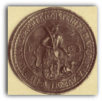
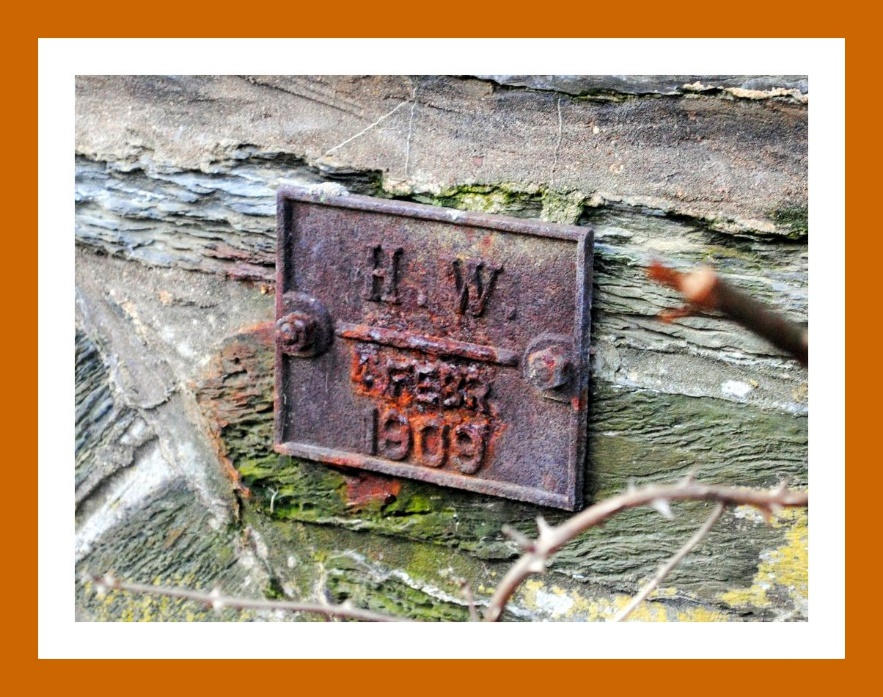
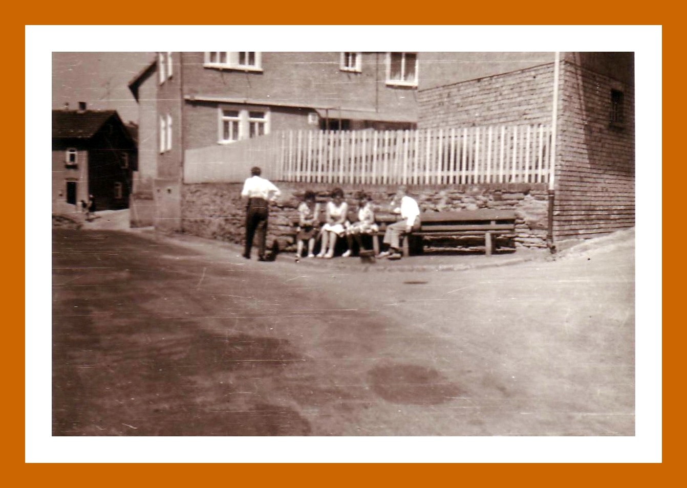
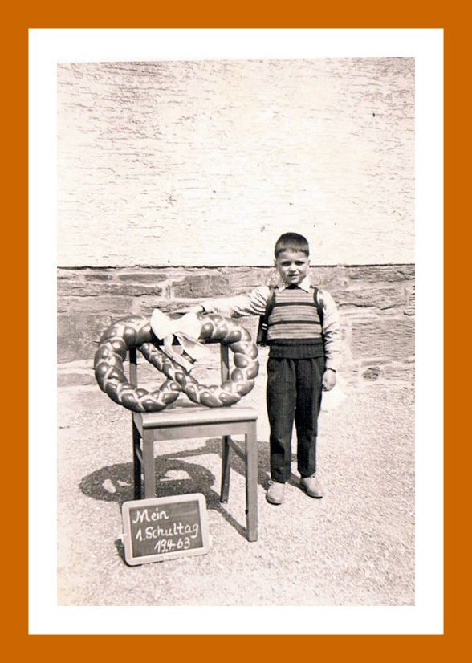
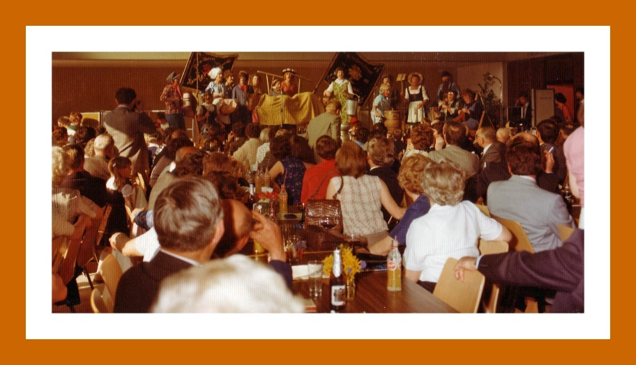
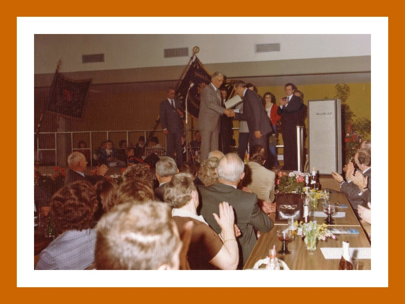
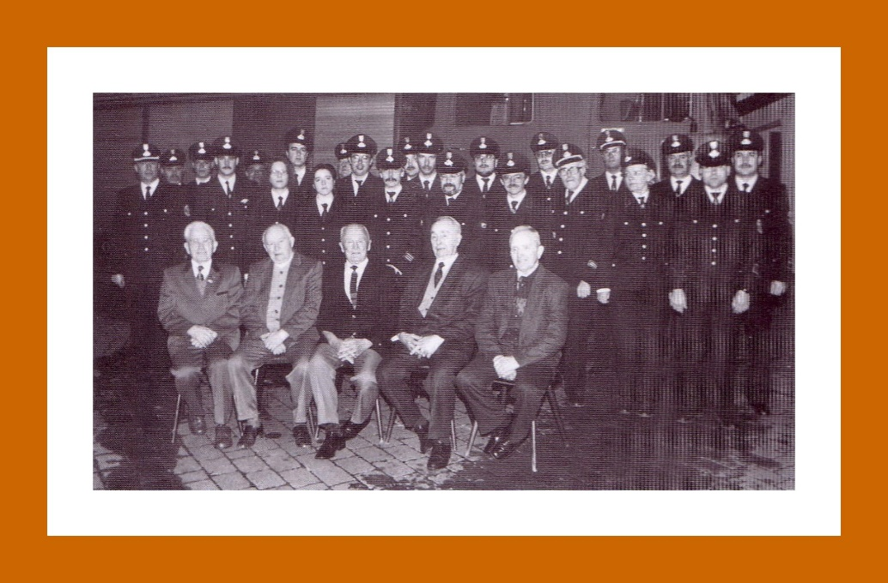
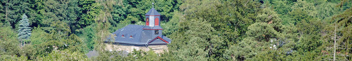
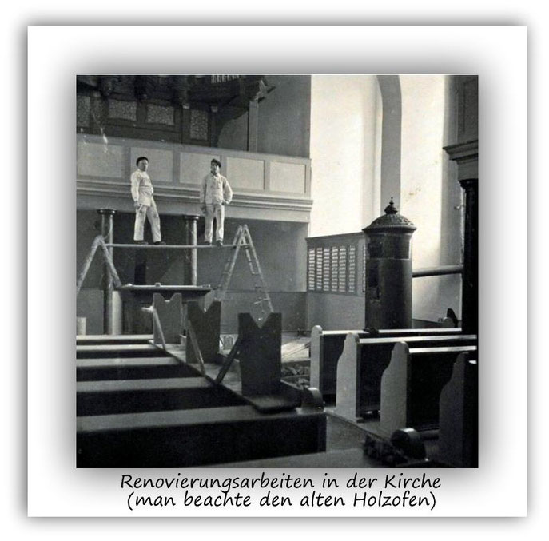
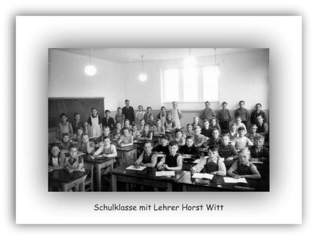

# Kirche und Religion

## 12.6.4Strinzer Pfarrer der Letzte der Region484

12.6.5Der Schuss485

---

## 12.6.10Das Leid des Pfarrer Neumann494

12.6.11Wahr oder Unwahr?496

---

## Der Beiname Margarethä ist kirchlichen Ursprungs. Die heilige Margaretha war eine der 14 Nothelfer. Jedenfalls war die erste Kirche unseres Dorfes der heiligen Margaretha gewidmet.

Demnach hat unser Dorf seinen Namen nach dem Gelände, das der Quellbach der Strinzepha durchfloss und der heiligen Margaretha erhalten.

---

## Gedenktag

Ihr Gedenktag ist in der katholischen Kirche, in der evangelischen und in der anglikanischen der 20. Juli, in der orthodoxen der 17. Juli. In alten Kalendern findet sich auch der 13. Juli. Es ist der Tag, an dem früher die Bauern mit der Ernte begannen.

---

## Der Dekan oder Dechant ist in der römisch-katholischen Kirche der Vorsteher einer Gruppe von Priestern.

(Quelle: Wikipedia)

---

## (Quelle: Wikipedia)

Kirspel

Kirspel (Kirchspiel) bezeichnet ursprünglich einen Pfarrbezirk, in dem die Ortschaften einer bestimmten Pfarrkirche und deren Pfarrer zugeordnet sind. Zum Kirspel StM gehörten neben Strinz-Margarethä auch Oberlibbach, Niederlibbach und Hambach.

---

## Pfarrer: Nicolas Rasor

Bekannte Namensformen

---

## Die Gemeinde liegt mit dem Kloster Bleidenstadt wegen des Zehnten im Streit.(Quelle: Nassauische Analen)

Das Kloster Bleidenstadt wird aufgelöst und in ein adliges Ritterstift umgewandelt. Das Ritterstift behält allerdings das Recht, Abgaben zu erheben und den jeweiligen Pfarrer des Kirchspiels zu ernennen. Dies ist als ein Kuriosum anzusehen, besonders nachdem das Kirchspiel mit seinen Orten evangelisch geworden ist. Nach wie vor aber gehören die Unterhaltungsmaßnahmen an den Kirchen und am Pfarrhaus zu den Pflichten des katholischen Stifts. Nur widerwillig kam es seinen Verpflichtungen nach.

---

## Pfarrer: Johannes Schiffer / Nicolaus Calciator

Ereignisse

---

## Obrigkeiten

Pfarrer: Nicolaus Calciator

---

## Obrigkeiten

Pfarrer: Jacob Hauensteiner

---

## Pfarrer: Jacob Hauensteiner

Statistik

---

## Obrigkeiten

Pfarrer: Adam Dornfelder (Dorfenthaler; Durffendal)

---

## Obrigkeiten

Pfarrer: Adam Dornfelder (Dorfenthaler; Durffendal)

Graf Albrecht von Nassau als Vormund über Graf Johann Ludwig von Nassau-Wiesbaden vererbleiht die mit Erlaubnis des verstorbenen Grafen Philipp errichtete Mühle zu Strinz-Margarethä an Philipp Müller.(Quelle: HHStAW 3001 Nr. 32 fol. 22)

---

## Obrigkeiten

Pfarrer: Adam Dornfelder (Dorfenthaler; Durffendal)

---

## Ereignisse

Auf den Filialen erhält der Pfarrer jede Kirb des Jahres 1 1/2 Wintzel weil dann die letzte Predigt da geschehen muss.

---

## Obrigkeiten

Pfarrer: Adam Dornfelder (Dorfenthaler; Durffendal)

---

## Pfarrer: Adam Dornfelder (Dorfenthaler; Durffendal)

Ereignisse

---

## Obrigkeiten

Pfarrer: Adam Dornfelder (Dorfenthaler; Durffendal)

---

## Obrigkeiten

Pfarrer: Adam Dornfelder (Dorfenthaler; Durffendal)

---

## Obrigkeiten

Pfarrer: Adam Dornfelder (Dorfenthaler; Durffendal); Hieremias Leo

---

## Ereignisse

Hieremias Leo aus Langenschwalbach hält auf der Synode von Idstein seine Probepredigt und unterwirft sich dem Examen, dass er wohl bestanden hat. Als Pfarrer Dorffenthalers Nachfolger wird er am 18. Dezember in StM als Pfarrherr eingesetzt.

---

## Obrigkeiten

Pfarrer: Hieremias Leo

---

## Pfarrer: Hieremias Leo

Ereignisse

Bei der Kirchenvisitation wird für Strinz die Einrichtung einer Schule angeregt. Aber das Beispiel des Schulzen drang nicht durch. Er hatte 10 Gulden beisteuern wollen. Aber "viel under der gemeindt sind unwillig darzu".

---

## Obrigkeiten

Pfarrer: Hieremias Leo

---

## Obrigkeiten

Pfarrer: Hieremias Leo

---

## Pfarrer: Hieremias Leo / Johann Papa

Ereignisse

---

## Obrigkeiten

Pfarrer: Johann Papa

---

## Obrigkeiten

Pfarrer: Johan Papa

---

## Pfarrer: Johan Papa; Georg Gleyberger (Gleyppurgio)

Ereignisse

Pfarrer Johann Papa wird abgesetzt. In einem langen Schreiben verteidigt er sich und bittet, wenn er nicht bleiben könne, um seine Versetzung. Seine 200 Pfarrkinder seien mit ihm zufrieden und so werde man ihn doch nicht mit den Seinen "umb eines oder zweier Willen ins Elend stoßen. 3 Jahre habe er Neuhof mitversehen im Dienst, 3 Jahre haben seine Gegner feindlich darauf getrachtet, ihn ins Elend zu bringen. Einer seine Feinde ist ihm in der Kirche auf seine Frage, warum die Leute nicht zur Kirchenlehre kämen, mit folgenden unnutzen Worten entgegengetreten, dass es mal mag eine Schande sein.

---

## Obrigkeiten

Pfarrer: Georg Gleyberger (Gleyppurgio)

---

## Pfarrer: Georg Gleyberger (Gleyppurgio)

Ereignisse

Das ehemalige Bleidenstadter Gericht als Oberhof hat schon lange keine Bedeutung mehr für StM. Das belegt eine Befragung der ältesten Einwohner von Wehen und StM. Diese wissen nur noch, dass ihre Ur- Ur- Urgroßeltern erzählt hätten, das Bleidenstadt Oberhof sei. Obs aber wahr sei, das wisse man nicht, das sei schon so lange her, dass es doch kein positives Recht mehr sei. Man habe sich seit Menschengedenken nicht an Bleidenstadt gewandt, um sein Recht zu holen, und sie hätten auch nie gehört, dass jemand auf den Gedanken gekommen wäre, sein Recht dort holen zu wollen.

---

## Obrigkeiten

Pfarrer: Georg Gleyberger (Gleyppurgio)

---

## Obrigkeiten

Pfarrer: Georg Gleyberger (Gleyppurgio)

---

## Obrigkeiten:

Pfarrer: Georg Gleyberger (Gleyppurgio) /Johann Heiger

---

## Obrigkeiten

Pfarrer:  Georg Pistorius

---

## Obrigkeiten

Pfarrer: Georg Pistorius

---

## Obrigkeiten

Pfarrer: Georg Pistorius

---

## Pfarrer: Georg Pistorius

Allgemeine Ereignisse

---

## Obrigkeiten

Pfarrer: Georg Pistorius

---

## Pfarrer: Georg Pistorius

Allgemeine Ereignisse

---

## Pfarrer: Georg Pistorius

Allgemeine Ereignisse

Wenn auch die Bewohner unserer Region und die Schweden friedlich zusammenleben, sieht es in unserer Heimat nicht sehr rosig aus. Die vor den Schweden zurückweichenden Ligisten waren von der Pest durchseucht und ließen die schlimme Krankheit im Taunus zurück. Viele Menschen fallen der Krankheit zum Opfer. Vielfach finden keine Beerdigungen mehr statt. Die Leichen verwesen unbeerdigt oder werden von freilaufenden Hunden gefressen.

---

## Pfarrer: Georg Pistorius

Allgemeine Ereignisse

Am 5. und 6. September findet eine große Entscheidungsschlacht bei Nördlingen statt, die die Schweden und Protestanten verlieren. Große Scharen von Schweden flüchten nach Mainz, durchqueren dabei unsere Region. Der Weg der zuvor so angesehenen Schweden ist gezeichnet durch Raub, Mord und Plünderungen. Was sich die Schweden bei Ihrer Flucht durch unsere Heimat an Grausamkeiten und Scheußlichkeiten leisten ist himmelschreiend. Sie wetteifern förmlich untereinander bei den Plünderungen der Dörfer.

Viele Dorfbewohner flüchten, weil sie auch von den nachdrängenden katholischen kaiserlichen Truppen nichts Gutes zu erwarten haben, da sich Nassau mit den protestantischen Schweden verbündet hatte.Unsere Heimat wird nach mehreren Scharmützel von den kaiserlichen Truppen unter Generalmajor von Benninghausen besetzt, was abermals zu Verwüstungen führt. Die Schweden liefern sich von Mainz aus immer wieder kleinere Gefechte mit von Benninghausen, die sie aber immer verlieren.

Nachdem von Benninghausen von hier abgezogen ist, kommen die Schweden über den zugefrorenen Rhein mit dem ausdrücklichen Befehl Wehen, Neuhof, Orlen, Hahn, Wingsbach, Seitzenhahn, Born und Breithard zu plündern. StM ist nicht aufgeführt. Alles was sich mitnehmen lässt wird gestohlen. Die Schweden haben es besonders auf Fenster, Türen, Heu, Stroh und jedes Hausgerät abgesehen. Täglich kommen 30-40 Wagen über den zugefrorenen Rhein, um die Beute nach Mainz zu fahren. Die Bauern schaffen es, sich gelegentlich zu wehren, müssen dann aber bei nächster Gelegenheit die harte Faust der Soldaten umso schlimmer spüren.

---

## Obrigkeiten

Pfarrer: Georg Pistorius

---

## Pfarrer: Georg Pistorius

Allgemeine Ereignisse

---

## Pfarrer: Johann Buttenius (Vertretung aus Auroff); Johann Meinhard Midieus (Vertretung aus Trinitatis)

Allgemeine Ereignisse

---

## Obrigkeiten

Pfarrer: Johann Buttenius (Vertretung aus Auroff); Johann Meinhard Midieus (Vertretung aus Trinitatis)

---

## Obrigkeiten

Pfarrer: Johann Buttenius (Vertretung aus Auroff); Johann Meinhard Midieus (Vertretung aus Trinitatis)

---

## Pfarrer: Johann Buttenius (Vertretung aus Auroff); Johann Meinhard Midieus (Vertretung aus Trinitatis)

Allgemeine Ereignisse

---

## Obrigkeiten

Pfarrer: Vertretung aus Breithardt

---

## Da die umliegenden Pfarrstellen am Ende des 30jährigen Krieges unbesetzt sind, hat der Breithardter Pfarrer mehrere Orte, darunter Strinz zu versehen.

(Quelle: Kleine Chronik des Ortes Hohenstein-Breithardt / Pfarrer Weinberger)

---

## Pfarrer: Vertretung aus Breithardt

Allgemeine Ereignisse

---

## Obrigkeiten

Pfarrer: Vertretung aus Breithardt

---

## Obrigkeiten

Pfarrer: Vertretung aus Breithardt

---

## Pfarrer: Vertretung aus Breithardt

Ereignisse

---

## Obrigkeiten

Pfarrer: Vertretung aus Breithardt

---

## Obrigkeiten

Pfarrer: Vertretung aus Breithardt

---

## Obrigkeiten

Pfarrer: Vertretung aus Breithardt

---

## Obrigkeiten

Pfarrer: Johann Albert Steinbach

---

## Obrigkeiten

Pfarrer: Johann Albert Steinbach

---

## Obrigkeiten

Pfarrer: Johann Albert Steinbach

---

## Obrigkeiten

Pfarrer: Johannes Neumann

---

## Ereignisse

Erste Taufe eines Kindes in Niederlibbach durch den neuen Pfarrer Johannes Neumann.

---

## Obrigkeiten

Pfarrer: Johannes Neumann

---

## Pfarrer: Johannes Neumann

Ereignisse

---

## Obrigkeiten

Pfarrer: Johannes Neumann

---

## Pfarrer: Johannes Neumann

Ereignisse

---

## Obrigkeiten

Pfarrer: Johannes Neumann

---

## Obrigkeiten

Pfarrer: Johannes Neumann/ Lehrer: Andreas Leoni, gewesen Pfarrer zu Michelbach

---

## Ereignisse

Erste urkundliche Erwähnung eines Lehrers in Strinz. Es handelt sich um Andreas Leoni, der zuvor Pfarrer in Michelbach war. Als ihm ein Söhnlein geboren wurde waren unter den Taufpaten der Sohn des Wehener Pfarrers Fischer und die Tochter des Strinzer Pfarrers Johan Neumann, Anna Catharina.

---

## Obrigkeiten

Pfarrer: Johannes Neumann

---

## Obrigkeiten

Pfarrer: Johannes Neumann

---

## Pfarrer: Johannes Neumann

Ereignisse

---

## Obrigkeiten

Pfarrer: Johannes Neumann / Albert Steinbach?

---

## Obrigkeiten

Pfarrer: Johannes Neumann

---

## Obrigkeiten

Pfarrer: Johannes Neumann

---

## Pfarrer: Johannes Neumann

Ereignisse

Joh. Georg Schrumpf und Konsorten verkaufen das sogenannte Rühlesche Gut zu Strintz-Margarethae der Landesherrschaft zur Vergrößerung des Georgenthaler Hofgutes für 600 Gulden; die letztere aber vertauscht diese Güter zum Teil wieder an die Gemeinde Strintz-Margarethae gegen den Rebersbacher Wiesengrund, wobei die Gemeinde 225 Gulden bar herauszahlt und verkauft davon Haus und Hof mit Gärten an die Geschwister Metern für 200 Gulden.(Quelle: HHStAW 133 Nr. U 403)

---

## Pfarrer: Johannes Neumann

Ereignisse

---

## Pfarrer Johannes Neumann verliert seine Frau (Tochter eines Schultheißen). Sie wird im Kirchenchor christlich begraben.

(Alte Strinzer Chronik, Band I, Seite 52)

---

## Obrigkeiten

Pfarrer: Johann Albert Steinbach

---

## Obrigkeiten

Pfarrer: Johannes Neumann

---

## Ein Sohn von Pfarrer Neumann verstirbt kurz vor seiner Hochzeit an Fleckfieber.(Quelle: Alte Strinzer Chronik, Band 1, Seite 52) (Siehe auch unter: Das Leid des Pfarrer Neumann)

Tausch der Stiftzehnten zu Idstein, Wörsdorf und Wallrabenstein gegen die fürstlich nassauischen Zehnten zu Born, Adolfseck, Steckenroth, Strinz-Margarethae und Holzhausen(Quelle: HHStAW 14 Nr. 689)

---

## Obrigkeiten

Pfarrer: Johannes Neumann

---

## Pfarrer: Johannes Neumann

Ereignisse

---

## Obrigkeiten

Pfarrer: Johannes Neumann

---

## Ereignisse

Pfarrer Neumann verliert in diesem Jahr zwei Söhne. Einen davon durch Mord.(Quelle: Alte Strinzer Chronik, Band 1, Seite 52)(Siehe auch unter: Das Leid des Pfarrer Neumann)

---

## In StM ereignet sich eine "Gretchentragödie".(Quelle: Alte Strinzer Chronik)Siehe auch unter: Eine Gretchentragödie

Die Frau von Johann Philipp Enders gebärt während Kirch und Gottesdienst zwischen 10 und 11 Uhr ein Söhnlein, welches schon Mittwochs darauf begraben werden muss.(Quelle: Gemeindearchiv Hünstetten)

---

## Obrigkeiten

Pfarrer: Johannes Neumann

---

## Pfarrer: Johannes Neumann

Allgemeine Ereignisse

---

## Pfarrer: Johannes Neumann

Ereignisse

---

## Obrigkeiten

Pfarrer: Johannes Neumann; Heinrich Rhod

---

## Obrigkeiten

Pfarrer: Heinrich Rhod

---

## Pfarrer: Heinrich Rhod

Ereignisse

---

## Obrigkeiten

Pfarrer: Heinrich Rhod / Schuldheiß: Johann Peter Rücker

---

## Obrigkeiten

Pfarrer: Heinrich Rhod / Lehrer: Johann Niedhorn

---

## Obrigkeiten

Pfarrer: Heinrich Rhod

---

## Pfarrer: Heinrich Rhod

Bekannte Namensformen

---

## Pfarrer: Heinrich Rhod

Ereignisse

---

## Obrigkeiten

Pfarrer: Heinrich Rhod

---

## Pfarrer: Heinrich Rhod

Ereignisse

5. August 1726Revers des Grafen Friedrich Ludwig von Nassau etc. (-Ottweiler) ausgestellt zugleich im Namen der Nassauischen Agnaten Walramischen Stammes für den Dechanten Wildericus Marsilius Freiherrn von Hoheneck und das Kapitel des S. Ferrutius Stiftes zu Bleidenstadt über Empfang der von diesen zu Lehen rührenden zwei Vogteien zu Würges und Kirberg und der vier Dörfer Strinz-Margarethae, der beiden Libbach und Hambach.

---

## Obrigkeiten

Pfarrer: Heinrich Rhod; Johannes Kaspar Becker

---

## Für dieses Jahr ist das Vorhandensein einer Orgel in der alten Strinzer Kirche nachweisbar. Das belegt eine alte Kirchenrechnung aus diesem Jahr.(Quelle: Internetseite der ev. Kirche StM)

Die zwischen dem Hof Georgenthal und den anstoßenden Gemeinden Steckenroth, Wingsbach und Strinz-Margarethae entstandenen Differenzen wegen der Beholzigung und Weide.(Quelle: HHStAW 133 Nr. Steckenroth 32)

---

## Pfarrer: Johannes Kaspar Becker

Ereignisse

---

## Schultheiß: Johann Peter Enders

Pfarrer: Johannes Kaspar Becker

---

## Die Kirche zahlt dem Schulmeister 10 Albus Jahreslohn wegen der Schlagung (Red.: Spielen) der Orgel.(Quelle. HStA: W133, R3188, StM Kirchenrechnungen)

Der Dechant Wildericus Marsilius Freiherr von Hoheneck und das Kapitel des S. Ferrutius Stiftes zu Bleidenstadt belehnen den Grafen Carl August von Nassau zugleich für die Fürsten und Grafen von Nassau etc. Carl den Älteren und Wilhelm Heinrich den Jüngeren mit den vom Stift zu Lehen rührenden zwei Vogteien zu Würges und Kirberg und den vier Dörfern Strinz-Margarethae, den beiden Libbach und Hambach.(Quelle: HHStAW 131 Nr. U 424)

---

## Pfarrer: Johannes Kaspar Becker

Ereignisse

---

## Obrigkeiten

Pfarrer: Johannes Kaspar Becker

---

## Pfarrer: Johannes Kaspar Becker

Ereignisse

---

## Obrigkeiten

Pfarrer: Johannes Kaspar Becker

---

## Obrigkeiten

Pfarrer: Johannes Kaspar Becker

---

## Ereignisse

Die Kirche bezahlt eine Rechnung an den Orgelmacher Weißhaupt aus Idstein(Quelle: HStA: W133, R3188, StM Kirchenrechnungen)

---

## Pfarrer: Pfarrer: Johannes Kaspar Becker /Johann Peter Freyberger

Ereignisse

---

## Pfarrer Johannes Kaspar Becker wird nach Wehen versetzt.(Quelle: Wehen und sein Grund / Dr. Eduard Wilhelmi)

Neuer Pfarrer wird Johann Peter Freyberger

---

## Pfarrer: Johann Peter Freyberger

Ereignisse

---

## Die Kirche bezahlt die Rechnung des Orgelmeisters Cristian Kötzler aus Frankfurt für die Stimmung der Orgel.(Quelle: HStA: W133, R3188, StM Kirchenrechnungen)

Die den Gemeinden Breithardt, Steckenroth, Hennethal, Strinz-Margarethae und Holzhausen über Aar koppelpflichtig zustehende Breitloh und dessen Rodung zu Fruchtland

---

## Obrigkeiten

Pfarrer: Johann Peter Freyberger

---

## Ereignisse

Die Kirche zahlt dem Schulmeister 10 Albus Jahreslohn wegen der Schlagung (Red.: Spielen) der Orgel.(Quelle: HStA: W133, R3188, StM Kirchenrechnungen)

---

## Obrigkeiten

Pfarrer: Johann Peter Freyberger

---

## Ereignisse

Die Kirche bezahlt die Rechnung des Orgelmeisters Cristian Kötzler aus Frankfurt für die Stimmung der Orgel.(Quelle: HStA: W133, R3188, StM Kirchenrechnungen)

---

## Obrigkeiten

Pfarrer: Johann Peter Freyberger

---

## Pfarrer: Johann Peter Freyberger

Ereignisse

---

## Obrigkeiten

Pfarrer: Johann Peter Freyberger

---

## Ereignisse

Pfarrer Freyberger erstattet Anzeige gegen Witwer Johannes Enders (den Mittleren), weil er sich eine neue Frau nehmen will, welche leibliche Geschwisterkinder sind und zudem die Fastenzeit sehr nahe sei. Enders verweist auf die Umstände seine Haushaltung und darauf, dass die Tochter seines Bruders auch Hochzeit halten will. Sein ersuchen wir noch 3 mal abgelehnt.(Quelle: Gemeindearchiv Hünstetten)

---

## Die Kirche bezahlt die Rechnung des Orgelmeisters Cristian Kötzler aus Frankfurt für die Stimmung der Orgel.(Quelle: HStA: W133, R3188, StM Kirchenrechnungen)

Streitigkeiten in Sachen der Gemeinde Strinz-Margarethae contra das Oberforstamt zu Idstein, puncto turbat. posessionis in dem 'Staud- oder Steinwald'.(Quelle: HHStAW 133 Nr. Strinz-Margarethae 26)

---

## Obrigkeiten

Pfarrer: Johann Peter Freyberger

---

## Obrigkeiten

Pfarrer: Johann Peter Freyberger

---

## Pfarrer: Johann Peter Freyberger

Ereignisse

Eine Aufstellung aus diesem Jahr zählt u. a. StM als in der Heu-, Frucht- und Grummet-Ernte dem Hof Georgenthal frohnpflichtig auf. Den Frohnpflichtigen steht pro Arbeitstag "1 wohlgebackenes Brod sodann 1/2 Mass trankbahres Bier" zu.(Quelle: Kleine Chronik des Ortes Hohenstein-Steckenroth mit Hofgut Georgenthal / Pfarrer Weinberger)

---

## Pfarrer: Johann Peter Freyberger

Inschrift in einem Haus in der Schulstraße

---

## Die Kirche zahlt dem Schuldiener Alberthi zu Oberems 2 Gulden.

(Quelle: HStA: W133, R3188, StM Kirchenrechnungen)

---

## Obrigkeiten

Pfarrer: Johann Peter Freyberger

---

## Pfarrer: Johann Peter Freyberger / Lehrer: Daniel Bachmann

Ereignisse

---

## Die Kirche bezahlt den Schulmeister Daniel Bachmann.(Quelle: HStA: W 133, R 3188 / Kirchenrechnungen)

Berufung des Theologiekandidaten Freyberger aus Strinz-Margarethä zum Vikar in Dörsdorf(Quelle: HHStAW 142 Nr. 110)

---

## (Quelle: Hessisches Staatsarchiv, Wiesbaden, Abt. 131 Nr. U 438)

Die Kirche bezahlt den Schulmeister Daniel Bachmann.(Quelle: HStA: W 133, R 3188 / Kirchenrechnungen)

Der Dechant Johann Franz Freiherr von Hoheneck und das Kapitel des S. Ferrutius Stiftes zu Bleidenstadt belehnen den Fürsten Carl (Christian) von Nassau (Weilburg) zugleich für die Fürsten Wilhelm Heinrich und Carl von Nassau etc. mit den zwei Vogteien zu Würges und Kirberg sowie mit den vier Dörfern Strinz-Margarethae, den beiden Libbach und Hambach.(Quelle: HHStAW 131 Nr. U 437)

---

## Die Kirche bezahlt den Schulmeister Daniel Bachmann.(Quelle: HStA: W 133, R 3188 / Kirchenrechnungen)

Die Kirche bezahlt die Rechnung des Orgelbauers Köhler aus Frankfurt für die Stimmung der Orgel durch den Gesellen Johann Sf Lück.(Quelle: HStA: W 133, R 3188 / Kirchenrechnungen)

---

## Pfarrer: Johann Peter Freyberger

Bekannte Namensformen

---

## Obrigkeiten

Pfarrer: Philipp Karl Freyberger

---

## Obrigkeiten

Pfarrer: Philipp Karl Freyberger

---

## Ereignisse

Die Kirche kauft dem Waisenknaben Kilian Franckenfeld ein Hemd für 1 Gulden, 12 Albus und 4 Pfennige.(Quelle: HStA: W 133, R 3188 / Kirchenrechnungen)

---

## Pfarrer: Philipp Karl Freyberger / Lehrer: Johann Martin Joch

Ereignisse

---

## Obrigkeiten

Pfarrer: Philipp Karl Freyberger

---

## Pfarrer: Philipp Karl Freyberger

Lehrer: Johann Martin Joch

---

## Ereignisse

Die Kirche zahlt dem Schultheiß Enders eine Beisteuer zur Reparatur der Uhr (Kirchenuhr?) in Höhe von 20 Gulden.(HStA: W 133, R 3188 / Kirchenrechnungen)

---

## Schultheiß: Enders

Pfarrer: Philipp Karl Freyberger

---

## Schultheiß: Enders

Pfarrer: Philipp Karl Freyberger

---

## Ereignisse

Pfarrer: Philipp Karl Freyberger

---

## Die Kirche zahlt der Witwe Gräfs die Rechnung des Schreinermeisters Kunz von Hennethal, für den Sarg ihres Ehemanns Heinrich Gräfs, in Höhe von 2 Gulden 20 Albus.

(Quelle: HStA: W 133, R 3188 / Kirchenrechnungen)

---

## Obrigkeiten

Pfarrer: Philipp Karl Freyberger, Ernst Gottlob Stritter

---

## (Quelle: HStA: W 133, R 3188 / Kirchenrechnungen)

Siehe auch unter: Der Streitbare Pfarrer Stritter

---

## Pfarrer: Ernst Gottlob Stritter

Lehrer: Johann Martin Joch

---

## Pfarrer: Ernst Gottlob Stritter

Lehrer: Johann Martin Joch

---

## Pfarrer: Ernst Gottlob Stritter; Christian Friedrich Bickel

Lehrer: Johann Martin Joch

---

## Pfarrer: Christian Friedrich Bickel

Ereignisse

---

## Schultheiß: Enders

Pfarrer: Christian Friedrich Bickel

---

## Die Kirche zahlt Schultheiß Enders wegen der umgestürzten Kirchhofsmauer 20 Gulden

(Quelle: HStA: W 133, R 3188 / Kirchenrechnungen)

---

## Pfarrer: Christian Friedrich Bickel

Lehrer: Johann Martin Joch

---

## Obrigkeiten

Pfarrer: Christian Friedrich Bickel

---

## Pfarrer: Christian Friedrich Bickel

Lehrer: Johann Martin Joch (für dieses Jahr wird auch ein Schulmeister Zog erwähnt)

---

## Pfarrer: Christian Friedrich Bickel

Lehrer: Johann Martin Joch (für dieses Jahr wird auch ein Schulmeister Zog erwähnt)

---

## Unter Pfarrer Bickel entsteht ein heftiger Streit, wegen Herstellung der Pfarrgartenumzäunung, die seit dem Siebenjährigen Krieg verkommen ist.

(Quelle: Strinzer Chronik, Teil 1, Seite 128)

---

## Pfarrer: Christian Friedrich Bickel

Lehrer: Johann Martin Joch (für dieses Jahr wird auch ein Schulmeister Zog erwähnt)

---

## Obrigkeiten

Pfarrer: Christian Friedrich Bickel

---

## Pfarrer: Christian Friedrich Bickel; Johann Gottfried Wex

Lehrer: Johann Martin Joch (für dieses Jahr wird auch ein Schulmeister Zog erwähnt)

---

## Ereignisse

Neuer Pfarrer in StM wird Johann Gottfried Wex. Er ist Kaplan und kommt aus Wehen.

---

## Pfarrer: Johann Gottfried Wex

Lehrer: Johann Martin Joch

---

## Obrigkeiten

Pfarrer: Johann Gottfried Wex

---

## Obrigkeiten

Pfarrer: Johann Gottfried Wex

---

## Pfarrer: Johann Gottfried Wex

Schultheiß: Joh. Enders

---

## Pfarrer: Johann Gottfried Wex

Schultheiß: Joh. Enders

---

## Obrigkeiten

Pfarrer: Johann Gottfried Wex

---

## Pfarrer: Johann Gottfried Wex

Schultheiß: Joh. Enders

---

## Obrigkeiten

Pfarrer: Johann Gottfried Wex

---

## Pfarrer: Johann Gottfried Wex

Schultheiß: Joh. Enders

---

## Als Lohn für seine Arbeit als Lehrer bekommt er 6 Klafter Buchen Scheitholz, welches ihm die Gemeindemitglieder frei in den Hof liefern müssen.(Quelle: Alte Strinzer Chronik, Teil 1, Seite 112)

Die Witwe von Lehrer Joch erhält die Besoldung ihres Mannes befristet weiter.

Auf dem Schulspeicher wird ein handgeschriebener Brief von Lehrer Joch gefunden: Inhalt:"Schul=Guth zu Strintz-Margaretha, Verzeichnis dessen, so in der Strintz-Margarethaer Gemarkung liegend, wie folgt gemessen und beschrieben worden".Darin heißt es zum Schluss:Gott helff und segen allen rechtschaffenen Schul=Lehrerdie dieses in Zukunft besitzen werden.(Quelle: Alte Strinzer Chronik, Teil 1, Seite 112)

Das Ritterstift, dass die Nachfolge des Kloster Bleidenstadts antrat, gibt das Pfaffengut in Pacht an Joh. Phil. Faust und dessen Erben.In dem Pachtvertrag heißt es unter anderem: "Er (gemeint ist der Pächter Faust) muss auf dem sog. Ochsengut (Pfaffengut) nicht nur das gewöhnliche Faselvieh auf seine Kosten stellen und unterhalten, sondern annebst unserem Ritterstift alljährlich Michaelis (29. Sept.) nach Bleidenstadt 3 Malter (1 Malter = 128 Liter) Korn und 6 Malter Haber (Hafer) guter und sauberer Frucht entrichten.

---

## Pfarrer: Johann Gottfried Wex

Schultheiß: Joh. Enders

---

## Obrigkeiten

Pfarrer: Johann Gottfried Wex; Johann Gottfried Kolb

---

## Nach dem Tod des Pfarrers Johann Gottfried Wex, wird Johann Gottfried Kolb aus Neuweilnau neuer Pfarrer in StM. Die Kinder von Wex beantragen die befristete Überlassung der Besoldung ihres Vaters.

Unter Pfarrer Wex, der als Wittwer in fortgeschrittenen Alter die Pfarrstelle versah, war das Verhältnis auf "gegenseitige Duldsamkeit eingestellt".

---

## Obrigkeiten

Pfarrer: Johann Gottfried Kolb / Lehrer: Philipp Ferdinand Sauer

---

## Obrigkeiten

Pfarrer: Johann Gottfried Kolb

---

## Pfarrer: Johann Gottfried Kolb

Lehrer: Philipp Ferdinand Sauer

---

## Obrigkeiten

Pfarrer: Johann Gottfried Kolb

---

## Pfarrer: Johann Gottfried Kolb

Lehrer: Philipp Ferdinand Sauer

---

## Obliegenheiten

Pfarrer: Johann Gottfried Kolb

---

## Pfarrer: Johann Gottfried Kolb / Lehrer: Philipp Ferdinand Sauer

Bekannte Namensform

---

## Obrigkeiten

Pfarrer: Johann Gottfried Kolb

---

## Obrigkeiten

Pfarrer: Johann Gottfried Kolb

---

## Pfarrer: Johann Gottfried Kolb

Lehrer: Philipp Ferdinand Sauer

---

## Obrigkeiten

Pfarrer: Johann Gottfried Kolb

---

## Obrigkeiten

Pfarrer: Johann Gottfried Kolb

---

## Pfarrer: Johann Gottfried Kolb

Lehrer: Philipp Ferdinand Sauer

---

## Obrigkeiten

Pfarrer: Johann Gottfried Kolb

---

## Schultheiß: Johann Adam Enders

Pfarrer: Johann Gottfried Kolb

---

## Pfarrer: Johann Gottfried Kolb / Ludwig Imanuel Snell

Lehrer: Philipp Ferdinand Sauer

---

## Ereignisse

Nach der Versetzung von Pfarrer Kolb nach Usingen wird Imanuel Snell aus Usingen neuer Pfarrer in StM.

---

## Ereignisse

Pfarrer Snell bezieht zum ersten Mal sein Pfarrbesoldungsholz

---

## Obrigkeiten

Pfarrer: Ludwig Imanuel Snell / Lehrer: Philipp Ferdinand Sauer

---

## Pfarrer: Ludwig Imanuel Snell

Lehrer: Philipp Ferdinand Sauer

---

## Schultheiß: Johann Emrich Enders

Pfarrer: Ludwig Imanuel Snell

---

## Pfarrer: Ludwig Imanuel Snell

Lehrer: Philipp Ferdinand Sauer

---

## Schultheiß: Johann Emrich Enders

Pfarrer: Ludwig Imanuel Snell, Ludwig Schmidtborn

---

## Neuer Pfarrer in StM wird Ludwig Schmidtborn(Quelle: Alte Strinzer Chronik)(Siehe auch unter: Pfarrer Schmidtborn)

Beginn der Strinzer Kirchenchronik durch den neuen Pfarrer Ludwig Schmidtborn.

(Anmerkung der Red.: Diese wurde durch den Niederlibbacher Heimatforscher Helmut Kurowski aufgearbeitet und mir freundlicherweise zur Verfügung gestellt. Die Inhalte werden in dieser Chronik unter „Auszug aus der Kirchenchronik 1:1 wiedergegeben.)

Im April findet die letzte Einquartierung des Befreiungskrieges statt. In Strinz liegen Soldaten des damals neu errichteten kurhessischen Kontingents.(Quelle: Alte Strinzer Chronik, Teil 1, Seite 126)

---

## Schultheiß: Johann Emrich Enders

Pfarrer: Ludwig Schmidtborn

---

## Schultheiß: Johann Emrich Enders

Pfarrer: Ludwig Schmidtborn

---

## Aus der Kirchenchronik

Gelinder Winter, wohlthätig bei der herrschenden Theuerung. Lebhafter Verkehr; bedeutender Geldumlauf, noch eine Folge der Kriegszeit. Ziemlicher Ertrag der hiesigen Pfarrei in diesem Jahrgang. Die neue Schulordnung. Zweckmäßige Bestimmungen in Betreff des Schulbesuches, dessen Beaufsichtigung sonst nicht ohne Schwierigkeit war. Der erste Schulinspector: Joh. Philipp Gruth, Pfarrer zu Bechtheim. Predigerconferenz am 1. Oct. auf der Hünerkirche wegen der Feier des Reformationsfestes; zahlreiche Versammlungen (die Inspection Idstein umfasst momentan zugleich die ehemaligen Ämter Kirberg u. Katzenelnbogen). Feier des Reformationsfestes am 31. Oct.. Einführung des neuen (reformirten) Ritus beim h. Abendmahl. Passives Verhalten der Gemeinden. Der seit den 1790er Jahren eingeführte Katechismus, das Spruchbuch. Dürftigkeit seines Inhaltes. Die neuen Kirchenbücher. Einführung der Civilstandsregister.

---

## Schultheiß: Johann Emrich Enders

Pfarrer: Ludwig Schmidtborn

---

## Ereignisse

Im März werden 4 Männer und 5 Frauen wegen Holzfrevels bestraft.(Quelle: Alte Strinzer Chronik, Teil 1, Seite 62)

In StM gibt es 42 Haushaltsvorstände, die sich als Schweinebesitzer am Lohn des Schweinehirten zu beteiligen haben, unter ihnen der Pfarrer Schmidtborn und Schullehrer Sauer.(Quelle: Alte Strinzer Chronik, Teil 1, Seite 64)

Die staatliche Getränkesteuer wird von dem Wirt Phil. Adam Friedrich um 15 Gulden für das ganze Jahr gepachtet. Es gibt demnach nur eine Gastwirtschaft im Ort.(Quelle. Alte Strinzer Chronik, Teil 1, Seite 64)

---

## Schultheiß: Johann Emrich Enders

Pfarrer: Ludwig Schmidtborn

---

## Schultheiß: Johann Emrich Enders

Pfarrer: Ludwig Schmidtborn

---

## Schultheiß: Johann Emrich Enders

Pfarrer: Ludwig Schmidtborn

---

## Schultheiß: Johann Emrich Enders

Pfarrer: Ludwig Schmidtborn

---

## Schultheiß: Johann Emrich Enders

Pfarrer: Ludwig Schmidtborn

---

## Schultheiß: Johann Emrich Enders

Pfarrer: Ludwig Schmidtborn

---

## Lehrer: Johann Gottfried Georg

Ereignisse

Schließung der alten Kirche, die keinen Turm besaß und deren Chor nach Osten zeigte, wegen Baufälligkeit. Die Strinzer müssen nun 10 Jahre lang den Gottesdienst in Niederlibbach besuchen.(Quelle: Alte Strinzer Chronik/Schulchronik)

---

## Schultheiß: Johann Emrich Enders

Pfarrer: Ludwig Schmidtborn

---

## Schultheiß: Johann Emrich Enders

Pfarrer: Ludwig Schmidtborn

---

## Schultheiß: Johann Emrich Enders

Pfarrer: Ludwig Schmidtborn

---

## Pfarrer: Ludwig Schmidtborn

Lehrer: Johann Gottfried Georg

---

## Pfarrer: Ludwig Schmidtborn

Lehrer: Johann Gottfried Georg

---

## Aus der Kirchenchronik

Kalte und feuchte Witterung. Besonders anhaltender Regen im September. Beschwerlichkeit der Erndte. Die Verordnung, dass die Pfarrer Schule halten sollen. Vorher schon Bestimmungen wegen der Katechismuslehren, durch welche zwar der precäre Zustand vermittels positiver Zwangsverfügung beseitigt, jedoch die Pflichtigkeit vom 25. Lebensjahr auf das 18. resp. 16. Jahr herabgesetzt ward. Die Verordnung, dass die bespannten Pfarrer beim Bau der Kirche u. Pfarrwohnung mit ihrer Fuhre frohen sollen.

---

## Schultheiß: Johann Emrich Enders

Pfarrer: Ludwig Schmidtborn

---

## Schultheiß: Johann Emrich Enders

Pfarrer: Ludwig Schmidtborn

---

## Schultheiß: Johann Emrich Enders

Pfarrer: Ludwig Schmidtborn

---

## Pfarrer: Ludwig Schmidtborn

Schultheiß: Johannes Enders; Martin Rücker; Friedrich Rücker

---

## Aus der Kirchenchronik

Ungewöhnliche Witterung: rauh und kalt bis zu den ersten Tagen des May, darauf plötzliche und anhaltende Wärme und volle Vegetation, so dass der gewöhnliche Übergang der Frühlingszeit ausfiel. Große Hitze und Dürre während des Sommers u. bis ins Spätjahr. Commission wegen Anlage des neuen Kirchhofs (Begräbnisplatzes); mein vergeblicher Protest gegen den Platz wegen der Entfernung von der Kirche. Widerspenstigkeit des Schullehrers Friedrich und Weigerung desselben bei den Leichen zu singen. Meine Collision mit den Behörden wegen dieses Falles. Geringer Ertrag an Sommerfrucht, besonders aber an Futtergewächsen, das Charakteristische der heißen und trockenen Sommer von jetzt an bis Ende der 1830er Jahre.

---

## Obrigkeiten

Pfarrer: Ludwig Schmidtborn

---

## Einfriedung des neuen Totenhofes mit einer Mauer und einem Tor.

Einweihung der neuen evangelischen Kirche als klassizistischer Saalbau durch Pfarrer Schmidtborn am 02. November.(Alte Strinzer Chronik / Kirchenchronik / Schulchronik)

---

## (Siehe auch unter: Pfarrerssohn verschwindet spurlos)

Aus der Kirchenchronik

Fortsetzung des Kirchenbaues, der langsam voranschritt. Meine neuen Vorbereitungen zur Erbauung eines neuen Viehstalles für die Pfarrei. Einweihung der neuen Kirche am 23. Sonntage nach Trinit., d. 2. November, bei welcher die benachbarten Pfarrer, Bleicherbach von Strinz Trinitatis, Ilgen von Panrod, u. Reiz von Oberauroff, fungierten. Meine Festpredigt über Jerem. 31, 23, 24, 25.

---

## Pfarrer: Ludwig Schmidtborn

Schultheiß: Friedrich Rücker

---

## Pfarrer: Ludwig Schmidtborn

Schultheiß: Friedrich Rücker

---

## Ereignisse

Rechtsstreit der Kirchengemeinden Strinz-Margarethä, Niederlibbach und Hambach, Klägerinnen, gegen das herzogliche Finanzkollegium, Beklagten, wegen Bauung und Unterhaltung der evangelischen Kirche und Pfarrgebäude zu Strinz-Margarethä. (Quelle: HStAW, 210, 2141)

---

## Pfarrer: Ludwig Schmidtborn

Schultheiß: Friedrich Rücker

---

## Pfarrer: Ludwig Schmidtborn

Schultheiß: Friedrich Rücker

---

## Pfarrer: Ludwig Schmidtborn

Schultheiß: Friedrich Rücker

---

## Pfarrer: Ludwig Schmidtborn

Schultheiß: Friedrich Rücker

---

## Pfarrer: Ludwig Schmidtborn

Schultheiß: Friedrich Rücker

---

## Pfarrer: Ludwig Schmidtborn

Schultheiß: Friedrich Rücker

---

## Pfarrer: Ludwig Schmidtborn

Schultheiß: Friedrich Rücker

---

## Pfarrer: Ludwig Schmidtborn

Schultheiß: Friedrich Rücker

---

## Pfarrer: Ludwig Schmidtborn

Schultheiß: Friedrich Rücker

---

## Pfarrer: Ludwig Schmidtborn

Schultheiß: Friedrich Rücker

---

## Ereignisse

Pfarrer Schmidtborn kann 13 Jahre nach der Beantragung endlich seinen Stall bauen.(Quelle: Kirchenchronik)

---

## Pfarrer: Ludwig Schmidtborn

Schultheiß: Friedrich Rücker

---

## Die Gemeinde StM verkauft 2 Klafter Schulholz an die Gemeinde Niederlibbach und erhält dafür 7 Thaler und 40 Kreuzer.

Beginn der Kirchen- Pfarrchronik durch Pfarrer Schmidtborn(Quelle: Alte Strinzer Chronik)

---

## Aus der Kirchenchronik

Spannung in den Erwerbsverhälnissen. Seit Ende des vorigen und Anfang dieses Jahres zeigt sich bei einigen Ortsvorstehern eine sehr feindliche Gesinnung gegen meine Person. Fortwährende Opposition der Schultheißen. Hauptursache dieser Erscheinung: der büreaukratische Druck, dessen äusserste Spitze in der Gewalt der Schultheißen ausläuft, und vielfach zur Mißstimmung aufreizt. Diese Mißstimmung und Gehässigkeit aber kehrt sich zunächst gegen den Pfarrer, dessen Stellung nicht büreaukratisch gewaffnet u. gesichert ist, dennoch aber durch ihre eigenthümliche Selbstständigkeit u. Freiheit Neid und Eifersucht erregt. Machinationen des hier domiciliirten Oberförsters, der zwar durch seine Uebergriffe die öffentliche Meinung offendirt, jedoch mir gegenüber den Demagogen spielt. Man verweigert mir die Auslieferung der Besoltungsfrucht im Libbacher Grund, die dießmal von bedeutendem Werth ist. Ich bewirke im Verlauf des Jan. und Febr. die Lieferung durch Zwangsmaßregeln. In dieser Zeit ließ ich den während der Pachtzeit arg mit Holz überwachsenen Rain am Mühlacker rasieren. Der Oberförster erhebt darüber einen ungeheuren Lärm und läßt einen Waldfrevel über 100 Gulden aufrechnen. Ich gewann diesen Prozeß durch Niederschlagung der Sache bei der L.Regierung. Am 8. April, wo ich bei einer öffentlichen Vergantung ein Grundstück für die Pfarrei durch Verwendung von Reluitionscapital ersteigern lassen wollte, brachten es die Ortsvorsteher auf eine tumulturische Weise dahin, daß die Pfarrei von der Converenz ausgeschlossen ward. Dieselben gingen darauf d. 12. Apr. nach Wiesbaden um eine förmliche Anklage zu machen, u. gaben beim bischöfl. H. Commissaeirs zu Protocoll, ich sey fein(d)selig gegen die Gemeindeglieder gesinnt u. keineswegs ein Pfarrer, sondern ein Bauer. Ungeheurer Schneefall am Sonnt. Miserc. den 18.April. Ich versank mit dem Pferd vor Steckenroth und ich vicarirte für den erkrankten Pf. (Confr. Fenrich) u. gelangte endlich unter großer Anstrengung in den Ort. Nachher schöpfte man mir Bahn, um nach Hause zu kommen. Am 19. April machten in tiefem Schnee die Kirchenvorstände nebst den hiesigen Ortsvorstehern = 11 Mann nach Wehen, um vor d. Decanat Erklärung auf das Klagprotocoll v. d.12. April zu geben. Mit Ausnahme des einzigen Kirchenvorstehers Kimpel v. N.Libbach stimmen sie diesem Protocoll im allgemeinen bei u. begehren „zur Hebung des Christenthums im hies. Kirchspiel“ meine Versetzung auf eine andere und „bessere“ Stelle. Meine Erklärung auf diese Protokolle, in welcher ich meine Umgebung charakterisir u. die ganze Perozedur als eine Eulenspiegelei und Mystification nachweise. Indifferenz der Kirchspielseinwohner bei diesen Vorgängen; sie betrachten die Prozedur instinktartig als den Kampf einer erbitterten Partei u. Dorfaristokraten gegen den bewährten u. überlegenen Pfarrer. Gleichwohl keine reelle Popularität u. Anhänglichkeit an die Person des Pfarrers. Meine rein objektive Haltung. Kein bezüglicher Rapport mit dem Kirchenvorstand, keine Discussion und Erklärung zwischen mir und einem Individuum, wie immer, so auch dießmal. Die Folge war, daß die Gegner nicht wagten, auf ihre Klage eine Resolution zu fordern, die sie auch nie empfingen. Große Theuerung im Frühling und Sommer. So wurde Brod zu ermässigten Preißen auf Staatskosten in den Gemeinden abgegeben. Beim vorherrschen der materiellen Interessen dennoch steigende Unzufriedenheit und Verarmung. In dem hiesigen Kirchspiel jedoch, daß sich auf dem Ackerbau basirt u. räumige Gemarkungen hat, findet bislang keine Uebervölkerung und darum auch keine Auswanderung statt, und es läßt sich nachweisen, daß zerrüttete Vermögensverhälnisse und Notstand, wo sie hierorts sich vorfinden, meistens selbst verschuldet sind. Große Aufregung im hiesigen Ort gegen Ende des Jahres wegen der Übergriffe des Oberförsters Halbey, der die Gemeinde in der ungünstigsten Jahreszeit zum Angriff eines beschwerlichen Wegbaues (in dem Bleidenstadter weg = hohl) vermittelst des Amtes nöthigt, u. sich dadurch beim Bauern verhaßt macht. In diesem Jahr ein enormer Obstertrag (mit einigen Ausnahmen der Zwetschgen) in Folge mehrjährigen Ausruhens der Obstbäume u. dann der etwas spät eingetretenen, darauf aber sehr günstigen Frühlingswitterung.

---

## Pfarrer: Ludwig Schmidtborn

Schultheiß: Friedrich Rücker

---

## Aus der Kirchenchronik

Meine Predigt am Neujahrstage mit Zugrundelegung des Erstev. (Luc 2, 21) über die Frage: Was hat das vergangene Jahr vorbereitet? Meine Ahnungen in Betreff einer Aenderung des bisherigen Weltzustandes. Jedoch vermuthete ich keineswegs, daß eine Katastrophe so nahe sey. In diesem Winter fanden noch zwei Feudaljagden in hiesiger Gemarkung statt. Die herz. Equipagen waren während der Jagd im hiesigen Ort aufgestellt. Den 26. Januar Zusammenkunft der sämmtlichen Orts- und Kirchenvorsteher unter Vorsitz des Amtmannes Schrak (in hies. Pfarrhaus), um mit mir ein Übereinkommen wegen Verwandlung der Pfarrkompetenzfrucht in eine finanz. Geldrente zu treffen. Die Verhandlung hatte kein Resultat, weil ich mich nicht beiließ. Ob dieß vortheilhaft war oder nicht (da der Maßstab der momentanen und letzten Preiße nicht ungünstig war), wird die Zeit lehren. Jedenfalls ist die Erhebung der Besoltungsfrucht in Natur unter den veränderten Verhältnissen (Anwuchs des Proletariats) sehr schwierig. (Noch habe ich (July a c.) aus den verwichenen Jahren an 60 Gulden Geldbeträge wegen nicht gelieferter Competenzfrucht an Parochianen zu fordern). Die Vorgänge am 4. März in Wiesbaden eine wahre Insurrection gegen das monarchische Prinzip und das bisherige büreaukratische System. Von Niederlibbach waren mehrere dabei gegenwärtig. Der schwer gefühlte Druck ging zunächst von der Gewaltsamkeit des Forstwesens und von dem Verhältniß der Domäne aus, deren reicher Ertrag in die landesherrliche Casse floß; sodann von dem Schultheißenamt, dessen Gewalt häufig mißbraucht ward. Große Aufregung in den Gemeinden, die sich selbst zu verwalten beginnen; manche Entsetzungen des Gemeindedienstpersonals, namentlich der Ortsschultheißen. Freies Jagen in den Waldungen. Die meisten Schuldner zahlen nicht. Hier und in der Umgegend fallen jedoch keine neuen Haftexcesse vor. Am Sonntag d. 5. März, abends 10 Uhr, schoss der hiesige Oberförster aus seiner Wohnung über die Straße und suchte darauf unter dem Vorgeben, er sey angegriffen worden, Jemanden, den er erschossen haben wollte. Das eigentliche Motiv dieser That ist noch unbekannt. Wahrscheinlich war derselbe in Folge der plötzlich eingetretenen Veränderung durch Furcht in einen panischen Zustand versetzt. Auf seine Veranlassung erschienen am 9. März zwei Deputierte vom Sicherheitscomittè in Wiesbaden, welche die Gemeinde in der Kirche heranguirten, um sie zu beschwichtigen. Ich lag während dieses Auftritts gerade zu Bett in Folge eines Sturzes vom Pferd. Später Suspension des Oberförsters u. seine Entfernung aus dem Ort. Hier u. da Besoldungs-angriffe und Petitionen gegen die Pfarrer. Ich bin bis jetzt unberührt geblieben; noch ist (d. 8. July a. c.) eine factische Veränderung in dem kirchlichen Zustande nicht eingetreten. D. 29. März Conferenz in dem hiesigen Pfarrhaus, auf welcher sich die Diöcesanen über die neuen Ereignisse bezüglich aussprachen und beratheten. Urwahlen am 18. April, in der Kirche Gottesdienst und Fürbitte wegen des Nationalparlaments in Frankfurt a.M. am Sonnt., Rogate, d. 28. May. Meine bezügliche Predigt auf Grund des Sonntagsevangeliums. Predigerconferenz im hiesigen Pfarrhaus d. 30.Juni, um wegen der etwaigen Propositionen auf der bevorstehenden Spezialsynode zu berathen. Diese Synode ward d. 18. September in Wehen gehalten. Sie bestand aus den Geistlichen des Decanats und aus den Deputirten für jede Kirchengemeinde. Die meisten Laien bestanden darauf, daß ihr Stand auf der Synode der Geistlichkeit gegenüber doppelt vertreten ward. Gegen Ende des Jahres wurde auf dem Filial, besonders auf Betrieb des Schultheißendienstes enthobenen J. Ph. Grund zu N. Libb. eine heftige mit vielen Unterschriften versehene Schmähschrift gegen den Schullehrer Staadt daselbst aufgesetzt und eingegeben. Zugleich wurde eine Schmähschrift gegen mich verfaßt, die hierorts spärlicher u. meistens von Restanten der Pfarrcompetenz und vorigen Pfarrgutspächtern unterzeichnet ward. Beide Schriften beabsichtigten die Versetzung des Pfarrers und Schullehrers von welcher die Petitionäre sich eine eigenthümliche Satisfaction (nach Vorgängen an anderen Orten) und einen größeren Spielraum für ihre Leidenschaften versprachen. Dieselben gingen mir von der Behörde zur Erklärung zu, in welcher ich sie gebührend abfertigte. Unter den aufgelösten Verhältnissen kam auch eine große Corruption zum Vorschein; im Übrigen ist die Moralität des großen Haufens zu keiner Zeit hoch anzuschlagen.

---

## Die Ortsvorstände beginnen einen Prozeß gegen Pfarrer Schmidtborn um das Pfarrbesoldungsholz.

(Quelle: Alte Strinzer Chronik)

---

## Obrigkeiten

Pfarrer: Ludwig Schmidtborn

---

## Klage des Staatsministeriums gegen das evangelische Kirchspiel Strinz-Margarethä wegen Anerkennung einer Pflicht zur Unterhaltung von Gebäulichkeiten. (Quelle: HStA, 290, 279)

Beginn von Streitigkeiten bzgl. da auf der Zinkenmühle ruhenden Bannpacht.(Quelle: HHStAW 250/1 Nr. 123)

Aufstellung der Barockorgel in der Strinzer Kirche. Diese stammt aus Niederingelheim und wird für 150 Gulden gekauft. Sie wird von Orgelbauer Voigt aus Igstadt aufgestellt.(Quelle: Alte Strinzer Chronik, Teil1, Seite 114)

---

## Obrigkeiten

Pfarrer: Ludwig Schmidtborn

---

## Obrigkeiten

Pfarrer: Ludwig Schmidtborn

---

## Der Lehrer Philipp Ferger wird von Arnoldsheim nach Strinz-Margarethä versetzt.(Quelle: Verordnungsblatt des Herzogtums Nassau, Band 57, Seite 389)

Feier zum 50. Dienstjubiläum von Pfarrer Schmidtborn.(Quelle: Alte Strinzer Chronik, Teil 1, Seite 97 - 100)

---

## Obrigkeiten

Pfarrer: Ludwig Schmidtborn

---

## Als erster "echter Preuße" wird August Keiper am 09.10. in StM geboren.(Quelle: Alte Strinzer Chronik, Teil 1, Seite 102)

Beschwerde über den protestantischen Pfarrer Schmidtborn in Strintz-Margarethä(Quelle: HHStAW 402 Nr. 188)

---

## Obrigkeiten

Pfarrer: Ludwig Schmidtborn

---

## Pfarrer Schmidtborn erkrankt an einem bösartigen Rücken- oder Nackentumor und kann erst nach 16 Wochen wieder Gottesdienst abhalten.(Quelle: Alte Strinzer Chronik, Teil 1, Seite 100)

Müllers August Bott von der Zinkenmühle bei Strinz-Margarethä fordert eine Entschädigung für aufgehobenes Bannrecht.(Quelle: HHStAW 405 Nr. 881)

---

## Schülerzahl: 91

Ereignisse

Pfarrer Schmidtborn wird von einem leichten Hirnschlag getroffen infolge dessen er seine Sprache und Sprachfertigkeit fast gänzlich verliert und wird nach 55 Jahren Seelsorgerschaft in StM pensioniert.(Quelle: Alte Strinzer Chronik, Teil 1, Seite 100 / Schulchronik)

---

## Neubau einer Schule an derselben Stelle neben der Kirche, wo die alte Schule stand.(Quelle: Alte Strinzer Chronik, Teil 1, Seite 120)

(Siehe auch unter: Die neue Schule)

---

## Obrigkeiten

Pfarrer: E. Doerr

---

## Ereignisse

Neuer Pfarrer wird der ehemalige Volksschullehrer Fr. G. Grünschlag.(Quelle: Alte Strinzer Chronik)

---

## Obrigkeiten

Pfarrer: Fr. G. Grünschlag

---

## Obrigkeiten

Pfarrer: Adolf Mai

---

## Schlechte Ernten - es fehlt an Korn.(Quelle: Alte Strinzer Chronik)

Feier zum 400. Geburtstag von Luther in der Kirche. Lehrer Kopp aus Niederlibbach hält einen Vortrag.(Quelle: Strinzer Chronik, Teil 1, Seite 115)

---

## Obrigkeiten

Pfarrer: Adolf Mai

---

## Obrigkeiten

Pfarrer: Ad. Klas (Pfarrverwalter); Ernst Schilp

---

## Obrigkeiten

Pfarrer: Ernst Schilp

---

## Ereignisse

Da Pfarrer Schilp Anstalten macht sich zu verheiraten, werden seitens der Gemeinde die Schäden am Pfarrhaus beseitigt. Die Renovierung der Zimmer übernimmt Schilp auf eigene Kosten.(Quelle: Alte Strinzer Chronik, Teil 1, Seite 6)

---

## Nach 25jähriger Tätigkeit in StM tritt Lehrer Ferger am 01. April in den Ruhestand.(Quelle: Alte Strinzer Chronik, Teil 1, Seite 116)

Neuer Lehrer in StM wird Julius Emil Schicht, aus Kallkappen.(Quelle: Alte Strinzer Chronik, Teil 1, Seite 116)

Pfarrer Schilp verheiratet sich mit Christiane Catharina Mathilda Paula Koch, Tochter der Eheleute August Koch und Philippine geb. Stemmler aus Erbenheim.(Quelle: Alte Strinzer Chronik, Teil 2, Seite 6)

Zum Andenken an seine Hochzeit und Dankbarkeit gegen die Gemeinde, die sich bis dahin sehr zuvorkommend gezeigt hat, gründet der Pfarrer im November eine kleine Volksbibliothek, die von den Bürgern gut angenommen wird.(Quelle: Alte Strinzer Chronik, Teil 2, Seite 6)

---

## Obrigkeiten

Pfarrer: Ernst Schilp

---

## Obrigkeiten

Pfarrer: Ernst Schilp

---

## Die zwei Gesangsvereine feiern eine Doppelfahnenweihe. Pfarrer Schilp hält die Festrede. Leider ist das Fest total verregnet.(Quelle: Alte Strinzer Chronik, Teil 2, Seite 10)

StM hat einen Selbstmord zu verzeichnen. Es ist der "Balgtreter" Adam Gruber der sich an der Strinzer Pfarrscheune erhängt.(Quelle: Alte Strinzer Chronik, Teil 2, Seite 10)

---

## Obrigkeiten

Pfarrer: Ernst Schilp

---

## Obrigkeiten

Pfarrer: Ernst Schilp

---

## Obrigkeiten

Pfarrer: Ernst Schilp

---

## Ereignisse

Die Kirche erhält eine neue Turmuhr die von Kosthage und Söhne zu Beuer angefertigt ist. Diese wurde in Hannover gekauft und kostete 1.200,- Mark.(Quelle: Alte Strinzer Chronik, Teil 2, Seite 11, Kirchenchronik)

Auf Anweisung des Königlichen Landrates von Trotha wird der Bau eines Pissoirs in der Schule angeordnet. Der Bau wird im Sommer ausgeführt und kostet 285 Mark.(Quelle: Strinzer Chronik, Teil 1, Seite 121)

---

## Obrigkeiten

Pfarrer: Ernst Schilp

---

## Obrigkeiten

Pfarrer: Ernst Schilp

---

## Obrigkeiten

Pfarrer: Ernst Schilp

---

## Obrigkeiten

Pfarrer: Ernst Schilp

---

## Obrigkeiten

Pfarrer: Ernst Schilp

---

## Obrigkeiten

Pfarrer: Ernst Schilp

---

## Obrigkeiten

Pfarrer: Ernst Schilp

---

## Durch den Verkauf eine Kuh wird der Landmann Heinrich Hankammer - aufgrund der Inflation - zum ersten Millionär in StM.(Quelle: Kirchenchronik / Pfarrer Schilp)(Siehe auch unter Erster Millionär)

Neuregelung der Organistenbesoldung. Der Organist erhält ab sofort 1 Klafter Holz und spielt dafür alle 14 Tage.(Quelle: Alte Strinzer Chronik/Band 2 Seite 29)

---

## Obrigkeiten

Pfarrer: Ernst Schilp

---

## Obrigkeiten

Pfarrer: Ernst Schilp

---

## Obrigkeiten

Pfarrer: Ernst Schilp

---

## Lehrer Großmann wird zum Vorsitzenden des Schulvorstandes gewählt. Pfarrer Schilp hatte zuvor dieses Amt freiwillig niedergelegt.(Quelle: Schulchronik / Alte Strinzer Chronik, Band 2, Seite 29)

Wahlen

---

## Obrigkeiten

Pfarrer: Ernst Schilp

---

## Obrigkeiten

Pfarrer: Ernst Schilp

---

## Obrigkeiten

Pfarrer: Ernst Schilp; Meneke (Vertretung aus Trinitatis), Schmidt (Vertretung aus Breithardt)

---

## Obrigkeiten

Pfarrer: Meneke (Vertretung aus Trinitatis); Schmidt (Vertretung aus Breithardt)

---

## Obrigkeiten

Pfarrer: Walter Maus; Meneke (Vertretung aus Trinitatis); Schmidt (Vertretung aus Breithardt); Gottwald (Vertretung aus Kettenbach)

---

## Ereignisse

Die Bauern des Ortes werden verpflichtet, ab sofort Ihre Erträge an den Reichsnährstand zu melden.(Siehe auch unter: Lückenlose Kontrolle)

Im Mai wird die Pfarrstelle mit dem mit dem Pfarrverwalter Maus besetzt. Er erteilt einige Wochen den Religionsunterricht. Aus politischen Gründen wird ihm die Weitererteilung untersagt. Der gesamte Religionsunterlicht liegt daraufhin wieder in den Händen des Lehrers.(Quelle: Schulchronik / Strinzer Chronik, Band 2, Seite 31)(Siehe auch unter: Pfarrer flieht in die Wehrmacht)

---

## Obrigkeiten

Pfarrer: Walter Maus + Gottwald (Vertretung aus Kettenbach)

---

## Obrigkeiten

Pfarrer: Gottwald (Vertretung aus Kettenbach)

---

## Ereignisse

Einweihung des ersten Strinzer Kindergartens nach einer zweijährigen Bauzeit. Die Schnitzerei über dem Eingang stammt von dem Idsteiner Bildhauer Ferdinand Abt.

---

## Obrigkeiten

Pfarrer: Gottwald (Vertretung aus Kettenbach)

---

## Obrigkeiten

Pfarrer: Gottwald (Vertretung aus Kettenbach)

---

## Ereignisse

Nutzung des neben dem Pfarrhaus gelegenen Konfirmantensaal zum Gottesdienst, um Heizkosten zu sparen.

---

## Obrigkeiten

Pfarrer: Gottwald (Vertretung aus Kettenbach)

---

## Obrigkeiten

Pfarrer: Adloff

---

## Obrigkeiten

Pfarrer: Adloff

---

## Obrigkeiten

Pfarrer: Adloff; Hefter (Vertretung aus Breithardt)

---

## Obrigkeiten

Pfarrer: Hefter (Vertretung aus Breithardt)

---

## Obrigkeiten

Pfarrer: Hefter (Vertretung aus Breithardt); Fritz Roth

---

## Gründung des Singkreises StM durch den Pfarrer Fritz Roth.

Die Gemeinde tritt dem Bertelsmann-Lesering bei und richtet eine Gemeindebücherei ein. Lehrer Horst Witt wird als Leiter der Bücherei benannt.

---

## Aufgrund der hessischen Gemeindeordnung werden die Wohnplätze "Haus Utthoff" und "Jagdhaus" in "Am Orler Weg" umbenannt.(Quelle: Hess. Staatsarchiv, Wiesbaden)

Der neue Pfarrer Fellner übernimmt den Singkreis von Pfarrer Roth

---

## Renovierung der Kirche

Einstellung von Fräulein Brigitte Jäkel als zweite Lehrerin in StM. Die Schule wird damit zweiklassig.(Quelle: Strinzer Chronik)

---

## (Siehe auch unter: Die Strinzer Orgel)

Bau einer Lagerhalle für das Warengeschäft der Raiffeisenkasse e.G.m.b.H.(Quelle: Helmut Hartwig)

Kircheneinweihung nach erfolgter Renovierung. Die Restaurierung der Kirche und der Orgel dauerte drei Jahre. Während dieser Zeit hielt der Pfarrer den Gottesdienst im Pfarrsaal. Der Dekan Dr. May weihte das verschönerte Gotteshaus wieder ein(Quelle: Alte Strinzer Chronik)

---

## Pfarrer: A. Hilbrig (Pfarrvikarin)

Ortsvorsteher: Werner Petri

---

## Pfarrer: A. Hilbrig (Pfarrvikarin)

Ortsvorsteher: Werner Petri

---

## Ereignisse

Verschwisterung mit der französischen Gemeinde Aube (Normandie). 100 Besucher aus Aube/Normandie besuchen Strinz-Margarethä. Zu dem offiziellen Programm dieses Besuches gehört eine gemeinsame Ausflugfahrt auf dem Rhein, das Pflanzen eines normannischen Apfelbaums in den Bornwiesen und vor allem die Verschwisterungszeremonie in der Kirche. Den geselligen Abschluss findet die Veranstaltung mit dem Waldfest, das ganz unter dem Zeichen deutsch-französischer Freundschaft abgehalten wird.

---

## Pfarrer: T. Hilbrig

Ortsvorsteher: Werner Petri

---

## Pfarrer: T. Hilbrig

Ortsvorsteher: Werner Petri

---

## Pfarrer: T. Hilbrig

Ortsvorsteher: Werner Petri

---

## (Quelle: Alte Strinzer Chronik)

2 x Einweihung Aubachhalle

---

## Instandsetzung mehrerer Ortsstraßen.

Pfarrer Hilbrig und seine Ehefrau lassen sich aus eigenem Wunsch nach Altenstadt bei Büdingen versetzen. Pfarrer Beyweihs übernimmt vertretungsweise die Seelsorge in StM.(Quelle: Alte Strinzer Chronik)

---

## Pfarrer: Beyweihs (Vertretung aus Breithardt)

Ortsvorsteher: Werner Petri

---

## Pfarrer: Hoppe

Ortsvorsteher: Werner Petri

---

## Ereignisse

Pfarrer Hoppe wechselt von Bleidenstadt nach StM.

---

## Pfarrer: Hoppe

Ortsvorsteher: Werner Petri

---

## Pfarrer: Hoppe

Ortsvorsteher: Werner Petri

---

## Festgottesdienst zum 150jährigen Bestehen der Strinzer Kirche. Pfarrer Hoppe läd zu einem Festgottesdienst und Gemeindefest ein.(Quelle: Strinzer Chronik)

Abriss der im Eigentum der Raiffeisengenossenschaft befindlichen alten Dreschhalle zur Errichtung eines Gebäudes für das Bankgeschäft.(Quelle: Helmut Hartwig)

---

## Pfarrer: Hoppe

Ortsvorsteher: Ernst Losert

---

## Pfarrer Hoppe, der in StM 5 Jahre lang seinen Dienst verrichtete tritt in den Ruhestand.(Quelle: Alte Strinzer Chronik)

Baubeginn am örtlichen Kanalnetz.(Quelle: Alte Strinzer Chronik)

---

## Pfarrer: Dr. Jürgen Noack

Ortsvorsteher: Ernst Losert

---

## Pfarrer: Dr. Jürgen Noack

Ortsvorsteherin: Christa Enders

---

## Pfarrer: Dr. Jürgen Noack

Ortsvorsteherin: Christa Enders

---

## Gründung des Schüler-Orchesters innerhalb der Musikfreunde StM e.V..Der im Vorjahr gegründete Obst- und Gartenbauverein legt sich eine gebrauchte Kelter zu.

Feierliche Wiedereröffnung der Strinzer Kirche nach 6monatiger Renovierung, die insgesamt 300.000,- DM kostete.(Quelle: Archiv der Gemeinde Hohenstein)

---

## Pfarrer: Dr. Jürgen Noack

Ortsvorsteherin: Christa Enders

---

## Pfarrer: Dr. Jürgen Noack

Ortsvorsteherin: Christa Enders

---

## Pfarrer: Dr. Jürgen Noack

Ortsvorsteherin: Christa Enders

---

## Pfarrer: Dr. Jürgen Noack

Ortsvorsteherin: Christa Enders

---

## In den nächsten Kapiteln könnt Ihr Euch über die Strinzer Chronisten informieren.

Pfarrer Ludwig Schmidtborn

Pfarrer Ludwig Schmidtborn kann man getrost auch als einen DER Strinzer Chronisten bezeichnen. Er war sehr fleißig in Bezug auf das Führen der Kirchenchronik, wodurch wir viel aus der Zeit des 19. Jahrhunderts erfahren können.

---

## Bis auf den heutigen Tag ist in unserem Dorf das Andenken an den "alten" Pfarrer Schmidtborn lebendig geblieben, der in der Seelsorge ebenso tüchtig war wie in der Landwirtschaft.

Schmidtborn hielt streng auf Kirchenzucht und schickte eine junge Mutter mit drohend erhobenem Stock nach Hause, weil sie den ersten Gang nach ihrer Entbindung ins Dorf machen wollte, statt, wie es sich gehörte, in die Kirche zu gehen.

---

## Sein Nachfolger, Pfarrer Grünschlag, bezeichnete den verstorbenen Kirchenrat Schmidtborn als einen reichbegabten, höchst originellen Mann.

Schmidtborns Thesen unter der Lupe

---

## Ein Beitrag von Helmut Hartwig

Wiedereinführung des Frondienstes

Da für eine gute Entlohnung dieser Arbeiten kein Geld zur Verfügung stand machte man sich den „Frondienst“ zu Nutze, d.h., dass alle Haushaltungen und die Bauern zu „Hand- und Spanndiensten“ herangezogen wurden. Die Bauern, die ein Pferd hatten, mussten sogenannte „Spanndienste mit ihrem Fuhrwerk leisten, während der „Haushaltsvorstand“ der übrigen Familien   mit Hacke und Schaufel (Hack un Schipp) arbeiten musste. Haushaltsvorständen der Evakuierten und z.T. auch der Flüchtlingsfamilien fiel diese Arbeit besonders schwer, da viele noch nie mit Hack un Schipp geschafft hatten und vielfach auch den Sinn der Arbeiten nicht erkennen konnten.

Eine besondere Herausforderung kam auf die Frondienstleistenden zu, als das Brennholz für die Schule und die Kirche aus dem „Holzwald“ angefahren wurde. Mehr als 40 Fuhren bestes Scheidholz sollten, wie das bisher üblich war, etwa je zur Hälfte auf dem alten Schulhof und hinter dem Pfarrhaus, da wo heute das Ehrenmal steht, abgeladen werden. Es kam aber anders, denn offenbar hatten sich die Fuhrleute dahingehend geeinigt, das gesamte Brennholz unten in der Scheidertalstraße, bei der Kirchentreppe zu entladen, worüber sich zunächst niemand wunderte.

Vielleicht wollte man es ja später hochfahren. Aber weit gefehlt, sollten es doch die Frondienstler die Treppe hochtragen. Die Fuhrleute (Spanndienstleistenden) hatten die Ausrede: „ de Parre leid`s nit, dess mir do nuffer fohrn“.  Diese Ausrede ist insofern nicht glaubwürdig, dass der Kirchenvorstand darüber zu befinden hat, ob die Fuhrleute die Auffahrt benutzen können oder nicht. Als im Dorf bekannt wurde, dass die Frondienstler gezwungen werden sollen ca. 60 – 70 Raummeter Holz die Kirchentreppe hoch zu tragen, nur, weil es „de Parre nit leid“ das man es mit dem Fuhrwerk hochfährt, wie man weiterhin fest und steif behauptet hat, waren die Betroffenen empört und wütend. Das waren mittelalterliche Methoden und eine Schande, wie man die Leute drangsalierte.

---

## Taufe

Die Taufe der Kleinen fand in der Kirche statt. Die "Pettern und Gothen", wie man hier die Taufpaten nennt, spielten bei den Kindern eine große Rolle. Bei ihnen konnte sich das Kind zu den Festen ein Geschenk abholen. Man besuchte sich gegenseitig und fragte den Paten gern um Rat, besonders bei der Schulentlassung.

---

## Zudem wird in der Strinzer Kirche die diamantene und goldene Konfirmation gefeiert.

Der Wandertag

Jede Familie hatte früher eine zahlreiche Kinderzahl. Es gab Familien, bei denen am Mittagstisch 10 bis 12 Personen saßen. Wenn die Buben und Mädchen die Schulpflicht hinter sich hatten, konnten nicht alle auf dem elterlichen Hof bleiben. Die Buben suchten sich eine Lehrstelle oder Arbeitsstelle bei den Bauern. Die Mädchen verdingten sich meistens in einem landwirtschaftlichen Betrieb oder nahmen eine Stellung in einem städtischen Haushalt an. Damals gab es kaum Lehrstellen für junge Mädchen.

Wenn diese Jungen und Mädchen ihre Arbeitsplätze wechselten und sich als Dienstboten bei einer neuen Herrschaft - wie man früher zu sagen pflegte - verdingten, begleitete die Jugend des Dorfes die Dienstboten. Mit einem Pferdefuhrwerk brachte man das Gepäck zur neuen Arbeitsstelle. Abends traf sich dann die Jugend in der Wirtschaft, wo der Umzug gefeiert wurde. Dieser Umzug fand immer am 3. Weihnachtsfeiertag statt und bekam den Namen "Wandertag".

---

## Die Hochzeit

Bei der Hochzeit wurde am Polterabend Glas und Porzellan vor die Tür geworfen. Scherben bringen Glück. Kam das Paar am Hochzeitstag aus dem Haus und wollte zur Kirche gehen, so sah es den Weg durch Seile versperrt. Wenn dann die Hochzeitsgesellschaft Bonbons und Geldstücke auswarf, gaben die Kinder den Weg frei; das wiederholte sich mehrmals.

Die Hochzeitsfeier spielte sich im Haus der Braut ab oder im Dorfgemeinschaftshaus. Am Hochzeitsabend kamen die Burschen und Mädchen aus dem Dorf vor das Haus, sangen Lieder und gratulierten. Neben Volksliedern hörte man Ehestandslieder. Die jugendlichen Sänger bekamen für ihr Ständchen Kuchen, Wein und oft ein Fässchen Bier gespendet.

---

## Ostern

Das erste kirchliche Fest im Kalenderjahr ist Ostern. Bevor die Kinder zum Gottesdienst gingen, sah man sie mit Körben von Haus zu Haus eilen. Bei ihren Paten und Verwandten suchten sie die buntgefärbten Eier, die in Haus, Scheune oder Garten versteckt waren. Mit ihren gefüllten Körbchen liefen sie strahlend nach Hause. Am Nachmittag trafen sich mehrere Kinder an einem Wiesenhang, wo das "Eierschibbeln" (Eierrollen) begann. Derjenige, dessen Ei am weitesten rollte wurde Sieger und erhielt das gewonnene Ei. Um die Osterzeit bekam auch der Schornsteinfeger von jeder Familie frische Eier.

---

## ich wollt bei Gott, er käm nie retour!"

"Ich bin`s dem du gebrochen hast die Treu`,

---

## Hier könnt Ihr euch Strinzer Geschichten anschauen, die zeitlich nicht genau zuordnet werden konnten. Vom Glaube unserer Vorfahren, bis hin zum wichtigen Feuerschutz in alter Zeit.

Woran unsere Vorfahren glaubten

Unsere ältesten Vorfahren glaubten an Wodan (Odin), Ziu und die Göttin Freya. Den heiligen Hain auf einem Hügel hielten sie für die Wohnung der Götter. Hier trafen sich die Bewohner aus der näheren Umgebung und brachten den Göttern Opfer dar. Für viele Jahrhunderte blieb Donar (Thor) - der Gott der Kraft und des Gewitters - die volkstümliche Gestalt.

Die Mönche vom Kloster Bleidenstadt hatten einen schweren Stand, um unsere Vorfahren von ihrem Götterglauben abzubringen. Deshalb sagten sie: "Die Götter, an die Ihr glaubt sind falsche Götter. Ihr seid auf dem falschen Weg. Der Berg, auf dem Ihr dem Donargott opfert ist in Wirklichkeit ein Höllenberg, und der Pfad der dorthin führt ist ein Teufelspfad. Wenn Ihr weiter diesen Weg geht und den falschen Gott anbetet, kommt Ihr direkt in die Hölle. Geht lieber zu der Stelle, wo wir das Kreuz des Heilands aufgestellt haben, dort ist der Engelsgarten".

---

## "Terminatio eccleasiae sancti Ferrutii in Blidenstadt" (Abgrenzung der Kirche des heiligen Ferrutius in Bleidenstadt).

In dieser Grenzbeschreibung wird zum ersten Mal der Bach Strinzepha genannt und an einer anderen Stelle derselben Urkunde begegnet uns die Wendung "ad Strincephan flumen" (bis an den Strinzer Bach); gemeint ist wahrscheinlich der Aubach von der Michelbacher Hütte bis zur Fischbachmündung in Hennethal.

---

## Wer sich heimlich verlobt und unzüchtig lebt, darf nicht mit dem Kranz zur Kirche gehen.

(Es existieren zwei Erklärungen zum Kranz: Eine nicht mehr jungfräuliche Braut, die Strohjungfer, musste nach altem Brauch bei der Hochzeit einen Strohkranz tragen. Die unbescholtene Braut durfte sich dagegen im Myrtenkranz präsentieren. Die andere Version ist, dass die jungfräuliche Braut einen geschlossenen Kranz trug und die nicht mehr jungfräuliche Braut oder Witwe einen offenen(Quelle: Wikipedia.)

Wer sich nicht bessert, kommt in den Turm, an den Pranger oder kann aus dem Land oder Amt verwiesen werden. Ein Ehebrecher oder eine Ehebrecherin sollen gefoltert und nach Überführung mit dem Schwert hingerichtet werden. Die Grade der Blutsverwandtschaft, die zur Eheschließung hinderlich sind, sollen genau beobachtet werden.

---

## Die alte Kirche in der die

Ehefrau von Pfarrer Neumann

begraben wurde.

---

## GOTT verzeihe den Mördern und verleihe diesem,

meinem lieben filio (Sohn) eine fröhliche Auferstehung.

---

## Bei der Leichenpredigt wählt Pfarrer Stein folgende Worte:

"Ich habe Lust abzuscheiden und bei Christus zu sein, welches auch nicht besser wäre."

---

## Der damalige Pfarrer Schmidtborn berichtet, dass die Kopfbedeckung und das blonde Haar der Pfarrersfrau noch vollkommen kenntlich waren.

Der alte Grabstein wurde in der heutigen Kirche im Chor, an dem Familienstuhl des Pfarrers, aufgestellt und eingemauert.

---

## "Nachfolgend eine Geschichte, deren Wahrheitsgehalt nicht nachgewiesen werden kann."

Ein Kind namens "Misere"

Im Untertaunuskreis gibt es die Sage, dass in der "Franzosenzeit" ein fremdes, verlassenes Kind gefunden wurde und der Pfarrer von Strinz-Margarethä das einsame Kind "Misere" genannt und getauft habe, was übersetzt so viel wie "Elend" bedeutet.

---

## Die Sage vom hartherzigen Pfarrer

Von einem Pfarrer erwartet man ein offenes Herz und eine offene Hand für die Armen.

Zu StM lebte jedoch der Sage nach zu Beginn des 19. Jahrhunderts ein Geistlicher, der war geizig und hartherzig.Wie viele Pfarrer jener Zeit betrieb er nebenher eine Landwirtschaft und wurde wohlhabend dabei.

Kam aber in den damaligen Hungerjahren ein Armer an seine Tür und bat um ein Stück Brot, dann schnitt er zwar ein dicke Scheibe vom Laib, reichte sie ihm aber nicht, sondern warf sie in den Trog zum Schweinefutter und jagte den Bettler weg. Das tat er unter lautem Lachen.Daher war man im Dorfe froh, als er starb und ein neuer Geistlicher ins Pfarrhaus zog. Doch darin war es, wie er bald erfuhr, nicht mehr geheuer.

---

## IN DER EIR GOTTES LUDEN ICH VIGAND KALWORT GOS

Der Friedhof dieser Kirche befand sich im direkten Umfeld der Kirche.

---

## Kirchenneubau

Der Strinzer Lehrer Friederich berichtete - in der mittlerweile verschollenen Schulchronik -  von den Kirchenbauarbeiten und überliefert uns ein gutes Bild von den damaligen Aktivitäten. In der Kirchenchronik, die seinerzeit von dem amtierenden Pfarrer Schmidtborn geführt wurde, wird der Kirchenneubau nur am Rande erwähnt.

---

## Der damalige Pfarrer Schmidtborn berichtet, dass die Kopfbedeckung und das blonde Haar der Pfarrersfrau noch vollkommen kenntlich sind.

Der alte Grabstein wird in der neuen Kirche im Chor, an dem Familienstuhl des Pfarrers, aufgestellt und eingemauert.

---

## Darüber hinaus sind bis zu 1.000 Menschen anwesend.

Der Zug auf den Bauplatz mit Gesang, wird von einem Blasorchester begleitet.

Der Grundstein liegt, wenn man durch die Haupttüre geht, zwischen der Flügeltür nach der Kirche und der Tür rechts nach der Empore, in der Ecke, ein Schuh unter dem Sockel. Darin befindet sich eine Messingplatte mit dem eingravierten Namen des Bauinspektors, des Kirchenvorstandes und Namen des Lehrers.

---

## Aus der Kirchenchronik:

Beginn des neuen Kirchenbaues. Provisorische Verlegung des Begräbnisplatzes auf den Schulgarten. Feierliche Legung des Grundsteines zur neuen Kirche am 31. October.

---

## Die Aufsicht über den ganzen Kirchenbau führte Herr Amtswerkmeister Laux aus Wehen.

Aus der Strinzer Chronik:

Verlegung des neuen Totenhofes neben diesen und zwar nach dem Ort zu, da das Ochsengut/Pfaffengut auf dem der neue Totenhof angelegt wurde, wegen der Verpflichtung zur Haltung des Faselviehts, nicht bebaut werden durfte. Es waren schon 12 Leute dahin beerdigt worden die umgebettet wurden. Der Ortsgeistliche, Pfarrer Schmidtborn, lehnte es ab, den neuen Totenhof einzuweihen.

---

## Aus der Kirchenchronik:

Commission wegen Anlage des neuen Kirchhofs (Begräbnisplatzes); mein vergeblicher Protest gegen den Platz wegen der Entfernung von der Kirche. Widerspenstigkeit des Schullehrers Friedrich und Weigerung desselben bei den Leichen zu singen. Meine Collision mit den Behörden wegen dieses Falles.

---

## Fortsetzung des Kirchenbaues, der langsam voranschritt.

Einweihung der neuen Kirche am 23. Sonntage nach Trinit., d. 2. November, bei welcher die benachbarten Pfarrer, Bleicherbach von Strinz Trinitatis, Ilgen von Panrod, u. Reiz von Oberauroff, fungierten. Meine Festpredigt über Jerem. 31, 23, 24, 25.

---

## (Quellen: Lehrer Friedrich Jakob Friederich in der Schulchronik / Übertragen in die Strinzer Chronik von Rektor Richard Weißer  / Strinzer Chronik, Teil 1, Seite 72 - 76 / Kirchenchronik)

Renovierungsarbeiten in der Kirche (man beachte den Holzofen)

---

## Alle im Ort amüsierten sich darüber, denn schon am nächsten Morgen hatte der Betrag noch kaum einen Wert.

(Quelle: Alte Strinzer Chronik / Kirchenchronik, Pfarrer Schilp)

---

## (Quelle: Zeitgenössische Zeitungsausschnitt / Verlag unbekannt)

Einweihung der neuen Schule

---

## Kirchenrenovierung

Da die im 19. Jahrhundert erbaute Strinzer Kirche in die Jahre gekommen war, musste diese in den 60er Jahren des 20. Jahrhunderts umfangreich renoviert werden. Die Kirche wurde seinerzeit auf einem alten Friedhof errichtet. Sie war seinerzeit ohne jegliche Isolierung direkt "auf den Boden" gesetzt worden.

---

## In 3 Bauabschnitten wurde die Kirche renoviert.

Erster Bauabschnitt

---

## Die Glocke muss gehen

In der Strinzer Kirche gab es zwei Glocken.

---

## (Quelle: Alte Strinzer Chronik, Teil 2, Seite 18, Kirchenchronik)

15. Juli 1917Die beiden großen Glocken heute zum letzten Mal zum Gottesdienst geläutet.Abends 20:00 Uhr Geläut mit beiden Glocken zum Abschied für 15 min.

---

## Wir haben dann das Pferd eingespannt und sind aufs Feld gefahren; auf den Hügel hinauf, die Futterrüben holen, die dort in einem Silo lagen. Das waren meine ersten Erfahrungen als Bauer.

Im Prinzip hatten Sie sich wohlgefühlt in Strinz. Ist Ihnen aber nie der Gedanke gekommen abzuhauen, zurück nach Frankreich?

Nein. Am Anfang mit meinem Kameraden, der so gut deutsch sprach, da hatten wir schon von Flucht gesprochen. Aber da es schon eine ganze Menge gab die ausgerissen waren und nicht weit gekommen sind und dann wieder in ein anderes Lager kamen, wo es viel schlimmer zugegangen ist, haben wir den Gedanken verworfen. Wir haben uns gesagt, das ist eine Zeit, die man überstehen muss. Mein Gott, es war kein Luxus aber wir wurden ernährt und nicht schlecht behandelt. Es war halt Kriegsgefangenschaft. So haben wir halt beschlossen zu bleiben. Als dann die Wachleute an die russische Front abgezogen wurden durften wir uns frei bewegen und das letzte Jahr habe ich dann auf dem Hof geschlafen. Dort hatte ich dann mein eigenes Zimmer und ein Bett.

---

## Das nachfolgend aufgeführte Gedicht hat der Strinzer Wilhelm Petri für seinen gefallen Freund geschrieben und an Weihnachten in der Kirche vorgesungen:

Weihnacht ist´s in allen Landen, beten Eltern, Weib und Kind,möge Gott auch sie bewahren,unsere tapferen Kriegerscharen,die fern auf dem Schlachtfeld sind.

---

## Weihnacht ist in fremder Erde,ruht im Grab ein deutscher Held,Gott bewahre seine Lieben,vor dem Feind ist er geblieben,schlummre sanft du deutscher Held.

Weihnacht ist’s ein heilger Friede,lag auf Erden weit so weit,Weihnacht ist’s in allen Herzen,Weihnacht ist’s für alle Schmerzen,ruhe sanft auf Wiedersehn,ruhe sanft auf Wiedersehn.

---

## Sogenannte „Fußer“, die als Panzersperrarbeiter in der Rheingegend eingesetzt waren, marschieren schwer bepackt und von den Strapazen gezeichnet vorbei. Das geht den ganzen Tag so.

Es findet eine Doppeltaufe der 2 Enkelkinder von Rektor Weißer in der Lehrerwohnung statt. Trotz der Gefahr durch Tiefflieger ist Pfarrer Gottwald mit dem Rad hierfür aus Kettenbach gekommen.

Ursprünglich wollte man mit der Taufe warten, bis wenigsten ein Kindsvater auf Heimaturlaub ist, um der Taufe beiwohnen können. Die herannahenden amerikanischen Truppen verlangen jetzt aber nach einem schnellen Handeln. Der Obergefreite Dr. jur. Frank aus Berlin, der bei der Familie Weißer einquartiert ist, übernimmt die Rolle des Taufpaten für ein Kind. Das zweite Kind wird von der Kindergartenleiterin Fräulein Gudrun Daeke aus der Taufe gehoben.

---

## Tagebucheinträge meiner Tante

Im Tagebuch meiner Tante Maria Fauser steht: "Am nächsten Tag, um halb sieben, ich war gerade am Waschen, knatterten MG Schüsse im Dorf. Wir stürzten in den Keller, und schon schrie eine Stimme - ein verwundeter Soldat. Die ganze Nacht waren deutsche Truppe zu Fuß, auf Leiterwagen, auf alle nur möglichen Arten durch das Dorf gezogen, eine traurige, geschlagene Armee.

Und nun der andere Morgen! Nach den MG-Schüssen und dem fürchterlichen Stöhnen des Verwundeten, der direkt auf der Straße vor unserem Haus liegen musste, folgte noch eine Detonation auf die andere. Wir konnten uns nicht recht erklären, woher es kam. Ich wäre gerne einmal vors Haus gegangen, um nach den Soldaten zu sehen, aber ich musste ja das Kind halten.

Auf einmal läutete die Kirchenglocke, da ging ich hinaus: mitten im Dorf brannte es lichterloh, Frau Pfarrer läutete, kein Mann war da, um die Spritze zu holen. Nach einer Weile ging ich auf die Straße, da kam singend der erste Amerikaner, dahinter standen die Panzer, den ganzen Weg nach Breithardt hinauf.

---

## Inzwischen war auch das Postauto da und hat die Post gebracht und geholt.

Um 11:00 Uhr wird in der Kirche geläutet, als Zeichen für die Bauern im Feld, sich langsam auf den Heimweg zu machen.

