# Bräuche und Traditionen

## Dieser Brauch stammt noch aus der Zeit als es keine Hausnummern gab und jedes Haus mit einem eigenen Namen versehen wurde, meist mit dem Namen des ursprünglichen Eigentümers.

Hier wird der Versuch gestartet, Ihnen einmal Ihnen einen Überblick zu hierüber zu verschaffen.

---

## (Quelle: Hessisches Staatsarchiv)

2x Strinzer Kerb

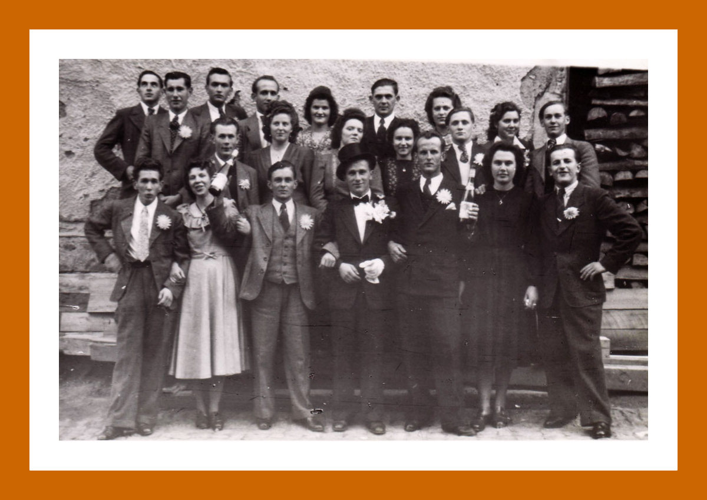

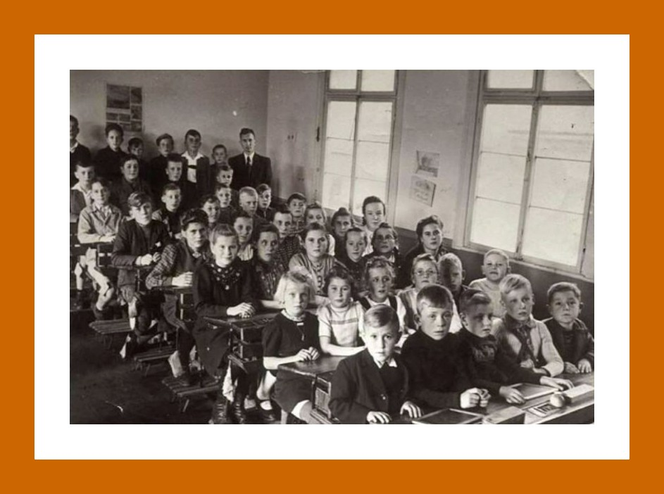

---

## Am Hieße Stein       Einschulung

2 x Strinzer Kerb

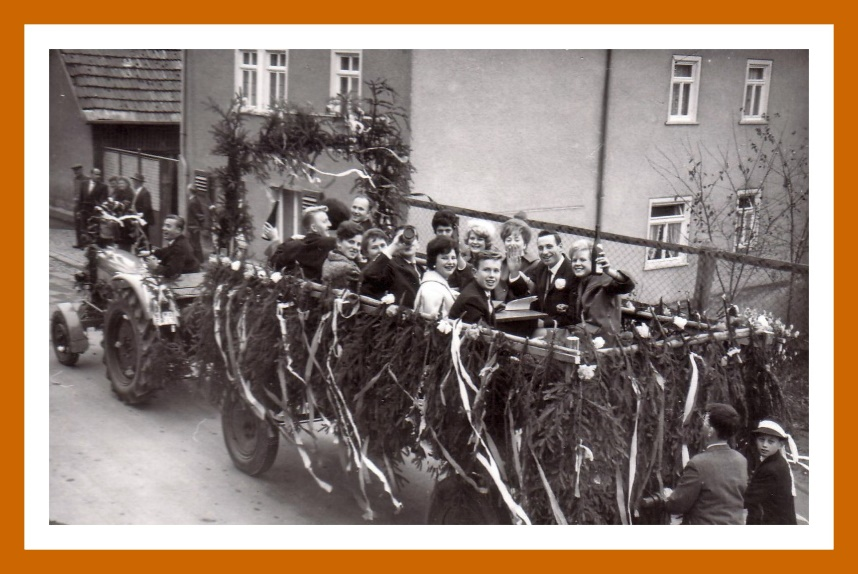

---

## Der MGV feiert sein 85jähriges Bestehen. Es beteiligen sich Gastvereine, Tanzgruppen des Turnvereines und der Frauensingkreis.(Quelle: Alte Strinzer Chronik)

Die Kerbegesellschaft lädt alle Einwohner zur Kerb ein. Leider kann der Gemeinschaftsraum nicht alle Bürger aufnehmen. Dies soll sich im nächsten Jahr ändern, wenn das Dorfgemeinschaftshaus gebaut wird. Seit mehreren Jahren steht der Gemeinde kein Saal mehr zur Verfügung. Gastwirt Klein hat seinen Saal an eine Firma verpachtet, die dort Waren lagert.(Quelle: Alte Strinzer Chronik)

---

## Zur diesjährigen Kerb eröffnet in der Zinkenmühle eine Gaststätte. Nun besitzt das Dorf 4 Gastwirtschaften.(Quelle: Alte Strinzer Chronik)

Grundsteinlegung Aubachhalle

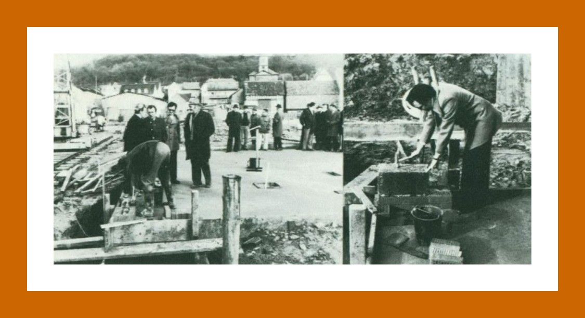

---

## (Quelle: Aarbote)

Zum Anlass der 800jahr-Feier baut der Schmiedemeister Willi Klein ein fahrbares Riesenrad für die Tanzgruppe des TV Strinz. Dieses geht als "Willimobil" in die Strinzer Geschichte ein.(Siehe auch unter: Das Willimobil)

---

## (Quelle: Alte Strinzer Chronik)

Impressionen der 800-Jahr Feier

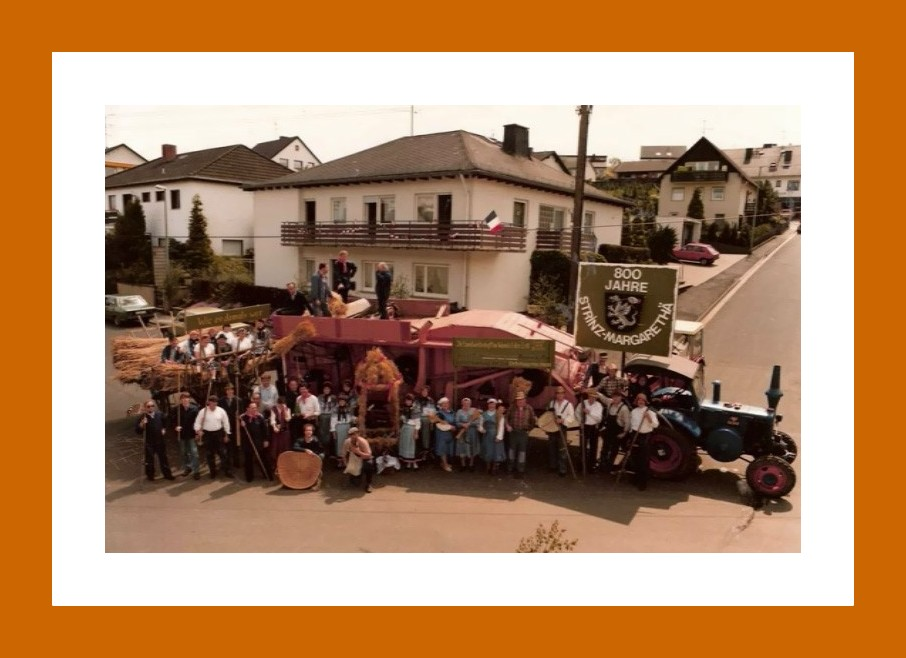

---

## 2 x Kerb

Luftbild

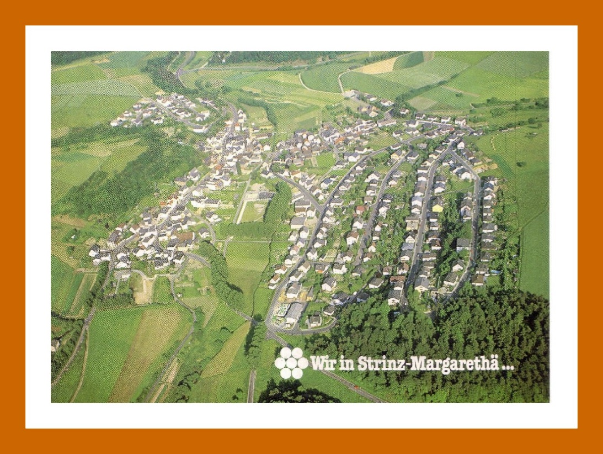

---

## Baubeginn der Erdgasleitung(Quelle: Alte Strinzer Chronik)

Kerb                                                                                       Schließung der Milchsammelstelle

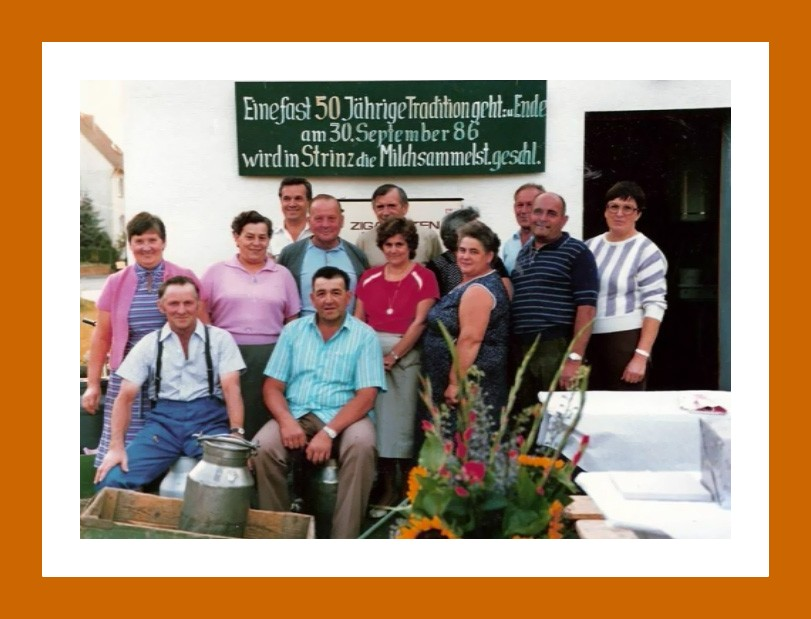

---

## Wahlber. 726 / Wähler 564 / Gültig 556 / SPD 194 / CDU 249 / FDP 56 / Grüne 55 / DKP 1 / ÖDP 1

Kerb             Konfirmation

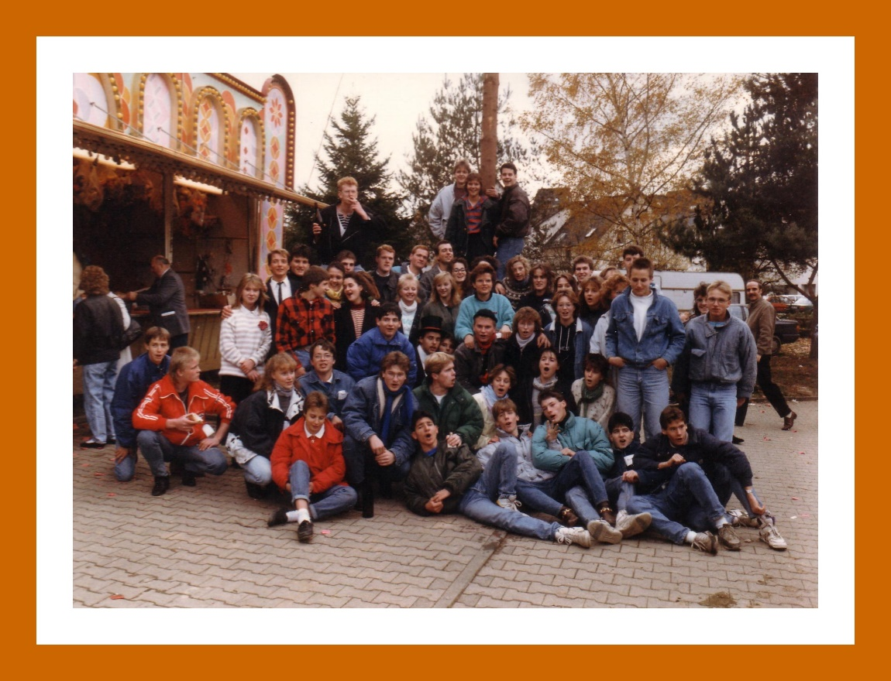

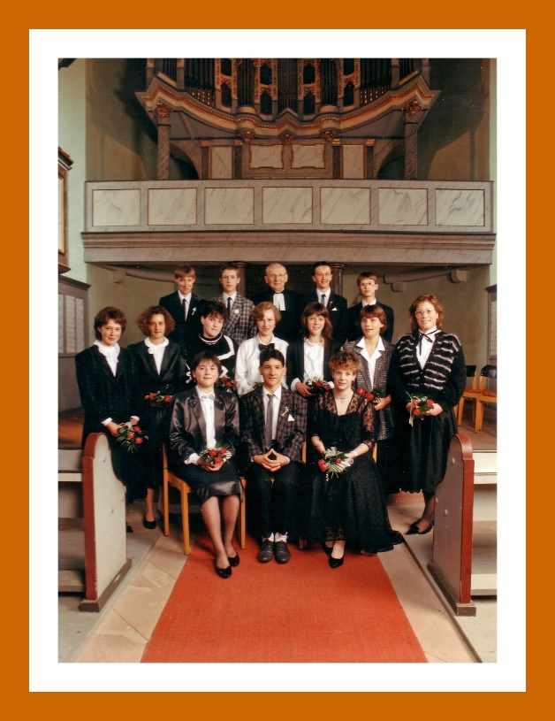

---

## War es vielleicht „Rache“ dafür, dass einer, der ein Pferd hatte, nicht beim Holzmachen etwas verdienen konnte?  Das wahre Motiv war leider nicht aufzuspüren, man hielt fest zusammen und

blieb dabei, dass es „de Parre nit leid“. Eine Stellungnahme des Pfarrers ist nicht bekannt.  Bei den damaligen Abhängigkeiten und sicher um sich vor „Schimmerem“ zu schützen, haben die Frondienstpflichtigen das gesamte Holz die Treppen hochgeschleppt. Vermutlich um sich etwas „Luft“ zu verschaffen, konnten man später in 40 cm großen weißen Buchstaben an Deusers Mauer den Spruch lesen: „Lieber tot als Sklave“. Damit kam das „gesunde Volksempfinden“ zum Ausdruck und eine Protesthaltung gegen die in der Nazizeit üblichen Schikanen, gegen die man sich, ohne Konsequenzen befürchten zu müssen, damals nicht wehren konnte. Erste vage Anzeichen dafür, dass sich die Menschen nicht mehr unterdrücken lassen wollten. Die Lebensumstände waren schlimm genug, sodass solche Quälereien, die man den Leuten abverlangte, völlig unmenschlich waren. Es war jedoch kein Einzelfall, wie man damals die Menschen, die sich nicht wehren konnten, behandelt hat. Bei Arbeiten in der Landwirtschaft und auf Baustellen waren solche Quälereien zu beobachten, es herrschte allgemein ein unmenschliches Verhalten von denen die Macht und Einfluss hatten, gegenüber denen die wenig oder nicht in den entsprechenden Kreisen eingebunden waren.

---

## Dem ane hats Jungesellelewe nit me gefalle,

drem horre die Hochzeit des Jahres gehallte.

---

## Der Polterabend

Vor der Hochzeit wurde der Polterabend gehalten. Dabei wurde dem Brautpaar Glas und Porzellan vor die Tür geworfen. Streng nach dem Motto: Scherben bringen Glück.

---

## Es existieren zwei Erklärungen zum Kranz:

1. Eine nicht mehr jungfräuliche Braut, die Strohjungfer, musste nach altem Brauch bei der Hochzeit einen Strohkranz tragen. Die unbescholtene Braut durfte sich dagegen im Myrtenkranz präsentieren.

---

## Fastnacht

Einige Tage vor Aschermittwoch suchten die Mütter Kleidungsstücke zusammen, um ihre Kinder zur Fastnacht originell zu kostümieren. Am Nachmittag herrschte im Dorf reges Leben. Die Kinder zogen zu dritt oder viert von Haus zu Haus und sangen das Fastnachtslied: "Hohoho, die Fassenacht ist do".

---

## Dafür erhielten sie meistens kleine Geldstücke oder Süßigkeiten.

Hohoho, die Fassenacht ist do

---

## Hohoho, die Fassenacht ist do,

ich hun gehört, ihr hätt geschlacht,

---

## hät so lange Würscht gemacht,

Hohoho, die Fassenacht ist do.

---

## Hohoho, die Fassenacht ist do,

gebt mir von den langen,

laßt die kurzen hangen,

---

## Hohoho, die Fassenacht ist do

Hohoho, die Fassenacht ist do,

---

## Hohoho, die Fassenacht ist do.

Hohoho, die Fassenacht ist do,

lasst mich nicht so lange stehn,

---

## will noch e Häusche weitergehn,

Hohoho, die Fassenacht ist do.

---

## Wenn der Umzug hält, liest der Kerbevater den Kerbespruch vor. An der Ecke Pfalzstraße/Schulstraße löst sich dann der Zug auf; jetzt beginnt für Jung und Alt die Feier mit Musik und Tanz.

Der Kerbespruch, der vom Kerbevater vorgelesen wird, sagt viel aus über die Geschehnisse im Ort des entsprechenden Jahres. Insbesondere lustige Begebenheiten wurden hier Kund getan.

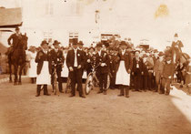

---

## Kerbebilder aus unterschiedlichen Epochen

In der Nachkriegszeit fand die Kerb noch in der Pfalzstraße statt.

---

## Bei 1 fängt man das Leben an,

man ißt, man trinkt, man schläft alsdann.

---

## Tragen die seltsamen Zwei,

Der schließt an den Himmel wie Ketten sie fest,

---

## Foto einer Tunnelsprengung

Genau um 12:00 Uhr werden die Sprengladungen in den Stollen gezündet und jagen eine Staubwolke aus Kreide, Sand und Ton in eine Höhe von bis zu 100 m. Die Erde wird erschüttert wie bei einem Vulkanausbruch oder einem Erdbeben. Der Himmel beginnt sich zu verdunkeln. Zurück bleiben Trichter von einer Tiefe bis zu 30 m.

Unmittelbar nach der Explosion, steigen die Deutschen aus ihren Schützengräben und beginnen mit der Erstürmung, unter Umgehung der tiefen Trichter. Die 5. Kompanie von Adolf Christmann, unter Führung von Leutnant d. L. Kilburg, hat die Aufgabe,  auf dem rechten Flügel bis zu den äußeren Gräben auf dem Südhang der Höhe vorzurücken.

Viele überlebende Franzosen sind so geschockt von den Detonationen, dass sie sich ohne Gegenwehr gefangen nehmen lassen. Andere kämpfen erbittert gegen die heranstürmenden Deutschen. Am Ende erringen die Deutschen die Überhand. Um 16:00 ist die Höhe 191 fest in deutscher Hand. Von den Franzosen werden 4 Offiziere und 150 Mann gefangen genommen und viele Waffen erbeutet.

Das Vorgehen bleibt aber nicht ohne Verluste auf deutscher Seite. 3 Offiziere und 68 Mann werden getötet, darunter auch Adolf Christmann als erster gefallener Soldat des 1. Weltkrieges aus Strinz-Margarethä. Verwundet werden 7 Offiziere und 269 Mann, vermisst werden 1 Offizier und 25 Mann.

Das Schlachtfeld selbst bietet einen schrecklichen Anblick. Die meisten Schützengräben brechen unter den Druckwellen, die die Explosionen verursachen, in sich zusammen. Überall liegen Hunderte von Toten, Massen von Waffen, Ausrüstung und Munition.

---

## Somit ging die Fahrt am Freitagnachmittag über Laufenselden, Zorn, die

Grenzstation und Strüht nach Welterod in der französischen Zone und wir sind heil bei unseren Verwandten angekommen.

Als Rückfahrtermin wurde Montag nach dem Mittagessen vereinbart. Inzwischen waren auch die Gäste aus Panrod eingetroffen. Sie waren mit der Schmalspurbahn von Zollhaus bis nach Nastätten gefahren und hatten den Rest des Weges zu Fuß gemacht, sie waren auch mit ihrem Passierschein in die französische Zone eingereist.

Alle Konfirmationsgäste, die von außerhalb kamen waren von Freitag bis Montag bei Nachbarn untergebracht (kostenlos). Die Gastfreundschaft war groß, die gegenseitige Hilfe war damals eine Selbstverständlichkeit und auch bitter nötig, da die Menschen viel an die französischen Besatzer abgeben mussten, so wie zuvor es auch die deutschen Besatzer in Frankreich gemacht hatten.  Für eine Feier hat man alles zusammen „geschrottelt“ und getauscht. Alles was nötig war wurde mit Bezugsscheinen zugeteilt und war sehr knapp bemessen.  Nur mit „schwarz Schlachten“ und mit „Schwarzhandel“ kam man einigermaßen über die Runden und konnte auch nur so mit den Verwandten aus der anderen Zone über drei Tage die Versorgung sichern. Mit Wein, Spirituosen und anderen „Genussmitteln“ wie Tabak, Zigaretten, Zigarren und Bohnenkaffee war es nicht gut bestellt. Wer diese Sachen hatte, der hatte sich beim „Schrotteln“ nicht erwischen lassen. Trotzdem haben es die Konfirmationsgäste drei Tage miteinander ausgehalten und das auch noch bei guter Laune und vielem was man sich zu erzählen hatte über die schlechten Zeiten und den Hindernissen, die den gegenseitigen Besuchen entgegenstanden.

Bei der Rückreise der Gäste aus der amerikanischen Zone kam es zu einer nicht vorgesehenen Änderung wegen des Regenwetters, das am Montagvormittag eingesetzt hatte. Die Gäste aus Panrod mussten an die Station der Kleinbahn nach Nastätten gehen, bei diesem Wetter. Aber unser guter Fahrer hatte ein Einsehen mit der Linagoth und hat ihr angeboten in dem kleinen „Adler“ noch mitfahren zu können, was sie natürlich auch gerne angenommen hat. Nun machte sich der Petter Paul alleine auf den Weg zur Station der Kleinbahn, um von Nastätten bis Zollhaus wieder mitfahren zu können.

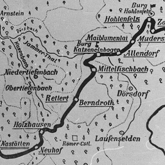

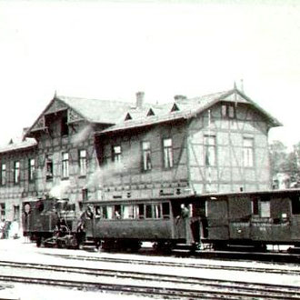

