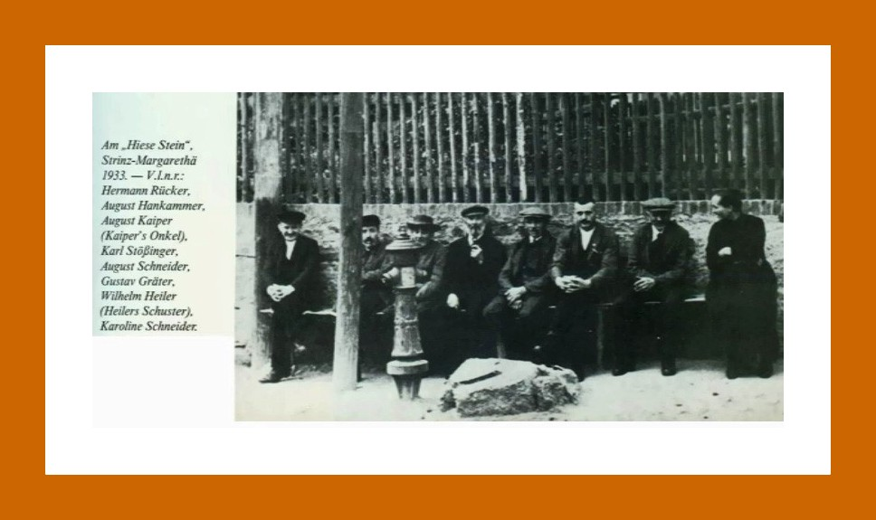
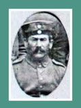

# Personen und Familien

## Ereignisse

Heinrich Kornigel (Kornegel) von Trohe (Trahe) reversiert sich gegen Margarethe von Baden, Gräfinwitwe zu Nassau, und deren Sohn, Grafen Johann, über Belehnung mit 7 1/2 Gulden zu Strinz-[Margarethae] (Hinderstrintzge), jährlich zu Martini vom gräflichen Schultheißen zu Strinz aus der Herbstbede zu zahlen, und mit der Ritzbach (Retsbach) bei Idstein, beides zu Erblehen.

---

## Ereignisse

Johann von Eppenstein, Schreiber des Graf Johann von Nassau, beurkundet, dass Schefferhenne, Klaus Scheffer Sohn zu Rückershausen, Höriger von Graf Philipp v. K.D., in das Amt Burgschwalbach gehörig, die nassauisch Hörige Adelheid Knoth von Strinz geehelicht hat. Es ist ausgemacht worden, dass Adelheid künftig dem Grafen Philipp v. K.D. gehörig sein soll.

---

## Cleßgen von Strinz arbeitet als Opperknecht der Maurer(Quelle: Gemeindearchiv Hünstetten)

Lehen von Nassau-Idstein, Burglehen zu Idstein, 6 Malter Weizengülte von der Vogtei Würges, 6 Gulden zu Niederseelbach, 3 3/4 Gulden aus der Herbstbede zu Strinz-Margarethae und die Rietspach bei Idstein: Philipp von Stockheim, + Philipps Sohn, Revers gegen Graf Johann, zugleich für seine Brüder.(Quelle; HHStAW 121 Nr. U von Stockstein)

---

## Ereignisse

Die Gemeinde liegt mit dem Kloster Bleidenstadt wegen des Haferzinses im Streit. (Quelle: Nassauische Analen)

Schultheiß, Schöffen und Gemeinden der Dörfer Strinz-Margarethä, Ober- und Niederliebbach und Hambach bevollmächtigen den Kilian Becker, Bürger zu Idstein, zu ihrer Stellvertretung in den Prozessen, den das Stift Bleidenstadt gegen sie wegen etlicher Haferzinsen bei dem Grafen Philipp von Nassau-Idstein angestrengt hat

---

## (Quelle: HHStAW 3001 Nr. 8 fol 14)

Dechant Philipp Hilche von Lorch, Scholaster Wendel von Vilbel, Sänger Philipp Klüppel von Elkerhausen und das Kapitel zu Bleidenstadt geben dem Stiftsvikar Christian Becker von Weilburg als ihrem Syndikus Vollmacht, ihre Sache gegen die Gemeinden Strintz-Margarethae, Hambach, Nieder- und Ober-Libbach vor dem Grafen Philipp von Nassau zu Wiesbaden zu führen.(Quelle: HHStAW 14 Nr. U 180)

---

## Der Schultheiß Hans Enders nimmt an der Beisetzung des Grafen Balthasar von Nassau-Idstein teil.

Lehen von Nassau-Idstein, Burglehen zu Idstein, 6 Malter Weizengülte von der Vogtei Würges, 6 Gulden zu Niederseelbach, 3 3/4 Gulden aus der Herbstbede zu Strinz-Margarethae und die Rietspach bei Idstein: Philipp von Stockheim, + Philipps Sohn, Revers.(Quelle: HHStAW 121 Nr. U von Stockstein)

---

## Ereignisse

Lehen von Nassau-Idstein, Burglehen zu Idstein, 6 Malter Weizengülte von der Vogtei Würges, 6 Gulden zu Niederseelbach, 3 3/4 Gulden aus der Herbstbede zu Strinz-Margarethae und die Rietspach bei Idstein: Ludwig Graf zu Nassau-Saarbrücken, Lehnbrief für Joh. Friedrich von Stockheim, + Wilhelms Sohn, zugleich für Joh. Nicolas, Friedrich und Johann Adolf, + Johanns Söhne, Phil. Eberhard, + Philipps Sohn, und Eberhard, alle von Stockheim.(Quelle; HHStAW 121 Nr. U von Stockstein)

---

## Ereignisse

Lehen von Nassau-Idstein, Burglehen zu Idstein, 6 Malter Weizengülte von der Vogtei Würges, 6 Gulden zu Niederseelbach, 3 3/4 Gulden aus der Herbstbede zu Strinz-Margarethae und die Rietspach bei Idstein: Johann Graf zu Nassau-Idstein, Lehnbrief für Heinrich Adolf von Stockheim, zugleich für Joh. Eberhard, Friedrich Wilhelm und August Magnus, seine Brüder, Söhne des Hans Heinrich, Enkel des Eberhard, Johann und Philipp, Söhne des + Friedrich und Enkel Johanns, alle von Stockheim.

---

## (HHStAW, 121, U von Stockheim)

21. Mai 1655Johann Graf zu Nassau und Saarbrücken belehnt Heinrich Adolph von Stockheim (-heimb), zugleich als Bevollmächtigten des ältesten Lehnträgers Johann Eberhard von Stockheim und namens seiner zwei Brüder Friedrich Wilhelm und August Magnus, der Söhne des + Hans Heinrich von Stockheim, Eberhards Enkel, und der Vettern Johann und Philipp von Stockheim, der Söhne des + Friedrich, + Johanns Enkel, zu Burg- und Erblehen, zu Burglehen mit 6 Malter Weizengülte zwischen dem 15.8. und 8.9., aus seiner Vogtei zu Würges (Werges), ablösbar mit 60 Gulden, als Burgmannen zu Idstein, mit 6 Gulden Martini, zu Seelbach, vom Schultheiß, die Henrich Kornigel zu Lehen hatte, ablösbar mit 60 Gulden; zu Erblehen mit 3 1/2 Gulden und 1 Ort auf der Herbstbede zu Strinz Margarethae (Hinterstrinz), Martini, vom Schultheiß, dazu mit der 'Richtspach' bei Idstein zur Hälfte. Siegler: Aussteller.(HHStAW, 121 Nr. U von Stockheim)

---

## Ereignisse:

Lehen von Nassau-Idstein, Burglehen zu Idstein, 6 Malter Weizengülte von der Vogtei Würges, 6 Gulden zu Niederseelbach, 3 3/4 Gulden aus der Herbstbede zu Strinz-Margarethae und die Rietspach bei Idstein: Philipp von Stockheim, + Philipps Sohn, Revers. Siegler: Aussteller.(Quelle: HHStAW 121 U von Stockheim)

---

## (Quelle: Hessisches Staatsarchiv Wiesbaden, Abt. 131 Nr. U 414)

Georg August Fürst zu Nassau, Graf zu Saarbrücken und Saarwerden, Herr zu Lahr, Wiesbaden und Idstein einigt sich durch Vermittelung des kaiserlichen Kammergerichtsassessors Johann Heinrich Daniel Freiherrn von Ritter-Grünstein mit dem Stifte Bleidenstadt über die Jurisdiktion, die Stiftshöfe zu Schierstein, Bierstadt und Hahn, den Abtswald , über den Wald 'der alte Stein', die Pfarrkollaturen zu Schierstein, Kloppenheim, Bierstadt, Bleidenstadt, Wehen, Strintz-Trinitatis und Strintz-Margarethae, Michelbach und Dörsdorf, die Zehnten zu Adolphseck, Born, Strintz-Margarethae, Idstein, Wallrabenstein, Wörsdorf und Ehrmbach, Wehen und Görsrod.(Quelle: HHStAW 14 Nr. U 314 Bl und C)

---

## Ereignisse

Im Strinzer Backhaus wird eine Familie aufgenommen, die in der gleichen Nacht ein Töchterlein (Johanna Maria) bekommt. Das Kind stirbt noch im selben Jahr, offensichtlich durch Mord.(Alte Strinzer Chronik, Band 1)

Der abgedankte Soldat Hans Georg Meyer wird mit seiner Frau Catharina im Backhaus aufgenommen. Kurz darauf bringt die Ehefrau einen Sohn (Johann Philipp) zur Welt.(Strinzer Chronik, Band 1)(Siehe auch unter: Das Backhaus)

---

## Die spätere Strinzer Barockorgel wird für das Weißfrauenkloster in Mainz, vermutlich von Johann Jakob Dahm, erbaut.

Die Strinzer Orgel

---

## Ereignisse

Revers des Grafen Friedrich Ludwig von Nassau-Saarbrücken (Ottweiler) ausgestellt zugleich im Namen der Fürsten und Grafen Georg August, Heinrich Wilhelm, Ludwig Crafft (im Gegensatz zu der Urkunde U 417 hier nicht getilgt), Johann Ernst und Carl Ludwig von Nassau etc. für den Dechanten Otto von der Malsburg und des Kapitels des S. Ferrutius-Stiftes zu Bleidenstadt über die von diesen zu Lehen rührenden zwei Vogteien zu Würges und Kirberg, sowie die vier Dörfer Strinz-Margarethae, die beiden Libbach und Hambach.(Quelle: HHStAW, 131 Nr. U 418)

---

## (Quelle: HHStAW 14 Nr. U324)

Otto von der Malsburg, Dechant, und das Kapitel des S. Ferrutius Stiftes zu Bleidenstadt belehnen den Grafen Friedrich Ludwig von Nassau-Saarbrücken(-Ottweiler) zugleich für die Fürsten und Grafen, Georg August, Wilhelm Heinrich (Ludwig Crafft getilgt), Johann Ernst und Carl Ludwig von Nassau etc. mit den zwei Vogteien zu Würges und Kirberg und den vier Dörfern Strinz-Margarethae, den beiden Libbach und Hambach.(Quelle: HHStAW 131 Nr. U 417)

---

## Johann Martin Joch

Ereignisse

---

## Ereignisse

Johann Enders Junior zahlt 2 Kreuzer Lämmerzehnten an das Stift St. Ferrutius Bleidenstadt.(Quelle: HStA  22 / 44)

---

## Adam Enders und Johann Enders der Mittlere zahlen 2 Kreuzer Lämmerzehnten an das Stift St. Ferrutius Bleidenstadt.

(Quelle: HStA  22 / 44)

---

## Ereignisse

1. Juli 1776Der Dechant Franz Ludwig Freiherr von Kesselstadt und das Kapitel des S. Ferrutius Stiftes zu Bleidenstadt belehnen den Fürsten Carl (Christian) von Nassau (Weilburg) zugleich für die Fürsten Carl Wilhelm, Ludwig, Friedrich-August und Johann Adolf von Nassau mit den zwei Vogteien zu Würges und Kirberg, sowie den vier Dörfern Strinz-Margarethae, den beiden Libbach und Hambach.(Quelle: HHStAW, 131 Nr. U 449)

---

## Ereignisse

Revers des Fürsten Carl (Christian) von Nassau(-Weilburg) ausgestellt zugleich namens der Fürsten Carl Wilhelm, Ludwig, Friedrich August und Johann Adolf von Nassau etc. für den Dechanten Franz Georg Carl Johann Freiherrn von Boos zu Waldeck und Monfort und das Kapitel des St. Ferrutius-Stiftes zu Bleidenstadt über Empfang der von diesem zu Lehen rührenden zwei Vogteien zu Würges und Kirberg, sowie der Dörfer Strinz-Margarethae, der beiden Libbach und Hambach.(Quelle: HHStAW, 131 Nr. U 452)

---

## Johannes Enders Junior und Adam Enders zahlen 2 Kreuzer Lämmerzehnten an das Stift St. Ferrutius Bleidenstadt.

(Quelle: HStA  19 / 38 u. 21/42)

Der Dechant Franz Georg Carl Johann Freiherr von Boos zu Waldeck und Montfort und das Kapitel des S. Ferrutius Stiftes zu Bleidenstadt belehnen den Fürsten Carl (Christian) von Nassau (Weilburg) zugleich für die Fürsten Carl Wilhelm, Ludwig, Friedrich August und Johann Adolf von Nassau etc. mit den zwei Vogteien zu Würges und Kirberg, sowie mit den 4 Dörfern Strinz-Margarethae, den beiden Libbach und Hambach.(Quelle: HHStAW 131 Nr. U 451)

---

## Johann Enders der Mittlere zahlt 2 Kreuzer Lämmerzehnten an das Stift St. Ferrutius Bleidenstadt. (Quelle: HStA  15 / 30)

Beilegung von Weidestreitigkeiten zwischen der Gemeinde Strinz-Margarethae und dem Hof Georgenthal. (Quelle: HStA, 133, Strinz-Margarethae 27)

---

## Johann Enders der Mittlere und Adam Enders zahlen 2 Kreuzer Lämmerzehnten an das Stift St. Ferrutius Bleidenstadt.

(Quelle: HStA  20 / 40 u. 21 / 42)

---

## Schultheiß: Johann Enders

Ereignisse

---

## Schultheiß Joh. Enders

Philipp Ferdinand Sauer

---

## Ereignisse

Der Gemeinde Strinz-Margarethä wird es gestattet, die aus der Konkursmasse von Johann Lotz ersteigerte Hofreite wieder zu verkaufen.

---

## Obrigkeiten

Schultheiß: Johann Emrich Enders

---

## Obrigkeiten

Schultheiß: Johann Emrich Enders

---

## Bewohner: 397

davon ortsgebürtig: 388

---

## Strinzer Spielmannszug

Am Hiese Stein (Der Stein hieß so, da er vor dem Grundstück der Familie Hies lag / Ecke Scheidertalstraße/Friedhofstraße)

---

## Im Haus der Familie Hartwig in der Pfalzstraße wird eine Unfallhilfe eingerichtet. (Quelle: Helmut Hartwig)

Im Oktober legt sich die Gemeinde einen Kartoffeldämpfer zu.(Siehe auch unter: Der Kartoffeldämpfer)

---

## Gründung des Freundeskreises Strinz - Aube.

Anlässlich seines 90jährigen Bestehens veranstaltet der Gesangsverein "Eintracht" auf dem alten Sportplatz ein Waldfest, an dem viele Gesangsvereine und Bewohner teilnehmen.(Quelle: Alte Strinzer Chronik)

In den Ortsbeirat werden gewählt: Werner Petri (Ortsvorsteher), Willi Fuhr (Stellvertreter), Roland Schütte (Schriftführer), Erwin Hinz, Horst Enders, Albrecht Egert; Ernst Losert.(Quelle: Alte Strinzer Chronik)

29 Jahre nach Gründung der Gemeindebücherei kündigt die Gemeinde Hohenstein den Vertrag mit dem Bertelsmann-Lesering auf. Die Gemeindebücherei wird geschlossen. Durch den wachsenden Wohlstand kauften sich die Bürger eigene Bücher und sind nicht mehr auf die Gemeindebücherei angewiesen.(Quelle. Alte Strinzer Chronik)

Das gab es noch nie. Sonst richteten die unverheirateten jungen Leute zur Zufriedenheit aller Dorfbewohner die Kerb aus. In diesem Jahr ist sich die Dorfjugend uneinig, sie bringen es einfach nicht fertig, eine Kerbegesellschaft zusammenzustellen. Da nehmen die älteren Männer und Frauen das Zepter in die Hand. Unter ihrer Leitung feiert das Dorf wie eh und je die Kerb. In diesem Jahr versagte also die Jugend.(Quelle: Alte Strinzer Chronik)

---

## Am Hessentag in Herborn beteiligen sich die Strinzer Landfrauen mit dem umgebauten "Willimobil". Von allen Besuchern wird das Karussell bewundert.(Siehe auch unter: Das Willimobil)

Mit Mahntafeln an der Landesstraße L 3032 protestiert der Ortsbeirat gegen den Plan eine Kreismülldeponie am Römerberg zu bauen. Die Tafeln, die von einer engagierten Strinzer Familie entworfen und hergestellt wurden, werden an den Weihnachtsfeiertagen aufgestellt, um den verantwortlichen Politikern deutlich zu machen, dass die Bevölkerung zu keiner Zeit den Frevel an Mensch und Natur aus dem Bewusstsein verliert.

---

## Kindererziehung und Freizeit

Da es keine Kindergärten gab, hielten sich die noch nicht schulpflichtigen Kinder überwiegend im Bauerngehöft der Eltern auf. Hier beaufsichtigte die Oma oder ein älteres Mädchen die Kleinen. Im Laufe der Jahre hatte jedes Kind in der Familie die Verantwortung für die jüngeren Geschwisterchen zu übernehmen.

---

## Woher die „Klusterbeeren“ ihren Namen Haben

Nach der Gründung des Klosters Bleidenstadt kamen die Benediktiner in unsere Gegend und sagten den Leuten, wie man das Feld besser anbauen konnte. Von den Mönchen lernten die Bewohner bessere Obstsorten und Beerensträucher kennen. Ältere Dorfbewohner sprechen noch heute von den Kloster- oder Klusterbeeren und meinen damit die Stachelbeeren. Der Volksmund hat demnach die Bezeichnung jahrhundertelang bewahrt.

---

## Außerdem hatten die Bewohner als Leibeigene für das Kloster Hand- und Spanndienste zu leisten, die Frauen mussten Hemden und Tischtücher nähen und waschen.

Die Ablösung von Frondiensten

Der Ausdruck "Arbeiten in der Fron" ist heute noch in unserem Dorf gebräuchlich, doch kommt sicher nicht vielen zum Bewusstsein, wie groß der Unterschied ist zwischen der heutigen Gemeinschaftsarbeit für das Dorf wohl und den Frondiensten, die von den Vorfahren zuerst für das Kloster und dann für die weltliche Obrigkeit geleistet werden mussten.

In Nassau - Idstein allerdings wurde schon frühzeitig der Versuch gemacht, die Last der Untertanen zu erleichtern. Von alters her hatten auch diese unter der Pflicht geseufzt, nicht allein die zahlreichen, im Lande verstreuten Höfe mit ihrem Fleiß und Schweiß zu bestellen, sondern auch als Rhein- und Weinfahrten, so oft es verlangt wurde, auszuführen.

Nach dem 1568 erfolgten Ableben des Grafen Balthasar hielt es die vormundschaftliche Regierung für seinen unmündigen Sohn Johann Ludwig im Jahre 1570 für zweckmäßig, die sämtlichen Domänen Hofleuten in Pacht zu geben, die auf eigene Kosten die Bebauung der Ländereien besorgte.

So wurden die Frondienste der Bauern hierfür nicht mehr benötigt. Aber die Regierung wollte das alte Herrenrecht den armen Leuten nicht ohne weiteres zum Geschenk machen, sondern suchte die fällige Arbeit in klingende Münze umzusetzen. Demgemäß verhandelten sie und vereinbarten mit den Bewohnern der Ortschaften, dass ein jeder Pferdebauer auf das Jahr von einem Gaul 2 Taler und ein "Heppenbauer" der keine Pferde hielt, einen Taler für den schuldigen Dienst auf 2 Ziele, auf Johannis (24. Juni) und Martinstag (11. November) zu erlegen schuldig sein sollte.

Die Herrschaft behielt sich aber den Dienst zu hohen und kleinen Jagden und Weidwerk, ebenso zum Fischen und ferner die schuldige Nachfolge der Untertanen (Leibeigenschaft) ausdrücklich vor. Auch blieb die Pflicht bestehen, den Kirbenwein für jeden Ort, wie von alters her, auf eigene Kosten zu stellen.

Die Steuerliste des Jahres 1573 nennt uns die Höhe der Ablösungsgelder. Jährlich entfielen demnach auf Strinz-Margarethä 61 Taler. Dass dabei unser Dorf nach Breithardt (62 Taler) die 3. Stelle einnimmt, ist sicher ein Beweis dafür, dass es im Vergleich zu anderen Dörfern wirtschaftlich gut gestellt war.

Die Bauern hatten jedoch keine reine Freude an dem gemachten Geschenk, das ihren immerhin schon mageren Geldbeutel unangenehm berührte. Sie suchten darum einen Weg, um diese neue Belastung nach Möglichkeit abzuschwächen. Das konnten sie am einfachsten durch Verringerung des Zugviehs erreichen, was sich auch ohne Schädigung des Betriebes machen ließ, da dieser nicht mehr so stark für herrschaftliche Zwecke in Anspruch genommen wurde.

---

## Folgende seiner Worte sind überliefert:

Vnser altern hant isz vff vns bracht, so han wir isz auch also biszher gehalten vnd wiszen auch nit anders, dan dasz vnszer gn. junher Johann graue zu Nassawe, herre zu Idtstein, desz vater, vnser here seliger, vnd sin altern vff in bracht vnd geerbet han, eine here sij zu Strincze, Liedebach vnd Liedebach, vnd wasz in das Kirspel gehoret, vnd habe macht zu gebieden, zu seczen und zu entseczen, vnd desz gerichts ein here, das zu hoen vnd niddern, zu lengen vnd korczen, vnd ein herre vber wasszer, weyde, welde, felde, vnd ober alles, das in das kirspel gehorig ist, nicht vszgescheiden, vnd wuszten sy auch nymandts anders, der einiche gebot, verbot ader herlichkeit in dem egen. kirspel habe in eniche wise, dan der obgen., vnser gn. jungher Hohan vnd syn erben, vnd das vff die eyde, wir alle vnd unszer iglicher sinem heren gethan hait, vnd solten wir icht moen im recht ... zut thun, wolten wir auch thun.

---

## Bleidenstädter Reaktion

Fünf Tage später am 25. September erfolgte schon die Bleidenstädter Reaktion auf dieses Schriftstück. Sie bringen ein Gegenstück dazu.

Vier Männer: Henne Haembecher, Contze Kunnemannssohn, Henne vom Ende und ein sogenannter Metzen-Menn dienen als Zeugen. Sie sagen auf Bitten und Ermahnung des Abtes Johann von Schönborn von Bleidenstadt aus.

Henne Haembecher sagt, er sei Schultheiß des Klosters zu Strinz Trinitatis schon seit über 40 Jahren und seine Eltern seien auch schon 100 Jahre Schultheißen dort gewesen. Nach weiteren Aussagen Haembechers erklärte Contze Kunnemannssohn, er sei klösterlicher Schultheiß an dem Gericht zu Lyddelbach (Libbach) seit 12 Jahren, wohin auch noch das andere Libbach und Hambach gehören.

Daraufhin kam Henne vom Ende zu Wort: Er sei seit über 15 Jahren, und vor ihm sein Vater des Klosters Schultheiß zu Walrabenstein. Als letzter sagte Metzenmann, er sei in Hohenstrinze (Margarethä) Schultheiß. Darauf beeiden die vier Personen ihre Aussagen.

---

## Catharina Steinbach

Eheleute

---

## Philipp Klein (Kirchenmeister)

Emma Ottenallering (Nachname schlecht lesbar)

---

## Kinder

Georg, Michael, Catharina, Johann, Appolonia, Jacob, Philipp, Heinrich

---

## Wilhelm Lause

Anna Maria Lotz

---

## Kinder

Anna Maria, Catharina, Dorothea, Barbara

---

## Johann Philipp, Anna Maria, Johann Peter, Anna Elisabetha

Johann Emmerich Heyler

---

## Eheleute

Philipp Lotz

---

## Margaretha Anna Maria Lotzin

Kinder

---

## Johann Philipp, Anna Margaretha, Anna Elisabeth, Elisabeth, Johann Conrad, Philipp Conrad, Johann Mattheus

Eheleute

---

## Eheleute

Johann Enders

---

## Annamaria Lotzin

Kinder

---

## Johann Philipp, Johann Albert, Johann Jacob

Eheleute

---

## Philipp Michael Endres

Annamaragaretha Lotzin

---

## Kinder

Johann Wilhelm, Catharina, Anna Margret (Zweitname schwer lesbar), Erna

---

## Eheleute

Johann Philipp Lotz

---

## Anna Catharina Hütigen

Kind

---

## Johann Conrad Rückert

Maria Catharina

---

## Philipp Lotz Schultheiß 2 Söhn der ein 27

verheiratet der andere lediger Stand 24

---

## Johann Friedrich Weber lediger Stand 40 Jahr

Hanß Conradt Hasting(?) 64 Jahr ein Sohn von 24 Jahren

---

## Johann Philipp Puff 46 Jahr

Hanß Jakob Klein 31

---

## Philipp Nickel Enders 32

Johann Nickel Heyler 34

---

## Philipp Klein sein Sohn Henrich Klein dienet zu (unbekannter Wohnort) 26

Gerädert und geköpft

---

## Das Backhaus als Notunterkunft

Die Gemeinden waren früher gesetzlich verpflichtet, für in Not geratene Bürger und Asylsuchende eine Notwohnung bereit zu stellen. Dazu waren die Räume über dem Backofen, im Dachgeschoss des Backes, bestens geeignet. Besonders im Winter war diese Wohnung schön warm. Auch fiel für die Bewohner das eine oder andere Brot, oder sogar Kuchen, ab.

---

## Die zwei anderen Kinder genasen, da nur anginöse Erscheinungen mit erythematösem Charakter vorhanden waren.

In einer anderen Familie in demselben Orte erkrankten 3 Kinder an Angina, 2 an Angina erythematosa nur leicht. Das älteste Kind ein Knabe von 8 Jahren, hatte dagegen Angina crouposa in hohem Grade. Die Schleimhaut der Mandeln, des Rachens war mit kleineren und größeren, inselartigen, kroupösen Exsudaten von schmutzig gelblichweißer Farbe besetzt, die abgestoßen und ausgeworfen, sich bald wieder ersetzten; an den durch Abstoßung von dem Exsudat befreiten Stellen zeigte sich die Schleimhaut ulzeriert. Die übrige Schleimhaut sehr gerötet, geschwollen und das Schlingen sehr erschwert. Durch Vermehrung des kroupösen Exsudats und dessen Ausdehnung auf Larynx erfolgte unter den Erscheinungen von Oedema glottidis der Tod. Gurgeln, Bepinselung und Decoct. chinae blieben erfolglos.

---

## In StM lebte einmal eine Familie Wahl. Diese hatte ein schweres Schicksal zu erleiden.

Familie Wahl hatte drei Söhne und eine Tochter.

---

## Somit war die ganze Familie Wahl in StM ausgestorben. Das Eckhaus der Familie wurde verkauft. Man sprach noch lange vom "Wahleck".

(Quellen: Alte Strinzer Chronik Teil 1, Seite 13 und 19 / Überlieferung von Adolf Hahn in der alten Strinzer Chronik Teil 2, Seite 176)

---

## Enders, Adolf II Adolf Enders II hat den Krieg überlebt. Quelle: Gemeinde

Enders, Philipp Phillip Enders überlebte den Krieg. Quelle: Gemeinde

---

## Durschnittszahl der Zimmer je Familie: 4

- Gruppe IV -

---

## Kinderzahl je Familie im Schnitt: 2,3

Schüleranzahl auf die Gesamtbevölkerung gerechnet

---

## In Strinz-Margarethä befand sich seinerzeit eine Außenstelle des Kriegsgefangen-Stammlager 12 A Limburg. In diesem Stammlager war Raoul Labonne, bevor er nach Strinz kam, interniert.

Labonne als Soldat

In Strinz befanden sich viele Kriegsgefangene, die u.a. im Tanzsaal eines Gasthofes untergebracht waren. Hierzu gehörten nicht nur Franzosen, sondern z.B. auch polnische und russische Kriegsgefangene. Auch in Strinz mussten die Gefangenen in der Landwirtschaft arbeiten.

Die Gefangenen wurden unterschiedlich behandelt, je nachdem, bei wem sie untergebracht waren. Die einen liefen in zerlumpten Kleidungsstücken herum, andere wiederum bekamen ihre Kleidung von den Bürgern bei denen sie untergebracht waren, wieder geflickt. Innerhalb des Hauses bestand strikte Trennung. So aßen die Bewohner an dem einen, die Kriegsgefangenen an einem anderen Tisch. Von ortsansässigen Leuten wurde diese Trennung streng kontrolliert. Diese kamen oft unverhofft in die Höfe und sahen nach, ob die strikte Trennung auch eingehalten wurde. Wenn nicht, dann musste man mit einem Verweis rechnen.

Das Schicksal der einzelnen Gefangenen lag auch immer in den Händen der Familien, für die sie arbeiten mussten. Das Leben auf dem Hof konnte zur Hölle werden, wenn sich Parteigenossen als Herrenmenschen aufführten. War die deutschen Familien ihren Gefangenen wohl gesonnen, wurde der Aufenthalt erträglich, man wartete gemeinsam auf das Ende des Krieges.

---

## Dr. Frank nimmt am Abend Abschied von der Familie Weißer. Er will versuchen über Idstein der Gefangenschaft zu entkommen.

Des Abends gegen 22 Uhr kommt ein Verband der SS in ziemlich betrunkenen Zustand angezogen. Die amerikanische Artillerie feuert bereits ins Breithardter Feld.

In der Nacht hält noch ein Trupp Gefangener Einzug in StM. Die Wachleute haben die Schreibstubenpapiere mit Bauernfuhrwerken bis hierhergebracht. In StM beginnen sie die Unterlagen in Herden und Öfen zu verbrennen. Dann entledigen sich die Wachleute noch ihren Uniformen und versuchen sich in ihre Heimat durchzuschlagen.

---

## Schellen-Info

In Zeiten, in denen es kaum Radios, Fernseher oder Zeitung im Ort gab, war eine Person sehr wichtig zur Verbreitung von Nachrichten:

---

## „Heute Abend um 9 Uhr soll aus jedem Haushalt Altbürger sowie Neubürger eine erwachsene Person bei Gastwirt Adolf Klein kommen.“

„Wer für die Landwirtschaft Arbeitsschuhe beantragt hat, soll am Dienstagabend um 9 Uhr auf die Bürgermeisterei kommen.“

---

## Ausgebombte erhielten (wie die Flüchtlinge) 10 Punkte je Person, außer Säuglinge.

Ostheimkehrer erhielten 150 Punkte

---

## Bäckerei Bodenheimer

Die meisten Familien hatten ein sogenanntes Brotbuch, in dem gegen die Lieferung von einem Zentner Korn (Roggen) 32 Brote gutgeschrieben wurden. Bei jeder Abholung verminderte sich der Bestand entsprechen. Eine große Familie lieferte ca. 8 - 10 Zentner Korn. Sie hatte damit genügend Brotgutschrift für das ganze Jahr. Wer mit seiner Brotgutschrift nicht auskam, konnte auch einen Vorschuss erhalten, er hatte damit dann "vorgegessenes Brot".

---

## Nachfolgend die Tagesspeisen einer durchschnittlichen Strinzer Familie in der ersten Hälfte des 20. Jahrhunderts:

Frühstück

In den Bauernfamilien wurde in der Regel zweimal gefrühstückt. Zum einen nach sieben Uhr, nachdem die Milch zur Milchsammelstelle gebracht wurde. Zum anderen gab es gegen zehn Uhr noch ein zweites Frühstück.

---

## Philipp Ludwig Bender, Müller in Strinz Margarethä, Taufpate in Ketternschwalbach.

(Quelle: Kirchenbuch des ev. Kirchspiels Bechtheim)

---

## Philipp Jakob Rauch (?), Müller ind Strinz Margarethä, Taufpate in Ketternschwalbach.

(Quelle: Kirchenbuch des ev. Kirchspiels Bechtheim)

---

## Die Schrecken des Krieges sind noch präsent

„Es hat sich so ergeben“, sagt Irma Kugelstadt über ihre Aufgabe. Schon früh hatte sie auf Kinder aus der Nachbarschaft aufgepasst, wenn deren Eltern auf dem Feld schafften. Kinder gab es seinerzeit viele im Dorf: Marei Richter war die Älteste in ihrer Familie, die Geschwister Peter, Gudula und Sabine waren mitgekommen, ebenso wie zwei Tanten – Schwestern der Mutter – mit ihrem Nachwuchs.

