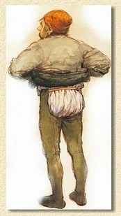

# Landwirtschaft und ländliches Leben

## Übrigens heißt heute noch ein Acker bei Strinz-Margarethä "Zehntfrei" - wohl wegen seiner geringen Bodengüte.

Die zweite Silbe epha = afa ist das keltische Wort für Bach. Danach bedeutet Strinzepha: eine durch eine Einöde fließender Bach.

---

## (Quelle: Wikipedia)

Besthaupt

Besthaupt bedeutet, dass beim Absterben des Hausvaters, örtlich auch der Mutter, dem Herrn das beste oder zweitbeste Stück in Haus und Stall verfällt. Vielfach ist auch beim Tod des Hausherrn einfach ein monetärer Obolus zu zahlen.

---

## De Schinnerhannes in ussem Ort

In fruirer Zät is de Schinnerhannes mi säner Röwerbande in Nassau erem gezue. In usser Heimat wore ach. Se hun die onzelliegende Mille un Heb ausgeraubt. Aach in ussem Ort hun se en Bauer beraubt.

---

## Allgemeine Ereignisse

Es ist ein Katastrophenjahr für die Ernte mit anschließender Teuerung.

---

## Es herrscht ein sehr kalter Winter.

Heuschrecken, die in riesigen Schwärmen von starken Mittelmeerwinden über die Alpen nach Mitteleuropa getrieben werden, zerstören Teile der Ernte und verursachen eine Hungersnot.

---

## Landwirtschaft

Häuser: 76

---

## Der "schlaue" Holzdiebstahl

Ende der vierziger Jahre des zwanzigsten Jahrhunderts, als infolge des verheerenden Krieges, der

Deutschland in unvorstellbare Not gebracht hatte, an allem Mangel herrschte, war Holz aus unseren Wäldern Gold wert. Holz war das einzige Brennmaterial, das den Menschen zur Verfügung stand. Dennoch sehr begrenzt, weil es der Zwangsbewirtschaftung unterlag, mit der Raubbau an den Wäldern verhindert werden sollte, denn die Waldbesitzer, größtenteils Gemeinden und der Staat, waren verpflichtet, auch die Städte und die Flüchtlingslager mit großen Mengen Brennholz zu versorgen.  Die Zuteilungsquoten mussten von der Gemeindeverwaltung vollzogen und kontrolliert werden. Den Familien wurde das Brennholz nach der Anzahl der Familienmitglieder zugeteilt, darüber hinaus gab es noch „Wellen“ und den „Schlagabraum“ in Selbstwerbung.

Da es weder Benzin, noch Dieselöl gab, außer den Zuteilungen für die Landwirtschaft, die Feuerwehr und sondergenehmigte PKWs, z. B für den Landarzt, wurden die Lkw`s mit dem Holzvergaser betrieben, der ebenfalls Holz verschlungen hat. Für eine Betriebsstunde wurden mehr als 75 kg Holz verbraucht, das dem Fuhrunternehmer (für das Milchauto) ebenfalls zugeteilt wurde. Man kann sich leicht vorstellen, dass in allen Bereichen die Zuteilungen nicht ausreichten, um den „tatsächlichen Bedarf“ zu decken. Wer im Winter nicht frieren wollte musste sich zusätzlich Brennmaterial beschaffen. Der Fuhrunternehmer musste von seinen Auftraggebern zusätzlich Holz verlangen, d.h. woher nehmen und nicht stehlen?  Die Transportaufträge waren so umfangreich, dass die Holzvergaser- Lkw`s Tag und Nacht unterwegs waren.

In den Wintermonaten wurde das Holz im Wald gefällt, bis zu 60 Holzfäller waren damit von Mitte November bis März beschäftigt. Das Brennholz wurde nach Güte sortiert und in Raummetern gestapelt in 1, 2, 3, oder 4 m Stößen, an der Stelle, wo man den Baum zerlegt hatte. Die Qualität wurde unterschieden in Scheitholz (einmal gespalten), in Knüppelholz und Reißerknüppel, letztere in unregelmäßiger Länge. Das Holz fällen wurde im Akkord entlohnt und meist von sogenannten „Rotten“ zu 4 oder auch mehreren Holzfällern ausgeführt, alles Bürger, die froh waren in den Wintermonaten etwas verdienen zu können, aber auch um kranken- und rentenversichert zu sein.

Schon wegen der Akkordentlohnung war es nötig, dass jeder Holzstoß nummeriert und registriert wurde, aber natürlich auch für die spätere Verteilung. Diese Aufgabe oblag dem Haumeister, der fortlaufend jedem Holzstoß mit dem Nummerierknüppel und schwarzer Farbe die Nummer einschlug und in einem dafür vorgesehenen Buch nach Qualitätsmerkmalen notierte. Bis zum Ende der Fällperiode waren das viele Hundert Holzstöße, die im Frühjahr bei trockenem Wetter zur Abfuhr freigegeben wurden. Dabei stellte sich heraus, dass eine ganze Reihe fortlaufender Nummern nicht da saßen, wo sie in der Reihenfolge der Nummerierung hätten sitzen müssen. Was war passiert, wie wollte man das klären?  So kam der Gemeinderat auf die Idee, den Schullehrer mit seinen Schülern in den „Holzwald“ zu schicken, um alle Holzstöße und ihre Nummern zu überprüfen. Das bereits abgefahrene Holz hat man im Dorf zu überprüfen versucht, ob das aber entsprechend erfolgreich war, blieb ungewiss. Man hatte jedoch „herausgefunden“, dass immer ganze Zehnerreihen der fortlaufenden Nummerierung fehlten.  Hatten Diebe sich das zunutze gemacht, um es nicht als Diebstahl erscheinen zu lassen? Das ist wohl anzunehmen! Es mangelte jedoch nicht an Ausreden, denn es wurde auch vermutet, dass der Haumeister falsch nummeriert haben könnte, das der Nummerierknüppel nicht in Ordnung gewesen sein könnte, ohne das er es gemerkt hätte.

Da Diebe nicht gefunden wurden, hat man die Sache nicht weiterverfolgt. Ein unguter „Geschmack“ blieb jedoch im Raum. Wenn es Diebe waren, konnten sie zufrieden sein und der Gemeinderat auch??? Das „abhanden“ gekommene wertvolle Brennholz machte schätzungsweise 10 % des regulären jährlichen Holzeinschlags aus. Warum die Diebe nicht gefunden werden konnten bleibt Spekulation. Es wurden allerlei Gerüchte in Umlauf gebracht, die vermutlich alle mit Bedacht an der Wahrheit vorbeigingen. Einige hatten sicher ihren Spaß dabei.

---

## Acker

AUF DEM ACKER

---

## Pfarr-zehnt

Im Pfarrzehnten

---

## ZEHNDE-FREI

Der Acker Zehntfrei trägt seinen Namen, da er der Überlieferung nach eine solch schlechte Qualität bot, dass eine Gräfin die an dem Acker vorbeiritt sagte: Dieser Acker ist so schlecht, von diesem will ich keinen Zehnten haben.

---

## Aus dem 17. Jahrhundert

Bäuerliches Leben im 17. Jahrhundert

Der Bauer in der Zeit des 30jährigen Krieges stand früh morgens von seinem Strohlager in dem langen Hemd auf, das er auch tagsüber trug. Er - und auch der Bürger in der Stadt - hatten kein eigentliches Nachthemd. Das Hemd, das man am Leibe trug, trugt man auch tagsüber - tagein, tagaus...

---

## Die Hose wurde mit sogenannten "Nesteln" - kleinen Schnüren - an dem Wams befestigt.

Im Sommer ging der Bauer barfuß, im Winter in Pantoffeln oder Schlappen, wie man sie auch heute noch kennt.

---

## Bei Arbeiten im Schlamm trug der Bauer "Tripklompen". Das waren stabile Pantoffeln, die auf ein starkes Brett genagelt waren, unter dem zwei Querleisten das Abrutschen verhindern sollten.

Auf dem Kopf trug man eine Mütze oder eine Kappe mit Ohrenklappen. Bei den Bauern hatte sie lediglich die Aufgabe, gegen die Witterung zu schützen; entsprechend vielfältig war die Form, die nur von der Funktion und nicht von der Mode beeinflusst war.

Wenn man die Umstände berücksichtigt, unter denen die Bauern und ihre Familien leben und knechten mussten, wenn man sich die hygienischen Verhältnisse vor Augen hält und wenn man weiß, dass Anfang des 17. Jahrhunderts eine "kleine Eiszeit" ausgebrochen war, die nicht nur zu Missernten führte, sondern die Bauern auch zwang, ihre Kleidung ständig anzubehalten um nicht zu frieren, dann ahnt man, dass es in den Bauernkaten und Schankhäusern nach Armut und Kuhmist gerochen hat.

---

## Auf einem Grundstück in der Gemarkung StM, dem Ochsengut oder Pfaffengut, ruhte die Verpflichtung, das Faselvieh oder Mannvieh für die Gemeinde zu stellen und zu unterhalten.

Das Ochsengut bestand aus 10 Morgen 35 Ruten Acker und 2 Morgen 29 Ruthen Wiese.

---

## Anlage eines neuen Totenhofes auf dem Acker des Herren Schultheiß Enders zwischen Strinz und der Zinkenmühle (Ochsengut/Pfaffenhof) unter dem Hennethaler Weg. Absteckung von 60 Ruthen.

Ungefähre Lage des Pfaffengutes/Ochsengutes wo der neue Totenhof angelegt wurde

---

## Dazu kam noch der sehr ungünstige Umstand, dass wir von dem Tage des Hagelschlags bis in den Spätherbst fast gar keinen Regen mehr hatten.

Dem entsprach auch die traurige Ernte. Das dreschen lohnte sich für die Mühe nicht und manche Leute droschen gar nicht. Der Sähsamen musste deshalb größtenteils von auswärts, von unbeschädigten Gemeinden bezogen werden.

Bei den Körnerfrüchten ist der Verlust auf 80 - 90%, bei den Kartoffeln auf 50% und bei den Wurzelgewächsen, Kürbis, Bohnen auf 75% angegeben. Obst blieb fast nichts, obwohl manche Bäume schön beladen gewesen waren.

---

## Die Vereine setzten sich für die Versöhnung der Völker und die Bewahrung des Friedens ein.

Vom Strinzer Kriegerverein ist wenig überliefert, jedoch tauchte vor kurzem bei der Kartoffelernte ein in eine Kartoffel eingewachsenes Eisernes Kreuz des Kriegervereines auf.

Auch in anderen Hohensteiner Gemeinden gab es Kriegervereine. So existiert im Hohensteiner Archiv noch die Fahne des Kriegervereines Hohenstein (heute Burg Hohenstein) und es wurde auf einem Strinzer Acker nahe der Eisenstraße eine Medaille des Kriegervereines Breithardt aufgefunden.

---

## Das Licht erlosch im Dorf

Der Bauer selbst versuchte, in der Scheune das drohende Unheil noch zu verhüten, trampelte ein loderndes Strohbündel aus - ab da züngelte das Feuer bereits oben auf der Tenne, fand reichlich Nahrung und dann stand auch schon der Scheunendachstuhl in hellen Flammen. Menschen liefen zusammen, die freiwillige Feuerwehr wurde alarmiert, das Licht erlosch im ganzen Dorf - Kurzschluss in der Leitung des Dachträgers. Das Vieh in den Ställen! Beherzte Männer und Frauen holten es heraus.

---

## Kriegshysterie

Mit Kriegsbeginn wird der Ort mit Anweisungen vom königlichen Landrat in Langeschwalbach überhäuft, welche eine Kriegshysterie im Ort auslösen. Jeder Militärpflichtige wird aufgefordert, sich bei der Ortspolizei zur Stammrolle anzumelden. Eventuell in der Gemarkung landende Luftfahrzeuge sind wegen Spionageverdacht zu überprüfen und die Dorfbrunnen müssen wegen Vergiftungsgefahr bewacht werden. Eine Anweisung, unbekannte Fahrzeuge zu kontrollieren führt dazu, das sich schon vier Tage nach Kriegsausbruch die Leute aus StM und den umliegenden Ortschaften auf die Suche nach einem Fahrzeug machen, das nachts durch Strinz gefahren sein soll – wie sich später herausstellte, das Fahrzeug des Kreistierarztes.

Doch damit nicht genug. Bereits kurz nach Kriegsbeginn muss die Bevölkerung ihre Pferde und Kutschen zur Musterung nach Langenschwalbach bringen. Pferde und Kutschen die eigentlich dringend in der Landwirtschaft gebraucht werden. Viele Pferde werden zum Militärdienst eingezogen, die Landleute dafür immerhin entlohnt.

---

## 1 Morgen Nutzland = 0,14 Stück Großvieh

1 Stück Vieh auf 6,8 Morgen Nutzland

---

## Bezeichnet diesbezüglich ist folgende Geschichte:

Der Bauer August Christmann fragte auf dem Amtsgericht in Wehen nach, ob er seine Äcker auf den Sohn übertragen könne. Amtsgerichtsrat Hemskerg erwiderte: "Haben Sie einen Erbhof? Ihnen wird man nichts abnehmen, solange sie leben, aber auf Ihren Sohn wird man nichts überschreiben, denn die jungen Leute müssen im Osten siedeln".

---

## Noch im Ort befindliche deutsche Soldaten versuchen Richtung Herrmannsweg zu fliehen. Unterwegs werden sie von Amerikanern beschossen.

Die Kinder die auch zur Brandstelle in der Ortsmitte geeilt waren, werden aufgefordert, sich um das herumlaufende Vieh zu kümmern.

Die noch im Ort verbliebenen Kriegsgefangen sind voller Freude, da ihre Gefangenschaft nun ein Ende hat. Sie streckten drei Finger, ja einige beide Hände gefaltet gegen den Himmel, aus Freude über ihre Befreiung.

---

## Die Eigentümer der Pfalz dürften nur morgens und abends zurück in die Häuser, um ihr Vieh zu füttern.

Die Amerikaner graben Löcher in die Wiesen, in die sie ihre Geschütze zur Verteidigung gegen mögliche deutsche Angriffe hineinstellen.

---

## Im 17. Jahrhundert

Der Bauer in der Zeit des 30jährigen Krieges stand früh morgens von seinem Strohlager in dem langen Hemd auf, dass er auch tagsüber trug. Er und auch der Bürger der Stadt – hatten kein eigentliches Nachthemd. Das Hemd, das man am Leibe trug, trug man auch tagsüber – tagein, tagaus …

Die Beine wurden in die Bauernhose gesteckt. Die Bauernhose bestand eigentlich aus zwei langen Strümpfen, sogenannte Beinlingen, die die Beine von den Zehen bis zu den Hüften bedeckten. Die Beinlinge wurden durch ein Band oder einen Strick um die Hüften gehalten.

---

## Die Hose wurde mit sogenannten „Nesteln“ – kleinen Schnüren -  an dem Wams befestigt.

Im Sommer ging der Bauer Barfuß, im Winter in Pantoffeln oder Schlappen, wie man sie auch heute noch kennt. Bei Arbeiten im Schlamm trug der Bauer „Tripklompen“. Das waren stabile Pantoffeln, die auf ein starkes Brett genagelt waren, unter dem zwei Querleisten das Abrutschen verhindern sollten.

Auf dem Kopf trug man eine Mütze oder Kappe mit Ohrenklappen. Bei den Bauern hatte sie lediglich die Aufgabe, gegen die Witterung zu schützen; entsprechend vielfältig wahr die Form, die nur von der Funktion und nicht von der Mode beeinflusst war.

Wenn man die Umstände berücksichtigt, unter denen die Bauern und ihre Familien leben und knechten mussten, wenn man sich die hygienischen Verhältnisse vor Augen hält und wenn man weiß, dass Anfang des 17. Jahrhunderts eine „kleine Eiszeit“ ausgebrochen war, die nicht nur zu Missernten führte, sondern die Bauern auch zwang, die Kleidung ständig anzubehalten, um nicht zu frieren, dann ahnt man, dass es in den Bauernkaten und Schankhäusern nach Armut und Kuhmist gerochen hat.

---

## (Quelle: Dr. Klaus Koniarek / Bad Sooden-Allendorf, Wehen und sein Grund)

Strinzer Ehepaar in der Landwirtschaft

---

## Tagesablauf in der Landwirtschaft

Über die Jahrhunderte hinweg hat sich der Tagesablauf der Strinzer Bauern nur unwesentlich geändert. Dieser war abhängig von den Jahreszeiten und vom Stand der Sonne. Ohne Sonne kein Tageslicht und ohne Tageslicht keine Arbeit auf den Feldern.

---

## Früh am Morgen, wenn die Hähne des Ortes mit dem ersten Sonnenstrahl anfangen zu krähen, hieß es auch für die Bauern: Aufstehen.

Noch bevor das erste Frühstück eingenommen werden kann, müssen zuerst die Haustiere mit Futter versorgt werden, denn mit den ersten Sonnenstrahlen wird das Vieh unruhig.

---

## In der Regel geht es auf einem Bauernhof um 6:00 direkt in den Stall. Im Vorbeigehen wird noch das Türchen zum Hühnerstall geöffnet. Schnell wird der Hof vom Hahn und seinem Gefolge bevölkert.

Als nächstes müssen alle Tiere versorgt werden. Füttern, Melken und Misten stehen auf der Tagesordnung. Überall klappern in den Gehöften Eimer und Milchkannen, rollen Schubkarren mit Mist. Die Zeit drängt, die Milch muss in die Milchküche, der Milchabgabestelle, abgegeben werden.

Um sieben Uhr, mit dem Morgengeläut, wird es lebendig auf den Strinzer Gassen. Alle bringen die Milch zur Milchabgabestelle. Im Vorbeigehen wird noch ein kleiner Plausch gehalten. Erst nach der Milchabgabe gibt es ein Frühstück.

---

## Die Landarbeit

Alles andere als romantisch waren die schwere Feldarbeiten, sowohl für die Männer, als auch für die Frauen. Mit wenigen technischen Hilfsmitteln musste jeder sehen, wie er zurechtkam. Alle Transporte ins Feld und bei der Ernte und dem täglichen Futter holen für die Tierbestände wurden mit Pferdefuhrwerk, Kuhgespann oder Handwagen und Schorschkarren erledigt werden. Je nachdem, ob es ein Hasenbauer, Gasebauer, ein Kuhbauer oder ein dicker Bauer war.

Im Frühjahr, bei der Aussaat und im Herbst bei der Ernte musste alles mit ins Feld, was Beine hatte. Alle Hände wurden gebraucht, um die vielfältigen Arbeiten zu erledigen. Man hielt sich an den gängigen Spruch:

---

## Wer im Frühjahr nicht zappelt, in der Ernte nicht gabbelt

und im Herbst nicht früh aufsteht,

der kann zusehen, wie es ihm im Winter ergeht.

Bei etwa 40 landwirtschaftlichen Betrieben, die ihre Felder bestellten und Viehhaltung hatten, konnte man im sogenannten „Brachfeld“, mit dem Anbau von Kartoffeln, Dickwurz, Kohlraben, Gemüse, Klee gerne bis zu 100 Leuten begegnen.

Die Männer hatten zu Pflügen, zu Eggen und zu Walzen, die modernen Bauern hatten schon Ringelwalzen, während die Frauen mit den Pflanz- und Pflegearbeiten zu tun hatten. Wer dabei eine große „Hauserling“ (Haushalt) hatte, der war natürlich im Vorteil mit vielen Helfern.

In der Nachkriegszeit tat man sich besonders schwer, denn es wurde vieles vernachlässigt, es konnte nichts repariert werden aus Mangel an fast allen Ackergeräten, Wagen, Handwerkszeug. Mangels Räder oder entsprechenden Wagen, wurde der Pflug mit einer Pfuggschlaaf transportiert. Die Feldwege waren ausgefahren und schwer befahrbar, was dazu führte, dass bei einem starken Gewitter im Sommer der Ackerboden über die ausgefahrenen Wege die Pfalzstraße herunter, bis an die Zeugwäsche geschwemmt wurde. Das war zusätzliche Arbeit, denn der angeschwemmte Boden musste mit dem Schneppkuve wieder hinausgefahren werden.

Bei all den schweren Arbeiten hat man nicht den Mut verloren, man ging in die Gesangsstunde des Männergesangvereins, in den Singkreis der Kirche und hat „gesunge“ was das Zeug hält. Der Gesangsverein hatte damals, bei rund 400 Einwohnern 54 Sänger, die mit großem Erfolg erste Preise geholt haben.

Durch die 1, Flurbereinigung, die 1923 beendet wurde, wurden viele Arbeiten erleichtert, es wurden neue Wege gebaut, neue Felder gerodet, wie z. B. die Strinzer Wachhecke (Wachholderhecke) auf Brüderstein, die eine zusammenhängende Wüstung von dem heutigen Grillplatz bis zur nächsten Hecke in Richtung Holzhausen war. Das die Wachhecken damit verschwunden waren hat man sehr bedauert, denn sie waren sehr begehrt zur reinigen und desinfizieren der Fleischbütt, vom Sauerkrautfass, dem Labbekrautfass und vom Bohnedibbe.

Mit der Flurbereinigung wurde auch die Dreifelderwirtschaft eingeführt, mit der Dreiteilung der Gemarkung in der jeweiligen Nutzung. Das jeweilige Drittel war mit Wintergetreide, dann mit Sommergetreide und danach mit Brachfeld (Kartoffeln, Dickwurz, Klee und Gemüse) bestellt. Die Hasen und Rebhühner haben ohne Probleme diesen jährlichen Wechsel mitgemacht. Sie mussten nicht umgesiedelt werden.

Die zweite Flurbereinigung war schon auf ein neues Zeitalter programmiert, für den verstärkten Einsatz von Maschinen. Der Traktor hielt Einzug mit vielen kleinen Einheiten und das alle hat wiederrum die Arbeit auf dem Feld erleichtert. Für viele Kleinbauern ging der rasante Fortschritt in der technischen Entwicklung schneller als gedacht vonstatten, sodass die kleinen Betriebe aufgeben mussten.

---

## Erstes Frühstück:

Kaffee, Brot, Butter, Marmelade oder Gelee

---

## Zweites Frühstück:

Kaffee, Brot, Butter, Schinken, Hausmacher Wurst oder Speck und Eier.

---

## Mittagstisch

Sonntag:

---

## fleischlose Kost wie zum Beispiel:

Suppe, Mehlspeisen (Pfannkuchen, Apfelplätzchen, Spatzen, Schluckerter, Nudeln, Grießbrei, Waffeln), Obst (aus Gläsern) oder Apfelbrei

---

## Kartoffelbrühe (Dicke Suppe)

Abendessen

---

## In dem Büchlein „Hünstetter Gericht`scher und Gedicht`scher“ kann man das Schuckerter-Rezept nachlesen.

Schluckerter

---

## in eine irdene Schüssel. Bestreut wird der Schluckerter mit Zucker und Zimt.

Nachgekochter Schluckerter

---

## Anforderungen an den Stall

Höhe des Stalles mindestens 2,50

---

## Der Stall muss mit Backsteinen in Zementmörtel gepflastert sein mit einem Gefälle von 5% nach der Jaucherinne zu.

Zur Abführung der Jauche muss eine Rinne mit genügendem Gefälle vorhanden sein.

---

## 3) einen Stall (35 x 13 m)

Belastet ist die Mühle mit einer an die Herzogliche Domänencasse zu entrichtenden jährlichen Bannpacht von 2 Malter Korn und einen an die Herzogliche Landescasse zu entrichtenden jährlichen Wasserlaufzins von fünf Malter, ein Viertel und 2 1/2 Kampf (?) Korn Mainzer Maß.

