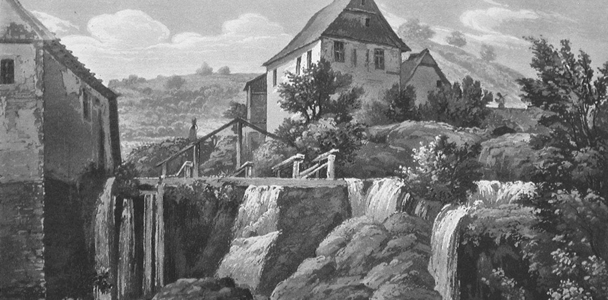

# Mittelalter

## Strinz-Margarethä (StM) ist der älteste Ortsteil der Gemeinde Hohenstein im Taunus. Er wurde schon im Jahre 1184 erstmals urkundlich erwähnt und zwar mit dem Ortsnamen "Strentzge Minorem".

Im Nordwesten bildete die Grenze das von dem Bach Strinzcepha durchflossene Scheiderthal, wie sein Name angibt, die Scheide (Grenze) zwischen dem Königsgau und Niederlahnau. Die Strinzcepha entsteht aus 2 Bächen beim Dorf Hennethal von denen der eine von Strinz-Margarethä (heutiger Aubach), der andere aus Strinz-Trinitatis kommt.

---

## Die Kleinstaaterei im Mittelalter führte dazu, dass eine Menge Währungen im Umlauf waren. Es war nicht immer einfach, die eigene Währung, wenn man in einen neuen Staat kam, umzurechnen.

Das Buch: „Dry facher Leitstern der Reisenden“ aus dem 17. Jahrhundert zeigt dies sehr Eindrucksvoll auf:

---

## Erstmals wurde der Batzen 1492 und in der Folge bis 1850 in Bern geprägt. Namensgeber soll nach Valerius Anshelm das Wappentier des Kantons sein, der Bär bzw. «Bätz», der auf der Rückseite der Münze aufgeprägt war. Die Herkunft des Begriffs ist aber nicht gesichert.

Der Wert eines Berner Batzens entsprach vier Kreuzern. Da der Gulden den Wert von 60 Kreuzer hatte, entsprach ein Batzen auch einem Fünfzehntel des Guldens. Später gab es auch «Grossi» (Dicke, d. h. Groschen) zu 5 Batzen.

Andere Orte der Alten Eidgenossenschaft und einige süddeutsche Staaten folgten bald dem Beispiel Berns. Der Batzen wurde zu einer weit verbreiteten Zwischenwährung zwischen den zahlreichen in Europa kursierenden großen und kleinen Silbermünzen. Da die süddeutschen Batzen zum Teil von sehr unterschiedlicher Güte waren, sprachen sich die Reichstage von 1522 und 1524 gegen diese Münzen aus. In Süddeutschland wurden sie noch bis 1536 geprägt, jedoch mit der Reichsmünzordnung 1559 verboten.

---

## 1385 erhielt Reinhard von Schönborn aus StM 5 Gulden Burglehen zu Adolfseck.(Quelle: H. Gensicke; Die von Schönborn. Nass. Analen, Bd. 91, 1980, S. 259 ff.)

Nassau-Idsteiner Lehen, Burglehen zu Adolfseck, 5 Mark Martini auf dem Amt Strinz Margarethae: Lehnbrief für Reinhard.(Quelle: HHStAW 121. U von Schönborn)

---

## Ab dem 1446 wird erstmalig die Kirchenpatronin (hl. Margaretha) zur Kennzeichnung der beiden Strinze zur Unterscheidung herangezogen.(Quelle: Nassauische Analen)

StM hat ein eigenes Centgericht für den Umfang seines Kirchspiels.(Beschreibung des Herzogthums Nassau / C. D. Vogel / 1843 / Seite 564)

---

## Erneuerung des Weistums von 1446 am 14. Juli 1457.(Hessisches Staatsarchiv Wiesbaden Abt. 133 / 44)

Gilbrecht der Jüngere von Schönborn, Kurmainzer Amtmann, erhält aus StM 5 Gulden Burglehen zu Adolfseck.(H. Gensicke; Die von Schönborn. Nass. Analen, Bd. 91, 1980, S. 259 ff.)

---

## Die Grafen zu Nassau-Idstein einigen sich mit dem Kloster Bleidenstadt über die beiderseitige Gerechtsname im Kirchenspiel Strinz-Margarethä (siehe hierzu auch 1446).(Quelle: Nassauische Analen)

24. Januar 1465Erzbischof Adolf von Mainz vergleicht Abt und Konvent des Klosters Bleidenstadt mit seinem Bruder Grafen Johann von Nassau (Idstein) betreffs der Gerechtigkeiten in dessen von dem Kloster zu Lehen rührenden Vogteien Würges und Kirberg und den Dörfern Strinz-Margarethae, Ober-Nieder-Libbach und Hambach.(Quelle: HHStAW, 131 Nr. U 187)

31. Janur 1465Abt Johann und der Konvent des Klosters Bleidenstadt belehnen den Grafen Johann von Nassau nach vorausgegangener Einigung mit den zwei Vogteien zu Würges und Kirberg (Wedries und Kirpurg) und den Dörfern Strinz-Margarethä, den beiden Libbach (Liddebach) und Hambach (Haynbach).(Quelle: HHStAW, 131 Nr. U 188)

31. Januar 1465Graf Johann von Nassau reversiert sich gegen Abt Johann des Klosters Bleidenstadt über Empfang der zwei Vogteien zu Würges (Widderges) und Kirberg (Kirporg) und der Dörfer Strinz-Margarethä, der beiden Libbach (Liddebach) und Hambach (Hayenbach) zu Lehen.(Quelle: HHStAW, 131 Nr. U 189)

---

## Im Jahre 1469 (sabbato post dominicom invocavit) präsentiert Abt Johannes von Bleidenstadt dem Probst von St. Peter bei Mainz als Pfarrer zu Strinz-Margarethä (ad scam Magaretham) nach dem Abgang des bisherigen Pfarrers, Nicolas Rasor, den Johannes Ernst de Wesebaden. Am 6. Mai stellt der Official des Probstes von St. Peter für Ernst von Wesebaden den Bestallungsbrief aus.(Quelle: Geschichte und historische Topographie der Stadt Wiesbaden im Mittelalter und der Neuzeit / 1883 und HHStA Wiesbaden 14. Nr. U 110)

Beleg der Strinzer Pfarrei mit "Ecclesia parrochialis ad sanctam Margaretham".(Quelle: Nassauische Analen)

---

## Im Reichssteuerregister der Herrschaft Idstein von 1499 werden die Strinzer Bürger aus dem entsprechendem Jahr namentlich festgehalten.(Siehe auch unter: Strinzer Bürger von 1499)

Die Rödel zu Reifenberg haben in StM ein Lehen von Nassau Idstein.(Quelle: H. Gensicke; Die Rödel von Reifenberg / Nass. Analen, Bd. 96, 1985, S. 240)

---

## Georg August Fürst zu Nassau-Saarbrücken und das Stift Bleidenstadt paktieren: Nassau zediert eine jährliche Rente für den Schullehrer zu Bierstadt, den Zehnten zu Kloppenheim, das Stift solle in der Nutznießung des Zehnten zu Strintz-Margarethae und Libbach nicht beeinträchtigt werden, die Bleidenstadter Zehnten, Renten usw. sollen erneuert und beschrieben werden, wobei dann dem Stift bei Belehnung und Verpachtung freie Hand gelassen werden soll, das Stift zediert den Zehnten zu Adolphseck und bezahlt dazu 1000 Gulden bar, gibt auch Geldverschreibungen auf benannte Personen zu Hahn und Breithard.(Quelle: HHStAW 14. Nr. U323)

Renovation der Zehnten, Renten und Gefälle des Stifts Bleidenstadt zu Bierstadt, Kloppenheim, Auringen, Hessloch, Schierstein (am 5. Oktober), Wehen (11. Oktober), Strintz-Margarethae, Strintz-Trinitatis, Ober- und Niederlibbach, Hambach, Wingsbach, Hahn, Seitzenhahn, Bleidenstadt, Hennethal, Michelbach, Dörsdorf, Berghausen, Eisighofen, Born, Watzhahn, Mudershausen, Rückershausen, Breithard, Steckenrod, Idstein, Orlen (12. Oktober).

---

## 1184 – Erste urkundliche Erwähnung

Die erste urkundliche Erwähnung fällt in das Jahr 1184. Papst Lucius III. bestätigt in dieser Urkunde dem Abt. Jofredus von dem Benedektiner-Kloster zu Bleidenstadt unter anderem den Besitz von Strinz-Trinitatis, Strinz-Margarethä und Libbach.

---

## Der Bürger mit Nachnamen Knippon ist der am älteste bekannte Schultheiß von Strinz-Margarethä. Ein Schultheiß hatte die gleichen Aufgaben wie ein Bürgermeister. Nachweißlich kümmerte ich mich von 1442 - 1464 um das Wohl der Strinzer Landbevölkerung, ca. 100 an der Zahl.

Bekannt wurde er dadurch, dass im Jahre 1446 der Amtmann des Grafen Nassau-Idstein ein Weisthum über die Rechte seines Herrn in unserem Kirchspiel von Strinz-Margarethä, Ober- und Niederlibbach erfragt. Es ging darum, wer denn der Herr über Strinz sei. Das Kloster Bleidenstadt oder die Herrschaft in Idstein.

---

## Im Mittelalter gab es zunächst kaum öffentliche Sicherheitsbehörden oder eine allgemein zuständige Polizei, die verstreut angesiedelten Höfe mussten sich daher selbst um Schutz und Beistand bemühen. Dazu konnten sie sich unter Aufgabe ihres Eigentums und Freiheit freiwillig einer befestigten Stadt, einem Oberhof oder einer Klostergemeinschaft anschließen und standen so als Wachszinsige oder Klosterhörige unter meist kirchlichem Schutz. Im Fall von StM standen diese Menschen wohl unter dem Schutz des Kloster Bleidenstadt.

---

## Als Gegenleistung für Schutz wurde als Abgabe alljährlich nur ein Zins z.B. in Form von Wachs oder Wachskerzen gefordert, der sogenannte Wachszins. Das Wachs diente im frühen Mittelalter für Schreibtafeln, das Bienenprodukt wurde hoch gehandelt. Die Wachszinsigkeit war die mildeste Art der Hörigkeit. In anderen Fällen mussten die Zinser einen Zinspfennig auf den Altar des Ortsheiligen an dessen Heiligenfest legen und ihm testamentarisch ihr bestes Stück Vieh oder ihr bestes Kleid im Todesfall vermachen.

Mit der Hörigkeit entgingen die Hofesleute auch der Dienstpflicht gegenüber den Territorialherren, die unter anderem im Kriegsdienst bestanden. Die Aufgabe der Freiheit schien für viele die bessere Alternative zu einem möglichen Tod in einer Fehde oder Schlacht.

Die Wachszinsigen oder Zensualen besaßen einen besseren Stand als die sonstigen Hofhörigen. Ihre Zahlungsverpflichtungen waren geringer und ihr sozialer Status höher, da das ganze Institut auf einem anderen Ursprung als die Hofhörigkeit basierte.

Das von den Zensualen erlangte freie Verfügungsrecht über die eigene Arbeitskraft war ein starkes Motiv für persönliches Streben und eine wesentliche Voraussetzung für den im 12./13. Jahrhundert entstehenden Bürgerstand.

---

## Es gab in der Gemeinde wohl kaum einen Einwohner, der nicht der feierlichen Einholung der neuen Kirchenglocke beiwohnte. In langem Zuge holte man die Glocke unter dem Vorantritt der Schulkinder mit Lehrer Witt, den Fahnen der beiden Ortsvereine, dem Bürgermeister und der Gemeindevertretung, sowie eines Großteils der Einwohnerschaft in den Ort ein. Auf einem Lastkraftwagen wurde die festlich dekorierte Glocke durch den Ort gefahren, beiderseits flankiert von den ganz in Weiß gekleideten Ehrenjungfrauen. Mit dankbarem Herzen säumten die Einwohner der Gemeinde den Straßenrand, als die neue Glocke, die im Verein mit der aus dem Jahre 1450 stammenden alten Glocke, das frühere Geläut wiederherstellen soll, durch den Ort gefahren wurde.

---

## Bender, Karl Karl Bender hat den Krieg überlebt Quelle: Gemeinde Bender, Wilhelm Wilhelm Bender wurde im Jahre 1918 als vermisst gemeldet. Quelle: Deutsche Verlustlisten / Nr. 1160 / 11.06.18

Blum, AdolfDer Gefreite Adolf Blum wurde im Jahre 1918 als vermisst gemeldet. Quelle: Deutsche Verlustlisten / Nr. 1280 / 20.10.18

Blum, Wilhelm Wilhelm Blum diente in der 2. Kompanie des Reserve Infanterie Regiment Nr. 82 im Range eines Musketiers. Im Jahre 1915 wurde er zuerst als verwundet gemeldet*, 2 Monate später noch einmal leicht verletzt ** Quelle: * Deutsche Verlustlisten / Nr. 245 / 10.06.15  *** Deutsche Verlustlisten / Pr 806 / 14.08.15

---

## Stösinger, Wilhelm Wilhelm Stösinger wurde laut den "Deutsche Verlustlisten" am 29.04.1916 durch einen Unfall verletzt. Offensichtlich überlebte er den Krieg. Quelle: Deutsche Verlustlisten / Pr 1111 / 12.04.18 /Gemeinde

Thiele, August August Thiele diente in der 10. Kompanie des Infanterieregiments Nr. 78. Er wurde am 29.09.1915 als durch Unfall verletzt gemeldet. Quelle: Deutsche Verlustlisten / Pr 340 / 29.09.15

---

## Diese Unterscheidungen wurden als erstes in Preußen 1752 aufgehoben, da sie zu ständigen Reibereien, auch zum Nachteil der Kundschaft führte. Der Bäckerberuf gehörte zu den freien, geschenkten und ungeschlossenen Handwerken. Die Befugnis eines Meisters, zu backen, hieß die (Back-) Gerechtigkeit oder auch die Bank. Bereits im römischen Recht wurden die Bäcker zu eigenen Korporationen vereinigt und im Mittelalter wurde durch Erteilung von Privilegien die Bildung von Bäckerinnungen vorangetrieben. Ihren Rechten entsprachen jedoch bestimmte Pflichten. So sollten die Bäcker durch die Bereitstellung ständig vorhandener Mehlvorräte allgemeinen Notständen vorbeugen helfen.

Der Beruf des Bäckers war für die Ernährung der Bevölkerung so wichtig, dass ein Bäcker in der Regel auch nicht zum Kriegsdienst eingezogen wurde.

---

## Im Mittelalter konnte nicht jeder einfach eine Mühle gründen. Es gab in der Regel einen Mühlenbann, das bedeutet, dass es Mühlen gab, die quasi ein Monopol auf ihre Tätigkeit hatten. So auch für unsere Region. Für die nassauischen Eigenleute (Leibeigenen) galt bis 1514 der Adolfsecker Mühlenbann. Bisher dahin waren Strinzer Bürger gezwungen ihr Getreide in der Adolfsecker Mühle malen zu lassen.

---

