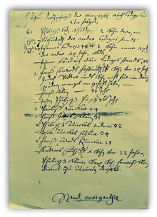

# Frühe Neuzeit

## Margareta in einem Siegel von 1703

Margareta von Antiochia wurde in Pisidien (in der heutigen Türkei) um 305 als Jungfrau und Märtyrin hingerichtet.

Die hl. Margareta ist die Schutzpatronin der Bauern, bei Schwangerschaft und Geburt, der Jungfrauen, Ammen und der Gebärenden. Sie wird gegen Unfruchtbarkeit, bei Wunden und Gesichtskrankheiten und zum Schutz „gegen Unholde aus der Tiefe des Wassers“ angerufen.

Auslöser für die Verfolgung scheint weniger ihr Glaube als ihre Schönheit gewesen zu sein, unabhängig von der zugrunde gelegten Überlieferung:

---

## Pfarrer Peter wird in einer Kirchenvisitation des Jahres 1594 als evangelischer Pfarrer in StM erwähnt. Dies ist der erste Nachweis von ev. Gottesdiensten in Strinz. Ob der im Jahre 1566 erwähnte Pfarrer Jacob Hauenstein schon ev. Glaubens war ist nicht bekannt.(Quelle: 800 Jahre StM, Horst Witt)

StM leistet 15 Malter für den Altar St. Hieronymus des Stift St. Martin Idstein.(Quelle: Die Stifte St. Walpurgis in Weilburg und St. Martin in Idstein / Neuauflage 1980)

---

## (Quelle: Historisches Lexikon Evangelischer Jubel-Priester" / Seite 71 / 1727)

Neue Pfarrer in StM wird Johann Heiger. Wie lange er hier seinen Dienst versehen hat ist nicht überliefert.

---

## 1639 drohen die Franzosen und die Schweden, dieses Gebiet wieder zu besetzen. Da schließt sich Nassau-Idstein an Amalie von Hessen an. Sie schickt ihren General Geisse in den Taunus. Alle Grafschaften stehen nunmehr unter hessischem Schutz. Dafür müssen sie monatlich zusammen 900 Reichsthaler Kriegssteuer zahlen. (Quelle: Wehen uns sein Grund, Dr. Eduard Wilhelmi, 1957)

Anfänglich benehmen sich die hessischen Truppen recht anständig, werden aber auch roh und hart, wenn die Gelder nicht rechtzeitig eingehen oder Lieferungen ausbleiben.(Quelle: Wehen uns sein Grund, Dr. Eduard Wilhelmi, 1957)

---

## Aus dem Kirchenbuch: Anno 1673 am 5. Oktober Philipp Michael Enders ein junges Söhnlein geboren. Johann Wilhelm getauft. Ist in der Kriegsflucht bei Hohenstein (heutiges Burg-Hohenstein) bei der Mühle an der Aar gestorben und auffem Kirchhof daselbst christlich begraben. (Quelle: Alte Strinzer Chronik, Band 1, Seite 43)

Weiterer Eintrag: Anno 73, als man begann des Krieges zu hassen bei der Mühl an der Aar eine Zeitlang mit dem Vieh und anderen Mobilien sich uffgehalten, ist Philipp Enderßen ein Söhnlein Johann Wilhelm derselbst gestorben, liegt auf dem Kirchhof zu Hohenstein christliche begraben.

---

## (siehe auch unter Die Strinzer von 1681)

---

## 5. August 1726

Der Dechant Wildericus Marsilius Freiher von Hoheneck und das Kapitel des S. Ferrutius Stiftes zu Bleidenstadt belehnen den Grafen Friedrich Ludwig von Nassau etc. (-Ottweiler) zugleich für die Fürsten und Grafen Carl, Wilhelm Heinrich und Carl August von Nassau etc. mit den zwei Vogteien zu Würges und Kirberg und den vier Dörfern Strinz-Margarethae, Libbach, Libbach und Hambach.(Quelle: HHStAW, 131 Nr. U 420)

---

## Am Freitag, dem 18. Juli 1727, beschweren sich die Abgesandten aus Ehrenbach, Görsroth, StM und Bechtheim bei der Verwaltung in Idstein, dass sie in der vergangenen Woche 5 Tage bei Hahn auf der Jagd liegen mussten. Sie konnten deswegen kein Heu machen und kein Korn schneiden. Doch nicht nur mit ihrer eigenen Feldarbeit blieben sie gewaltig zurück, auch die Frondefahrten, zu denen sie ebenfalls verpflichtet sind, blieben ungetan. Sie hätten Hafer nach Biebrich und (Holz-)Kohle zu einer (Eisen-)Schmelze fahren müssen. Da wegen der unterlassenen Zulieferung ein Ofen ausgegangen war, sprach nun die zuständige Rentkammer von Bestrafung.Die Amtsverwaltung hat ein Einsehen und hilft den frondepflichtigen Untertanen aus der Zwickmühle, die durch die an sich berechtigten Forderungen der verschiedenen Behörden entstanden ist. Der Oberforstmeister wird angewiesen, die Leute "so viel möglich bey dieser kostbaren Erndte Zeit gäntzlich und durchauß zu verschonen".(Quelle: Walsdorfer Bürgerbrief Nr. 22 / Rund um den Hutturm / 1983)

Am 12. November zahlt Philipp Christian von Strinz-Margarethä das Besthaupt seines verstorbenen Schwiegervaters Jokob Klein mit 4 Gulden 15 Albus.(Quelle: HStA.: W133, VIII e, 2)

---

## 15. November 1751

Der Dechant Johann Franz Freiherr von Hoheneck und das Kapitel des S. Ferrutius Stiftes zu Bleidenstadt belehnen den Fürsten Carl August von Nassau(-Weilburg) zugleich für die Fürsten Carl und Wilhelm Heinrich von Nassau etc. mit den zwei Vogteien zu Würges und Kirberg sowie den Dörfern Strinz-Margarethae, den beiden Libbach und Hambach.(Quelle: HHStAW, 131, U 433)

---

## Ablösung der Zehntberechtigungen des Domänenfiskus in den Gemarkungen.(Quelle: HHStAW 244 Nr. 1684)

Ablösung der Lasten des Domänenfiskus für die evangelische Pfarrei Strinz-Margarethä(Quelle: HHStAW 244 Nr. 1678)

---

## Pfarrer Ludwig Schmidtborn wurde am 11.02.1792 in Assenheim bei Worms geboren. Sein Vater war dort seit 1786 Pfarrer. Durch die Franzosen im Jahre 1794 vertrieben, flüchtete er mit Frau und Kind in das elterliche Haus nach Altenkirchen bei Weilburg.

Der Fürst zu Weilburg berief ihn 1795 als Pfarrer nach Wismar bei Gießen. Hier wuchs Ludwig heran und studierte später in Gießen und Marburg.

Am 07.05.1812, also mit 20 Jahren, wurde Schmidborn ordiniert und zu Rettert bei Nastätten angestellt. Im Jahre 1815 trat er seine Pfarrstelle in Strinz-Margarethä an.

Bis auf den heutigen Tag ist in unserem Dorf das Andenken an den "alten" Pfarrer Schmidtborn lebendig geblieben, der in der Seelsorge ebenso tüchtig war wie in der Landwirtschaft.

---

## Die Eisenstraße ist ein Teil eines mindestens eisenzeitlichen Fernweges von der Lahn bis Mainz. Zu dem Namen Eisenstraße ist zu bemerken, dass dieser nicht nur von der Michelbacher Hütte herrührt. Diese nahm erst im Jahre 1655 ihren Betrieb auf, während im Begang der Grenze der Herrschaft Idstein von Beuerbach bis Breithardt vom 07. bis 10. November 1653 bereits zweimal der Name Eisenstraße erwähnt wurde.

So ist vielmehr anzunhemen, dass er auf die Eisenfuhren von den zahlreichen Waldschmieden im Raume Hahnstätten und Burgschwalbach Richtung Mainz/Wiesbaden deutet.

Die Waldschmieden beherrschten technisch alle Zweige der Eisengewinnung, so wurde z. B. in kleinen Öfen, die mit Holzkohle befeuert wurden, Eisenerze geschmolzen und in Hammerschmieden weiterverarbeitet und die Erzeugnisse auf der von Norden Richtung Süden in Gräben gelegten und eingeebneten Eisenstrasse befördert.

Gleichzeitig diente diese stark befahrene und mit natürlicher Festigkeit versehene Weg auch den Einheimischen zum Transport von Feldprodukten und anderen Handelsgegenständen.

---

## Schon im Jahre 1629 bestimmt die von Graf Johannes von Nassau-Idstein erlassene Heftricher Verordnung, die auch für Strinz-Margarethä galt, dass jeder Einwohner, der wegzog, der Gemeinde 2 Gulden zu geben hatte. Wer zuzog musste zwei lederne Eimer kaufen, einen für die Gemeinde, einen fürs eigene Wohnhaus, ferner eine tannene Leiter mit mindestens 30 Sprüssel (Sprossen).

Wer sich nach auswärts verheiratete und nach dem Tode der Eltern zurückkehrte, musste 2 Eimer kaufen und 6 junge Eichenbäume in den gemeinen Wald setzen.

---

## Die Strinzer von 1681

Im hessischen Staatsarchiv Wiesbaden ist eine Urkunde erhalten geblieben, die die männlichen Bürger von StM aufgelistet hat.

---

## Die in der Geschichte 'Die letzten Strinzer' als Tochter von Andreas Fuchs aufgeführte Anna Margaretha (*1656) ist mit einem Schultheißen (Bürgermeister) Jon (Johann?) B (Nachname nicht vollständig erwähnt) verheiratet. Sie hat mit Ihrem Ehemann zwei Jungen.

In den Aufzeichnungen von Pfarrer Johannes Neumann wird berichtet, dass sie wohl mit einem ledigen Kerl ein Verhältnis hatte und mit dessen Hilfe ihren Mann nachts im Bett umgebracht und verscharrt hat.

---

## Tod eines Sohnes in 1699

---

## Tod des ältesten Sohnes in 1704

Sein älterer Sohn, Johann Peter, hatte seinen Bruder in Wittenberg besucht und wohlbehalten zurückgelassen. Als er die Post von der Ermordung seines Bruders erhielt, verfällt dieser in Melancholie. Er, der bis dahin frisch und schön geraten, nahm immer mehr ab, bekam Fleckfieber und verstarb schließlich bei seinem alten Vater. Er wurde 22 Jahre alt.

---

## Bei der Öffnung stellt man fest, dass auch der Pfarrer Neumann im Jahre 1712 in diesem Grab beigesetzt wurde. Außerdem noch andere Personen, die dort mit wollenen Kleidern begraben lagen.

Der damalige Pfarrer Schmidtborn berichtet, dass die Kopfbedeckung und das blonde Haar der Pfarrersfrau noch vollkommen kenntlich waren.

---

## Ein Schriftstück beweist aber, dass es sich nicht um die "Franzosenzeit" gehandelt haben kann, denn bereits im Jahre 1651 wird im Niederlibbacher "Nachbarschaftsverzeichnis ein Bürger namens Melchior Meßere erwähnt.

Wahrscheinlicher ist es deshalb, dass mit der "Franzosenzeit" eher die Zeit des 30jährigen Krieges gemeint ist.

Im Jahre 1818 gab es noch einen Schultheißen (Bürgermeister) in Oberlibbach mit dem Nachname Misere, der ein Nachfahre dieses Kindes gewesen sein könnte.

---

## Das Backhaus bestand schon 1707, wie Eintragungen aus dem Kirchenbuch belegen. Leider wurde es in den 50ern, nachdem es nicht mehr genutzt wurde, abgerissen. Noch heute nennt man das Grundstück auf dem das Backhaus stand "Backeswiese". Vom Backes existieren nur noch wenige Aufnahmen.

---

## Eintrag vom 24. Martii (März) 1703

Einen armen, uff der Bettelfahrt krank hingebrachten und 2 Tag im Backhaus gelegenen Mann, des jetzigen Kuhhirten zu Hambach Vatter, Pantificium (katholisch) christlich begraben aetatis (seines Alters) 70 Jahre.

---

## Weiterer Eintrag von 1707

Anno 1707. Einen fremden Mann, Hans Georg Meyer, gebürtig aus Frankfurt, ein blassierter, abgedankter Soldat, so mit seinem Waib Catharina gebürtig zu Bernburg Sachsen Land, sein logiment im hiesigen Backhaus genommen, aber das Waib den 1. Martii (März) nachts zwischen 11 und 12 Uhr eines Söhnlein geneßen, so den 4. Martii (März) Johann Philipp getauft worden. Pathen (Paten) sind Johann Philipp Enders, Jakob Klein. Den 90. Psalm gelesen und darüber einen kurzen Sermon (Predigt) gehalten.

---

## Mittels eines speziellen Architekturprogramms wurde das Strinz von 1782 wiederaufleben lassen.

Hier die alte Karte, auf die die damaligen Gebäude eingezeichnet wurden. Die Gebäudehöhen sind nicht maßstabsgerecht, da die meisten Gebäude heute nicht mehr existieren.

---

## Aus dem Jahre 1782

Eine Dorfkarte aus dem Jahre 1782 zeigt, dass es auch schon im 18. Jahrhundert eine Brücke über den Aubach gab. Woraus die Brücke bestand ist allerdings nicht bekannt.

---

## Im Jahre 1704 hatte sich im Strinzer Pfarrhaus eine Gretchentragödie abgespielt.

Die Gretchentragödie ist ein offenes Drama, das Johann Wolfgang Goethe in den Urfaust von 1772 einfügte und überarbeitet in sein Hauptwerk Faust I übernahm. Sie beschreibt das Auseinanderbrechen des Liebesverhältnisses zwischen Faust und Margarete (Grete). (Quelle: Wikipedia)

---

## Als sich ein auffälliger Rückgang in der Frequenz der Schule zeigte, schrieb man dies dem Alter und der Kränklichkeit Stritters zu.Die Regierung, die den Gegnern glaubte, entließ Stritter im Jahre 1766 aus dem Amte und betraute den Konrektor J. G. Schellenberg mit der Leitung der Schule.

Der an Tätigkeit gewöhnte Stritter hielt es aber nur zwei Jahre im Ruhestand aus. Im Jahre 1768 zog er mit seinem Sohn als Pfarrer nach StM und verbrachte seine Zeit mit Predigen und Unterweisung der Schullehrer der ganzen Umgebung.

---

## Er verstand es aber, sich bei der Regierung in Idstein wieder so in Szene zu setzen, dass er im Jahre 1771 nicht nur wieder als Rektor nach Idstein berufen wurde, sondern auch, um allen Streitigkeiten mit der Geistlichkeit vorzubeugen, die Stelle des Scholarchen (= Schuloberhaupt) erhielt, von welcher der Superindendent Drossten entbunden wurde.

Aber er scheint unterdessen nicht ruhiger und friedfertiger geworden zu sein. Schon nach zwei Jahren wurde er wieder, diesmal für immer, entlassen.Den Rest seines Lebens verbrachte er in Idstein, wo er am 30. Januar 1781 starb.

---

## Kartenausschnitt 1782               erwähnt. Dort heißt es:

Ende des 16., Anfang des 17. Jahrhundert wurde von einem Vigand Kalwort die Strinzer Glocke gebaut. Sie wog ca. 200 kg und hatte einen Durchmesser von 70 cm. Auf der Schulter der Glocke war eine umlaufende Inschrift, wahrscheinlich in frühromanistischer Kapitalis eingeschlagen. Sie lautet:

---

## Dabei wird ein Grab im Kirchenchor, in dem die Ehefrau des damaligen Pfarrers Neumann 1696 beerdigt wurde, geöffnet. Bei der Öffnung stellt man fest, dass auch der damalige Pfarrer Neumann im Jahre 1712 in diesem Grab beigesetzt wurde. Außerdem noch andere Personen, die dort mit wollenen Kleidern begraben liegen.

Der damalige Pfarrer Schmidtborn berichtet, dass die Kopfbedeckung und das blonde Haar der Pfarrersfrau noch vollkommen kenntlich sind.

---

## Tagesration entspricht 1550 Kilokalorien

Ende 1946 entsprach die vorgesehene Tagesration für erwachsene Normalverbrauche 1550 Kilokalorien. In den Jahren 1948 und 1949 wurden die Mengen schrittweise erhöht.

Man erhielt rationierte Lebensmittel in den Geschäften und Gaststätten nur, wenn man die entsprechenden Lebensmittelkartenabschnitte, die Marken, abgeben konnte (und zusätzlich natürlich die vom Händler geforderte Summe bezahlte). Die Marken waren nach einzelnen Lebensmitteln aufgeteilt; beispielsweise konnte man mit Brotmarken nur Brot erwerben, aber mit Fleischmarken auch Fisch.

---

## Desgleichen soll er  die Nachbarn ihrer Gebühr anhalten, daß keine Partei die andere zu beklagen geursacht werde, und soll solche Lieferung der Pacht für das erste Ziel angehen zwischen den zweien unserer lieben Frauen Tagen obgemelt im Jahr wann man zählen wird nach Christi Geburt 1500 und im fünfzehnten aus Ursachen, daß die Mühle erst von neuem gebauen, darumb wir ihm das erste Ziel aus Gnaden nachgelassen und erstreckt haben, und damit wir unsere Erben und Nachkommen solcher Pacht und Steuern, auch die Mühle in Bau und Besserung zu haben, von gedachtem Philpsen oder seinen Erben desto sicherer sein mögen, so hat er uns für sich und seine Erben im Beiwesen des Reichen Hansen, z. Zt. unsers Schulthessen zu Strinz Margarethä und Emmerichs, Schöffen derselbst, zu rechten unverschiedlichen Unterpfändung zwentzig Wert gelegt ung gesetzt, nemlich eine Wiese in der Rypspach unter dem Schulthessen und auf Heusern Stoffeln, geschätzt für 10 Gulden, item 3 Viertel Landes im Bleidenstädter Wege, geschätzt auf 5 Gulden. Obsach wäre, daß der obgemelte Philips oder seine Erben solchen Pacht und Eier nit liefern auf Zeit und Ziele auch die Mühle in Bau und Besserung nit halten, wie obsteht, so sollen und mögen wir wir, unsere Erben und Nachkommen, solche Güter zu unseren ohne des gedachten Philipsen, seinen Erben oder männiglich von ihretwege Intrag. Wir haben uns, unsere Erben und Nachkommen herzu auch vorbehalten, solch Pacht nach Vermögen und Aufkommen der Mühlen zu mehren und zu mindern nach Gelegenheit der Sachen, ohn all Gefährte.

Des zu Urkund haben wir unser Insiegel heran tun hencken auf Donnerstag nach St. Martinstag, als man zählt nach Christi Geburt 1500 und im 14.

---

## Er müsste zwischen 1720 und 1730 geboren sein. Er starb 1796. Er hatte drei Töchter.

Seine Tochter Maria Margaretha (od. Philippina) heiratet um 1783 den Johann (Philipp?)  Ludwig Bender, der vermutlich ab 1789 als Müller in Strinz erwähnt wird.

---

## Im Februar 2018 ging es los mit einem Landfrauen-Abend. Dann trafen sich eine Volkslieder-Gruppe, der Ortsbeirat und Freundeskreise im Heimatmuseum. Für maximal zwölf Personen ist Platz, jeder bringt etwas zu essen und zu trinken mit, der Hausherr sorgt für ein historisch fundiertes und zugleich unterhaltsames Programm. So hält er einen Vortrag über die Wolfsplage 1604 oder alte Balken-Inschriften.

Doch es wird nicht nur zugehört, sondern auch geraten. Ein kleines Gerät von der Größe einer Streichholz-Schachtel führt Schwarzer vor: Wer kommt schon darauf, dass man Rasierklingen damit schärfen kann? Eine Vaginal-Dusche aus dem Jahr 1850 macht die Treffen ein wenig frivol. „Letztlich spielen wir Dings vom Dach“, sagt der Gastgeber. Wer am meisten weiß, wird zum „Klugscheißer des Abends“ gekürt.

„Man merkt nicht, wie die Stunden vergehen“, berichten Doris und Werner Schurr, die bereits an einem Heimatabend teilgenommen haben. Drei Stunden sind demnach rasch vorüber, und gerade „für uns als Zugereiste ist das hochinteressant“. Wer sich mit alten Schlagern von Peter Alexander oder Caterina Valente auskennt, kann übrigens ebenso Punkte sammeln, sie erschallen ebenso wie eine Grammophonplatte.

Während das 1928 hergestellte Grammophon mit der Handkurbel eiern darf, wurde das drei Jahrzehnte jüngere Radio mit Bluetooth-Technik modernisiert, ohne dass dies äußerlich erkennbar ist. So weit in die Gegenwart führt die Zeitreise allerdings nicht, der Vortrag endet mit einem Luftbild aus dem Jahr 1945.

---

