# Neuzeit bis 1900

## Durch den Tod des Hunnenführers Attila zerfällt das Reich der Hunnen.

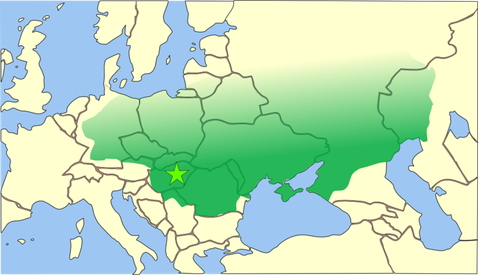

---

## (Quelle: H. Gensicke; Die von Schönborn. Nass. Analen, Bd. 91, 1980, S. 259 ff.)

Nassau-Idsteiner Lehen, Burglehen zu Adolfseck, 5 Mark Martini auf dem Amt Strinz Margarethae: Revers Gilbrechts nach rechtlichem Austrag.(Quelle: HHStAW 121 Nr. U von Schönborn)

---

## Für StM ist die Existenz von Zinsern nachgewiesen.(Quelle: Hessisches Jahrbuch der Landesgeschichte - Band 4 / 1990)(Siehe hierzu auch unter: Strinzer Zinser)

Gilbrecht der Jüngere von Schönborn, Kurmainzer Amtmann, verzichtet auf sein Burglehen von StM.(H. Gensicke; Die von Schönborn. Nass. Analen, Bd. 91, 1980, S. 259 ff.)

---

## (Quelle: Hessisches Wappenbuch / 1956)

Graf Ludwig zu Nassau erlässt drastische Verhaltensvorschriften im Umgang mit den Kirmessen, Ehebrechern, Säufern etc.

---

## (Quelle: Wehen und sein Grund, Dr. Eduard Wilhelmi, 1957)

Ligistische Söldner durchqueren den Taunus. Trotz des strengen Befehls, nicht zu plündern, kommt es zu Gräueltaten.

---

## (Quelle: Wehen und sein Grund, Dr. Eduard Wilhelmi, 1957)

---

## (Quelle: Wehen und sein Grund, Dr. Eduard Wilhelmi, 1957)

Ende 1624 wird unsere Region wiederbesetzt, und zwar von den Truppen des bayrischen Oberst Adam Philipp von Cronberg, unter dessen Besatzung es wieder zu Gräueltaten kommt.

---

## (Quelle: Wehen und sein Grund, Dr. Eduard Wilhelmi, 1957)

Am 25. September quartiert sich Rittmeister König in Bleidenstadt mit einer Kompanie Reiter ein und saugt die ganze Umgebung aus.

---

## (Wehen uns sein Grund, Dr. Eduard Wilhelmi, 1957)

Im September 1626 ziehen die Truppen Görzenichs ab. Ihm folgen sofort die Truppen Wallensteins, unter dem Herzog von Lauenburg, in die ausgepressten Taunusorte. Seine Horden benehmen sich zwar etwas besser als Görzenichs Scharen, aber sie sind immer noch viel teuflischer als Tillys Ligaheer. Schlimm ist zusätzlich, dass die Soldaten noch die Pest mitbringen.

---

## (Quelle: Wehen uns sein Grund, Dr. Eduard Wilhelmi, 1957)

Der ganze Winter 1626/27 war für die Nassauischen Lande sehr traurig. Das Hauptquartier des Herzog Maximilian von Sachsen-Lauenburg war zu Offenheim in der Wetterau, von wo aus seit September die sämtlichen nassauischen Lande mit Truppen überzogen wurden. Das Land war hohen Contributionen (Abgaben) ausgesetzt. 8.000 Reichstaler Constribution wurden gefordert. Das Drückendste war die Willkür, wonach man sich an gar keine Bestimmung band, sondern abpresste, wozu man Lust hatte.

Konnten die Dorfschaften die angesetzten Contributionen nicht entrichten, so wurden Menschen und Vieh eingesperrt und nicht zur Weide und Arbeit gelassen, wie das u.a. auch in Strinz-Margarethä vorkam. Die Schultheiße (Bürgermeister) wurden misshandelt und deren Wohnungen ausgeplündert. Und dabei wurden tausend andere Plackereien den Einwohnern zugemutet, die keineswegs gering anzuschlagen waren.

(Quelle: Die Drangsalen des Nassauischen Volkes und den angrenzenden Nachbarländern in den Zeiten des dreißigjährigen Krieges, seine Helden, Staatsmänner und andere berühmte Zeitgenossen)

Zusätzlich zu Lauenburgs Truppen wir unsere Region noch von den Truppen des Wallenstein Oberstleutnant von Freysing besetzt, dessen Truppen unsere Region zusätzlich ausnehmen.

---

## (Quelle: Wehen und sein Grund, Dr. Eduard Wilhelmi, 1957)

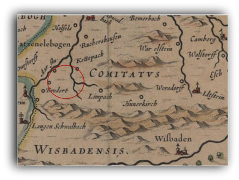

---

## (Quelle: Wehen und sein Grund, Dr. Eduard Wilhelmi, 1957)

Im Februar schließen die Nassauer Grafen einen Vertrag mit Schweden, nachdem sie so lange wie der Krieg dauert, Verbündete der Schweden sein wollen.(Quelle: Wehen und sein Grund, Dr. Eduard Wilhelmi, 1957)

Im März verlassen die Schweden unserer Region und wenden sich gegen die Truppen Tillys, die in Süddeutschland stehen. Tillys Truppen werden von den Schweden besiegt. Tilly selbst stirbt an einer Verwundung.(Quelle: Wehen und sein Grund, Dr. Eduard Wilhelmi, 1957)

---

## (Quelle: Wehen und sein Grund, Dr. Eduard Wilhelmi, 1957)

Nachdem es im Frühjahr etwas ruhiger wird und einige Bauern wieder notdürftig ihr Feld bestellen können, erscheinen die Kaiserlichen wieder, diesmal unter General Holzappel, die auch wieder plündern wollen aber nichts mehr vorfinden und ihre Wut darüber an der Bevölkerung auslassen. (Quelle: Wehen und sein Grund, Dr. Eduard Wilhelmi, 1957)

Nach General Holzappel versuchen noch andere Kaiserliche ihr Glück, aber auch diese finden nichts mehr vor was es wert gewesen ist geplündert zu werden.

---

## (Wikipedia / Beiträge zur Geschichte Hohenstein-Breithardt, -Steckenroth und - Burg Hohenstein / Weinberger / 1992)

---

## (Quelle:Hessisches Wappenbuch / 1956)

---

## (Quelle: Wehen und sein Grund, Dr. Eduard Wilhelmi, 1957)

Am 02. Juli passieren Teile der 5. preußischen Marschkolonne unserer Region dem Rhein entgegen. Ihr folgt einige Tage später die 4. Kolonne, die in unserer Region einquartiert wird. Von da ab reißen die Durchmärsche der Preußen bis zum 21. Juli nicht mehr ab. (Quelle: Wehen und sein Grund, Dr. Eduard Wilhelmi, 1953)

Die Preußen, die ohne Grund nach der gewonnenen Schlacht bei Valmy den Rückzug angetreten haben überlassen den nachfolgenden französischen Heeren den deutschen Boden. Viele Mainzer fliehen vor den herannahenden Franzosen in unsere Region. Auch viele Wiesbadener fliehen in die Taunushöhen. (Quelle: Wehen und sein Grund, Dr. Eduard Wilhelmi, 1953)

Nachdem die Franzosen den Rhein überschritten haben ist es der französische Befehlshaber und Oberst Houchard, der den Taunus mit seinen Truppen durchstreift und überall brandschatzt. (Quelle: Wehen und sein Grund, Dr. Eduard Wilhelmi, 1953)

Im Dezember gelingt es den Preußen, die Franzosen wieder über den Rhein zurückzudrängen. Unsere Region wird zur Operationsbasis der Preußen. Häuser und Scheunen liegen voll Krieger, in manchen Scheunen bis zu 50 Mann.

---

## Karte aus 1800

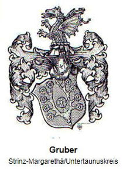

---

## Gemeindesteuer-Ausschreibung der Gemeinden des Oberamts Idstein:Zur Bestreitung gemeinheitlicher Aufgaben des laufenden Jahres 1813 ist den benannten Gemeinden des herzoglichen Oberamts Idstein die Ausschlagung und bis zum November des Jahres zu bewerkstelligende Erhebung der benannten Grund- und Gewerbesteuer-Simpeln erlaubt worden: Strinz-Margarethä zwei Simplum.Wiesbaden den 2. August 1813(Quelle: Verordnungsblatt des Herzogtums Nassau, Band 5 / 1813)

Der Wehrpflichtige Philipp Peter Enders wird im Verordnungsblatt des Herzogthums Nassau aufgefordert seiner Wehrpflicht nachzukommen und sich binnen 4 Wochen zu melden. Im Falle, dass er dieser Aufforderung nicht nachkommt, droht ihm die Aberkennung seiner Untertanenrechte und der Verlust seines Vermögens.(Quelle: Verordnungsblatt Herzogthum Nassau / 16.12.1813)

---

## Während des Befreiungskrieges gegen das napoleonische Frankreich stehen die Füsiliere des 1. ostpreußischen Infanterieregiments, die zur Streitmacht von Blücher gehören, am 13. November in Strinz-Margarethä. Das Dorf ist in einer Nacht so stark besetzt, dass in den einzelnen Häusern 40 Mann und darüber Quartier nehmen.Der Prinz Wilhelm von Preußen (der spätere Kaiser Wilhelm der I.) hält Nachtlager im Pfarrhaus.Die Truppen kochen sich meist selbst, furagieren in den Scheunen und ziehen mehreren Leuten die brauchbaren Schuhe aus. Am 14. ziehen sie weiter.(Quelle: Geschichte des koeniglich preußischen ersten Infanterie-Regiments / 1855)

Am 30. November befindet sich das königliche preußische Garde-Husaren-Regiment in StM.(Quelle: Das königlich preußisches Garde-Husaren-Regiment und sein Abstammung 1811 -1869)

---

## Neuer Lehrer in StM wird Johann Adam Schmidt, geb. 1811 zu Bechtheim. Seine Besoldung beträgt 275 Gulden jährlich.(Quelle: Alte Strinzer Chronik, Teil 1, Seite 113)

Es grassiert erstmalig die Kartoffelfäule, die die Ernte dezimiert.(Quelle: Wehen und sein Grund, Dr. Eduard Wilhelmi, 1953)

---

## Neuer Lehrer wird Johann Friedrich Demmer, geb. 1811 zu Philippstein. Der "Herzoglich Nassauische Staatsminister des Kreisamtes Langenschwalbach ernennt ihn zum Lehrer und gleichzeitig zum Organisten, Küster und Glöckner der ev. Kirche. Schulinspektor Heinzemann führt ihn in sein Amt ein.(Quelle: Alte Strinzer Chronik, Teil 1, Seite 114)

In StM werden die Schmetterlingsarten Daplidice und Bellidice nachgewiesen.(Quelle: Jahrbücher des Nassauischen Vereins für Naturkunde: Bände 7-8 - Seite 111, 1851)

---

## Ein Hitzejahr(Quelle: Wehen und sein Grund, Dr. Eduard Wilhelmi, 1953)

Pfarrer Schmidtborn gewinnt den Prozess um das Pfarrbesoldungsholz nach 3 Instanzen (1. Instanz: Justizamt Wehen / 2. Instanz: Herzogliches Hofgericht / 3. Instanz: Oberappelationsgericht.)

---

## Als oberste kirchliche Behörde fungiert jetzt ein Kirchensenat; im Uebrigen bestehen noch die kirchlichen Verhältnisse auf Grund des Edicts v. 1818, das noch nicht ausser Kraft gesetzt ist. Manche Amtsverrichtungen seit April durch die Vacanz in Breithardt.

Freitag d.19. Nov. Elisabeth. Wegen einiger Beschickungen ging ich heute nach Wiesbaden. Seit dem 12. October hatte ich wegen des noch schwebenden Prozesses mich nicht erkundigt. Als ich um 91\2 Uhr bei Hr. Dr. Großman eintrat, verkündigte mir der Secretär, dann er selbst, daß der Prozeß entschieden und gewonnen sey. Meine Freude und Genugthuung: ich war in dem Moment mit der Welt versöhnt. Ich schrieb angesichts an meinen Bruder (Generalsuperintendent in Coblenz), der an dem Resultat immer zweifeln wollte; ging in das Gasthaus des Adlers, besorgte meine Geschäfte in der Stadt, konnte aber auf keinen Freund oder Bekannten treffen, um meine Freude zu theilen. Schweigsam kehrte ich am Abend zurück. Ob in dem Moment der Ausgang des Prozesses hierorts schon bekannt war, habe ich nicht erfahren; derselbe machte nachgerade keinen überraschenden Eindruck, weil er nicht unerwartet war. Dem Kirchspiel und Publicum gegenüber verhielt ich mich, als ob nichts geschehen sey. Ich liquidirte meinerseits 120 Gulden 27 Kreuzer ausgelegte Prozeßkosten.

---

## Harter und kalter Winter.(Quelle: Wehen und sein Grund, Dr. Eduard Wilhelmi, 1953)

Es grassiert die Kartoffelfäule, die die Ernte dezimiert.(Quelle: Wehen und sein Grund, Dr. Eduard Wilhelmi, 1953)

---

## Harter und kalter Winter.(Quelle: Wehen und sein Grund, Dr. Eduard Wilhelmi, 1953)

Es grassiert die Kartoffelfäule, die die Ernte dezimiert.(Quelle: Wehen und sein Grund, Dr. Eduard Wilhelmi, 1953)

---

## Ein Hitzejahr(Quelle: Wehen und sein Grund, Dr. Eduard Wilhelmi, 1953)

Gegen Mitte September erscheint am nordwestlichen Himmel ein schöner Komet, der gegen Ende September und Anfang Oktober einen ungewöhnlichen Glanz entfaltet.(Quelle: Wehen und sein Grund, Dr. Eduard Wilhelmi, 1953)

---

## Ein Hitzejahr(Quelle: Wehen und sein Grund, Dr. Eduard Wilhelmi, 1953)

Das Jahr zeichnet sich durch eine große Dürre aus.(Quelle: Wehen und sein Grund, Dr. Eduard Wilhelmi, 1953)

---

## Milder Winter.(Quelle: Wehen und sein Grund, Dr. Eduard Wilhelmi, 1953)

Ein ausgesprochenes Regenjahr. Es gab keinen richtigen Sommer.(Quelle: Wehen und sein Grund, Dr. Eduard Wilhelmi, 1953)

---

## Starker Hagel in unserer Region.(Quelle: Wehen und sein Grund, Dr. Eduard Wilhelmi, 1953)

Um Mitte des Monats Juni erscheint am westlichen Himmel ein Komet, der einen langen Schweif nach sich zieht. Man sieht ihn nicht so lange wie den Komet aus dem Jahre 1858.(Quelle: Wehen und sein Grund, Dr. Eduard Wilhelmi, 1953)

---

## Milder Winter(Wehen und sein Grund, Dr. Eduard Wilhelmi, 1953)

---

## Auch August Schaus aus StM nimmt an der ersten Schlacht bei Weißenburg teil und wird dort verwundet.(Quelle: Geschichte des Füsilier-Regiments von Gersdorff Nr. 80, 1913)(Siehe auch unter: Halsdurchschuss)

Am 1. Oktober, morgens 9 Uhr, wird das Wohnhaus und das Feldgut zur Concursmasse der Witwe des Johann Philipp Baum von StM gehörig und zu 2.500 fl taxiert, in der Rathausstube zu StM versteigert.(Quelle: Amtsblatt der Regierung in Wiesbaden, Seite 247, 1870)

---

## Am Dienstag den 6. Juni, morgens 10 Uhr, wird das zur Concursmasse des Johann Friedrich Klein gehörende Wohnhaus und Feldgut, zu 3118 Gulden taxiert, in dem Gemeindezimmer zu StM. zum ersten Mal meistbietend versteigert.(Quelle: Amtsblatt der Regierung in Wiesbaden/ Pkt 968 und 682 / 1871)

---

## (Quelle: Die Hessen als Reichstagswähler / 1990)

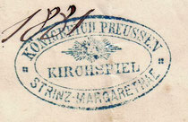

---

## Durch Blitzschlag brennt die Scheune der Frau Christmann im Unterdorf gegenüber der Kirche ab. Die 1891 angeschaffte Feuerspritze bewährt sich gut bei den Löscharbeiten.(Quelle: Alte Strinzer Chronik, Chronik der Freiwilligen Feuerwehr, 2009)

Für den Bau eines ca. 2,9 km langen Teilstücks der Scheidertalstraße zwischen StM und Hennethal werden 225 Cementrohre frei Baustelle geliefert.(Quelle: Tonindustrie-Zeitung und Keramische Rundschau, Band 23, Teil 1 / 1899)

---

## (Quelle: Die Hessen als Reichstagswähler / 1990)

---

## Gründung des TV 1904 Strinz-MargarethäAngeregt von den Turnvereinen der Nachbarorte erwägt man in der Strinzer Jugend, auch solch einen Turnverein zu gründen. Urheber diesen Gedanken ist der 20jährige Karl Weber. Ihnen schlägt im Ort keine größere Begeisterung entgegen, gibt es doch schon 2 Gesangsvereine und einen Kriegerverein. Man bringt im Ort der turnerischen Körperertüchtigung wenig Sympathien entgegen. Trotzdem lassen sich die jungen Leute nicht beirren. Nachdem man Zusammenkünfte abgehalten und Statuen besorgt hat, ruft man die Interessenten der Turnerei am 25.05. zur Gründungsversammlung zusammen. Der vorläufige Vorstand besteht aus Adolf Müller (1. Vorsitzender), Heinrich Wahl (Turnwart) und Reinhard Deuser (Kassenwart). Da die erforderlichen Geräte und das Geld für die Anschaffung fehlen, werden Gesuche an Gemeinde und Kreisverbände gestellt, die aber erfolglos bleiben. Das Mitglied August Schneider erklärt sich daraufhin bereit, dem Verein 150 Reichsmark zinslos zu leihen. Davon wird ein Reck, ein Barren und 10 Eisenstäbe für Stabübungen gekauft. Im gleichen Jahr werden aus eigenen Mitteln der Mitglieder einheitliche Turnhemden, Turnschuhe und Hüte gekauft.(Quelle: Vereinschronik des TV 1904)

Durch das plötzliche Ableben des Dirigenten wird im MGV "Eintracht" der Schneidermeister Karl Enders zum neuen Dirigenten gewählt.(Quelle: Festschrift 100 Jahr MGV Eintracht 1891 / 1991)

---

## Kugelstadt, der zwei Weltkriege überlebt hatte, stirbt im Jahre 1953 als er und der Landwirt und Ortsdiener Karl Gruber von einem Motorradfahrer aus Görsroth angefahren und verletzt werden. Kugelstadt stirbt auf dem Weg zum Krankenhaus.

Bild 2 zeigt den Strinzer Bürger August Fuhr auf dem Reservistenbild der Versuchskompanie der Artillerie / Prüfungskommission, Schießplatz Cummersdorf-Berlin. Dieser Einheit gehörte Fuhr von 1902 bis 1904 an.

---

## Kaisermanöver in unserer Gemarkung. In StM befindet sich eine Feldbäckerei, das Proviantamt u. das Telegrafenamt.(Quelle: Alte Strinzer Chronik)Bei dem Manöver wird angenommen, dass eine feindliche Armee den Rhein bei Koblenz überquert hat. Die deutschen Truppen werfen sich dem Feind entgegen. Dabei durchquert die 21. Infanterie-Division - auf ihrem Weg nach Laufenselden - StM.(Quelle: Journal of the Royal United Services Institute for Defence Studies; Volume 50, page 182 / 1906)

Hierbei handelt es sich um eine Postkarte, die ein am Manöver beteiligter Soldat nach Hause geschickt hat.

---

## Zeitgenössische Postkarte vom Kaiermanöver 1905

---

## Anfang 1911 gibt es wieder Bemühungen wegen der zukünftigen Eisenbahn. Entsprechende Eingaben werden an den zuständigen Minister und Abgeordneten Bartling abgesandt auf die im Mai günstige Nachrichten eingehen. Am 18.05. hat der Kommunallandtag das sogenannte Taunusquerbahnprojekt einstimmig angenommen, jedoch noch ohne Angaben einer Linienführung. Daraufhin findet am 29.10. eine von Wehen aus betriebene Eisenbahnversammlung in Langenschwalbach statt, welche den Ausbau von Langenschwalbach über Wehen nach Niedernhausen wünscht, während die Strinzer den Ausbau von Langenschwalbach, Adolfseck, Breithardt, StM, Nieder- und Oberlibbach und Ehrenbach nach Idstein unterstützen.(Quellen: Alte Strinzer Chronik, Teil 2, Seite 12, Kirchenchronik)(Siehe auch unter: Strinzer Eisenbahn)

Wahl eines neuen Vorstandes für den MGV "Eintracht".Wilhelm Klein (1. Vorsitzender) / Adolf Weber (2. Vorsitzender) / Adolf Seel (Kassierer) Dem Verein gehören u.a. noch Julius Bott, Karl Petri und Adolf Kadesch an. Die Chorleitung übernimmt nun der Landwirt und Musiker Ludwig Petri. Als Jahresendgeld für Herrn Petri werden 25 Mark vereinbart. Der Verein schließt sich dem Aartal-Sängerbund an. Die Proben werden in den Gasthäusern Hertling und Schneider abgehalten. Die Jahresmiete schwankte zwischen drei bis zehn Mark, abhängig von den Strom- und Heizkosten. Die Kosten für die Gesangsmappe und Notenblätter müssen die Sänger zusätzlich selbst tragen.(Quelle: Festschrift 100 Jahr MGV Eintracht 1891 / 1991)

---

## (Quelle: Die Hessen als Reichstagswähler / 1990)

---

## Der TV beteiligt sich am ersten Gauturnfest des Turngaues in Holzhausen über Aar. Dabei erzielt er den 6. Vereinspreis.(Quelle: Vereinschronik des TV 1904)

Der erst Vorsitzende des TV 1904, Adolf Müller sein Amt nieder, Sein Nachfolger wird Reinhard Walter.(Quelle: Festschrift zur Sportplatzeinweihung 1990)

---

## Ab 1914 ruht das Vereinsleben des TV 1904, da die meisten Vereinsmitglieder als Soldaten eingezogen werden.(Quelle: Vereinschronik des TV 1904)

---

## Chronik des Ersten Weltkrieges (1914 – 1918)

"Die Geschehnisse der Jahre 1914 - 1918 hier im Dorf sind sehr gut dokumentiert. Zum einen durch die Aufzeichnungen des damaligen Pfarrers Schilp, zum anderen durch die Mobilmachungsmappe von Breithardt, deren Inhalt auch für StM Gültigkeit hatte.

---

## Die Gemeinde wird aufgefordert, zur Erneuerung der Schulbänke die entsprechenden Geldmittel im Etat 1915 vorzusehen. Bürgermeister Schmidt bittet, dass die Anschaffung der Bänke um ein Jahr zurückgestellt wird, da es durch den Krieg viele unvorhergesehene Ausgaben gibt und die Holzeinnahmen beinahe 2000 Mark unter dem Anschlag geblieben sind.(Quelle: Hessisches Staatsarchiv / Wiesbaden)

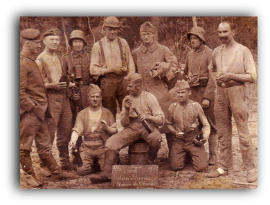

---

## 08. Februar 1916

Reinhard Walter fällt. Er diente beim Landwehr Infanterie Regiment Nr. 80, 3. Kompanie. Sein Dienstgrad: Gefreiter

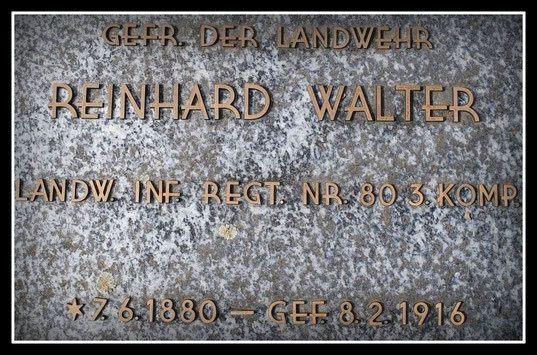

---

## Am Ende des ersten Weltkrieges besetzten die französischen Truppen das Deutsche Reich bis zum Rhein hin. Um einen Puffer zu schaffen, besetzen Sie auch die rechtsrheinische Seite, wozu auch unsere Gemarkung gehörte.

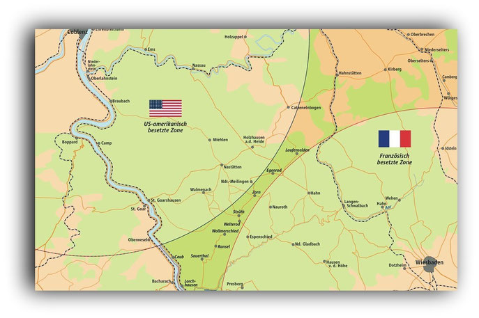

---

## Ende der Grundstückszusammenlegungen in StM die 1913 begonnen wurden.(Quelle: Alte Strinzer Chronik, Teil 1, Seite 123)

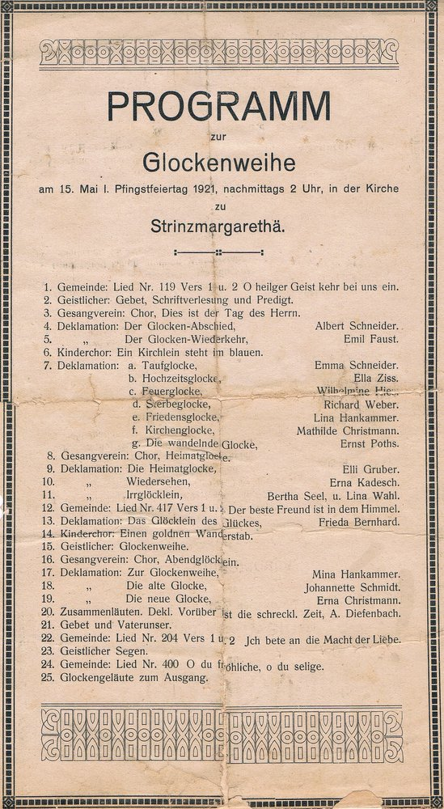

---

## TV 1904 Strinz-Margarethä

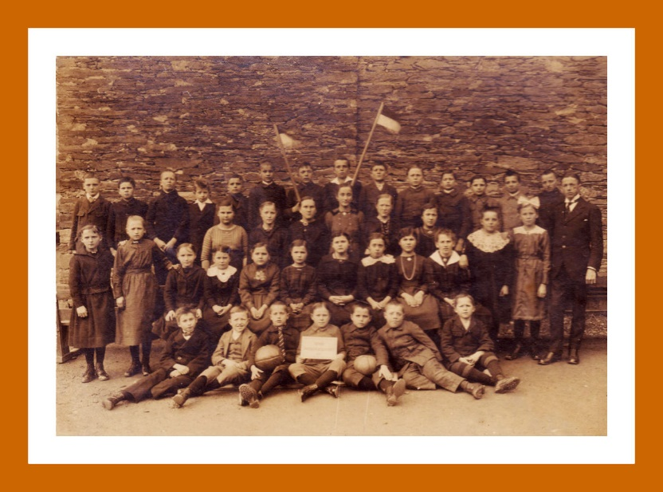

---

## Im Jahre 1925 wird eine Kraftpostlinie von Idstein-Hühnerkirche-Hennethal-StM-Breithardt-Bad Schwalbach eingerichtet, die der Personenbeförderung dient. Wegen mangelnder Rentabilität ging die Linie aber wieder ein.(Quelle: Statistische Erhebung zur Standorterforschung von Strinz-Margarethä / 1935 / Archiv der Gemeinde Hohenstein)

In der Generalversammlung des MGV "Eintracht" legt der langjährige Vorsitzende Wilhelm Klein in Folge seines hohen Alters sein Amt nieder. Bei der anstehenden Neuwahl wird der Landwirt Emil Kadesch zum 1. Vorsitzende gewählt. Klein wird Ehrenvorsitzender.(Quelle: Festschrift 100 Jahre MGV Eintracht 1891 / 1991)

Im Haus der Familie Christmann wird eine Nebenzweigstelle der Nassauischen Sparkasse eingerichtet, die von der Familie Christmann geführt wird.(Quelle: Hohensteiner Blättche)

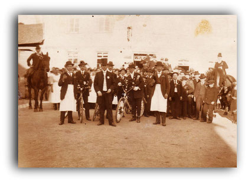

---

## (Quelle: Die Hessen als Reichstagswähler / 1990)

---

## (Quelle: Die Hessen als Reichstagswähler / 1990)

---

## Die Gemeinde erhält seitens des Landrats die Aufforderung 4.000 RM für die größeren notwendigen Unterhaltungsmaßnahmen am Aubach, festgestellt durch den Kreiswiesenbaumeister, im Rechnungsvoranschlag für 1929 bereitzustellen. Bürgermeister Weber entgegnet, dass die Gemeinde durch die ausgeführten Arbeiten zur Erweiterung und Reparatur der Wasserleitung und außerdem durch den Mindererlös bei den Holzverkäufen nicht in der Lage sei, die Summe in den Etat einzusetzen.(Quelle: Hessisches Staatsarchiv, Wiesbaden)

Einstellung des Arbeiters Adolf Fuhr als Wege- und Wiesenwärter.(Quelle: Hessisches Staatsarchiv, Wiesbaden)

---

## 1929 geht als der kälteste Winter seit 100 Jahren in die Annalen ein. Es werden Temperaturen bis 30° Grad unter null gemessen.(Quelle: Beiträge zur Geschichte Hohenstein-Breithardt, - Steckenroth und -Burg-Hohenstein / Pfarrer Weinberger /1992)

Der Dirigent des MGV "Eintracht" Ludwig Petri, der den Verein lange Jahre betreut hat wird zum Ehrendirigenten ernannt. Neuer Dirigent wird Ludwig Gerhardt aus Steckenroth.(Quelle: Festschrift 100 Jahre MGV Eintracht 1891 / 1991)

---

## (Quelle: Die Hessen als Reichstagswähler / 1990)

---

## Der TV 1904 führt einen Monatsbeitrag von 30 Pfennig ein. Der Verein wird gerichtlich eingetragen und die Vereinsfahne versichert.(Quelle: Vereinschronik des TV 1904)

Der MGV "Eintracht" beschließt im Hinblick auf das 40jährige Gründungsfest eine neue Fahne zu weihen.(Quelle: Festschrift 100 Jahre MGV Eintracht 1891 / 1991)

Verpachtung des zur Lehrerstelle gehörenden Schulgutes für die Amtszeit von Lehrer Schmidt. Die Erlöse müssen für Schulzwecke verwendet werden.(Quelle: Hess. Staatsarchiv, Wiesbaden)

---

## (Quelle: Die Hessen als Reichstagswähler / 1990)

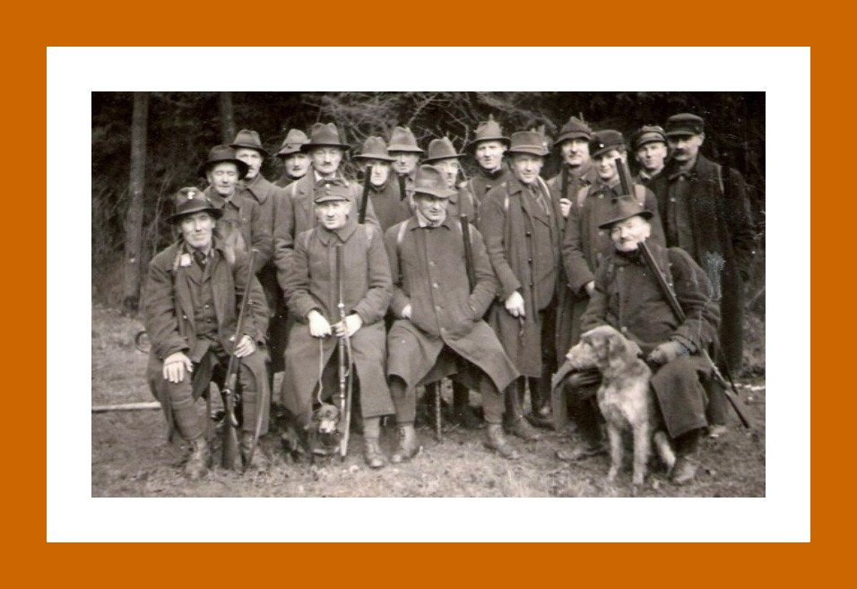

---

## Jagdgesellschaft 1930

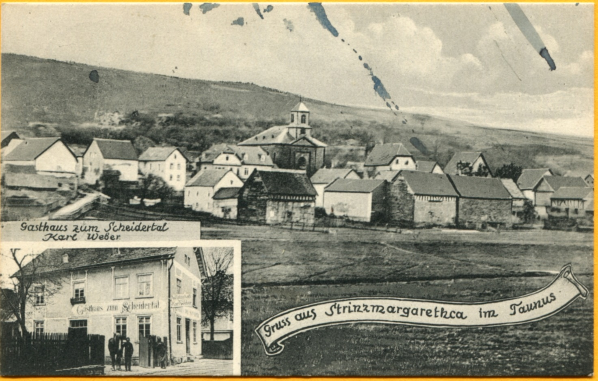

---

## Die Gemeinde zahlt an Wohlfahrtserwerbslose einen Eigenanteil (30%) von 147,45 Mark und an sonstige Unterstützungsempfänger 187,05 Mark. Die restlichen 70% werden von UTK getragen.(Quelle: Finanzstatistik für 1931 / Archiv der Gemeinde Hohenstein)

Der MGV Strinz-Margarethä feiert sein 40jähriges Bestehen.(Quelle: Festschrift 100 Jahre MGV Eintracht 1891 / 1991)

---

## (Quelle: Die Hessen als Reichstagswähler / 1990)

Auch wenn Hitler in StM die Wahl in StM gewonnen hat, so wurde insgesamt doch Hindenburg der Wahlsieger. "Die Enttäuschung über den Sieg Hindenburgs im Wahlkampf war außerordentlich groß"

---

## (Quelle: Die Hessen als Reichstagswähler / 1990)

---

## (Quelle: Die Hessen als Reichstagswähler / 1990)

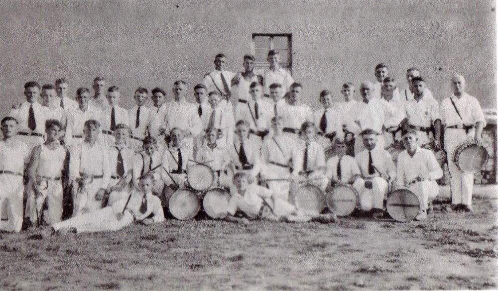

---

## Die Gemeinde wird aufgefordert, ein Niederschriftsbuch zur Dokumentation der Gemeindeentschließungen anzuschaffen und zu führen.(Quelle: Schreiben des Landrates vom 21. Juli 1934, Archiv der Gemeinde Hohenstein)

Die Eberhaltung von StM liegt seit 50 Jahren in den Händen des Landwirts und Bürgermeister Adolf Weber bzw. dessen verstorbenen Vaters.(Quelle: Hess. Staatsarchiv, Wiesbaden)

---

## Die Gemeinde erstellt eine statistische Erhebung zur Standorterforschung für StM.(Quelle: Stat. Erhebung, 1935 / Archiv der Gemeinde Hohenstein)

---

## Impressionen von 1936

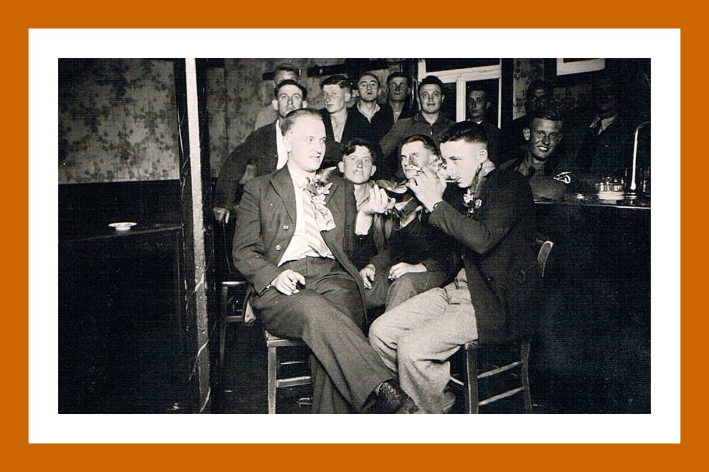

---

## Lehrer Schmidt hat durch Blumenpflege, Elternabende und größere Schulausflüge schöne Erinnerungen hinterlassen. Er heiratet die Tochter des Lehrers Theo Fischer aus Hennethal und kommt 1937 nach Wiesbaden wo er mehrere Jahre lang an einer Mittelschule unterrichtete.(Quelle: Hess. Staatarchiv Wiesbaden / Alte Strinzer Chronik, Teil 1, Seite 116)Aber es wurde auch mdl. überliefert, dass er den Nationalsozialisten die Behinderten des Ortes, im Gegensatz zum Bürgermeister, zwecks Sterilisierung, gemeldet haben soll.(mdl. Überlieferung, Name bekannt)

Neuer Lehrer in StM wird der Schulamtsbewerber Johannes Buse, geb. 1908 in Herrnkirch.(Quelle: Hess. Staatsarchiv, Wiesbaden)

---

## Impressionen von 1938

---

## Strinz-Margarethä im Herbst 1940

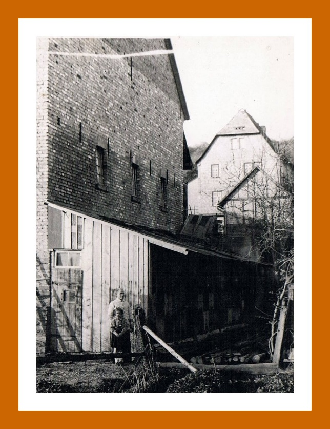

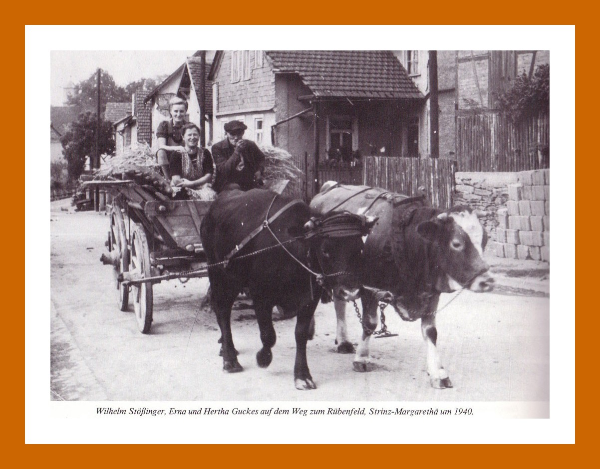

---

## 31.12.1941 Alois Habich fällt

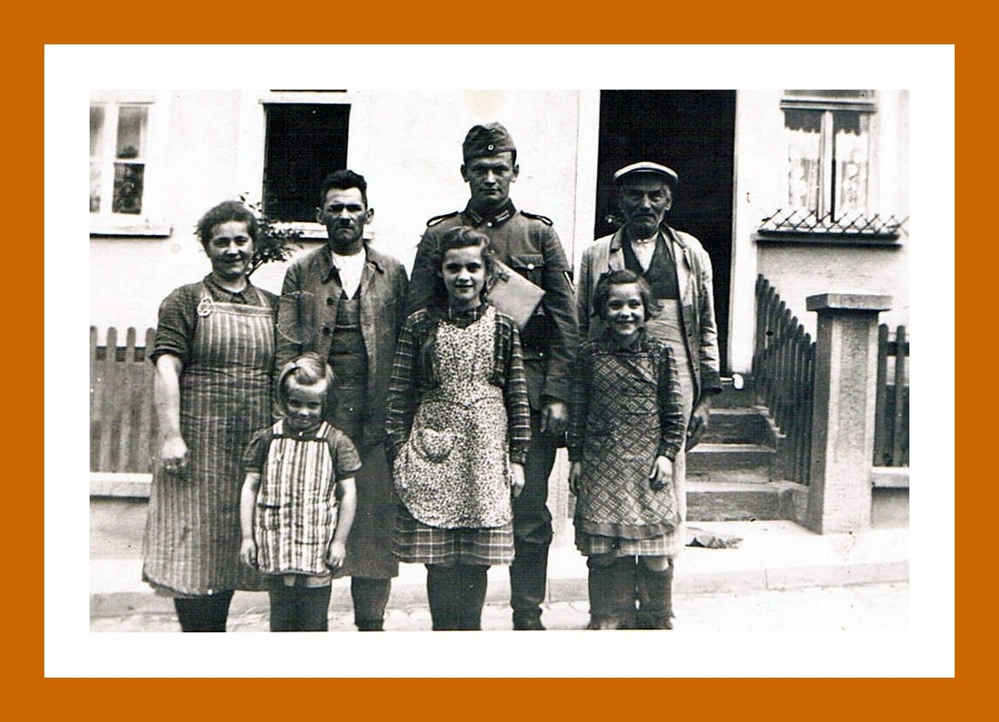

---

## 30.12.1942 August Deuser fällt

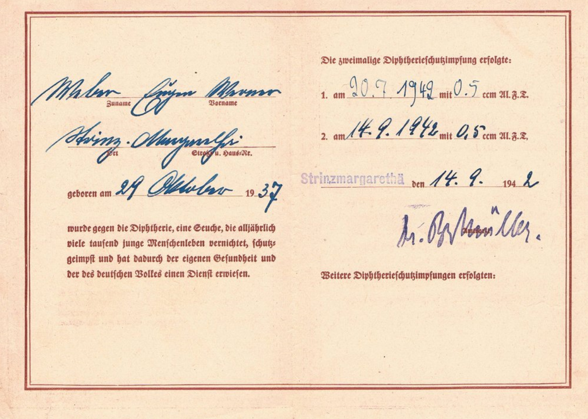

---

## 06.11.1943 Emil Kugelstadt fällt

Um der stetig wachsenden Zahl von Evakuierten Herr zu werden, werden in StM zwei Behelfsheime gebaut.(Quelle: Helmut Hartwig)(Siehe auch unter: Das Behelfsheim)

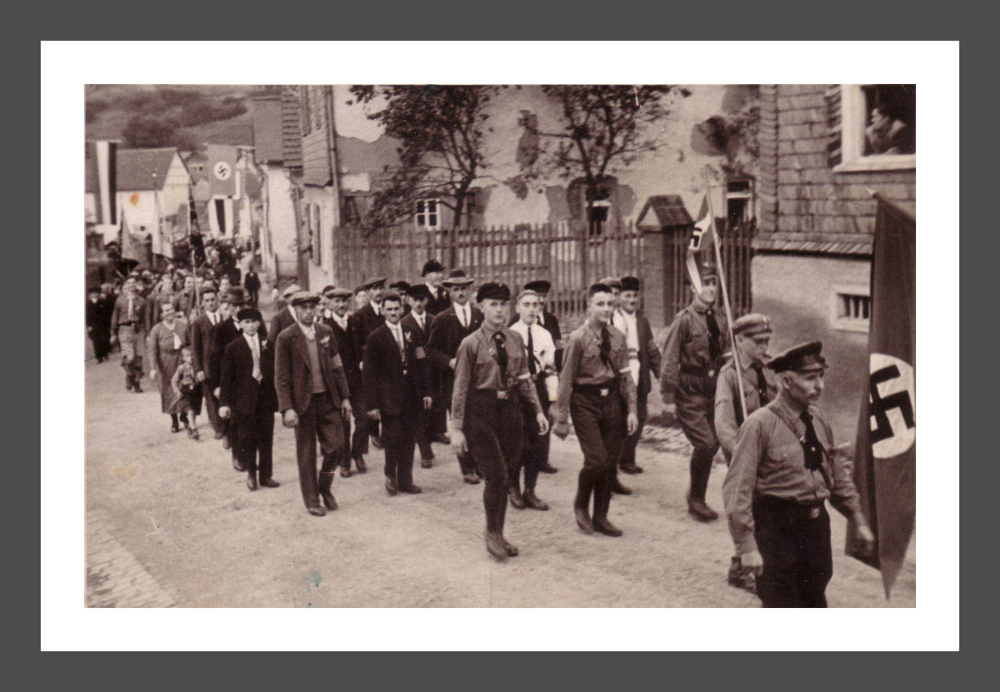

---

## 12.10.1944 Emil Gräter fällt

---

## Der Schullehrer von StM Rektor Richard Weißer beginnt am 1. Juni 1945 mit dem Schreiben einer Ortschronik. Bei den ersten Aufzeichnungen handelt es sich um Interviews mit den zurückkehrenden Frontsoldaten.

Ernennung von Frl. Ursula Nissen zur Lehrerin und gleichzeitig Versetzung nach StM zum 1. Januar 1945(Quelle: Hess. Staatsarchiv, Wiesbaden)

---

## Der am 28. Juni 1945 in Haft genommene, ehemalige Bürgermeister von StM, Adolf Weber wird am 04. Juni 1946 aus der Haft entlassen.(Quelle: Alte Strinzer Chronik, Teil 1, Seite 124)

Der am 16. November 1945 in Haft genommene Wilhelm Enders kehrt am 10. August aus dem Internierungslager Darmstadt nach StM. zurück.

---

## 1949

---

## Impressionen von 1949

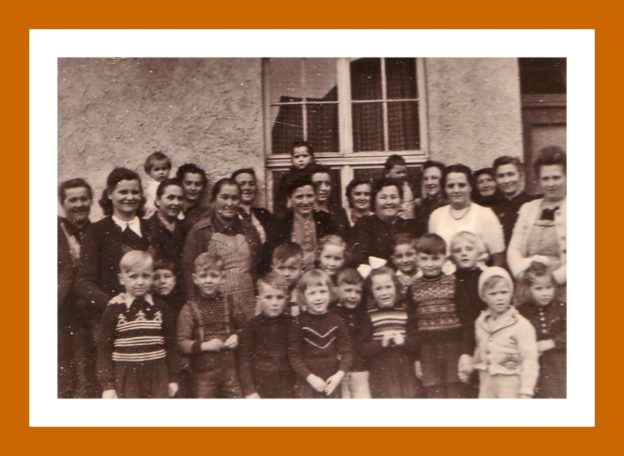

---

## Der Spielmannszug des TV 1904 wird wieder aufgestellt und es wird eine Schachgruppe gegründet.(Quelle: Vereinschronik des TV 1904)

Neuer Chorleiter des MGV "Eintracht" wird Norbert Walzik aus Elz. Dieser hat keinen fahrbaren Untersatz und kann deshalb nach den Proben nicht mehr nach Hause kommen. Der 1.Vorsitzende Adolf Christmann I. erklärt sich deshalb bereit den Dirigenten für eine vom Verein zu leistende Vergütung von 1,- DM übernachten zu lassen.(Quelle: Festschrift 100 Jahre MGV Eintracht 1891 / 1991)

Stromnetz: nach einem Trafobrand, ausgelöst durch die Kartoffeldämpfkolonne, wurde ein anderer Trafo installiert.(Quelle: Helmut Hartwig)

Infolge der ständig steigenden Belastung der Ortsnetzleitungen in StM wird die Ortsspannung von 220/127 Volt auf 380/220 Volt umgestellt.

---

## Impressionen von 1950

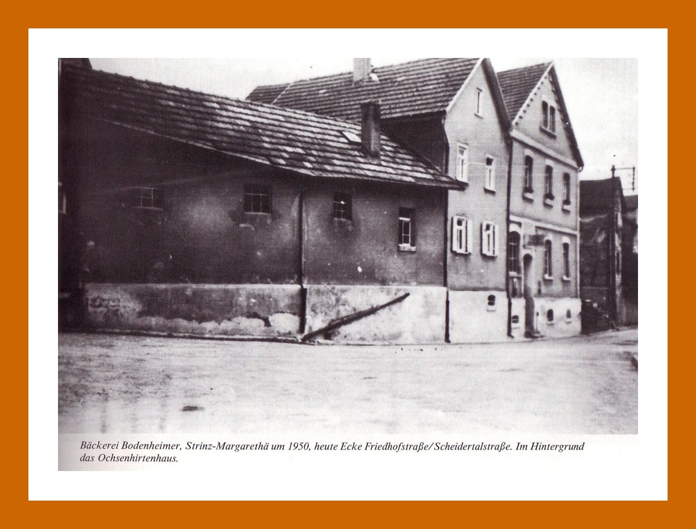

---

## Weitere Impressionen von 1951

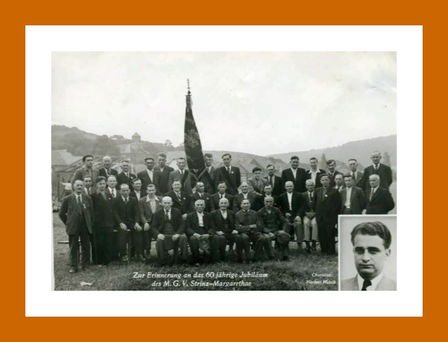

---

## Am Familienabend des TV 1904 wird die Ehrentafel für die gefallenen Soldaten geweiht. Diese hängt heute noch im Treppenaufgang der Strinzer Kirche.(Quelle: Vereinschronik des TV 1904)

Der Landwirt Wilhelm Guckes wird als Bürgermeister wiedergewählt. Ehrenamtliche Beigeordnete werden August Klein und August Schneider.

---

## Impressionen von 1956

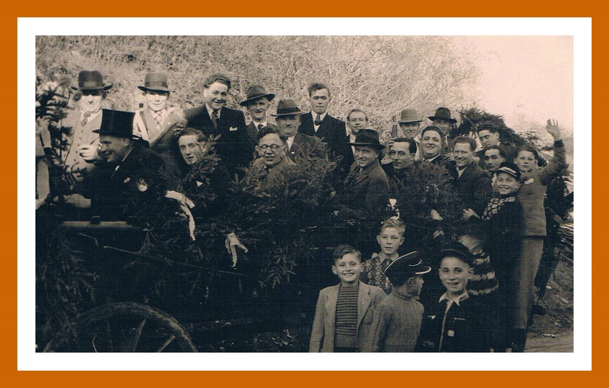

---

## Führungswechsel bei der Feuerwehr. Alfred Hankammer (geb. 1917) wir Nachfolger von Adolf Hankammer.(Quelle: Chronik der Freiwilligen Feuerwehr StM / 2009)

Karl Schuhmacher übernimmt den Vorsitz des TV 1904.(Quelle: Festschrift zur Sportplatzeinweihung 1990)

---

## Adolf Guckes übernimmt den Vorsitz des TV 1904.(Quelle: Festschrift zur Sportplatzeinweihung 1990)

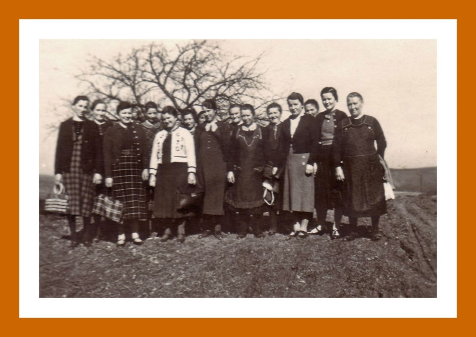

---

## Trockenlegung des Sportplatzes.(Quelle: Vereinschronik des TV 1904)

Der Landwirt Wilhelm Guckes wird als Bürgermeister wiedergewählt. Ehrenamtliche Beigeordnete werden August Schneider, Wilhelm Enders und Karl Ernst.

---

## Die Teilnahme am Turnbetrieb des TV 1904 nimmt rapide ab.(Quelle: Vereinschronik des TV 1904)

Der 1. Vorsitzende des MGV "Eintracht" legt sein Amt nieder, neuer 1. Vorsitzender wird Karl Keis. Der MGV trennt sich von seinem Dirigenten Herrn Schlaud, weil die hohen Honorarforderungen nicht mehr getragen werden können. Die Stimmung des Vereins tendiert dahin, eher auf die Teilnahme an Wettstreiten zu verzichten, als durch die erneute Verpflichtung eines renommierten Dirigenten sich finanziell bis an die Grenzen zu belasten. Durch den persönlichen Kontakt mit einigen Vereinsmitgliedern und auf deren Anraten bewirbt sich der Studienassessor Klaus Ochs um die Stelle des Chorleiters. Nach einigen Gesangsproben entschied sich der MGV für Ochs.(Quelle: Festschrift 100 Jahre MGV Eintracht 1891 / 1991)

---

## 1964

---

## Richard Hieß übernimmt den Vorsitz des TV 1904.(Quelle: Festschrift zur Sportplatzeinweihung 1990)

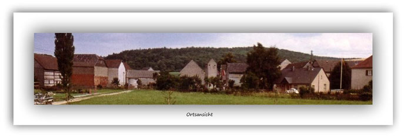

---

## Der Monatsbeitrag des TV 1904 wird auf 1 DM erhöht wobei Beitragsfreiheit für Ehefrau und Kinder unter 14 Jahren vereinbart wird.(Quelle: Vereinschronik des TV 1904)

Von Kindern werden laufend die Bachstauungen abgelassen, was bei starkem Regen zu Unannehmlichkeiten führt. Außerdem werden von Kindern an den Münzfernsprechern Streiche verübt, die zu Beanstandungen geführt haben. Die Eltern werden dazu angehalten auf Ihre Weise dazu beizutragen, dass solcher Unfug nicht mehr vorkommt.(Quelle: Rundschreiben von StM Nr. 10/69)

---

## Am 17. Febr. 1969 beantragt der Bürgermeister von StM das Hess. Hauptstaatsarchiv in Wiesbaden im Namen der Gemeinde Strinz-Margarethä 5 Wappenentwürfe, Größe nicht unter 18 x 2 cm, auf Rechnung der Gemeinde in Auftrag zu geben.(Quelle: Hessisches Staatsarchiv Wiesbaden) (Siehe auch unter: Geschichte des Strinzer Wappens)

Bei einem Einbruchdiebstahl werden die in einem Stahlschrank unter Verschluss gelagerten, vorrätigen leeren Passvordrucke entwendet. Insgesamt waren 45 Vordrucke vorrätig.(Quelle: Aarbote)

---

## Der TV 1904 und der MGV richten das Waldfest aus.(Quelle: Vereinschronik des TV 1904)

Zu Beginn des 9. Jahrzehnts des Bestehens des MGV "Eintracht" findet zum 7. Mal ein Wechsel in der Person des 1. Vorsitzenden statt. Die Schwierigkeiten bei dieser Vorstandswahl waren beachtlich. Auszug aus dem Protokoll:Zur Wahl des 1. Vorsitzenden wurde aus der Versammlung Karl Keis vorgeschlagen und einstimmig gewählt. Er nahm die Wahl jedoch nicht an. Die vorgeschlagenen Gerhard Wölfinger, Paul Hahn, Albrecht Egert, Willi Fuhr, Adolf Weber, Horst Wahl und Werner Petri lehnten eine Wahl ab. Eine Abstimmung über den Vorschlag, Willi Fuhr zum 1. Vorsitzenden zu wählen, ergab für den Vorschlag 25 Ja- und 5 Gegenstimmen. Paul Hahn lehnte die Wahl ab. Da Willi Fuhr zur Bedingung gemacht hatte, dass Paul Hahn 2. Vorsitzender wird, lehnte auch er die Wahl ab. Nach erneuten Beratungen wurde Paul Hahn zum 1. Vorsitzenden vorgeschlagen und einstimmig gewählt. Er nahm die Wahl an.(Quelle: Festschrift 100 Jahre MGV Eintracht 1891 / 1991)

---

## Alfred Klein übernimmt den Vorsitz des TV 1904.(Quelle: Festschrift zur Sportplatzeinweihung 1990)

Der TV 1904 erhält eine Satzung. Demnach ist der Zweck des Vereins "die Förderung und Ausübung von Sport und Spielarten aller Altersgruppen sowie die Pflege der Geselligkeit unter seinen Mitgliedern durch Zusammenkünfte, Veranstaltungen und ähnliches.(Quelle: Festschrift zur Sportplatzeinweihung 1990)

---

## Eröffnung einer Zweigstelle der Raiffeisenbank Aarbergen-Hohenstein.(Quelle: Aarbote / 1985)

Anlässlich seiner 20jährigen Dirigententätigkeit für den MGV "Eintracht" wird Klaus Ochs mit einem Festkonzert geehrt.(Quelle: Festschrift 100 Jahre MGV Eintracht 1891 / 1991)

An der Stelle, an der im Jahr zuvor die alte Dreschhalle abgerissen wurde, wird eine Geschäftsstelle der Raiffeisenbank Aarbergen-Hohenstein e.G. errichtet.

Im März brechen unbekannte Täter in ein Wochenendhaus am Orler Weg ein. Sie entwenden einen tragbaren TV, einen Stereoturm mit 2 Lautsprechern, und diverse kleinere Gegenstände. Der Gesamtschaden beläuft sich auf ungefähr 9.000,- DM

---

## Paul Hahn erklärt in der Jahreshauptversammlung des MGV "Eintracht" seinen Rücktritt. Er nennt hierfür persönliche Gründe, insbesondere das schwindende Interesse am Chorgesang und am Vereinsleben. Bei den nun erforderlichen Neuwahlen wird Willi Fuhr zum 1. Vorsitzenden und Ottmar Christmann zum 2. Vorsitzenden gewählt.(Quelle: Festschrift 100 Jahre MGV Eintracht 1891 / 1991)

"Aktivität kennt kein Alter" lautete das Motto der zehnten Hohensteiner Seniorenwoche, die mit einem Festakt in der Aubachhalle in StM abgeschlossen wird. Im Mittelpunkt stehen neben den Festreden die Siegerehrungen in den verschiedenen Disziplinen und ein buntes Programm der Ortsvereine.

Am Hessentag in Herborn beteiligen sich die Strinzer Landfrauen mit dem umgebauten "Willimobil". Von allen Besuchern wird das Karussell bewundert.(Siehe auch unter: Das Willimobil)

---

## Durchführung der deutsch-französischen Jugendsportwoche des TV Strinz 1904. Die Woche war ausgefüllt mit sportlichen und kulturellen Aktivitäten.(Quelle: Vereinschronik des TV 1904)

Der Chorleiter des MGV "Eintracht" Klaus Ochs stellt den Verein vor die ultimative Entscheidung, entweder Bildung eines gemischten Chors oder Niederlegung seines Amtes, auf einer außerordentlichen Sängerveranstaltung. Trotz 23jähriger überaus erfolgreicher Zusammenarbeit mit Klaus Ochs entschieden sich die Mitglieder gegen einen gemischten Chor und lassen Klaus Ochs ziehen. Neuer Chorleiter wird Rainer Tauber.(Quelle: Festschrift 100 Jahre MGV Eintracht 1891 / 1991)

---

## Verlegung eines neuen Hallenbodens.(Quelle: Vereinschronik des TV 1904)

Unterstützt durch viele Spenden kann die dringende Renovierung der Vereinsfahne der MGV "Eintracht" durchgeführt werden.

Die Saison 1988/89 ist die bislang erfolgreichste Saison der Tischtennisabteilung des TV 1904. Neben der Meisterschaft und dem damit verbundenen Aufstieg in die 1. Kreisklasse wird der Kreis- und Bezirkspokal gewonnen. Im gleichen Jahr kann auch die 2. Mannschaft in die 2. Kreisklasse aufsteigen.(Quelle: Festschrift zur Sportplatzeinweihung 1990)

Bau einer Sportfläche an der Aubachhalle, überwiegend durch Mitglieder des Turnvereins. Die freiwilligen Helfer leisteten 3.500 Arbeitsstunden und der Verein brachte 30.000,- DM auf.(Quelle: Hohensteiner Blättche)

---

## Einbau einer Holzschiebewand zur Abdeckung der Sportgeräte in der Aubachhalle.(Quelle: Vereinschronik des TV 1904)

Bei einem Überfall auf den SPAR-Markt in StM erbeutet ein unbekannter Täter 4.000,- DM. Mit einer Pistole bewaffnet dringt er gegen 18:30 in den Markt ein und bedroht die Kassiererinnen. Er hat eine gestrickte Mütze auf dem Kopf und vor dem Gesicht ein graublaues Tuch. Er wird auf ein Alter zwischen 18 bis 20 Jahre und einer Größe von 1,70 m geschätzt. Gemeinsam mit einem vor dem Laden wartenden Komplizen flüchtet er in einem dunklen VW-Golf ohne Licht in Richtung Breithardt/Hennethal.

---

## Der TV 1904 feiert sein 90jähriges Vereinsjubiläum.(Quelle: Vereinschronik des TV 1904)

Gründung des Schüler-Orchesters innerhalb der Musikfreunde StM e.V..Der im Vorjahr gegründete Obst- und Gartenbauverein legt sich eine gebrauchte Kelter zu.

---

## Wie streng die damaligen Sitten waren, sieht man aus den Aufzeichnungen des Bürgermeisters Enders aus dem Jahre 1817. Darin erfahren wir, dass einmal von Pfarrer Schmidtborn 7 Burschen angezeigt wurden, weil sie die Katechismuslehre geschwänzt hatten. Die jungen Sünder weigerten sich zunächst die auferlegte Polizeistrafe zu zahlen, aber als die "Auspfändung" drohte, konnte der Schultheiß dem Justizrat Forst in Wehen berichten, "dass sie die Strafe bezahlen wollten, welches wie mir der Kirchen Senior Kandler sagte, auch geschehen ist".

Bis zum Jahre 1829 musste jeder bis zum 25. Lebensjahr am Katechismus Unterricht teilnehmen. Erst seit dieser Zeit setzte man das Alter auf 16. bzw. 18. Lebensjahr fest. Der Katechismus Unterricht fand meistens im Anschluß an den Gottesdienst statt. Es beteiligten sich daran oft Verheiratete und alte Leute.

Während seiner langen Amtstätigkeit in StM hatte Schmidtborn mancherlei Auseinandersetzungen mit der "Dorfaristokratie" zu bestehen, wie Schmidtborn seine Prozessgegner bezeichnete. Das begann bereits im Jahre 1832, als er einen Antrag auf Erbauung eines neuen Stalles stellte. Die zuständigen Gremien lehnten ab und empfahlen später dem Pfarrer, die Ländereien zu verpachten. 13 Jahre danach wird der Bau endlich genehmigt und 1846 errichtet.

---

## Während der Revolutionswirren (1847 - 1848) versuchten seine Prozessgegner zweimal, seine Versetzung zu betreiben. Dabei geben seine Gegner beim Bischöflichen Herzoglichen Commissarius in Wiesbaden zu Protokoll, er sei feindselig gegen die Gemeindemitglieder gesinnt und keineswegs ein Pfarrer, sondern ein Bauer.

Mit dem Jahre 1852 endeten die Auseinandersetzungen. Die Aufregungen der Revolutionsstimmung waren verklungen. In den Dörfern kehrte mit der Zeit wieder Ruhe und Frieden ein.

---

## Im Jahr 1862 feierte Schmidtborn sein 50jähriges Amtsjubiläum. Darüber berichtet Lehrer Conrad aus Niederlibbach in der Schulchronik: "Am 7.5.1862 waren es 50 Jahre, dass Pfarrer Schmidborn in seinem Amt wirkt. Herr Dekan Spieß zu Bechtheim hatte zur Feier des Tages, Mittwoch, den 7.5., die Herren Geistlichen des Dekanats zu einer Konferenz in das Pfarrhaus zu Strinz-Margarethä eingeladen. Eine öffentliche kirchliche Feier und Festlichkeiten und damit zusammenhängende äußere Ehrenbezeichnung seiner Person hatte Herr Pfarrer entschieden abgelehnt. Auch die Annahme der goldenen Verdienst-Medaille, welche in Nassau den höheren Ständen nach 50jähriger Dienstzeit zu Teil wird, hatte er aus großer Bescheidenheit verweigert. Seine Hoheit unser Herzog und Landesvater hatte jedoch durch die vorgesetzte Behörde von dieser 50jährigen treuen Dienstführung Kenntnis erhalten und den Herrn Pfarrer Schmidtborn dadurch geehrt, dass er ihm den Titel eines Kirchenrats erteilt hat, worüber ihm das Diplom an dem genannten 50jährigen Gedenktage aus der Hand des Herrn Dekan Spieß ausgehändigt worden ist.

Bis zum Jahr 1870 konnte Schmidtborn noch seine Amtstätigkeit ausüben. Am 23.01.1870 erlitt er einen Schlaganfall, der ihm die Sprache fast völlig raubte. Er konnte seinen Dienst nicht mehr versehen und mußte schweren Herzens am 1.4.1870 in den Ruhestand treten. Ihm waren noch 5 Lebensjahre beschieden.

---

## Im Jahre 1946 wechselt er dann von StM als Mittelschulrektor nach Bad Schwalbach.

Weißer ist leidenschaftlicher Autor diverser Bücher, Verfasser von historischen Bühnenstücken und Lyriker.

---

## Des Kindes Festtag. Ratschläge und Stoffe für Schulunterhaltungsabende / 1921

Der Einmaleinsstudent. Ein Lehrgang zur anschaulichen, selbsttätigen Erlernung und sicheren Einprägung des Einmaleins und des Enthaltenseins / verm. 1921

---

## Weißer stirbt im Jahre 1950 in Bad Schwalbach.

---

## Im Gemeindewalde werden am Dienstag den 16. Februar, vormittags 18 3/4 Klafter Buchenscheid, 10 Klafter Buchenbrügel, 1 Klafter Eichenlagerholz, dann 10 Stück Achsen, 1 Klafter Felgenholz und 500 Stück Buchenwellen versteigert.(Quelle: Herzoglich-Nassauisches Intelligenzblatt / 1819)

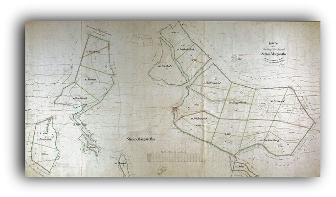

---

## Bemerkenswert ist, dass in den Jahren 1946/47 und 1948/49 aufgrund von Anordnungen der Militärverwaltung der Amerikaner in der amerikanischen Zone die Waldeigentümer – vorwiegend die Gemeinden, Städte und der Staat (Land) -  zur Versorgung der Stadtbevölkerung und der Flüchtlingslager, große Mengen Brennholz abgeben mussten.  Die ausgewählten Flächen wurden im Kahlschlag abgeholzt. Dazu hatte die Militärverwaltung ehemalige Zwangsarbeiter - meist Polen -  die noch nicht wieder zurückkehren konnten, mit schweren Motorsägen ausgestattet.  Die Buchen, Hainbuchen und Eichen wurden einfach ca. 60 – 70 cm über dem Boden abgesägt, leicht entastet und mit großen Dreiachser Lkw`s der amerikanischen Armee abtransportiert. Sowohl die Beschlagnahme der Waldflächen als auch die unsachgemäße und wilde Abholzung empörte die Bürger. „Unser guter Wald wird einfach von den Amis abgemacht“. Das wollte man nicht so einfach hinnehmen. „Wer war daran schuld und was machen die mit unserm Holz“.  Was damit gemacht wurde konnte jeder, der es wissen wollte nachvollziehen. Die vielen tausend Menschen die in der näheren Umgebung noch in Lagern lebten (z.B.  Lager Bleidenstadt Lager Michelbacher Hütte und andere) wären erfroren und verhungert, wenn nicht durch strikte Maßnahmen der Militärverwaltung die Versorgung gesichert worden wäre. Die zivilen Strukturen wären dazu nicht in der Lage gewesen, aus vielerlei Gründen.

Allein für Transporte von Gütern aller Art war noch das Pferdefuhrwerk und das Kuhgespann übriggeblieben und das mit Einschränkungen, denn selbst die eisenbereiften Bauernwagen waren wegen der in der Kriegszeit vernachlässigten Reparaturen für größere Strecken nicht geeignet. Aber auch gute Zugtiere waren nicht ausreichend vorhanden. Die guten Pferde waren für den Krieg eingezogen und nicht mehr zurückgekommen.

---

## Die Wiederaufforstung der schwer in Anspruch genommenen Wälder hat sich über ein weiteres Jahrzehnt hingezogen. Zunächst wurden die Kahlschlagflächen bis auf den blanken Waldboden abgeräumt. Alles was noch als Brennmaterial verwertet werden konnte, wurde in großen und kleinen „Wellen“ zusammengebunden, z.T. noch in „Witt“ – das sind junge Buchen, die man dem üppigen Aufwuchs entnommen, in Wasser geweicht und anschließend gedreht hat- als Ersatz für Strick und Kordel an dem es gemangelt hat.  Der Wald war regelrecht leergefegt, auch trocken gefallene junge Buchen von 10–12 Meter Höhe hat man um gedrückt, in der Mitte geteilt und auf der Schulter heimgetragen.  Zur Wiederaufforstung der Kahlflächen waren natürlich riesige Mengen an jungen Pflanzen nötig, die in den eigens dafür erweiterten gemeindeeigenen Pflanzenschulen und neu angelegten Anzuchtflächen herangezogen wurden. So konnten Anfang der fünfziger Jahre ca. 350.000 bis 400.000 junge Fichten- und Kiefernpflanzen entnommen werden für die Neubepflanzung. Die Arbeiten in der Pflanzenschule und im Pflanzenwald war Frauensache. Etwa 12 bis 15 Frauen gingen mehrere Monate im Jahr in die „Planzeschul“ und in „de Planzewald“. Der Stundenlohn für Frauen lag damals bei 50 Pfennig, der für Männer, die bei der Pflanzung mit der Hacke die Pflanzlöcher machten, bei 70 Pfennig.  Die Pflanzung erfolgte mit einem Reihenabstand von einem Meter und in der Reihe ebenfalls von einem Meter, sodass je Hektar 10.000 Pflanzen gebraucht wurden, die dank der sorgfältigen Pflanzung und der nachfolgenden Pflege durch Freischneiden und dem Teeren gegen Wildverbiss fast zu 100 % aufgewachsen sind.  Die damals kahl geschlagenen Flächen sind heute noch an dem neu herangewachsenen Bestand zu erkennen, vor allem rechts und links vom „Neuen Weg“, am Hennethaler Weg, wo durch eine Luftmine eine Kahlfläche entstanden war und Teilflächen auf dem Geröms, die nach dem Schneebruch im Mai 1936 kahl geschlagen wurden.

So wie der „Pflanzenwald“ Frauensache war, war der „Holzwald“ Männersache, denn das Fällen und Aufarbeiten der Bäume war damals Schwerstarbeit. Die Arbeitsgeräte waren Drumsäge, Bügelsäge, Axt, Spalthammer, Keile und Schlegel, Wendering, Ablängmaß mit Reißhaken, Feilen und Schränkeisen, Schäleisen und Schnitzmesser. Der gefällte Baum, meist Buche und Eiche, wurden zerlegt in den astfreien, höherwertigen Stamm, dann in Meterstücke zu Brennholz und in Reißerknüppel. Das alles war Handarbeit mit Säge und Axt. Aus minderwertigeren Stämmen wurde Papierholz/ Faserholz, zerlegt In Meterstücke und einmal gespalten oder auch höherwertiges Brennholz.  Buchenfaserholz musste mit dem Schnitzmesser entrindet werden. Fichte- und Kiefernstammholz wurde mit dem Schälmesser entrindet, das war Knochenarbeit.  Fichtenstammholz wurde in der Regel als Bauholz verwendet, während Fichtenstangen in der Klassifizierung I - III, ebenfalls geschält, von 2 Mann auf der Schulter an den befahrbaren Weg gerückt und gestapelt wurden. Sie wurden meist als Gerüststangen im Baugewerbe gebraucht. Das Stammholz wurde meist im Frühjahr bei trockenem Wetter mit dem Pferd an den befahrbaren Weg gerückt, desgleichen auch große Mengen „Grubenholz“, Buchen und Eichen, die zum Abstützen in die Kohle- und Erzbergwerke gingen. Brennholz und Faserholz wurden in Raummeter zu 1.2.3 oder 4 Meter gestapelt, an mit dem Fuhrwerk abfahrbereiter Stelle. Auch hierbei musste viel getragen werden, ebenfalls Knochenarbeit. Nur mit Galgenhumor war der oft übliche Spruch zu verstehen „Wer abends nicht müde ist, der ist selber schuld“.

Der Arbeitstag hatte gut 8 Std., plus Hin- und Rückweg zu Fuß, das waren oft 3 – 5 km. In den Monaten Nov. bis Febr. ging man im Dunkeln von zu Hause weg und kam im Dunkeln wieder heim. Der harte Arbeitstag wurde pünktlich um 12.00 Uhr unterbrochen von der Mittagspause, zu der die Frauen und Mütter der „Holzmäscher“ das warme Essen in den „Holzwald“ brachten, frei Arbeitsplatz, wobei man sich an einem rechtzeitig angemachten Feuer wärmte und etwas entspannen konnte. Allerdings wurde das „Essentragen“ mit der Zeit wieder abgeschafft.

Diese harten Zeiten haben sich erst in der zweiten Hälfte der fünfziger Jahre geändert, als in Folge des „Wirtschaftswunders“ und besserer Verkehrsmöglichkeiten, sich neue Arbeits- und Verdienstmöglichkeiten eröffneten. Infolge des technischen Fortschritts gab es auf allen Ebenen

Arbeitserleichterungen. Sowohl im „Pflanzen- wie im „Holzwald“ waren die Arbeitsplätze auf ein Minimum geschrumpft.

---

## Die alte Linde im Jahre 1929

Im Jahre 1984 wird die alte Dorflinde von einer Sturmbö erfasst und entwurzelt. Man schätzte das Alter auf ungefähr 100 Jahre.

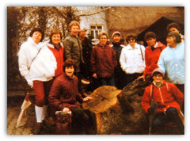

---

## - die Erinnerung an das Inthronisationsdatum Kaiser Friedrich III.  am 10. März 1888.

Stimmt die Alterseinschätzung von 1984, so ist davon auszugehen, dass eines dieser Daten der Anlass zur Pflanzung der Linde war.

Noch im selben Jahr wird eine neue Linde durch Ortsvorsteher Werner Petri und Willi Guckes im Beisein vieler Bürger gepflanzt.

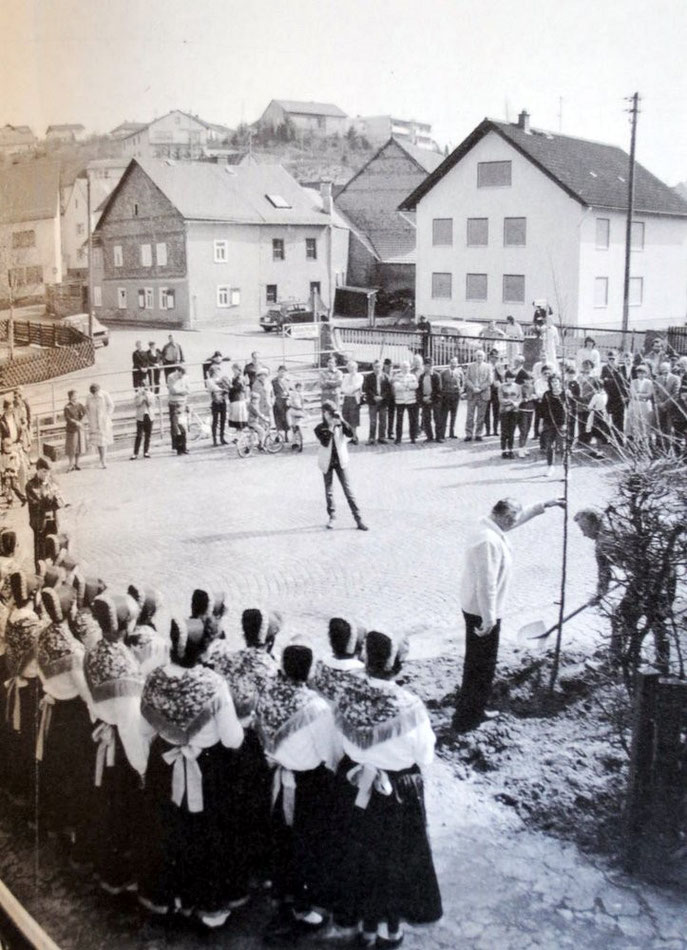

---

## Am 2. November 1834 wurde unsere heutige Kirche vom Pfarrer Schmidtborn eingeweiht, der hier von 1815 bis 1870 als Seelsorger wirkte. Dieses Kirchweihfest wird durch einen Umzug eingeleitet. Dieser Umzug wurde fortan jedes Jahr zur Kerb wiederholt.

Früher, wenn Kerb war, gingen die Musikanten des Dorfes vor das Haus des Bürgermeisters, um ihm ein Ständchen zu bringen. Natürlich begleitete die Jugend die Musikanten. Nach dem Ständchen erholten sich die Musikanten beim Freibier von den Anstrengungen.

Wenn der Umzug hält, liest der Kerbevater den Kerbespruch vor. An der Ecke Pfalzstraße/Schulstraße löst sich dann der Zug auf; jetzt beginnt für Jung und Alt die Feier mit Musik und Tanz.

Der Kerbespruch, der vom Kerbevater vorgelesen wird, sagt viel aus über die Geschehnisse im Ort des entsprechenden Jahres. Insbesondere lustige Begebenheiten wurden hier Kund getan.

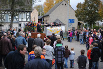

---

## Nachfolgend der Original Text und eine Veröffentlich aus der Idsteiner Zeitung von 1945.

---

## Nach den Befreiungskriegen war immer noch starker Selbstschutz der Gemeinden notwendig, wie das Bürgermeisterbuch aus dem Jahre 1818 beweist. Damals bestellte unsere Gemeinde beim Schlossermeister Kahn in Idstein drei neue Spieße, auf die der Dorfname eingeschlagen werden musste. Daraus ersieht man, dass das Dorf seinerzeit durch drei Spießträger geschützt wurde: Den Tagwächter, den Nachtwächter und den Flurschütz.

In späterer Zeit hat man den Tagwächter abgeschafft und dafür den Nachtwächter durch sogenannte Beiwachen unterstützt.

Im Jahre 1838 stellt der Amtmann Gieße aus Wehen fest, dass "der Teil des Amtes, welcher zwischen der Landstrasse und dem Amte Idstein gelegen ist, dem Diebsgesindel zum Schauplatz und den Landstreichern zum ungestörten Aufenthalte dient". Deshalb sollen die Herren Schultheißen die Nacht- und Beiwachen gehörig beaufsichtigen. "Es ist nicht, wie an verschiedenen Orten bisher der Fall war, dem Ortsdiener bloß die Bestellung der Beiwache zu überlassen, sondern die Herren Schultheißen müssen stets Kenntnis davon haben, an welchem Ortseinwohner die Reihe ist. Keine Weibsperson und Kinder unter 17 Jahren, noch weniger Blödsinnige, wie es schon der Fall war, dürfen zum Dienste als Beiwache zugelassen werden. Die Dauer des Dienstes muss bis zum Anbruch des Tages währen".

Der letztgenannte Zeitpunkt wurde später geändert; die Nachtwache dauerte von Martini (11.11.) bis Ostern von 9 Uhr abends bis 5 Uhr morgens, von Ostern bis Martini von 10 Uhr bis 2 Uhr. Während dieser Zeit hatte der Nachtwächter stündlich zu blasen und die Beiwachen mussten abwechselnd auf der Straße sein.

Vermögende Witwen waren verpflichtet, einen Wachmann zu stellen, für arme Witwen galt die Vorschrift nicht.

Der letzte Flurschütz oder Feldhüter war der Landwirt Willi Egert, der seine Tätigkeit 1961 beendete.

---

## Der Zinkeimer von 1900

Der hier gezeigte Zinkeimer ist der letzte von 25 "Eimer mit Anstrich und Beschriftung", die im Jahre 1900 angeschafft wurden.

---

## Prämienquittung Feuerversicherung von 1886

---

## Hydrantenwagen von 1908

Nachdem im Jahre 1907 in Strinz-Margarethä Wasserleitungen verlegt wurden, wurde der hier gezeigte Hydrantenwagen, als Ergänzung zur Feuerspritze von 1891 angeschafft.

Bestückt war er mit 2 Schlauchhaspeln mit je 5 C-Schläuchen, einem Standrohr, einem Hydrantenschlüssel und einem Werkzeugkasten.

---

## von Hans Linck, erschienen im Falken Verlag Darmstadt im Jahre 1917.

Wann und von wem das Gedicht seinerzeit geschrieben wurde, ließ sich bislang nicht mehr recherchieren.

---

## Am Ende des 2. Weltkrieges (Mai 1945) hausten etwa 20 Personen aus Biebrich darin und kochten ab. Es waren Kesselflicker (Spengler). Polizeiliche Anfrage oder Anmeldung hatten sie sich erspart.

---

## Die wohl erste Brücke über die Aubach wurde im Jahre 1841 erbaut. Sie war, wie für diese Zeit üblich, aus Stein gebaut, leicht gebogen und rechts und links mit einer festen Mauer bewehrt.

Heute existieren nicht mehr viele Bilder von dieser alten Brücke. Die noch vorhandenen Bilder habe ich nachfolgend aufgeführt:

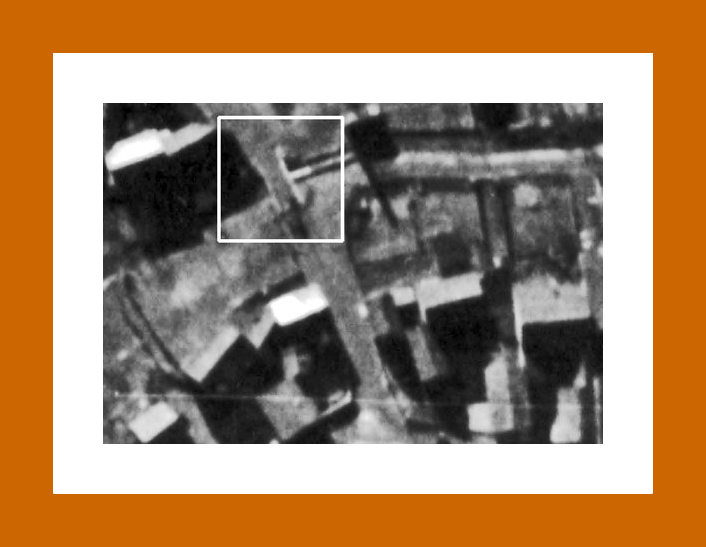

---

## Die Gemeindevertretung fasst 1949 den Beschluß, die Dorfstraße der Pfalz und die Brücke neu zu bauen. Maurermeister Gräter aus StM übernimmt den Bau der neuen Brücke. Zuvor wurde die alte Brücke abgetragen.

Um den Verkehr nicht zu sperren, baut Herr Zimmermeister Kreusel aus Hennethal eine Notbrücke und legt sie unterhalb der alten Brücke über den Bach.

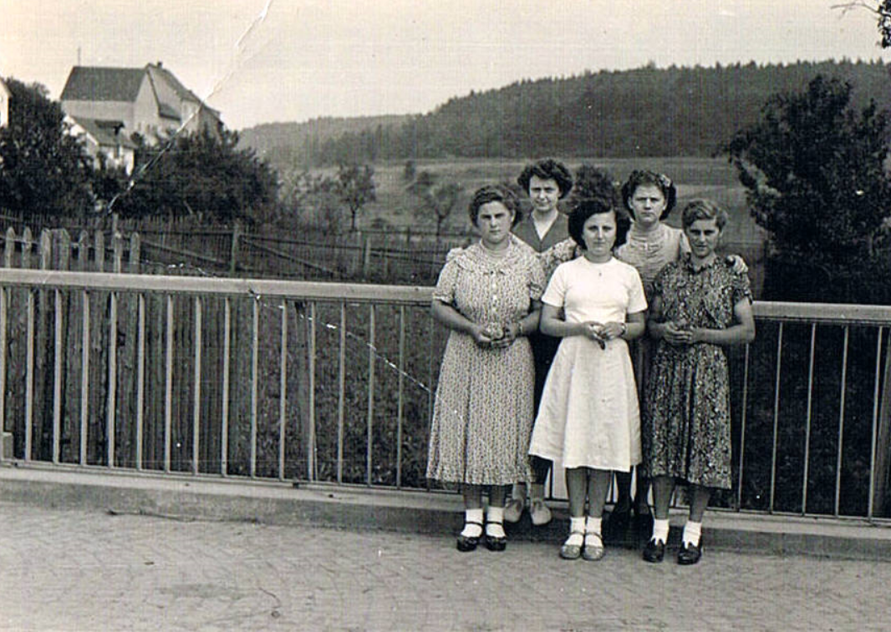

---

## Am 1. Advent begann um Mitternacht ein unheimliches Treiben, und das setzte sich die gesamte Adventszeit hindurch fort. Türen wurden von unsichtbarer Hand zugeschlagen und öffneten sich von selbst wieder. Ein ohrenbetäubender Lärm, wie von schleifenden Ketten erfüllte das Haus. Jeden Morgen standen die beiden Pferde des Pfarrers schweißnass im Stall, als ob man sie ausgeritten und überanstrengt hätte.Kein Gesinde wollte mehr im Pfarrhaus bleiben. Der Pfarrer scheute sich, seine Gemeinde zu verlassen, doch wusste er keinen Rat. War es sein Vorgänger, der umging, umgehen musste, um das Böse zu sühnen, das er begangen hatte?Schließlich versammelten sich mehrere Pfarrer aus der Umgebung und beteten so lange und kräftig, bis das Unwesen aufhörte. (Quelle: Taunus-Sagenschatz, 190 Sagen erzählt von Helmut Bode, Verlag Walter Kramer oHG, Frankfurt am Main, ISBN 3-7829-0325-0, 1986)

Anfang des 19. Jahrhundert taten zwei Pfarrer in StM Dienst.Zum einen Johann Gottfried Kolb von 1793 bis 1809 und Ludwig Imanuel Snell von 1810 bis 1814.

Von Beiden ist nicht überliefert, dass sie in StM starben. Kolb wurde 1809 nach Usingen versetzt und Snell 1814 wegen seiner Trunksucht aus dem Amt entlassen.Der darauffolgende Pfarrer Schmidtborn (Pfarrer von 1815 bis 1870) beschrieb das von ihm übernommene Pfarrgut wie folgt: Schwierigkeit der Verwaltung des Guts wegen dessen geringer Qualität u. Unzulänglichkeit der Wiesen.

Es erscheint deshalb als sehr unwahrscheinlich, dass sein Vorgänger, wie in der Sage beschrieben, durch seine Landwirtschaft wohlhabend wurde.

---

## Auszug aus der Frankfurter Ober-Postamts-Zeitung vom18. Juli 1834

Gottfried Eberhard Freyberger, Sohn des längst verstorbenen Pfarrers Freyberger zu Strinz-Margaretha bei Idstein und der nachher verehelichten Pfarrerin Kaiser zu Niederramstadt, geboren am 21. April 1764, entfernte sich bereits im Jahre 1790 von seiner Heimat, ohne seitdem von seinem Leben oder von seinem Aufenthalte irgend eine Nachricht gegeben zu haben.

Da dieser nunmehr das siebenzigste Lebensjahr zurückgelegt hat, so wird derselbe hiermit aufgefordert, binnen drei Monaten, von unten stehendem Datum an gerechnet, sich dahier zu melden, widrigenfalls er für todt erklärt, und sein, dahier verwaltet werdendes Vermögen an dessen sich legitimiert habenden nächste Verwandte wird ausgeliefert werden.

Binnen derselben Frist werden seine Leibes- oder sonstigen Erben hiermit ebenfalls vorgeladen, um ihre etwaige rechtliche Ansprüche an die genannte Vermögensmasse zu bescheinigen, widrigenfalls und wenn Gottfried Eberhard Freyberger wird für todt erklärt worden sein, diese Vermögensmasse an die, bereits sich als Erbin legitimiert habende, Auguste Heberer, Tochter des Pfarrers Heberer zu Leeheim, gegen für das Capital zu stellende Caution, wird übergeben werden. Darmstadt den 3. Juli 1834.

---

## Er ist dem Streunen sehr ergeben und deshalb bereits mehrfach bestraft worden. Namentlich wurde er im Mai 1841 wegen Bettelns und längeren müssigen Umherziehens dahier zur Strafe gezogen und aus demselben Grunde, sowie wegen Führung eines holländischen Passes, d. d. 6. Dec. 1843 abermals dahier zur Haft gebracht und am 12 desselben Monats in seine Heimat abgeschoben.

Nach einer Mittheilung des herzoglich nassauischen Amt Wehen ist er in den letzten Jahren öfters von Floßherren von Mainz, Koblenz und Köln mit nach Holland genommen und am 27. April 1843 wegen Streunens in Neuendorf bei Koblenz arrestiert und von dort nach Hause transportiert worden. Bei dem herzoglichen Amte Runkel mußte er im März 1843 wegen Bettelns eine 14tägige Gefängnisstrafe verbüßen.

---

## Als aber der Schultheiß Joh. Adam Enders als Erbe im Besitz des Ochsengutes war und die Gemeinde im Jahre 1832 128 Kühe und 60 Mutterschafe besaß, war die Anschaffung eines zweiten Bullen und eines zweiten Ebers notwendig geworden.

Da sich der Schultheiß auf den Kaufvertrag berief und die Mehrleistung ablehnte, kam es zum Prozess.

---

## Seit dem Tode des Schultheißen Enders erhob die Herzogliche Generaldomänendirektion von dem Ochsengut den Zehnten gegen den Willen der Besitzer, bis diese 1842 die Zahlung des Zehnten "förmlich verweigerten". Außerdem verlangte Frau Conradi durch Prozeß vor dem Appellationsgericht in Usingen namens ihrer zwei minderjährigen Kinder von der Herzoglichen Domänendirektion erstens Entschädigung dafür, dass das Gut stärker belastet war, als beim Kauf festgestellt wurde, zweitens Entschädigung wegen des widerrechtlich erhobenen Zehnten.

Ehe es zum Prozeß kam zwischen dem nassauischen Staat und der energischen für ihr Recht kämpfenden Bauersfrau, kam es zu dem oben erwähnten Vergleich. Darin verzichtete die Klägerin auf Ersatzansprüche und die Rückzahlung des geleisteten Zehnten; die Generaldomänendirektion verzichtete auf die Zehntberechtigung und zahlte an die Erben 3000 Gulden. Die Streitaxt war begraben.

1832 war ein neuer Friedhof eingeweiht worden. Schon hatte man 12 Tote beerdigt, da brachte der schwebende Prozeß zum Bewusstsein: Der Friedhof kann und darf auf diesem Acker nicht bleiben, denn der gehört ja zum Pfaffengut, worauf das Faselvieh lastet. Also wurde auf dem benachbarten Acker ein neuer Friedhof angelegt. Aber der Ortsgeistliche, Pfarrer Schmidtborn, lehnte es ab, ihn einzuweihen.

---

## Im Jahre 1931 beschweren sich Eltern aus Ketternschwalbach, Hennethal und Strinz-Margarethä bei der Landesständigen Deputiertenversammlung über die Haftbedingungen im Zuchthaus von Diez und darüber, dass die Untersuchungen schon so lange andauern und kein Urteil gefällt wird. Außerdem sei man der festen Überzeugung, dass die Anschuldigungen jeder rechtlichen Grundlage entbehren.

Ihre Söhne müssten die schlimmsten Drangsale der Einkerkerung erdulden. Selbst der Besuch eines Geistlichen würde den Inhaftieren verweigert werden.

Mit dem Hinweis der Deputiertenversammlung, dass man der Regierung vertraue, dass sie alles erdenklich Mögliche in der Sache tun würde, ging man, ohne weitere Schritte einzuleiten wieder zur Tagesordnung über.

---

## (Quelle: Sitzungs-Protocolle der Landesständigen Deputiertenversammlung / 28.03.1831)

Die Urteile des Kriegsgerichts gegen die überlebenden 37 Beteiligten ergehen im Frühjahr 1832, fünf Jahre nach der Tat. Als Rädelsführer werden Trapp und drei weitere, inzwischen degradierte, Unteroffiziere (Heuser, Lemp, Leidung) „durch das Schwert“ enthauptet. Die übrigen Ex-Unteroffiziere und Soldaten erhalten Zuchthausstrafen, zwischen zwei und 15 Jahren.

Der Strinzer Enders erhält eine Zuchthausstrafe von 9 Jahren. Auch er muss auf das Opfer eingestochen haben, da alle Beteiligten dazu verdonnert wurden, nach und nach auf das Opfer einzustechen.

---

## 1832

Am 19. Juli 1832 wird von den Mauern der Strauß (Richtkranz) aufgestarkt und der alte Zimmermannsspruch zum Besten gegeben.

---

## Die Einweihung der heutigen Strinzer Kirche wurde am 2. November 1834 von Pfarrer Schmidtborn im Zuge einer Predigt vorgenommen.  Der Kirchengesang wird von Blasinstrumenten (9 Musikanten aus Idstein) begleitet, da eine Orgel bei der Einweihung noch fehlte. Die Orgel der alten Kirche sollte keine Verwendung mehr finden, denn:

"Die Orgel ist als Instrument im Allgemeinen betrachtet mangelhaft, klein, unbedeutend, schreiend, geschmacklos."

---

## Um ihre Forderungen durchzusetzen, haben die entsprechenden Gemeinden versucht, im Jahre 1858 eine für sie positive Entscheidung über die Ständeversammlung des Herzogthums Nassau zu erwirken.

Im Vergleich zur geplanten Aartalstrecke haben, so wurde festgestellt, beide Vorschläge sehr ungünstige Steigungsverhältnisse vorzuweisen.

---

## Erhaltenes Schulbuch aus dem Jahre 1866. Es gehörte Adolf Kadesch.

---

## Fahne des Kriegervereins Hohenstein (Burg Hohenstein) von 1908

Im Adressbuch für den Untertaunus aus dem Jahre 1929 wird als Vorsitzender des Kriegervereins StM August Christmann aufgeführt.

---

## Aus dem Jahre 1825 sind 16 Erkrankungsfälle in Strinz bekannt, von denen 4 zum Tode führten.

Aus dem Jahre 1842 sind im Amtsgebiet Wehen insgesamt 55 Fälle bekannt, von denen 9 zum Tode führten.

Es wurde insbesondere dokumentiert das während des Jahres 1842 der gastrische Krankheitscharakter vorherrschend und der Abdominaltyphus sich in allen Monaten sporadisch, am häufigsten vom September an, besonders in den Orten Panrod und Strinz-Margarethä zeigte.

---

## die Linie Homburg - Usingen (1895)

Die meisten dieser Bahnen überquerten den Taunus von Nord nach Süd. Schon bald nach Fertigstellung kam der Plan auf, diese Strecken mit einer längs durch die Taunus verlaufende Eisenbahn zu verbinden. Mit der "Taunuslängsbahn" auch fälschlicher Weise Taunusquerbahn genannt.

Im Jahre 1899 wurde im "Idsteiner Anzeiger" von ersten Vermessungsarbeiten an der Strecke Butzbach-Idstein berichtet.

---

## 1900 - erster Plan mit Anbindung von StM

Aus dem Jahre 1900 stammt eine Karte, aus der die damals vorhandenen Eisenbahnlinien hervorgehen. Diese Karte wurde handschriftlich um eine Eisenbahnlinie ergänzt, die einen Streckenverlauf von Langenschwalbach bis Strinz-Margarethä zeigt. Bei StM endet der Streckenverlauf, es ist aber davon auszugehen, dass dieser weiter bis Idstein führen sollte. Bei StM verzweigt die Bahnlinie und führt über Breithardt nach Laufenselden und weiter. Es ist wahrscheinlich, dass es sich hierbei um einen ersten Entwurf aus der Planungsphase der Taunuslängsbahn handelt.

---

## Am 07.07. 1912 findet in StM wieder eine Versammlung statt, in der über den aktuellen Status des Taunusquerbahnprojektes gesprochen wird.(Quellen: Strinzer Chronik, Teil 2, Seite 12, Kirchenchronik)

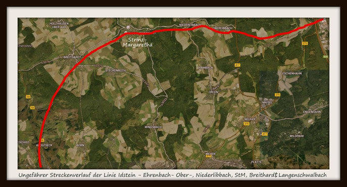

---

## Im Jahre 1928 gewinnen die Befürworter der Idstein-Linie wieder an Boden als diese in einer mit 300 Personen einstimmig verabschiedeten Resolution die Reichsbahn aufforderten, die früheren Pläne für eine Strecke Bad Nauheim - Idstein - Bad Schwalbach wieder aufzunehmen, was aber von der Reichsbahn abgelehnt wurde.

Bis zum Beginn der Weltwirtschaftskrise gab es immer wieder Initiativen für die ein oder andere Variante. Die Weltwirtschaftskrise letztendlich führte dazu, dass die Taunuslängsbahn nicht mehr finanzierbar war und in Vergessenheit geriet.

---

## Der zweite Sohn, Reinhard Wahl, fiel 1916 im ersten Weltkrieg bei Roy.

Der dritte Sohn, Karl Wahl starb am 16. Mai 1917 - auch durch Selbstmord. Aufgrund einer schweren Erkältung in seiner Kindheit, hatte er eine sehr krumme Körperhaltung. Er war unverheiratet und berufslos. Er hat sich mit einer Rasierklinge den Hals aufgeschnitten und ist gegen 5 Uhr in seiner Wohnung tot aufgefunden worden. Infolge des Todes des Vaters  (Zeitpunkt

---

## (Quelle: Heimatjahrbuch - Der Untertaunus, 1962)

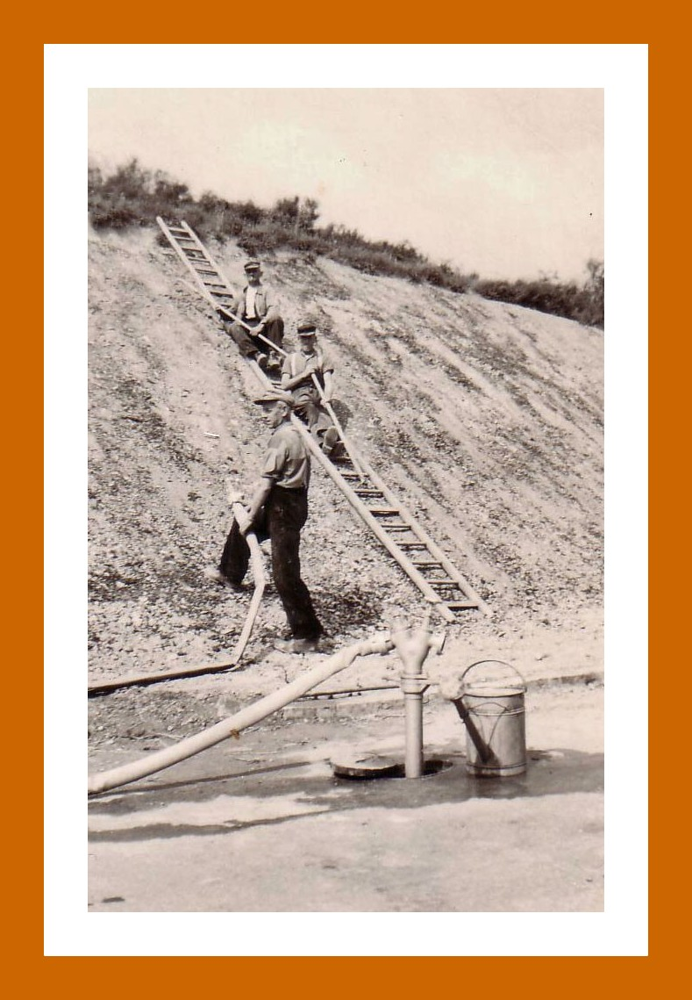

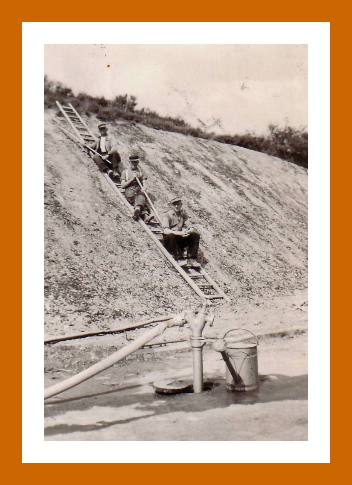

---

## Am 18.02.1985 berichtete der Wiesbadener Kurier:

"So blieb es mal wieder einmal den kleinen Vereinen und Gruppierungen überlassen, Glanzpunkte zu setzen. Ganz vorneweg dabei die Leut` aus StM. Ihr Karussell blieb konkurrenzlos."

---

## Viele im Ort können sich an den 7. Oktober 1977, den Tag des Absturzes, noch gut erinnern. Tiefflüge waren damals alltäglich für die kleine Gemeinde im Untertaunus. Erst die ungewöhnlichen Geräusche des Jets mit der Bundeswehr-Kennung 28+18 schreckten die Einwohner auf. Sie hörten laute Explosionen. Der folgende Absturz dann eine Sache von Sekunden. Die Piloten konnten sich mit dem Schleudersitz retten. Und landeten per Fallschirm. „Auch, wenn ich alt genug bin“, sagt der 54-jährige Schwarzer, „kenne ich den Tag nur aus Erzählungen und Zeitungsberichten.“ Und jetzt hält der Heimathistoriker ein Stück dieser Geschichte in Form einer Metallkiste in der Hand.

---

## Das Vereinsleben, welches noch wenige Wochen zuvor beim Jubiläumsfest des TV 1904 so ausgelassen gefeiert wurde wird eingestellt, da viele Vereinsmitglieder an die Front berufen werden.

Schon am 09. August beruhigt sich die Lage im Ort etwas, die Menschen gehen wieder ihrem Tagesgeschäft nach. Gegen Ende August werden dann aber die Benzin- und Benzolmengen für die Privathaushalte gesperrt und Hafervorräte dürfen nicht mehr frei verkauft werden.

Mit dem Einfall Russlands in Ostreußen werden Sammlungen im Ort organisiert.  So gehen im Oktober 1914 zwei schwere Wagen voll Kartoffeln, Gemüse, Butter, Eier und zwei Kisten Wäsche und Kleidungsstücke an das Rote Kreuz in Langenschwalbach, für Soldaten und die Bevölkerung in Ostpreußen. Noch sind hierfür ausreichend Vorräte vorhanden.

Weihnachten 1914 wird für viele Bewohner doppelt schön, denn viele Soldaten kommen auf Heimaturlaub nach Hause.

Doch schon nach Weihnachten beginnt das verwalten der Mangelwirtschaft. Da die Bauern nicht mehr frei über ihre Erzeugnisse verfügen dürfen, fehlt es plötzlich an allen Ecken und Enden.

---

## Mit Beginn der Feldarbeit fehlen die Soldaten in der Landwirtschaft. Sie müssen durch Kriegsgefangene ersetzt werden. Im Mai 1915 kommen die ersten 18 französischen Kriegsgefangene ins Dorf und werden auf die bedürftigen Familien aufgeteilt.

Den Rest des Jahres arrangiert man sich mit den schlechten Verhältnissen. Doch das Dorf muss noch mit 4 weiteren Gefallen auskommen.

Während der Ort bis 1916 bislang nur Lebensmittel und Pferde abzugeben hatte, wird erstmals Anfang 1916 Kupfer und Messing, zur Kanonen- und Munitionsproduktion abgegeben und ab Mai erhält man Nahrungsmittel und Seife nur noch über Bezugskarten.

Zu allem Überfluss grassiert im Frühjahr 1916 noch Typhus im Ort, an dem mehrere Menschen erkranken.

Mehrmals finden im Ort sogenannte Granatennagelungen statt bei denen für kriegsbeschädigte Soldaten gesammelt wird. Dabei können sich die Bewohner für 10 Pfennig einen Nagel kaufen, den sie dann mit einem Hammer in ein aus Holz gefertigtes Modell einer Granate einschlagen dürfen.

---

## 1917 - Die Glocken müssen gehen

Nachdem die letzten verfügbaren Metallvorräte abgegeben sind, werden im Januar 1917 die Zinnprospektpfeifen der Orgel beschlagnahmt.

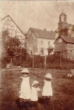

---

## Ende Januar 1918 wird der Kaisergeburtstag gefeiert. Man kann sich denken, dass in der kriegsmüden und ausgeplünderten Gemeinde keine große Freude aufkommt.

Noch im März 1918 versucht die Regierung den Bewohnern den letzten Groschen für Kriegsanleihen zu entlocken.

Am 31. Juli 1918 kommt der Krieg auch in unsere Region, als nämlich morgens, ca. 09:30 Uhr feindliche Flieger bei Steckenroth Bomben abwerfen, die aber keinen Schaden anrichten.

Im August taucht plötzlich August Ziß, der sich eigentlich in russischer Kriegsgefangenschaft befinden sollte, im Ort auf. Bei den aufgelösten Verhältnissen in Russland hat er sich einfach auf und davon gemacht und sich auf eigene Faust nach Strinz durchgeschlagen. Soweit ihn seine Füße trugen.

---

## Am 25. November 1918 verlassen die kriegsgefangenen Franzosen den Ort, am darauffolgenden Tag ziehen die geschlagenen deutschen Soldaten hindurch. Am 1. Dezember dann kommen die ersten Strinzer Soldaten nach Hause – „still und leise“, wie es der damalige Pfarrer in der Kirchenchronik beschreibt.  Die patriotischen Parolen sind verklungen.

Am 14. Dezember wird StM mit französischen Besatzungstruppen belegt. Es kommen 14 Soldaten in den Ort, die in den Häusern der Bürger untergebracht werden.

---

## 08. Juli 1917

18:00, Sitzung wegen der großen Glocken (Red.: StM und Niederlibbach), die an die Heeresverwaltung abgegeben werden müssen.

---

## 28. Juli 1917

Unter dem 28. Juli 1917 übersandte das königliche Landratsamt zu Langenschwalbach den Scheck für die Strinzer Glocke. Es waren 2.938,50 Mk. notiert. Der Betrag wurde der Direktion der Landesbank zu Wiesbaden für die neue (7.) Kriegsanleihe überwiesen. Bis zur Anlage auf Kriegsanleihe wird das Kapital mit 4 1/2 Prozent verzinst.

---

## (Quellen: Regimentstagebuch des Reserve-Infanterie Regiments 88 / Das Reserve-Infanterie-Regiment Nr. 80 im Weltkriege, 1914/18 / lamaindemassiges.com / Kirchenchronik StM / Bundesarchiv Bild 146-1974-132-26A / CC-BY-SA / Wikipedia)

Die Höhe 191 war während des folgenden Kriegsverlaufes noch des Öfteren Schauplatz blutiger Schlachten. Noch heute kann man den Krater von 1915 erkennen und durch die ehemaligen Schützengräben gehen.

---

## May, Heinrich Der früher bei Heinrich Fuhr dahier in Erziehung und Pflege gewesene Heinrich May aus Frankfurt ist bei Verdun gefallen. (Evangelischer Gemeindebote für den Synodalkreis Kirberg, Nr. 4, November 1917)

Müller II, Adolf Adolf Müller diente in der 8. Kompanie einer unbekannten Einheit als Musketier und überlebte den Krieg leicht verwundet.             Quelle: Deutsche Verlustlisten / Pr 606 / 14.08.16

---

## Müller IX, Wilhelm Wilhelm Müller diente in der 11. Kompanie einer unbekannten Einheit. Er fiel am 05.06.1916. Quelle: Deutsche Verlustlisten / Pr 606 / 14.08.16 + Gemeinde

Paulsen, Julius Der am 19.08.1889 geborene Julius Paulsen diente in der 10. Kompanie des Infanterie Regiment Nr. 159.  Er wurde zuerst als vermisst gemeldet, bis sich herausstellte, dass er in Gefangenschaft geraten ist.       Quelle: Deutsche Verlustlisten / Pr 1345 / 21.01.1919

---

## Am 04. November 1915 schreibt sein Vater in die Kirchenchronik:

Wir erhalten heute die erste Karte unseres Sohnes Ernst (Leutnant) aus seiner Gefangenschaft in Russland. ***

---

## Wahl, Reinhard Reinhard Wahl fiel am 08.09.1916. Quelle: Deutsche Verlustlisten / Pr 511 / 20.04.16 + Gemeinde

Wahl, Reinhard Der Gefreite Reinhard Wahl wurde am 04.11.1916 als gefallen gemeldet. Quelle: Deutsche Verlustlisten / Pr 677 / 04.11.16

---

## Der Kontrollwahn der Nationalsozialisten führte dazu, dass die Gemeinden genaueste statistische Erhebungen zu ihrem Ort und der Gemarkung abzuliefern hatten. Solch eine Auswertung aus dem Jahre 1935 ist im Hohensteiner Archiv erhalten geblieben und gibt uns nun genaueste Auskunft über die Zusammensetzung des Ortes im Jahr 1935.

---

## Im Jahre 1925 wurde eine Kraftpostlinie von Idstein-Hühnerkirche-Hennethal-StM-Breithardt-Bad Schwalbach eingerichtet, die der Personenbeförderung diente. Wegen mangelnder Rentabilität ging die Linie aber wieder ein.

Seit mehreren Jahren besteht eine Autoverbindung nach Wiesbaden durch ein Milchauto von Steckenroth. Fahrzeit täglich um 7:00 Uhr ab Strinz, ab Wiesbaden um 1 Uhr.

---

## Der Reichsnährstand (RNST) war eine ständische Organisation der Agrarpolitik im Deutschen Reich in den Jahren 1933 bis 1945.

Die Arbeit des RNST konzentrierte sich vor allem auf die Lenkung der Produktion, des Vertriebs und der Preise von landwirtschaftlichen Erzeugnissen. Zudem gehörten die sozialen und kulturellen Belange seiner Mitglieder zu seinen Aufgaben. Organisatorisch wurde dies erreicht durch eine Untergliederung des RNST in Landes-, Kreis- und Ortsbauernschaften, die jeweils von einem Bauernführer kontrolliert wurden. (Quelle: Wikipedia)

---

## Pfarrer hatten es zu Zeiten des Nationalsozialismus nicht einfach. Sie wurden sehr oft angefeindet. So erging es auch dem Strinzer Pfarrer Walter Maus der seit 1936 Pfarrer in Strinz war. Als er 1936 seine Pfarrstelle antrat, über nahm er den Religionsunterricht in der Strinzer Schule. Dies wurde ihm aus politischen Gründen aber untersagt, sodass der Schullehrer wieder den Religionsunterricht übernehmen musste.

Pfarrer Maus flüchtete sich in die Wehrmacht, wo man als Kritiker der Nazis einigermaßen sicher aufgehoben war.

Pfarrer Maus wurde aber auch ein Opfer des Krieges. Er starb 12. Mai 1945 in Kriegsgefangenschaft an einer Lungenentzündung.

---

## Der Strinzer Kindergarten wurde während des 2. Weltkrieges als sogenannter Musterkindergarten gebaut. Die Bauzeit betrug 2 Jahre von 1939 bis 1941.

In der Zeit von 1933 bis 1945 stand der Kindergarten im Fokus der nationalsozialistischen Ideologie. Dabei war von besonderer Bedeutung die Erziehung zum typischen deutschen Jungen und Mädchen:

„Wir wollen ein hartes Geschlecht heranziehen,das stark ist, zuverlässig, treu, gehorsam und anständig...Der kleine Junge wird einmal ein deutscher Soldat werden,das kleine Mädchen eine deutsche Mutter“.

Während der nationalsozialistischen Diktatur wurde die Zahl der Kindergartenplätze in Deutschland mehr als verdoppelt (Versorgungsquote 1941: 31 %).

Bei dem Gebäude handelt es sich um einen eingeschossigen, traufständigen Putzbau mit geschiefertem Satteldach und übergiebelter Eingangsvorhalle auf profilierten Holzstützen.Das nach 1945 leicht veränderte Holzrelief (Entfernung des Hakenkreuzes im Wimpel) im Giebelfeld wurde von dem bekannten Idsteiner Bildhauer und Stadtbaurat von Frankfurt am Main, Ferdinand Abt (1877 – 1962), geschaffen. Es zeigt eine Frau mit drei spielenden Kindern. Das unter Denkmalschutz stehende Gebäude zeichnet sich durch, für die damalige Zeit moderne Elemente, wie z. B. asymmetrisch in die Wand eingeschnittene Fensteröffnungen, aus.

---

## Als in den Jahren 1943/44 die Kriegsfolgen auch unsere Region heimsuchten, und in unvorstellbarem Ausmaß die größeren Städte bombardiert wurden, kam es zu einer enormen Flucht der Menschen aus den Städten auf das Land, in die kleinen Dörfer, die kein Angriffsziel darstellten. Die Zahl der Obdachlosen war allerdings so groß, dass die Unterbringung von der örtlichen Verwaltung nicht organisiert werden konnte, sie wäre damit überfordert gewesen. Da bereits alle Lebensbereiche des Volkes bewirtschaftet und reglementiert waren, war auch diese Sache in der Zuständigkeit des Kreiswohnungsamtes geregelt. Alle Wohnhäuser, meist Bauernhäuser, die von Großfamilien -Großeltern, Eltern und deren Kindern- bewohnt waren, wurden vom Wohnungsamt begutachtet. In der Regel wurde für die Unterbringung der Ausgebombten ein größeres Zimmer beschlagnahmt und Familien mit fünf und auch in Einzelfällen mehr Personen eingewiesen. Die Eigentümer mussten sich nun, so gut es ging, mit „Fremden“ in der Wohnung arrangieren, alles mit ihnen teilen und meist auch mit Lebensmitteln versorgen. Alles zu teilen bedeutete: Wasser, Strom, Heizmaterial für Herd und Ofen sowie das „Plumpsklo“ und vieles mehr. Die Versorgung mit Lebensmitteln war für Alle mit der „Lebensmittelkarte“ geregelt. Selbst für die Bauern, sogenannte Selbstversorger, war die Lebensmittelkarte von Bedeutung, denn sie mussten ihre Erzeugnisse „abliefern“, die über den geregelten Eigenbedarf hinausgingen. Das „Abliefern“ wurde streng kontrolliert, man hatte durch Viehzählungen und über den Anbau der Feldfrüchte genaue Zahlen, auf die die Kontrolleure aufbauen konnten. Mit der Versorgung von Evakuierten, die ihre Lebensmittelmarken entsprechend abgeben mussten, konnte das Ablieferungssoll gemindert werden. Es konnte jedoch oft nicht Alles, was jemand nach der Lebensmittelkarte zustand, geliefert werden, weil es einfach nicht vorhanden war.

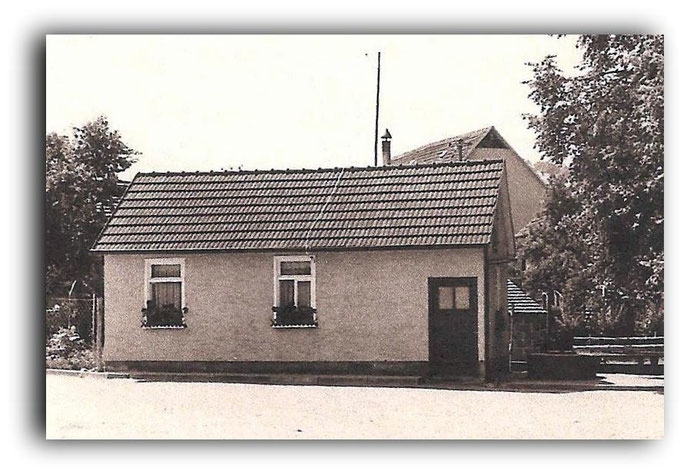

---

## 1944: Am 4. Dezember fallen beiderseits der Straße nach Niederlibbach Fliegerbomben

1945: Am 3. Februar fallen hinter dem Schulhaus Bomben auf den Kirchberg. Durch die           Detonation werden acht Fensterscheiben im Schulhaus zertrümmert

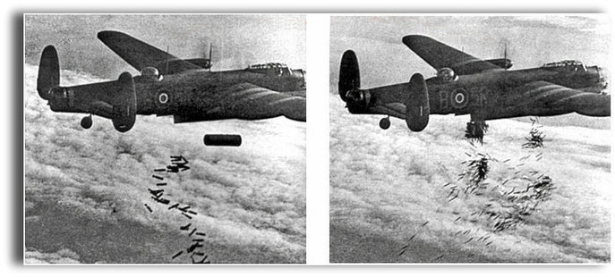

---

## Die Brüder wurden beide im Jahr 1940 zum Kriegsdienst herangezogen und fielen beide im Jahre 1942.

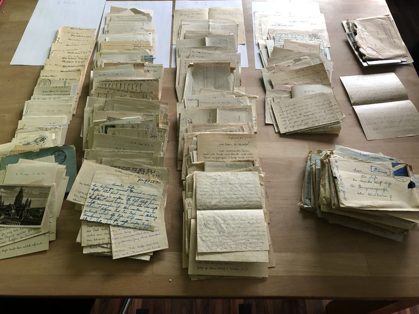

---

## Weihnacht ist’s und ich muss sterben,reich mir noch einmal die Hand,grüß mein Mütterl, laß ihr sagen,soll nicht weinen, soll nicht klagen,denn ich fiel für’s Vaterland.

Weihnacht ist in fremder Erde,ruht im Grab ein deutscher Held,Gott bewahre seine Lieben,vor dem Feind ist er geblieben,schlummre sanft du deutscher Held.

Weihnacht ist’s ein heilger Friede,lag auf Erden weit so weit,Weihnacht ist’s in allen Herzen,Weihnacht ist’s für alle Schmerzen,ruhe sanft auf Wiedersehn,ruhe sanft auf Wiedersehn.

---

## 03. Februar 1945

Hinter dem Schulhaus fallen Bomben auf den Kirchberg. Durch die Detonation werden acht Fensterscheiben im Schulhaus zertrümmert

---

## Mittwoch, 7. März 1945

Amerikanische Truppen unterbrechen die Sprengkabel zur Ludendorfbrücke in Remagen und vereiteln damit deren Sprengung. Damit hatten die US-Truppen ab dem 7. März 1945 einen Rheinübergang. Einem weiteren Vormarsch der Alliierten auch in unser Gebiet hinein steht somit nichts mehr im Wege.

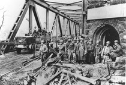

---

## Sonntag, 11. März 1945

Der Lehrer des Dorfes, Richard Weißer, wird wegen Krankheit aus dem Militärdienst entlassen und kehrt zu Fuß aus Hattenheim nach StM zurück.

---

## Montag, 12. März 1945

In StM werden die ersten deutschen Soldaten einquartiert. Berichtet wird u.a. von drei Unteroffizieren aus der Freudenberg-Kaserne bei Wiesbaden. Es handelt sich um die Unteroffiziere Scherer, Schogt und Feda. Sie lagern in einem Gehöft auf Strohsäcken auf dem Boden. Sie sollen als Offiziere an die Front befördert werden, was ihnen „gegen die Natur geht“. Der eine, ein Austauschgefangener mit nur einem Auge, war in Afrika in Gefangenschaft gewesen und hatte allerlei erlebt in Die Freudenbergkaserne           dieser Zeit.

Nach der Rückkehr von Lehrer Richard Weißer wird der Unterricht wiederaufgenommen. Dieser wird oft durch Fliegeralarm unterbrochen.

---

## Mittwoch, 14. März 1945

In der Nacht vom 14. auf den 15. März müssen die Unteroffiziere wieder zurück nach Freudenberg in ihre Kaserne marschieren.

---

## Donnerstag, 15. März 1945

Gegen Abend kommen die Unteroffiziere mit Blasen an den Füßen wieder zurück, ohne Essen empfangen zu haben. Noch war es nicht Mitternacht, als sie schon wieder geweckt werden und ihren Rückmarsch antreten müssen.

---

## Freitag, 16. März 1945

An diesem Tag kommen verschiedene Truppengattungen nach StM und beziehen Quartier. In dem besagten Gehöft werden drei Mann von einem Infanterie-Trupp einquartiert. Sie machen tagsüber Holz und schneiden es auf der Kreissäge zum Fahren der Autos, die mittels Holzvergaser angetrieben werden. An diesem Tag wird noch eine Evakuierte aus Eschenhahn in das Gehöft geholt - zum Nähen. In der Stube wird sehr lebhaft.

---

## Sonntag, 18. März 1945

Wachmannschaften mit Gefangen kommen nach StM. In dem benannten Gehöft werden 30 Gefangene und 3 Wachleute einquartiert. Bei den Wachleuten handelt es sich um Bauern aus der Gegend von Bad Kreuznach. Zur Verpflegung der Menschen wird am laufenden Band auf beiden zur Verfügung stehenden Herden gekocht. Kartoffeln, Dörrobst, Kaffee, Suppen – alles kommt aufs „Brett“.

---

## Dienstag, 20. März bis Samstag, 24. März 1945

Immer mehr Tiefflieger tauchen über unserer Gemarkung auf. Sie gehen so tief herunter, dass in der Bevölkerung die Angst besteht sie würden die Menschenmassen in den einzelnen Gehöften entdecken und diese beschießen. Denn, die Flugzeuge schießen auf alles was sich bewegt. So sind die Bauern auf dem Felde gezwungen öfters in Deckung zu gehen. In dieser Woche werden viele Pferde und Kühe Opfer der Flieger, z.B. in Breithardt und Hennethal, denn die Hafersaat kommt in Gang und so ist man gezwungen die Felder zu bestellen.

---

## Sonntag, 25. März 1945

Die Wachmänner und ihre Gefangenen müssen weiter - auf der Flucht vor den herannahenden Truppen. Ein französischer Gefangener verschenkt sein Akkordeon an die Bevölkerung, da er davon ausgeht, dass er dieses eh bald abgenommen bekommt.

---

## Montag, 26. März 1945

Die amerikanischen Truppen überqueren den Rhein bei Kaub, unter dem Kommando von General George J. Patton.

---

## Nachdem Richard Weißer 1943 in Frankfurt ausgebombt war, bewarb er sich auf eine freie Lehrerstelle auf dem Land und suchte sich unter mehreren Orten Strinz-Margarethä aus wegen des interessanten Namens – wie er uns später erzählte.

Er drängte seine drei Töchter in Frankfurt dazu, ihm zu folgen und die durch Bombenangriffe gefährdete Großstadt zu verlassen. Meine Tanten Maria Fauser mit ihrem Sohn Michael und dem 1944 in Bad Schwalbach geborenen Jörg Fauser und die unverheiratete Irmgard Weißer wohnten mit meinen Großeltern im Schulhaus. Meine Mutter Gertrud Richter, die älteste der drei Töchter, fand mit ihren 4 Kindern dort keinen Platz mehr. Sie mieteten sich im November 1943 im letzten Haus der Straße nach Libbach bei der Familie Fay ein. In meiner Erinnerung war das ein kleiner Anbau, in dem wir in zwei Zimmern hausten.

---

## Einsatzgebiete: Westfront, Ostfront, Deutsches Reich

Erlebnisse: Kam mit der Luftwaffenbaukompanie an die Westfront, erhielt in Magdeburg Infanterieausbildung, auf Rügen als Kampfbeobachter ausgebildet. 1942 als Sturmartillerist im Osten, schließlich zur Fallschirmausbildung. Begleitete beim 3. Fallschirmregiment die Luftoffensive bei Wesel-Bochold. Kam am 12. April 1945 in englische Gefangenschaft., flüchtete mit einem Hauptmann, einem Stabsarzt und einem Feldwebel bis Magdeburg. Als der Aufruf der Amerikaner erschien, nachdem sich Flüchtlinge stellen müssten, meldete sie sich nach 14 Tagen. Karl wurde am 14. Juni 1945 aus dem Kriegsgefangenenlager Bingen-Büdesheim und kehrte am 17. Juni nach StM zurück.

---

## Einsatzgebiete: Ungarn / Deutsches Reich

Erlebnisse: Kämpfte hauptsächlich bei Stuhlweißenburg in Ungarn, bei Bayreuth und Nürnberg. Im Erzgebirge von Russen gefangen genommen. Von Diez aus dem amerikanischen Lager entlassen. Rückkehr nach StM am 02.06.1945.

---

## Erlebnisse: Bei Nürnberg in Kriegsgefangenschaft geraten. Rückkehr nach StM am 5.06.1945.

Auszeichnungen: Eisernes Kreuz 2. Klasse, Infanteriesturmabzeichen, Kriegsverdienstkreuz mit Schwertern, Ostmedaille

---

## Einsatzgebiet: Deutsches Reich

Erlebnisse: Nach der Ausbildung am 02.02.1945 von Heidelberg in die Gegend von Görlitz verlegt. Kämpfte gegen die Russen und bei Nürnberg gegen die Amerikaner. 8 Wochen in Gefangenschaft bei guter Behandlung und Verpflegung. Rückkehr nach StM am 06.06.1945.

---

## Einsatzgebiete: Frankreich, Elsass, Deutsches Reich

Erlebnisse: Kämpfte 1944 in Mittelfrankreich, im Einsatz im Oberelsass 1944/45 und 1945 in Bayern. Aus amerikanischer Kriegsgefangenschaft am 14.06.1945 entlassen. Rückkehr nach StM am 16.06.1945.

---

## Einsatzgebiet: Deutsches Reich

Erlebnisse: In Pommern ausgebildet. Im Einsatz als Kanonier. 1945 bis Krefeld und im Ruhrkessel, dort bei Solingen am 16.04.1945 in amerikanische Gefangenschaft geraten. Entlassung aus der Gefangenschaft am 14.06.1945. Rückkehr nach StM am 18.06.1945.

---

## 29. März 1945

Am frühen Morgen zieht amerikanische Infanterie nach StM ein. Im Gänsemarsch zu beiden Seiten der Straße kommen sie schleichend, das Gewehr schussbereit haltend, an.

Gegen 09:00 Uhr müssen sämtliche Häuser der Pfalz geräumt werden. Die Bewohner der Pfalz müssen Zuflucht bei Bürgern im alten Dorfkern suchen. Mit ein paar Habseligkeiten verlassen sie ihre Häuser. Sie sind noch nicht richtig fertig, da kommen schon die Amerikaner in Massen eingerückt, um Quartier zu nehmen. Auf den Straßen herrscht viel Verkehr. Es ist kaum ein Durchkommen möglich.

Die Eigentümer der Pfalz dürften nur morgens und abends zurück in die Häuser, um ihr Vieh zu füttern.

Die Amerikaner graben Löcher in die Wiesen, in die sie ihre Geschütze zur Verteidigung gegen mögliche deutsche Angriffe hineinstellen.

Gegen 15:00 Uhr kommen die Kriegsgefangenen aus ihren Verstecken in den Waldungen wieder zurück in den Ort.

Nach dem Einzug der Amerikaner verpflichtet sich Bürgermeister Weber durch Eid, alle Verbindungen mit der Nazipartei abzubrechen und den Anordnungen der Besatzungstruppen zu gehorchen.

Mittels der Ortsglocke wird verkündet: „Laut amerikanischer Verordnung müssen sämtliche Gewehre, Munition und Fotoapparate sofort abgegeben werden“.

Maurermeister August Gräter und Lehrer Richard Weißer mit Tochter (Frau Fauser) werden zum amerikanischen Kommandanten nach Hennethal bestellt. Nachtwache durch August Gräter und Richard Weißer.

---

## 30. März 1945

Es finden wieder Hausdurchsuchungen statt, bei denen noch ein deutscher Soldat in einer Scheune aufgebracht wird.

---

## 1. April 1945

So einen ersten Ostertag hatte man in StM noch nicht erlebt. Die Kinder können nicht auf Ostereiersuche gehen und Ostern kann nicht wie gewohnt gefeiert werden.

---

## 2. April 1945

Am 2. Ostertag können die Bewohner der Pfalz wieder in ihre Häuser einziehen. Dies wird durch die Ortsschelle mitgeteilt. Die Häuser werden Ihnen in schlechtem Zustand zurückgegeben. Vieles wurde entwendet. Ganz besonders hatten es die Besatzer auf Uhren, Schmucksachen, Essbestecke u.v.a. mehr abgesehen.

Die Ausgangzeit wird von 8:00 - 10:00 Uhr vormittags und 4:00 - 6:00 Uhr am Nachmittag verlängert. Die Benutzung von Fahrzeugen und Motorrädern wird verboten, auch darf das Dorf nicht verlassen werden. Außerdem muss den Anordnungen der örtlichen Hilfspolizisten (erkennbar durch weiße Binden) Folge geleistet werden.

---

## 3. April 1945

Am Tag nach Ostern dürfen die Leute ihre Arbeit im Feld wiederaufnehmen, von morgens 6 bis abends 18 Uhr.

An einem der nächsten Mittage wird die Munition in der Gemarkung zusammengetragen und vergraben. Die drei jungen deutschen Soldaten die den Tod in der Gemarkung gefunden haben, werden in Särge gebettet und auf dem hiesigen Friedhof finden sie vorerst ihre letzte Ruhestätte.

Zahlreiche tote Pferde aus der Gemarkung werden in einem Bombentrichter an der Straße nach Niederlibbach, in den Wiesen von Wäldersbach vergraben.

---

## 18. April 1945

"Mir wurde unheimlich, als ich abends zum Fenster hinaussehend lautes Schreien hörte - ein Mädchen wehrte sich erfolglos gegen die Gier eines Soldaten"

---

## 19. April 1945

Am Nachmittag zwingen fünf Russen die Einwohner eines Jagdhauses, ihnen zu öffnen. Sie holen sich aus dem Keller zwei Flaschen Wein. Eine Frau aus dem Jagdhaus klettert über das Geländer und holt Hilfe im Dorf. Mehrere Einwohner eilen herbei und nehmen die Russen fest, von denen aber ein Russe fliehen kann. Auch nehmen sie ihnen 5 Schafe ab, die sie angeblich für 300 Mark gekauft haben.

Ein Radfahrer wird nach Michelbach geschickt, um den amerikanischen Kommandanten um Hilfe zu bitten. Aber in Michelbach war keine Kommandantur mehr und die Russen werden freigelassen. Die Schafe behält man im Ort und verspricht, diese freizugeben, wenn die Russen die Rechtmäßigkeit des Kaufes nachweisen.

In der Nacht wird heftig an die Tür des Schulhauses geschlagen und Öffnung verlangt. Rektor Weißer kleidet sich an und als das Pochen und Rufen immer dringender wird, öffnet er. Zwei leicht angetrunkene amerikanische Unteroffiziere überschütten Ihn mit einer Flut von Vorwürfen und dringen gleich in das Schlafzimmer ein, in das sich seine beiden Töchter geflüchtet haben. "I will sleep with you" schreit der eine, mit der Pistole herumfuchtelnd, seine jüngste Tochter an. Rektor Weißer sagt ihnen auf Englisch, dass er immer der größte Gegner von Hitler gewesen sei und jetzt würden amerikanische Soldaten in solch einer Weise auftreten. "I hope you are gentlemen!" ergänzt Tochter Elfriede in einer Haltung, die ihrem Beruf als Schauspielerin alle Ehre macht. "We are gentlemen" lautet die Antwort und die Gefahr ist beseitigt. Schließlich dauert es noch eine halbe Stunde, bis die ungeladenen Gäste gehen. Sie verlangen in das "bathroom" geführt zu werden, holen die letzten beiden Flaschen Wein des Lehrers und versuchen ihn politisch aufzuklären. Jeden Satz beenden sie mit einem "compris?". Schließlich verabschieden sie sich mit einem Händedruck.

---

## 21. April 1945

Um 7 Uhr erscheinen 8 - 10 Russen vor dem Schulhaus und verlangen Rektor Weißer zu sprechen. Er ist darauf vorbereitet, denn er hatte ja veranlasst die 6 Russen zwei Tage zuvor festzusetzen. Den drohend Auftretenden sagt er, dass er den Kommandanten angerufen hat und dass dieser StM gegen Gewalttätigkeiten schützen werde.

Die Russen verlangen die Herausgabe des einen Russen, den Rektor Weißer angeblich am Vortag hat einsperren lassen. Rektor Weißer gelingt es einige Russen davon zu überzeugen, dass er den Russen nicht hat einsperren lassen. Der Russe, der am besten deutsch kann sagt zu seinen Kameraden: "Er ist anständig gewesen, aber einer hat mich geschlagen, wenn ich den erwische, geht es ihm schlecht."

---

## 6. Mai 1945

Es findet eine Trauerfeier - durch Pfarrer Gottwald aus Kettenbach - zugunsten der im Strinzer Feld gefallenen Soldaten statt.

---

## 7. Mai 1945

Die Dorfbewohner erfahren, dass der Rest des deutschen Heeres kapituliert hat, nachdem Hitler und Göbbels tot sind. So sehr man sich nach dem Frieden sehnte, kann man sich im Ort nicht richtig freuen. Denn es geht keine Post, keine Eisenbahn und niemand weiß etwas von seinen Angehörigen. Es ist nur mit Tod oder Gefangenschaft zu rechnen.

Städter kommen auf der Suche nach Lebensmittel nach StM und so kommt es vor, dass täglich 15 - 20 Mann an die Tür der Einwohner kommen. Viele bringen was zum Tauschen mit. Seife, Seifenpulver, Salz, Bürsten, Handtücher, Schuhe, Stoffe und vieles mehr. Doch die Strinzer Bürger sind selbst in Not und können nicht viel tauschen.

---

## 21. Mai 1945

Beutesachen der Wehrmacht müssen abgeben werden. Vieles davon kann nicht abgeliefert werden, da zu schwer und demnach nicht transportabel.

---

## 11. Juni 1945

Eröffnung des Kindergartens 3 Amerikaner auf dem Bürgermeisteramt, das im Kindergarten eingerichtet wurde. Meldung wegen Wildschadens und Bitte Wildschweine und Füchse abschießen zu dürfen.

---

## 13. Juni 1945

Eine Dame aus Düsseldorf ist bei Emil Diefenbach zu Besuch. Sie gibt sich als Kartenlegerin aus. Viele Leute aus dem Dorf lassen sich die Karten legen. Die Kartenlegerin verspricht viel, insbesondere die schnelle Rückkehr der Soldaten, was sich aber nicht bewahrheitet.

---

## 24. Juni 1945

Wieder einer Kartenlegerin im Ort bei Frau Ziegler. Sie erzählt, dass die Strinzer Soldaten alle noch am Leben seien und bald nach Hause kommen.

---

## 28. Juni 1945

Der ehemalige Bürgermeister Adolf Weber wird von den Alliierten in Haft genommen und kommt ins Internierungslager nach Darmstadt. Neuer Bürgermeister wird August Gräter.

---

## 20. Juli 1945

2 amerikanische Soldaten (Polizei aus Wiesbaden) erschießen 4 Tauben von R. Heinzmann, da das Halten von Tauben verboten ist.

---

## 1. August 1945

Rudolf Heinzemann wird vor dem Militärgericht in Wiesbaden wegen Ungehorsam (Nichttötung seiner Brieftauben) angeklagt und freigesprochen.

---

## 10. August 1945

Erste Lehrerversammlung nach dem Kriege. Diese findet in Idstein unter Lehrer Conrad statt, dessen jüngste Tochter in StM als Evakuierte wohnt (sie heiratet 1947 einen Amerikaner).

---

## 13./14. August 1945

Nachts wird bei Frau Elise Petri unberechtigt ein Schwein geschlachtet. Die Eingeweide nebst Ohren liegen noch im Hof.

---

## 9. September 1945

Erste Hochzeit nach dem Krieg. Das Brautpaar sind Albert Schneider und Wittlich. Es wurde wieder wie früher das Ehestandslied gesungen.

---

## 16. November 1945

Wilhelm Enders wird verhaftet und ins Zuchthaus nach Butzbach gebracht, dann ins Internierungslager in Darmstadt.

---

## Anno 1863

In einer Zeitschrift zur Nassauer Kunst- und Gewerbeausstellung in Wiesbaden im Jahre 1863 werden nachfolgende Gewerbe in StM aufgeführt:

2 Leinenweber / 1 Mahlmeister / 1 Brandweinbrenner / 2 Kaufleute / 2 herumziehende Kramer / 2 Wirte / 1 Zimmermann / 1 Wagner / 2 Schmiede / 1 Schuhmacher / 1 Sattler / 1 Schneider / 2 Schreiner

---

## Anno 1969

Im Kerbespruch von 1969 sind einige Anzeigen aufgeführt, die auf die damaligen Gewerbebetriebe in StM hinweist. Es sind:

Fuhrbetrieb Adolf Klein / Auto-Transporte, Bagger - und Raupenbetrieb W. M. Enders / Installation, Spenglerei, Heizungsbau Josef Warzelhahn / Gasthaus zum Scheidertal, Karl Weber / Auto-Transporte aller Art, Albert Schneider / Damen-Herren-Friseursalon, H. Christmann / Landmaschinenhandel, Hufbeschlag, Wagenbau, Schmiedmeister, Karl Rücker / Tüncher- und Ansteichergeschäft, Kurt Mager / Tüncher- und Anstreichermeister, Willi Hankammer / Kornbrennerei - Gastwirtschaft, Enst und Dieter Schneider / Schmiedmeister, Fahrzeugbau, Reparaturen  Willi Klein / Textilwaren, Kurzwaren, Otto Hankammer / Ihr UNION Kaufmann, Paula Wahl / Getränkevertrieb, Günter Jacob / Saalbau, Gastwirtschaft, Adolf Klein / Raiffeisenkasse e.G.m.b.H., Kredit- und Warengenossenschaft

---

## 1949     216          1955        9         1950     168          1956        9                                                     1951     165          1957      16         1952     107          1958        2                                                     1953      67           1959      34         1954      10           1960      29

Der allgemeine Strukturwandel in der Landwirtschaft, der Verfall der Preise für Wolle und Fleisch sowie der hohe Arbeitsaufwand hat zu dem starken Rückgang der Schafhaltung geführt.

---

## (Quelle: Das war ihr Leben / Helge Schmidt / 1985)

---

## Bilder der Mühle aus dem Jahre 1995

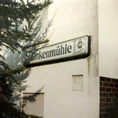

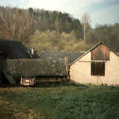

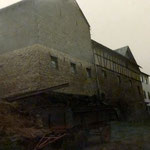

---

