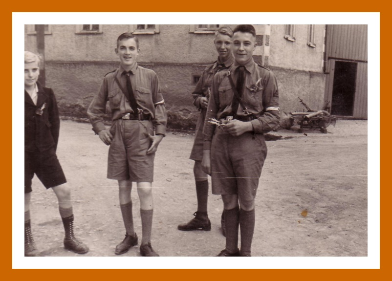
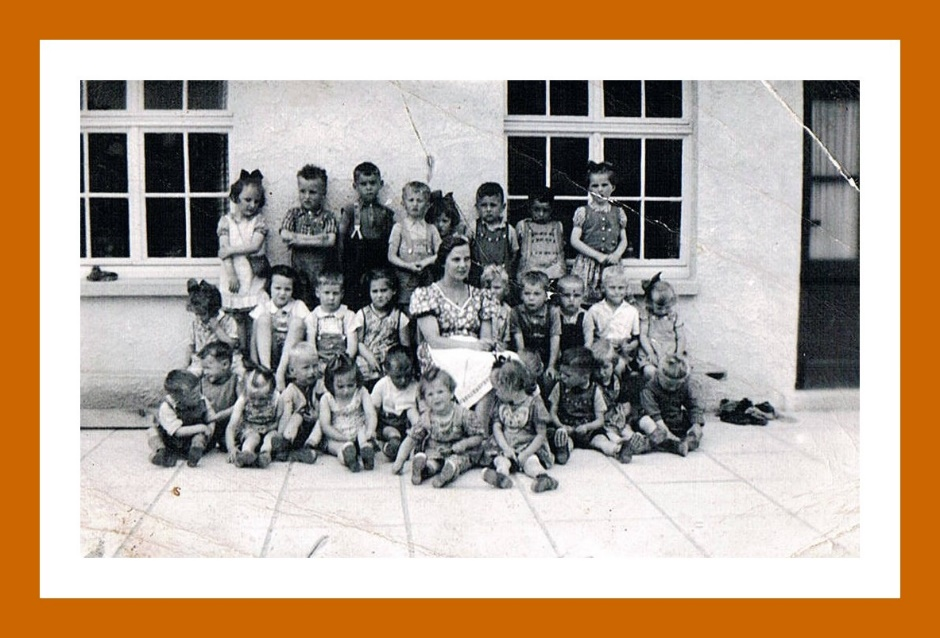

# Weltkriege und Zwischenkriegszeit

## Geschichte kann man nicht neu erfinden, insofern war ich bei meinen Recherchen auf Informationen angewiesen, die schon einmal niedergeschrieben wurden. Hier sei auch den Strinzer Bürgern gedankt, die schon einige Chroniken verfasst haben. An dieser Stelle sei z.B. die Chronik des Turnvereins, der Freiwilligen Feuerwehr oder des ehemaligen Männergesangvereines erwähnt. Sehr geholfen haben mir auch die Chroniken des ehemaligen Rektors Weißer geholfen, die er in den 1940er Jahren während seiner Dienstzeit verfasst hat. Als Grundlagen seiner Recherchen dienten z. B. die Kirchenchroniken oder die Schulchronik. Gerade in Bezug auf die Schulchronik sind die Recherchen von Herrn Weißer sehr wichtig, da diese nach dem 2. Weltkrieg verloren ging und die Informationen sonst nicht mehr nutzbar wären.

Weitere Quellen für Informationen aller Art bezog ich z. B. aus dem Hessischen Staatsarchiv, unterschiedlichsten Publikationen in Büchern und Zeitschriften, die ich über die Funktion Google-Book ermitteln konnte, bis hin zu persönlichen Gesprächen mit Strinzer Bürgern.

---

## Neuer Lehrer in StM wird Fritz Schmidt. Lehrer Schmidt fällt besonders durch ein starkes Räuspern im Unterricht auf. Dieses rührt noch vom 1. Weltkrieg her, in dem er einem Gasangriff zum Opfer fiel.(Quelle: Alte Strinzer Chronik, Band 2, Seite 30 / mdl. Überlieferung)

Am Morgen des 16. September durchqueren Teile des englischen 2. Worcetershire Regimentes bei einem Manöver Strinz-Margarethä. Zuvor wurde das Regiment von den Royal Welch und Royal Berkshires angegriffen. Es gelingt dem Regiment den Feind bei Kämpfen zwischen Strinz und Niederlibbach zurückzudrängen. Gegen Mittag dann erreichen die siegreichen Truppen Oberlibbach.(Quelle: www.worcestershireregiment.com)

---

## Am 21. September fällt Karl Gräter als erster Strinzer im Zweiten Weltkrieg. Er wurde 22 Jahre alt.

---

## Auch wenn es eigentlich nach dem 1. Weltkrieg dringendere Probleme gab, wurde der Kampf um die Taunuslängsbahn wiederaufgenommen. In den ersten Jahren ging es im Streit hauptsächlich um die Streckenführung im Hochtaunus, östlich von Idstein.

Als begeisterter Verfechter für die Idstein-Linie erwies sich der Breithardter Pfarrer Rohr, der den Landrat mit Eingaben und Vorschlägen bedrängte, um ihn zu Aktivitäten zugunsten der Linie Idstein-Breithardt-Langenschwalbach zu bewegen. Aufgrund der Tatsache, dass andere, dringendere Investitionen in der Region anstanden, lies Landrat Dr. Werner Pollack den Breithardter Pfarrer immer wieder abblitzen.

---

## Nachfolgend erzähle ich Euch eine überlieferte Geschichte aus der Zeit vor dem zweiten Weltkrieg:

Mienchen war unsere Nachbarin, die im Winter jeden Abend zu uns kam. Um 8 Uhr lief Roland, unser Hund, an die Tür - er hörte sie schon kommen, bevor wir es gehört hatten - und begrüßte seine Freundin mit freudigem Gebell. Mienchen suchte sich einen Stuhl in unserer Runde. Wir saßen alle in der Küche mit Handarbeiten beschäftigt und sie fing ebenfalls an zu stricken. Dabei stand ihr Mund nicht still, Mienchen hatte immer etwas zu erzählen, wußte alle Neuigkeiten aus dem Dorf, war dabei aber niemals unangenehm. Man mußte nur aufpassen, dass man nicht zuviel Privates preisgabe, denn Mienchen war auch zu anderen Leuten sehr mitteilsam. Nun, wir wußten sie zu nehmen, und wenn sie einmal nicht kam, fehlte uns etwas.

Heute war Mienchen schweigsamer als sonst. Sie sagte, dass sie sich Sorgen mache um ihren Mann Rudolf, der jetzt nach einer ganzen Woche immer noch brumme, das heißt, er schmollte. Er kam nicht zu den Mahlzeiten, ließ sich den ganzen Tag nicht sehen, arbeitete nichts, man hörte ihn nur im Schlafzimmer rumoren.

Mienchen mußte dann alle Arbeit alleine machen. Nachts stand Rudolf dann auf doch seine Frau war so müde von der harten Arbeit, daß sie das nicht einmal merkte. Dabei wußte Mienchen meißtens nie, warum er brummte.

Wir hielten uns aus der Sache heraus, hatten auch schon unsere Erfahrungen mit Rudolf gemacht. Wir wußten, wie schlimmdas Leben für sie war mit diesem Mann, dem sie auf Gedeih und Verderb ausgeliefert war. Die Frauen hatten damals keine Möglichkeit zur Trennung, ohne eigenes Geld und Einkommen. Besonders in der Landwirtschaft war man aufeinander angewiesen und konnte froh sein, wenn das Zusammenleben gut war. Damit, daß sie sich bei uns aussprechen konnte, habe wir ihr sicher geholfen.

An besagtem Abend ging sie früher als sonst nach Hause, ihre Unruhe war deutlich zu spüren. Wir gingen auch zu Bett.

Ich weiß nicht mehr, wie lange wir geschlafen hatten, als wir verhaltenes Rufen hörten. Mutter wurde als erste wach und ging ans Fenster. Sie stieß einen entsetzten Schrei aus. Sie glaubte, ein Gespenst zu sehen. Vor unserem Haus stand Mienchen, das lange graue Haar hing ihr wirr um den Kopf, ihr helles Nachthemd hing unter dem grauen Kittel hervor, den sie sich in der Eile übergezogen hatte. Dann war auch Vater am Fenster und bekam ebenfalls einen gewaltigen Schreck:

"Komm bitte schnell mal rüber, Rudolf ist nicht im Bett er ist in der Küche und schärft Messer, der Hund heult, ich glaube, er tut sich etwas an. Die Küche ist von innen verschlossen, ich traue mich nicht, den Sohn zu wecken, ich habe solche Angst. Helft mir bitte".

So sprudelte es aus ihr heraus, sie schlotterte am ganzen Körper. Was blieb Vater anderes übrig, als sich anzuziehen und mitzugehen. Er nahm eine lange Bohnenstange und klopfte damit an das Fenster im ersten Stock ihres Hauses, um den Sohn zu wecken, der dann auch herunterkam. Gemeinsam brachen sie die Küchentür auf und mußten alle drei laut lachen.

Am Küchentisch saß Rudolf mit Hund Nobby und schlug sich mit Brot und Schinken den Magen voll. Alle Ängste, die Mienchen ausgestanden hatte, waren umsonst gewesen. Rudolf hatte nur Hunger bekommen, hatte das lange Brummen und Fasten nicht mehr ausgehalten. Für den dicken Schinken, den er angeschnitten hatte, mußte er das Messer schärfen. Mit vollen Magen schien er auch friedlich zu sein, und Vater kam nach Hause zurück.

Mutter konnte einige Nächte lang nicht schlafen, so sehr saß ihr der Schreck in den Knochen. Rudolf stellte für ein paar Tage das Brummen ein, aber das dauerte nicht lange. Für Mienchen war die Sache doch etwas peinlich gewesen, aber was tut man nicht alles, wenn man Angst hat.

Rudolf ist eines natürlichen Todes gestorben und Mienchen hat sich danach noch einmal richtig erholt und mit Sohn und Schwiegertochter noch ein paar ruhige Tage verbracht.

---

## Eine Kriegsnagelunge bezeichnete eine der zahlreichen Sammelaktionen im Ersten Weltkrieg, mit denen Geld für die Unterstützung von Kriegshinterbliebenen und -verwundeten von der Bevölkerung erbeten wurde, da die staatlichen Sozialfonds nicht über ausreichende Finanzmittel zu ihrer Versorgung verfügten.

Beschlossen wurde solch eine Aktion in den örtlichen Gremien, die Trägerschaft übernahm aber meist ein karitativer Verein (z.B. das Rote Kreuz), das den Verkauf der Nägel, die Organisation der Nagelaktionen selbst und die Verwaltung der Gelder übernahm.

Das Nageln von Kriegswahrzeichen begann im März 1915; in diesem Jahr ist die Errichtung der meisten Nagelobjekte nachweisbar. Sie endeten ziemlich abrupt im dritten Kriegsjahr, als die materielle Not auch die Bevölkerung erreichte und in Angesicht der großen Materialschlachten 1916 um Verdun und an der Somme mit den riesigen Verlusten an Menschen auch die Siegesgewissheit schwand.

Benagelt wurde in der Regel eine hölzerne Figur. Durch die Benagelung erhielt diese Figur ihr endgültiges Aussehen.

Es gab eine große Vielfalt in der Gestaltung der Nagelobjekte; für Strinz-Margarethä wurde die Form einer Granate gewählt. Der Preis für einen Nagel betrug in StM. 10 Pfennig. Die erste Sammlung fand am 02.04.1916 statt, die letzte am 21.09.1916. Insgesamt wurden dabei 12 Reichsmark und 60 Pfennig für den guten Zweck gesammelt.

---

## Von Strinzer Bürgern bekam ich einmal eine Blechkiste, in der Feldpostbriefe eines Strinzer Soldaten aus dem ersten Weltkrieg gesammelt wurden. Dies Briefe schlummerten 100 Jahre vor sich hin. Das Interessante daran ist, dass nicht nur Briefe vorhanden sind die von der Front nach StM geschickt wurden, sondern auch Briefe, die von hier aus an die Front gesendet wurden. Gerade diese Briefe geben einen Einblick in die schwierige Zeit des 1. WK hier in StM.

In dieser Box ist quasi die Zeit von 1914 bis 1918 eingefroren worden. Deshalb habe ich die Box "Zeitkapsel" getauft.

---

## 600.000 französische Soldaten gerieten im 2. Weltkrieg in Kriegsgefangenschaft. Die meisten von ihnen kamen in die Landwirtschaft, wo die Bauern fehlten, die ihrerseits im Kriegseinsatz waren. So auch Raoul Labonne, der spätere Bürgermeister unserer Partnergemeinde Aube in der Normandie.

In Strinz-Margarethä befand sich seinerzeit eine Außenstelle des Kriegsgefangen-Stammlager 12 A Limburg. In diesem Stammlager war Raoul Labonne, bevor er nach Strinz kam, interniert.

---

## Nach dem 2. Weltkrieg war die Not sehr groß. Vieles war nicht zu bekommen und so war Improvisationsgeist gefragt.

Bei dem hier gezeigten Behälter, den ich in der Nachbargemarkung gefunden habe, handelt es sich um eine Zünderbüchse 1. In dieser wurden Zünder für die 8,8 Flugabwehrgranaten transportiert. Die Zünder selbst wurden erst kurz vor deren Einsatz auf die Granaten geschraubt.

Die hier gezeigte Zünderbüchse wurde zu einem Wäschesprenger umgearbeitet. Dazu wurden in den Deckel kleine Löcher gebohrt. Dies war seinerzeit wohl eine verbreitete Vorgehensweise für diese Zünderbüchsen.

Nachdem die Büchse von mir gereinigt wurde, kann diese auch wieder als Wäschesprenger genutzt werden.

---

## Die Schafhaltung in den Zeiten vor und nach dem 2. Weltkrieg war sehr angepasst an die Bedürfnisse der Landbevölkerung, zeitweise aber auch an die staatliche Förderung und entsprechende Vorgaben.

Aus dem Jahr 1935 sind hierzu statistische Daten darüber bekannt, eine allgemeine Statistik, aufgrund von Daten die für die Neuausrichtung der landwirtschaftlichen Betriebe und der Produktion (Reichsnährstand) im dritten Reich erhoben wurden:

---

## Hausschlachtungen waren in früherer Zeit fester Bestandteil des Dorflebens und der Daseinsvorsorge der im Dorf lebenden Familien. Wenn man die vergangenen 100 Jahre betrachtet, mit den verheerenden Notlagen, während und nach dem ersten und noch verstärkt während und nach dem 2. Weltkrieg, konnte man nur überleben, wenn man Tiere aufzog, die für den Eigenbedarf geschlachtet werden konnten.

Das war in der Regel Schweine, aber auch Kleintiere wie Ziegen, Schafe, Hühner und Hasen. Ein Rund zu schlachten war eher die Ausnahme, denn das konnten sich nur wenige leisten, weil Rinder vorwiegend als Milchlieferanten und als Zugtiere genutzt wurden. Mit der Schlachtung eines Schweines war die Versorgung der Familie mit Fleisch für ein halbes Jahr gesichert.

---

## Frank Schwarzer aus Strinz-Margarethä wertet Feldpost aus dem Zweiten Weltkrieg aus. Dabei kommen interessante Details ins Blickfeld. Von Thorsten Stötzer   24.08.2019

---

