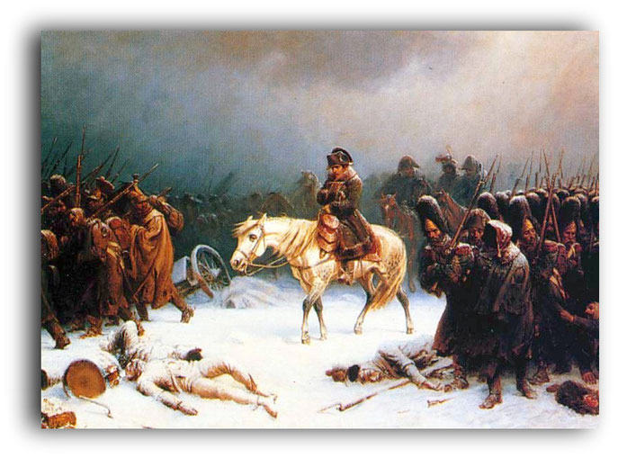
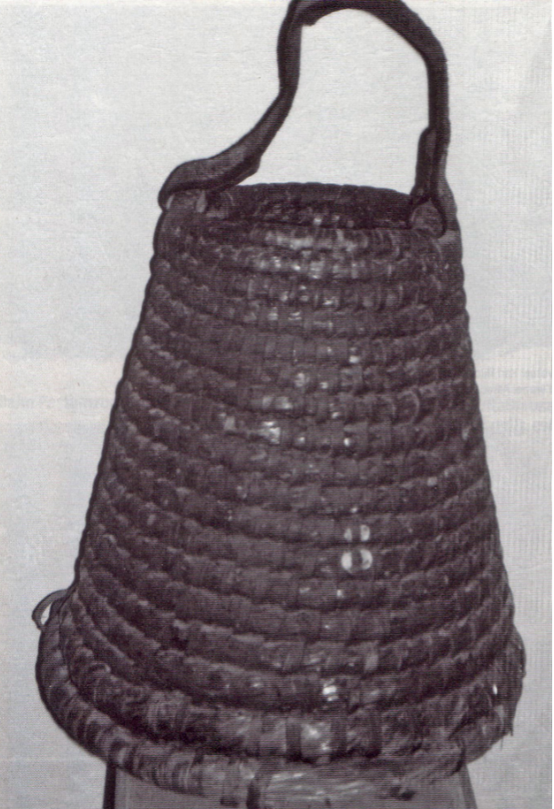
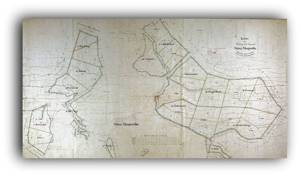
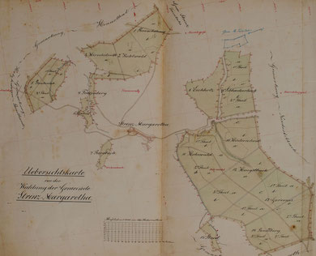
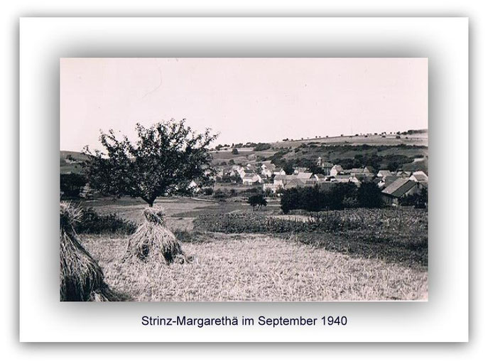
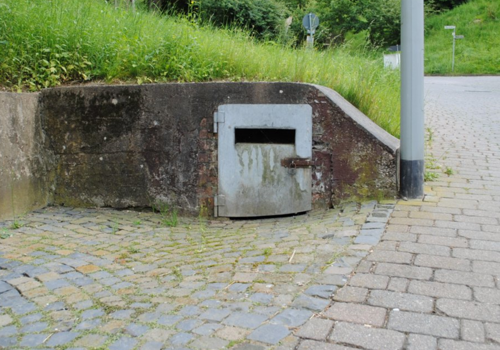
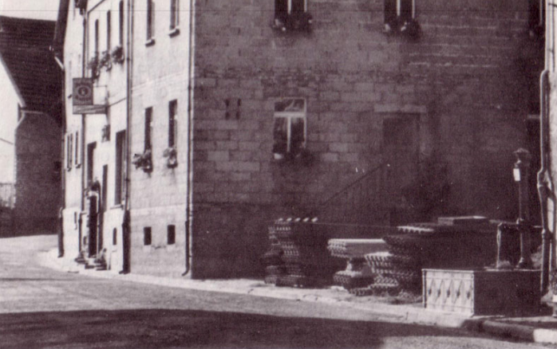
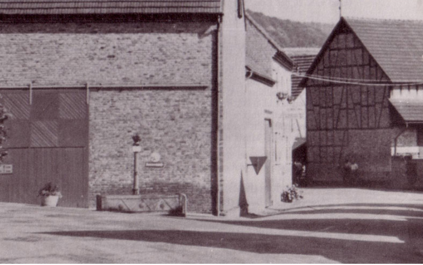
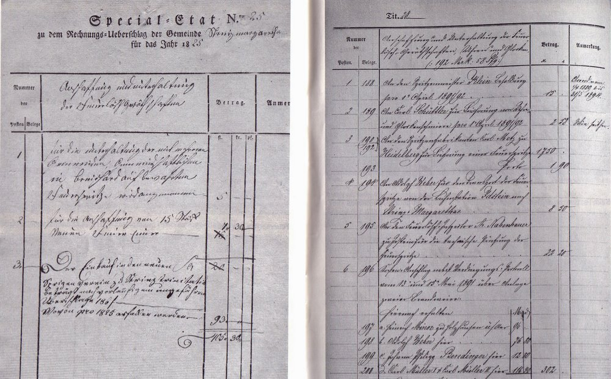

# Nachkriegszeit bis heute

## Auch mich als „Neubürger“ (echter Strinzer wird man wohl nur mit Geburt), ich lebte mittlerweile 4 Jahre in StM, bewegte im Jahre 2010 die Frage, wo denn Strinz seinen seltsamen Namen her hat.

Ich fing an zu recherchieren und fand immer mehr Informationen zum Ort. Diese stellte ich nach und nach in einer Internetpräsenz ein, um so viel Interessenten wie möglich, Zugang zu den Erkenntnissen zu gewähren. Dies bis zum Jahre 2019.

Immer schärfer werdende Anforderungen an Copyright, Datenschutz, Urheberrechten etc., die für einen Laien kaum noch zu überblicken schienen, zwangen mich dazu die Internetpräsenz wieder aufzugeben.

---

## Es wurde vermerkt. "Die Feuergefahr in Strinz-Margarethä war groß, zumal die Häuser und Scheunen mit Stroh gedeckt waren".Die "Abgebrannten" wurden bettelarm, denn eine Feuerversicherung gab es damals noch nicht. Es gab auch keine organisierte Feuerwehr, obwohl es dazu gesetzliche Vorschriften gab. Wenn die strohgedeckten Häuser erst einmal brannten, war es schon zu spät. Sie brannten schnell nieder. Eine gewisse Sicherheit zum Schutz der Bürger wurde gewährleistet durch einen Tagwächter, einen Nachtwächter und einem Flurschütz.(Quelle: Chronik der Freiwilligen Feuerwehr / 2009)

StM zahlt 20,19 Gulden "Herrngeld" an die Renthei in Idstein.(Quelle: Auszug aus den Rechnungen der Renthei Idstein der Jahre 1802 - 1806)

---

## (Quelle: Landesgeschichtliches Infosystem Hessen / 2011)

Nach der Niederlage der Truppen von Napoleon Bonaparte in Russland galt es für diese, so schnell wie möglich wieder zurück über den Rhein zu kommen. Unsere Region wird von zurückweichenden französischen Soldaten heimgesucht.Ihnen folgen russische Kosaken, die sich in unserer Region niederlassen. Nassau gehört noch immer zum Rheinbund, den Verbündeten von Napoleon. Insofern befinden sich die Kosaken noch in Feindesland und sind entsprechend eingestellt. Ca. 2 Wochen später treten die Nassauer zu den russischen Verbündeten über.(Quelle: Wehen uns sein Grund, Dr. Eduard Wilhelmi, 1953)

---

## Anschaffung eines strohernen Feuereimers für 1 Gulden 40 Kreuzer.(Quelle: Chronik der Freiwilligen Feuerwehr / 2009)

---

## Anschaffung einer neuen Feuerleiter.(Quelle: Chronik der Freiwilligen Feuerwehr / 2009)

In einem Wahlverzeichnis der Wahlcandidaten aus den bürgerlichen Landeigenthümern wird ein Johann Philipp Ott aus StM aufgeführt.(Quelle: Verordnungsblatt des Herzogthums Nassau / Nr. 3 / 7. März 1936)

---

## (Quelle: Landesgeschichtliches Infosystem Hessen / 2011)

Wiedereinstellung des Oberförsters, der im Jahr zuvor seines Dienstes enthoben und aus dem Ort verwiesen wurde.

---

## Erstmalig wird ein Spritzenmeister - Ferdinand Gräter - erwähnt. Er ist zuständig für die Pflege und Wartung der Spritze und ruft zu Übungen ein. Er bekommt für seine Arbeit 3 Gulden 30 Kreuzer Lohn.(Quelle: Chronik der Freiwilligen Feuerwehr / 2009)

---

## Neuer Spritzenmeister wird der Schmiedemeister Philipp Klein. Er behält das Amt für 40 Jahre.(Quelle: Chronik der Freiwilligen Feuerwehr / 2009)

---

## Zwischen 12 Uhr und 1 Uhr mittags brennt eine Scheune durch Blitzschlag in der Pfalzstraße ab. Stall und Wohnhaus wurden stark beschädigt. Es handelt sich um das Anwesen Baum.(Quelle: Chronik der Freiwilligen Feuerwehr / 2009)

Als Förster für den Schutzbezirk Strinz-Margarethä der Oberförsterei Breithardt der königlich preußischen Forstverwaltung wird ein Hr. Bayer genannt.

---

## Erstmals werden Feuerversicherungsprämien gezahlt.(Quelle: Chronik der Freiwilligen Feuerwehr / 2009)

Die Eberhaltung von StM übernimmt der Landwirts Weber. Dies wird über 50 Jahre Bestand haben.(Quelle: Hess. Staatsarchiv, Wiesbaden)

---

## Einstimmiger Beschluss des Gemeinderates das Leiterhaus abzulegen, um auf Abbruch zu verkaufen.(Quelle: Chronik der Freiwilligen Feuerwehr StM / 2009)

Ausbesserung der Kurve an der Wegkreuzung Breithardt/Hennethal/Strinz, da diese zu den "besserungsbedürftigen Kurven" im UTK gehört. Der Eigentümer des Geländes neben dem Wege hat sich dem Bürgermeister gegenüber zur Abgabe des Grund und Bodens zum angemessenen Preise bereiterklärt.(Quelle: Hess. Staatsarchiv, Wiesbaden)

---

## Die Strinzer Wehr zählt 32 Mitglieder, wovon einige keine Gründungsmitglieder mehr sind.(Quelle: Chronik der Freiwilligen Feuerwehr / 2009)

---

## Neuformierung der Strinzer Feuerwehr. Es treten 20 Männer der Wehr bei. Adolf Hankammer ist weiterhin Wehrführer und maßgeblich am Wiederaufbau der Wehr beteiligt.(Quelle: Chronik der Freiwilligen Feuerwehr StM / 2009)

In StM finden die ersten Bürgerversammlungen statt. Die Amerikaner geben die Anregung dazu. Im Allgemeinen sollen diese monatlich abgehalten werden. Solche Versammlungen sollen dem Bürgermeister Klarheit über die Wünsche der Bevölkerung vermitteln und ihm Gelegenheit geben, die Öffentlichkeit über örtliche Angelegenheiten zu informieren.

In Hessen wird die Gewerbefreiheit eingeführt. In StM werden daraufhin von Lederarbeiter Albert Mager ein Gewerbe für den Verkauf von Schul- und Lederwaren und von Autofahrer Adolf Wahl ein Kolonialwarengeschäft eröffnet.

Der Land - und Gastwirt Adolf Klein vergrößert sein Autofuhrgeschäft um einen Omnibus. Zurzeit fährt er damit dreimal pro Woche nach Bad Schwalbach. Somit findet zum ersten Mal ein geregelter Busverkehr in die Kreisstadt statt.

---

## Die Strinzer Wehr zählt 42 Mitglieder.(Quelle: Chronik der Freiwilligen Feuerwehr / 2009)

Der Landwirt Wilhelm Guckes wird als Bürgermeister wiedergewählt. Ehrenamtliche Beigeordnete werden August Klein und August Schneider.

---

## (Quelle: Landesgeschichtliches Infosystem Hessen / 2011)

Der Haushalt von StM beläuft sich auf 101.000 DM, wobei der größte Teil der Einnahmen aus dem Holzverkauf kommen.

---

## Wassernotstand in Breithardt. Insbesondere dem unermüdlichen Einsatz der Strinzer Wehr, die mit ihrem 6.000-Liter-Tanklöschfahrzeug Wasser für Breithardt heranfährt, ist es zu verdanken, dass Breithardt ausreichend Wasser für die Bevölkerung zur Verfügung steht. Grund für den Wassernotstand ist ein marodes Leitungswassersystem.(Quelle: Chronik der Freiwilligen Feuerwehr StM / 2009)

Als erste Bürgerin von StM erhält Frau Liselotte Gruber das Bundesverdienstkreuz für 50jährige Tätigkeit als Zustellerin der Wiesbadener Tageszeitungen.(Quelle: Wiesbadener Kurier)

---

## (Quelle: Landesgeschichtliches Infosystem Hessen / 2011)

Werner Petri wird von der Bürgerliste, der SPD und der CDU einstimmig zum Ortsvorsteher gewählt.(Quelle: Hohenstein aktuell)

---

## Öffnung der Jugendfeuerwehr für Mädchen.(Quelle: Chronik der Freiwilligen Feuerwehr StM / 2009)

Dieter Niederhäuser übernimmt erneut den Vorsitz des TV 1904.(Quelle: Festschrift zur Sportplatzeinweihung 1990)

---

## Die Jugendmannschaft der FFW StM erringt auf Kreisebene den ersten Platz.(Quelle: Chronik der Freiwilligen Feuerwehr StM / 2009)

Das Jahr 1987 wir von umfangreichen Protesten gegen die geplante Kreis-Mülldeponie am Römerberg begleitet.(Quelle: Wiesbadener Kurier)

---

## Wiederwahl des Vorstandes der Freiwilligen Feuerwehr StM.(Quelle: Chronik der Freiwilligen Feuerwehr StM / 2009)

Mit einem großen Dorffest wurde der neugestaltete Ortsplatz im Bereich zwischen der Schul- und Pfalzstraße sowie der Straße am Welschbach eingeweiht. Nach über dreijähriger Bauzeit an Wasserleitung, Kanal, Dofstraßen, Aufbereitungs- und Kläranlagen sowie an dem Erdgasversorgungsnetz sind die Bauarbeiten nunmehr weitgehend fertiggestellt. Dabei wurden über 5 Mio. DM investiert.

---

## Der Ortsbrandmeister der freiwilligen Feuerwehr StM. Reinhard Guckes wird einstimmig wiedergewählt.(Quelle: Chronik der Freiwilligen Feuerwehr StM / 2009)

Bereits nach 2jähriger Tätigkeit legt der Chorleiter des MGV "Eintracht" aus beruflichen Gründen seine Tätigkeit zur Sommerpause nieder. Auch der Vorstand sieht keine Basis mehr für eine weitere Tätigkeit und erklärt auf einer außerordentlichen Versammlung seinen Rücktritt. Die Versammlung kann sich nicht auf einen neuen Vorstand einigen und beauftragt eine Kommission, die Vorschläge für einen neuen Vorstand ausarbeiten soll. In dieser Versammlung wird ein neuer Vorstand gewählt. Paul Hahn 1. Vorsitzender, Willi Fuhr. 2. Vorsitzender. Gleichzeitig wird die bereits vom alten Vorstand vorgeschlagene Marion Marchand aus Strinz als neue und erste Chorleiterin gewählt.(Quelle: Festschrift 100 Jahre MGV Eintracht 1891 / 1991)

---

## Der Laufbrunnen wurde im Jahre 2014 in der Michelbacher Hütte restauriert.

---

## Der Laufbrunnen an der Gaststätte wurde durch ein neueres Exemplar ersetzt und läuft heute noch (Stand: 2020)

---

## StM tritt dem Spritzenverein Strinz-Trinitatis bei . Dieser Gemeinschaft gehören noch Niederlibbach, Oberlibbach und Hambach an.(Quelle: Chronik der Freiwilligen Feuerwehr / 2009)

---

## Brückenneubau 2015

Bereits im Jahre 2012, musste die Tragfähigkeit der 1949 gebauten Brücke von 30 auf 16 Tonnen herabgesetzt werden, denn eine Untersuchung ergab, dass der Zustandswert der Brücke bei 3,9 liegt, was für größere Fahrzeuge nicht mehr ausreichend ist. Ab einem Zustandswert von 4,0 hätte die Brücke sogar komplett gesperrt werden müssen. 16 Tonnen Belastbarkeit ist ausreichend für Busse und Müllautos, nicht jedoch für voll beladene landwirtschaftliche Gespanne. D.h. diese dürfen die Brücke nicht mehr befahren und müssen den längeren Weg über die Brücke am Ortsausgang Richtung Breithardt einschlagen.

---

## Von Thorsten Stötzer 12.09.2017

Viele Stunden hat Frank Schwarzer im Freien verbracht, um seine Flaschensammlung auszubauen und zu erhalten. Foto: Thorsten Stötzer (Foto: Thorsten Stötzer)

STRINZ-MARGARETHÄ - An der eckigen Form und dem dünnen Hals erkennt noch heute jedes Kind eine Maggi-Flasche. Beim Exemplar, das Frank Schwarzer präsentiert, handelt es sich dennoch um eine Rarität, denn sie ist mindestens 80 Jahre alt und ungewöhnlich groß. Die Ein-Liter-Flasche war speziell für die Gastronomie im Handel, erläutert der Heimathistoriker aus Strinz-Margarethä.

Schwarzer sammelt alte Flaschen und zwar nicht, indem er sie im Internet erwirbt. Vielmehr durchstreift er die Gemarkung seines Wohnortes und gräbt vorsichtig aus, was an Glas aus der Erde lugt. Eine Sektflasche aus der Zeit um 1900 gehört zu seinen Schätzen. Sie ist mehr als ein Kilo schwer, und der Fachmann erkennt, dass sie mundgeblasen ist wegen der Lufteinschlüsse im Glas und der fehlenden Naht.

---

