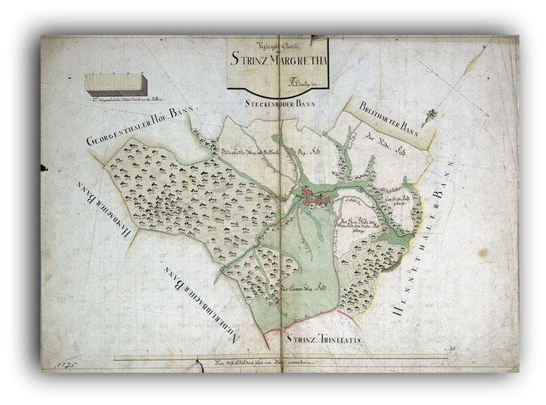
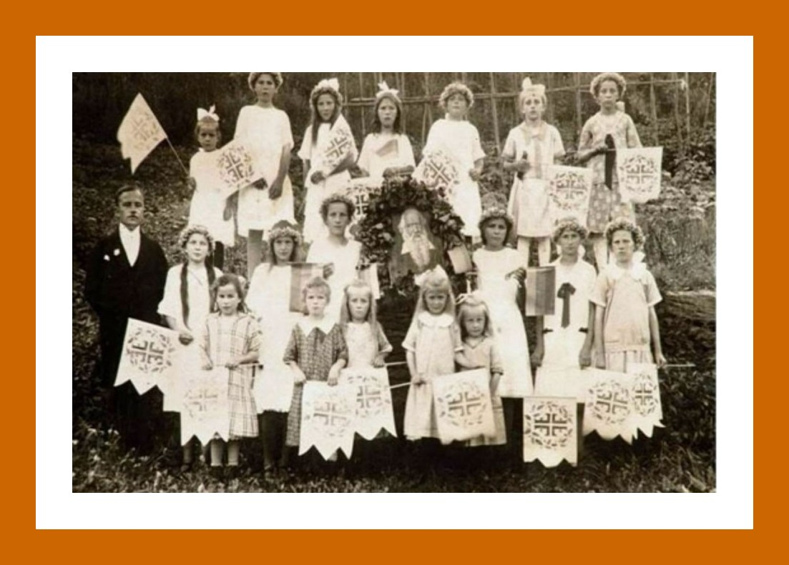
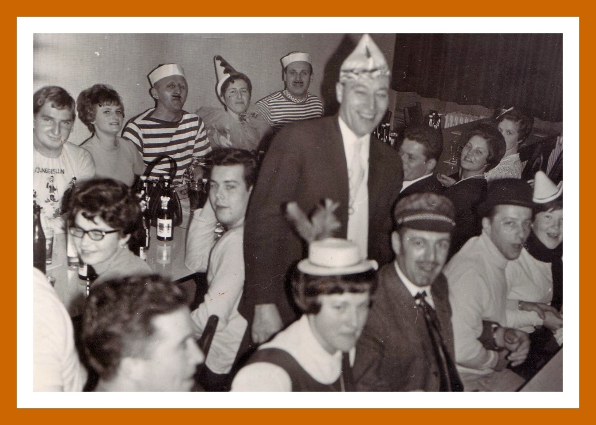
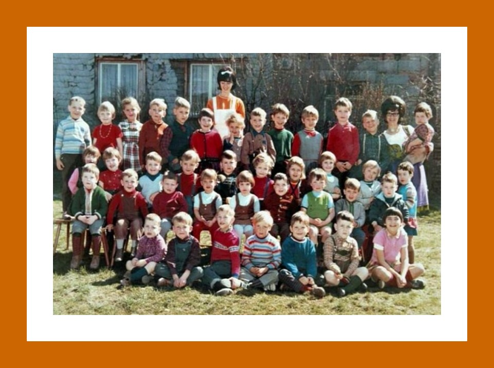
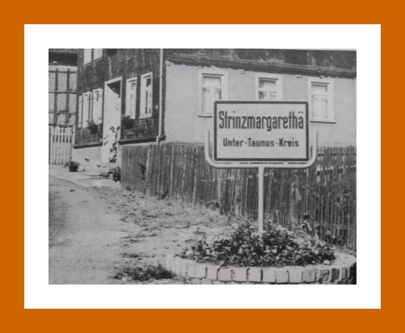
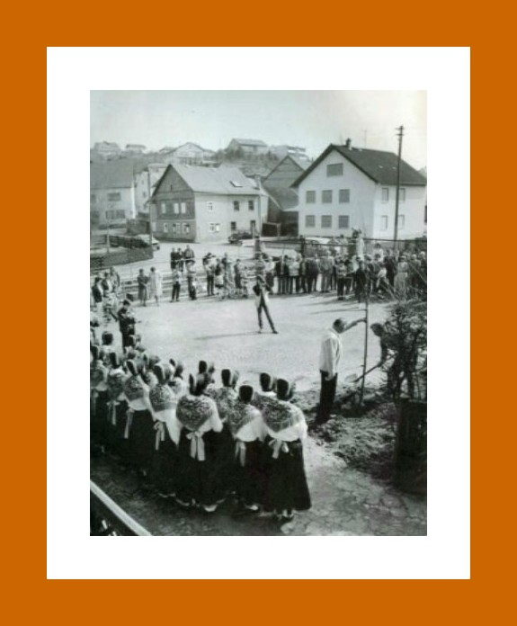
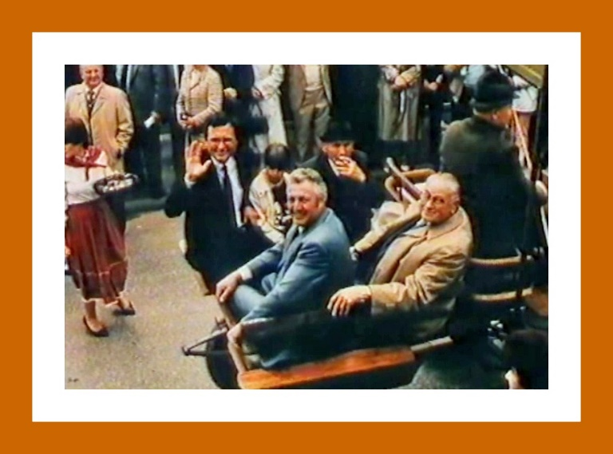
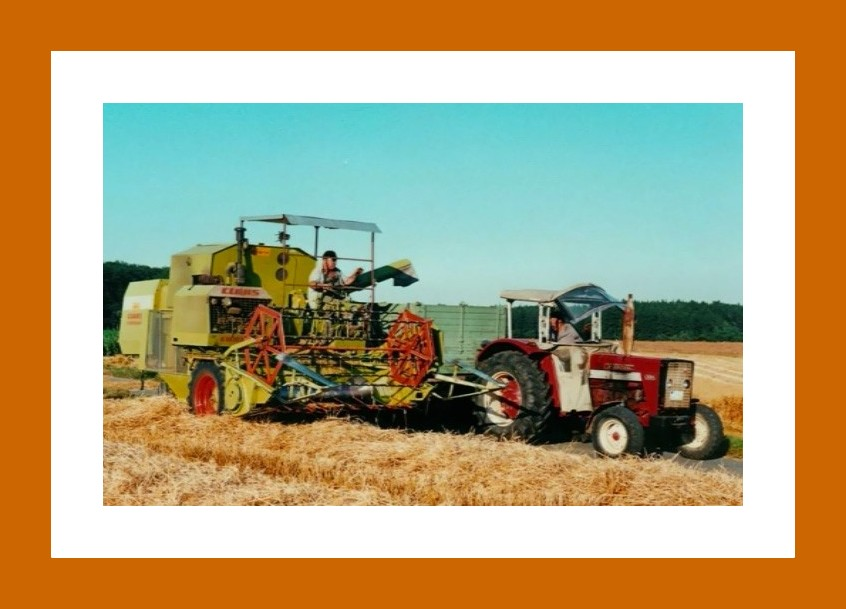
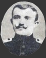
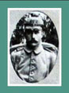

# Verwaltung und Politik

## Im Strinzer Wappen wird deshalb ein Drachen gezeigt.

Auf dem Weg zur Hinrichtung betete sie für ihre Verfolger, diejenigen, die sich in Zukunft an sie wenden würden, vor allem aber für Schwangere und Gebärende.

---

## Wappen und Siegel

---

## Gemeinde

---

## Streitigkeiten in Sachen der Gemeinde Hambach contra die Gemeinde Strinz-Margarethae, die streitige Gemarkung auf dem sogenannten alten Stuhl betreffend.(Quelle: HHStAW 133 Nr. Strinz-Margarethae 21)

---

## Als Ergebnis der Revolution besitzt jeder Bürgersohn der Gemeinde das Bürgerrecht; er muss aber eine Eintrittsgebühr dafür bezahlen. Sie beträgt 10 Gulden. Für einen Inländer, der nicht aus der Gemeinde statt, beträgt das Eintrittsgeld höchstens 60 Gulden, für einen Ausländer (Nicht-Nassauer) höchsten 120 Gulden.

Aus diesem Jahr ist ein Geometer Heinzemann bekannt.(Quelle: Annalen des Vereins für Nassauische Altertumskunde / Band 4 / Seite 283)

Am 23.07.1849 wandert der Strinzer Bürger Johann Jacob Rücker nach Amerika aus. Ziel ist New York City. Er hat fünf Kinder, der Name der Ehepartnerin ist unbekannt. Eingeschifft wird die Familie in Antwerpen.(Quelle: Die Auswanderung aus dem Herzogtum Nassau 1806 - 1866)

---

## In meinem Verhältnis zum Kirchspiel u. zu den einzelnen Gemeindegliedern änderte der Prozeß nichts. Ich machte kein Aufheben von der Sache und vermied, wie ich auch in anderen Fällen u. Beziehungen gewohnt bin, jede Diskussion. Bei der Instruction des Prozesses stellte ich sogleich die Sache auf die Spitze u. bezeichnete als die gründliche Meinung u. Endabsicht des Gemeinderathes (woran nicht zu zweifeln), das Pfarrbesoldungsholz in seine Hand zu nehmen u. nach seiner Auswahl u. Bestimmung an den Pfarrer gegen Entrichtung des Hauerlohns zu überweisen, und zwar eventuell Holz von solcher Qualität, dessen Werth etwa die Kosten des Hauer- und Fuhrlohnes compensire. Hiernach ließ sich das Risiko der Pfarrei bemessen. Langsamer Gang des Prozesses. Im November war der Gemeinderath genöthigt, daß mir überwiesene u. während des Jahres im Wald sitzen gebliebene Holz für Rechnung der Gemeinde zu verkaufen. Am 28. Dec. war die erste Zeugenabhör: der Gemeinderath ließ die von ihm aufgerufenen Zeugen zum ewigen Gedächtnis vernehmen. Ich selbst hielt den Termin für meinen Sachwalter (Dr. Großmann in Wiesbaden) ab.

Während des Jahres wurden mehrere Predigerconferenzen im hiesigen Pfarrhaus abgehalten. Der Verlauf in Witterung u. Erträgnisse = ein gewöhnliches.

---

## Nach einem langen und sehr schweren Krankenlager stirbt der Bürgermeister Heinrich Meyer, neuer Bürgermeister wird August Schmidt.(Quelle: Alte Strinzer Chronik, Teil 1, Seite 115)

---

## Die Gemeinden werden aufgefordert, bei den Aufschriften auf Ortstafeln und Wegweisern möglichst wenig fremde Sprachen zu verwenden. Bei Neuaufstellung von Ortsschildern oder Ersatz von alten, schadhaften ist die deutsche Sprache anzuwenden, falls nicht eine ganz besondere militärische Anforderung vorliegen sollte.(Quelle: Archiv der Gemeinde Hohenstein)

August Gräter übernimmt die Vereinsführung des TV 1904.(Quelle: Festschrift zur Sportplatzeinweihung 1990)

Pfarrer Schilp meldet dem Nassauischen Verein für Naturkunde das Vorkommen einer Schleiereule (Strix flammea L.) in Strinz-Margarethä .(Quelle: Jahrbücher des nassauischen Vereins für Naturkunde, J. F. Bergmann 1922)

---

## Beginn von größeren Umlegungsmaßnahmen, damit landwirtschaftliche Maschinen besser und rationeller eingesetzt werden können. Vor der Umlegung waren die Felder und Wiesen sehr klein. Die Umlegung hat auch zur Folge, dass das Feldwegenetz verändert oder verbessert wird. Die Umlegungsmaßnahmen kosten 170.000,- DM von denen die Gemeinde 130.000 DM trägt. Bei der Umlegung wird schon auf den Wiesen am Aubach ein künftiger Sportplatz vorgesehen.

Willi Hankammer übernimmt den Vorsitz des TV 1904.(Quelle: Festschrift zur Sportplatzeinweihung 1990)

---

## Aufgrund des Erfolges beim Dorfverschönerungswettbewerbes veranlasst der Kreisbauernverband seine alljährliche Erntedankfeier in StM. Nach einem Festzug der Untertaunusjugend durch die Dorfstraßen halten der Landrat, der Bürgermeister und Vertreter des Bauernverbandes Ansprachen. Ein gemütliches Beisammensein schließt sich an.(Quelle: Alte Strinzer Chronik)

Der Dirigent des MGV "Eintracht" Rolf Wilberg muss wegen Arbeitsüberlastung sein Amt niederlegen. Als neuen Dirigent gelingt es dem Verein den Chordirektor Franz Schlaud aus Kelkheim zu gewinnen. Der langjährige Vorsitzende Adolf Christmann I. gibt sein Amt aus Altersgründen ab. Zum 1. Vorsitzenden wird daraufhin der Landwirt Emil Heiler gewählt.(Quelle: Festschrift 100 Jahre MGV Eintracht 1891 / 1991)

---

## Da die Probebohrungen zur Wasserversorgung von StM im Vorjahr erfolglos verliefen, beschließt man, nun doch am Steckenröter Weg zu bohren und man wird fündig! Die (unnötigen) Probebohrungen und die Hauptbohrung verschlingen einen Betrag von 165.000,- DM. Dafür nimmt die Gemeinde ein Darlehen von 30.0000,- DM auf. Das Land Hessen steuert 135.000,- DM bei.(Quelle: Alte Strinzer Chronik)

Es findet eine Neueinkleidung der Freiwillige Feuerwehr StM statt.(Quelle: Rundschreiben von StM Nr. 12/69)

---

## Strinzer Wappen    Fasching

---

## Ein neues Raumordnungsverfahren sieht vor, dass die neue Gemeinde Hohenstein schon wieder aufgelöst wird und u.a. StM nach Taunusstein eingemeindet wird. Mit dem Hinweis, dass es sich dabei nur um eine Vorstudie handelte, wird dieses Vorhaben nicht umgesetzt.

Ortseingang von Breithard aus kommend Pflanzung Linde   Der Kriegsgefangen kehrt zurück (vorne rechts)

---

## Verschwisterung mit der französischen Gemeinde Aube (Normandie). 100 Besucher aus Aube/Normandie besuchen Strinz-Margarethä. Zu dem offiziellen Programm dieses Besuches gehört eine gemeinsame Ausflugfahrt auf dem Rhein, das Pflanzen eines normannischen Apfelbaums in den Bornwiesen und vor allem die Verschwisterungszeremonie in der Kirche. Den geselligen Abschluss findet die Veranstaltung mit dem Waldfest, das ganz unter dem Zeichen deutsch-französischer Freundschaft abgehalten wird.

Für seine langjährige und verdiente Tätigkeit wird der beliebte ehemalige Bürgermeister von Strinz, Wilhelm Guckes, zum Ehrenbürger von Hohenstein ernannt.

---

## Zum Abschluss der diesjährigen Seniorenwoche der Gemeinde Hohenstein versammelten sich die älteren Mitbürger in der Aubachhalle von StM, wo bei Kaffee und Kuchen ein schwungvolles Programm geboten wurde, ganz im Sinne des Mottos "Aktivität kennt kein Alter".

Ihr 25jähriges Bestehen feiern die Landfrauen von StM mit vielen Freunden und Gästen in der Aubachhalle. Ein buntes Programm und eine Kaffeetafel bildeten die Umrahmung der Geburtstagsfeier.

Nachdem Gisela Diefenbach 24 Jahre lang den Singkreis geleitet hat übergibt sie den Staffelstab an Marion Marchand.

---

## Feierliche Wiedereröffnung der Strinzer Kirche nach 6monatiger Renovierung, die insgesamt 300.000,- DM kostete.(Quelle: Archiv der Gemeinde Hohenstein)

---

## Der Obst- und Gartenbauverein lässt eine alte Tradition wiederaufleben. Nach der mühsamen Instandsetzung einer Obstkelter können Interessierte jetzt eigene Äpfel und Birnen zu Saft und Wein verarbeiten. Zur Einweihung gibt es an der Aubachhalle ein gemütliches Kelterfest.(Quelle: Archiv der Gemeinde Hohenstein)

---

## Aufgrund des oben dargestellten Aufrufes, wurde nachfolgender Befreiungsantrag an die Gemeinde gerichtet:

-----------------------------------------------------------------------------------------------------------------------------------

---

## Gesang und Turnverein bringen Leben in die Gemeinde

Nach Gründung des Gesangvereins (1891) und des Turnvereineins (1904) entstand ein reges Vereinsleben. Jetzt konnten sich die jungen Leute körperlich ertüchtigen, ihre Leistungen mit anderen Turnvereinen messen und an Sängerwettstreiten teilnehmen.

---

## Der letzte Bürgermeister von StM, Wilhelm Guckes.

Von jeher galt es als besondere Ehre und Auszeichnung, zum Bürgermeister (früher Schultheiß oder Scholles genannt) gewählt zu werden. Bis zu Eingemeindung 1972 war es in unserem Dörfchen ein Ehrenamt. Es brachte dem Bürgermeister zwar viel Arbeit ein; dagegen keinen materiellen Vorteil für seine verantwortungsvolle Tätigkeit.

Wenn früher ein neuer Bürgermeister gewählt worden war, wurde ihm ein mit Kranz und Bändern geschmückter Tannenbaum vor das Haus gestellt. Der Gesangsverein brachte ihm ein Ständchen und der Bürgermeister hielt eine Ansprache an die Dorfbevölkerung. Dann ging es in die Wirtschaft und man trank Freibier auf Kosten des Bürgermeisters.

Das letzte Mal ist dieser Brauch bei der Wahl des Bürgermeisters Kadesch im Jahr 1919 ausgeübt worden.

---

## Diese Vorsicht bekommt der Gemeinde sehr übel. Der Oberst, der als ein Mann mit einem langen, weißen Bart und dem Regimentsstab beschrieben wird, schreit mit lauter Stimme den Soldaten zu: "Schießt drauf, gebt Feuer auf die Bauern." Zugleich stürzen mehrere tod zur Erde nieder und andere krümmen sich in ihrem Blut. Ein Ortsbewohner eilt, um die Aufgeregten zu besänftigen, mit einem Leibbrod in der Hand herbei, aber derselbe wird sogleich Tod da niedergestreckt. Nun wird Breithardt ganz ausgeplündert, zwölf schöne Pferde und 120 Stück Schafe aus den Ställen weggetrieben. Unterdessen sind Bürger aus den Nachbargemeinden, u.a. aus Strinz-Margarethä, mit Schießgewehr hinlänglich versehen, herbeigeeilt, um den bedrängten Nachbarn beizustehen. Aber leider kommen sie zu spät, indem schon alles ausgeleert ist. Kaum aber hat die räuberische Horde die herannahenden Mannschaften zu Gesicht bekommen, machen sie sich eilends auf und davon.

(Quelle: Die Drangsale des Nassauischen Volkes und die angrenzenden Nachbarländer in den Zeiten des dreißigjährigen Krieges, seine Helden, Staatsmänner und andere berühmte Zeitgenossen)

---

## Am 20. September werden von der hiesigen Gemeinde, die Glocken in den Turm gehängt. Ob es sich dabei um die oben genannte Glocke gehandelt hat, ist nicht überliefert.

Am 25. Oktober wird von den Schieferdeckern (Dachdecker) Roos u. Rübfarm aus Idstein und mehreren "Consorten" das Dach gedeckt und der Strauß (Richtkranz) aufgestarkt.

Die Schlosser Klein und Eunl (Name schwer zu lesen) aus Idstein haben die Schlosserarbeiten durchgeführt und "das sehr schlecht".

---

## Reinhard Wahl

und Ursache unbekannt), den Verlust seiner Brüder und der Tatsache, dass seine Schwester in Görsroth lebte, war Karl vereinsamt, was ihn wohl dazu bewegte, diesen Schritt zu gehen.

Somit war die ganze Familie Wahl in StM ausgestorben. Das Eckhaus der Familie wurde verkauft. Man sprach noch lange vom "Wahleck".

---

## Nach Ansicht der evangelischen Landeskirche war die Plastik nicht besonders wertvoll. Sie sei mehr eine handwerksmäßige Arbeit und nur noch für ein Museum interessant. Sie gab daraufhin der Gemeinde die Erlaubnis, diese Plastik an das Nass. Landesmuseum für 100 RM (Museumsgebot) zu verkaufen.

Die Genehmigung stammt von Ende Dezember 1936, die Plastik wurde aber erst im September 1937 in den Bestand des Museums aufgenommen.

Anfang des Jahres hielt ich eine Anfrage beim Landesmuseum in Wiesbaden, ob sich diese Statur in deren Besitz befände und erhielt die obigen "Koordinaten" als Bestätigung dafür.

---

## Die Fallensteller waren oft Buben im Alter von 10 – 14 Jahren. Diese haben in den Fangmonaten April bis August täglich die Fallen geleert und die Beute bei einem von der Gemeinde beauftragten Bauern abgeliefert, der die jeweilige Anzahl in eine Liste eintragen musste.

---

## Es war damals die Aufgabe der Gemeinde Feld, Wald und Flur in Ordnung und funktionsfähig zu erhalten, dazu gehörte das ordentliche Unterhalten der Feld- und Waldwege, der Grenzmarkierungen, der Bachläufe, der Entwässerungsgräben der Wiesen, die Einstellung eines “Feldschütz” und vieles mehr, so auch die Bekämpfung der Maulwurfsplage.

Heute existiert noch eine Maulwurf-Fangliste aus dem Jahre 1937. Diese belegt, dass in diesem Jahr 1.402 Maulwürfe hier in StM gefangen wurden. Rekordhalter war die Familie Egert mit 206 gefangenen Maulwürfen was zu einer Fangprämie von 41 RM und 20 Pfennig führte.

---

## Schulleiter Witt dankte im Namen der Lehrerschaft und der Kinder der Gemeinde und dem ganzen Dorf für die neue Schule.

Die Feierstunde wurde würdig umrahmt von Liedervorträgen des örtlichen Gesangsvereines und des Schülerchors, sowie durch Sprechchöre und eine Volkstanzeinlage der Schülerinnengruppe.

---

## (Quelle: Programm zur Glockenweihe / Archiv der Gemeinde Hohenstein)

---

## Da er in Gemeindeunterlagen als Kriegsheimkehrer geführt wird ist davon auszugehen, dass er später doch noch eingezogen wurde. Quelle: Gemeinde / Kirchenchronik

Brech,  Julius    Julius Brech diente im Kaiser Alexander Garde Infanterie Regiment und wurde bereits im 1. Kriegsjahr verwundet. Er erlag im Reserve Lazarett Göttingen seinen Verletzungen. Quelle: Armee-Verordnungsblatt / Ausgabe 867 / Verlustliste vom 28. Januar 1916)

Christmann, Adolf   Adolf Christmann diente in der 5. Kompanie des Reserve-Infanterie-Regiment Nr. 80 im Range eines Musketiers.

---

## Corelius, Adolf Adolf Corelius hat den Krieg überlebt. Quelle: Gemeinde

Deuser, Adolf Adolf Deuser wurde durch einen Unfall schwer verletzt und starb am 25.06.2017. Quelle: Deutsche Verlustlisten / B 380 / 16.04.1918

Der von hier gebürtige Schlosser Adolf Deuser z. Zt. wohnhaft gewesen mit seiner Familie in Wiesbaden, ist in der letzten Woche leider durch einen Unfall beim Heere um sein Leben gekommen. Er war von der Stadt aus reklamiert und wäre also in nächster Zeit zurückgekommen.

---

## Deuser, K. K. Deuser überlebte den Krieg Quelle: Gemeinde

Deuser, Richard Richard Deuser wurde am 15.06.18 als schwer verwundet gemeldet. Quelle: Deutsche Verlustlisten / 1165 / 15.06.18

---

## Diefenbach, Adolf Adolf Diefenbach überlebte den Krieg. Quelle: Gemeinde

Diefenbach, Emil Der am 24.12.1894 geborene Unteroffizier Emil Diefenbach wurde * leicht verletzt / **leicht verwundet  / ***schwer verletzt, Quelle:

* Deutsche Verlustlisten / Nr. 569 / 01.06.16 ** Deutsche Verlustlisten / Nr. 807 / 13.04.17 *** Deutsche Verlustlisten / Nr. 1251 / 25.09.18

---

## Egert, August August Egert überlebte den Krieg. Quelle: Gemeinde

Egert, Karl Karl Egert wurde am 30.10.1917 leicht verwundet gemeldet. Quelle: Deutsche Verlustlisten / Nr. 976 / 30.10.17

---

## Funk, H. H. Funk überlebte den Krieg. Quelle: Gemeinde

Grulke, Max Der Landsturmmann Max Grulke wurde am 11.05.1915 als schwer verwundet gemeldet. Quelle: Deutsche Verlustlisten / Pr 221 / 11.05.15

---

## Hankammer, Reinhardt I Reinhardt Hankammer überlebte den Krieg. Quelle: Gemeinde

---

## Hankammer, Wilhelm Ludwig Wilhelm Ludwig Hankammer überlebte den Krieg. Quelle: Gemeinde

Hanappa, Gustav Der Ersatz-Reservist Gustav Hanappa wurde am 13.04.15 als verwundet gemeldet. Quelle: Deutsche Verlustlisten / Pr 199 / 13.04.15

---

## Herdling, Reinhardt Reinhardt Herdling hat den Krieg überlebt. Quelle: Gemeinde

Herdling, Wilhelm Wilhelm Herdling fiel schon im ersten Kriegsjahr. Quelle: Deutsche Verlustlisten / Pr 266 / 05.07.15

---

## Hies, Karl Karl Hies überlebte den Krieg. Quelle: Gemeinde

Hieß, Ludwig Der am 22.10.1871 geborene Ludwig Hieß wurde im Jahre 1917 zuerst * vermisst  und später  ** bisher vermisst /in Gefangenschaft gemeldet. Quelle: * Deutsche Verlustlisten Pr 822 / 01.05.17    **Deutsche Verlustlisten / Pr 927 / 03.09.17

---

## Kadesch, Emil Emil Kadesch überlebte den Krieg. Quelle: Gemeinde

Kadesch, Karl Karl Kadesch diente in der 6. Batterie der Leichten Munitionskolonne des Feldartillerieregiments Nr. 27 und wurde durch einen Unfall tödlich verletzt. Quelle: Deutsche Verlustlisten / Pr 5277 / 11.05.16

---

## Quelle: Deutsche Verlustlisten / Pr 907 / 10.08.17 + Gemeinde

Plank (Plant), Adolf Adolf Plank diente in der 12. Kompanie des Infanterieregiments Nr. 171. Er wurde zuerst als vermisst* gemeldet, später als bisher vermisst, in Gefangenschaft** (A. N.). Quelle: *Deutsche Verlustlisten / Pr 376 / 10.11.15 **Deutsche Verlustlisten / Pr 522 / 05.05.16

---

## Poths, Karl Karl Poths überlebte den Krieg. Quelle: Gemeinde

Rochillon, Matthias Matthias Rochillon diente in der 11. Kompanie des Infanterieregiments Nr. 148. Er wurde im  2. Kriegsjahr schwer verwundet. Quelle: Deutsche Verlustlisten / Pr 298 / 11.08.15

---

## Schäfer Wilhelm Wilhelm Schäfer überlebte den Krieg. Quelle: Gemeinde

Schauss, Karl Karl Schauss wurde im Jahre 1918 als vermisst gemeldet. Ob er den Krieg überlebte ist nicht überliefert. Quelle: Deutsche Verlustlisten / 2204 / 09.11.18

Schilp, Ernst Bei Ernst Schilp handelte es sich um den Sohn des Ortspfarrers. Er diente in der 10. Kompanie des 3. Bataillons des Reserve Infanterie Regiment Nr. 257 im Range eines Leutnants. Er wurde zuerst im Jahre 1915 als vermisst gemeldet*, später stellte sich heraus, dass er sich in russischer Gefangenschaft** befindet.

---

## Schleif, Kurt Kurt Schleif überlebte den Krieg. Quelle: Gemeinde

Schmidt, Wilhelm Wilhelm Schmidt diente in der 6. Kompanie des Reserve Infanterie Regiment Nr. 81. Er wurde im Krieg leicht verletzt. Quelle: Deutsche Verlustlisten / Pr 334 / 22.09.15

---

## Seel, Adolf Adolf Seel überlebte den Krieg. Quelle: Gemeinde

Severin, Wilhelm Der Vizewachtmeister Wilhelm Severin wurde 1917 als schwer verwundet gemeldet.            Quelle: Deutsche Verlustlisten / Pr 999 / 27.11.17

---

## Wagner, August August Wagner überlebte den Krieg. Quelle: Gemeinde

Wahl, August August Wahl wurde am 09.11.1918 als leicht verletzt gemeldet. Quelle: Deutsche Verlustlisten / Pr 1290 / 09.11.18

---

## Wittlich, Karl Karl Wittlich überlebte den Krieg. Quelle: Gemeinde

Ziß, August Der Wehrmann August Ziß diente in der 10. Kompanie des Reserve Infanterie Regiment 218 in Minden.         Er wurde als * bisher vermisst, in Gefangenschaft / ** aus Gefangenschaft zurück / als *** gefallen gemeldet.

Quelle:* Armeeverordnungsblatt Nr. 336 / 22.01.15  **Deutsche Verlustenlisten / Pr 183 / 25.03.15  ***Deutsche Verlustenlisten / Pr 1237 / 09.09.18

Ziß, August August Ziß diente in der 6. Kompanie einer nicht weiter bekannten Einheit. Er wurde am 27.11.2016 als gefallen gemeldet. Quelle: Deutsche Verlustenlisten / Pr 695 / 27.11.16

---

## Nach dem Krieg war die Gemeinde für den Bunker verantwortlich. Später übernahm der Bund die Zuständigkeit.

Nachdem in den 90ern Luftschutzbunker in der Eifel einstürzten, wurde beschlossen sämtliche Bunker zuzuschütten, so auch den Strinzer Bunker. Durch die Fluchtausgänge wurde der Bunker mit Beton verfüllt. Die Zuschüttung erfolgte aber nicht bis zur Bunkerdecke, damit Fledermäuse das Relikt aus dunkler Zeit als Zufluchtsort nutzen können.

---

## Es sollen einigen angesehenen Männern der Gemeinde weiße Armbinden mit der Aufschrift "Police" anlegen und nachts Wache halten. Dann fährt er sie mit seinem Auto nach StM zurück.

Da die Unterhaltung in Gegenwart von Soldaten stattgefunden hatte, bekommen diese sofort Kenntnis von der Beschwerde.

Die erste Wache wird von Maurermeister Gräter und Rektor Weißer durchgeführt, natürlich ohne Waffen. Später von anderen Dorfbewohnern. In Gegensatz zu anderen Dörfern werden die Bewohner von StM danach nicht weiter belästigt.

---

## „Heute Mittag werden die Süßwaren und Weihnachtskränze bei August Wahl ausgegeben“

„Sonntagmorgen um 10 Uhr kommt ein Photograph beim Gastwirt August Schneider. Wer Passbilder oder sonstige Photographien benötigt, kann sich bei August Schneider anmelden.“

„Wer von den Neubürgern am Samstag mit nach Schwalbach auf die Versammlung will, soll sich auf der Bürgermeisterei anmelden.“

---

## „Es ist eine Bubenjacke gefunden worden. Kann beim Bürgermeister abgeholt werden.“

„Am Sonntag findet in Michelbach das Jahresfest der Frauenhilfe statt. Abfahrt im Auto von hier um 9 Uhr.“

„Alle entlassenen Kriegsgefangenen der Neubürger welche noch keinen Antrag auf Aussiedlung gestellt haben, sollen sich am Freitagabend auf der Bürgermeisterei melden.“

„Wer denkt, dass er mit seinem Brennholz nicht auskommt, soll heute Abend um 9 Uhr auf die Bürgermeisterei kommen.“

---

## Antragsteller, die etwas kaufen wollten, hatten dafür die Hälfte der vorzulegenden Punkte vorzulegen. Die übrigen Punkte wurden aus dem Punktebestand der Gemeinde entnommen. Zu Anschaffung von Kindermäntel allerdings, durfte die Gemeinde nur 35 Punkte zusteuern.

Die verwendeten Spinnstoffpunkte wurden auf die Rückseite einer Bezugsanweisung geklebt und waren damit entwertet.

---

## Wenn durch die vorbeschriebenen Ausgaben der Punktebestand erschöpft war, musste die Gemeinde bei der Regierung in Bad Schwalbach Meldung machen. Die Gemeinde wurde dann mit neuen Punkten versorgt.

---

## Noch vor seinem Tot war Hankammer draußen auf dem Feld. Weil er keine Schafe mehr zu hüten hatte, übernahm er es, Straßen und Plätze in der Gemeinde sauber zu halten.

Mit seiner treuen Gattin, mit der er im Jahre 1964 goldene Hochzeit feiern konnte, zeugte er drei Töchter, die ihm wiederum elf Enkel und neun Urenkel bescherten.

---

