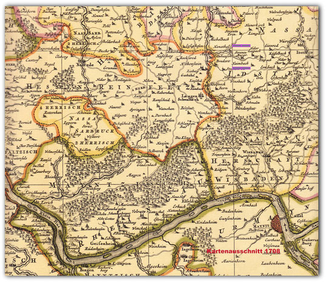
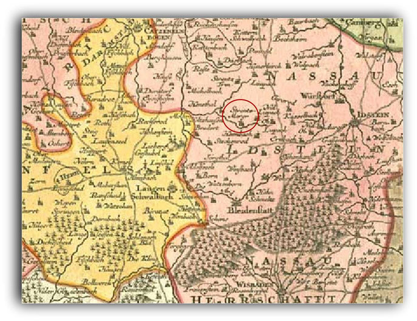
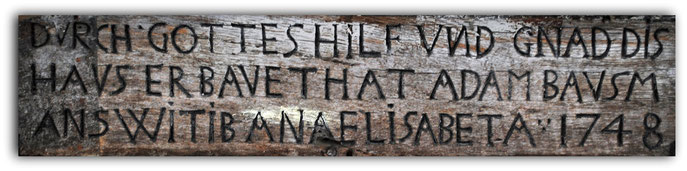
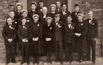
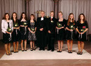
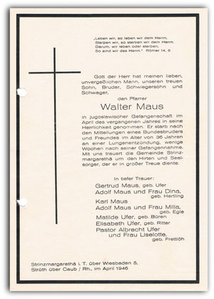

# Kirche und Religion

## Das Kloster Bleidenstadt wird aufgelöst und in ein adliges Ritterstift umgewandelt. Das Ritterstift behält allerdings das Recht, Abgaben zu erheben und den jeweiligen Pfarrer des Kirchspiels zu ernennen. Dies ist als ein Kuriosum anzusehen, besonders nachdem das Kirchspiel mit seinen Orten evangelisch geworden ist. Nach wie vor aber gehören die Unterhaltungsmaßnahmen an den Kirchen und am Pfarrhaus zu den Pflichten des katholischen Stifts. Nur widerwillig kam es seinen Verpflichtungen nach.

Die Rödel zu Reifenberg haben in StM ein Lehen von Nassau Idstein.(Quelle: H. Gensicke; Die Rödel von Reifenberg / Nass. Analen, Bd. 96, 1985, S. 240)

---

## Ein Sohn von Pfarrer Neumann verstirbt kurz vor seiner Hochzeit an Fleckfieber.(Quelle: Alte Strinzer Chronik, Band 1, Seite 52) (Siehe auch unter: Das Leid des Pfarrer Neumann)

Tausch der Stiftzehnten zu Idstein, Wörsdorf und Wallrabenstein gegen die fürstlich nassauischen Zehnten zu Born, Adolfseck, Steckenroth, Strinz-Margarethae und Holzhausen(Quelle: HHStAW 14 Nr. 689)

---

## Pfarrer: Johannes Neumann

---

## Pfarrer: Johannes Kaspar Becker

Schultheiß Johann Peter Enders wird im Jahre 1730 und 1750 als herrschaftlicher Schultheiß und Gerichtsmann von StM erwähnt. Er ist Bauer und besitzt 2 Häuser, 2 Scheunen und 2 Ställe in StM.

---

## Die Kirche zahlt dem Schulmeister 10 Albus Jahreslohn wegen der Schlagung (Red.: Spielen) der Orgel.(Quelle. HStA: W133, R3188, StM Kirchenrechnungen)

Der Dechant Wildericus Marsilius Freiherr von Hoheneck und das Kapitel des S. Ferrutius Stiftes zu Bleidenstadt belehnen den Grafen Carl August von Nassau zugleich für die Fürsten und Grafen von Nassau etc. Carl den Älteren und Wilhelm Heinrich den Jüngeren mit den vom Stift zu Lehen rührenden zwei Vogteien zu Würges und Kirberg und den vier Dörfern Strinz-Margarethae, den beiden Libbach und Hambach.(Quelle: HHStAW 131 Nr. U 424)

---

## Die Kirche bezahlt die Rechnung des Orgelmeisters Cristian Kötzler aus Frankfurt für die Stimmung der Orgel.(Quelle: HStA: W133, R3188, StM Kirchenrechnungen)

---

## Pfarrer: Johann Peter Freyberger

---

## Die Kirche bezahlt den Schulmeister Daniel Bachmann.(Quelle: HStA: W 133, R 3188 / Kirchenrechnungen)

Berufung des Theologiekandidaten Freyberger aus Strinz-Margarethä zum Vikar in Dörsdorf(Quelle: HHStAW 142 Nr. 110)

---

## Die Kirche bezahlt den Schulmeister Daniel Bachmann.(Quelle: HStA: W 133, R 3188 / Kirchenrechnungen)

Der Dechant Johann Franz Freiherr von Hoheneck und das Kapitel des S. Ferrutius Stiftes zu Bleidenstadt belehnen den Fürsten Carl (Christian) von Nassau (Weilburg) zugleich für die Fürsten Wilhelm Heinrich und Carl von Nassau etc. mit den zwei Vogteien zu Würges und Kirberg sowie mit den vier Dörfern Strinz-Margarethae, den beiden Libbach und Hambach.(Quelle: HHStAW 131 Nr. U 437)

---

## Auf dem Schulspeicher wird ein handgeschriebener Brief von Lehrer Joch gefunden: Inhalt:"Schul=Guth zu Strintz-Margaretha, Verzeichnis dessen, so in der Strintz-Margarethaer Gemarkung liegend, wie folgt gemessen und beschrieben worden".Darin heißt es zum Schluss:Gott helff und segen allen rechtschaffenen Schul=Lehrerdie dieses in Zukunft besitzen werden.(Quelle: Alte Strinzer Chronik, Teil 1, Seite 112)

Das Ritterstift, dass die Nachfolge des Kloster Bleidenstadts antrat, gibt das Pfaffengut in Pacht an Joh. Phil. Faust und dessen Erben.In dem Pachtvertrag heißt es unter anderem: "Er (gemeint ist der Pächter Faust) muss auf dem sog. Ochsengut (Pfaffengut) nicht nur das gewöhnliche Faselvieh auf seine Kosten stellen und unterhalten, sondern annebst unserem Ritterstift alljährlich Michaelis (29. Sept.) nach Bleidenstadt 3 Malter (1 Malter = 128 Liter) Korn und 6 Malter Haber (Hafer) guter und sauberer Frucht entrichten.

---

## Pfarrer: Johann Gottfried Wex / Schultheiß: Joh. Enders / Lehrer: Philipp Ferdinand Sauer

---

## Fürst Wilhelm von Nassau ratifiziert die Aufteilung der 207 Morgen Viehweide (Breiteloh) zwischen den anliegenden Gemeinden an. Auf Strinz entfielen 27 Morgen. Grund war, dass sich die Gemeinden nicht um die gemeinsam genutzten Viehweiden kümmerten. Mangels Pflege war z.B. der Weidebrunnen verfallen.(Quellen: Kleine Chronik des Ortes Hohenstein-Breithardt / Pfarrer WeinbergerHessisches Staatsarchiv, Abt. 133/649)

Gottfried Eberhard Freyberger, Sohn des ehemaligen Strinzer Pfarrers Freyberger , geboren am 21. April 1764 entfernt sich im Jahre 1790 von seiner Heimat, ohne seitdem von seinem Leben oder von seinem Aufenthalt irgend eine Nachricht zu geben(Siehe auch unter: Pfarrerssohn verschwindet spurlos)

---

## Die Haltung und die Gewohnheiten von Pfarrer Snell, der als lediger Mann in einem gesetzten Alter nach StM kam waren während seiner Amtszeit keineswegs zuträglich; zuletzt trat in mehrfacher Rücksicht ein übler Zustand ein. Snell, der einer berühmten Familie angehörig und anfangs selbst Schriftsteller war, war der Stelle des Pfarrers nicht gewachsen und war einer der Charaktere wie sie in der damaligen Zeit nicht selten vorkommt (rationalistische Behaglichkeit, Indifferenz und Frivolität, neben der noch fortbestehenden altkirchlichen  Lebensordnung).(Quelle: Alte Strinzer Chronik, Teil 1, Seite 130)

In der Frankfurter Ober-Post-Amtszeitung wird neben weiteren 6 Constributionspflichtigen (Steuerpflichtigen) auch der Strinzer Philipp Peter Enders aufgefordert, sich zur Erfüllung seiner Militärpflichtigkeit binnen 4 Wochen a dato so gewiss im Herzoglich Nassauischen Oberamt Idstein einzufinden, als er im Ausbleibungsfalle nach der Vorschrift der Gesetze behandelt, in Betretungsfalle an das Militär abgegeben und seines Unterthanenrechts und Vermögens verlustig erklärt werden soll.(Quelle: Frankfurter Ober-Post-Amtszeitung, 1814)

---

## Ungewöhnliche Witterung: rauh und kalt bis zu den ersten Tagen des May, darauf plötzliche und anhaltende Wärme und volle Vegetation, so dass der gewöhnliche Übergang der Frühlingszeit ausfiel. Große Hitze und Dürre während des Sommers u. bis ins Spätjahr. Commission wegen Anlage des neuen Kirchhofs (Begräbnisplatzes); mein vergeblicher Protest gegen den Platz wegen der Entfernung von der Kirche. Widerspenstigkeit des Schullehrers Friedrich und Weigerung desselben bei den Leichen zu singen. Meine Collision mit den Behörden wegen dieses Falles. Geringer Ertrag an Sommerfrucht, besonders aber an Futtergewächsen, das Charakteristische der heißen und trockenen Sommer von jetzt an bis Ende der 1830er Jahre.

---

## Pfarrer Schmidtborn hält nach langer Krankheit (16 Wochen) am 07. März erstmalig wieder einen Gottesdienst.(Quelle: Strinzer Chronik, Teil 1, Seite 100)

Der Berginspector Card Ludwig Münster erhält die Schürfrechte für die Zechen Berthazeche und Fritz auf den Gebieten von StM, StT und Hennethal.(Quelle: Amtsblatt der Regierung in Wiesbaden, 1869)(Siehe auch unter: Die Zechen Bertha und Fritz)

---

## Am 23. Juni, morgens früh von 4:30 bis 6:00 Uhr ziehen mehrere Gewitter über die Gemarkung, wobei ein Blitzschlag in die Breithardter Schafsherde fährt, die im Strinzer Feld steht. 23 Schafe werden getötet. (Quelle: Kleine Chronik des Ortes Hohenstein-Breithardt / Pfarrer Weinberger)

Am 13. Juli 1892 kommt es zu einer blutigen Auseinandersetzung der beiden Strinzer Gesangvereine "Eintracht" und "Cecilia". (Quelle: Aarbote vom 15. Juli 1892)(Siehe auch unter: Kampf der Gesangvereine)

---

## Der Strinzer Pfarrer Walter Maus flüchtet sich schon Anfang des Krieges in die Wehrmacht. Pfarrer waren seinerzeit starken Anfeindungen durch die Nationalsozialisten ausgesetzt. Regimekritiker waren in der Wehrmacht einigermaßen sicher.(Quelle: Internetseite der ev. Kirche StM) (Siehe auch unter: Pfarrer flieht in die Wehrmacht)

Der Lehrer Johannes Buse wird nach Bestehen der Prüfung am 1.4. endgültig zum Lehrer in StM ernannt.(Quelle: Hess. Staatsarchiv, Wiesbaden)

Der bisherige Vorsitzende des MGV "Eintracht" Emil Kadesch stellt sich aus persönlichen Gründen nicht mehr zu Wahl. Zum neuen Vorsitzenden wird daraufhin der Landwirt Emil Heiler gewählt.(Quelle: Festschrift 100 Jahre MGV Eintracht 1891 / 1991)

Im Haus der Familie Hartwig in der Pfalzstraße wird eine Unfallhilfe eingerichtet. (Quelle: Helmut Hartwig)

---

## Kircheneinweihung nach erfolgter Renovierung. Die Restaurierung der Kirche und der Orgel dauerte drei Jahre. Während dieser Zeit hielt der Pfarrer den Gottesdienst im Pfarrsaal. Der Dekan Dr. May weihte das verschönerte Gotteshaus wieder ein(Quelle: Alte Strinzer Chronik)

Der Landwirt Wilhelm Guckes wird als Bürgermeister wiedergewählt. Ehrenamtliche Beigeordnete werden August Schneider, Karl Poths und Willi Enders.

Pfarrer Fellner wird nach Wehen versetzt. Die Pfarrstelle ist verwaist. Die Vertretung übernimmt Pfarrer Beyweihs aus Breithardt.

---

## Festgottesdienst zum 150jährigen Bestehen der Strinzer Kirche. Pfarrer Hoppe läd zu einem Festgottesdienst und Gemeindefest ein.(Quelle: Strinzer Chronik)

Abriss der im Eigentum der Raiffeisengenossenschaft befindlichen alten Dreschhalle zur Errichtung eines Gebäudes für das Bankgeschäft.(Quelle: Helmut Hartwig)

---

## Schmidtborn hielt streng auf Kirchenzucht und schickte eine junge Mutter mit drohend erhobenem Stock nach Hause, weil sie den ersten Gang nach ihrer Entbindung ins Dorf machen wollte, statt, wie es sich gehörte, in die Kirche zu gehen.

Im Freien trug er stets einen Zylinder, sogar beim Heumachen. Vor lauter Arbeit fand er keine Zeit zum Heiraten. An kalten Wintertagen zitieren heute noch die Bauern die Worte Schmidtborns:

---

## Zudem wird in der Strinzer Kirche die diamantene und goldene Konfirmation gefeiert.

---

## Bei der Hochzeit wurde am Polterabend Glas und Porzellan vor die Tür geworfen. Scherben bringen Glück. Kam das Paar am Hochzeitstag aus dem Haus und wollte zur Kirche gehen, so sah es den Weg durch Seile versperrt. Wenn dann die Hochzeitsgesellschaft Bonbons und Geldstücke auswarf, gaben die Kinder den Weg frei; das wiederholte sich mehrmals.

Die Hochzeitsfeier spielte sich im Haus der Braut ab oder im Dorfgemeinschaftshaus. Am Hochzeitsabend kamen die Burschen und Mädchen aus dem Dorf vor das Haus, sangen Lieder und gratulierten. Neben Volksliedern hörte man Ehestandslieder. Die jugendlichen Sänger bekamen für ihr Ständchen Kuchen, Wein und oft ein Fässchen Bier gespendet.

---

## "Terminatio eccleasiae sancti Ferrutii in Blidenstadt" (Abgrenzung der Kirche des heiligen Ferrutius in Bleidenstadt).

In dieser Grenzbeschreibung wird zum ersten Mal der Bach Strinzepha genannt und an einer anderen Stelle derselben Urkunde begegnet uns die Wendung "ad Strincephan flumen" (bis an den Strinzer Bach); gemeint ist wahrscheinlich der Aubach von der Michelbacher Hütte bis zur Fischbachmündung in Hennethal.

In dieser wohl gefälschten Bleidenstädter Grenzbeschreibung von 812 kommt der Strinzerbach vor, der aber sonst nirgends erscheint.

---

## ... ferner setzen wir fest, dass alle Besitzungen jeglicher Art und alle Güter, die das Kloster gegenwärtig rechtmäßig und nach kanonischem Recht besitzt oder künftig durch Zugeständnisse der Päpste, durch Schenkungen der Könige und Fürsten, durch Stiftungen der Gläubigen oder auf andere rechtmäßige Weise für Gott erwerben könnte, euch und euren Nachfolgern fest und ohne Beeinträchtigung gehören sollen. Unter diesen Eigengütern nennen wir namentlich: den Ort selbst, an dem das Kloster gelegen ist, mit all seinem Zubehör ferner ... Strentzge (StM), das größere und das kleine …

Etwas ungewöhnlich scheint, dass das Kloster die päpstliche Kanzlei bemühte, seinen Besitz zu bestätigen. Wir kennen den Anlass nicht. Man könnte vermuten. Man könnte vermuten, dass es geschah, um den Ansprüchen weltlicher "Großer" zu begegnen.

Die Grafen zu Nassau waren die Klostervögte. Jedes Kloster hatte einen weltlichen Großen als Vogt, da ein geistliches Gericht keine Bluturteile (Todesurteile) fällen durfte. Auch für militärische Zwecke war der Vogt zuständig. Meist nahmen die Großen einen mächtigen als Vogt, um auch wirkliche geschützt zu sein.

Die Vögte bekamen für ihr Amt Einkünfte aus Klosterbesitz oder auch Land geliehen. Bald hatten die Klöster sehr zu leiden unter den Ansprüchen der Vögte. Es gab immer Streitigkeiten. So ist sicher auch die Urkunde von 1184 als Abwehrwaffe gegen die Klostervögte zu verstehen. Denn die Absicht der Nassauer Grafen ging dahin, sich immer mehr Einkünfte und Land zu verschaffen, um so das Gebiet der Vogtei ganz zu ihrem Hausbesitz zählen und in ihm ihre Landeshoheit ausbilden zu können.

Die Urkunde aus dem Jahre 1184, in der StM erstmalig genannt wird, zeigt, dass das Kloster Bleidenstadt, das um 780 gegründet worden war, der Grundherr des Strinzer Grundes war, der wohl früher fränkisches Königsgut war, dann aber wie viel Reichs- und Krongut, das damals noch nicht unterschieden wurde, durch Schenkung in kirchlichen Besitz überging. Auf Königsgut kann die noch heute in Oberlibbach existierende Flurbezeichnung "Königshof" hindeuten.

Ein dem König gehörender Hof verwaltet einen Teil des Königsgutes selbst, das andere Land war ausgegeben an Hintersassen in freien Höfen oder zinspflichtigen Höfen, sogenannte Zinser; die Hintersassen konnten persönlich frei sein.

(Quelle: Evangelischer Heimatbote für das Dekanat Bad Schwalbach / Dezember 1954 / Nummer 11 / Horst Neumann, stud. theol.)

---

## Wer sich heimlich verlobt und unzüchtig lebt, darf nicht mit dem Kranz zur Kirche gehen.

(Es existieren zwei Erklärungen zum Kranz: Eine nicht mehr jungfräuliche Braut, die Strohjungfer, musste nach altem Brauch bei der Hochzeit einen Strohkranz tragen. Die unbescholtene Braut durfte sich dagegen im Myrtenkranz präsentieren. Die andere Version ist, dass die jungfräuliche Braut einen geschlossenen Kranz trug und die nicht mehr jungfräuliche Braut oder Witwe einen offenen(Quelle: Wikipedia.)

Wer sich nicht bessert, kommt in den Turm, an den Pranger oder kann aus dem Land oder Amt verwiesen werden. Ein Ehebrecher oder eine Ehebrecherin sollen gefoltert und nach Überführung mit dem Schwert hingerichtet werden. Die Grade der Blutsverwandtschaft, die zur Eheschließung hinderlich sind, sollen genau beobachtet werden.

Weihnachten, Ostern und Pfingsten werden an je drei Tagen gefeiert. Länger als eine halbe Stunde soll nicht gepredigt werden, damit das Volk nicht aufgehalten und kein Überdruss verursacht würde."

---

## Strinzer Pfarrer der Letzte der Region

Der 30jähirge Krieg hat unsere Region fast leergefegt. Diejenigen, die bis dahin den 30jährigen Krieg überlebt haben, sind den steten feindlichen Angriffen, Raufen, Schlagen, Plündern und Hungern ausgewichen und halten sich im Rheingau, Langenschwalbach, Diez, Hohenstein (heute Burg Hohenstein) und auch in Idstein auf. Viele Zurückgebliebene sind dem Hungertod geweiht. Auch Pfarrer gibt es in der Region nicht mehr, sodass der einzig verbliebene Pfarrer "Georg Pistorius" etlichemal bis nach Wehen seinen Dienst verrichten muss. Doch auch diesen hat der Druck der Zeit hinweggerafft und der Verstorbene wird am 21. Oktober 1636 vom einzig verbleiben Geistlichen der Region Pfarrer Plebanus aus Wehen begraben. Dieser berichtete vom Begräbnis:

---

## "Bei diesem Leichenbegräbnis ist es fast erbärmlich zugegangen; denn auch so viele Mannspersonen aus dem Grund zusammenzubringen waren, dass sie das Grab machen und ihren toten Pfarrer zu seinem Grabe, nur etlichen Schritt aus dem Pfarrhaus in die Kirche tragen konnten. Mussten auch die armen Leute bei dem Ausgang aus der Kirche wegen einer ankommenden hungrigen Partei auf dem Kirchhof entlaufen. Kam ich kaum ohngeplündert und das durch Hilf einer schriftlichen Salven Quartier davon. Ist nun auf diesem ganzen Strich kein einziger Pfarrer mehr"

(Quelle: Die Drangsale des Nassauischen Volkes und der angrenzenden Nachbarländer in den Zeiten des dreißigjährigen Krieges, seine Helden, Staatsmänner und andere berühmte Zeitgenossen / 1854)

---

## Das Leid des Pfarrer Neumann

Ende des 17., Anfang des 18. Jahrhundert war Pfarrer Johannes Neumann für die Seelsorge in StM zuständig. Dieser Pfarrer hatte sehr viele persönliche Schicksalsschläge zu ertragen, von denen nachfolgend berichtet wird.

---

## Von einem Pfarrer erwartet man ein offenes Herz und eine offene Hand für die Armen.

Zu StM lebte jedoch der Sage nach zu Beginn des 19. Jahrhunderts ein Geistlicher, der war geizig und hartherzig.Wie viele Pfarrer jener Zeit betrieb er nebenher eine Landwirtschaft und wurde wohlhabend dabei.

Kam aber in den damaligen Hungerjahren ein Armer an seine Tür und bat um ein Stück Brot, dann schnitt er zwar ein dicke Scheibe vom Laib, reichte sie ihm aber nicht, sondern warf sie in den Trog zum Schweinefutter und jagte den Bettler weg. Das tat er unter lautem Lachen.Daher war man im Dorfe froh, als er starb und ein neuer Geistlicher ins Pfarrhaus zog. Doch darin war es, wie er bald erfuhr, nicht mehr geheuer.

---

## Im Kirchenchor waren mehrere Personen begraben, unter anderem der ehemalige Pfarrer, seine Frau Neumann und weitere Personen, die wollene Kleidung trugen und nicht näher zugeordnet werden konnte.

Nun müssen die Strinzer Bürger nach Niederlibbach zum Gottesdienst gehen. Es wird 10 Jahre dauern, bis sie wieder in StM einem Gottesdienst beiwohnen können.

---

## Am 4. August und an den folgenden Tagen wird die Kirche vom Zimmermann Rock von Holzhausen ü. A. aufgeschlagen. Am 6. August fällt ein Zimmergeselle namens Tammeritz aus Wörsdorf, vom Eck auf der links des Chores und staucht sich dabei den Rücken. Er liegt 6 Wochen lang krank bei dem Strinzer Wirth Hies, wird dann noch nach Wiesbaden ins Hospitz gefahren, wo er nach einigen Tagen starb.

Am 09. August 1832 wir von Zimmermann Rock der Strauß (Richtkranz) aufgestarkt und der Zimmermannsspruch gehalten.

---

## Das Ganze ist ein Winkelbau, einstöckig im Schweizerstil. Der Eingang ist auf der Nord- und Giebelseite; die ganze innere Einrichtung zweckentsprechend. Im Dachraum befinden sich noch drei schöne Mansarden, sodass das Ganze auch für eine zahlreiche Familie hinlänglich Räume zum Wohnen enthält. An dieses ist, zu der Kirche zu, der Lehrsaal angebaut.

Die ganzen Arbeiten übernimmt Zimmermeister Puff von Strinz-Trinitatis und die Aufsicht wird Herrn Bauaufseher Schuber von Langenschwalbach übertragen.

Obwohl die Arbeiten an diesem Bau im Laufe des Jahres wegen Kürze der Zeit nicht alle ausgeführt werden können, so ist derselbe doch so weit fortgeschritten, dass er am 05. November 1871 eingeweiht werden kann.

---

## (Quelle: Alte Strinzer Chronik / Kirchenchronik, Pfarrer Schilp)

---

## Auch wenn im Februar noch Schweine zum Schlachten im Ort vorhanden sind ist das Schlachtergebnis doch sehr dürftig. So berichtet der Pfarrer in die Kirchenchronik:

„Wir schlachten beide Schweine, von denen das eine bloß 75 Pfd. und das andere nur 96 Pfd. wiegt, da die armen Tiere nicht besser gefüttert werden konnten, weil es an Futter fehlt und Kartoffel nicht gefüttert werden dürfen.“

---

## Pfarrer flieht in die Wehrmacht

---

## Das nachfolgend aufgeführte Gedicht hat der Strinzer Wilhelm Petri für seinen gefallen Freund geschrieben und an Weihnachten in der Kirche vorgesungen:

Weihnacht ist´s in allen Landen, beten Eltern, Weib und Kind,möge Gott auch sie bewahren,unsere tapferen Kriegerscharen,die fern auf dem Schlachtfeld sind.

Weihnacht ist am Waldessaume,lag im Blut ein deutscher Held,und er spricht zum Kameraden,hörst du sausen die Granaten,Lebe wohl du schöne Welt.

---

## Bei all den schweren Arbeiten hat man nicht den Mut verloren, man ging in die Gesangsstunde des Männergesangvereins, in den Singkreis der Kirche und hat „gesunge“ was das Zeug hält. Der Gesangsverein hatte damals, bei rund 400 Einwohnern 54 Sänger, die mit großem Erfolg erste Preise geholt haben.

Durch die 1, Flurbereinigung, die 1923 beendet wurde, wurden viele Arbeiten erleichtert, es wurden neue Wege gebaut, neue Felder gerodet, wie z. B. die Strinzer Wachhecke (Wachholderhecke) auf Brüderstein, die eine zusammenhängende Wüstung von dem heutigen Grillplatz bis zur nächsten Hecke in Richtung Holzhausen war. Das die Wachhecken damit verschwunden waren hat man sehr bedauert, denn sie waren sehr begehrt zur reinigen und desinfizieren der Fleischbütt, vom Sauerkrautfass, dem Labbekrautfass und vom Bohnedibbe.

Mit der Flurbereinigung wurde auch die Dreifelderwirtschaft eingeführt, mit der Dreiteilung der Gemarkung in der jeweiligen Nutzung. Das jeweilige Drittel war mit Wintergetreide, dann mit Sommergetreide und danach mit Brachfeld (Kartoffeln, Dickwurz, Klee und Gemüse) bestellt. Die Hasen und Rebhühner haben ohne Probleme diesen jährlichen Wechsel mitgemacht. Sie mussten nicht umgesiedelt werden.

Die zweite Flurbereinigung war schon auf ein neues Zeitalter programmiert, für den verstärkten Einsatz von Maschinen. Der Traktor hielt Einzug mit vielen kleinen Einheiten und das alle hat wiederrum die Arbeit auf dem Feld erleichtert. Für viele Kleinbauern ging der rasante Fortschritt in der technischen Entwicklung schneller als gedacht vonstatten, sodass die kleinen Betriebe aufgeben mussten.

---

