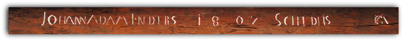
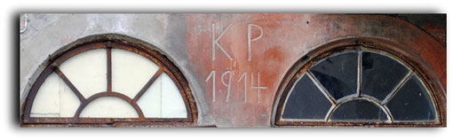
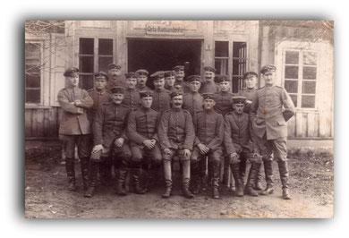
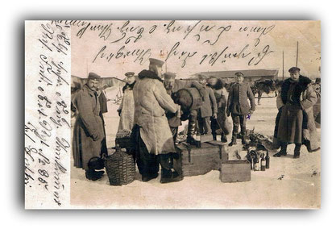
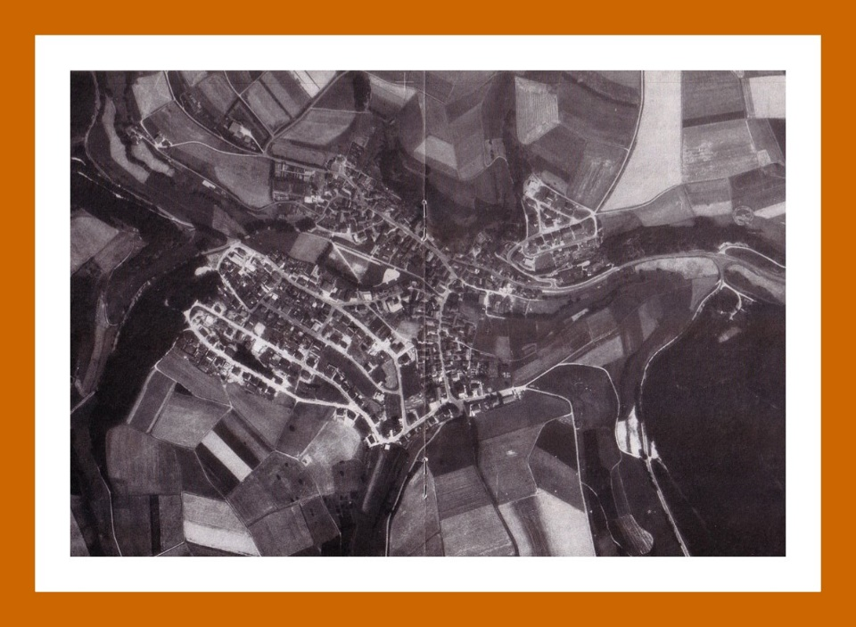
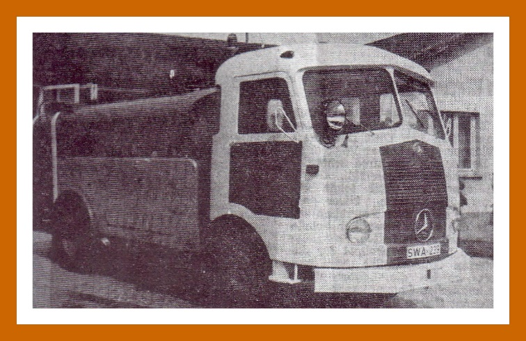
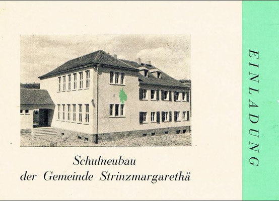

# Bildung und Schule

## Lehrer:

Um 1588 bis 1590 nimmt der Schulmeister Stein Abschied vom Schuldienst. Für seine Nachfolge bewirbt sich Petrus Biedenkopf. Die genaue Jahreszahl ist nicht bekannt.(Quelle: HStA W14 / 488)

---

## Lehrer:

Um 1588 bis 1590 nimmt der Schulmeister Stein Abschied vom Schuldienst. Für seine Nachfolge bewirbt sich Petrus Biedenkopf. Die genaue Jahreszahl ist nicht bekannt.(Quelle: HStA W14 / 488)

---

## Lehrer:

Um 1588 bis 1590 nimmt der Schulmeister Stein Abschied vom Schuldienst. Für seine Nachfolge bewirbt sich Petrus Biedenkopf. Die genaue Jahreszahl ist nicht bekannt.(Quelle: HStA W14 / 488)

---

## Erste Erwähnung einer Schule in StM.

---

## Die Kinder aus Niederlibbach, Oberlibbach und Hambach werden ab sofort nicht mehr in Strinz, sondern in der neuen Schule in Niederlibbach unterrichtet.

(Die Drangsalen des Nassauischen Volkes und der angrenzenden Nachbarländer in den Zeiten des dreißigjährigen Krieges, seine Helden, Staatsmänner und andere berühmte Zeitgenossen / 1854)

---

## Anstellung des Johann Martin Joch aus Breithardt als Lehrer in StM.

Im Siebenjährigen Krieg (1756 -1763) wird die Registraturkiste im hiesigen Pfarrhaus durch französische Einquartierung geplündert.

---

## Lehrer: Philipp Ferdinand Sauer

---

## Auf Anweisung des Königlichen Landrates von Trotha wird der Bau eines Pissoirs in der Schule angeordnet. Der Bau wird im Sommer ausgeführt und kostet 285 Mark.(Quelle: Strinzer Chronik, Teil 1, Seite 121)

---

## Lehrer: Julius Emil Schlicht

---

## Lehrer: Julius Emil Schlicht

---

## Lehrer: Julius Emil Schlicht

---

## Lehrer Georg Petri tauscht seine Stelle mit dem Lehrer Alfred Großmann in Laubuseschbach.(Quelle: Alte Strinzer Chronik, Teil 1, Seite 117)

Erst im Jahre 1923, nach der Währungsreform, erhält der MGV "Eintracht" Unterstützung und Hilfe in Form eines Kredites, der dringend benötigt wird.(Quelle: Festschrift 100 Jahre MGV Eintracht 1891 / 1991)

---

## Einstellung von Fräulein Brigitte Jäkel als zweite Lehrerin in StM. Die Schule wird damit zweiklassig.(Quelle: Strinzer Chronik)

---

## Der letzte Lehrer von StM, Horst Witt, räumt die Lehrerwohnung in der Schule und zieht in ein Eigenheim in der Gartenstraße. Damit steht auch die Lehrerwohnung der "Sonderschule für praktisch bildbare Kinder" zur Verfügung.

---

## Nachdem man endlich zu der Einsicht gekommen ist, dass das alte Schulgebäude seinem Zweck immer weniger entspricht und ein Neubau nicht länger mehr zu umgehen sei, auch die Genehmigung der Königlichen Regierung erteilt worden ist, eine neue Schule aus Holz bauen zu dürfen, entschließt sich endlich der Gemeindevorstand, das alte Schulhaus abzulegen und an dieser Stelle ein neues Schulhaus zu erbauen.

Dies geschieht im Laufe des Jahres 1871 und zwar nach einem von Herrn Baudirektor Musset zu Langenschwalbach entworfenen Plan.

---

## Der Lehrer selbst ist wahrscheinlich bei der Einweihung seiner Schule gar nicht zu Wort gekommen!

---

## Unterricht im Schulgarten

---

## Nach einem feierlichen Vormittagsgottesdienst versammelten sich des Nachmittags die Schüler wieder in der Schule, denn das Wetter war außerordentlich günstig. 14 Grad Wärme im Schatten - so sollte auf Anordnung des Pfarrers Osterloh mit den Schülern zu StM ein gemeinschaftlicher Spaziergang vorgenommen werden. Da sich aber auch die Eltern der Schüler beim Schulhaus einfanden, um den Spaziergang mitzumachen, so hielt der Lehrer im Schulhof eine Anrede über die Bedeutung des Tages und brachte im Hof auf unseren siegreichen Heldenkaiser, dann auf

seinen Sohn den tapferen siegreichen Kronprinzen und zuletzt auf das siegreiche deutsche Heer. Alle Anwesenden, Kinder, Kaiser Wilhelm I. um 1871                      Männer und Frauen stimmten freudig ein in dieses dreimalige Hoch und ohne vorherige Verabredung hatten die sämtlichen Burschen des Kirchspiels zu jedem Hoch ihre Pistolen hochgeschossen.

Nachdem jeder Schüler ein Bretzel empfangen und mit einer Schnur an die Seite gehängt hatte, zogen wir mit unseren Fuhren nach StM, holten die dortigen Schüler mit Ihren Lehrern und Herrn Pfarrer ab und machten dann unseren gemeinschaftlichen Zug in das schöne Waldwiesenthal, genannt "Weltersbach" am Wege von hier nach StM.

---

## Abschied von der alten Schule

Dies war Anlass genug, dass die ganze Bevölkerung des Ortes auf den Beinen war, aber auch viele Gäste aus den Nachbarorten nahmen an diesem feierlichen Akt teil.

---

## Einweihung der neuen Schule

---

## Schulklasse mit Leher Böhm          Schulklasse mit Lehrer Witt

---

## Enders hatte von Kreisleiter den Auftrag erhalten, die Verpflichtung, der die Schule verlassenden Jungend, auf die Partei vorzunehmen. Es war dies eine Art Ersatz für die verpönte Konfirmation. Enders wollte diesem entgehen, indem er Rektor Weißer bat, diese Verpflichtung vorzunehmen. Rektor Weißer lehnte mehrmals ab. Als aber der Ortsgruppenleiter seine Bitte noch dringender wiederholte und Weißer den Eindruck bekam, dass hier ein Mensch innere Not litt, durch den Zwiespalt zwischen seinem Amt und seiner wahren Überzeugung, gibt Weißer nach und verpflichtet am nächsten Tag die abgehenden Schüler nach seiner Entlassungsrede auf den Nationalsozialismus. Einige der aufgeweckten Jungen und Mädchen, die diese Vorgehensweise durchschauten konnten, so wie Rektor Weißer selbst, konnten bei dieser Zeremonie ein Lächeln nicht unterdrücken. Der Ortsgruppenleiter meldete nun, dass die abgegangenen Schüler befehlsmäßig verpflichtet worden waren und die Sache war in Ordnung.

Die größte Erbitterung gegen die Partei hatte ein Plan hervorgerufen, die kleinen Bauern nach dem Krieg zu enteignen und zur Neusiedlung in den Osten zu schicken. Ihre Höfe sollten danach den Nazi-Großbauern übereignet werden.

---

## Durch den Einschlag am Kirchberg wurden mehrere Fenster in der Strinzer Schule zerstört.

In den Trichtern östlich von StM hat man zum Teil - nach dem Einmarsch der Amerikaner - tote Pferde verscharrt.

Von einer der dort explodierten Bomben müsste der hier gezeigte Splitter stammen, denn er wurde in unmittelbarer Nähe gefunden.

---

## Die Ortsschelle verkündet, dass alle Männer zwischen 14 und 60 Jahren in der Schule zu erscheinen haben. Der Volksturm "bringt sich in Erinnerung". Ortsgruppenleiter Dittmar verließt den Befehl, "dass es die Pflicht eines jeden Volkssturmmannes sei, sich zu verteidigen bis zum letzten Atemzug und jedem Befehl Folge zu leisten. Falls das einer nicht wolle, stünde dem Vorgesetzten das Recht zu, ihn zu erschießen. Die Stunde des Abmarsches werde rechtzeitig bekannt gegeben. Die Leiter verschiedener Ortsverbände werden die Volkssturmmänner fremder Dörfer übernehmen. Er selbst können leider nicht teilnehmen, da die Ortgruppenleiter den ausdrücklichen Befehl erhalten haben, sich zurückzuziehen." Dittmar verlangt äußerste Verschwiegenheit und schließt mit einem Sieg Heil auf den Führer. Die letzte Führerehrung in StM.

Auch die bislang in StM lebenden Kriegsgefangenen sollen weiter ins Hinterland verbracht werden. Um dies zu vermeiden, verstecken sich diese in bereits in den Tagen zuvor im Wald angelegten Verstecken, ausgestattet mit Brot, Wurst und Zigaretten.

Auch das deutsche Militär macht sich vereinzelt auf den Weg. Alle wollen möglichst in Richtung Autobahn, die bei Idstein noch nicht von amerikanischen Truppen besetzt ist.

---

## Die Uniform, die Rektor Weißer noch vor Tagen getragen hatte, hängt in einem toten Winkel der Schule. Da Rektor Weißer die Soldaten in fließendem Englisch ansprechen kann, sind diese gleich entspannter und nicht mehr so feindselig gesinnt. Ein amerikanischer Soldat schenkt dem Enkel von Rektor Weißer sogar deutsches Inflationsgeld.

Rektor Weißer wird zum militärischen Befehlshaber gerufen. Dieser teilt ihm mit, dass im Ort bekanntgemacht werden soll, dass niemand die Häuser verlassen darf, außer eine Stunde am Vormittag und eine Stunde am Nachmittag, zum Wasser holen. Auch müsse die Pfalz geräumt werden.

---

## Gegen halb zehn ist große Pause in der Schule. Fast im ganze Dorf hört man das Schreien und Rufen der Kinder.

Gegen 10 Uhr wird im Bauernhaus das zweite Frühstück eingenommen. Wer draußen im Felde frühstückt, hat entsprechendes mitgekriegt.

---

## Die alte Schule im Hintergrund ist ein Anlaufpunkt beim Wiedersehen von Marei Hartlaub (2.v.r.) und ihrem früheren Kindermädchen Irma Kugelstadt (Mitte). Auch für Helmut Hartwig (l.), Frank Schwarzer (2.v.l.) und Sohn Daniel Hartlaub sind die Erinnerungen an die Kriegstage interessant. Foto: Thorsten Stötzer (Foto: Thorsten Stötzer)

STRINZ-MARGARETHÄ - Alte Schwarz-Weiß-Fotos liegen auf dem Tisch mit Männern darauf, die Knickerbocker tragen. Und ein Kalenderblatt, auf dessen Rückseite Marei Hartlaub einst mit Kinderschrift das Strinzer Lied geschrieben hat, sorgt für Aufmerksamkeit. „Die Strinzer Hymne könnte ich immer noch singen“, ist sie sich sicher, als sie bei der Familie Hartwig zu Besuch ist.

Dabei ist es lange her, dass Marei Hartlaub, die damals noch als Mareile Richter bekannt war, in Strinz-Margarethä lebte. Von 1943 bis 1946 war das. Als Fünfjährige kam sie ins Dorf, weil in Frankfurt die Lage wegen der Luftangriffe immer gefährlicher wurde. Erstmals trifft sie nun ihr Kindermädchen wieder: Irma Kugelstadt, geborene Hartwig, Jahrgang 1931, war damals selbst noch schulpflichtig.

---

## Der Großvater war Lehrer im Dorf, für das er sich wegen des schönen Namens interessierte. Sein Berufsleben verlief wechselhaft. Die Nazis hatten Weißer von seinem Rektor-Posten in Frankfurt abgesetzt, aufs Land zog er als Ausgebombter. Nach dem Krieg wurde Weißer Rektor der Mittelschule in Bad Schwalbach. Der Pädagoge war zugleich als Autor von Romanen und Dramen produktiv.

„Er war ein früher aufrechter Demokrat, ein richtiger Liberaler“, beschreiben seine Nachfahren das Mitglied der linksliberalen DDP und für kurze Zeit der SPD.

Als sein Enkel und Cousin Marei Hartlaubs wurde 1944 in Bad Schwalbach der Schriftsteller Jörg Fauser geboren (gestorben 1987), der ebenfalls frühe Kindheitstage in Strinz verbrachte. Seine Mutter Maria Fauser erlebten viele Hörer später als HR-Moderatorin.

---

## Nach dem Waffenstillstand vom 11. November organisierten sich die Einwohner von Strinz-Margarethä in neuen Formen. In einer Gemeindeversammlung forderten sie eine „Bürgerwehr“ an „zur Bewachung des Dorfes“. Wenige Tage darauf wurde ein „Arbeiter- und Bauernrat“ gegründet „in der Wirtschaft von Schneiders“. Solche Räte mussten nicht vom Sozialismus inspiriert sein. In Strinz ging es darum, sich auf durchmarschierende deutsche Truppen vorzubereiten, die von der Front heimkehrten. Kinder schmückten zu ihren Ehren die Schule, aber „die Mannschaften vom Heer kommen hier bei uns ganz still nach Hause“. Gegangen waren inzwischen die französischen Kriegsgefangenen.

Stattdessen rückten am 14. Dezember in Strinz-Margarethä 14 französische Besatzungssoldaten ein und verboten sogleich den Verkehr nach Hennethal und Strinz-Trinitatis. Der Pfarrer diente als Dolmetscher und erfuhr vom Kommandanten Bernhard de Lanquesaine: „Sie wollen nicht unsere Freunde sein, sondern vergelten und schrieben dem Kaiser die Schuld an dem Kriege zu.“ An Weihnachten war die Besatzung wieder abgezogen, stattdessen erfolgte die „Begrüßung heimkehrender Krieger“.

---

