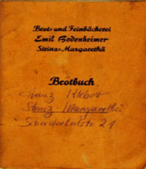
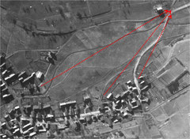
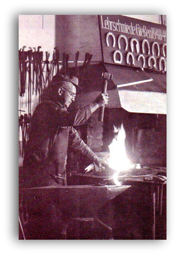
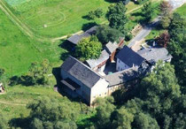

# Wirtschaft und Handwerk

## Nach v. Schubert wird hier, wie fast allenthalben, die schwedische Kirchenverfassung in Absicht des Verhältnisses zum Staate, nebst der Stellung und Wirksamkeit des geistlichen Standes, musterhaft genannt; anders würde Mancher urtheilen, wenn es eben so bekannt, wie v. Schuberts übrigens sehr schätzbare Schrift, in Deutschland wäre, was Beehen, Molbech u. a. reisenden Dänen von dem schwedischen Kirchenwesen halten, und in ihren Reisebeschreibungen beybringen. Von dem Colegialsysteme sagt unser Verfasser S. 53: „Selbst mit der unumschränkten und souveränen Staatsgewalt kann eine evang. Kirchenverfassung (nach jenem Systeme) sich vertragen, wenn nur der Regent den Beruf und die Würde des christlichen Königthums“ (was ist das?) „zu üben versteht“ (adde: und zu üben den Willen und die Lust hat!).

Muß Herr Pfarrer Schmidtborn im Verfolge selbst einräumen: „Allerdings haben die Consistorien ihre ursprüngliche Einrichtung und ihren Einfluß in wesentlichen Theilen verloren: „so kann er ja nicht in Abrede stellen, dass auch das Collegialsystem nicht gegen Uebel schützt; und es ist kaum erklärbar, warum er einem gehörig modiheirten (?) Presbyterialsysteme nicht mehr Gerechtigkeit widerfahren läßt

---

## Dieser Bruch ist als “Steinbruch” unbedeutend, da diese Steine weder zum Mauern noch als “Gestück” für den Straßenunterbau geeignet waren.

Er ist jedoch erwähnenswert, da er das Material für den Unterbau des neuen Sportplatzes geliefert hatte. Dafür waren die unförmigen Felsbrocken bestens geeignet. Das Herausbrechen mit dem Bagger (Fa. Enders) war hier möglich. Am Transport auf das Sportplatzgelände haben sich viele

Bürger mit Traktoren und Wagen ehrenamtlich beteiligt, sowie auch beim Einbau mit Hacke und Schippe.

Der obere Teil der ausgebaggerten Mulde wurde von Jugendlichen (Jugendclub) gerne als Grillplatz genutzt. Der größte Teil ist längst von der Natur zurückerobert, durch Bewuchs mit Hecken und Sträuchern.

---

## Das (auch der oder die) Lachter war ein im Bergbau übliches Längenmaß, mit dem meiste Teufen, der Stollenvortrieb und die Größe von Grubenfeldern, auch Gedinge bestimmt wurden, In den meisten deutschsprachigen Bergrevieren war es das wichtigste Längenmaß. In dem damaligen Preußen betrug ein Lachter 2,092 Meter.

(Amtsblatt der Regierung in Wiesbaden, Nr. 57, 11. November 1869, Seite 373 / Wikipedia / HStA Wdn / Abt. 469/31 Nr. 1793-1816)

Neben den Zechen Bertha und Fritz gab es eine weitere Zeche. Die Zeche „Glücksfund 1“. Diese lag auf dem Gebiet von StM und Steckenroth.

---

## Speziell in dörflichen Bereichen waren Backhäuser bis in die 1960er Jahre verbreitet. Regelmäßige Backtage der Gemeindemitglieder sparten den Bäcker, den eigenen Ofen und Energie. Zudem stellte der Backtag ein willkommenes Zusammentreffen zum Austausch von Informationen dar. Es wurden Neuigkeiten beim Warten auf das Brot und den Kuchen ausgetauscht.

Ein weiterer Grund für die Errichtung von Backhäusern bestand darin, die Feuergefahr durch Backen in Einzelhaushalten zu vermindern. Der Ofen wurde mit lokal verfügbarem Heizmaterial, meist Reisig und Holz, beheizt. Vor dem Einbringen der Backware musste vorgeheizt werden. Die entstandene Glut wurde vor dem Beschicken entfernt.

Die Reihenfolge des Backens wurde beim Bürgermeister ausgelost, so wurde das aufwändige Anheizen dem Zufall überlassen. Die nachfolgenden Benutzer profitierten davon und mussten nur nachheizen. Es kam des Öfteren vor, dass das Los zum Anheizen auf eine Familie fiel, die damit große Probleme hatte. Besonders an Festtagen wurden viele und große Kuchen gebacken.

---

## Die Soldaten stellen die Geschütze zum Feuern bereit auf, das eine in der Nähe vom Spritzenhaus, das andere am Hirtenpfad, das dritte in dem Weg der zur Mühle führt und zwar direkt hinter der Scheune von Christmanns. Die Geschütze werden auf die Kreuzung Breithardt/Hennethal ausgerichtet, um die ankommenden Panzer zu beschießen.

---

## Der Batterieführer befiehlt dem Unteroffizier Horstmann und dem Soldaten Knechtsberger, auf die Höhe (Eisenstraße) zu gehen und zu melden, wenn die Panzer im Anrollen wären. Als Beide aus der Küche Ihrer Unterkunft in den Hof gehen, versucht ein Bürger den Unteroffizier mit den Worten aufzuhalten: „Junger Mann, gehen Sie in den Steinbruch und wenn der Ami kommt, heben Sie die Hände hoch, etwas Anderes können Sie nicht machen“. Der Unteroffizier antwortete: „Befehl ist Befehl“ und geht mit seinem jungen Kameraden in den Tod.

Inzwischen befindet sich das Dorf schon im Blickfeld von amerikanischen Beobachtern, die von der Höhe (heutige Waldstraße) einen sehr guten Blick auf die Geschehnisse in StM haben.

---

## Bei dem Bäckerhandwerk handelt es sich um ein schon sehr altes Handwerk.

Da die Strinzer früher ihr Brot gemeinschaftlich im Backhaus backten, finden wir den Beruf des Bäckers in unserem Ort erst seit Anfang des 20. Jahrhunderts.

---

## Köhler bezeichnet einen in Deutschland nahezu ausgestorbenen Beruf, dessen Aufgabe es ist, aus Holz Holzkohle herzustellen. Der zugehörige Handwerksbetrieb nennt sich Köhlerei.

Den ältesten Hinweis auf Köhlereien oder Kohlemeiler in unserer Region erhalten wir aus dem Jahre 1727.

Am Freitag, dem 18. Juli 1727, beschweren sich die Abgesandten aus Ehrenbach, Görsroth, StM und Bechtheim bei der Verwaltung in Idstein, daß sie in der vergangenen Woche 5 Tage bei Hahn auf der Jagd liegen mussten. Sie konnten deswegen kein Heu machen und kein Korn schneiden. Doch nicht nur mit ihrer eigenen Feldarbeit blieben sie gewaltig zurück, auch die Frondefahrten, zu denen sie ebenfalls verpflichtet sind, blieben ungetan. Sie hätten Hafer nach Biebrich und (Holz-)Kohle zu einer (Eisen-)Schmelze fahren müssen. Da wegen der unterlassenen Zulieferung ein Ofen ausgegangen war, sprach nun die zuständige Rentkammer von Bestrafung.

Bereits im Altertum wurde Holzkohle in Meilern hergestellt. Hierbei werden Holzscheite in kegelförmige Haufen (Meiler) um Pfähle gesetzt, ein mit Reisig und Spänen gefüllter Feuerschacht angelegt und eine luftdichte Decke aus Gras, Moos und Erde geschaffen.

---

## Schmied

---

## Geschichte der Strinzer Mühle

---

## Albrecht Graf zu Nassau-Saarbrücken, Herr zu Lahr pp., Vormund für Johannes Ludwig, Graf zu Nassau, Herr zu Wiesbaden-Idstein verleiht die Mühle zu Strinz Mararethä erblich an "MalernPhilipsen" einem Untertan zu Strinz-Margarethä, gegen einen jährlichen Pacht von 3 Limburger Malter Korn und 100 Eier, solche aufzurichten und zu erbauen, die nach ihm Caspar Müller seinem Eidam Philipp Müller eingeräumet, von jedem gemahlenen Malter Mainzer Frucht für abgehend Staub und Molter 12 Pfund und mehr mitzunehmen und abzuziehen zugelassen sein, als gedungene Mahlgäste zu Strinz.

Es ist ihm auch der Handel mit Frucht und Ölfahren erlaubt. Als Unterpfand werden seine Äcker und Wiesen vorbehalten. Ein halb hundert Eier sind jährlich auf Ostern zu liefern.

---

