# Infrastruktur und Gebäude

## Bau einer Brücke über den Aubach zur Pfalz. Zuvor musste der Bach über eine Furt überquert werden.(Alte Strinzer Chronik)

Ersteigerung einer Wiese der Erben des Johann Philipp Otto von Strinz-Margarethä durch die Domäne.(Quelle: HHStAW 244 Nr. 1653)

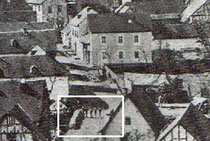

---

## Haus Hartwig in der Pfalzstraße                    Karl Heiler mit seinem Fahrrad der Marke NSU

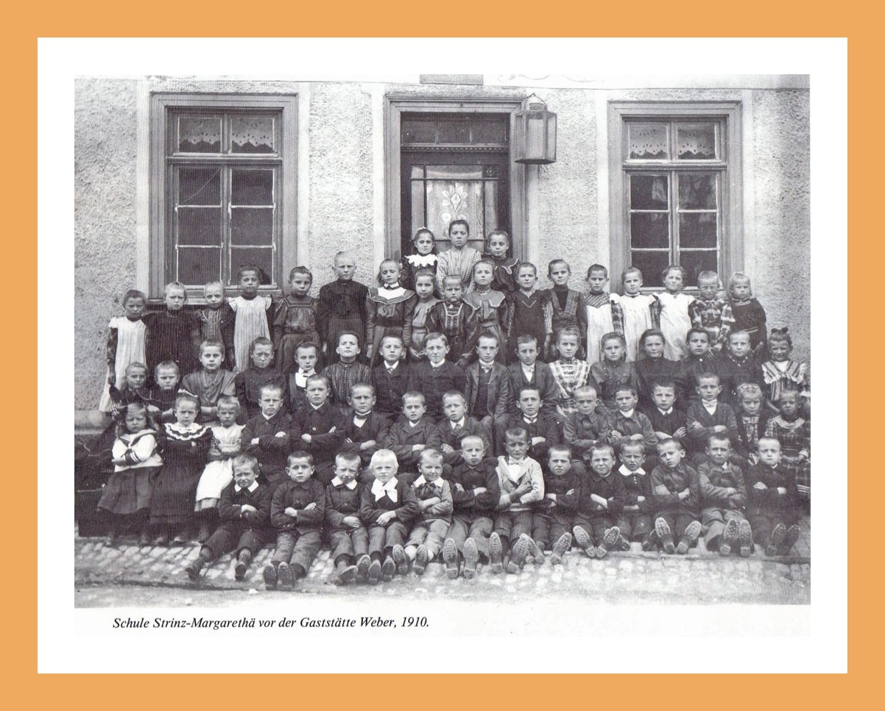

---

## Haus Hartwig            Stimmzettel

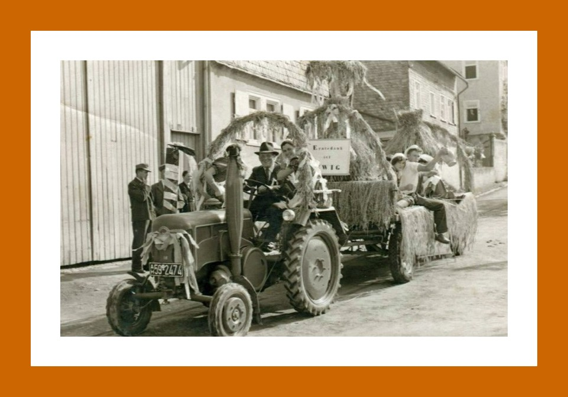

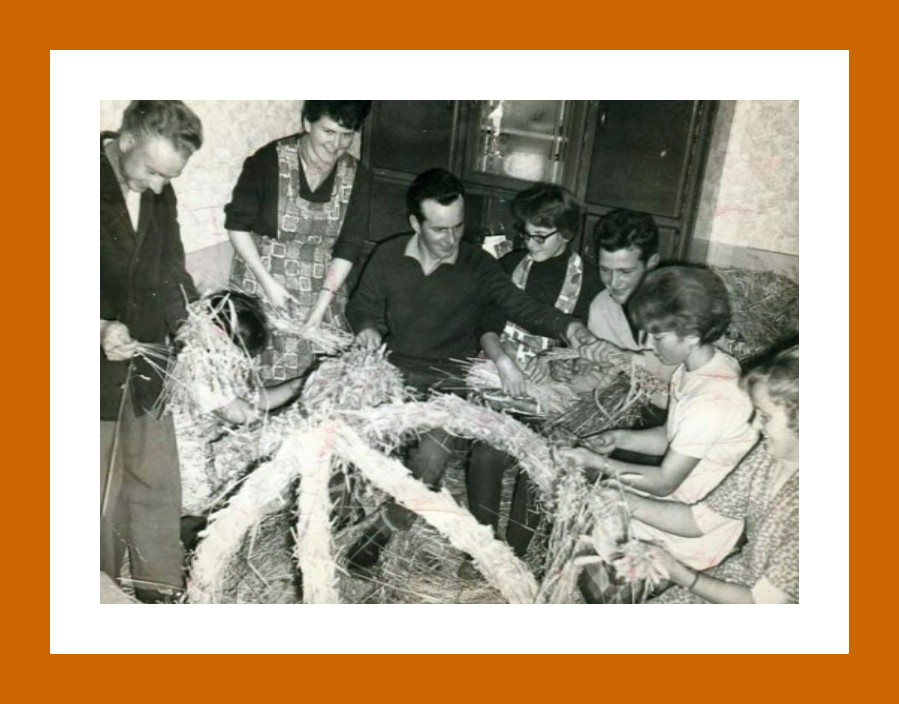

---

## Bau einer Trauerhalle am Friedhof.

Aufnahme der Nachbargenossenschaft Steckenroth in die Raiffeisenkasse e.G.m.b.H. durch Fusion.(Quelle: Helmut Hartwig)

---

## Einbruch bei Bäckermeister Bodenheimer. Die Diebe stehlen diverse Sammelmünzen und 1.500,- DM Bargeld. Danach brechen die Diebe noch in die Wohnung des Bäckersohnes ein, die im gleichen Haus liegt, und stehlen dort noch 3.500,- DM Bargeld und ein Paar goldene Manschettenknöpfe.(Quelle: Alte Strinzer Chronik)

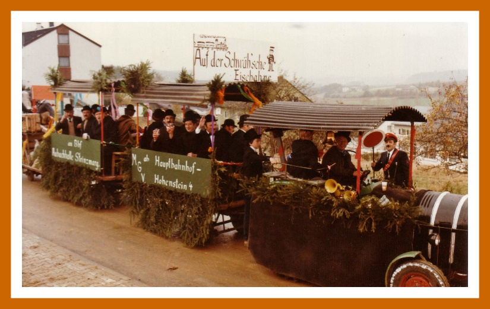

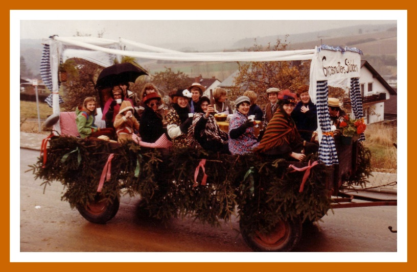

---

## Einweihung der fertiggestellten Aubachhalle. Die Kosten für den Bau beliefen sich auf über 800.000,- DM.(Quelle: Alte Strinzer Chronik)

Durch den Neubau der Aubachhalle erlebt der Turnverein einen neuen Aufschwung.(Quelle: Festschrift zur Sportplatzeinweihung 1990)

---

## Die Brunnen in der Scheidertalstraße

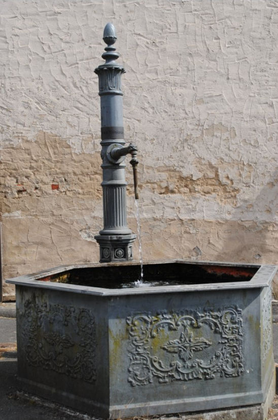

---

## Wenn an den Sonntagen in den Nachbardörfern Vergnügungen oder Vereinsfeste stattfanden, zog die Jugend gemeinsam zu Fuß dort hin. Nach Beendigung des Festes gingen sie wieder gemeinsam nach Haus. Der Schlaf kam in dieser Nacht dann zu kurz, und oft wollte der nächste lange Arbeitstag kein Ende nehmen.

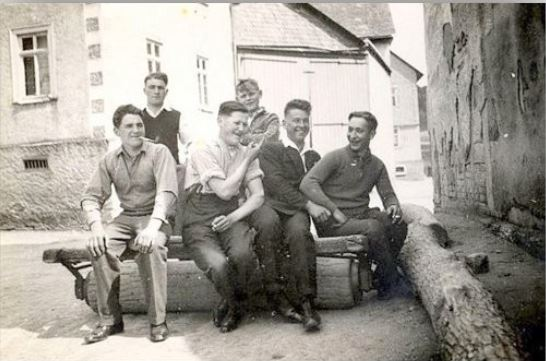

---

## Um Wasser saugen zu können, musste zuerst der Wasserbehälter mit Eimern befüllt werden.

Die Bedienung der Pumpen verlangte viel Kraft und so wurden bei längerem Einsatz die Bedienungsmannschaft gewechselt.

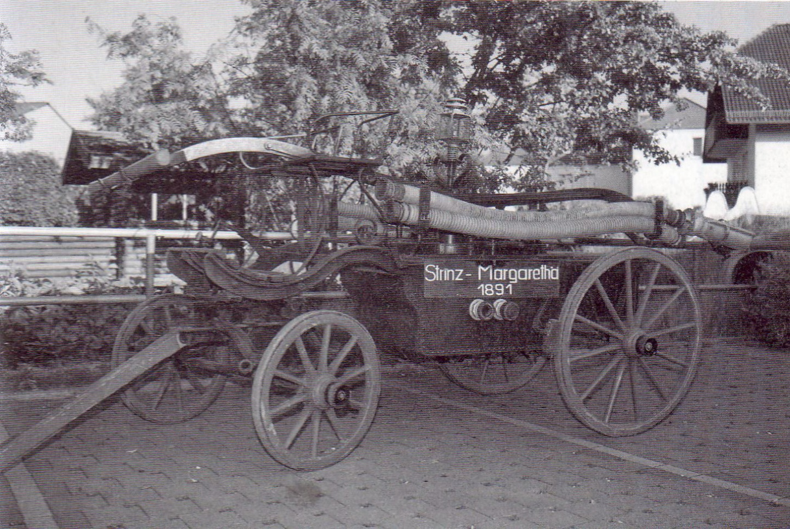

---

## Fahrrichtung Breithardt. Zur Entschärfung der Kurve wurde das Haus später abgerissen.

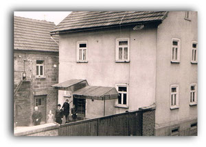

---

## So nahmen fast alle Familien im Dorf diese Dienstleistung gerne in Anspruch und in der Saison ging die “Holzmaschin” von Haus zu Haus.

Sie war für die Bürger des Dorfes ein sehr nützliches Gerät, denn man konnte mit dieser Maschine sein gesamtes Brennholz, das man für den Winter brauchte, gegen Lohn schneiden lassen. In der Regel waren das je Haushalt etwa 15 bis 30 Raummeter, die nicht nur zum Heizen der Wohnung nötig waren, sondern auch für den Küchenherd und für den Kessel, in dem das Viehfutter gekocht wurde, wie z.B. Kartoffeln für die Schweinemast.

Am Waschtag, das war in der Regel der Montag, wurde im holzbefeuerten Kessel auch die Wäsche gekocht und im Spätherbst auch die Ladwerg (Lekweije) sowie bei den Jährlich zweimaligen Hausschlachtungen auch die Wurst.

---

## Am Rande des Brunnen- und Brücken-Einweihungsfest in Strinz-Margarethä gab es ein Wiedersehen, welches man in dieser Form wohl kaum noch erleben wird.

An diesem Tag trafen sich Frau Marei Hartlaub und Irma Kugelstadt, geb. Hartwig nach 71 Jahren wieder. Irma Kugelstadt war seinerzeit das Kindermädchen von Frau Hartlaub.

---

## Das Treffen fand seinen Abschluss bei einem Besuch des Brunnen- und Brücken-Einweihungsfestes.

Bevor es für Frau Hartlaub wieder nach Frankfurt ging, wurde vereinbart, dass nun der Kontakt weiter aufrechterhalten werden soll und auch einem erneuten Wiedersehen nichts im Wege stehen sollte.

---

## Nachfolgendes Bild zeigt die Damen beim Brunnen- und Brücken-Einweihungsfest.

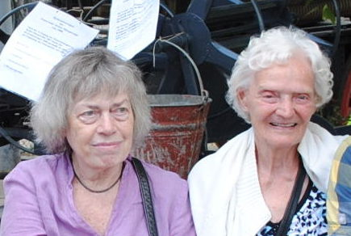

---

## Die Zinkenmühle selbst liegt ca. 500 nordwestlich von StM. Sie liegt nicht direkt am Aubach. Sie wurde deshalb über einen eigenen Mühlbach versorgt. Dieser ist heute nur noch in Teilen erkennbar. Der Mühlbach zweigte in etwa auf Höhe des Spielplatzes ab, floss an der Straße "Am Mühlgraben" entlang, überquerte dann die Scheidertalstraße und floss dann unterhalb des "Neuer Mühlweg" bis zur Zinkenmühle und dort über das Mühlrad, welches sich innerhalb der Zinkenmühle befand, wieder in den Aubach hinein.

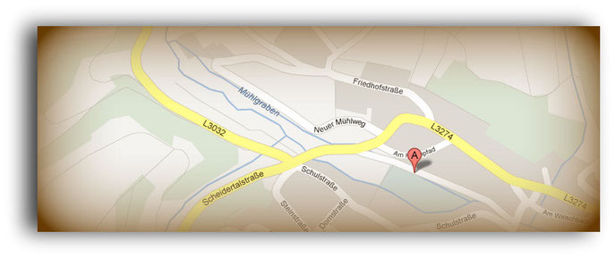

---

## Damals wurde das gusseiserne Stück vermutlich in der Michelbacher Hütte gebaut, und genau dort vollzog sich die jüngste Sanierung. Der Strinzer Michael Hahn hat die Restauration bei der heutigen ACO Passavant Guss GmbH in Aarbergen übernommen. „Die Ecken wurden neu gegossen, das sieht man an den Schweißnähten“, erklärt Schwarzer. Blau schimmert der Brunnen mit der achteckigen Säule. Am Edelstahlbecken, das kürzer und höher ist als üblich, fallen goldene Ornamente wie ein Löwenkopf auf. „Die habe ich eine volle Woche lang gestrichen“, schildert Schwarzer. Das macht deutlich, wie viele Eigenleistungen investiert wurden. Dillmann schätzt die Zahl der unentgeltlichen Arbeitsstunden von Ortsbeiratsmitgliedern auf über 200.

---

## Im Frühjahr soll noch das Buswartehäuschen auf der anderen Straßenseite gestrichen und eventuell mit Bänken ausgestattet werden. Anschließend ist Zeit für ein Fest, um den neuen Platz und das Ende der vorangegangenen Bauarbeiten an Straße und Brücke zu feiern, sagt Dillmann. Gute Erfahrungen hat der Ortsbeirat bereits beim ersten „Lebendigen Adventskalender“ gemacht: Als der Brunnen und die Anlagen ringsum Station waren, trafen sich dort über 100 Menschen.

---

