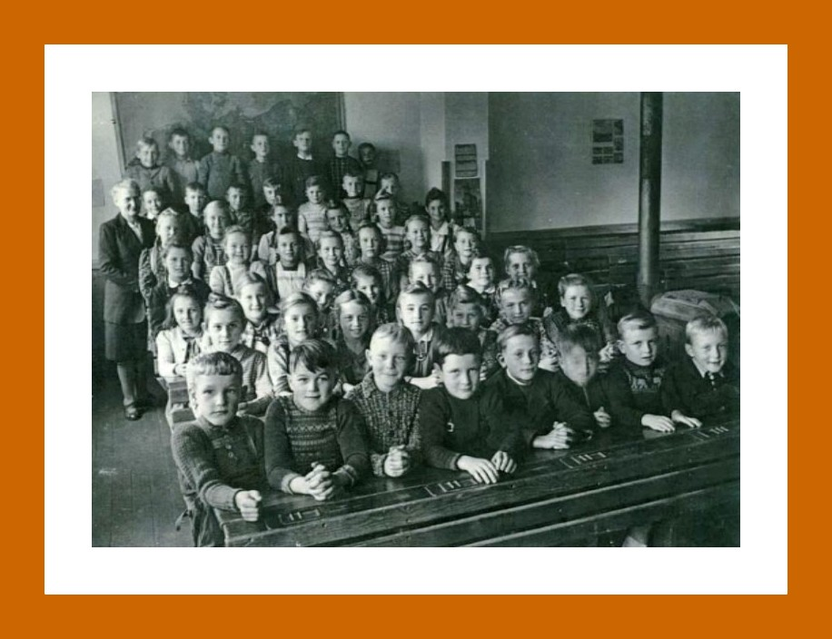
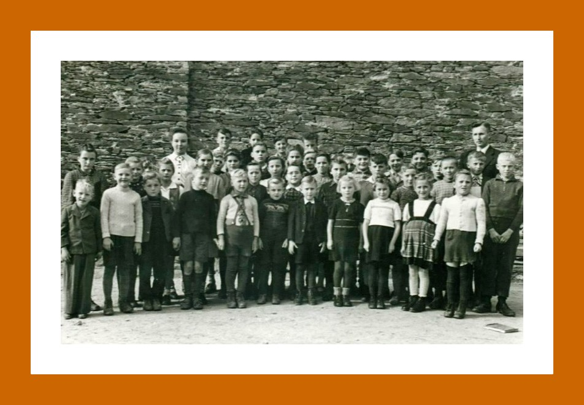

# Bräuche und Traditionen

## 2x Strinzer Kerb

---

## Zur diesjährigen Kerb eröffnet in der Zinkenmühle eine Gaststätte. Nun besitzt das Dorf 4 Gastwirtschaften.(Quelle: Alte Strinzer Chronik)

---

## 2 x Kerb

---

## 2 x Kerb

---

## Vielleicht wollte man es ja später hochfahren. Aber weit gefehlt, sollten es doch die Frondienstler die Treppe hochtragen. Die Fuhrleute (Spanndienstleistenden) hatten die Ausrede: „ de Parre leid`s nit, dess mir do nuffer fohrn“.  Diese Ausrede ist insofern nicht glaubwürdig, dass der Kirchenvorstand darüber zu befinden hat, ob die Fuhrleute die Auffahrt benutzen können oder nicht. Als im Dorf bekannt wurde, dass die Frondienstler gezwungen werden sollen ca. 60 – 70 Raummeter Holz die Kirchentreppe hoch zu tragen, nur, weil es „de Parre nit leid“ das man es mit dem Fuhrwerk hochfährt, wie man weiterhin fest und steif behauptet hat, waren die Betroffenen empört und wütend. Das waren mittelalterliche Methoden und eine Schande, wie man die Leute drangsalierte.

War es vielleicht „Rache“ dafür, dass einer, der ein Pferd hatte, nicht beim Holzmachen etwas verdienen konnte?  Das wahre Motiv war leider nicht aufzuspüren, man hielt fest zusammen und

blieb dabei, dass es „de Parre nit leid“. Eine Stellungnahme des Pfarrers ist nicht bekannt.  Bei den damaligen Abhängigkeiten und sicher um sich vor „Schimmerem“ zu schützen, haben die Frondienstpflichtigen das gesamte Holz die Treppen hochgeschleppt. Vermutlich um sich etwas „Luft“ zu verschaffen, konnten man später in 40 cm großen weißen Buchstaben an Deusers Mauer den Spruch lesen: „Lieber tot als Sklave“. Damit kam das „gesunde Volksempfinden“ zum Ausdruck und eine Protesthaltung gegen die in der Nazizeit üblichen Schikanen, gegen die man sich, ohne Konsequenzen befürchten zu müssen, damals nicht wehren konnte. Erste vage Anzeichen dafür, dass sich die Menschen nicht mehr unterdrücken lassen wollten. Die Lebensumstände waren schlimm genug, sodass solche Quälereien, die man den Leuten abverlangte, völlig unmenschlich waren. Es war jedoch kein Einzelfall, wie man damals die Menschen, die sich nicht wehren konnten, behandelt hat. Bei Arbeiten in der Landwirtschaft und auf Baustellen waren solche Quälereien zu beobachten, es herrschte allgemein ein unmenschliches Verhalten von denen die Macht und Einfluss hatten, gegenüber denen die wenig oder nicht in den entsprechenden Kreisen eingebunden waren.

Der menschenverachtende Geist der gerade zu Ende gegangenen Epoche lebte überall wieder auf und war im Alltag vieler Menschen deutlich spürbar.

---

## Fastnacht

Einige Tage vor Aschermittwoch suchten die Mütter Kleidungsstücke zusammen, um ihre Kinder zur Fastnacht originell zu kostümieren. Am Nachmittag herrschte im Dorf reges Leben. Die Kinder zogen zu dritt oder viert von Haus zu Haus und sangen das Fastnachtslied: "Hohoho, die Fassenacht ist do".

---

## Ende Oktober, Anfang November feiert unser Dorf die Kerb.

Die erste Nennung einer Strinzer Kirmes (Kerb) gibt es schon aus dem Jahre 1477. Es ist überliefert, dass in diesem Jahr der Amtskeller in Wiesbaden eine größere Zahl von Wiesbadener Doppen (Tonbecher) für die Kirmes von StM kauft. Diese waren wahrscheinlich für den dortigen Ausschank des Bannweines bestimmt.

Den Begriff Bannwein kennt man seit dem 12. Jahrhundert. Dabei handelte es sich um (herrschaftlichen) Wein, der alleinig ausgeschenkt werden durfte und den die Verpflichteten kaufen mussten. Es war nicht erlaubt einen anderen Wein auszuschenken.

Auch aus dem Jahre 1521 ist überliefert, dass die gräfliche Rentei in Idstein 600 Wiesbadener „Doppen" für die Strinzer Kirmes vom 21. Mai zum Gesamtpreis von anderthalb Gulden ersteht.

Im Jahre 1609 wurde seitens der Regierung in Idstein die Kirmessen mit nachfolgendem Wortlaut verboten:

"Die Kirmessen sollen abgeschafft werden und jeder Pfarrer der sie zulässt bestraft werden, weil "übermäßiges Fressen, Saufen, Spielen, Schlägern und sonstige geschieht. Der Pfarrer, der es duldet, soll mit 20 Gulden bestraft und seines Amtes entsetzt werden."

Zur Strinzer Kerb gehört heutzutage auch ein Kerbeumzug.  Die meisten Bewohner kennen heute nicht mehr den Ursprung dieses Brauches.

---

