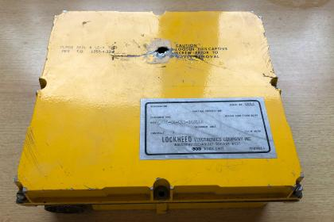
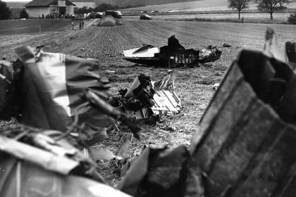
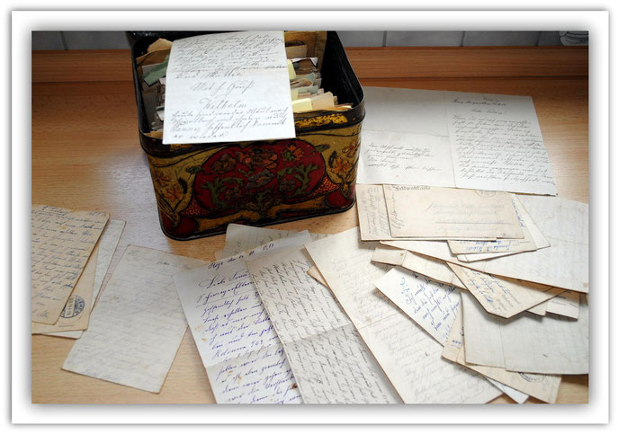
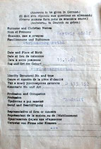
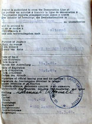
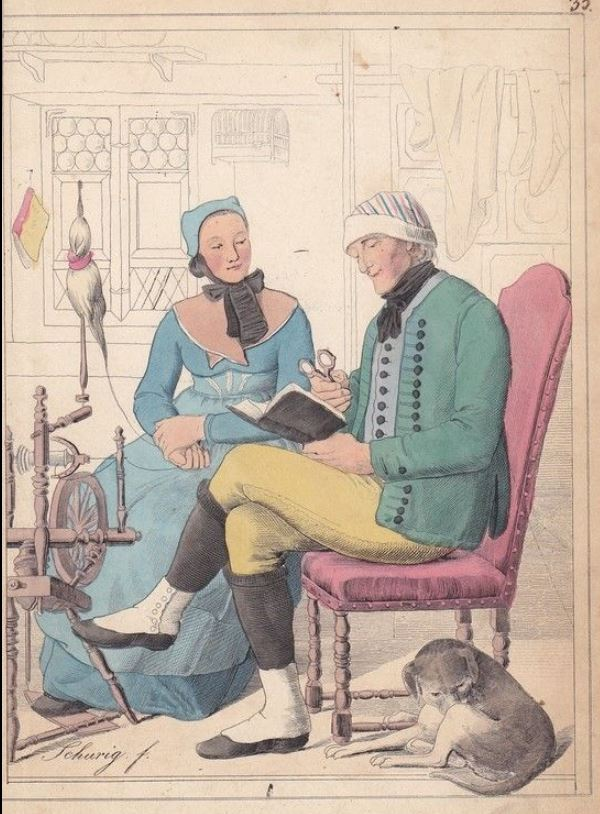

# Sagen und Erzählungen

## In früher Zeit ist der Schinderhannes mit seiner Räuberbande in Nassau herumgezogen. In unserer Heimat war er auch. Sie haben die einzelliegenden Mühlen und Höfe ausgeraubt. Auch in unserem Ort haben sie einen Bauer beraubt.

Der Bauer wollte nach Wiesbaden mit dem Pferd. Der Bauer ist morgens schon früh aufgestanden, und wie er in den Pferdestall ist, da hat er oben in seiner Stube Licht gesehen.

Da ist der Bauer hochgegangen, und wie er in die Stube kam, da war der Schinderhannes mit seiner Räuberbande da.

Sie hatten schon die Betten und sonstige Sachen zum Fenster hinuntergeworfen. So hat der Schinderhannes mit seiner Bande alles ausgeraubt und geplündert, bis er im Jahre 1803 in Mainz mit 22 seiner Spießgesellen geköpft worden ist.

---

## In StM gibt es einen Acker mit der Bezeichnung "Zehntfrei". Der Name bedeutet, dass die ursprünglichen Besitzer in alter Zeit keinen Zehnten für diesen Acker zu zahlen hatten. Zur Geschichte des Ackers gibt es folgende Überlieferung:

Früher ritt hier einmal eine Gräfin vorbei, die diesen Acker betrachtete. Auf dem Acker stand der Hafer sehr dünn und die Gräfin soll voller Geringschätzung gesagt haben: "Von einem solchen Acker will ich keinen Zehnten haben". Der Eigentümer freute sich natürlich, da er jetzt vom Zehnten befreit war.

---

## Nachfolgend eine Geschichte, die in der alten Strinzer Chronik festgehalten ist und über deren Wahrheitsgehalt Sie sich selbst Gedanken machen sollten.

Die Feuerbuche wurde nach 1813 gepflanzt, da, wo unsere Gemarkung mit der Niederlibbacher zusammenstößt. Einmal ging ein Trompeter durch den Wald. Er wurde von Räubern überfallen und ausgeplündert. Als sie ihn töten wollten, bat er, noch einmal ein Lied spielen zu dürfen. Die Bitte wurde gewährt.

---

## Da staunte Frank Schwarzer, als ein Nachbar vor der Tür seines Hauses in Strinz-Margarethä stand. Dieser hatte ein Stück eines F-104 „Starfighters“ in der Hand. Das Flugzeug war vor über 40 Jahren über dem kleinen Ort im südhessischen Taunus abgestürzt. Auf den ersten Blick eine unscheinbare gelbe Metallkiste, die allerdings den Flugdatenschreiber der abgestürzten F-104 enthält. Und damit ein Stück Geschichte der Luftwaffe.

---

## „Der Nachbar hat sie als Kind im Bach in der Nähe der Unglücksstelle gefunden“, berichtet Schwarzer, der die Geschichte des kleinen Ortes aufarbeitet. „Da ich ein kleines Heimatmuseum habe“, so Frank Schwarzer weiter, „war ich wohl nach all den Jahren der richtige Ansprechpartner für diesen Fund.“ Offenbar wurde damals bei den Aufräumarbeiten etwas übersehen. Oder der Nachbar war einfach schneller. „Ich hab‘ ihn besser nicht gefragt“, sagt Schwarzer und lacht.

---

## Die kleine gelbe Metallkiste, das letzte „überlebende“ Bauteil der 28+18, hat Frank Schwarzer jetzt der Luftwaffe übergeben. Eine Auswertung ist nicht mehr notwendig, der Unfall ist längst geklärt. Aber der Flugschreiber wird – jetzt Teil der Geschichte der Luftwaffe – im Militärhistorischen Museum Flugplatz Berlin-Gatow ausgestellt. Kaum 100 Meter von einem Starfighter entfernt, der dort als Ausstellungsstück steht. Die schlanke Spitze Richtung Himmel. So als wäre er eigentlich gar nicht auf dem Boden. Sondern würde einfach weiterfliegen.

Frank Schwarzer übergibt Oberstabsfeldwebel Karl-Heinz Reinberg die „gelbe Kiste“. (Quelle: Luftwaffe/Frank Schwarzer)

---

## Ich habe die Geschichte des Briefeschreibers ausgewertet und dessen Kriegserlebnisse in einer separaten Ausarbeitung „Briefe von Ludwig“ aufbereitet.

---

## Bezeichnet diesbezüglich ist folgende Geschichte:

Der Bauer August Christmann fragte auf dem Amtsgericht in Wehen nach, ob er seine Äcker auf den Sohn übertragen könne. Amtsgerichtsrat Hemskerg erwiderte: "Haben Sie einen Erbhof? Ihnen wird man nichts abnehmen, solange sie leben, aber auf Ihren Sohn wird man nichts überschreiben, denn die jungen Leute müssen im Osten siedeln".

---

## Nachfolgende Ablichtungen zeigen das original Grenzübertrittspapiere zur obigen Geschichte.

---

## Hier will ich nach und nach etwas aus der Geschichte der Landleute erzählen.

---

## So sieht Schwarzer in seiner Sammlung „Geschichte im Kleinen“. Er betreibt eine Internetseite zur Historie Strinz-Margarethäs, will sich aber nicht nur mit Schriftgut befassen. So sind für ihn die Flaschen gleichfalls Zeugnisse der Vergangenheit: „Das gehört für mich dazu, da haben inzwischen verstorbene Strinzer draus getrunken.“

---

## Frank Schwarzer arbeitet in seinem privaten Museum die Geschichte Strinz-Margarethäs auf. Dort veranstaltet er Heimatabende mit Ratespielen, Geschichten und kuriosen Gegenständen. Von Thorsten Stötzer    16.01.2019Frank Schwarzer am Küchenherd, einem Schmuckstück seiner privaten, lokalgeschichtlichen Sammlung. (Foto: Thorsten Stötzer)

STRINZ-MARGARETHÄ - Der erste Millionär in Strinz-Margarethä hieß Heinrich Hankammer. Zu diesem Status verhalf ihm eine Kuh, die er im Inflationsjahr 1923 für 1,8 Millionen Mark verkaufte – bald waren auch alle Nachbarn nominell Millionäre. Das ist eine der Episoden, die Frank Schwarzer preisgibt, wenn er in sein rund 20 Quadratmeter großes, privates Heimatmuseum einlädt.

---

## Einen Haushalt aus früherer Zeit mit der Küche als Mittelpunkt darzustellen, ist das Leitmotiv im Museum. Frank Schwarzer arbeitet schon lange die Geschichte Strinz-Margarethäs auf, wobei ein Artikel im Aar-Boten über seine Flaschensammlung Folgen hatte. „Ich habe etwas für dich“, bekam er anschließend von Mitbürgern zu hören, die alten Hausrat nicht einfach wegwerfen wollten und zu ihm brachten.

„80 Prozent von dem, was hier steht, habe ich geschenkt gekriegt“, schätzt der gebürtige Rheingauer. Und dabei ist der Kellerraum nicht nur ein Ort für stille Betrachtungen. Auf einem Fernsehbildschirm, der in einen Bilderrahmen integriert ist, taucht ein Schriftzug auf: „Herzlich willkommen zum Heimatabend im kleinen Strinzer Heimatmuseum.“ Das deutet auf die Veranstaltungen vor Ort hin.

---

## Mein besonderer Dank gilt Helmut Hartwig, der schon seit Jahren in der Geschichte von StM forscht und mir eine wichtige Hilfe bei der Erstellung dieser Chronik ist und war.

Auch danke ich allen weiteren Helfern, die mich tatkräftig beim Aufbau dieser Seite unterstützt haben.

---

