# Verschiedenes

## Vorwort

Im Strinzer Lied, welches im Jahre 1945 vom damaligen Rektor Richard Weißer geschrieben wurde heißt es in der 1. Strophe:

---

## Vielfach wird berichtet, dass Leute denken, dass es sich dabei um einen Frauen- und nicht einen Ortsnamen handelt.

Auch mir ist es seinerzeit so ergangen als man mich als Rheingauer fragte, wo denn meine neue Freundin her sei. Ich antwortete natürlich mit „Strinz-Margarethä“, woraufhin mit entgegnet wurde:

---

## Ihr Frank Schwarzer

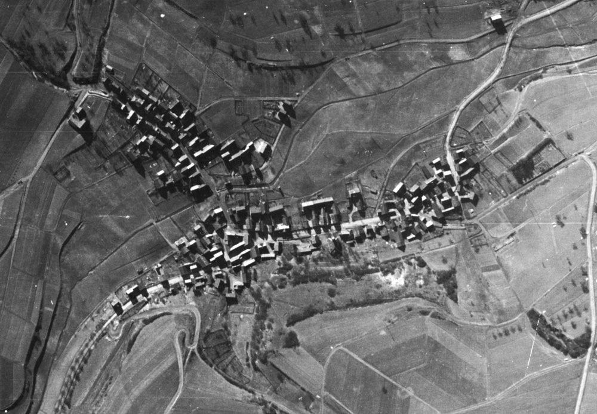

---

## Weitere Ortsnamensformen

Wohl kaum ein Ortsname hat sich im Laufe der Jahrhunderte so verändert wie der von Strinz-Margarethä. Dies liegt wohl hauptsächlich daran, dass eine Unterscheidung zwischen dem gleichnamigen Strinz (später Trinitatis) hermusste.

---

## Zwischen den Gemeinden Strinz-Margarethä und Strinz-Trinitatis kommt es gelegenlich zu Meinungsverschiedenheiten, welcher der beiden Ortsteile denn nun Vorderstrinz und welcher Hinterstrinz wäre.

Eine These, die StM als Vorderstrinz sieht begründet dies damit, dass vom Kloster Bleidenstadt, aus gesehen der Ort vor Strinz-Trinitatis liegt und dieser deshalb als Vorderstrinz anzusehen ist.

Dem Wiedersprich allerdings eine Urkunde aus dem Hessischen Staatsarchiv aus dem Jahre 1462. Dort wird StM als „Hinder Strinczge“ angesprochen.

---

## Es gibt zwei Überlieferung:

Margareta war die Tochter eines heidnischen Priesters und wurde von einer christlichen Amme erzogen. Als der Vater die Hinwendung der Tochter zum christlichen Glauben bemerkte, denunzierte er sie beim Stadtpräfekten. Vor Gericht gestellt, weckte sie das Begehren des Richters, der sie umso härter bestrafte, als sie ihn zurückwies: sie sollte mit Fackeln versengt und in Öl gebraten werden. Als sie bei dieser Prozedur unverletzt blieb, führte dies zu Massentaufen in ihrer Umgebung und zu ihrer Hinrichtung durch Enthaupten.

---

## Die zweite Überlieferung sieht sie als Schäferin und den Stadtpräfekten (mit Namen Olybrius) als denjenigen, der sie begehrte und den sie zurückwies. Margareta wurde im Gefängnis mit eisernen Kämmen und Fackeln gefoltert. Ihre Wunden heilten immer wieder, so kam es auch hier zu außerordentlich vielen Bekehrungen. Schließlich wurde Margareta durch Enthaupten hingerichtet.

Diese zweite Überlieferung weist Erweiterungen auf, die für die heutige Verehrung Margaretas bedeutsam sind.

Im Gefängnis erschien ihr ein riesiger Drache (oft der verwandelte Stadtpräfekt), um sie zu verschlingen. Das Kreuzzeichen, das sie schlug, rettete sie jedoch.

---

## Fazit:

Wäre Margareta 305 nach Christus - hunderte von Kilometer von hier - nicht als Märtyrin gestorben, würde unser Ort heute anders heißen.

---

## In früheren Zeiten bezeichnete man die Strinzer Bürger auch als "Strinzer Heckeflämmser".

In der Strinzer Gemarkung gab es viele Hecken, die in regelmäßigen Abständen abgebrannt (abgeflämmt) wurden. Daher rührt die Bezeichnung "Strinzer Heckeflämmser".

---

## Gulden

Der Gulden bezeichnete ursprünglich eine Goldmünze, später aber auch eine Recheneinheit und eine Silbermünze. Daher unterscheidet man Goldgulden, Rechnungsgulden und Silbergulden.

---

## Appellationsgericht

Ein Appellationsgericht, auch Berufungsgericht genannt, ist ein übergeordnetes Gericht, das über Rechtsbehelfe gegen Entscheidungen nachgeordneter Gerichte urteilt, wobei diese zusammenfassend als Appellation bezeichnet werden.

---

## Besthaupt

Besthaupt bedeutet, dass beim Absterben des Hausvaters, örtlich auch der Mutter, dem Herrn das beste oder zweitbeste Stück in Haus und Stall verfällt. Vielfach ist auch beim Tod des Hausherrn einfach ein monetärer Obolus zu zahlen.

---

## Bete (Herbstbete)

Die Bede (Bete) ist im engeren Sinn eine erbetene, freiwillig geleistete Abgabe an den Grundherrn, aus der sich mitunter eine regelmäßig erhobene, auch landesherrliche Steuer entwickelte. Im weiteren Sinn steht Bede auch im Zusammenhang mit Geldern für kirchliche Zwecke.

---

## Gerechtsname

Die Gerechtsame ist eine veraltete Bezeichnung für eine Berechtigung, ein Nutzungsrecht, Privileg oder Vorrecht an etwas.

---

## Lehen

Unter Lehen verstand man ein weltliches Gut, das der Eigentümer einem anderen zur Nutzung überließ. Das konnte sein: ein Stück Land (mit Gebäuden), ein politisches Amt, ein Recht (zu fischen, jagen, Steuern einzutreiben) oder andere Werte von erheblicher Dauer.

Der Eigentümer (Lehnsherr) gab dieses Lehen unter einer Bedingung, z. B. (gegenseitiger) Treue, in den zumeist erblichen Besitz des Berechtigten, der dadurch zum Lehnsmann wurde. Das Lehen beinhaltete ein ausgedehntes Nutzungsrecht an der fremden Sache, die zugleich zwischen dem Lehnsherren und dem Lehnsmann ein Verhältnis (wechselseitiger) Treue begründen und erhalten sollte.

---

## Manngeld

Das Manngeld war im germanischen Recht das Sühnegeld. Bei einem Totschlag musste der Totschläger eine Entschädigung leisten, und zwar an diejenigen Angehörigen des Erschlagenen, die sonst die Blutrache bzw. die Fehde hätten ausüben müssen. Das Manngeld ging an die nächsten männlichen Verwandten des Geschädigten; gab es diese nicht, auch an Frauen. Manngeld wurde nicht nur auf Tötung angewandt, sondern auch auf andere Vergehen, wie z. B. Notzucht oder Verwundung.

---

## Die heimatliche Mundart

Die heimatliche Mundart gehört zum nassauischen, d. h. fränkischen Sprachgebiet und wird von den alten Strinzer noch gesprochen.

---

## De Schinnerhannes in ussem Ort

In fruirer Zät is de Schinnerhannes mi säner Röwerbande in Nassau erem gezue. In usser Heimat wore ach. Se hun die onzelliegende Mille un Heb ausgeraubt. Aach in ussem Ort hun se en Bauer beraubt.

Der Bauer wollt no Wißborn mer`m Gaul. De Bauer ist möns schun frui uffgestiege, un wiere in de Gäulsstall is, do horre uwwe in säner Stubb Licht geseh.

Do ist de Bauer nuff gunge, un wiere in de Stubb ku, do wor de Schinnerhannes mit säner Röwerbande do.

Se harre schun die Better un sonstige Sache em Finster nunner geworfe. Su hot de Schinnerhannes met säner Bande alles ausgeraubt un geplünnert, bisse im Johr 1803 in Meenz met 22 säner Spießgeselle geköpt wore is.

---

## Um 3 Uhr sin mer haam. Mer worn blutschernaß.

Als mer us Ufgowe gemacht harre, do simmer in die Pfalz fohrn. Die Wuch wollte mehr werre mol fohrn, es hots awwer nit gedon.

---

## Und wir sind auch einmal neben rausgefahren. Um 3 Uhr sind wir heim. Wir waren durchnässt.

Als wir unsere Aufgaben gemacht hatten, da sind wir in die Pfalzstraße gefahren. Die Woche über wollten wir wieder einmal fahren, es hatte aber nicht geklappt.

---

## (Übersetzung: Frank Schwarzer)

Im nachfolgenden Gedicht geht es um die verschiedenen mundartlichen Bezeichnungen für den Hasen, der schon im Nachbarort anders ausgesprochen wird

---

## De Strinzer Hoas

Im Steckenrother Dialekt heißt der Hase:  Haass, in Strinz isses en Hoas.Im Strinzer Dialekt heißt der Bräter:  Bräärer,  Leute nennt man:  Lööt.Der Spitzname der Steckenrother heißt:  Käes  (vom Käsemachen)Der Spitzname der Strinzer heißt:   Strinzer Heckeflämser (Abflämmen derHecken und Feldraine im Frühjahr).

---

## Wos iss ders doa feer Dier?

De Hoas, iss des aach en Strinzer?Jo, Jo, so heißt der Hase in unserem echte Strinzer Dialekt, unn ders is werkliche goldig Dier, sonst hätt` en jo de Albrecht Dürer nit su schee gemold:

Unn Haas, isses im Uwe, wenn mer mit Uweknibbel feuern duud.Doa werds im Winder su richdig worm in de Buud.Woas en Hoas iss, unn wenns  Haass iss, des muss mer vesteeh,sonst deed die Pointe in die Hoose geeh.De Strinzer Hoas des iss e Dier, frisst Ajerpisch un  trinkt koa Bier.De Nome heert sich oo wie Hors, abber des iss in England ee Pferd oder ee RossDie fresse  Howwer un Hei un sinn gegeüwwer  eem Hoas riesegroß.Se saufe Wasser unn  ziehe de Woache unn ach de Blugg, wenn e Hingel gluggsich iss,

---

## doa isses en Glugg, Die Hingel fresse Howwer un lehe ee Aaii, negst alle Doag aans

unn gaggern debei.Awwer de Hoas, des iss e goldig Dier, verlässt der mool sei Rewierunn leäft  üwwer die Äsestross, eer Lööt, eer Lööt, doa iss ebbes loos,vieläscht sugor noo Steggerod, doo muss eer sich ferschde feer säm Dood.Die Steggeräärer rufe: „enn Haas, enn Haas, dess iss feer den Hoas werglich koan Spaas.

Haas, ders heert de Hoas werglich nit gern, unn bereut, des er gelaafe iss in die Fern.Hee schlieht en Hooge unn leeft wos`e kann, in die Strinzer Gemorgg, in die erscht best Gewann.Do fühlt`e sich sicher, unn iss nit mee nerveess,unn heert nit mee haass, haass, vo de Steggerärer Käes.Denn haass, vestieht de Hoas im´e  annern  Sinn gewiss, haas isses  feern Hoas wenn`e  im Bräärer drin iss.

---

## ein goldiges Tier, sonst hätte es der Albrecht Dürer nicht so schön gemalt:

Und heiß ist es im Ofen, wenn man mit Ofenknüppel heizen tut. Da wird es im Winter so richtig warm in der Bude.

Was ein Hase ist und wenn es heiß ist, das muss man verstehen, sonst wird die Pointe in die Hose gehen.

---

## Die Hühner fressen Hafer und legen ein Ei, legen jeden Tag eins und gackern dabei.

Aber der Hase, das ist ein goldiges Tier, verlässt der mal sein Revier und läuft über die Eisenstraße, er läuft er läuft, da ist etwas los, vielleicht sogar nach Steckenrodt,

---

## Er schlägt einen Haken und läuft wo er kann, in die Strinzer Gemarkung, in die erst beste

Gewann.  Dort fühlt er sich sicher und ist nicht nervös, und hört nicht mehr heiß, heiß von dem Steckenrödter Käse.

Denn heiß versteht der Hase in einem anderen Sinn gewiss. Heiß ist es dem Hasen, wenn er im Bräter drinnen ist.

---

## Hier zeigte man im Dorf viel Namensphantasie, um die einzelnen Schneider voneinander unterscheiden zu können."

Sprach man von de Pälzer Schnäder, meinte man eigentlich den in der Pfalz wohnenden Karl Wilhelm August Schneider.

Sprach man hingegen vom Moasdersch Schnäre meinte man eigentlich den Berufsschneider Otto Hankammer.

---

## STRINZMARGRETHA AVROFF U(ND) LIEBACHER GERICHTSSIEG(EL)

von 1703 (Abdruck bis 1806, Siegelstempel erhalten, siehe unten) und dem im Laufe des 18. Jahrhunderts unbeholfen nachgeschnittenen

---

## (Siegelstempel siehe unten).

Während Margareta mit der Linken die Fessel des Drachen hält, schultert sie mit der Rechten einen Palmzweig, und zu ihren Füßen steht der nassauische Löwenschild.

---

## Die offizielle Wappenbeschreibung lautet:

„In Schwarz ein rotbewehrter silberner Drache, von einer aus dem linken Schildrand hervorragenden silbernen Hand mit rotem Ärmel an rotem Strick gehalten".

---

## Eine Darstellung des Drachens bloß mit einem Strick würde unverständlich und sinnlos erscheinen; denn bei Weglassung der Hand, die hier für das Gute steht, würde das Böse, das durch den Drachen verkörpert ist allein das Wappenbild beherrschen. Vorgeschlagen wurde noch ggf. durch zusätzliche Darstellung eines Ringes oder Armreifes den Eindruck noch überzeugender zu vermitteln, dass es sich um eine Frauenhand handelt.

Aufgrund der zusätzlich entstehenden Kosten, hat man dann doch auf eine Veränderung des Entwurfes verzichtet.

---

## Siegel und Stempel

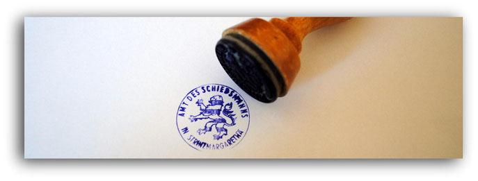

---

## Standesamt

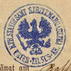

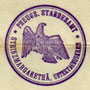

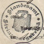

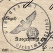

---

## Kirchengemeinde

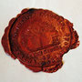

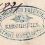

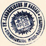

---

## Ortsgericht

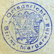

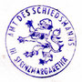

---

## Ortsbeauftragter Winterhilfswerk

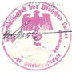

---

## Verband der Kriegsbeschädigten

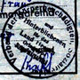

---

## Ausgabestelle der Angestelltenversicherung

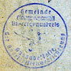

---

## Volksschule

---

## Vor 300.000.000 Jahren

Der Taunus, der bis dahin vom Meer bedeckt war erhebt sich noch vor den Alpen aus dem Meer. Er soll seinerzeit sogar höher gewesen sein als die heutigen Alpen.

---

## Allgemeine Ereignisse

Unsere hiesige Region wird vom Stamm der Mattiaken bewohnt. Dieser ist wahrscheinlich ein germanischer Teilstamm der Chatten der in der Umgebung von Wiesbaden im Taunus lebt.

82 nach Christus und 85 nach Christus kämpften römische Truppen in den sogenannten Chattenkriegen gegen Chatten, die im Taunus und im Gießener Becken lebten. In der Folge entstehen die Grenzbefestigungen des Taunuslimes.

Die spätere Strinzer Gemarkung liegt direkt am obergermanischen Limes zwischen den römischen Kleinstkastellen Zugmantel und Adolfseck.

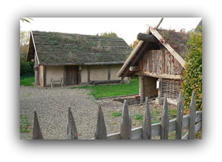

---

## (Quelle: Wikipedia)

Infolgedessen gehört die Strinzer Gemarkung nicht zum römischen Reich, sondern zur sogenannten Magna Germania die nicht von römischen Truppen besetzt werden konnte.

Mattiakergebiet (Quelle: Wikipedia)             Römische Legionäre (Quelle: Wikipedia - Matthias Kabel)

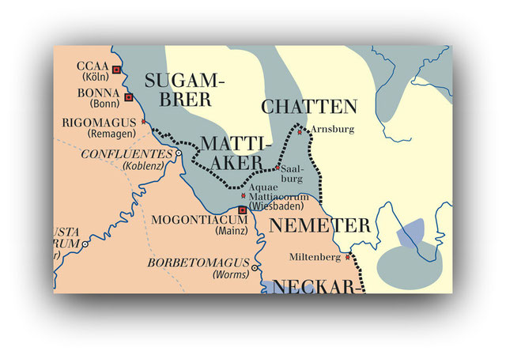

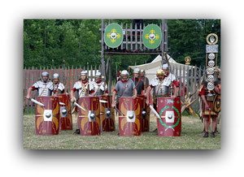

---

## Nach den Chattenkriegen wird der Stamm der Mattiaken Teil des römischen Imperiums.

Der Stamm leistet den Römern Hilfe im Kampf, womit er ein Vorposten der römischen Herrschaft an der Grenze zu Germanien ist.

Die Mattiaken haben auf der germanischen Seite des Limes ihren Wohnsitz, doch ihr Herz und ihre Gesinnung bei den Römern.

---

## Allgemeine Ereignisse

Im Jahre 375 beginnt die große Völkerwanderung. Mit der Aussicht auf ein besseres Leben im Römischen Reich, machen sich viele Völker auf, in die Gebiete, die günstigere Lebensbedingungen versprechen.

Als erstes fallen die Hunnen in die westlichen Gebiete ein und verbreiten sich bis an den Rhein, also auch in unsere Gemarkung. Geführt werden die Hunnen durch Attila.

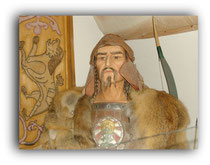

---

## Allgemeine Ereignisse

Das Strinzer Gebiet gehört zu Austrasien das den östlichen Teil des Frankenreiches beschreibt. Austrasien (also Land im Osten) war meist ein selbstständiges fränkisches Teilkönigreich mit der Hauptstadt Metz. Das Gebiet umfasste die fränkischen Gebiete um Rhein, Maas und Mosel und neben Metz die Orte Reims, Köln und Trier, dazu die Gebiete der besiegten germanischen Stämme.

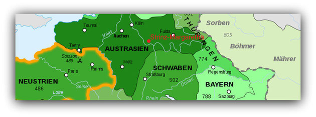

---

## Allgemeine Ereignisse

Der Angelsachse Bonifatius wird vom Papst mit der Christianisierung der germanischen Völker im östlichen Frankenreich beauftragt. Mehr als 30 Jahre lang verbreitet er den christlichen Glauben u.a. im heutigen Hessen. Zur Festigung des Christentums gründet er zahlreiche Klöster.

---

## Ereignisse

Die Benediktiner-Abtei Kloster Bleidenstadt wird als Mainzer Eigenkloster wahrscheinlich durch Erzbischof Lullus von Mainz gegründet.

Neben vielfachem Streubesitz umfasste das Klostergut die Ortschaften Breithardt, Seitzenhahn, Wehen, Hahn, Strinz-Margarethä, Michelbach, Orlen, Neuhof, Wingsbach, Born, Steckenroth, Reßfeld bei Adolfseck, Ober- und Niederlibbach, Heimbach und den Bleidenstädter Grund.

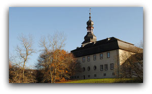

---

## Allgemeine Ereignisse

Strinz-Margarethä gehört zum Herzogtum Franken. Das Herzogtum Franken war eines der Stammesherzogtümer des ostfränkischen Reichs, die sich gegen Ende der Karolingerzeit Anfang des 10. Jahrhunderts herausbildeten. Sein Gebiet umfasste das heutige Hessen, das nördliche Baden-Württemberg, Südthüringen, weite Teile von Rheinland-Pfalz und Teile der Herzogtum Franken heute fränkischen Gebiete in Bayern.

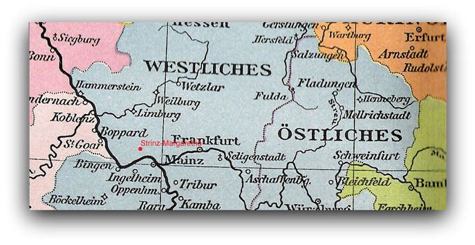

---

## Ereignisse

Aus dem Jahre 812 soll es eine Urkunde geben, auf den sich der Name von StM zurückführen lassen soll. Ich Echtheit dieser Urkunde ist aber wohl umstritten.

---

## Das Gebiet von StM fällt dem Königreich von Ludwig dem Deutschen zu.

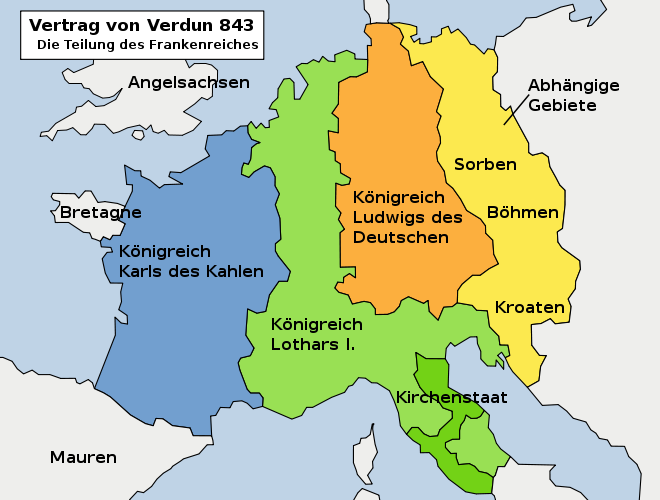

---

## Allgemeine Ereignisse

Zu Anfang des 12. Jahrhunderts regiert Graf Ulrich II. unseren Königsgau, der im Besitz der Burgen Etychenstein (Idstein) und Eppenstein war und sich nach ihnen benannte. Nach seinem Tod geht die Burg und Herrschaft Idsteins an die Grafen von Laurenburg über.

---

## Ereignisse

Um die Mitte des 12. Jahrhunderts überträgt das Kloster die Vogteirechte über sein Gebiet den Grafen von Nassau.

---

## Ereignisse

Die Grafen von Laurenburg nennen sich von 1160 nach der zu Nassau erbauten Burg, Grafen zu Nassau. Ihr Besitz wird durch Ankäufe und Heiraten immer bedeutender, sodass der Graf Heinrich der Reiche schon einen großen Teil des späteren Herzogtum Nassau sein eigen nennen konnte. Seit 1160 waren die Grafen von Lauenburg/Nassau mit der Obervogtei des Klosters Bleidenstadt belehnt. Außerhalb der Bleidenstadter Mark hatten sie zum Teil auch die Vogtei der Orte, in denen das Kloster die Herrschaft ausübte, also vermutlich auch Strinz-Margarethä. Im Ort gab es ein grundherrliches Gericht.

---

## Ereignisse

Für das Jahr 1312 ist ein Adelsgeschlecht in StM belegt, das wohl zum Wehener Adelsgeschlecht "von Wyhne" gehört. (Quelle: Wehen und sein Grund, Dr. Eduard Wilhelmi, 1957)

---

## Ereignisse

Abt. Erwin und sein Convent vom Kloster Bleidenstadt bitten den Erzbischof Balduin zu Trier, dass er die Pfarreien Wersdorf und Strinz-Margarethen, deren Vergebung dem Abt zuständig, wegen erlittener Kriegsschäden dem Kloster einverleiben wolle.

---

## Ereignisse

Wehen erhält vom Kaiser die Stadtrechte. Wehen, das auch zur Terminei des Klosters Bleidenstadt gehört, wurde vom Grafen Gerlach deshalb ausgewählt, weil alle Wege innerhalb der Terminei in Wehen zusammentreffen. So auch der Ritter- oder heute Riddelweg, der die Verbindung nach StM herstellt. (Quelle: Wehen und sein Grund, Dr. Eduard Wilhelmi, 1957)

---

## Allgemeine Ereignisse

Nach langen sommerlichen Regenfällen führen Missernten und Viehseuchen zur ersten großen Hungerskatastrophe des Jahrtausends. Mehrere Jahrzehnte dauert das schlechte Klima an.

---

## Ereignisse

In unserer Region herrscht die Pest. Aus Limburg werden 20 Tote täglich gemeldet. Insgesamt 2400 Tote.

---

## StM gehört ab sofort zu Nassau-Weilburg.

Bei der nassauischen Landesteilung 1355 fallen die Zehntrechte über Bleidenstadt und die dazugehörigen Dörfer an die Weilburger Linie, während Idstein und Wiesbaden an die Idsteiner Linie gehen.

Durch die Teilung wird das Klostergebiet in zwei Teile zerrissen und durch zwei weltliche Obrigkeiten regiert. Es sind die Brüder Johann und Adolf von Nassau.  Graf Adolf erhält die Orte StM, Ober- und Niederlibbach und Haymbach (Hambach).  (Quelle: Wehen und sein Grund, Dr. Eduard Wilhelmi, 1957)

---

## Allgemeine Ereignisse

Feierliche Belehnung der Landesteilung aus dem Jahre 1355 durch den Abt. Köth von Wanscheid zu Bleidenstadt. Bei der Belehnung legt der Abt ausdrücklich fest, dass der Oberhof und die Berufungsinstanz für alle 17 Klosterorte Bleidenstadt sei und bleibe.

---

## Es herrscht ein sehr kalter Winter.

Heuschrecken, die in riesigen Schwärmen von starken Mittelmeerwinden über die Alpen nach Mitteleuropa getrieben werden, zerstören Teile der Ernte und verursachen eine Hungersnot.

---

## Ereignisse

Ein nicht näher bestimmtes Lehen des verstorbenen Johann von Cramburg zu Strinz-Mar. fällt an Bleidenstadt zurück.(Quellen: Nassauische Analen)

---

## Ereignisse

In StM wird das Gericht am dortigen Klosterhof abgehalten, der von einem Bleidenstadter Schultheiß bewirtschaftet wird. Aus diesem Jahre ist ein Petrus Ernicho genannt.

---

## Jeanne d´Arc, die Jungfrau von Orleans, wird am 30. Mai in Rouen/Frankreich wegen Ketzerei auf dem Scheiterhaufen verbrannt.Mit dreizehn Jahren hatte Jeanne d’Arc laut Gerichtsprotokoll ihre ersten Visionen. In diesen erschien ihr unter anderem die Namensgeberin von StM, die heilige Margareta.

Von ihnen erhielt sie den Befehl, Frankreich von den Engländern zu befreien und den Dauphin zum Thron zu führen.Während des Hundertjährigen Krieges verhalf sie bei Orléans den Truppen des Dauphins zu einem Sieg über Engländer und Burgunder und geleitete anschließend Karl VII. von Frankreich zu seiner Krönung nach Reims.Durch eine Verrat, wurde Sie von den Burgundern festgenommen und den Engländern verkauft. Nach mehreren Prozessen wurde sie schließlich zum Tode verurteilt.

---

## Ereignisse

Heinrich Kornigel (Kornegel) von Trohe (Trahe) reversiert sich gegen Margarethe von Baden, Gräfinwitwe zu Nassau, und deren Sohn, Grafen Johann, über Belehnung mit 7 1/2 Gulden zu Strinz-[Margarethae] (Hinderstrintzge), jährlich zu Martini vom gräflichen Schultheißen zu Strinz aus der Herbstbede zu zahlen, und mit der Ritzbach (Retsbach) bei Idstein, beides zu Erblehen.

---

## Allgemeine Ereignisse

Eine Missernte führt zur Teuerung der Nahrungsmittel, die Hungersnöte mit vielen Toten und Seuchen in Deutschland verursacht.

---

## Das grundherrliche Gericht von StM unterliegt dem Schöffengericht am Bleidenstadter Oberhof.

In StM wird das Gericht am dortigen Klosterhof abgehalten, der von einem Bleidenstadter Schultheiß bewirtschaftet wird. Aus diesem Jahre ist ein Metzenhenn genannt.

Den Kirchsatz der 1446 zuerst in Strinz belegten Pfarrei trug Nassau-Idstein von Bleidenstadt zu Lehen.(Quelle: Nassauische Analen)

Zwischen dem Kloster Bleidenstadt und den Grafen von Nassau-Idstein erwächst eine Auseinandersetzung über die beiderseitige Gerechtsname im Kirchspiel Strinz-Margarethä.(Quelle: Nassauische Analen)

In Holen oder Kleinstrinz erfragt der Amtmann des Grafen Nassau-Idstein ein Weistum über die Rechte seines Herrn in dem Kirchspiel von Strinz-Margarethä, Ober- und Niederlibbach.(Quelle: Weisthümer gesammelt von Jacob Grimm, Vierter Theil / 1863)Staatsarchiv Wiesbaden Abt. 133/44)(Siehe auch unter: Wer ist Herr über StM?)

---

## Ereignisse

Gilbrecht der Jüngere von Schönborn, Kurmainzer Amtmann, erhält aus StM 5 Gulden Burglehen zu Adolfseck.

---

## Überlieferte Zahlung (an die Herrschaft in Idstein?)Knipp Hen 12 Gulden(Gemeindearchiv Hünstetten)

Gilbrecht der Jüngere von Schönborn, Kurmainzer Amtmann, erhält aus StM 5 Gulden Burglehen zu Adolfseck.(H. Gensicke; Die von Schönborn. Nass. Analen, Bd. 91, 1980, S. 259 ff.)

---

## Hilmann Strinz mit seinem Kirspel, 16 Pfluge von Hilmann Strinz(Quelle: Gemeindearchiv Hünstetten)

Gilbrecht der Jüngere von Schönborn, Kurmainzer Amtmann, erhält aus StM 5 Gulden Burglehen zu Adolfseck.(H. Gensicke; Die von Schönborn. Nass. Analen, Bd. 91, 1980, S. 259 ff.)

---

## Ereignisse

Gilbrecht der Jüngere von Schönborn, Kurmainzer Amtmann, erhält aus StM 5 Gulden Burglehen zu Adolfseck.(H. Gensicke; Die von Schönborn. Nass. Analen, Bd. 91, 1980, S. 259 ff.)

---

## Ereignisse

Gilbrecht der Jüngere von Schönborn, Kurmainzer Amtmann, erhält aus StM 5 Gulden Burglehen zu Adolfseck.(H. Gensicke; Die von Schönborn. Nass. Analen, Bd. 91, 1980, S. 259 ff.)

---

## Ereignisse

Lehen von Nassau-Idstein, 7 1/2 Gulden zu Strinz-Margarethae (Hinder Strinczge) und die Rietsbach bei Idstein, Erblehen: Philipp von Stockheim und Johann von Königstein, Revers. Siegler: Aussteller.(Quelle: HStA, 121, U von Stockheim 1462 Juni 22 b)

---

## Ereignisse

Als im Jahr 1465 das Kloster Bleidenstadt dem Grafen Johann von Nassau-Idstein die Verlängerung des bisherigen Lehensvertrages über die beiden Vogteien Würges und Kirberg sowie die Dörfer Strinz-Margarethä, Hambach und Libbach verweigert und damit seine Macht unter Beweis stellen will, kann sich Graf Johann die zur Befriedigung seiner eigenen Lehensleute dringend benötigten Lehen nur unter Einschaltung seines Bruders, des Erzbischof Adolf von Mainz sichern.

Erzbischof Adolf von Mainz vergleicht Abt und Konvent des Klosters Bleidenstadt mit seinem Bruder Grafen Johann von Nassau (Idstein) betreffs der Gerechtigkeiten in dessen von dem Kloster zu Lehen rührenden Vogteien - Würges und Kirberg - und Dörfern - Strinz-Margarethae, Ober-, Nieder-Libbach und Hambach.(Quelle: HHStAW 14 Nr. U 103 a)

---

## (Quelle: Gemeindearchiv Hünstetten)

Luden Hentzen in Strinz, den Kindern das Besthaupt für den Vater erlassen; er war zu Foytperg gefangen gewesen.

---

## (Quelle: Gemeindearchiv Hünstetten)

Dienstag nach Latere zahlt Wanmeister zu Strinz 1 Gulden um Werk willen, die er mit dem Scheffer hatte; weiter 12 Albus und 17 Torn.; der Wagenmeister mit dem Hoensteyner Landschreiber zu Idstein.

---

## Ereignisse

Johann von Eppenstein, Schreiber des Graf Johann von Nassau, beurkundet, dass Schefferhenne, Klaus Scheffer Sohn zu Rückershausen, Höriger von Graf Philipp v. K.D., in das Amt Burgschwalbach gehörig, die nassauisch Hörige Adelheid Knoth von Strinz geehelicht hat. Es ist ausgemacht worden, dass Adelheid künftig dem Grafen Philipp v. K.D. gehörig sein soll.

(Quelle: Regesten der Grafen von Katzenelnbogen, Karl E. Demandt, 1954, Seite 1625)Anmerkung: Es ist nicht bekannt, aus welchem Strinz Adelheid kam.

---

## Cleßgen von Strinz arbeitet als Opperknecht der Maurer(Quelle: Gemeindearchiv Hünstetten)

Lehen von Nassau-Idstein, Burglehen zu Idstein, 6 Malter Weizengülte von der Vogtei Würges, 6 Gulden zu Niederseelbach, 3 3/4 Gulden aus der Herbstbede zu Strinz-Margarethae und die Rietspach bei Idstein: Philipp von Stockheim, + Philipps Sohn, Revers gegen Graf Johann, zugleich für seine Brüder.(Quelle; HHStAW 121 Nr. U von Stockstein)

---

## Ereignisse

Die Dörfer Styntz, StM, Ober- und Niederlibbach und Hanbach verkaufen dem Peter Zauwer 14 Gulden Jahresrente am Mandach nach Reminiscere 1479.(Quelle: Hessisches Staatsarchiv, Abt. 133/63)

---

## Ereignisse

Die Rödel zu Reifenberg haben in StM ein Lehen von Nassau Idstein.(Quelle. H. Gensicke; Die Rödel von Reifenberg / Nass. Analen, Bd. 96, 1985, S. 240)

Henne Rödel von Reifenberg bekundet, daß Philipp Graf zu Nassau ihn, laut inseriertem Lehnsbrief, mit 8, statt 6 Gulden auf seine und seiner Frau Katharina Lebzeit von Gefällen und Renten vom Schultheissen zu Strinz-Margarethae, Weihnachten fällig, belehnt hat.(Quelle: HHStAW 121 Nr. U von Reifenberg)

Lehen von Nassau-Idstein, Burglehen zu Idstein, 6 Malter Weizengülte von der Vogtei Würges, 6 Gulden zu Niederseelbach, 3 3/4 Gulden aus der Herbstbede zu Strinz-Margarethae und die Rietspach bei Idstein: Philipp von Stockheim, Revers gegen Graf Philipp von Nassau.(Quelle: HHStAW Bestand 121 Nr. U von Stockstein)

---

## Ereignisse

Die Rödel zu Reifenberg haben in StM ein Lehen von Nassau Idstein.(Quelle: H. Gensicke; Die Rödel von Reifenberg / Nass. Analen, Bd. 96, 1985, S. 240)

---

## Ereignisse

Die Rödel zu Reifenberg haben in StM ein Lehen von Nassau Idstein.(Quelle: H. Gensicke; Die Rödel von Reifenberg / Nass. Analen, Bd. 96, 1985, S. 240)

---

## Ereignisse

Die Rödel zu Reifenberg haben in StM ein Lehen von Nassau Idstein.(Quelle: H. Gensicke; Die Rödel von Reifenberg / Nass. Analen, Bd. 96, 1985, S. 240)

---

## Ereignisse

Die Rödel zu Reifenberg haben in StM ein Lehen von Nassau Idstein.(Quelle: H. Gensicke; Die Rödel von Reifenberg / Nass. Analen, Bd. 96, 1985, S. 240)

---

## Ereignisse

Die Rödel zu Reifenberg haben in StM ein Lehen von Nassau Idstein.(Quelle: H. Gensicke; Die Rödel von Reifenberg / Nass. Analen, Bd. 96, 1985, S. 240)

---

## Ereignisse

Die Rödel zu Reifenberg haben in StM ein Lehen von Nassau Idstein.(Quelle: H. Gensicke; Die Rödel von Reifenberg / Nass. Analen, Bd. 96, 1985, S. 240)

---

## Ereignisse

Es kommt zu einem Streit mit dem Pfarrer von StM wegen des kleinen und großen Zehnten, den Erzbischof Berthold von Mainz schlichtete, wobei er den Zehnten dem Kloster zusprach, wofür dieses aber dem jeweils residenzpflichtigen Pfarrer eine jährliche Rente von acht Maltern Korn Mainzer Maß zusichern muss. (Quelle: HHStAW 14 Nr. U 130)

Abt Johann und der Konvent des Klosters Bleidenstadt belehnen (verpachten) den Grafen Johann von Nassau-Idstein unter Substituierung des Philipp von Storkheim, Amtmanns zu Idstein, mit den zwei Vogteien zu Würges (Wedries) und Kisberg (Kyrchpurgk) und den Dörfern Strinz Margarethä, den beiden Libbach (Liedbach) und Hambach (Haynbach). G. uff Dornstag nach Sant Martins dag = 17. November 1491(Quelle: Hessisches Staatsarchiv Wiesbaden, Abt. 131 Nr. U 208)

Philipp von Stockheim, Amtmann zu Idstein, reversiert (verpflichtet) sich als Substituierter des Grafen Johann von Nassau-Idstein gegen Abt Johann des Klosters Bleidenstadt über Empfang der von demselben herrührenden Lehen, der zwei Vogteien zu Würges (Wedries) und Kirberg (Kirchpurgk) und der Dörfer Strinz Margarethä, der beiden Libbach (Lieddebach, Leddebach) und Hambach (Hainbach). G. uff Dornstag nach Sant Martins dag = 17. November 1491(Quelle: Hessisches Staatsarchiv Wiesbaden, Abt. 131 Nr. U 209)

Die Rödel zu Reifenberg haben in StM ein Lehen von Nassau Idstein.(Quelle: H. Gensicke; Die Rödel von Reifenberg / Nass. Analen, Bd. 96, 1985, S. 240)

---

## Ereignisse

Die Rödel zu Reifenberg haben in StM ein Lehen von Nassau Idstein.(Quelle: H. Gensicke; Die Rödel von Reifenberg / Nass. Analen, Bd. 96, 1985, S. 240)

---

## Ereignisse

Die Rödel zu Reifenberg haben in StM ein Lehen von Nassau Idstein.(Quelle: H. Gensicke; Die Rödel von Reifenberg / Nass. Analen, Bd. 96, 1985, S. 240

---

## Ereignisse

Die Rödel zu Reifenberg haben in StM ein Lehen von Nassau Idstein.(Quelle: H. Gensicke; Die Rödel von Reifenberg / Nass. Analen, Bd. 96, 1985, S. 240)

---

## Ereignisse

Eckart von Elkerhusen, Propst des S. Ferrutius Stiftes zu Bleidenstadt belehnt (verpachtet) den Grafen Philipp von Nassau-Idstein unter Substituierung des Philipp von Stockheim, Amtmanns zu Idstein, mit den zwei Vogteien zu Würges (Wedries) und Kirberg ("Kirpurg") und den Dörfern Strinz Margarethae, den beiden Libbach ("Liedebach") und Hambach ("Hanbach"). G. uff. Mitwochen nach dem heiligen Oisterdage = 6. April 1496(Quelle: Hessisches Staatsarchiv Wiesbaden, Abt. 131 Nr. U 215)

Philipp von Stockheim, Amtmann zu Idstein, reversiert (verpflichtet) sich als Bevollmächtigter des Grafen Philipp von Nassau-Idstein dem Propst des Ferrutius Stiftes Bleidenstadt Eckart von Elkerhusen über Empfang der von dem Stift herrührenden Lehen: der zwei Vogteien zu Würges ("Wedries") und Kirberg ("Kirpurg") und der Dörfer Strinz-Margarethä, der beiden Libbach (Liedebach) und Hambach (Hanbach). G. uff. Mitwochen nach dem heiligen Oisterdage = 6. April 1496(Hessisches Staatsarchiv Wiesbaden, Abt. 131 Nr. U 216)

Die Rödel zu Reifenberg haben in StM ein Lehen von Nassau Idstein.(Quelle: H. Gensicke; Die Rödel von Reifenberg / Nass. Analen, Bd. 96, 1985, S. 240)

---

## Ereignisse

Die Rödel zu Reifenberg haben in StM ein Lehen von Nassau Idstein.(Quelle: H. Gensicke; Die Rödel von Reifenberg / Nass. Analen, Bd. 96, 1985, S. 240)

---

## Ereignisse

Die Rödel zu Reifenberg haben in StM ein Lehen von Nassau Idstein.(Quelle: H. Gensicke; Die Rödel von Reifenberg / Nass. Analen, Bd. 96, 1985, S. 240)

---

## Obrigkeiten

Schultheiß: Helbick ??? (Im Reichsteuerregister wird ein Helbick Scholtheiß aufgeführt. Dies kann ein Hinweis auf den damaligen Schultheißen sein

---

## Ereignisse

Die Rödel zu Reifenberg haben in StM ein Lehen von Nassau Idstein.(Quelle: H. Gensicke; Die Rödel von Reifenberg / Nass. Analen, Bd. 96, 1985, S. 240)

---

## Ereignisse

Die Rödel zu Reifenberg haben in StM ein Lehen von Nassau Idstein.(Quelle: H. Gensicke; Die Rödel von Reifenberg / Nass. Analen, Bd. 96, 1985, S. 240)

---

## Ereignisse

Die Rödel zu Reifenberg haben in StM ein Lehen von Nassau Idstein.(Quelle: H. Gensicke; Die Rödel von Reifenberg / Nass. Analen, Bd. 96, 1985, S. 240)

---

## Ereignisse

Die Rödel zu Reifenberg haben in StM ein Lehen von Nassau Idstein.(Quelle: H. Gensicke; Die Rödel von Reifenberg / Nass. Analen, Bd. 96, 1985, S. 240)

---

## Ereignisse

Die Rödel zu Reifenberg haben in StM ein Lehen von Nassau Idstein.(Quelle: H. Gensicke; Die Rödel von Reifenberg / Nass. Analen, Bd. 96, 1985, S. 240)

---

## Ereignisse

Die Rödel zu Reifenberg haben in StM ein Lehen von Nassau Idstein.(Quelle: H. Gensicke; Die Rödel von Reifenberg / Nass. Analen, Bd. 96, 1985, S. 240)

---

## Ereignisse

Johann von Stockheim, Propst des S. Ferrutius Stiftes zu Bleidenstadt, belehnt (verpachtet) den Grafen Adolf von Nassau, Herrn zu Wiesbaden und Idstein, mit Substituierung des Wilhelm Judden von Eltville, Amtmanns zu Wiesbaden mit den Lehen die Graf Philipp von Nassau-Idstein (Bruder des Graf Adolf) vom Stift innegehabt hatte, den zwei Vogteien zu Würges ("Wedriges") und Kirberg ("Kirppurg") und den Dörfern Strinz-Margarethä, den beiden Libbach ("Lydbach") und Hambach ("Hambach"). G. uff Montag nach dem achtzehenten tag = 14. Januar 1510.(Quelle: Hessisches Staatsarchiv, Wiesbaden, Abt. 131 Nr. U 240)

Graf Adolf von Nassau, Herr zu Wiesbaden und Idstein, reversiert (verpflichtet) sich durch Wilhelm Judden von Eltville, Amtmann zu Wiesbaden, dem Propst Johann von Stockheim des S. Ferrutius Stiftes zu Bleidenstadt über Empfang der früher dem Grafen + Philipp von Nassau-Idstein (Bruder Adolfs) verliehenen Lehen, der zwei Vogteien zu Würges ("Wedriges") und Kirberg ("Kirppurg") und der Dörfer Strinz-Margarethä, der beiden Libbach (Lidbach) und Hambach (Hambach). G. uff Montag nach dem achtzehenten tag = 14. Januar 1510.(Quelle: Hessisches Staatsarchiv, Wiesbaden, Abt. 131 Nr. U 241)

Lehen von Nassau-Idstein, Burglehen zu Idstein, 6 Malter Weizengülte von der Vogtei Würges, 6 Gulden zu Niederseelbach, 3 3/4 Gulden aus der Herbstbede zu Strinz-Margarethae und die Rietspach bei Idstein: Friedrich von Stockheim, + Philipps Sohn, Revers gegen Adolf Graf zu Nassau-Wiesbaden-Idstein.(Quelle: HHStAW 121 Nr. U von Stockheim)

---

## Ereignisse

Johann von Stockheim, Propst des S. Ferrutius Stiftes zu Bleidenstadt, bestätigt dem Grafen Philipp von Nassau, Herrn zu Wiesbaden und Idstein die vom Stift herrührenden und zuvor dem Grafen Adolf von Nassau verliehenen Lehen (Verpachtung) , die zwei Vogteien zu Würges ("Wedriges") und Kirberg (Kirppurg) und die Dörfer Strinz-Margarethä, die beiden Libbach ("Lidbach") und Hambach ("Hannbach"). G. uff Sampstag nechst nach dem Sontag Quasimodogeniti = 09. April 1513(Quelle: Hessisches Staatsarchiv Wiesbaden, Abt. 131 Nr. U 251)

Graf Philipp von Nassau, Herr zu Wiesbaden und Idstein, reversiert (verpflichtet) sich dem Propst Johann von Stockheim des S. Ferrutius Stiftes zu Bleidenstadt über Empfang der zuvor dem Grafen Adolf von Nassau etc. verliehenen Stiftischen Lehen, der zwei Vogteien zu Würges ("Wedriges") und Kirberg (Kirppurgk) und der Dörfer Strinz-Margarethä, der beiden Libbach ("Lidbach") und Hambach ("Hannbach"). G. uff Sampstag nechst nach dem Sontag Quasimodogeniti = 09. April 1513(Quelle: Hessisches Staatsarchiv Wiesbaden, Abt. 131 Nr. U 252)

Lehen von Nassau-Idstein, Burglehen zu Idstein, 6 Malter Weizengülte von der Vogtei Würges, 6 Gulden zu Niederseelbach, 3 3/4 Gulden aus der Herbstbede zu Strinz-Margarethae und die Rietspach bei Idstein: Friedrich von Stockheim, + Philips Sohn, Revers zugleich für seine Brüder, gegen inserierten Lehnbrief des Grafen Philipp von Nassau-Wiesbaden-Idstein.(Quelle: HHStAW 121 Nr. U von Stockheim)

---

## Ereignisse

Bei der Verrechnung der Einnahmen der Herrschaft Idstein vom Weinschank auf "Kirben", vom "Kirchweingeld" und der Weinlieferung zu "Kirben" wird die Kirchweihe zu Strinz-Margarethä am 13. Juli 1520 (uff Freitag nach Margaretha) erwähnt.(Quelle: Nassauische Analen)

---

## Ereignisse

Am 26.04.1524 erhält Pfarrer Johannes Schiffer vom Domkapitel zu Mainz, die Erlaubnis die Pfarrei mit Nicolaus Calciator zu permutieren (Red.: nachzubesetzen).

---

## Ereignisse

Lehen von Nassau-Idstein, Burglehen zu Idstein, 6 Malter Weizengülte von der Vogtei Würges, 6 Gulden zu Niederseelbach, 3 3/4 Gulden aus der Herbstbede zu Strinz-Margarethae und die Rietspach bei Idstein: Philipp von Stockheim, + Friedrichs Sohn, Revers gegen Graf Philipp von Nassau-Wiesbaden-Idstein. Siegler: Aussteller.

---

## Ereignisse

Strinz-Margarethä zahlt dem Stift St. Martin in Idstein 2 1/2 Goldgulden(Quelle: Die Stifte St. Walpurgis in Weilburg und St. Martin in Idstein / Neuauflage 1980)

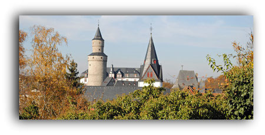

---

## Ereignisse

StM ist mit einem Nassau-Idsteiner Lehen der von Müllermark zu Miehlen (6 fl. Manngeld) belegt.(Quelle: Hessisches Staatsarchiv, Abt. 133 / Müllermark 2)

---

## 

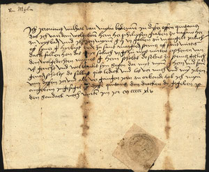

---

## Ereignisse

Bei der Verrechnung der Einnahmen der Herrschaft Idstein vom Weinschank auf "Kirben", vom "Kirchweingeld" und der der Weinlieferung zu "Kirben" wird die Kirchweihe zu Strinz-Margarethä am 18. Juli 1546 (Sonntag nach Margaretha) erwähnt.(Quelle: Nassauische Analen)

---

## Ereignisse

Die Kirchbaumeister des Stift St. Martin in Idstein kaufen am 11. November in Strinz 1 Gulden Gülte (Grundsteuer).(Quelle: Die Stifte St. Walpurgis in Weilburg und St. Martin in Idstein / Neuauflage 1980)

Die Eheleute Kaspar Zimmermann zu Strinz-Margarethä verschreiben dem Stift Idstein unter Vorbehalt der Wiederlösung für 20 Gulden eine Rente von jährlich einem Gulden und stellen dafür benannte Immobilien zum Unterpfand.

(Quellen: Die Stifte St. Walpurgis in Weilburg und St. Martin in Idstein / Neuauflage 1980 / HStA Bestand 36 Nr. U 65)

---

## Ereignisse

Aus diesem Jahr ist ein Hilmer Kremers erwähnt. Dieser muss in Wiesbaden eine Zeugenaussage machen. Es geht um eine Forderung von Johan Engelmann (Schultheiß von Rauenthal) von 14 Gulden, die er dem "abgebrannten" Joachim Gaifpiczen geliehen hatte. Da Gaifpiczen mittlerweile gestorben war, ging die Forderung an seine Witwe über. Hier die Zeugenaussage von Hilmer Kremers im damaligen Wortlaut:Item sagt Kremes Hilmer von Margreten Strincz uf gethanen aid, das sichs begeben uf den Wißbader Kirbmontag des LVII ten jars, sei er sampt Kun Thomas mit Johann Engelmann in junker Joachim Gaispiczen haus kommen, sei er Gaißpicz seliger tot gewesen, doch noch unbegraben aldo gelegen; hab er Engelman an ihr gefordert 14 gulden, darauf sie ihme geantwort, sie hab ihm etliche stroe (Stroh) geben, sie bitte ihnen, er solt gedult gegen ihr tragen, sie wolte ihnen gutlich bezalen, sie wisse wol, das sie es ihm schuldig sei; weiter ihme nit wißlichen. Hier ein Übersetzungsversuch: Auf Eid sagte Kremes Hilmer aus Strinz-Margarethe, dass er am Wiesbadener Kerbemontag (10. Mai 1557) mit Kun Thomas und Johan Engelmann in das Haus von Joachim Gaispiczen gekommen ist. Gaißpicz sei tot aber noch nicht begraben dagelegen. Engelmann hat von der Witwe die 15 Gulden gefordert. Darauf antwortete sie ihm, sie habe ihm schon etliches Stroh gegeben (Anmerkung der Red.: Das Stroh war aber faul und nicht zu gebrauchen). Sie bitte ihn, dass er Geduld haben soll. Sie weiß, was sie ihm schuldig sei und sie will es auch bezahlen. Weiter ist ihm (Red.: Hilmer Kremer) nichts bekannt. (Quelle: Ältestes Gerichtsbuch der Stadt Wiesbaden)

---

## Ereignisse

Lehen von Nassau-Idstein, Burglehen zu Idstein, 6 Malter Weizengülte von der Vogtei Würges, 6 Gulden zu Niederseelbach, 3 3/4 Gulden aus der Herbstbede zu Strinz-Margarethae und die Rietspach bei Idstein: Philipp von Stockheim, + Philipps Sohn. (Quelle: HStAW, 121, U von Stockheim 1565 Juli 9 b)

---

## Ereignisse

Ein Amtsverzeichnis gibt sicheren und endgültigen Aufschluss darüber das Strinz zum Verwaltungsbezirk "Amt Idstein" gehört.(Quelle: Landesgeschichtliches Infosystem Hessen / 2011)

---

## Der Schultheiß Hans Enders nimmt an der Beisetzung des Grafen Balthasar von Nassau-Idstein teil.

Lehen von Nassau-Idstein, Burglehen zu Idstein, 6 Malter Weizengülte von der Vogtei Würges, 6 Gulden zu Niederseelbach, 3 3/4 Gulden aus der Herbstbede zu Strinz-Margarethae und die Rietspach bei Idstein: Philipp von Stockheim, + Philipps Sohn, Revers.(Quelle: HHStAW 121 Nr. U von Stockstein)

---

## Ereignisse

Das Jahr 1570 ist außerordentlich heiß. Nach dem ersten Grasschnitt kann kein Hälmchen mehr hervorsprießen, so trocken sind schon die Wiesen. Niemand der lebenden Leute kann sich auf solch eine schlechte Heuernte besinnen.(Quelle: Wehen und sein Grund, Dr. Eduard Wilhelmi, 1957)

---

## Ereignisse

StM muss als Ablösegeld von den Frondiensten, ab sofort jährlich 61 Taler an Nassau-Idstein zahlen. Dass dabei unser Dorf nach Breithardt (62 Taler) die 3. Stelle einnimmt, ist sicher ein Beweis dafür, dass es im Vergleich zu anderen Dörfern wirtschaftlich gut gestellt war.

---

## Ereignisse

Auf den Filialen erhält der Pfarrer jede Kirb des Jahres 1 1/2 Wintzel weil dann die letzte Predigt da geschehen muss.

---

## Ereignisse

Adam Dornfelder befasst sich mit der Frage, ob ein Christ der Pest entfliehen darf und verneint sie.(Quelle: Abhandlung: Seuchen suchten Idstein heim)

---

## Ereignisse

Der Dechant Gerhard Köth von Wanscheidt und das Kapitel des S. Ferrutius-Stiftes zu Bleidenstadt bestätigen dem Grafen Albrecht von Nassau-Saarbrücken etc. als Vormund des Grafen Johann Ludwig von Nassau, Herrn zu Wiesbaden und Idstein, die vom Stift herrührenden und zuvor dem Grafen Philipp von Nassau-Idstein verliehenen Lehen (Verpachtung), die zwei Vogteien zu Würges und Kirberg (Kyrburgk) und die Dörfer Strinz Margarethä, die beiden Libbach ("Liedbach") und Hambach. 15. September 1586(Quelle: Hessisches Staatsarchiv Wiesbaden, Abt. 131 Nr. U 338)

Graf Albrecht von Nassau-Saarbrücken etc. (-Weilburg) reversiert (verpflichtet) sich als Vormund des Grafen Johann Ludwig von Nassau Herrn zu Wiesbaden und Idstein dem Dechanten und Kapitel des S. Ferrutius Stifts zu Bleidenstadt über Empfang der von diesem zu Lehen rührenden, vormals dem Grafen Philipp von Nassau-Idstein verliehenen zwei Vogteien zu Würges und Kirberg und der Dörfer Strinz-Margarethä, der beiden Libbach ("Liedbach") und Hambach. 15. September 1586(Quelle: Hessisches Staatsarchiv Wiesbaden, Abt. 131 Nr. U 339)

---

## Ereignisse

Hieremias Leo aus Langenschwalbach hält auf der Synode von Idstein seine Probepredigt und unterwirft sich dem Examen, dass er wohl bestanden hat. Als Pfarrer Dorffenthalers Nachfolger wird er am 18. Dezember in StM als Pfarrherr eingesetzt.

Außerdem hatte sich der Pfarrer von Kettenbach, Heinrich Müller, auf die Stelle beworben. Er wurde aber wegen Bedenken abgelehnt.

---

## Ereignisse

Ende des 16., Anfang des 17. Jahrhundert wurde von einem Vigand Kalwort die Strinzer Glocke gegossen. Sie wog ca. 200 kg und hatte einen Durchmesser von 70 cm. Auf der Schulter der Glocke war eine umlaufende Inschrift, wahrscheinlich in frühromanistischer Kapitalis eingeschlagen. Sie lautet:

---

## Allgemeine Ereignisse

Da die Linie Nassau-Idstein ausgestorben ist, wird Nassau-Idstein wieder mit Nassau-Weilburg (zudem StM gehört) zusammengelegt.

---

## Ereignisse

Der weite Weg, die Dunkelheit, der Winter mit Eis und Schnee und die Wolfsplagen erwiesen sich für den Strinzer Pfarrer, der seinen Dienst auch in Neuhof versah (siehe auch 1601) als nicht mehr durchführbar. Gräfin Elisabeth von Nassau-Weilburg verfügt daraufhin, dass der Wehener, für den Schuldienst verpflichtete Kaplan, zugleich den Pfarrdienst in Neuhof versehen soll. Der Strinzer Pfarrer war erlöst.

---

## Ereignisse

Das ehemalige Bleidenstadter Gericht als Oberhof hat schon lange keine Bedeutung mehr für StM. Das belegt eine Befragung der ältesten Einwohner von Wehen und StM. Diese wissen nur noch, dass ihre Ur- Ur- Urgroßeltern erzählt hätten, das Bleidenstadt Oberhof sei. Obs aber wahr sei, das wisse man nicht, das sei schon so lange her, dass es doch kein positives Recht mehr sei. Man habe sich seit Menschengedenken nicht an Bleidenstadt gewandt, um sein Recht zu holen, und sie hätten auch nie gehört, dass jemand auf den Gedanken gekommen wäre, sein Recht dort holen zu wollen.

---

## Allgemeine Ereignisse

Pfarrer Geory Gleyberger stirbt im Jahre 1613.  In dem Buch "Historisches Lexikon Evangelischer Jubel-Priester" aus dem Jahr 1727 wird folgendes über ihn berichtet:

Herrn Georg Gleyppurgio damaliger Pfarrer in Strinz.Margarethä in Francken, das öffentliche Zeugnis bekommen, dass er ein ernstlicher Eyferrer und Liebhaber des Göttlichen Worts gewesen, und dasselbe 18 Jahre zu Breithardt und 32 Jahre zu Michelbach mit allen Fleiß geprediget, und einen solchen Priester-Wandel geführet, dass manniglich ein sonderbares Wohlgefallen daran getragen. Er ist den 4. Oct. Anno 1613 gestorben in 75ten Jahr seines Alters und 50. des Predig-Amts. Davon Wolf Silber in Triade Exequiarum Christanarum ein mehrers mittheilet.

---

## Ereignisse

Lehen von Nassau-Idstein, Burglehen zu Idstein, 6 Malter Weizengülte von der Vogtei Würges, 6 Gulden zu Niederseelbach, 3 3/4 Gulden aus der Herbstbede zu Strinz-Margarethae und die Rietspach bei Idstein: Ludwig Graf zu Nassau-Saarbrücken, Lehnbrief für Joh. Friedrich von Stockheim, + Wilhelms Sohn, zugleich für Joh. Nicolas, Friedrich und Johann Adolf, + Johanns Söhne, Phil. Eberhard, + Philipps Sohn, und Eberhard, alle von Stockheim.(Quelle; HHStAW 121 Nr. U von Stockstein)

---

## Allgemeine Ereignisse

Das Jahr zeichnet sich durch mehrere Erdbeben aus. (Wehen und sein Grund, Dr. Eduard Wilhelmi, 1957)

Der spanische Feldherr Spinola lässt sich mit seinen Truppen in unserem Gebiet nieder. Die Menschen staunen über das große gut ausgerüstete spanische Heer, das 16 große Geschütze und 1000 Wagen Munition mitführt. Jedes Geschütz wird von 15 Pferden gezogen. Von Orlen ist bekannt, dass dieses komplett von den Spaniern ausgeplündert wird. Auch Wehen hat schwer unter den Spaniern zu leiden. Es kommt wieder zu unzähligen Gräueltaten.

---

## Ereignisse

18. März 1620Lehen von Nassau-Idstein, Burglehen zu Idstein, 6 Malter Weizengülte von der Vogtei Würges, 6 Gulden zu Niederseelbach, 3 3/4 Gulden aus der Herbstbede zu Strinz-Margarethae und die Rietspach bei Idstein: Ludwig Graf zu Nassau-Saarbrücken, Lehnbrief für Johann Burckhardt von Stockheim, anstelle seines Vaters Johann Friedrich sowie für Joh. Henrich, + Eberhards Sohn, Joh. Niclaus und Phil. Eberhard und Friedrich und Joh. Adolph, alle von Stockheim. Siegler: Aussteller.(HHStAW, 121, U von Stockheim)

---

## Allgemeine Ereignisse

Im November besetzt der ligistische General Tilly unser Region. Diese Besetzung hält acht Monate lang an. Graf Gustav von Nassau muss das Heer Tillys verköstigen, was ihn täglich 20.000 Gulden kostet.

---

## Ereignisse

Der Krieg verlagert sich nach Norddeutschland. Deshalb ziehen die Truppen Tillys nach 8 Monaten aus unserer Region ab.

---

## Allgemeine Ereignisse

Bis August ist unsere Region truppenfrei. Doch dann kehren die Truppen Tillys wieder in unsere Region zurück. Viele junge Bauernburschen lassen sich für Tillys Armee werben. Die Werbetrommeln Tillys versprechen ihnen ein gutes Auskommen. Wieder müssen die Truppen Tillys aus der Region verpflegt werden, was zu Hungersnöten in der Bevölkerung führt.

---

## Allgemeine Ereignisse

Im Januar werden die Truppen Tillys in der Rhein-Main-Ebene zusammengezogen, was zur Folge hat, dass unsere Region geräumt wird.

---

## Allgemeine Ereignisse

Das Jahr 1625 zeichnet sich durch seine abnormen Witterungsverhältnisse aus. Der Monat Januar beginnt mit ungewöhnlich heftigen Stürmen, denen Mitte des Monats sommerliche Hitze folgt. So kommt es, dass Ende Januar die Blumen, Mandelbäume und die frühen Obstsorten in voller Blüte stehen. Ende Februar tritt eine äußerst harte Kälteperiode auf, sodass sogar das Pfingstfest in tiefen Schnee gefeiert werden muss. Der Fruchtansatz der Bäume ist dahin. Nach gelindem Wetter, das bis Ende Juni anhält, erfolgt eine neue Kälteperiode, die den ganzen Sommer anhält. Stürme und Hagelwetter wechselten einander ab.

---

## Im Dezember liegen die Truppen von Oberst Cratz von Scharfenstein in Strinz.

(Quelle: Rund um Dauborn / heimatgeschichtlicher Beitrag / Julius Gustav Wagner / Camberger Verlag / 1987)

---

## Allgemeine Ereignisse

Im Frühjahr 1626 wird unsere Region von Wallensteins Offizier Oberst Freiherr von Görzenich besetzt. Für die Bewohner unserer Gegend beginnt nun eine Leidenszeit, die sich fortgesetzt steigern wird.Oberst Görzenich ist der gefürchtete Heerführer des Krieges. Wo er mit seinen Soldaten hinkommt, wird alles in Grund und Boden vernichtet. Seine Soldaten benehmen sich der Bevölkerung gegenüber wie die Bluthunde. Sie haben Methoden ausgearbeitet, die geeignet sind, die Bevölkerung bis aufs Blut auszunehmen.

Wer Hab und Gut nicht freiwillig hergibt, wer erklärte, nichts zu besitzen, der wird gebunden und es wird mit Füßen auf ihm herumgetrampelt. Hände und Finger werden den Bauern zusammengeschraubt, bis das Blut herausspritzt. Wenn das nichts hilft, werden die Bedauernswerten zusammengebunden und mit dem Kopf nach unten in den Rauchfang gehängt.

Reichere Leute werden fortgeschleppt und nur gegen entsprechendes Lösegeld freigelassen. Die Mädchen und Frauen werden entehrt und Männern und Kindern die Schuhe geraubt.

---

## Allgemeine Ereignisse

Görzenich wird 1627 erneut zur Werbung nach Idstein beordert und Herzog Maximilian von Bayern beauftragt, ihn besonders zu schützen. Nun beginnen die Bedrückungen der vorangegangenen Jahre von neuem.

Es hagelt wieder Beschwerden bei Wallenstein und dem Kaiser. Die Aufforderung sich zurück- und seine Truppen in Zaum zu halten werden von Görzenich ignoriert.(Quelle: Wehen uns sein Grund, Dr. Eduard Wilhelmi, 1957)

Die Grausamkeiten mehren sich von Tag zu Tag. Da erscheint auf kaiserlichen Befehl der kaiserliche Kommissar und Notar aus Frankfurt am Main in Görzenichs Lager und schickt sein Regiment nach Holstein ins Hauptquartier Wallensteins. Ende August rücken die Blutsauger endlich aus unserer Region ab.

Wegen seiner Gräueltaten und Ungehorsamkeit militärischer Befehle gegenüber wird Görzenich am 09. Oktober zum Tode verurteilt. Er wird mit dem Schwert enthauptet, sein Körper aufs Rad geflochten und sein Kopf auf einer Stange zur Warnung für alle im Lager aufgesteckt. (Quelle: Wehen uns sein Grund, Dr. Eduard Wilhelmi, 1957)

Die Unsicherheit im Taunus hat durch den Abzug der Wallensteiner aber nicht abgenommen. Allein kann sich niemand aufs Feld wagen. Nicht nur die hungrigen Wölfe, sondern hauptsächlich die Überfälle durch Räuberbanden und versprengte Soldaten, sind ständig zu befürchten. Aber auch Flüchtlinge aus allen Herren Ländern irren durch die Wälder und Dörfer

---

## Allgemeine Ereignisse

Wohl ist in diesem Jahr keine Besatzung zu ertragen, aber die ganze Gegend wird durch umherschweifende Reiterhorden beängstigt, die nicht nur jeden überfallen, sondern auch in den Dörfern, in denen sie noch irgendeine Beute wittern, Plünderungen veranstalten und Häuser und Höfe in Flammen aufgehen lassen.

Hinzu kommt eine Hungersnot, die viele Einwohner veranlasst Haus und Hof zu verlassen und wegzuziehen. Schlimmer als in unserer Region kann es woanders auch nicht sein. Zu allem Elend gesellt sich bald noch der Hungertyphus und die Pest.

Allgemein wird geglaubt, dass all dieses Elend von Hexen verursacht wird, was zum Beginn der Hexenverfolgung führt, die bis zum Jahre 1632 anhält.

---

## StM gehört zu Nassau-Idstein

Durch eine Erbteilung wird 1629 unter Graf Johann eine neue Linie Nassau-Idstein gegründet. Zu dem Besitz gehörten Idstein, Wiesbaden, Sonnenberg, der Weher Grund und Burg Schwalbach.

---

## Ereignisse

Auch das Jahr 1629 wird von Missernten geprägt. Dies führt dazu, dass auch nun der letzte Plünderer versteht, dass es in unserer Gegend nichts mehr zu holen gibt. Unserer Region wird in diesem Jahr von einer Besatzung verschont. Viele geflohene Bürger wagen gegen Ende des Jahres die Rückkehr.(Quelle: Wehen und sein Grund, Dr. Eduard Wilhelmi, 1957)

Spätestens ab 1629 ist Nassau alleiniger Ortsherrr von StM. Dass Stift in Bleidenstadt hat auf einem Feld den Zehnten alleine, auf den anderen Feldern hat das Stift und Nassau jeder seine Zehntrechte.

---

## Allgemeine Ereignisse

Das Jahr 1630 ist endlich wieder ein Jahr mit einer guten Ernte. Die ausgehungerte Bevölkerung, oder das was von ihr übriggeblieben ist, kann sich endlich mal wieder satt essen. (Quelle: Wehen und sein Grund, Dr. Eduard Wilhelmi, 1957)

Nun greift auch das protestantische Schweden in den 30jährigen Krieg ein und besiegt am 17. September Tillys Truppen bei Breitenfeld. Sie treiben Tillys Truppen vor sich her bis sich diese versuchen in Mainz und Wiesbaden festzusetzen. Wieder soll das nassauische Volk Kriegskontributionen an die ligistischen Truppen unter von Eckstädt leisten.

---

## Allgemeine Ereignisse

Die Ende 1630 von den ligistischen Truppen geforderten Kriegskontributionen müssen nicht entrichtet werden, denn kaum haben die Truppen von von Eckstädt die Kontributionen gefordert, müssen sie sich in die Mainzer Festung zurückziehen, da sie von den Truppen Gustav Adolfs bedrängt werden. Dafür wüten die Truppe Tillys wieder besonders roh und verabscheuungswürdig bis zu dem Zeitpunkt, da die Schweden unsere Region erreichen. (Quelle: Wehen und sein Grund, Dr. Eduard Wilhelmi, 1957)

Am 01. September 1631 fällt Mainz in schwedische Hände.Um die Festung Mainz gegen Angriffe widerstandsfähig zu machen brauchen die Schweden Holz aus dem Taunus. Der ganze Taunus wird durch die Schweden besetzt. Die Schweden verhalten sich, im Gegensatz zu den bisher durchziehenden Truppen, mustergültig und werden von der Landbevölkerung gerne mit allem versehen.(Quelle: Wehen und sein Grund, Dr. Eduard Wilhelmi, 1957)

Wilhelm Ludwig Graf von Nassau-Saarbrücken etc. reversiert (verpflichtet) sich zugleich für seine Brüder Johann, Ernst Casimir und Otto dem Dechanten Philipp von Mauwel genannt Meuchen und dem Kapitel der S. Ferrutius Stiftes zu Bleidenstadt über Empfang der von demselben herrührenden (eigentlich bzw. ursprünglich der Linie Nassau-Idstein zustehenden) Lehen (Pacht), der zwei Vogteien zu Würges und Kirberg und der Dörfer Strinz-Margarethä, der beiden Libbach und Hambach ("Haymbach"). 25. Februar 1631(Quelle: Hessisches Staatsarchiv Wiesbaden, Abt. 131 Nr. U 380)

---

## Allgemeine Ereignisse

Wenn auch die Bewohner unserer Region und die Schweden friedlich zusammenleben, sieht es in unserer Heimat nicht sehr rosig aus. Die vor den Schweden zurückweichenden Ligisten waren von der Pest durchseucht und ließen die schlimme Krankheit im Taunus zurück. Viele Menschen fallen der Krankheit zum Opfer. Vielfach finden keine Beerdigungen mehr statt. Die Leichen verwesen unbeerdigt oder werden von freilaufenden Hunden gefressen.

---

## Allgemein Ereignisse

Im Jahr 1633 kann keine fremde Macht unsere Region besetzen. Es gibt Bestrebungen dazu, allerdings können die feindlichen Truppen von schwedischen und nassauischen Truppen daran gehindert werden. (Quelle: Wehen und sein Grund, Dr. Eduard Wilhelmi, 1957)

---

## Allgemeine Ereignisse

Am 5. und 6. September findet eine große Entscheidungsschlacht bei Nördlingen statt, die die Schweden und Protestanten verlieren. Große Scharen von Schweden flüchten nach Mainz, durchqueren dabei unsere Region. Der Weg der zuvor so angesehenen Schweden ist gezeichnet durch Raub, Mord und Plünderungen. Was sich die Schweden bei Ihrer Flucht durch unsere Heimat an Grausamkeiten und Scheußlichkeiten leisten ist himmelschreiend. Sie wetteifern förmlich untereinander bei den Plünderungen der Dörfer.

Viele Dorfbewohner flüchten, weil sie auch von den nachdrängenden katholischen kaiserlichen Truppen nichts Gutes zu erwarten haben, da sich Nassau mit den protestantischen Schweden verbündet hatte.Unsere Heimat wird nach mehreren Scharmützel von den kaiserlichen Truppen unter Generalmajor von Benninghausen besetzt, was abermals zu Verwüstungen führt. Die Schweden liefern sich von Mainz aus immer wieder kleinere Gefechte mit von Benninghausen, die sie aber immer verlieren.

Nachdem von Benninghausen von hier abgezogen ist, kommen die Schweden über den zugefrorenen Rhein mit dem ausdrücklichen Befehl Wehen, Neuhof, Orlen, Hahn, Wingsbach, Seitzenhahn, Born und Breithard zu plündern. StM ist nicht aufgeführt. Alles was sich mitnehmen lässt wird gestohlen. Die Schweden haben es besonders auf Fenster, Türen, Heu, Stroh und jedes Hausgerät abgesehen. Täglich kommen 30-40 Wagen über den zugefrorenen Rhein, um die Beute nach Mainz zu fahren. Die Bauern schaffen es, sich gelegentlich zu wehren, müssen dann aber bei nächster Gelegenheit die harte Faust der Soldaten umso schlimmer spüren.

---

## Allgemeine Ereignisse

Im Jahre 1635 ist unsere Region von den kaiserlichen Truppen besetzt. Die spanischen Truppen, die die Kaiserlichen unterstützen, sind enttäuscht darüber, dass es in unser Region nichts mehr zu plündern gibt. Auch sie scheuen nicht vor Gräueltaten an den wenigen noch verbliebenen Einwohnern zurück. Besonders kroatischen Regimenter durchschweifen den ganzen Taunus, um Beute zu machen. Die letzten noch verbliebenen Einwohner fliehen in den Wald und verstecken sich. Wölfe bevölkern die zum Teil noch stehengebliebenen Höfe und es sind immer wieder verwilderte Hunde anzutreffen, die vor Hunger zuerst die Leichen dann sich gegenseitig zerfleischen.

---

## Ereignisse

Am Sonntag den 25. Januar 1635 wird Breithardt von schwedischen Soldaten heimgesucht. Die Hilfe aus StM kommt zu spät. Einige Breithardter Bürger werden von den Schweden erschossen.

(Quelle: Die Drangsalen des Nassauischen Volkes und den angrenzenden Nachbarländern in den Zeiten des dreißigjährigen Krieges, seine Helden, Staatsmänner und andere berühmte Zeitgenossen)

---

## Allgemeine Ereignisse

Der Winter 35/36 ist äußerst kalt und streng. Er bringt vielen Tod und Verderben. (Quelle: Wehen und sein Grund, Dr. Eduard Wilhelmi, 1957)

An der Lahn hat sich Hauptmann Hass, der im Taunus für den leibhaftigen Teufel gehalten wird, sein Quartier inne und sendet seine Soldaten auf schreckliche Plünderungszüge in den Taunus.

---

## Immer wieder streifen kroatische Reiter durch unsere Region auf der Suche nach Beute.

Die Hungersnot wird immer größer. Viele Menschen sterben, insbesondere an der Pest. Niemand wagt es die Pestleichen anzufassen, so werden diese einfach liegengelassen und verwesen oder werden von wilden Hunden gefressen.

Die Leute essen Gras und Wurzeln, dürre und grüne Laubblätter. Brot gibt es keines mehr. Auch Salz nicht. Die hungrigen Menschen fallen über die Häute und Felle der Tiere her, essen halbverweste Pferde, Hunde, Katzen, Ratten, Heuschrecken und allerlei Käfer. Auch Kannibalismus tritt immer mehr zu Tage. So erschlagen sich die Leute und essen sich dann auf. Sogar die Friedhöfe werden nach frischen Leichen durchwühlt um diese zu verzehren. Ja selbst Kinder werden geschlachtet und gegessen.(Wehen und sein Grund, Dr. Eduard Wilhelmi, 1957)

---

## Ereignisse

Der 30jähirge Krieg hat unsere Region fast leergefegt. Auch Pfarrer gibt es in der Region nicht mehr, sodass der einzig verbliebene Pfarrer "Georg Pistorius" aus StM etlichemal bis nach Wehen seinen Dienst verrichten muss. Doch auch diesen hat der Druck der Zeit hinweggerafft und der Verstorbene wird am 21. Oktober 1636 von Pfarrer Plebanus aus Wehen begraben.

(Quelle: Den Drangsalen des Nassauischen Volkes und der angrenzenden Nachbarländer in den Zeiten des dreißigjährigen Krieges, seine Helden, Staatsmänner und andere berühmte Zeitgenossen / 1854)

---

## Obrigkeiten

Pfarrer: Johann Buttenius (Vertretung aus Auroff); Johann Meinhard Midieus (Vertretung aus Trinitatis)

---

## Allgemeine Ereignisse

Das Jahr 1637 beginn unter sehr unglücklichen Umständen und verspricht noch schlimmer zu werden. Ein schwerer Sturm im Januar bringt zusätzliches Leid. (Quelle: Wehen uns sein Grund, Dr. Eduard Wilhelmi, 1957)

Noch immer wird unsere Region von Kroatischen und kaiserlichen Truppen drangsaliert. (Quelle: Wehen uns sein Grund, Dr. Eduard Wilhelmi, 1957)

Die Monate Mai und Juni sind ungewöhnlich trocken. Es herrscht glühende Hitze. Die wenige Sommerfrucht der Bauern verdorrt in der Hitze. (Quelle: Wehen uns sein Grund, Dr. Eduard Wilhelmi, 1957)

Zu allem Elend kommt es noch zu einer Mäuseplage. (Quelle: Wehen uns sein Grund, Dr. Eduard Wilhelmi, 1957)

Als nächstes durchstreifen die Truppen von Johann von Wert unser ausgeplündertes Gebiet. Die vergeblich suchenden Soldaten, die sich in ihren Erwartungen auf fette Beute getäuscht sehen, lassen ihre Wut an den wehrlosen Einwohnern aus. Was da mancher Mann, manche Frau und manches Mädchen ausgestehen müssen spottet jeder Beschreibung, und die kühnste Fantasie ist nicht imstande, sich in die Lage der Gemarterten zu versetzen. Frauen und Mädchen werden systematisch vergewaltigt, ja sogar 70jährige werden nicht verschont.(Quelle: Wehen uns sein Grund, Dr. Eduard Wilhelmi, 1957)

---

## Obrigkeiten

Pfarrer: Johann Buttenius (Vertretung aus Auroff); Johann Meinhard Midieus (Vertretung aus Trinitatis)

---

## Allgemeine Ereignisse

Infolge Saatgutmangel muss die Aussaat unterbleiben. Die wenigen Überlebenden sehen sich gezwungen die Region zu verlassen. (Quelle: Wehen uns sein Grund, Dr. Eduard Wilhelmi, 1957)

Das ganze Jahr über wagt es sogar kein Soldat mehr, diesen Landstrich zu betreten. Jeder der diese Wüste betritt, glaubt nicht, dass sich dort jemals wieder Menschen niederlassen werden.(Quelle: Wehen und sein Grund, Dr. Eduard Wilhelmi, 1957)

---

## Obrigkeiten

Pfarrer: Johann Buttenius (Vertretung aus Auroff); Johann Meinhard Midieus (Vertretung aus Trinitatis)

---

## Obrigkeiten

Pfarrer: Johann Buttenius (Vertretung aus Auroff); Johann Meinhard Midieus (Vertretung aus Trinitatis)

---

## Allgemeine Ereignisse

Das Jahr 1640 lädt manchen Flüchtling zur Rückkehr ein, nachdem bekannt wird, dass sich die Hessen anständig benehmen. Die Rückkehrer richten sich recht und schlecht in den Trümmerhaufen ein und beginnen wieder das Feld zu bestellen.

---

## Obrigkeiten

Pfarrer: Johann Buttenius (Vertretung aus Auroff); Johann Meinhard Midieus (Vertretung aus Trinitatis)

---

## Allgemeine Ereignisse

Das Jahr 1641 ist sehr fruchtbar. So kann die Bevölkerung den Anforderungen der hessischen Truppen nachkommen und es kommt zu keinen Auseinandersetzungen.

---

## Obrigkeiten

Pfarrer: Johann Buttenius (Vertretung aus Auroff); Johann Meinhard Midieus (Vertretung aus Trinitatis)

---

## Allgemeine Ereignisse

In Hofheim lagern 1200 bayrische Reiter. Von dort aus unternehmen sie Plünderungszüge in die Taunusorte, versetzen die ganze Landschaft in Schrecken und verüben die schrecklisten Grausamkeiten. (Quelle: Wehen uns sein Grund, Dr. Eduard Wilhelmi, 1957)

---

## Obrigkeiten

Pfarrer: Johann Buttenius (Vertretung aus Auroff); Johann Meinhard Midieus (Vertretung aus Trinitatis)

---

## Allgemeine Ereignisse

Da in unserer Region mal wieder nichts mehr zu holen ist, bleiben in 1645 die Plünderungen überwiegend aus. Flüchtlinge kehren zurück. (Quelle: Wehen uns sein Grund, Dr. Eduard Wilhelmi, 1957)

Erzherzog Leopold Wilhelm dringt in das nassauische Gebiet vor, um die Verbündeten von Süddeutschland abzudrängen. Er schlägt sein Lager in Dehrn an der Lahn auf.

---

## Allgemeine Ereignisse

Die Truppen von Erzherzog Leopold Wilhelm machen den ganzen Taunus unsicher und versuchen Beute zu machen. Kein Kochtopf, Karren, Kessel oder anderes Geschirr bleiben zurück. Wagen, Karren, Tore, Bänke, Möbel, Kisten usw. wandern ins Feldlager an die Lahn, damit genügend Holz zum Feuern vorhanden ist. Noch kein Bienenstock bleibt unberührt. Was noch nicht verbrannt ist, wird eingeäschert.

---

## Ereignisse

Da die umliegenden Pfarrstellen am Ende des 30jährigen Krieges unbesetzt sind, hat der Breithardter Pfarrer mehrere Orte, darunter Strinz zu versehen.

---

## Allgemeine Ereignisse

Im Juni zieht der Niederländer Caspar Cornelius Mortaigne de Portalis, der von Amalie von Kassel in Dienst gestellt wird in unsere Region. Der wilde Kriegsmann, der manche zerstörte Gegend gesehen hat, ist entsetzt über die Zerstörungen in unserer Heimat. Er findet nichts als niedergebrannte Ortschaften, wüste Felder, eingestürzte und verbrannte Häuser, menschenleere Dörfer und Städtchen vor. Er befiehlt daraufhin seinen Soldaten, die verbliebene Bevölkerung zu schonen. Trotzdem kann er nicht verhindern, dass seine Soldaten den übriggebliebenen Leuten von Steckenroth und seinen Nachbarorten, deren 20 Stück Vieh, die sie in den Wäldern verborgen haben, abzunehmen. Als ihm das gemeldet wird, lässt er die Übeltäter gehörig bestrafen.(Quelle: Wehen und sein Grund, Dr. Eduard Wilhelmi, 1957)

---

## Ereignisse

Nach dem 30jährigen Krieg besteht Strinz-Margarethä infolge von Plünderungen, Brandschatzungen, Tötungen und Flucht aus nur noch 4 Haushaltungen.(Quelle: Landesgeschichtliches Infosystem Hessen / 2011)

---

## Ereignisse

Leopold Friedrich Reichserbtruchseß etc. Dechant und das Kapitel des S. Ferrutius Stiftes zu Bleidenstadt belehnen (verpachten) den Grafen Johann von Nassau(-Idstein) zugleich für (seinen Bruder) Graf Ernst Casimir und die Grafen (seine Neffen) Johann Ludwig, Gustav Adolf und Walrad von Nassau mit den zwei Vogteien zu Würges und Kirberg und den Dörfern Strinz-Margarethä, den beiden Libbach und Hambach (Heymbach). 1. Juli 1649(Quelle: Hessisches Staatsarchiv Wiesbaden, Abt. 131 Nr. U 391)

---

## Ereignisse

In unserer Gemarkung herrscht noch immer eine Wolfsplage. Hans Michael, das 5jährige Söhnchen des Meisters Heinrich Wagner zu Niederlibbach, wird von Wölfen gefressen, bis auf den Kopf.

---

## Ereignisse

Lehen von Nassau-Idstein, Burglehen zu Idstein, 6 Malter Weizengülte von der Vogtei Würges, 6 Gulden zu Niederseelbach, 3 3/4 Gulden aus der Herbstbede zu Strinz-Margarethae und die Rietspach bei Idstein: Johann Graf zu Nassau-Idstein, Lehnbrief für Heinrich Adolf von Stockheim, zugleich für Joh. Eberhard, Friedrich Wilhelm und August Magnus, seine Brüder, Söhne des Hans Heinrich, Enkel des Eberhard, Johann und Philipp, Söhne des + Friedrich und Enkel Johanns, alle von Stockheim.

---

## 21. Mai 1655Johann Graf zu Nassau und Saarbrücken belehnt Heinrich Adolph von Stockheim (-heimb), zugleich als Bevollmächtigten des ältesten Lehnträgers Johann Eberhard von Stockheim und namens seiner zwei Brüder Friedrich Wilhelm und August Magnus, der Söhne des + Hans Heinrich von Stockheim, Eberhards Enkel, und der Vettern Johann und Philipp von Stockheim, der Söhne des + Friedrich, + Johanns Enkel, zu Burg- und Erblehen, zu Burglehen mit 6 Malter Weizengülte zwischen dem 15.8. und 8.9., aus seiner Vogtei zu Würges (Werges), ablösbar mit 60 Gulden, als Burgmannen zu Idstein, mit 6 Gulden Martini, zu Seelbach, vom Schultheiß, die Henrich Kornigel zu Lehen hatte, ablösbar mit 60 Gulden; zu Erblehen mit 3 1/2 Gulden und 1 Ort auf der Herbstbede zu Strinz Margarethae (Hinterstrinz), Martini, vom Schultheiß, dazu mit der 'Richtspach' bei Idstein zur Hälfte. Siegler: Aussteller.(HHStAW, 121 Nr. U von Stockheim)

Gegenseitige Zollfreiheit für die Hofhaltungen von Nassau-Diez, Nassau-Idstein und Nassau-Weilburg an den Zöllen zu Strinz-Margarethae und Camberg(Quelle: HHStAW 171 Nr. Z 122)

---

## Durch den 30jährigen Krieg sind viele Dörfer menschenleer geworden. In Strinz wohnen im Ganzen 70 Personen. Namen die heute noch hier vorkommen sind Klein, Heiler, Rücker und Enders.(siehe auch unter: Die letzten Strinzer)

Die Kinder von Niederlibbach werden nach dem 30jährigen Krieg nicht mehr in Wehen, sondern in in StM unterrichtet.

---

## Ereignisse

Anselm Franz Friedrich von Ingelheim, Dechant, und das Kapitel des S. Ferrutius Stiftes zu Bleidenstadt belehnen (verpachten) den Grafen Johann von Nassau-Saarbrücken etc. zugleich für seine Neffen, die Grafen Johann Ludwig, Gustav Adolf, Walrad und Friedrich von Nassau etc. mit den zwei Vogteien zu Würges und Kirberg und den Dörfern Strinz Margarethä, den beiden Libbach und Hambach (Heimbach). 31. Juli 1663(Hessisches Staatsarchiv Wiesbaden, Abt. 131 Nr. U 399)

---

## Ereignisse:

Lehen von Nassau-Idstein, Burglehen zu Idstein, 6 Malter Weizengülte von der Vogtei Würges, 6 Gulden zu Niederseelbach, 3 3/4 Gulden aus der Herbstbede zu Strinz-Margarethae und die Rietspach bei Idstein: Philipp von Stockheim, + Philipps Sohn, Revers. Siegler: Aussteller.(Quelle: HHStAW 121 U von Stockheim)

---

## Allgemeine Ereignisse

Beginn des Holländischen Krieg, auch Niederländisch-Französischer Krieg genannt, der auch Auswirkungen auf StM haben wird. Dieser war ein gesamteuropäischer militärischer Konflikt, der von 1672 bis 1679 dauerte.

---

## Ereignisse

Die Strinzerin Anna Margarethä Fuchs wird, nachdem sie gemeinsam mit ihrem Geliebten ihren Ehemann ermordet hat, mit diesem in Bärstadt hingerichtet.

---

## Ereignisse

Lehen von Nassau-Idstein, Burglehen zu Idstein, 6 Malter Weizengülte von der Vogtei Würges, 6 Gulden zu Niederseelbach, 3 3/4 Gulden aus der Herbstbede zu Strinz-Margarethae und die Rietspach bei Idstein: Joh. Ludwig Graf zu Nassau-Saarbrücken belehnt den Kammerschreiber Johannes Pfeil zu Weilburg als Bevollmächtigten des Friedrich Wilhelm von Stockheim, zugleich für dessen Vetter Eberhard Friedrich, Sohn von dessen + Bruder Joh. Eberhard von Stockheim.(Quelle: HHStAW 121 Nr. U von Stockstein)

---

## Ereignisse

Die der Landesherrschaft heimgefallenen Güter der Martin Borns Erben und ein dem Joh. Enders von diesen Gütern abgetretenes Stück(Quelle: HHStAW 133 Nr. Strinz-Margarethae 16)

---

## Ereignisse

Erste urkundliche Erwähnung eines Lehrers in Strinz. Es handelt sich um Andreas Leoni, der zuvor Pfarrer in Michelbach war. Als ihm ein Söhnlein geboren wurde waren unter den Taufpaten der Sohn des Wehener Pfarrers Fischer und die Tochter des Strinzer Pfarrers Johan Neumann, Anna Catharina.

---

## Geburt von 4 Kindern in StM. (Alte Strinzer Chronik, Band 1, Seite 43)

Nach der Befreiung von Mainz kommen versprengte französische Truppen in den Taunus. Die Strinzer fliehen vor den Plünderern. Die vier Neugeborenen sterben auf der Flucht in der Reihenfolge Ihrer Geburt.

---

## (Alte Strinzer Chronik, Band 1, Seite 43)

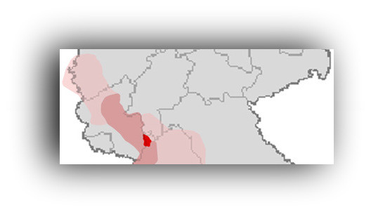

---

## Ereignisse

12. Juni 1694Wallrad Fürst zu Nassau-Usingen bekundet, daß er 1693 Friederich Wilhelm Löner von Laurenburg eine Anwartschaft auf die Stockheimischen Mannlehen erteilt hat und, nachdem diesem Friedrich Wilhelm von Stockheim, der auf Lebzeit noch Vasall und Besitzer ist, für eine namhafte Summe am 10.3. den Besitz eingeräumt, dessen Bevollmächtigten Johann Martin Stein mit 6 Malter Weizengülte auf seine Vogtei Würges (Werges) mit 60 Gulden ablösbar als Burgmann zu Idstein mit 6 Gulden, Martini, vom Schultheiß zu Seelbach, mit 60 Gulden ablösbar, die vorzeiten Heinrich Kornigel hatte, und 3 1/2 Gulden 1 Ort auf der Herbstbede zu Strinz Margarethae (Hindern Strintz) vom Schultheiß daselbst, Martini und mit der Hälfte der 'Richtspach' bei Idstein belehnt. Siegler: Aussteller.(Quelle HHStAW; 121 Nr. U Loener von Laurenburg)

---

## Margretstrentz

---

## Allgemeine Ereignisse

Tausch der Stiftzehnten zu Idstein, Wörsdorf und Wallrabenstein gegen die fürstlich nassauischen Zehnten zu Born, Adolfseck, Steckenroth, Strinz-Margarethae und Holzhausen.(Quelle. HStAW, 14, 689)

---

## Ereignisse

---

## Ereignisse

Franz Emmerich Wilhelm von Bubenheim, Dechant, und das Kapitel des S. Ferrutius Stiftes zu Bleidenstadt belehnen den Grafen Friedrich Ludwig von Nassau und zugleich für die Fürsten und Grafen Georg August, Heinrich Wilhelm, Ludwig Crafft, Johann Ernst und Carl Ludwig von Nassau etc. mit den zwei Vogteien zu Würges und Kirberg und den vier Dörfern Strinz-Margarethä, den beiden Libbach und Hambach.25. September 1705(Hessisches Staatsarchiv Wiesbaden, Abt. 131 Nr. U 413)

---

## (Quelle: Hessisches Staatsarchiv Wiesbaden, Abt. 131 Nr. U 414)

Georg August Fürst zu Nassau, Graf zu Saarbrücken und Saarwerden, Herr zu Lahr, Wiesbaden und Idstein einigt sich durch Vermittelung des kaiserlichen Kammergerichtsassessors Johann Heinrich Daniel Freiherrn von Ritter-Grünstein mit dem Stifte Bleidenstadt über die Jurisdiktion, die Stiftshöfe zu Schierstein, Bierstadt und Hahn, den Abtswald , über den Wald 'der alte Stein', die Pfarrkollaturen zu Schierstein, Kloppenheim, Bierstadt, Bleidenstadt, Wehen, Strintz-Trinitatis und Strintz-Margarethae, Michelbach und Dörsdorf, die Zehnten zu Adolphseck, Born, Strintz-Margarethae, Idstein, Wallrabenstein, Wörsdorf und Ehrmbach, Wehen und Görsrod.(Quelle: HHStAW 14 Nr. U 314 Bl und C)

---

## Ereignisse

Früher unter der Kollatur des Stifts Bleidenstadt gestandene Pfarreien (Kloppenheim, Bierstadt, Schierstein, Bleidenstadt, Wehen, Michelbach, Strinz-Margarethae, Strinz-Trinitatis und Dörsdorf) und Übernahme der Besoldung der Pfarrer

---

## Allgemeine Ereignisse

Die spätere Strinzer Barockorgel wird für das Weißfrauenkloster in Mainz, vermutlich von Johann Jakob Dahm, erbaut.

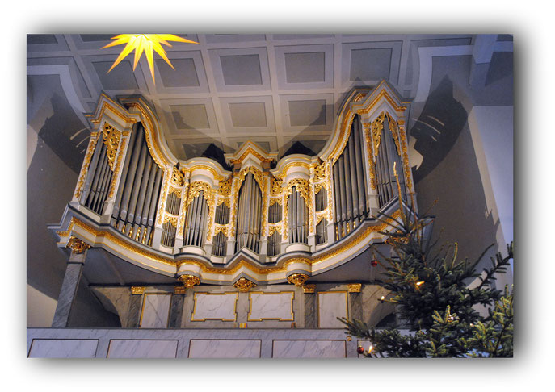

---

## Ereignisse

Irrungen zwischen Steckenroth und Strinz-Margarethae, streitige Grenze und Lieferung von Gültfrüchten betreffend.(Quelle: HStAW, 133, Steckenroth 2)

---

## Ereignisse

Gemarkungsstreitigkeiten zwischen Strinz-Margarethae und Steckenroth(Quelle: HStA, 133, Strinz-Margarethae 19)

---

## Revers des Grafen Friedrich Ludwig von Nassau-Saarbrücken (Ottweiler) ausgestellt zugleich im Namen der Fürsten und Grafen Georg August, Heinrich Wilhelm, Ludwig Crafft (im Gegensatz zu der Urkunde U 417 hier nicht getilgt), Johann Ernst und Carl Ludwig von Nassau etc. für den Dechanten Otto von der Malsburg und des Kapitels des S. Ferrutius-Stiftes zu Bleidenstadt über die von diesen zu Lehen rührenden zwei Vogteien zu Würges und Kirberg, sowie die vier Dörfer Strinz-Margarethae, die beiden Libbach und Hambach.(Quelle: HHStAW, 131 Nr. U 418)

Nassau-Idstein verspricht, das Stift Bleidenstadt in der Nutznießung des Zehnten von StM, nicht zu beeinträchtigen.(Quelle: Nassauische Analen)

---

## (Quelle: HHStAW 14 Nr. U324)

Otto von der Malsburg, Dechant, und das Kapitel des S. Ferrutius Stiftes zu Bleidenstadt belehnen den Grafen Friedrich Ludwig von Nassau-Saarbrücken(-Ottweiler) zugleich für die Fürsten und Grafen, Georg August, Wilhelm Heinrich (Ludwig Crafft getilgt), Johann Ernst und Carl Ludwig von Nassau etc. mit den zwei Vogteien zu Würges und Kirberg und den vier Dörfern Strinz-Margarethae, den beiden Libbach und Hambach.(Quelle: HHStAW 131 Nr. U 417)

---

## StM gehört ab sofort zu Nassau Usingen

Das Haus Nassau-Usingen ist eine Linie des Hauses Nassau und ging 1659 neben den Linien Nassau-Saarbrücken und Nassau-Ottweiler durch Teilung aus dem Haus Nassau-Saarbrücken (walramischen Linie) hervor. Aus dem Haus Nassau-Usingen stammte Friedrich August, der erste Herzog von Nassau. (Quelle: Wikipedia)

1728 kommen die Ämter Idstein, Wiesbaden, Saarbrücken, Ottweiler und Lahr hinzu. Die bisherigen Länder werden neu in die Ämter Usingen, Wehen und Burgschwalbach gegliedert.(Quelle: Wikipedia)

---

## Strentz Marg.

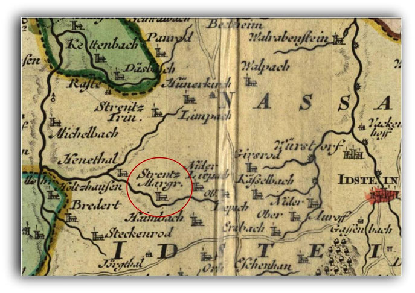

---

## Ereignisse

Es findet ein Grenzbegehung der Gemarkung von StM statt.(Quelle: Hessisches Staatsarchiv, Abt. 133 / 467 + 468)

---

## Ereignisse

Irrungen zwischen Nassau und dem Stift Bleidenstadt über ein Novalzehnt zu Strinz-Margarethae und Hennethal. (Quelle: HStAW, 14, 844)

---

## Revers des Grafen Carl August von Nassau-Saarbrücken (Weilburg) ausgestellt zugleich namens der Fürsten Carl und Wilhelm Heinrich von Nassau etc. für den Dechanten Josephus Franciscus Freiherrn von Kesselstadt und des Kapitels des S. Ferrutius Stiftes zu Bleidenstadt über Empfang der von diesem zu Lehen rührenden zwei Vogteien zu Würges und Kirberg, sowie der vier Dörfer Strinz-Margarethae, Libbach, Libbach und Hambach.(Quelle: HHStAW, 131 Nr, U 426)

25. Juni 1737Der Dechant Josephus Franciscus Freiherr von Kesselstadt und das Kapitel des S. Ferrutius Stiftes zu Bleidenstadt belehnen den Grafen Carl August von Nassau etc. (Weilburg) zugleich für die Fürsten Carl und Wilhelm Heinrich von Nassau etc. mit den zwei Vogteien zu Würges und Kirberg, sowie mit den vier Dörfern Strinz-Margarethae, den beiden Libbach und Hambach.(Quelle: HHStAW, 131, Nr. U 425)

Pfarrer Johannes Kaspar Becker wird nach Wehen versetzt.(Quelle: Wehen und sein Grund / Dr. Eduard Wilhelmi)

---

## Margretstrenz

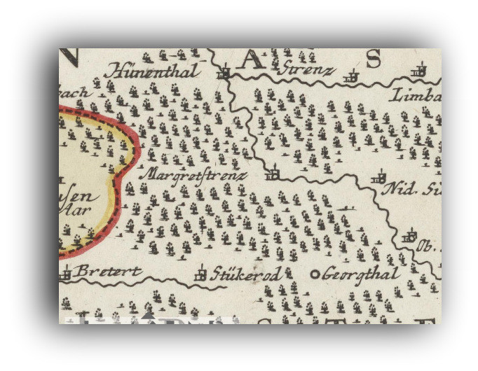

---

## Schultheiß: Johann Peter Enders

Schultheiß Johann Peter Enders wird im Jahre 1730 und 1750 als herrschaftlicher Schultheiß und Gerichtsmann von StM erwähnt. Er ist Bauer und besitzt 2 Häuser, 2 Scheunen und 2 Ställe in StM.

---

## Ereignisse

Der Auswanderer Johannes Enders aus StM ertrinkt mit seiner Frau und seinen 3 Kindern am 25.07. im Meer bei der Überfahrt nach Pennsylvania (USA).

---

## Ereignisse

Revers über die vom Stift Bleidenstadt lehnsrührigen zwei Vogteien zu Würges und Kirberg sowie vier Dörfer Strinz-Margarethae, die beiden Libbach und Hambach.(Quelle: HHStAW 150 Nr. U 680)

---

## Allgemeine Ereignisse

Beginn des "Siebenjährigen Krieges" der auch Auswirkungen auf StM hat. Im Siebenjährigen Krieg (1756–1763) kämpften mit Preußen und Großbritannien/ Kurhannover auf der einen und der kaiserlichen österreichischen Habsburgermonarchie, Frankreich und Russland sowie dem Reich auf der anderen Seite alle europäischen Großmächte dieser Zeit. Auch mittlere und kleine Staaten waren an den Auseinandersetzungen beteiligt.

---

## Strenz

---

## Ereignisse

Franz Ludwig Freiherr von Kesselstadt, Dechant, und das Kapitel des Ritterstifts zu Bleidenstadt verleihen dem Fürsten Karl zu Nassau - auch für die Fürsten Wilhelm Heinrich und Karl zu Nassau - die Vogteien zu Würges und Kirberg (Kirburg) und die vier Dörfer Strinzmargarethä, Ober- und Niederlibbach und Heimbach zu Lehen. Mainz, 15 Mai 1759.(Quelle: Hessisches Staatsarchiv Wiesbaden, Abt. 131 Nr. U 438 a)

---

## Allgemeine Ereignisse

Eine Hungersnot lässt die schon um einiges früher in Nassau eingeführte Kartoffel endgültig zum wichtigsten Grundnahrungsmittel werden.

---

## Ereignisse

Martin Ender Sohn Johannes, Johannes Enders Junior und Johannes Enders der ältere zahlen 2 Kreuzer Lämmerzehnten an das Stift St. Ferrutius Bleidenstadt.

---

## Ereignisse

Martin Ender Sohn Johannes und Johannes Enders zahlen 2 Kreuzer Lämmerzehnten an das Stift St. Ferrutius Bleidenstadt.

---

## Ereignisse

Johann Enders Junior zahlt 2 Kreuzer Lämmerzehnten an das Stift St. Ferrutius Bleidenstadt.(Quelle: HStA  22 / 44)

Aussteinung (Red.: Grenzsteinsetzung) der Grenze zwischen dem Hof Georgenthal und Strinz-Margarethae. (Quelle: HStA, 133, Steckenroth 39)

---

## Ereignisse

Adam Enders und Johann Enders der Mittlere zahlen 2 Kreuzer Lämmerzehnten an das Stift St. Ferrutius Bleidenstadt.

---

## Ereignisse

1. Juli 1776Der Dechant Franz Ludwig Freiherr von Kesselstadt und das Kapitel des S. Ferrutius Stiftes zu Bleidenstadt belehnen den Fürsten Carl (Christian) von Nassau (Weilburg) zugleich für die Fürsten Carl Wilhelm, Ludwig, Friedrich-August und Johann Adolf von Nassau mit den zwei Vogteien zu Würges und Kirberg, sowie den vier Dörfern Strinz-Margarethae, den beiden Libbach und Hambach.(Quelle: HHStAW, 131 Nr. U 449)

---

## Revers des Fürsten Carl (Christian) von Nassau (Weilburg) ausgestellt zugleich namens der Fürsten Carl Wilhelm, Ludwig, Friedrich August und Johann Adolf von Nassau etc. für den Dechanten Franz Ludwig Freiherrn von Kesselstadt und das Kapitel des S. Ferrutius Stiftes zu Bleidenstadt über Empfang der von diesen zu Lehen rührenden zwei Vogteien zu Würges und Kirberg, sowie der Dörfer Strinz-Margarethae, den beiden Libbach und Hambach.(HHStAW, 131 Nr. U 450)

Adam Enders und Johannes Enders Junior zahlen 2 Kreuzer Lämmerzehnten an das Stift St. Ferrutius Bleidenstadt.

---

## Revers des Fürsten Carl (Christian) von Nassau(-Weilburg) ausgestellt zugleich namens der Fürsten Carl Wilhelm, Ludwig, Friedrich August und Johann Adolf von Nassau etc. für den Dechanten Franz Georg Carl Johann Freiherrn von Boos zu Waldeck und Monfort und das Kapitel des St. Ferrutius-Stiftes zu Bleidenstadt über Empfang der von diesem zu Lehen rührenden zwei Vogteien zu Würges und Kirberg, sowie der Dörfer Strinz-Margarethae, der beiden Libbach und Hambach.(Quelle: HHStAW, 131 Nr. U 452)

Unter Pfarrer Bickel entsteht ein heftiger Streit, wegen Herstellung der Pfarrgartenumzäunung, die seit dem Siebenjährigen Krieg verkommen ist.

---

## (Quelle: Strinzer Chronik, Teil 1, Seite 128)

Johannes Enders Junior und Adam Enders zahlen 2 Kreuzer Lämmerzehnten an das Stift St. Ferrutius Bleidenstadt.

---

## (Quelle: HStA  19 / 38 u. 21/42)

Der Dechant Franz Georg Carl Johann Freiherr von Boos zu Waldeck und Montfort und das Kapitel des S. Ferrutius Stiftes zu Bleidenstadt belehnen den Fürsten Carl (Christian) von Nassau (Weilburg) zugleich für die Fürsten Carl Wilhelm, Ludwig, Friedrich August und Johann Adolf von Nassau etc. mit den zwei Vogteien zu Würges und Kirberg, sowie mit den 4 Dörfern Strinz-Margarethae, den beiden Libbach und Hambach.(Quelle: HHStAW 131 Nr. U 451)

---

## Ereignisse

Der Wehener Philipp Weiß möchte den früheren Kuhhirten und Tagelöhner von StM, Christoph Graf, in sein Haus aufnehmen, weil er Arbeit für ihn hat. Das fürstliche Amt Wehen gibt dazu nur seine Einwilligung unter der Bedingung, dass die Entfernung von Graf nach getaner Arbeit sofort erfolge. Dies ist u.a. eine Maßnahme um das Bettelunwesen in Wehen einzudämmen. (Quelle: Wehen und sein Grund, Dr. Eduard Wilhelmi, 1957)

Johann Enders der Mittlere zahlt 2 Kreuzer Lämmerzehnten an das Stift St. Ferrutius Bleidenstadt. (Quelle: HStA  15 / 30)

---

## Ereignisse

Johann Enders der Mittlere und Adam Enders zahlen 2 Kreuzer Lämmerzehnten an das Stift St. Ferrutius Bleidenstadt.

---

## Ereignisse

Das Ritterstift zu Bleidenstadt lässt zur Begrenzung seiner Güter Grenzsteine in der Strinzer Gemarkung aufstellen.(Quelle: HStA, 14, 845)

---

## Ereignisse

Schultheiß Enders berichtet, dem Mainzer Domkapitel stünden als Nachfolger Bleidenstadts außer Frucht- und Blutzehnten 23 Morgen Land zu.(Quelle: Nassauische Analen)

Aussteinung der Grenze zwischen Steckenroth und Strinz-Margarethae an der 'Struth'.(Quelle: HStA, 133, Steckenroth 3)

---

## Ereignisse

Durchführung einer Güter- und Schatzungsrenovatur zu Strinz-Margarethae, in specie Notizzettel und Adjudikationsprotokoll.(Quelle: HHStAW 133 Nr. Strinz-Margarethae 41)

---

## Ereignisse

Breithardt, Feuerspritzenrechnungen; darin die Ortschaften: Strinz-Margarethä, Steckenroth, Watzhahn, Adolfseck(Quelle: HHStAW 133 Nr. 1385)

---

## Ereignisse

Der Schullehrer Joch hat "das Schulhaus samt 5 Morgen Schulgut frei zu benutzen und das Schulgut ist Zehnten frei".

---

## Beginn der Revolutionskriege.

Als sich die französischen Revolutionstruppen anschicken, den Rhein als Frankreichs Grenze in Besitz zu nehmen, stellen sich ihnen 1792 Österreicher und Preußen entgegen.

---

## Ereignisse

Nach dem Tod des Pfarrers Johann Gottfried Wex, wird Johann Gottfried Kolb aus Neuweilnau neuer Pfarrer in StM. Die Kinder von Wex beantragen die befristete Überlassung der Besoldung ihres Vaters.

Unter Pfarrer Wex, der als Wittwer in fortgeschrittenen Alter die Pfarrstelle versah, war das Verhältnis auf "gegenseitige Duldsamkeit eingestellt".

---

## Allgemeine Ereignisse

Zu Beginn des Jahres liegen die Preußen noch in Ihren Stellungen hier im Taunus. Die Bauern müssen Fronfahrten nach Limburg machen. Dort müssen sie Nachschub für die hier liegenden Truppen holen. (Quelle: Wehen und sein Grund, Dr. Eduard Wilhelmi, 1953)

Am 27. Februar beschießen die Franzosen Biebrich, was wieder zu Flüchtlingsströmen in die Taunushöhen führt. (Quelle: Wehen und sein Grund, Dr. Eduard Wilhelmi, 1953)

In der zweiten Jahreshälfte ziehen sich die Preußen aus unserer Region zurück. Von da an sind für ein Jahr lang keine Auswirkungen der Revolutionskriege in unserer Region zu verspüren.

---

## Allgemeine Ereignisse

Im Sommer kommen die Franzosen erneut unter Ihrem General Jourdan ins Nassauer Land. Es gibt keinen Ort ohne französische Besatzung. Im Oktober, nach dem Sieg der Österreicher ziehen die Franzosen schnell wieder ab. Die nachsetzenden Österreicher nehmen den Taunus in Ihren Besitz.

---

## Im September passiert ein Teil der französischen Maar- und Sambrearmee unter Führung von Jean-Baptiste Jourdan - auf dem Rückzug aus Franken - plündernd die hiesige Gegend. (Quelle: Alte Strinzer Chronik, Teil 1, Seite 126)

Die Einwohnerschaft flüchtet mit Vieh und Habe in das benachbarte hessische Gebiet, das durch den Baseler Separatfrieden neutral geworden ist.

---

## (Quelle: Alte Strinzer Chronik, Teil 1, Seite 126)

Bis September ist unsere Region wieder von Franzosen besetzt, die dann wieder über den Rhein zurückgetrieben werden können.

---

## Allgemeine Ereignisse

Der inzwischen besiegte General Jourdan wird durch den französischen General Hoche ersetzt, der kurz vor dem endgültigen Frieden 1797 noch einmal durch den Taunus streift. Hierbei kommt es in unserer Region zu Kämpfen zwischen Österreichern und Franzosen, die die Franzosen gewinnen. Daraufhin besetzen die Franzosen wieder unser Gebiet. Die Bewohner werden zu Schanzarbeiten bei Mainz gezwungen. Hierzu wurden viele Bäume gefällt, unsere Wälder wurden stark gelichtet. (Quelle: Wehen und sein Grund, Dr. Eduard Wilhelmi, 1953)

Mit dem Frieden von Campo Formio wird der Rheinstrom Frankreichs Grenze. Die Franzosen ziehen sich aus dem Taunus zurück.

---

## Allgemeine Ereignisse

Bürger unserer Region werden immer noch zu Schanzarbeiten nach Mainz abgeführt. Außerdem müssen weiterhin Schanzholz und Lebensmittel geliefert werden. Fast von allen Lebensmitteln entblößt, müssen die Taunusbewohner im Winter 1797/98 für die Franzosen arbeiten und hungern.

---

## Strinz Margaretha

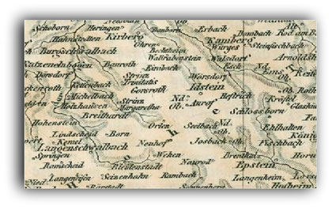

---

## Hier die offizielle Beschreibung:

Ältester bekannter Vorfahr im Mannesstamm: Johann Philipp Gruber, Landwirt, * Strinz-Margarethä um 1800. In Rot ein goldenes Hirschgeweih mit Grind, an den zehn Enden und aus der Schädeldecke hervorkommend je mit einer goldenen Rose besetzt. Auf dem rot-golden bewulsteten Helm mit rot-goldenen Decken ein wachsender, mit einem roten Strick um den Hals gefesselter goldener Drache.

Führungsberechtigt sind: Eingereicht bzw. neu angenommen am 20. Februar 1981 von Wilhelm Gruber, Forstamtsrat, * Wambach 7.4.1927, für sich und seine ehelichen Nachkommen im Mannesstamm.

---

## Ereignisse

Aus dem Jahre 1800 ist einen Urkunde erhalten geblieben, die die Zehntverpflichtung von von StM gegenüber dem Ritterstift Bleidenstadt zum Inhalt hat.(Siehe auch unter: Der Zehnte ging ans Kloster)

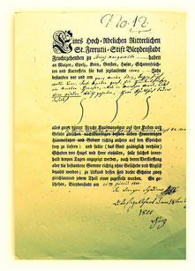

---

## Ereignisse

StM zahlt 20,19 Gulden "Herrngeld" an die Renthei in Idstein.(Quelle: Auszug aus den Rechnungen der Renthei Idstein der Jahre 1802 - 1806)

---

## Ereignisse

Der als österreichischer Soldat tätige Strinzer Tobias Enders meldet sich letztmalig bei seiner Ehefrau aus Carlstadt. 20 Jahre später klagt diese auf Scheidung wegen böslicher Verlassung.(Quelle: Allgemeiner Anzeiger und Nationalzeitung der Deutschen / 2663 / 1824)

StM zahlt 20,19 Gulden "Herrngeld" an die Renthei in Idstein.(Auszug aus den Rechnungen der Renthei Idstein der Jahre 1802 - 1806)

Beginn einer Untersuchung wegen der von dem ehemaligen Bleidenstadter Stiftsgut zu Strinz-Margarethae zu tragenden Kriegskosten.(Quelle: HStA, 133)

Streitigkeiten zwischen Philipp Wendel Kugelstatt zu Wingsbach und Georg Philipp Enders zu Strinz-Margarethä wegen Herausgabe des Vermögens aus erster Ehe. (Quelle: HStAW, 293, 984)

---

## Ereignisse

StM zahlt 20,19 Gulden "Herrngeld" an die Renthei in Idstein.(Quelle: Auszug aus den Rechnungen der Renthei Idstein der Jahre 1802 - 1806)

---

## StM gehört ab sofort zum Rheinbund und somit zum Herzogthum Nassau (Amt Idstein).

Der Rheinbund (Confédération du Rhin) war eine auf Initiative Napoleons I. 1806 in Paris gebildete Konföderation deutscher Staaten, die mit der Gründung dieses Staatenbundes aus dem Verband des Heiligen Römischen Reiches Deutscher Nation austraten. Durch die Rheinbundakte war die Konföderation als Militärallianz mit dem Kaiserreich Frankreich gegründet worden. Napoleon fungierte in diesem Gebilde als „Protektor“. Frankreich selbst gehörte der Konföderation aber nicht an, sondern war ihr Alliierter. Das Ziel, den Rheinbund von 1806 zu einem Staatenbund mit gemeinsamen Verfassungsorganen auszubauen, scheiterte am Widerstand der größeren Mitgliedsstaaten. Faktisch blieb der Rheinbund im Wesentlichen ein Militärbündnis deutscher Staaten mit Frankreich.(Quelle: Wikipedia)

In der Rheinbundakte werden die Fürstentümer Nassau-Weilburg und Nassau-Usingen, zu dem seit 1728 das Oberamt Idstein gehört, vereinigt und zum Herzogtum Nassau erhoben.

---

## Beschwerde des Pfarrers Kolb gegen Einquartierung(Quelle: HHStAW, 270 Nr. 162)

StM zahlt 20,19 Gulden "Herrngeld" an die Renthei in Idstein.(Quelle: Auszug aus den Rechnungen der Renthei Idstein der Jahre 1802 - 1806)

---

## Abschaffung der Leibeigenschaft im Herzogthum Nassau und Einführung eines neuen Steuerrechts.

Friedrich August, Herzog von Nassau und Friedrich Wilhelm, Fürst zu Nassau teilen 1808 in der Sammlung der "Landesherrlichen Edicten und anderen Verordnungen" die Aufhebung der älteren und direkten Abgaben (Zehnten) nach Einführung eines neuen direkten Steuersystems, beginnend am 01. Januar 1808, mit. Für die einzelnen Ämter und Ortschaften werden die einzelnen Abgaben aufgeführt, die nicht mehr zu entrichten sind.Für das Oberamt Idstein (zu dem auch StM gehört):- die ordinäre Schatzung- die Extrasteuern- die Additionalsteuer der ehemaligen Freigüter- die Servicegelder- die zur Landesunkostenkasse sowie die zur alten Constributionscasse erhobenen  Schätzungsimpeln- die nach dem Schatzungsfuß bisher erhobenen Beiträge des Oberamtsphvficus in Idstein- das Dienstgeld, die Diensthafer und das Dienstheu- das Hofdienstgesindegeld- die mit dem Dienstgeld bisher erhobene Leibbeet- Fastnachtshübner und Sommerhahnen.Speziell für StM:- das Bereiter-Jossengeld- das Herrengeld- das Weidhammelgeld- die Frohnd-Rodemtisensgelder wegen Befreiung von den Natural-Erndtefrohnden auf  dem Georgenthaler Hof- die Frohnden auf der Brühlwiese- die Rauchhafer- das Kirmesweingeld- die ständigen Abgabe von den Krämereien- das Landwachtgeld

---

## Ereignisse

Nach der Versetzung von Pfarrer Kolb nach Usingen wird Imanuel Snell aus Usingen neuer Pfarrer in StM.

---

## Allgemeine Ereignisse

StM gehört ab sofort zum Verwaltungsbezirk Herzogtum Nassau, Regierungsbezirk Wiesbaden, Amt Idstein -

---

## Ereignisse

Absetzung des Ludwig Imanuel Snell als Pfarrer in StM aufgrund seiner Trinksucht. Zuvor wurde der Sonntagsgottesdienst bereits Vertretungsweise von Konrektor Philippi aus Idstein gehalten.

---

## Ereignisse

Absetzung des Pfarrers Snell zu Strinz-Margarethä vom Pfarramt. Nach der Absetzung stellt Pfarrer Snell ein Gesuch um Wiederanstellung, was nicht bestätigt wurde. Im Jahre 1837 wird ihm ein Gnadengehalt bewilligt.(Quelle: HHStAW 210 Nr. 2158)

---

## Aus der Kirchenchronik

Gelinder Winter. Rückkehr der Truppen aus den Feldzügen von 1815. Beginn der Friedensjahre. Gedächtnißpredigten auf die verewigten Herzoge. Aufhebung der Fornicationsstrafen u. Verbot der öffentlichen Leichenbegängnisse. Spätere Modification u. Zugeständnisse in Ansehung der Letzteren. Unaufhörlicher Regen im May und nach Johanni. Mißraten der Winterfrucht in Folge der nasskalten Witterung im Juni u. July. Späte Erndte; Reife gegen d.10. August. Versetzung des bisherigen Ephorus, Inspectors Lender, als Pfarrer nach Igstadt. An dessen Stelle: Fr. Jac. Koch (bisher Pfarrer zu Friedberg in der Wetterau, geb. 1769 zu Kettenbach, gestorben 1829). Rauhe Witterung im Spätherbst. Steigen der Fruchtpreiße.

---

## Bestellung eines Hirten für das Zugvieh, dass durchgehend aus Ochsen besteht.(Quelle: Alte Strinzer Chronik, Teil 1, Seite 127)

Am 18. August wird das Bächlein welches bei dem Georgenthaler Hof seinen Anfang nimmt und sich bei Strinz Margaretha endet auf Lebzeit oder Wohnorts-Veränderung meistbietend versteigert.(Quelle: Herzoglich nassauisches Intelligenzblatt, Seite 442, 1819)

---

## Strinz Margarethe

---

## Aus der Kirchenchronik

Gelinder Winter; einiger Frost mit Schnee in der Mitte des Februars. Zeitiger Eintritt des Frühlings. Regelmäßige Witterung. Geringer Ertrag meiner Besoldung bei den gesunkenen Preißen der Naturalien. Stille im öffentlichen Verkehr u. Leben. Predigerconferenz im Pfarrhaus zu Bechtheim, im September. Der zur Abschaffung der Pfarrökonomien gesetzte Termin, Ende 1821, geht unbeachtet vorüber.

---

## Aus der Kirchenchronik

Heftige Kälte im Januar; darauf sehr milde Witterung. Sehr heißer und trockener Sommer. Frühe Erndte; reifes Korn d. 7. July. Erhöhter Erndtepreiß in Folge des spärlicheren Ertrages. Predigerconferenz im Pfarrhaus zu Breithardt.

---

## Aus der Kirchenchronik

Später Frühling; wenig Graswuchs vor Juni. Darauf sehr günstige Witterung. Reicher Ertrag der Erndten. Tiefstes Sinken der Naturalienpreiße. Waldmast, die letzte bis jetzt, 1847. Abgang der alten Eichen- und Buchenwaldung. Predigerconferenz im Pfarrhaus zu Michelbach.

---

## (Siehe auch unter: Kirchenneubau)

Catharine Elisabeth Enders, geb. Paul von Ketternschwalbach, herzogliches Amt Wehen klagt vor dem herzogl. nass. Appelationsgericht, gegen Ihren Ehemann Tobias Enders aus StM, herzogliches Amt Wehen, welcher zum letzten Mal als österreichischer Soldat aus Carlstadt, ungefähr im Jahre 1804 Nachricht von sich gegeben hat, auf Scheidung wegen böslicher Verlassung.

---

## Ereignisse

In StM erkranken 16 Bürger an Typhus, 4 Bürger sterben.(Quelle: Medicinische Jahrbücher für das Herzogthum Nassau / 1854)

---

## Aus der Kirchenchronik

Heftige Kälte im Februar; sonst gelinde. Anhaltende Trockniß im Sommer. Frühe und knappe Erndte. Seit dieser Zeit sank der Fruchtpreiß nicht wieder auf den tiefen Stand von 1823/1824. Abgang des Decans Gruth als Decan und Pfarrer nach Liederbach. Die Decanatsverwaltung erhielt der bisherige Schulinspector, Pfarrer Schneider zu Bleidenstadt. Nervenfieber, das im Herbst hier grassierte. Mein Lager vom 19. Nov. Bis 5. Dezember, in Folge der Ansteckung. Meine erste Predigt nach der Genesung am 1. Weihnachtsfeiertage.

---

## Ereignisse

Für einen Brand vom 13. auf den 14. Juli in StM muss die Brand Assekuranz 519 Gulden bezahlen.(Quelle: Verordnungsblatt des Herzogthum Nassau / 1827)

Im Jahr 1827 stiftet Mathias Trapp, Sergeant im 1. Infanterieregiment der Herzoglich Nassauer Armee, in Weilburg mehrere Soldaten - darunter auch den Strinzer Georg Adam Enders -  zum Mord an dem 18 Jahre alten Kadetten (Offiziersanwärter) Adolph Vigelius an.

---

## Aus der Kirchenchronik

Später Eintritt des Winters mit heftiger Kälte und vielem Schnee d.15. Januar; Dauer bis 28. Februar. Heißer Sommer, mittlere Erndte.

---

## Aus der Kirchenchronik

Meistens kühle und unfreundliche Witterung. Mittlerer Ertrag der Erndte. Die Saison in den Bädern. Sonst nichts Neues.

---

## Aus der Kirchenchronik

Harter Winter. Anhaltende Kälte u. tiefer Schnee während 12 Wochen. Thauwetter ab 9. Februar. Gedächtnispredigt auf die Übergabe der Augsburg. Confession sonntags d. 27. Juni. Sonstige Merkwürdigkeit dieses Jahres. Wendepunct, den dasselbe im allgemeinen bildet. Lebhafter Verkehr bei erhöhtem Werthe der materiellen Producte. Freiere Bewegung der Geister. Der neue Schullehrer Fr. Ju. Friedrich.

---

## Gesuch der Müller von der Brückmühle, Kesselmühle, Dillenbergermühle im Amt Nastätten und Reifenmühl bzgl. Anspruch der Bahnermühle bei Hennethal auf das Mahlrecht in Hennethal und Strinz-Margarethä.(Quelle: HHStAW 211 Nr. 8356 Dep.)

Der 1927 ins Diezer Zuchthaus inhaftierte Strinzer Bürger der gemeinschaftlich mit Bürgern aus Ketternschwalbach und Hennethal einen Cadetten ermordet haben soll, sitzt noch immer ohne Prozess in demselben.(Quelle: Sitzungs-Protocolle der Landständischen Deputierten-Versammlung / Seite 174 / 28.03.1831)(Siehe auch unter: Weilburger Kadettenmord)

---

## (Siehe auch unter: Prozess um das Ochsengut)

Als Mitglieder der Amtsarmencommision werden u.a. Pfarrer Schmidtborn und Schultheiß Enders (Cassirer) aufgeführt.(Quelle: Staats- und Adressbuch des Herzothums Nassau /1832/33 / Seite112)

Als für StM zuständiger Oberförster wird ein Wilhelm Ludwig Haas genannt.(Quelle: Staats- und Adressbuch des Herzothums Nassau /1832/33 / Seite136)

---

## (Siehe auch unter Kirchenneubau)

In der Frankfurter Ober-Postamts-Zeitung erscheint eine Suchanzeige nach dem Sohn des ehemaligen Strinzer Pfarrers Freyberger, bezüglich des Erbvermögens.

---

## “Soleanu i miei pensien Soaremente Di lon obietto ragionar insieme”

Begräbniß des Bischofs Müller (geboren zu Löhnberg im July 1766, achtungswert durch Wohlwollen, geistlichen Tact und edlen Charakter) zu Wiesbaden d. 12. Dec., bei welchem ich von den hiesigen Diöcesen allein gegenwärtig war.

---

## Ereignisse

Pfarrer Ludwig Schmidtborn soll nach Rod an der Weil abgeordnet werden. Neuer Pfarrer soll Pfarrer Victor von Dickschied werden.(Quelle: Verordnungsblatt des Herzogthums Nassau / Nr. 10 / 1838)

Zur Bestreitung gemeinheitlicher Ausgaben für das Jahr 1938 muss StM eine Communalsteuer von ein und ein halbes Simpel zahlen.(Quelle: Verordnungsblatt des Herzogthums Nassau / Nr. 8 / 1838)

Seine Durchlaucht der Herzog haben, den für die Pfarrei Rod bestimmt gewesenen Pfarrer Schmidtborn zu StM an seiner Stelle zu belassen und den nach StM designierten Pfarrer Victor von Dickschied nach Rod an der Weil zu versetzen geruht.(Quelle: Verordnungsblatt des Herzogthums Nassau / Nr. 8 / 1838)

---

## Aus der Kirchenchronik

Große Kälte vom 8. Januar bis 19. Februar; der härteste Winter seit 1830. Versetzung des bisherigen Decanatsverwalters Erlenmayer als Decan nach Langenschwalbach. Der neue Ephorus: Keller, bisher zweiter Pfarrer zu Diez, gebürtig zu Dillenburg. Einführung der neuen Amtskleidung = Chorrock u. Barret anstatt des bisherigen Mantels mit Hut. Zweckmäßigkeit dieser Änderung.

---

## Aus der Kirchenchronik

Kälte und tiefer Schnee mit dem Anfange des Jahres. Thauwetter d. 16. Januar, Wasserflut sonntags d. 17. Januar. Darauf vom 19. Jan. bis 9. Februar große Kälte und tiefer Schnee. Wiederaufnahme der Angelegenheit des Stallbaues. Mein Antrag auf die solirte Erbauung eines neuen Schweinestalles.

---

## Ereignisse

55 Bürger erkranken im Medicinalbezirk Wehen an Typhus, 9 sterben, insbesondere in Strinz und Panrod.(Quelle: Medicinische Jahrbücher für das Herzogthum Nassau / 1854)

---

## (Siehe auch unter Typhustod)

Ablösung der Domanialzehnten und der auf dem Domanialvermögen ruhenden Lasten im Rezepturbezirk Bleidenstadt (inkl. StM)(Quelle: HHStAW 210 Nr. 5043)

---

## Aus der Kirchenchronik

Außerordentliche Hitze während des Frühlings und Sommers. Wassermangel an verschiedenen Orten. Spärliche Erndte, die Körner jedoch von seltener Güte. Fallen lassen des Plans wegen Bau eines neuen Schweinestalles, der bereits mit dem Fundament (auf der Westseite des Hofes, an der Mauer) begonnen hatte, d. 9. Aug.. Neuer Bauplan.

---

## Einwohner Zinkenmühle 10

(Quellen: Lexicon der sämtlichen Ortschaften der deutschen Staaten, 1843 / Beschreibung des Herzogthums Nassau, 1843)

---

## Ereignisse

Vergleich zwischen der Domänendirektion und der Witwe des Johann Emmerich Enders von Strinz-Margarethä, jetzige Ehefrau des Leonhard Conradi von Strinz-Margarethä, Anna Christina, geborene Diefenbach, und ihren Kindern erster Ehe bezüglich Zehntleistung und Lasten auf dem sogenannten Ochsengut in der Gemarkung Strinz-Margarethä.(Quelle: HHStAW 244 Nr. 1673)

---

## Ereignisse

Der Strinzer Bürger Philipp Emmerich Kilb erfährt einen zweifelhaften Ruhm, indem er im Allgemeinen Polizeianzeiger als "Gemeinschädlicher Umtreiber" aufgeführt und beschrieben wird.(Quelle: Allgemeiner Polizeianzeiger, 1845)(Siehe auch unter: Gemeinschädliche Umtreiber)

---

## Allgemeine Ereignisse

Es grassiert die Kartoffelfäule, die die Ernte dezimiert.(Quelle: Wehen und sein Grund, Dr. Eduard Wilhelmi, 1953)

---

## Allgemeine Ereignisse:

StM gehört ab sofort zum Verwaltungsbezirk Herzogtum Nassau, Regierungsbezirk Wiesbaden, Verwaltungsbezirk VI

---

## Ereignisse

Lehrer Schmidt soll nach Steckenroth versetzt werden, was aber wieder aufgehoben wird.(Quelle: Verordnungsblatt des Herzogtums Nassau, Band 43, Seite 101)

Lehrer Schmidt wird nach Lohrheim versetzt.(Quelle: Verordnungsblatt des Herzogtums Nassau, Band 43, Seite 158)

---

## Statistik

Der Flächengehalt des Forstes Breithardt, zudem auch der Forst von StM gehört beträgt 13,813 Morgen, 80 Ruthen.

---

## Allgemeine Ereignisse

Der Winter ist sehr schneereich, obwohl es nicht sehr kalt ist.(Quelle: Wehen und sein Grund, Dr. Eduard Wilhelmi, 1953)

---

## Im März erfolgte das hofgerichtliche Urtheil im Holzprozeß wodurch der Gemeinderath in zweiter Instanz unterlag; er trieb nun den Prozeß an das Oberappellationsgericht. An meinem dießjährigen wie an dem vorjährigen Besoldungsholz, das ich der Competenz gemäß hauen ließ, ließ sich der Gemeinderath unbetheiligt.

Sonstiger Verlauf des Jahres. Sehr gelinder Winter; jedoch anfangs März, zumal d. 5., harter Frost mit Schnee. Aufschlag der Brotfrucht im Februar; dann Ermässigung der Preiße durch Beschaffung vom Auslande und Handelsconcurrenz. Starker Regen freitags vor Pfingsten, d. 28. May. Mittelerndte; besserer Ertrag der Kartoffeln als im vorigen Jahr. Außer Zwetschken kein Obst. Vollständige Einführung der Stallfütterung, hierorts selbst mit Vernachlässigung der Weide, die sonst allerwärts benutzt wird.

---

## Allgemeine Ereignisse

Der Winter ist sehr schneereich, obwohl es nicht sehr kalt ist.(Quelle: Wehen und sein Grund, Dr. Eduard Wilhelmi, 1953)

---

## Ereignisse

Klage des Staatsministeriums gegen das evangelische Kirchspiel Strinz-Margarethä wegen Anerkennung einer Pflicht zur Unterhaltung von Gebäulichkeiten. (Quelle: HStA, 290, 279)

---

## Aus der Kirchenchronik

Ein im Ganzen nasses Jahr. Der Roggen gerieth hier schlecht, weil die Witterung im Herbst 1854 der jungen Saat durch Schnee und Frost ungünstig war. Wegen des anhaltenden Regenwetters hatte man nach der Mitte des Octobers große Noth mit der Einbringung des Hafers, der mir auf den Schwaden und in den Garben zu keimen begann, jedoch mit einigem Verlust noch gewonnen wurde.

---

## Die Industrieschule wird wiedereingeführt. Die Industrielehrerin wird die Lehrerfrau Johannette Demmer.  Sie erhält ein Jahresgehalt von 32 Gulden.(Quelle: Alte Strinzer Chronik, Teil 1, Seite 114)

Johann Adam Enders wandert am 5. August nach Amerika aus.(Quelle: Die Auswanderung aus dem Herzogtum Nassau 1806 - 1866)

---

## Allgemeine Ereignisse

Vom 13.- 15. Juli ist die Hitze auf 26 Grad Reaumur gestiegen. Am 16. zeigt das Thermometerschon bei Sonnenaufgang 20,8 Grad Reaumur gestiegen, das entspricht 26 Grad Celsius.(Quelle: Wehen und sein Grund, Dr. Eduard Wilhelmi, 1953)

---

## Aus der Kirchenchronik

Mit diesem Jahr nahm die Witterung einen veränderten Charakter an; sie wurde im Gegensatz zur bisherigen entschieden trockner. In der Pfingstwoche, d. 24. May ff. fanden einige heftige u. kalte Regengüsse statt; von da an mangelte der Regen bis im Sept. einige feuchte Tage eintraten. Die Ernte aber war sehr ergiebig, der Weizen vortrefflich. Nach langer Zeit wieder ein ausgezeichneter u. berühmter Wein. Wenig Obst.

---

## Ereignisse

Dr. Emil Hildenbrand von StM wird in die Zahl der geprüften Candidaten der höheren Rechtswissenschaften aufgenommen.(Quelle: Verordnungsblatt des Herzogthums Nassau / Nr. 3 / 1. Februar 1859 / Seite 12 / Dienstnachrichten)

---

## 2 Schreiner

(Quellen: Beiträge zur Statistik des Herzogthums Nassau / 1863 / Seite 167 / Zeitschrift zur Nassauer Kunst- und Gewerbeausstellung in Wiesbaden / 1863)

---

## Ereignisse

Bei der nassauischen Kunst- und Gewerbeausstellung in Wiesbaden stellt der Strinzer Schmiedemeister Klein einen amerikanischen Wendepflug, einen böhmischen Schaufelpflug und einen Häufelpflug aus.(Quellen: Zeitschrift zur Nassauer Kunst- und Gewerbeausstellung in Wiesbaden / 1863)

18. Oktober: Feier zum Andenken an die Befreiungsschlacht bei Leipzig im Jahre 1813. Tagsüber Gottesdienst, abends wurden auf allen Bergen Freudenfeuer angezündet.

---

## Ereignisse

Der Lehrer Philipp Ferger wird von Arnoldsheim nach Strinz-Margarethä versetzt.(Quelle: Verordnungsblatt des Herzogtums Nassau, Band 57, Seite 389)

---

## Schulhausbau in den Gemeinden: Strinz-Margarethä(Quelle: HHStAW 418 Nr. 670)

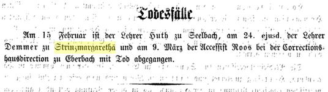

---

## Allgemeine Ereignisse

Am vier Wochen dauernden Bruderkrieg zwischen Preußen und Österreich nimmt auch das Herzogtum Nassau teil. In diesem Krieg verliert Herzog Adolph von Nassau als Bundesgenosse Österreichs sein Land an die im Krieg siegreichen Preußen.

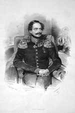

---

## In der Folge gehört StM ab sofort zur preußischen Provinz Hessen-Nassau.

Den Nassauern fällt es nicht leicht ihre Selbständigkeit aufzugeben und preußisch zu werden, aber die Umwandlung geht dann doch recht schnell von statten, zumal die Steuerlast in Preußen geringer ist.

---

## Als erster "echter Preuße" wird August Keiper am 09.10. in StM geboren.(Quelle: Alte Strinzer Chronik, Teil 1, Seite 102)

Beschwerde über den protestantischen Pfarrer Schmidtborn in Strintz-Margarethä(Quelle: HHStAW 402 Nr. 188)

---

## Ab sofort:

Verwaltungsbezirk: Preußische Provinz Hessen-Nassau, Regierungsbezirk Wiesbaden, Unter-Taunus-Kreis.

---

## Ereignisse

Am 21. August wandert Johannes Christian Wahl nach Amerika aus.(Quelle: Die Auswanderung aus dem Herzogtum Nassau 1806 - 1866)

---

## Ereignisse

Für einen Brand in StM. am 11. Dez. muss die Brand-Assecuranz 45 Thaler bezahlen(Quelle: Amtsblatt der Regierung in Wiesbaden / S. 81 / 1870)

---

## (Siehe auch unter: Patriotische Feiern)

Über das Vermögen des Johann Friedrich Klein aus StM ist ein Concursprozeß rechtskräftig erkannt. Ansprüche die auf persönlichen oder dinglichen Rechten beruhen sind bis zum 04.04. um 9:00 zu stellen.(Quelle: Amtsblatt der Regierung in Wiesbaden/ Pkt 968 und 682 / 1871)

---

## Ereignisse

Am 19. August wird das Wohnhaus der Concursmasse des Christian Diefenbach in der Rathausstube derselbst zum erstenmal versteigert.

---

## Ereignisse

An dessen wegen Altersschwäche als Gerichtsschöffe ausgeschiedenen Johann Georg Schmidt zu Strinz-Margarethä ist der jetzige Gerichtsschöffe Adolf Walter derselbst zum Stellvertreter des Standesbeamten für den Standesamtsbezirk Strinzmargarethä ernannt worden.(Quelle: Amtsblatt der Regierung in Wiesbaden / 1. März 1877 / Seite 60)

---

## Ein nasser Herbst, in dem es wenig Kartoffeln gab.(Quelle. Alte Strinzer Chronik)

Bau eines Vizinalweges von der Aarstrasse bei Michelbacher Hütte nach Strinz-Margarethae in der Gemarkung Kettenbach

---

## Ereignisse

August Weidnau, der im deutsch-französischen Krieg 1870-1871 einmal als Kavallerist die Seine in Frankreich durchschwommen hat, stirbt im Alter von 46 Jahren.

---

## Ereignisse

Streitigkeiten im Männergesangsverein "Eintracht" führen zur Spaltung des Vereins. Ursache für diese Querelen ist, dass ein Teil der Sänger gerne den neu eingesetzten Schulleiter Julius Emil Schlicht als Chorleiter möchten, der andere Teil aber den bisherigen Chorleiter behalten wollte. Schließlich einigen sich die erhitzten Gemüter zum Wohle des Vereins und konnten unter dem Dirigenten Karl Wahl weitermusizieren.(Quelle: Festschrift 100 Jahre MGV Eintracht 1891 / 1991)

---

## (Quelle: Alte Strinzer Chronik, Teil 2, Seite 10)

---

## Ereignisse

Der MGV "Eintracht" wählt den Schmied Wilhelm Klein zum neuen 1. Vorsitzenden(Quelle: Festschrift 100 Jahr MGV Eintracht 1891 / 1991)

---

## Beginn des Ausbaus des Scheiderthalweges, Gemeinden: Michelbach, Strinz-Margarethae, Kettenbach, Steckenroth, Daisbach(Quelle: HHStAW 403 Nr. 420)

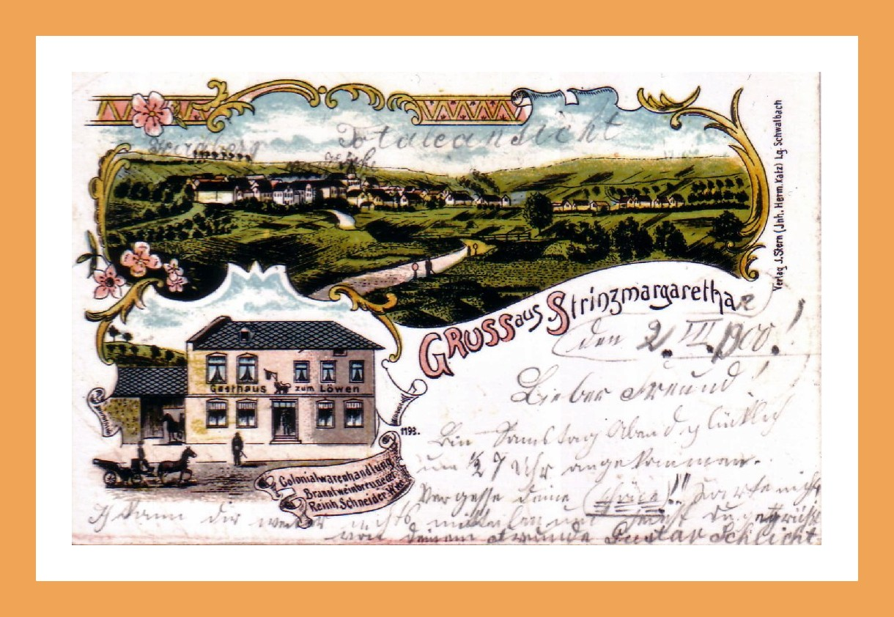

---

## Ereignisse

Die neu gebaute Chaussee durch das Scheidertal von StM nach Kettenbach wird dem Verkehr übergeben. Am 24. August findet eine Besichtigungsfahrt des Kreisausschusses statt. Der Schultheiß von StM nimmt daran teil.

---

## Beginn von Streitigkeiten bzgl. der Übernahme des Scheiderthalweges in ständische Unterhaltung, Gemeinden: Kettenbach, Steckenroth, Daisbach, Wingsbach, Hennethal, Hahn, Strinz-Margarethä.(Quelle: HHStAW 403 Nr. 232)

Bild 1 zeigt den Strinzer Reinhard Kugelstadt auf seinem Abschiedsfoto (Reservistenbild) von der 10. Companie Königin Augusta/Berlin, Garde-Grenadier-Regiment Nr. 4, bei dem er von 1902 - 1904 diente.

---

## Er schreibt:

„Nach einem feinen Quartier in Nieder-Seelbach bei einem Schuster sind wir nach großer Anstrengung in diesem Kaff angekommen und liegen hier 2 Tage.Herzlichen Gruß Ludwig

---

## Aus der Kirchenchronik

Im Dezember wurde nach früheren diesbezüglichen Bemühungen noch weiter an der Petition um die für unsere Gegend zu erstrebende Eisenbahn gearbeitet, die von Lorch über Langenschwalbach, Idstein nach Butzbach gehen soll und so den ganzen Taunus von Westen nach Osten durchziehen würde.

---

## (Siehe auch unter: Die Strinzer Eisenbahn)

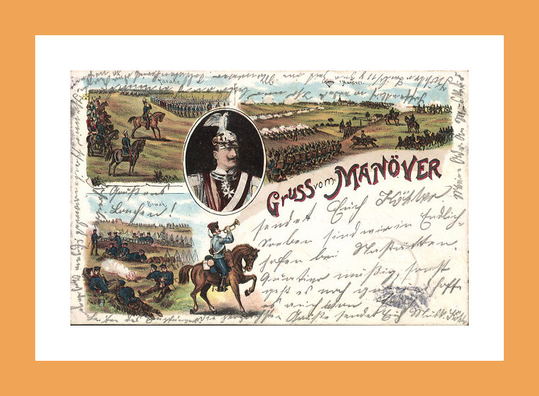

---

## (Quelle: Alte Strinzer Chronik, Teil 2, Seite 11, Kirchenchronik)

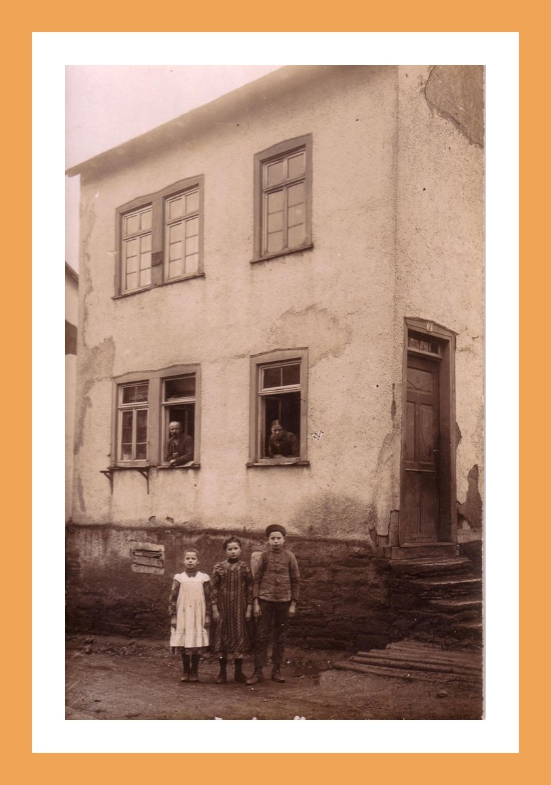

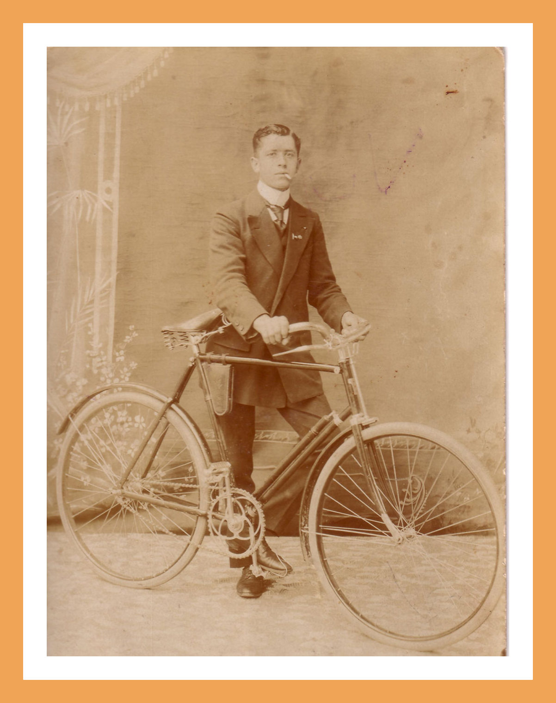

---

## Im Herbst findet in unserer Region das große Kaisermanöver des XVIII Armeekorps mit 40.000 Soldaten und 12.000 Pferden statt. Es ist auch von einem Manöver auf einem Feld bei Breithardt die Rede. In StM werden Soldaten einquartiert.(Quelle: Strinzer Chronik / Kaiserliche Kriegsspiele)

Am Sonntag den 3. Dezember findet im "Gasthaus zum Löwen" eine Wahlveranstaltung der "Nationalliberalen Partei statt.(Quelle: Flugblatt der Nationalliberalen Partei vom 30.11.1911)

---

## Allgemeine Ereignisse

Auf ihrer Jungfernfahrt kollidiert die Titanic am 14. April 1912 gegen 23:40 Uhr etwa 300 Seemeilen südöstlich von Neufundland seitlich mit einem Eisberg und sinkt zwei Stunden und 40 Minuten nach dem Zusammenstoß im Nordatlantik.

---

## Am 07.07. findet in StM eine Versammlung statt, in der über den aktuellen Status des Taunusquerbahnprojektes gesprochen wird.(Quelle: Strinzer Chronik, Teil 2, Seite 12, Kirchenchronik)(Siehe auch unter: Strinzer Eisenbahn)

Am 4.8. findet das erste Waldfest, organisiert vom MGV "Eintracht" statt. Es werden insgesamt 351,16 Mark eingenommen. Nach Abzug der Ausgaben verbleibt noch ein Überschuss von 113,65 Mark. Zum Begleichen der Bierrechnung muss sich der Vorsitzende nach Idstein begeben, wofür ihm ein Zehrgeld von zwei Mark bewilligt wird.(Quelle: Festschrift 100 Jahr MGV Eintracht 1891 / 1991)

---

## Ereignisse

Der MGV "Eintracht" nimmt am Sängerbundesfest in Laufenselden teil. Zu dieser Zeit ist es üblich, dass die Sänger mit Pferdefuhrwerken zu den Veranstaltungen anreisen. Die Fuhrleute werden aus den Reihen der Sänger ausgewählt und erhalten pro Pferd eine Vergütung von 6 Mark.(Quelle: Festschrift 100 Jahr MGV Eintracht 1891 / 1991)

---

## Der Konfirmationstermin wird von Pfingsten auf Ostern verlegt.(Quelle: Alte Strinzer Chronik, Teil 2, Seite 13, Kirchenchronik)

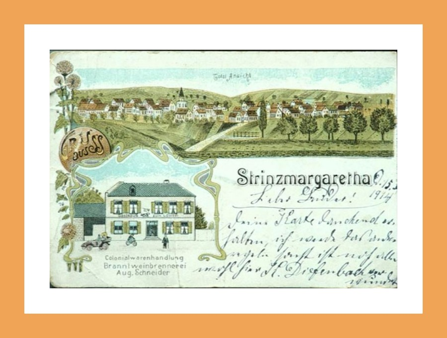

---

## Inschrift in einem Stall in der Schulstraße

Zu dieser Inschrift wird berichtet, dass der Baumeister der Scheune sein Werk nicht vollenden konnte, da er direkt 1914 zum Militärdienst eingezogen wurde und an der Front gefallen ist.

---

## Die Konfirmation wird erstmalig an Ostern (13. April) statt an Pfingsten abgehalten.(Quelle: Alte Strinzer Chronik, Teil 2, Seite 13, Kirchenchronik)

Der MGV "Eintracht" nimmt am Sängerwettstreit in Hahn teil.(Quelle: Festschrift 100 Jahr MGV Eintracht 1891 / 1991)

---

## Nachmittags kommt endlich der lang ersehnte Petroleumwagen, da schon eine lange Zeit lang kein Petroleum mehr zu haben war. Es sind eine ganze Anzahl von Soldaten in Urlaub hier. Beim Gottesdienst werden an die Strinzer Kinder Lebkuchen und Konfekt verteilt. Eine sonstige besondere Weihnachtsfeier kann wegen der Kriegsverhältnisse nicht veranstaltet werden.  (Quelle: Alte Strinzer Chronik, Teil 2, Seite 14, Kirchenchronik)

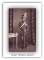

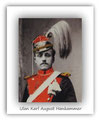

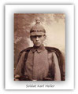

---

## Ereignisse

Nach einer Kriegstagung des MGV "Eintracht" kommt das Vereinsleben zum Erliegen. Grund hierfür ist, dass achtzehn Mitglieder aktiv am Kriegsgeschehen teilnehmen.(Quelle: Festschrift 100 Jahr MGV Eintracht 1891 / 1991)

---

## Ereignisse, die zeitlich nicht genau zugeordnet werden können.

Der früher bei Heinrich Funk dahier in Erziehung und Pflege gewesene Heinrich May aus Frankfurt ist bei Verdun gefallen.

---

## Begrüßung der heimkehrenden Krieger. (Quelle: Alte Strinzer Chronik)

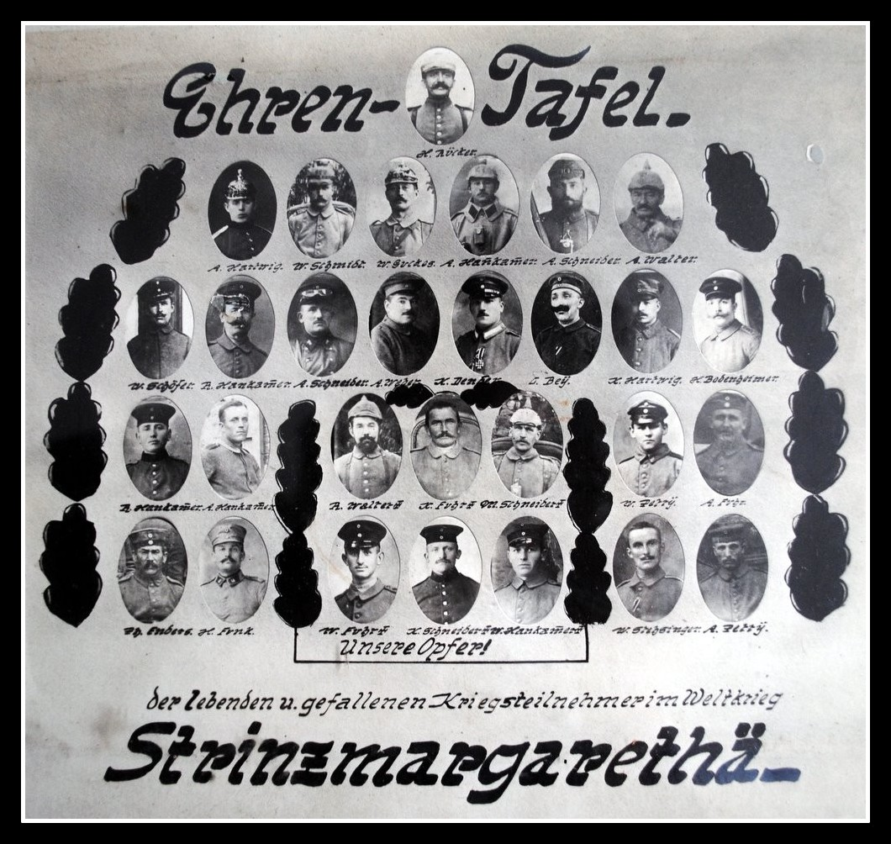

---

## Ehrentafel für die Kriegsteilnehmer des TV Strinz

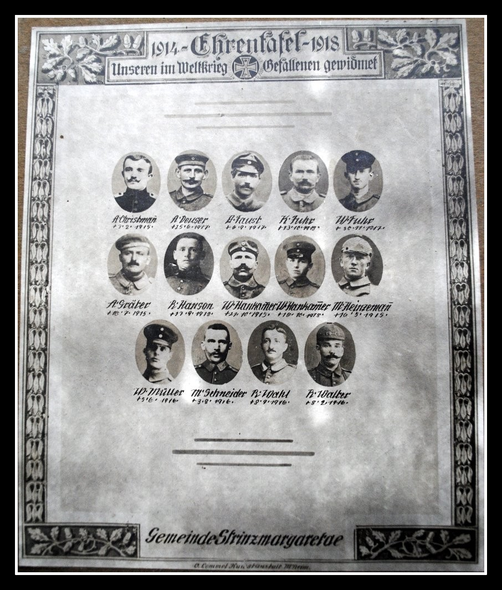

---

## Reichstagswahl 1. Wahlgang

DVP = 100 Stimmen / SPD = 32 Stimmen / DNVP = 22 Stimmen / KPD = 7 Stimmen / DDP = 2 Stimmen / USPD = 2 Stimmen / WP = 1 Stimme / VöSozB = 1 Stimme

---

## Einwohner: 383

Kutschenbestand: 24 zweirädrige Einspänner, 34 vierrädrige Einspänner, 28 vierrädrige Zweispänner Pferdebestand: 42 Wallache / 15 Stuten

---

## Wahlen

Ergebnis des Volksentscheids über den Entwurf eines Gesetzes über die Enteignung des Fürstenvermögens

---

## Ereignisse

Der Schulverband StM hat sich zur Beschäftigung der Frau Hankammer aus StM als Nadelarbeitslehrerin entschlossen. Sie erhält eine Entschädigung von 40,- RM je Jahresstunde.(Quelle: Hess. Staatsarchiv, Wiesbaden)

---

## Fuhrwerk Faust

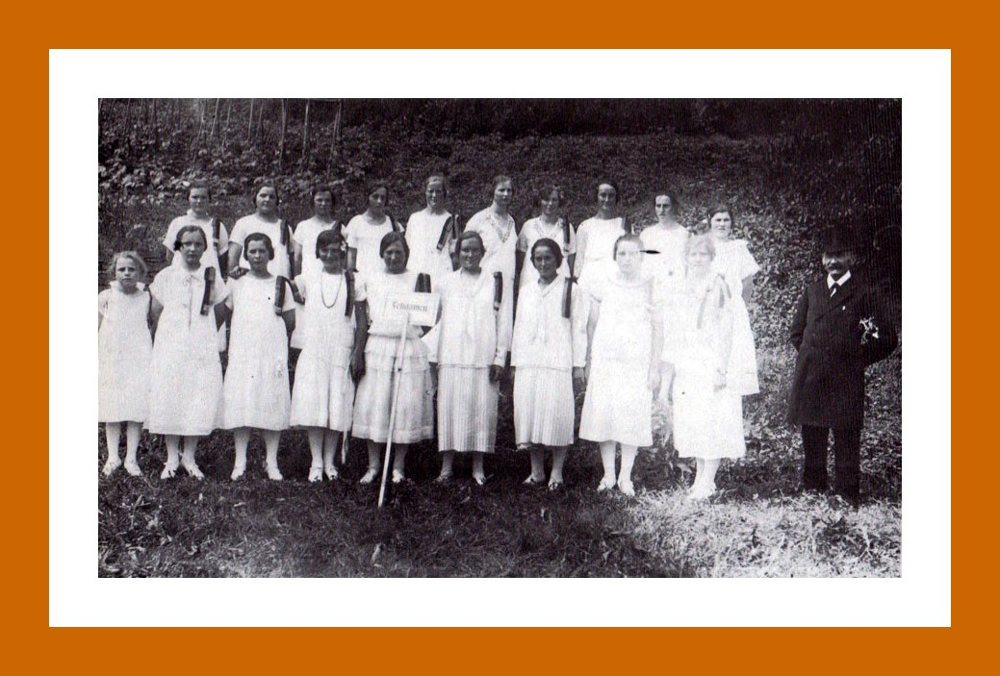

---

## Reichstagswahl

CNBL = 105 Stimmen / SPD = 15 Stimmen / DVP = 6 Stimmen / KPD = 5 Stimmen / DDP = 3 Stimmen / DBP = 2 Stimmen / DNVP = 1 Stimme / VöNatB = 1 Stimme

---

## Impressionen vom 25jährigen Stiftungsfest

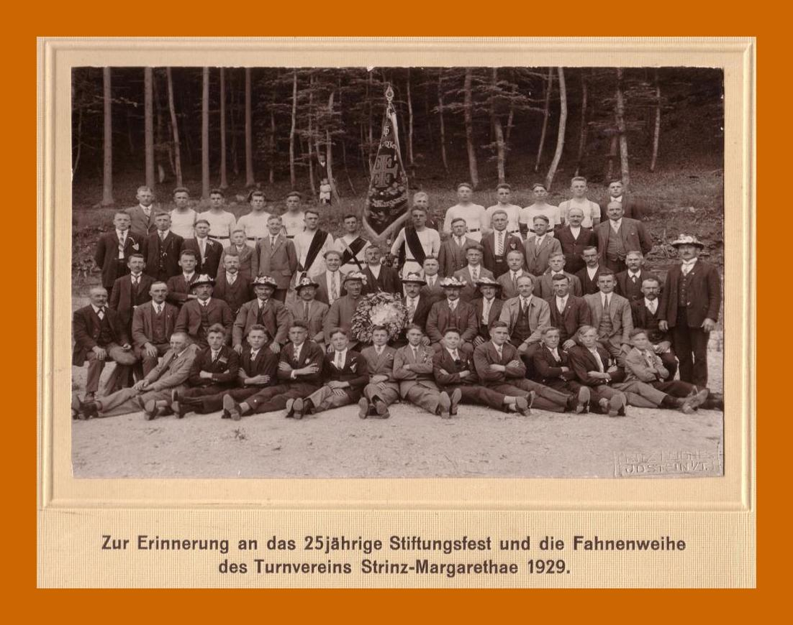

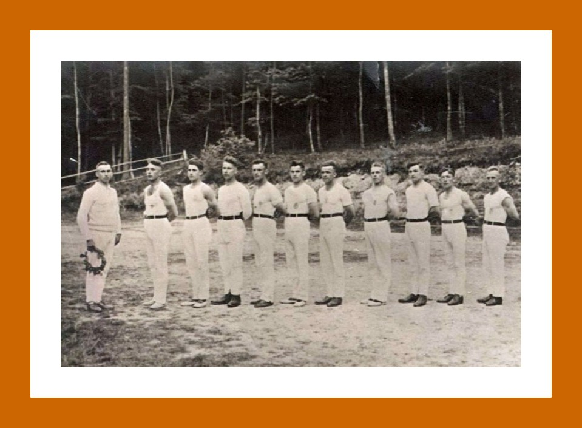

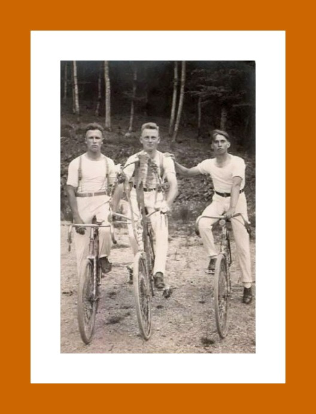

---

## Ereignisse

Wiederwahl von Adolf Weber zum Bürgermeister von StM. Zum Stellvertreter wird Wilhelm Guckes gewählt.

---

## Reichstagswahl

LP = 92 Stimmen / NSDAP = 21 Stimmen / SPD = 10 Stimmen / CSVD = 5 Stimmen / KPD = 4 Stimmen / DNVP = 2 Stimmen / StP = 2 Stimmen

---

## Impressionen vom der 40-Jahr-Feier des Turnvereins:

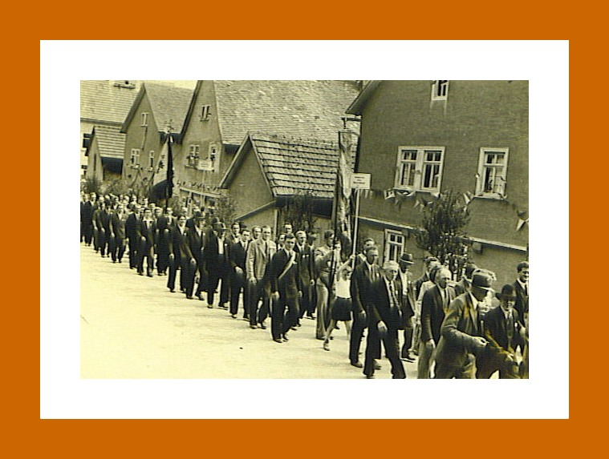

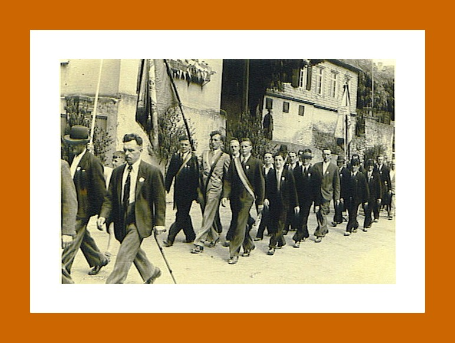

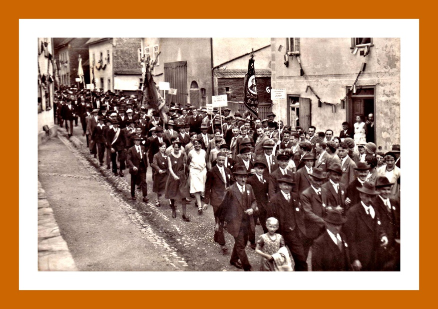

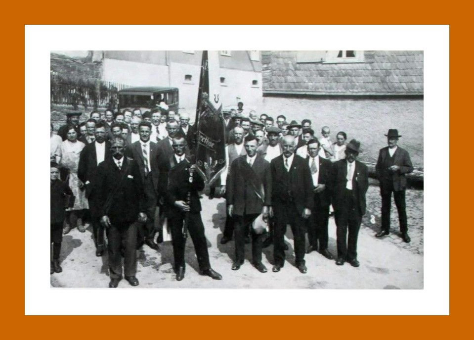

---

## Strinzer Spielmannszug

Am Hiese Stein (Der Stein hieß so, da er vor dem Grundstück der Familie Hies lag / Ecke Scheidertalstraße/Friedhofstraße)

V.l.n.r.: Hermann Rücker, August Hankammer, August Kaiper (Kaiper`s Onkel), Karl Stößinger, August Schneider, Gustav Gräter, Wilhelm Heiler (Heilers Schuster), Karoline Schneider.

---

## Schulklasse

---

## Obrigkeiten

Pfarrer: Walter Maus; Meneke (Vertretung aus Trinitatis); Schmidt (Vertretung aus Breithardt); Gottwald (Vertretung aus Kettenbach)

---

## Ereignisse

Die Bauern des Ortes werden verpflichtet, ab sofort Ihre Erträge an den Reichsnährstand zu melden.(Siehe auch unter: Lückenlose Kontrolle)

---

## Bei Schneiders  Strinzer Turnerriege

---

## Allgemeine Ereignisse

Das Flaggschiff der deutschen Luftschiffflotte, die "Hindenburg", welches im Jahr zuvor noch über unserer Gemarkung zu sehen war, stürzt spektakulär beim Landeanflug in Lakehurst USA, in einem Feuerball, ab.

---

## Der Reichsregierung wird der Plan für einen Schulneubau vorgelegt, welcher von dieser aber abgelehnt wird. (Quelle: Alte Strinzer Chronik)

Eine Liste aus diesem Jahr belegt, dass hier in StM Maulwürfe gejagt wurden.(Quelle: Helmut Hartwig)(Siehe auch unter: Maulwurfjagd)

---

## Ausflug               Strinzer Spielmannszug in Hausen

---

## (Quelle: Alte Strinzer Chronik)

---

## Ereignisse

Einweihung des ersten Strinzer Kindergartens nach einer zweijährigen Bauzeit. Die Schnitzerei über dem Eingang stammt von dem Idsteiner Bildhauer Ferdinand Abt.

---

## Ein in StM einquartierter Soldat (wohl zur Gefangenenbewachung)

---

## Ereignisse

Ende des Jahres kommt das Vereinsleben des MGV "Eintracht" abermals zum Erliegen. Um der ungewissen Zukunft Vorsorge zu tragen, wurde ein Vereinstestament geschrieben, in dem festgehalten wurde, dass bei einer Auflösung des Vereins das Vermögen dem Deutschen Sängerbund e. V. zufallen soll.(Quelle: Festschrift 100 Jahre MGV Eintracht 1891 / 1991)

---

## Ereignisse

Nutzung des neben dem Pfarrhaus gelegenen Konfirmantensaal zum Gottesdienst, um Heizkosten zu sparen.

NS-Aufmarsch am 18. Januar (vermutlich handelt es sich um eine Feier zur Reichsgründung, die im Zuge der „Durchhalteparolen“ organisiert wurden)(Quelle: Rückseite Bilddokument s.u.)

---

## NS-Aufmarsch (Anlass unbekannt)

---

## Obrigkeiten

Pfarrer: Gottwald (Vertretung aus Kettenbach)Bürgermeister: Adolf Weber; August GräterLehrer: Richard Weißer; Ursula Nissen; Horst Witt

---

## Wilhelm Faust

---

## Kriegsheimkehrer

26.5.45 Alfred Seel, 30.05.45 Richard Hankammer, 01.06.45 Edmund Egert, 03.06.45 Albert Ohlemacher, 02.06.45 Karl Steinmetz, 05.06.45 Alfred Hankammer, 06.06.45 Emil Faust, 15.06.45 Wilhelm Diefenbach, 16.06.45 Willi Wahl, 17.06.45 Karl Baum, 18.06.45 Wilhelm Klein, 22.06.45 Albrecht Ufer, 07.07.45 Adolf Guckes, 03.06.45 Karlheinz Ernst, 09.07.45 Albert Hankammer, 11.07.45 Albert Schneider, 19.07.45 Adolf Deuser, 20.07.45 Wilhelm Schneider, 02.08.45 Richard Christmann, 06.08.45 Alfred Egert, 2.8.45 Karl Weber, 10.08.45 Karl Hankammer, 17.08.48 Oskar Egert, 18.08.45 Artur Heinzemann, 30.08.48 Ernst Richter, 02.09.45 Arthur Faust, 02.09.45 Günther Puff, 01.09.45 Otto Kögel, 08.09.45 Willi Egert, 12.09.45 Otto Bender, 12.09.45 Ernst Schneider, 03.10.45 Wilhelm Guckes, 03.10.45 August Diefenbach, 12.10.45 Emil Bodenheimer, 25.10.45 August Christmann, 25.10.45 Willi Hankammer, 31.10.45 Moritz Feix, 20.12.45 Adolf Christmann

---

## Am 15. April wird Josefine Drößler in Folge des Zweiten Weltkriegs als vermisst gemeldet.

In einer Vereinsversammlung des MGV "Eintracht" am 23. November wird die Vereinstätigkeit wiederaufgenommen. Die dabei anwesenden 24 Vereinsmitglieder wählen zum 1. Vorsitzenden den Schmiedemeister Adolf Christmann I. . Da der langjährige Dirigent Ludwig Gebhard aus Altersgründen dem Verein nicht mehr zur Verfügung steht, verpflichtet man Karl Schön aus Hausen über Aar zum neuen Chorleiter.(Quelle: Festschrift 100 Jahre MGV Eintracht 1891 / 1991)

---

## Kriegsheimkehrer

07.01.1946 Otto Baum, 25.01.1946 Albert Mager, 02.02.1946 Adolf Klein, 11.03.1946 Willi Fuhr, 06.04.1946 Karl Hanson, 04.06.1946 Adolf Weber, 06.08.1946 Paul May, 10.12.1946 Georg Edinger

---

## (Quelle: Hess. Staatsarchiv, Wiesbaden)

---

## Einschulung

---

## Statistik

Tierbestand: Schweine 252 / Rinder 295 / Schafe 214 / Pferde 42/ Ziegen 55 / Hühner 478 / Gänse 16 / Enten 2 / Trut- und Perlhühner / 10 Zwerghühner 19 / zahme Kaninchen 31 / Bienenstöcke 70

---

## (Siehe auch unter Erlebnisse der Heimkehrer)

Schäfer                                                           Goldene Hochzeit Petri                                  Spielende Kinder Scheidertalstraße

---

## Flüchtlinge: 22 östl. der Oder-Neiße / 148 Tschechoslowakei / 18 Ungarn / 4 Rumänien

Tierbestand: Schweine 252 / Rinder 327 / Schafe 222 / Pferde 44 / Ziegen 59 / Hühner 459 / Gänse 33 / Enten 8 / Trut- und Perlhühner 15 / Zwerghühner 19 / Bienenstöcke 72

---

## Kriegsheimkehrer

29.01.1948 Wilhelm Moritz Enders, 17.02.1948 Otto Ax, 26.02.1948 Karl Rücker, 26.02.1948 Ernst Meyer, 10.08.1948 Willi Petri

---

## (Quelle: Hessisches Staatsarchiv)

---

## Evakuierte: 2 aus Berlin

Flüchtlinge: 2 aus Österreich / 19 östl. der Oder-Neiße / 120 Tschechoslowakei / 13 Ungarn / 2 Rumänien

Tierbestand: Schweine 471 / Rinder 367 / Schafe 216 / Pferde 43 / Ziegen 63 / Hühner 800 / Gänse 61 / Enten 9 / Trut- Perl- und Zwerghühner 29 / Bienenstöcke 92

---

## Der Turnverein führt das Theaterstück "Der Tatzelwurm" auf.

Zum ersten Mal wird die weibliche Jugend in die sportlichen Aktivitäten des TV 1904 einbezogen(Quelle: Festschrift zur Sportplatzeinweihung 1990)

---

## Kindergarten             Sommerfest

---

## Flüchtlinge: 2 Österreich / 15 östl. der Oder-Neiße / 122 Tschechoslowakei / 13 Ungarn / 1 Rumänien

Tierbestand: Schweine 585 / Rinder 393 / Schafe 168 / Pferde 41/ Ziegen 59 / Hühner 955 / Gänse 22 / Enten 7 / Trut- Perl- und Zwerghühner 15 / Bienenstöcke 80

---

## Am rechten Rand das Ochsenehirtenhaus

---

## Fassenacht        Kerbeumzug

---

## Einwohner: 516

Flüchtlinge 2 Österreich / 12 östlich der Oder-Neiße / 120 Tschechoslowakei / 12 Ungarn / 2 Rumänien

Tierbestand: Schweine 554 / Rinder 401/ Schafe 165 / Pferde 41 /Ziegen 60 / Hühner 1191 / Gänse 1 / Enten 1 / Trut- Perl- und Zwerghühner 9 / Bienenstöcke 99

---

## Impressionen von der Schuleinweihung

---

## Kindergarten              60. Jubiläum Gesangsverein

---

## Einwohner: 501

Flüchtlinge: 2 Österreicher / 12 östlich der Oder-Neiße / 109 Tschechoslowakei / 11 Ungarn / 1 Rumänien

Tierbestand: Schweine 430 / Rinder 388 / Schafe 107 / Pferde 41 / Ziegen 57 / Hühner 1354 / Gänse 1 / Enten 3 / Trut- und Zwerghühner 21

---

## 351 Wahlberechtigte / 244 Stimmen / SPD 37 / CDU 24 / FDP 122 / BHE 61

---

## Schulklasse        Kerbegesellschaft

---

## Flüchtlinge: 2 Österreicher / 17 östlich der Oder-Neiße / 100 Tschechoslowakei / 12 Ungarn

Tierbestand: Schweine 432 / Rinder 368 / Schafe 67 / Pferde 37 / Ziegen 44 / Hühner 1451 / Gänse 1 / Trut-, Perl- und Zwerghühner 1

---

## Der Landwirt Wilhelm Guckes wird zum Ortsgerichtsvorsteher gewählt.

Lehrer Witt beantragt die Herabsetzung des Mietwertes seiner Lehrerwohnung, da sich in der Wohnung keine Speisekammer befindet, der Aufgang zur Dachkammer zu niedrig ist, sich der Schlafraum über dem Schulraum befindet, im Wohnzimmer keine größeren Gegenstände untergebracht werden können und der Keller so feucht ist, dass eingemachte Lebensmittel verschimmeln. Dies wird mit Hinweis auf den ohnehin niedrigen m²-Preis von 0,75 DM pro Monat vom Kreisbauamt abgelehnt.

---

## Flüchtlinge: 2 Österreicher / 18 östlich der Oder-Neiße / 98 Tschechoslowakei / 15 Ungarn

Tierbestand: Schweine 538 / Ziegen 42 / Hühner 1439 / Gänse - / Enten 3 Trut und Perlhühner, Zwerghühner 4 / Bienenstöcke 86 / Rinder 383 / Schafe 10 / Pferde 40

---

## Flüchtlinge: 19 östlich der Oder-Neiße / 92 Tschechoslowakei / 8 Ungarn / 2 andere Länder

Tierbestand: Schweine 633 / Ziegen 33 / Hühner 1.442 / Gänse 2 / Enten 3 / Bienenstöcke 66 / Rinder 373 / Schafe 9

---

## Ereignisse

Gründung einer "Landwirtschaftlichen Bezugs- und Absatzgenossenschaft e.G.m.b.H" durch 32 Strinzer Bürger.(Quelle: Helmut Hartwig)

---

## Flüchtlinge: 19 östlich der Oder-Neiße / 92 Tschechoslowakei / 8 Ungarn / 2 andere Länder

Tierbestand: Schweine 633 / Ziegen 33 / Hühner 1.442 / Gänse 2 / Enten 3 / Bienenstöcke 66 / Rinder 373 / Schafe 9

---

## 60 Jahre Gesangsverein                   Am Hieße Stein

---

## KerbSchule

---

## Flüchtlinge: 19 östlich der Oder-Neiße / 78 Tschechoslowakei / 6 Ungarn

Tierbestand: Schweine 627 / Ziegen 21 / Hühner 1.439 / Gänse 2 / Enten 12 / Trut-, Perl- und Zwerghühner 12 / Bienenstöcke 80 / Rinder 394 / Schafe 16 / Pferde 42

---

## Ereignisse

Die "Landwirtschaftliche Bezugs- und Absatzgenossenschaft e.G.m.b.H." wird durch die Aufnahme des Bankgeschäftes in eine "Raiffeisenkasse e.G.m.b.H" umgewandelt.(Quelle: Helmut Hartwig)

Da sich der Dirigent des MGV "Eintracht" Herr Walzik beruflich verändern will, sollen die Übungszeiten in die frühen Abendstunden verlegt werden. Dieser Probenbeginn kann aber von vielen Sängern nicht wahrgenommen werden, sodass man sich im gegenseitigen Einvernehmen trennt. Neuer Dirigent wird Rolf Wilberg.(Quelle: Festschrift 100 Jahre MGV Eintracht 1891 / 1991)

---

## DRP 4

---

## Einwohner: 432

Tierbestand: Schweine 555 / Ziegen 19 / Hühner 1.333 / Gänse 6 / Enten 14 / Trut-, Perl- und Zwerghühner 14 / Bienenstöcke 68 / Rinder 406 / Schafe 2 / Pferde 42

---

## 300 Stimmberechtigte / 202 Stimmen / SPD 44 / CDU 35 / FDP 77 / BHE 31 / GVP 15

---

## Einwohner: 435 (davon 223 weiblich)

Tierbestand: Schweine 572 / Ziegen 17 / Hühner 1.429 / Gänse 4 / Enten 11 / Trut-, Perl- und Zwerghühner - / Bienenstöcke 68 / Rinder 387 / Schafe 34 / Pferde 40

---

## Evangelische Frauengruppe             Kerbegesellschaft

---

## (Quelle: Alte Strinzer Chronik)

Tierbestand: Schweine 591 / Ziegen 12 / Hühner 1.307 / Gänse 6 / Enten 9 / Trut-, Perl- und Zwerghühner 5 / Bienenstöcke 68 / Rinder 419 / Schafe 29 / Pferde 40

---

## 301 Wahlberechtigte / 237 Stimmen / SPD 59 / CDU 43 / FDP 112 / GDP, BHE 19 / DRP1

---

## Einwohner: 447

Tierbestand: Schweine 681 / Ziegen 3 / Hühner 1.251 / Gänse 6 / Enten 3 / Trut-, Perl- und Zwerghühner - / Bienenstöcke 46 / Rinder 419 / Schafe 26 / Pferde 35

---

## (Siehe auch unter Unser Dorf soll schöner werden)

Der Verband der Züchtervereine Limburg/Lahn veranstaltet in StM eine Tierzuchtausstellung mit Tierprämierung.(Quelle: Zeitungsausschnitt aus einer unbekannten Tageszeitung vom 14.09.1961)

---

## 301 Wahlberechtigte / 237 Stimmen / SPD 59 / CDU 43 / FDP 112 / GDP, BHE 19 / DRP1

---

## Einwohner: 446

Tierbestand: Schweine 490 / Ziegen 3 / Hühner 1.148 / Gänse - / Enten 10 / Trut-, Perl- und Zwerghühner - / Bienenstöcke 56 / Rinder 386 / Schafe - / Pferde 28

---

## (Quelle: Hess. Staatsarchiv, Wiesbaden)

---

## Ereignisse

Das Dorf nimmt noch einmal an der Ausscheidung zum Dorfverschönerungswettbewerb teil und erzielt im Schulbezirk Bad Schwalbach hinter Nauroth den zweiten Platz.

---

## Einwohner: 468

Tierbestand: Schweine 658 / Ziegen 2 / Hühner 1.148 / Enten 10 / Bienenstöcke 56 / Rinder 386 / Pferde 28

---

## Am Hieße Stein       Einschulung

---

## Die Vorsitzende des Landfrauenvereins, Frau Erna Schröder, legt noch im Gründungsjahr ihr Amt nieder. Neue Vorsitzende wird Erika Guckes, Stellvertreterin wird Liesel Hahn.(Quelle: Vereinschronik der Strinzer Landfrauen)

---

## Kircheneinweihung         Männergesangsverein

---

## Am Hieße Stein            In der Scheidertalstraße

---

## Einwohner: 497

Tierbestand: Schweine 539 / Ziegen 2 / Hühner 1.258 / Gänse 2 / Enten 6 / Trut-, Perl- und Zwerghühner 1 / Bienenstöcke 35 / Rinder 426 / Schafe 7 / Pferde 25

---

## Gisela Diefenbach übernimmt die Leitung des Singkreises StM.

Unter einem goldenen Stern hielt der Singkreis gemütliche Kaffeetafel. Das aber erst, nachdem die jungen Frauen und Mädchen bei der Altenfeier des Dorfes mit schönen Liedern erfreut worden waren. Denn das ist die Aufgabe, die sich der Singkreis gestellt hat: überall mit seinen Liedern Freude spenden.(Quelle: Wiesbadener Kurier, 23.12.1965)

---

## 337 Wahlberechtigte / 223 Stimmern / SPD 72 / CDU 78 / FDP 74 / DFU 2 / NPD 7

---

## (Quelle: Alte Strinzer Chronik)

Tierbestand: Schweine 593 / Ziegen 2 / Hühner 1.277 / Gänse 4 / Enten 4 / Bienenstöcke 28 / Rinder 426 / Pferde 22

---

## 357 Wahlberechtigte / 255 Stimmen / SPD 94 / CDU 56 / FDP 71 / GDP, BHE 14 / NPD 20

---

## Einwohner: 550

Tierbestand: Schweine 582 / Hühner 1.124 / Gänse 5 / Bienenstöcke 40 / Rinder 424 / Schafe 48 / Pferde 20

---

## Einweihung Feuerwehrhaus    Neue Feuerspritze

---

## Einwohner: 570

Tierbestand: Schweine 611 / Hühner 1.085 / Gänse 4 / Enten 5 / Bienenstöcke 20 / Rinder 415 / Pferde 15

---

## Strinz erhält die erste Telefonzelle am Rathaus. Jetzt hat jeder die Möglichkeit zu jeder Tages- und Nachtzeit zu telefonieren. Das war lange, besonders in der Nacht ein Problem, wenn ein Arzt gerufen werden musste.(Quelle: Alte Strinzer Chronik)

Der Landwirt Wilhelm Guckes wird als Bürgermeister wiedergewählt. Ehrenamtliche Beigeordnete werden Willi Enders, Werner Petri und Paul May.

---

## Im Saal der Gastwirtschaft Klein findet eine Kreistagsitzung statt.(Quelle: Alte Strinzer Chronik)

---

## Abriss des alten Spritzenhauses am heutigen Brunnenplatz

---

## Zum Jahreswechsel wird die Verkündung von Neuigkeiten durch die Ortsschelle von Gemeinderundschreiben abgelöst. Diese Rundschreiben werden ausgehängt aber auch allen Bürgern zur Verfügung gestellt. Der Aushang erfolgt an der Pfarrmauer und am alten Rathaus. Das erste Rundschreiben wird den Bürger inkl. eines Schnellhefters zur Verfügung gestellt. Den Bürgern wird empfohlen, die Rundschreiben in der Reihenfolge aufzubewahren und abzuheften.(Quelle: Rundschreiben von StM Nr. 1/69)  (Siehe auch unter: Ortschelle)

Die Polizeistunde in den Fastnachtstagen 1969 wird vom Regierungspräsidium Darmstadt aufgehoben.(Quelle: Rundschreiben von StM Nr. 2/69)

---

## Die Feuerwehr veranstaltet einen "Tanz in den Mai"(Quelle: Rundschreiben von StM Nr. 9/69)

Im Juni macht die ev. Frauenhilfe, gem. mit der Breithardter Frauenhilfe einen Ausflug nach Straßburg.(Quelle: Rundschreiben von StM Nr. 10/69)

---

## Aus Rücksichtnahme auf das Jubiläum des MGV wird kein Waldfest gehalten.

Dieter Niederhäuser übernimmt den Vorsitz des TV 1904.(Quelle: Festschrift zur Sportplatzeinweihung 1990)

---

## 428 Wahlberechtigte / 351 Stimmen / SPD 146 / CDU 142 / FDP 22 / NPD 39 / AP 2

---

## Zum ersten Mal startet die Aktion "Christkind" in StM. Als Christkind und Nikolaus verkleidete Bürger/innen besuchen die Kinder des Ortes und überreichen von den Eltern zur Verfügung gestellte Geschenke. Dabei sammeln sie freiwillige Spenden, die gemeinnützig verwendet werden.(Quelle: Alte Strinzer Chronik)

---

## Am Totensonntag wird die Trauerhalle auf dem Friedhof feierlich seiner Bestimmung übergeben.(Quelle: Alte Strinzer Chronik)

Durch Fusion wird die Nachbargenossenschaft Breithardt in die Raiffeisenkasse e.G.m.b.H. aufgenommen. (Quelle: Helmut Hartwig)

---

## Der ehemalige Kriegsgefangene Raoul Labonne kehrt nach 27 Jahren nach Strinz zurück.

Das von der Bundesregierung ausgesprochene Sonntagsfahrverbot schafft Probleme für die einzelnen Ortsteile, so auch StM. Diese werden gelöst, indem zusätzliche Busse der Firmen Fricke und Domke eingesetzt werden.

---

## Wahlberechtigte 592 / Stimmen 490 / SPD 175 / CDU 265 / FDP 41 / DKP 1 / NPD 8

---

## 2 x Kinderfest

---

## 3 x Fasching

---

## Die Arbeiterwohlfahrt gründet einen Seniorenkreis. An jedem Dienstag findet im Feuerwehrhaus eine Zusammenkunft der Einwohner über 60 Jahren statt. Außerdem finden Fahrten und Wanderungen an Wochenenden statt.(Quelle: Alte Strinzer Chronik)

Einbruch in einem Wohnhaus am Sonnenhang. Unbekannte Täter verschaffen sich Einlass durch ein Fenstergitter und durchwühlen systematisch alle Räume. Die Waschbecken verstopfen sie mit Waschmittel und Tüchern. Anschließend öffnen sie die Wasserhähne, was zu einem großen Wasserschaden führt. Sie erbeuten zwei wertvolle Zinnfiguren aus dem 18. Jahrhundert, ein Meissner-Porzellan-Service und einen Wandteppich. Der Gesamtschaden beläuft sich auf ca. 40.000,- DM.(Quelle: Wiesbadener Kurier)

Gründung der Elterninitiative "Schülertransport Obere Aar". Ziel ist die Verbesserung des Schülertransportes von und nach Taunusstein Hahn, auch für Strinzer Schüler.

---

## Durchführung der Aktion "Saubere Landschaft" durch den Ortsbeirat.

Der Bau des Dorfgemeinschaftshauses ist ins Stocken geraten. Die Bürger sind misstrauisch geworden und glauben nicht mehr so recht an eine Fertigstellung des Gebäudes.

---

## Der MGV nimmt an einem Gesangswettstreit in Vendersheim (Rheinhessen) teil. Unser Verein erzielt den 1. Klassenpreis, einen Klassenehrenpreis und den Dirigentenpreis, während er im höchsten Ehrenpreis den 2. Platz belegte.(Quelle: Alte Strinzer Chronik)

Ein Starfighter der Bundesluftwaffe (Kennung 28+18) stürzt 800 m neben Strinz in ein Feld. Die Piloten können sich mit dem Schleudersitz retten. Grund des Absturzes war Vogelschlag. Die Strinzer Feuerwehr war als erstes am Ort des Geschehens.(Quelle: Wiesbadener Kurier)(Siehe hierzu auch unter: Starfighterabsturz)

Der letzte Lehrer von StM, Horst Witt, feiert sein 40jähriges Dienstjubiläum.(Quelle: Wiesbadener Kurier)

---

## (Quelle: Alte Strinzer Chronik)

---

## Europawahl

Wahlberechtigte 647 / Stimmen 429 / SPD 164 / CDU 208 / FDP 40 / DKP 1 / EAP 0 / CBV 3 / Zentrum 0 / Grüne 13

---

## 2 x Kindergarten

---

## Die Raiffeisengenossenschaft feiert ihr 25jähriges Bestehen.(Quelle: Helmut Hartwig)

Im Strinzer Wald wird ein erschossener Bankräuber in seinem Fahrzeug gefunden.(Quelle: Wiesbadener Kurier)(Siehe auch unter: Toter Bankräuber im Wald)

Zusammen mit seinem Chorleiter feiert der MGV "Eintracht" die 15jährige Chorleitertätigkeit von Chordirektor ADC Klaus Ochs in der Aubachhalle. Neben Ehrungen, die Herrn Ochs aus allen Schichten des öffentlichen Lebens zuteilwerden, bietet der Verein allen Gästen ein Programm, welches einen Durchschnitt der 15jähringen musikalischen Zusammenarbeit darstellt.(Quelle: Festschrift 100 Jahre MGV Eintracht 1891 / 1991)

Aufnahme einer Schallplatte in der Aubachhalle mit Kompositionen von Bernhard Weber. Anlass ist der große Erfolg im Wiesbadener Kurhaus beim Bernhard Weber Gedächtnissingen. Unter Mitwirkung aller Chöre, die unter der Leitung von Klaus Ochs stehen wird eine Schallplatte produziert. Der MGV "Eintracht" ist mit dem Liede "Lieber Morgenstern" zu hören.(Quelle: Festschrift 100 Jahre MGV Eintracht 1891 / 1991)

Nach einem Blitzeinschlag in den Strinzer Hochbehälter ist ein Großeinsatz erforderlich, um die Schäden zu beheben.

---

## Wahlber. 662 / Wähler 620 / Gültig 613 / SPD 243 / CDU 264 / FDP 95 / Grüne 6 / NPD 1

---

## 2 x Schlachtfest

---

## SchlachtfestFasching

---

## Nach 45 Jahren Tätigkeit als Förster in Hennethal und StM tritt Walter Klein in den Ruhestand.

Durch Fusion werden die Nachbargenossenschaften Holzhausen und Panrod in die Raiffeisenkasse e.G.m.b.H. aufgenommen.(Quelle: Helmut Hartwig)

---

## Wahlberechtigte 733 / Stimmen 586 / CDU 197 / SPD 250 / FDP 44 / FWG 95

---

## Umzug der Sonderschule von Strinz nach Breithardt.

In der Jahreshauptversammlung des MGV "Eintracht" wird beschlossen, dass jeder Sänger, der höchstens drei Mal im Jahr bei einer Gesangsstunde gefehlt hat, durch die Überreichung eines Glases geehrt wird.(Quelle: Festschrift 100 Jahre MGV Eintracht 1891 / 1991)

---

## (Quelle: Alte Strinzer Chronik)

---

## Militärmanöver in der Hohenstein Gemarkung. Dabei werden im Wald zwischen den Gemeinden Hennethal und StM sogenannte "Manöverschäden" festgestellt. U.a. fällt ein amerikanisches Kettenfahrzeug einen Strommasten oberhalb des Friedhofes.(Quelle: Strinzer Chronik)

Anlässlich des 10jährigen Bestehens des Freundeskreises Strinz-Aube findet eine Radtour von 4 Radlern und einem Betreuer von Strinz nach Aube statt.

Die Strinzer sind auf dem Hessentag in Lambertheim vertreten. Große Beachtung fand hierbei der vom Strinzer Dorfschmied Willi Klein erbaute Wagen des TV StM.

---

## Pflanzung einer Linde durch Ortsvorsteher Werner Petri und Willi Guckes im Beisein vieler Bürger.

Aufnahme der Raiffeisenbank Aarbergen e.G. in die Raiffeisengenossenschaft Strinz-Margarethä.(Quelle: Helmut Hartwig)

Eine Wildschweinplage richtet große Schäden auf den Feldern der örtlichen Bauern an.(Quelle: Wiesbadener Kurier)

---

## Europawahl

Wahlberechtigte 761 / Stimmen 430 / SPD 163 / CDU 182 / FDP 41 / Grüne 32 / EAP 0 / Zentrum 2 / Sonstige 10

---

## Impressionen der 800-Jahr Feier

---

## Weitere Impressionen

---

## Hessentag     Kartoffelernte

---

## Ereignisse

Neuer Ortsvorsteher wird Ernst Losert. Sein Stellvertreter wird Willi Fuhr und Schriftführer Albrecht Egert.

---

## Wahlberechtigte 281 / CDU 167 / FDP 41 / Grüne 28 / FWG 137 / WGH 0

---

## Baubeginn der Erdgasleitung(Quelle: Alte Strinzer Chronik)

Kerb                                                                                       Schließung der Milchsammelstelle

---

## Ereignisse

Bei einem Einbruch in ein Wochenendhaus am Orler Weg entsteht ein Gesamtschaden von ca. 20.000,- DM.

Aufgrund von Baummaßnahmen auf dem Sportplatz kann keine Vereinsmeisterschaft des TV 1904 abgehalten werden.

---

## Wahlber. 726 / Wähler 564 / Gültig 556 / SPD 194 / CDU 249 / FDP 56 / Grüne 55 / DKP 1 / ÖDP 1

---

## Die Musikfreunde feiern ihr 10jähriges Bestehen.

Nach langen Diskussionen kann der MGV "Eintracht" unter dem Aktenzeichen VR 465 in das Vereinsregister von Bad Schwalbach eingetragen werden.(Quelle: Festschrift 100 Jahre MGV Eintracht 1891 / 1991)

---

## Sanierung des Fußbodens in der Aubachhalle.

Zuschüsse zu Renovierunsmaßnahmen an alten Häusern hat Ortsvorsteher Ernst Losert jetzt mit einem Schreiben an den Hessischen Innenminister gefordert. Anlaß dafür waren die Sanierungsmaßnahmen an den Außenwänden eines alten Wohnhauses in der Schulstraße, dass seit kurzem in neuer Fachwerkzirde zu bewundern ist.

---

## Fertigstellung des neuen Sportplatzes in Ortsmitte.

Leni und August Christmann begehen ein Jubiläum der besonderen Art. Seit 40 Jahren wird die Nebenzweigstelle der Nassauischen Sparkasse von Herrn Christmann und seine Ehefrau geführt. Darüber hinaus wird die Nassauische Sparkasse seit April 1925 - also über 63 Jahre - durch die Familie Christmann in StM repräsentiert.(Quelle: Hohensteiner Blättche)

Auch im Jahre 1988 wird weiter um die geplante Kreismülldeponie am Römersberg gestritten.(Quelle: Wiesbadener Kurier)

---

## Freiwillige Feuerwehr           Showtanzgruppe

---

## Ereignisse

Durch die Kommunalwahl erhält StM folgenden Ortsbeirat: Ernst Losert (Ortsvorsteher), Willi Fuhr (Stellvertreter), Paul Hahn (Schriftführer), Werner Petri, Horst Enders, Elke Schröder, Eleonore Weber.

---

## Wahlber. 813 / Stimmen 664 / CDU 107 / SPD 255 / FDP 46 / FWG 256

---

## Es werden nachfolgende Sportarten angeboten:

Kinderturnen/Geräteturnen/Gymnastik für Mutter und Kind/Tischtennis/Volleyball/Frauengymnastik/Tanzen /Leichtathletik und Fußball(Quelle: Festschrift zur Sportplatzeinweihung 1990)

---

## Ereignisse

Durch Fusion wird die "Raiffeisenbank Aarbergen-Hohenstein e.G." von der "VR Bank Untertaunus e.G" aufgenommen.(Quelle: Helmut Hartwig)

---

## Ein Sturm mit einer Geschwindigkeit von bis zu 150 km rast durch unsere Region und hinterlässt starke Schäden im Gemeindewald. Umgeknickte Bäume unterbrechen die Stromzufuhr, sodass StM zwei Stunden ohne Strom ist.(Quelle: Alte Strinzer Chronik)

Die erste Mannschaft der Tischtennisabteilung des TV 1904 wird Meister in der Saison 1989/90 und steigt in die Kreisliga auf. Auch die 2. Mannschaft kann in der 2. Kreisklasse einen hervorragenden 3. Platz erreichen.(Quelle: Festschrift zur Sportplatzeinweihung 1990)

Fest zur Einweihung des neuen Sportplatzes an der Aubachhalle mit offizieller Einweihung des Sportplatzes, sportlichen Darbietungen und gemütlichem Beisammensein.(Quelle: Festschrift zur Sportplatzeinweihung 1990)

---

## Der Freundeskreis Strinz - Aube wird eingetragener Verein.

Die über 250 Jahre alte Mauer am Pfarrhaus von StM wird saniert. Die Mauer, die bis zu 1,70 Meter dick ist, ist seit längerer Zeit einsturzgefährdet.

---

## Bundestagswahl (Erststimmen)

Wahlber. 840 / Stimmern 660 / CDU 292 / SPD 226 / Grüne 53 / FDP 64 / Rep. 21 / Graue 0 / NPD 3 / ÖDP 1 / PDS 0

---

## (Quelle: Wiesbadener Kurier)

---

## Ereignisse

Feier zum 100jährigen Bestehen des MGV Strinz-Margarethä. Der Saal ist bis auf den letzten Platz besetzt.(Quelle: Festschrift 100 Jahre MGV Eintracht 1891 / 1991)

---

## (Quelle: Wiesbadener Kurier)

---

## Stimmen 650 / SPD 247 / CDU 113 / Grüne 97 / FDP 43 / FWG 150

---

## Ereignisse

Mit der Wahl von Christa Enders zur Ortsvorsteherin, werden die Geschicke des Ortes erstmalig von einer Frau geleitet.

---

## Am 12.Dezember enden die Aufzeichnungen des ehemaligen Lehrers Horst Witt in der alten Strinzer Chronik(Quelle: Alte Strinzer Chronik)

---

## Ortsvorsteherin: Christa Enders

---

## Gründung des Pumuckle-Orchesters innerhalb der Musikfreunde Strinz-Margarethä e.V..

---

## Kinder aus Tschernobyl

---

## Schmidtborns Thesen unter der Lupe

Im Jahre 1886 verfasste Pfarrer Schmidtborn 2 Thesen, die 1827 in der „Jenaische allgemeine Literatur-Zeitung“ unter der Rubrik „Vermischte Schriften“ kommentiert wurden.

---

## Als die Bombenangriffe auf Frankfurt zunahmen ließ er sich Anfang 44 als Schullehrer nach StM versetzen. Er suchte sich unter mehreren Orten Strinz-Margarethä aus wegen des interessanten Namens – wie er später erzählte.

Er drängte seine drei Töchter in Frankfurt dazu, ihm zu folgen und die durch Bombenangriffe gefährdete Großstadt zu verlassen.

---

## Mineralienfunde

Wenn man mit offenen Augen in der Gemarkung unterwegs ist, insbesondere mit dem Metallsuchgerät über die Felder geht, findet man die unterschiedlichsten Steinarten vor. Einige in unserer Gemarkung aufzufindende Mineralien möchte ich hier vorstellen."

---

## Kalkspalt

Ein sehr häufiges in unserer Gemarkung aufzufindendes Mineral ist der Kalkspat aber auch Calcit, Kalzit oder Doppelspat genannt.

Der Stein entwickelt verschiedene Kristall- beziehungsweise Aggregatformen, die entweder farblos oder von milchig weißer bis grauer, durch Verunreinigungen auch gelber, rosa, roter, blauer, grüner, brauner oder schwarzer Farbe sein können. Mit einer Mohshärte von 3 (Diamant = 10) gehört Calcit zu den weichen Mineralen.

---

## Mandel

Eine Mandel ist ein vollständig mit mineralischer Substanz gefüllter ehemaliger Hohlraum (Geode) in Vulkaniten.

Ein Vulkanit ist ein Gestein, das infolge vulkanischer Aktivität durch rasche Abkühlung einer Gesteinsschmelze an der Erdoberfläche entsteht. Die Mandel besteht vermutlich aus Sandstein und Ferrit.

---

## Der Wald als Ertragsquelle

---

## Impressionen aus der Waldarbeit

---

## Deutschland in unvorstellbare Not gebracht hatte, an allem Mangel herrschte, war Holz aus unseren Wäldern Gold wert. Holz war das einzige Brennmaterial, das den Menschen zur Verfügung stand. Dennoch sehr begrenzt, weil es der Zwangsbewirtschaftung unterlag, mit der Raubbau an den Wäldern verhindert werden sollte, denn die Waldbesitzer, größtenteils Gemeinden und der Staat, waren verpflichtet, auch die Städte und die Flüchtlingslager mit großen Mengen Brennholz zu versorgen.  Die Zuteilungsquoten mussten von der Gemeindeverwaltung vollzogen und kontrolliert werden. Den Familien wurde das Brennholz nach der Anzahl der Familienmitglieder zugeteilt, darüber hinaus gab es noch „Wellen“ und den „Schlagabraum“ in Selbstwerbung.

Da es weder Benzin, noch Dieselöl gab, außer den Zuteilungen für die Landwirtschaft, die Feuerwehr und sondergenehmigte PKWs, z. B für den Landarzt, wurden die Lkw`s mit dem Holzvergaser betrieben, der ebenfalls Holz verschlungen hat. Für eine Betriebsstunde wurden mehr als 75 kg Holz verbraucht, das dem Fuhrunternehmer (für das Milchauto) ebenfalls zugeteilt wurde. Man kann sich leicht vorstellen, dass in allen Bereichen die Zuteilungen nicht ausreichten, um den „tatsächlichen Bedarf“ zu decken. Wer im Winter nicht frieren wollte musste sich zusätzlich Brennmaterial beschaffen. Der Fuhrunternehmer musste von seinen Auftraggebern zusätzlich Holz verlangen, d.h. woher nehmen und nicht stehlen?  Die Transportaufträge waren so umfangreich, dass die Holzvergaser- Lkw`s Tag und Nacht unterwegs waren.

In den Wintermonaten wurde das Holz im Wald gefällt, bis zu 60 Holzfäller waren damit von Mitte November bis März beschäftigt. Das Brennholz wurde nach Güte sortiert und in Raummetern gestapelt in 1, 2, 3, oder 4 m Stößen, an der Stelle, wo man den Baum zerlegt hatte. Die Qualität wurde unterschieden in Scheitholz (einmal gespalten), in Knüppelholz und Reißerknüppel, letztere in unregelmäßiger Länge. Das Holz fällen wurde im Akkord entlohnt und meist von sogenannten „Rotten“ zu 4 oder auch mehreren Holzfällern ausgeführt, alles Bürger, die froh waren in den Wintermonaten etwas verdienen zu können, aber auch um kranken- und rentenversichert zu sein.

---

## Da Diebe nicht gefunden wurden, hat man die Sache nicht weiterverfolgt. Ein unguter „Geschmack“ blieb jedoch im Raum. Wenn es Diebe waren, konnten sie zufrieden sein und der Gemeinderat auch??? Das „abhanden“ gekommene wertvolle Brennholz machte schätzungsweise 10 % des regulären jährlichen Holzeinschlags aus. Warum die Diebe nicht gefunden werden konnten bleibt Spekulation. Es wurden allerlei Gerüchte in Umlauf gebracht, die vermutlich alle mit Bedacht an der Wahrheit vorbeigingen. Einige hatten sicher ihren Spaß dabei.

Es fiel allerdings später auf, dass die „Holzmaschin“ an einigen Stellen tagelang Holz kleinzuschneiden hatte, was sehr ungewöhnlich war.

---

## Achtungsvoll

-----------------------------------------------------------------------------------------------------------------------------------

---

## Waldnamen

---

## Eichholz

Waldstück am Hermannsweg links. Dieses Waldstück wurde 2003 weitgehend aus der Bewirtschaftung genommen. Bis zu 183 Jahre alt ist der Buchenbestand im Eichholz. Da das Waldstück nicht mehr bewirtschaftet wird, entsteht hier wieder ein "Urwald".

---

## Kohl Wald

Hier standen in früher Zeit Kohlemeiler. Dort wurde Holzkohle hergestellt. Noch heute ist der Waldboden dort schwarz von der Kohle.

---

## Die Strinzer Linde

---

## Es ist davon auszugehen, dass es sich dabei um ein sogenannte Kaiserlinde handelte.

Die Bezeichnung Kaiserlinde tragen Linden, welche früher zu herausragenden Ereignissen in Zusammenhang mit dem Kaiser bzw. zu national bedeutsamen Daten gepflanzt wurden.

Im ausgehenden 19. Jahrhundert und beginnenden 20. Jahrhundert erlebte das Kaisertum und die Kaiserverehrung eine späte Blütezeit. Dementsprechend wurden

Die Landfrauen am Stumpf der alten Linde                diesbezügliche sowie nationale Feiertage mit großem patriotischem Eifer begangen.

Oft wurden Kaiserlinden neben anlassspezifischen Gedenksteinen gepflanzt oder es wurden Tontafeln mit Widmung bzw. Glasflaschen mit eingelegter Widmung mit eingegraben. Vor allem im ländlichen Raum erfreute sich das Pflanzen derartiger Linden großer Beliebtheit – aus dem einfachen Grund, dass man sich aufwändige Gedenksteine oder die Widmung neuer, großer Bauwerke wie in den großen Städten nicht leisten konnte.

---

## Sehr beliebte Pflanzdaten für Kaiserlinden waren:

- die Erinnerung an den Geburts- bzw. Todestag Kaiser Wilhelm I.  (* 22. März 1797; † 9. März 1888),

---

## Strinzer Steinbrüche

In der Strinzer Gemarkung sind vier Steinbrüche bekannt, die für den Hausbau und den Wegebau genutzt wurden. Die auf der Hand liegenden Vorteile eigener Brüche waren zu allen Zeiten die geringen Transportwege.

---

## Gemarkungs- und Wegenamen

---

## Damit die alten Flur- und Gemarkungsnamen nicht in Vergessenheit geraten, habe ich sie aufgeführt. Die einzelnen Namen könnt Ihr euch über die obigen Reiter anschauen.

---

## Die Beun ist ein Privatgrundstück im Gegensatz zur Gemeindeweide.

(Quelle: Periodische Blätter der Geschichts- und Altertumsvereine zu Kassel, Darmstadt, Frankfurt, Mainz und Wiesbaden / Jahrgang 1854)

---

## Erster Kuhweg / Teufelspfad

Der erste Kuhweg ist der erste Waldweg rechts auf der  Straße nach Hennethal. Er wurde der Überlieferung nach von den Bleidenstädter Mönchen "Teufelspfad" genannt, weil er zum "Teufelsberg" (dort huldigten die Bürger Ihren alten Göttern) führte.

---

## 2 x Brunnenschacht in der Pfalzstraße

---

## Strinzer Zechen

Am 8. Oktober 1869 wird im Amtsblatt der Regierung in Wiesbaden bekanntgegeben, dass unter Beweisung der §§ 35 und 36 des Berggesetzes die Beleihungsurkunde für das Berkwerk „Berthazeche“ und „Zeche Fritz“ erteilt wurde.

Der Ausdruck Zeche bezeichnete ursprünglich den Zusammenschluss mehrerer Peronen zum Betreiben eines Berkwerks. Mit ihrer Einlage in die bergrechtliche Gewerkschaft bezahlten die Beteiligen die Zeche, was heute noch als umgangssprachlicher Ausdruck für das Bezahlen der Rechnung verwendet wird.

Die Schürfrechte für die beiden Zechen wurden dem Berginspektor Carl Ludwig Münster aus Limburg, zur Gewinnung von im Felde vorhandenen Eisenerzen, erteilt.

Die Berthazeche lag im Grenzbereich von StM, StT und Hennethal und hatte eine Fläche von 499.411 Quatratlachtern.

Die Zeche Fritz lag im Grenzbereich von StM und Hennethal und hatte eine Fläche von 499.500 Quatratlachtern. Auch dort wurde Eisenerz gefördert.

---

## Kindererziehung und Freizeit

Da es keine Kindergärten gab, hielten sich die noch nicht schulpflichtigen Kinder überwiegend im Bauerngehöft der Eltern auf. Hier beaufsichtigte die Oma oder ein älteres Mädchen die Kleinen. Im Laufe der Jahre hatte jedes Kind in der Familie die Verantwortung für die jüngeren Geschwisterchen zu übernehmen.

---

## Spielzeug war Handarbeit

Gekauftes Spielzeug war den meisten Kindern unbekannt. Im Bäuerngehöft gab es viele Dinge, mit denen sich die Kinder stundenlang beschäftigen konnten. Die älteren Buben bastelten für ihre jüngere Schwester eine Wiege; die Mutter, Oma oder auch ein älteres Mädchen nähte eine Puppe mit Kleidern. Solche ein Spielzeug vererbte man dann noch an jüngere Geschwister weiter.Zum Spielen verwendeten die Kinder Holzscheite, Steine, Bohnen, Stöckchen, Nüsse, Bucheckern, Knöpfe oder Tannenzapfen. Wer einen hölzernen Baukasten mit Klötzen sein Eigen nannte, wurde bewundert und beneidet.

---

## Die Arbeit ruft

Nach der Schulzeit wuchsen die Jugendlichen allmählich in die Arbeitswelt der Erwachsenen hinein und waren stolz, wenn der Vater den Söhnen das Pferdegespann überließ.

Daß ein Arbeitstag in alter Zeit aber keine Zuckerschlecken war, können Sie unter Tagesablauf und Landarbeit nachlesen

---

## Der Graf fordert darin:

Wenn Hochzeiten sind, mag man ziemlich tanzen, doch nicht unter der Predigt. Verboten ist das Nackttanzen, das Herumwerfen und alles unzüchtige Wort und Gebarde, und ein Ortsvorsteher soll beim Tanzen sein, dass zu rechter Zeit anzufangen und aufgehört werde.

Die Grade der Blutsverwandtschaft, die zur Eheschließung hinderlich sind, sollen genau beobachtet werden.

---

## Ehepartner von außen oder aus dem Dorf

In 85 Ehen: 5 beide Partner von außen / 33 beide Partner aus dem Dorf / 47 ein Partner von ausserhalb.

---

## Das Aufgebot selbst wurde in einem Schaukasten an der Kirchenmauer zur Scheidertalstraße ausgehängt.

Sollte bekannt gewesen sein, dass die Braut schon vor der Hochzeit schwanger war, so wurde der Brauch ausgeübt, den Schaukasten zu stützen. Es wurden in der Regel schwere Hölzer unter den Kasten gestützt, manchmal bis zu einem Raummeter Brennholz, das man bei Nacht vom Grundstück der Brautleute geholt hat. Brautvater und Bräutigam mussten es dann wieder wegräumen.

---

## Der Polterabend

Vor der Hochzeit wurde der Polterabend gehalten. Dabei wurde dem Brautpaar Glas und Porzellan vor die Tür geworfen. Streng nach dem Motto: Scherben bringen Glück.

---

## Es existieren zwei Erklärungen zum Kranz:

1. Eine nicht mehr jungfräuliche Braut, die Strohjungfer, musste nach altem Brauch bei der Hochzeit einen Strohkranz tragen. Die unbescholtene Braut durfte sich dagegen im Myrtenkranz präsentieren.

2. Die andere Version ist, dass die jungfräuliche Braut einen geschlossenen Kranz trug und die nicht mehr jungfräuliche Braut oder Witwe einen offenen.

---

## Die Hochzeitkränze wurden früher gerne eingerahmt und ins Wohnzimmer gehängt.

---

## Hohoho, die Fassenacht ist do.

Auch heute noch wird der Brauch vereinzelt durch Dorfkinder durchgeführt, allerdings kommen diese beim Singen meist nicht über die erste Strophe hinaus.

---

## Ostern

Das erste kirchliche Fest im Kalenderjahr ist Ostern. Bevor die Kinder zum Gottesdienst gingen, sah man sie mit Körben von Haus zu Haus eilen. Bei ihren Paten und Verwandten suchten sie die buntgefärbten Eier, die in Haus, Scheune oder Garten versteckt waren. Mit ihren gefüllten Körbchen liefen sie strahlend nach Hause. Am Nachmittag trafen sich mehrere Kinder an einem Wiesenhang, wo das "Eierschibbeln" (Eierrollen) begann. Derjenige, dessen Ei am weitesten rollte wurde Sieger und erhielt das gewonnene Ei. Um die Osterzeit bekam auch der Schornsteinfeger von jeder Familie frische Eier.

---

## 1. Mai

Am 1. Mai zog die Schuljugend mit einem Handwagen von Haus zu Haus. Auf diesem stand das Maimännchen; es war früher ein von Laub vollkommen umhüllter Junge. Später wurde nur noch eine aus Buchenlaub bestehende Garbe dazu benutzt. Die Kinder sangen vor jedem Haus "Der Mai ist gekommen" und sammelten Geld.

---

## Pfingsten

Zu Pfingsten traf sich die Dorfjugend und zog singend durch die Straßen, um in einen Nachbarort zu wandern. Bei der Rückkehr wurde am Dorfeingang das Lied "Strinzmargarethä" angestimmt, das der frühere Lehrer Richard Weisser gedichtet hatte. Mit schlichten Worten wird in diesem Lied das Taunusdorf besungen.(Siehe auch unter: Strinzer Lied)

---

## Kerbebilder aus unterschiedlichen Epochen

---

## Weihnachten

---

## Liedgut

In Strinz wurde schon immer viel und gerne gesungen. So wurde hier im Jahre 1891 bereits ein Männergesangsverein gegründet.

---

## Strinzer Geschichten

Ist der Ort auch noch so klein, so gibt es doch sehr viel zu erzählen. Über die Jahrhunderte hinweg hat sich hier so einiges ereignet.

---

## Woran unsere Vorfahren glaubten

Unsere ältesten Vorfahren glaubten an Wodan (Odin), Ziu und die Göttin Freya. Den heiligen Hain auf einem Hügel hielten sie für die Wohnung der Götter. Hier trafen sich die Bewohner aus der näheren Umgebung und brachten den Göttern Opfer dar. Für viele Jahrhunderte blieb Donar (Thor) - der Gott der Kraft und des Gewitters - die volkstümliche Gestalt.

Die Mönche vom Kloster Bleidenstadt hatten einen schweren Stand, um unsere Vorfahren von ihrem Götterglauben abzubringen. Deshalb sagten sie: "Die Götter, an die Ihr glaubt sind falsche Götter. Ihr seid auf dem falschen Weg. Der Berg, auf dem Ihr dem Donargott opfert ist in Wirklichkeit ein Höllenberg, und der Pfad der dorthin führt ist ein Teufelspfad. Wenn Ihr weiter diesen Weg geht und den falschen Gott anbetet, kommt Ihr direkt in die Hölle. Geht lieber zu der Stelle, wo wir das Kreuz des Heilands aufgestellt haben, dort ist der Engelsgarten".

---

## Wenn man von StM nach Wingsbach läuft, dann sieht man in einem Felsen eine Höhle. Die Leute sagen, es wäre ein Hexenhaus. Als wir noch kleine Kinder waren hatten wir immer Angst in diese Höhle zu gehen.

Wenn man den Weg nach Wingsbach weitergeht, dann sieht man noch eine Höhle. Früher hatten die Leute immer Angst, hier vorbeizugehen. Denn hier wäre eine Schlappenfrau auf einem Besenstiel herumgeritten.

---

## Spuk am Steckenröther Wald

Man erzählt sich, dass da, wo jetzt der Steckenröther Wald steht, es gespukt hätte. Die Leute hätten Angst gehabt, da vorbei zu gehen, da dort oben einer mit dem Eisenstiefel geklopft hat.

---

## Woher die „Klusterbeeren“ ihren Namen Haben

Nach der Gründung des Klosters Bleidenstadt kamen die Benediktiner in unsere Gegend und sagten den Leuten, wie man das Feld besser anbauen konnte. Von den Mönchen lernten die Bewohner bessere Obstsorten und Beerensträucher kennen. Ältere Dorfbewohner sprechen noch heute von den Kloster- oder Klusterbeeren und meinen damit die Stachelbeeren. Der Volksmund hat demnach die Bezeichnung jahrhundertelang bewahrt.

---

## Die Zehntpflicht unserer Vorfahren

Der Zehnte soll unter Karl dem Großen eingeführt worden sein. Die Bauern mussten dem Kloster Bleidenstadt den "Großen Zehnten" (Roggen, Weizen, Gerste, Hafer und Heu), den "kleinen Zehnten" (den 10. Krautkopf und ebenso vom übrigen Gemüse, von Rüben, Obst, Erbsen, Wicken und Flachs den 10. Teil) und den "Blutzehnten" liefern, der sich auf lebende Haustiere und ihre Erzeugnisse wie Milch, Eier, Butter, Honig erstreckte.

Lange Zeit hatten die Bauern die Eier stückweise abzuliefern. Oft suchten sie die kleinsten von den jüngsten Legehennen aus. Die Mönche konnten gegen diesen Ablieferungszoll natürlich nichts einwenden, ärgerten sich aber über die kleinen Eier. Endlich fanden die Mönche einen Ausweg, wie die Rentenverzeichnisse des 11. Jahrhunderts bestätigen. Von jetzt an durften die Eier nur noch pfundweise abgeliefert werden. Das war wohl die gerechteste Lösung für beide Seiten.

Außerdem hatten die Bewohner als Leibeigene für das Kloster Hand- und Spanndienste zu leisten, die Frauen mussten Hemden und Tischtücher nähen und waschen.

---

## Die Ablösung von Frondiensten

Der Ausdruck "Arbeiten in der Fron" ist heute noch in unserem Dorf gebräuchlich, doch kommt sicher nicht vielen zum Bewusstsein, wie groß der Unterschied ist zwischen der heutigen Gemeinschaftsarbeit für das Dorf wohl und den Frondiensten, die von den Vorfahren zuerst für das Kloster und dann für die weltliche Obrigkeit geleistet werden mussten.

In Nassau - Idstein allerdings wurde schon frühzeitig der Versuch gemacht, die Last der Untertanen zu erleichtern. Von alters her hatten auch diese unter der Pflicht geseufzt, nicht allein die zahlreichen, im Lande verstreuten Höfe mit ihrem Fleiß und Schweiß zu bestellen, sondern auch als Rhein- und Weinfahrten, so oft es verlangt wurde, auszuführen.

Nach dem 1568 erfolgten Ableben des Grafen Balthasar hielt es die vormundschaftliche Regierung für seinen unmündigen Sohn Johann Ludwig im Jahre 1570 für zweckmäßig, die sämtlichen Domänen Hofleuten in Pacht zu geben, die auf eigene Kosten die Bebauung der Ländereien besorgte.

So wurden die Frondienste der Bauern hierfür nicht mehr benötigt. Aber die Regierung wollte das alte Herrenrecht den armen Leuten nicht ohne weiteres zum Geschenk machen, sondern suchte die fällige Arbeit in klingende Münze umzusetzen. Demgemäß verhandelten sie und vereinbarten mit den Bewohnern der Ortschaften, dass ein jeder Pferdebauer auf das Jahr von einem Gaul 2 Taler und ein "Heppenbauer" der keine Pferde hielt, einen Taler für den schuldigen Dienst auf 2 Ziele, auf Johannis (24. Juni) und Martinstag (11. November) zu erlegen schuldig sein sollte.

Die Herrschaft behielt sich aber den Dienst zu hohen und kleinen Jagden und Weidwerk, ebenso zum Fischen und ferner die schuldige Nachfolge der Untertanen (Leibeigenschaft) ausdrücklich vor. Auch blieb die Pflicht bestehen, den Kirbenwein für jeden Ort, wie von alters her, auf eigene Kosten zu stellen.

Die Steuerliste des Jahres 1573 nennt uns die Höhe der Ablösungsgelder. Jährlich entfielen demnach auf Strinz-Margarethä 61 Taler. Dass dabei unser Dorf nach Breithardt (62 Taler) die 3. Stelle einnimmt, ist sicher ein Beweis dafür, dass es im Vergleich zu anderen Dörfern wirtschaftlich gut gestellt war.

Die Bauern hatten jedoch keine reine Freude an dem gemachten Geschenk, das ihren immerhin schon mageren Geldbeutel unangenehm berührte. Sie suchten darum einen Weg, um diese neue Belastung nach Möglichkeit abzuschwächen. Das konnten sie am einfachsten durch Verringerung des Zugviehs erreichen, was sich auch ohne Schädigung des Betriebes machen ließ, da dieser nicht mehr so stark für herrschaftliche Zwecke in Anspruch genommen wurde.

---

## Die Abschaffung der Leibeigenschaft

Im Jahre 1818 wir im Herzogthum Nassau die Leibeigenschaft abgeschafft. Die hat zur Folge, das die alten Abgaben abgeschafft werden und ein neues Steuersystem geschaffen wird.

Friedrich August, Herzog von Nassau und Friedrich Wilhelm, Fürst zu Nassau teilen 1808 in der Sammlung der "Landesherrlichen Edicten und anderen Verordnungen" die Aufhebung der älteren und direkten Abgaben (Zehnten) nach Einführung eines neuen direkten Steuersystems, beginnend am 01. Januar 1808, mit.

Für die einzelnen Ämter und Ortschaften werden die einzelnen Abgaben aufgeführt, die nicht mehr zu entrichten sind.

---

## Diebstahlschutz in alter Zeit

In frühen Jahren fürchtete man sich oft vor Räuberbanden. Wenn auch der Schinderhannes selbst nicht hier war, wie sich das Volk erzählt, so hatte man doch unter seiner Bande zu leiden.

---

## (1) Der Räuber Katzuff oder Katzoff wurde gefasst und zu 15 Jahren Zuchthaus verurteilt.

(Quelle: Verhandlungen der Ständeversammlung des Herzogthums Nassau / Seite 40 / Erwähnung im Zusammenhang mit dem Bau der Aarstraße / 1859)

---

## Feuerschutz in alter Zeit

Die Feuergefahr in unserem Dörfchen war früher sehr groß, zumal fast alle Häuser und Scheunen mit Stroh gedeckt waren. Die "Abgebrannten" wurden bettelarm, denn in jener Zeit gab es noch keine Brandversicherung.

---

## Die Eimer wurden im Zuchthaus von Diez herstellt und kosteten insgesamt 33 Mark und 75 Pfennig.

Der hier gezeigte Eimer stand 109 Jahre im Dienst der Strinzer Feuerwehr und war noch bis 2009 auf dem Tanklöschfahrzeug als Kaminkehrerwerkzeug verladen.

---

## Bild Zinkeimer einfügen

---

## Die Bleidenstädter Grenzbeschreibung

Im Jahre 812 wird Bleidenstadt zum ersten Mal in einer Urkunde zur Weihe des Benediktinerklosters durch Erzbischof Richulf erwähnt. Kaiser Karl der Große übertrug darin dem Erzbistum Mainz das Gebiet ungefähr zwischen dem Taunushauptkamm, der Lahn, der Hohen Straße (der heutigen Bäderstraße) und der Hühnerstraße zur Verwaltung.

Die Bleidenstädter Grenzbeschreibung die vom 6. Juni 812 stammen soll, nimmt somit den Strinzergrund in den Klosterbezirk hinein.

---

## Diese Grenzbeschreibung ist umstritten. Wenn sie auch keine Fälschung der Neuzeit zu sein braucht, so muss doch ihr Alter bestritten werden.

Sie kann im 14. Jahrhundert, nach dem Brand des Klosters durch die Mönche aus deren Erinnerung heraus niedergeschrieben sein, um die altüberkommenen Recht zu wahren. Dafür spricht auch, dass kein Original von ihr vorhanden ist. Fest steht aber auf jeden Fall, dass das Kloster die Grundherrschaft und die dazugehörige Gerichtsbarkeit schon vor 1184 inne hatte.

(Quelle: u.a. Evangelischer Heimatbote für das Dekanat Bad Schwalbach, Nummer 11, Dezember 1954 / Horst Neumann, stud. theol.)

---

## Hier ein Auszug aus der Urkunde (deutsche Übersetzung aus dem lateinischen):

Papst Lucius III. nimmt das Kloster St. Ferrutius in Bleidenstadt in den apostolischen Schutz und gewährt genannte Rechte ...

---

## Folgende seiner Worte sind überliefert:

Vnser altern hant isz vff vns bracht, so han wir isz auch also biszher gehalten vnd wiszen auch nit anders, dan dasz vnszer gn. junher Johann graue zu Nassawe, herre zu Idtstein, desz vater, vnser here seliger, vnd sin altern vff in bracht vnd geerbet han, eine here sij zu Strincze, Liedebach vnd Liedebach, vnd wasz in das Kirspel gehoret, vnd habe macht zu gebieden, zu seczen und zu entseczen, vnd desz gerichts ein here, das zu hoen vnd niddern, zu lengen vnd korczen, vnd ein herre vber wasszer, weyde, welde, felde, vnd ober alles, das in das kirspel gehorig ist, nicht vszgescheiden, vnd wuszten sy auch nymandts anders, der einiche gebot, verbot ader herlichkeit in dem egen. kirspel habe in eniche wise, dan der obgen., vnser gn. jungher Hohan vnd syn erben, vnd das vff die eyde, wir alle vnd unszer iglicher sinem heren gethan hait, vnd solten wir icht moen im recht ... zut thun, wolten wir auch thun.

---

## Erstmalig die heilige Margaretha im Ortsnamen

Sein Name ist nicht zu 100 % überliefert. So findet man ihn auch als Knippe, Knipp oder auch Knyp in den Analen wieder. Das letzte Mal wo sein Name auftauchte ist in einem Reichssteuerregister der Herrschaft Idstein von 1499, wo ein Claß Knippon Niederschlag findet.

---

## Leistung Befehlender

Schultheiß bedeutet ‚Leistung Befehlender‘ und bezeichnete in vielen westgermanischen Rechtsordnungen einen Beamten, der Schuld heischt: Er hatte also im Auftrag seines Herren in Idstein die Strinzer zur Leistung ihrer Schuldigkeit anzuhalten, also Abgaben einzuziehen oder für das Beachten anderer Verpflichtungen Sorge zu tragen.

Außerdem war er auch Richter der niederen Gerichtsbarkeit. D.h. er befasste sich in der Regel mit geringeren Delikten des Alltags, die mit Geldbußen oder leichteren Leibstrafen sühnbar waren. Dazu gehörten der Pranger, das Tragen des Lästersteins sowie der Schandpfahl.

---

## In einem Buch fand sich über StM folgenden Hinweis:

"Die Zuordnung ergibt sich aus dem Vorkommen einiger hier genannter Zinser bei Strinz-Margarethä im Herbstbederegister von 1459."

---

## Bleidenstädter Reaktion

Fünf Tage später am 25. September erfolgte schon die Bleidenstädter Reaktion auf dieses Schriftstück. Sie bringen ein Gegenstück dazu.

---

## Einigung erst nach 20 Jahren

Für eine Einigung zwischen den beiden Gegner sorgte 20 Jahre später am 24. Januar 1465 der Bruder des Grafen Johann von Nassau, der seit 1461 Erzbischof und Kurfürst von Mainz war, dem folglich das Kloster unterstand.

Der Abt gibt die vier Dörfer StM, die beiden Libbach und Hambach dem Nassauer zu Lehen. Der Abt soll aus den Dörfern den Zehnten einziehen. Graf Johann und seine Nachkommen sollen dem Abt in den Dörfern zu seinem Recht verhelfen.

Neben anderen Vereinbarungen ward so der Streit beigelegt. Man darf sich jedoch nicht darüber hinwegtäuschen, dass die tatsächliche Macht bei den Grafen lag und der Abt trotz des Vergleichs vor Übergriffen in seine Rechte nicht bewahrt blieb. Ein grundsätzlicher Wandel in den Ansprüchen des Klosters Bleidenstadt gegenüber des Kirchspiels Strinz-Margarethä einerseits und den Grafen von Nassau-Idstein bahnte sich erst nach der Einführung der Reformation an.

(Quelle: Weisthümer gesammelt von Jacob Grimm, Vierter Theil / 1863, Evangelischer Heimatbote für das Dekanat Bad Schwalbach, Dezember 1954, Nummer 11, Horst Neumann, stud. theol.)

---

## Es sind:

Die Struderßen / Foln Cleßg(e) und Gerdrut sin hußfr(au)e / Moldner Gred(e) und Ka(theri)na ir dochter / Greden Cleßge und Eua syn hußfrauwe / Contzg(e) Synder und Greda sin hußfr(au) / die alde Wyntersen, Katheryn ir dochter und Greda ir dochter / Hans / Greta / Contzg(e) / die Wenerßen / Wenerß Cleßg(e) und greta syn husfr(au)e / Folck / Greda Uxor / Pfaff Hen / Gute Uxor Sua / Stifft und Eyle syn hußfrauwe / Snyder Hen und Ka(theri)na syn hußfr(au)e / Gerdrucen Kathryn / Heyntz Schoman und Greda syn Hyßfraue / Philips / Anna Uxor / Matis Hen und Guta syn hußfr(au)e / Koniges Peter und Greta syn hußfr(au)e / Petergen von Hanbach und Anna syn hußfrawe / der Grobbe / Hilman Smyt und Anna syn hußfrauwe / Gredg(e) / Cleßgen / Knyppon Claß und Elles syn hußfrauwe / Adam / Holn Tyll / Wigand und Eylgen syn hußfrauwe / Greden Heyntz und Fyhee syn frawe / Helbick Scholteiß und Anna syn frawe / Heyntz / Werner / Lotzen Claß / Katherin Uxor / Wameysterß Clao und Greta syn son / Henne /Hylman / der Koewehyrt (der Kuhhirt???) / Katheryn Uxor / Schoman Hen und Greta syn frawe / Eben Heyntz und Greta syn maydt / Adam / Emmerich / Demgen / Dyne / Greda / Emmerich / Logen Heyntz und Anna syn hußfrawe / Meckeln Hans und Eua syn hußfr(au)e / Lotzen Hen und Greta syn hußfr(au)e / Arnoldt und Eylchen syn frauwe / Philips / Adam / Drescheren und Gerda syn hußfr(au)e / Hans Tyll / Lysee / Koe Cleßgen / Molnerß Peter und Grede syn hußfr(aue) / Malden Grede / Hen / Eylchen / Philips / Greden Glaß.

---

## Bäuerliches Leben im 17. Jahrhundert

Der Bauer in der Zeit des 30jährigen Krieges stand früh morgens von seinem Strohlager in dem langen Hemd auf, das er auch tagsüber trug. Er - und auch der Bürger in der Stadt - hatten kein eigentliches Nachthemd. Das Hemd, das man am Leibe trug, trugt man auch tagsüber - tagein, tagaus...

---

## Die Beine wurden in eine Bauernhose gesteckt. Die Bauernhose

bestand eigentlich aus zwei langen Strümpfen, sogenannten Beinlingen, die die Beine von den Zehen bis zu den Hüften bedeckten.

---

## Die Beinlinge wurden durch ein Band oder ein Strick um die Hüften gehalten.

An den Strümpfen blieb vorn und hinten natürlich ein großes "V" offen, in welches das lange Tag- und Nachthemd gesteckt wurde. Das Hemd diente gewissermaßen als Unterhose.

Darüber hing ein weiter Rock (eigentlich ein zweites grobes Hemd), der bei der Arbeit durch einen Gürtel oder Strick geschürzt war.

---

## In einigen Regionen kam später das kurze Wams in Mode, der knapp bis zum Gürtel reichte.

Nun wurden aus den Strümpfen eine Art Strumpfhose. Vorn wurde ein Hosenlatz und hinten ein Dreieck auf die Stellen genäht, die vorher "frei" waren.

---

## Die Hose wurde mit sogenannten "Nesteln" - kleinen Schnüren - an dem Wams befestigt.

Im Sommer ging der Bauer barfuß, im Winter in Pantoffeln oder Schlappen, wie man sie auch heute noch kennt.

Bei Arbeiten im Schlamm trug der Bauer "Tripklompen". Das waren stabile Pantoffeln, die auf ein starkes Brett genagelt waren, unter dem zwei Querleisten das Abrutschen verhindern sollten.

Auf dem Kopf trug man eine Mütze oder eine Kappe mit Ohrenklappen. Bei den Bauern hatte sie lediglich die Aufgabe, gegen die Witterung zu schützen; entsprechend vielfältig war die Form, die nur von der Funktion und nicht von der Mode beeinflusst war.

---

## Wenn man die Umstände berücksichtigt, unter denen die Bauern und ihre Familien leben und knechten mussten, wenn man sich die hygienischen Verhältnisse vor Augen hält und wenn man weiß, dass Anfang des 17. Jahrhunderts eine "kleine Eiszeit" ausgebrochen war, die nicht nur zu Missernten führte, sondern die Bauern auch zwang, ihre Kleidung ständig anzubehalten um nicht zu frieren, dann ahnt man, dass es in den Bauernkaten und Schankhäusern nach Armut und Kuhmist gerochen hat.

Dass unter diesen Bedingungen Rheuma, Gicht, Tuberkulose und später auch die Pest ein leichtes Spiel hatten, braucht nicht noch begründet zu werden.

Als lebende Plage für die Bauern trieb seinerzeit, aufgrund der schlechten hygienischen Verhältnisse, Flöhe und Läuse ihr Unwesen. Nicht zuletzt verbreitet durch Ratten und Mäuse, die wie fast selbstverständlich mit den Bauersleuten in deren Häusern wohnten und von den unachtsam weggeworfenen Abfällen lebten. Natürlich kann das sogenannte gesunde Volksempfinden auch aus einer Plage, der man nicht entkommen konnte, noch etwas Gutes abgewinnen: bei den Bauern galten Läuse - vor allem bei Kindern - als Zeichen bester Gesundheit.  Niemand konnte damals ahnen, welche hinterhältige Rolle zum Beispiel die Kleiderläuse bei einer Seuche spielten, die später als Fleckfieber bekannt wurde.

Man hatte zwar in den folgenden Jahrhunderten immer wieder versucht, mit diversen Rezepten der Läuse Herr zu werden, doch meist mit mäßigem Erfolg.

---

## Hohe Kindersterblichkeit

Seinerzeit war die Kindersterblichkeit in unserem Gebiet sehr hoch. Dies lag wohl auch überwiegend an fehlender Hygiene. Schuld daran war sicherlich auch der damals gebräuchliche "Schnuller". Dieser bestand aus einer Art Ball der aus einem Stück Stoff gerollt wurde und an dessem Ende eine Schnur hing. Den Stoff trängte man mit etwas Süßem, z.B. Honig und steckte es den Kindern in den Mund, die daran nuckelten. Dieser wurde natürlich des öfteren ausgespuckt, landete auf dem verdreckten Boden und wurde, wenn es ganz schlimm kam, von den Haustieren abgeleckt. Desinfektion kannte man damals nicht und so wurde der verdreckte "Schnuller" den Kindern wieder in den Mund gesteckt, was zu Krankheiten und schließlich zum Tod führte.

(Quellen: Dr. Klaus Koniarek / Bad Sooden-Allendorf / Wehen und sein Grund Dr. Eduard Wilhelmi / 1957)

---

## Der Graf fordert darin:

... Abschaffung allerhand Aberglaubens, Rotten und ärgerlichen Lebens, auf Befürderung christlicher Zucht und Erbarkeit und Erhaltung guter polizeydienlichen Stücken als mit Kristallsehern, Zauberern, Widertäufern, Kirmessen, Sonntagstänzen, Gotteslästern und Vollsäufern und mit straft der Unzucht und Ehebruchs.

An Leib und Leben soll bestraft werden, wer zu einem Wahrsager oder Kristallenseher läuft; 12 Meilen Weges weit sollen die Wiedertäufer außer Landes verwiesen werden und ihr Gut von den Beamten eingezogen werden.

Die Kirmessen sollen abgeschafft werden und jeder Pfarrer, der sie duldet, bestraft werden, weil auf ihnen viel "übermäßiges Fressen, Saufens, Spielen, Schlägerung und sonst viel geschieht. Der Pfarrer, der es duldet, soll mit 20 Gulden bestraft und seines Amtes entsetzt werden.

Wenn aber Hochzeiten sind, mag man ziemlich tanzen, doch nicht unter der Predigt. Verboten ist das Nackttanzen, das Herumwerfen und alles unzüchtige Wort und Gebarde, und ein Ortsvorsteher soll beim Tanzen sein, dass zu rechter Zeit anzufangen und aufgehört werde.

Ein Gotteslästerer und Vollsäufer soll bei Wasser und Brot in den Turm (Hexenturm in Idstein) gesetzt und wenn dies nicht hilft, außer Landes verwiesen werden, nach dem Tode soll er nicht wie anderen in geweihter Erde ruhen.

---

## Die letzten Strinzer

Nach dem dreißigjährigen Krieg war unsere Region fast leergefegt. Sind die Bauern dem Tod entkommen, flüchteten dieses meist in sicherere Gebiete.

---

## Viele Dörfer hatten kaum noch Einwohner, so auch geschehen in StM.

Im Jahre 1658 wurde von Pfarrer Steinbach, der hier in diesem Jahr seinen Dienst antrat, eine kleine Volkszählung durchgeführt, die die Nachbarn (Einwohner) der einzelnen Orte aufführt.

---

## Demnach lebten in StM nur noch 70 Personen. Namen die heute hier noch vorkommen sind Klein, Heiler, Rückert und Enders.

Es ist wohl auch noch der Name Puff dazu zu zählen, denn 1684 ist Wilhelm Puff im Alter von 81 Jahren gestorben. Margaretha Pfuin folgte ihrem Ehemann bald nach. Da das Ehepaar im Verzeichnis der "Nachbarn" von 1658 nicht genannt wird, muss man annehmen, dass es entweder von auswärts zuzog, oder dass es eine Zeitlang, noch infolge des Krieges, einen anderen Wohnsitz hatte.

---

## Kinder

Johann Philipp, Anna Margaretha, Anna Elisabeth, Elisabeth, Johann Conrad, Philipp Conrad, Johann Mattheus

---

## Mit dem Begriff "aufs Rad gelegt" ist das seinerzeit übliche Rädern gemeint. Es handelt sich dabei um eine grausame Hinrichtungsform des Mittelalters und der Frühen Neuzeit.

Die als Mörder und/oder Räuber Verurteilten wurden auf ein Schafott gebracht und auf dem Boden festgebunden. Vorrangiges Ziel des ersten Aktes war das qualvolle Verstümmeln des Leibes, nicht der Tod. Deshalb sah die gebräuchlichste Variante vor, das Knochenbrechen mit den Beinen zu beginnen. Dazu ließ der Scharfrichter das Richtrad (oft mit eiserner Kante) auf den Unterschenkel des Verurteilten fallen und arbeitete sich dann bis zu dessen Armen hinauf. Dabei waren Rhythmus und Anzahl der Schläge jeweils vorgeschrieben, manchmal auch die Speichenzahl des Richtrades. Um dessen Wirkung zu erhöhen, legte man scharfkantige Hölzer unter die Gelenke, sogenannte Krammen, Krippen oder Brecheln. Später gab es Vorrichtungen, in die der Verurteilte „eingespannt“ werden konnte. Obwohl nicht üblich, konnte der Scharfrichter angewiesen werden, den Verurteilten am Ende des ersten Aktes zu exekutieren, indem er beim Gnadenstoß auf Hals oder Herz zielte. Noch seltener geschah dies sofort zu Beginn (vom Kopf herab).

Im zweiten Akt wurde der Leib in ein anderes Rad geflochten, was durch die gebrochenen Glieder möglich war, oder daran festgebunden. Nun wurde das Rad an einem Stock oder Pfahl aufgerichtet. Danach durfte der Scharfrichter den Verurteilten gegebenenfalls enthaupten oder erdrosseln. Es wurde auch Feuer unter dem Rad entfacht, oder man warf den Geräderten einfach hinein. Gelegentlich errichtete man einen kleinen Galgen auf dem Rad, etwa wenn der Schuldspruch zusätzlich zu Mord auf Diebstahl lautete.

Da der Leib nach der Hinrichtung auf dem Rad verblieb und Tierfraß und Verfall überlassen wurde, hatte diese Form der Bestrafung, ähnlich der antiken Kreuzigung, eine sakrale Funktion über den Tod hinaus: Nach damaligem Glauben stand die unterbliebene Bestattung einer Auferstehung entgegen.(Quelle: Wikipedia)

---

## begraben wurde.

---

## Ein Kind namens "Misere"

Im Untertaunuskreis gibt es die Sage, dass in der "Franzosenzeit" ein fremdes, verlassenes Kind gefunden wurde und der Pfarrer von Strinz-Margarethä das einsame Kind "Misere" genannt und getauft habe, was übersetzt so viel wie "Elend" bedeutet.

Unter der "Franzosenzeit" versteht man den Zeitraum, in dem unser Gebiet von den Franzosen besetzt war. Das war um 1804 - 1815.

---

## Das Leid uneheliche Kinder

In der damaligen Zeit galt es als Schande uneheliche Kinder zu haben. Der Makel, der der unverheirateten Mutter anhing, wurde auch auf das uneheliche Kind übertragen. Man gestand ihm nicht, wie dem ehelichen Kinde, die gleichen Rechte und die gleiche Achtung zu. Es war ein "Bankert", der sich überall verachtet fühlte und dem man seine uneheliche Geburt, an der er schuldlos war, bei jeder passenden und unpassenden Gelegenheit vorhielt. Dieser Makel hing ihm sein ganzes Leben an. Um dieser Verachtung zu entgehen, kam manches Mädchen und manche Frau dazu, ihr heimliche geborenes uneheliches Kind zu töten oder auszusetzen.

---

## Früher kamen immer wieder Bettler und Obdachlose durch den Ort. Die Gemeinden

waren seinerzeit verpflichtet diesen armen Menschen ein Obdach zu geben. Für diesen Zweck gab es Räume, die dafür vorgesehen waren.

---

## Das Backhaus in alten Ansichten

Das Backhaus war ein einfacher Zweckbau. In der Mitte stand der gemauerte Backofen, rechts davon gab es eine Arbeitsstube mit einer Durchreiche zum Ofen und linker Hand befand sich der Eingang mit Treppe zum Obergeschoß, wo sich eine Notwohnung befand. Das Innere des Backofens war mit Backofenstein ausgebaut.

---

## Das Backhaus als Notunterkunft

---

## aus einer Ortsansicht aus den 30er Jahren.

---

## Brücke über den Aubach

Am 25. August 2015 zeugt Baustellenlärm aus der Pfalzstraße davon, dass dort eine größere Baumaßnahme von statten geht. In der Tat, denn ein Bagger hat damit begonnen, die Brücke in der Pfalzstraße, die den Aubach überspannt, zu pulverisieren. Doch wieso muss diese Ortsbrücke, die erst im Jahre 1949 gebaut wurde, schon nach etwas über 60 Jahren wieder abgerissen werden?

---

## Die aus der Pfalz (es könnte die Pfalzstraße gemeint sein) kommende Magdt des Strinzer Pfarrers Neumann hatte ein Töchterlein geboren und sogleich nach dem nächsten Sonntag nachdem sie schon vorher Fürstlich Consitorio den leichtfertigen Vatter zum Kind, nämlich des Pfarrers Knecht namens Eidlich beständig benannt und bekannt hat zur heiligen Tauff befördert und den Nahmen Anna Elisabetha erteilt. Wozu Gevatterschaftlich gediehnt Anna Margaretha Heyler und Elisabetha Pfäffin, beide hier in StM. Und Franz Klein, hiesigen Müllers Stieff Sohn.

Der gemeldete untreue Knecht hat sich, sobald seine böße Sach begonnen Kund zu werden, bey nacht aus dem Staub gemacht. Zu seinen Brüdern hatte die Magd gesagt, er wolle sie heiraten. Undt sie damit zu Fall bracht und betrogen.

---

## Die aus der Pfalz kommende Magd des Strinzer Pfarrers Neumann hatte ein Töchterlein geboren, welches, nachdem der Knecht des Pfarrers als Vater ausgemacht wurde, am darauffolgenden Sonntag auf den Namen Anna Elisabetha getauft wurde.

Als Taufpaten dienten Anna Margaretha Heyler und Elisabetha Pfäffin, beide aus StM und der Stiefsohn des hiesigen Müllers Franz Klein.

Der Knecht, welcher der Magd die Ehe versprochen hatte, hat sich, sobald er als Vater ausgemacht wurde, nachts aus dem Staub gemacht und Margarethe damit zu Fall gebracht und betrogen.

---

## Rubrik: Gemeinschädliche Umtreiber.

K i l b, Philipp Emmerich, Metzger, aus Limbach geboren und in Strinz-Margarethä, herzoglich nassauisches Amt Wehen wohnhaft.

Alter: 37 Jahre; Statur: untersetzt, 5´ 1´´ rhein. M.: Haare: braun, gelockt; Stirn: gefurcht; Augenbrauen: blond; Augen: grau; Nase: breit; Mund: mittel; Zähne: gesund; Kinn: rund; Bart: blond; Gesichtsform: breit; Farbe: gesund; besonderes Kennzeichen: trägt Ohrringe.

---

## Ohrringe im 19. Jahrhundert?

Laut Beschreibung trug Kilb seinerzeit Ohringe. Dies ist gar nicht so ungewöhnlich wie es anfangs scheint.

---

## Ein Wikipedia-Artikel beschreibt die damalige Lebensart:

Auf das französische Vorbild ist zurückzuführen, dass auch in Deutschland, bezeichnenderweise aber häufiger in süddeutschen Regionen, etwa zwischen 1810 und 1850 in allen Ständen Ohrringe getragen wurden. Auf dem Lande, vor allem in Süddeutschland, galten Ohrring und Ohrschraube als wirksame Abwehr gegen Krankheiten besonders der Augen. Von Seeleuten, Fischern, Flößern, Gauklern und Schaustellern wurde der Ohrring auch dann noch gern getragen, als er selbst beim Kleinbürger nach der Mitte des Jahrhunderts aus der Mode gekommen war.

---

## Art der Züchtigung

Die Aufzeichnungen in dem vorliegenden Buch beginnen am 08. März 1888 und enden am 20. Dezember 1917.

In diesem Zeitraum wurden über 1000! Strafmaßnahmen durchgeführt. Dabei waren die Gründe für die bestraft wurde höchst unterschiedlich.

---

## "tobt und schlägt auf dem Spielplatz".

In der Regel wurden die Schüler mit Riemenschlägen auf Hand, Rücken und Gesäß bestraft. Die Anzahl der Schläge für das gleiche Vergehen variierten aber. So konnte man für Faulheit mit 2 aber auch mit 4 Schlägen bestraft werden. Neben den Riemenschlägen wurde gelegentlich mit Ohrfeigen gezüchtigt.

Den einsamen Rekord hält der 12jährige Schüler Carl, der am 03. November 1891 mit 10 Schlägen auf die Hand bestraft wurde. Sein Vergehen: lügt in frecher Weise.

---

## Hier ein Auszug aus dem Strafbuch:

---

## Das Ochsengut bestand aus 10 Morgen 35 Ruten Acker und 2 Morgen 29 Ruthen Wiese.

Die Bindung bestand natürlich fort, als 1495 das Kloster in ein adliges Ritterstift umgewandelt wurde, was ein 1789 abgeschlossener Leihvertrag mit Johann Philipp Faust beweist.

---

## Das Ochsen-/Pfaffengut

1808 kaufte Joh. Emmerich Enders das Ochsengut von der Herzoglich Nassauischen Hofkammer, der Rechtsnachfolgerin des inzwischen aufgelösten Ritterstiftes.

---

## Zeitgenössische Inschrift

Die Beweisaufnahme ergab, dass "seit unvordenklichen Zeiten" das Faselvieh "unbestimmt vom Ochsengutpächter habe gehalten werden müssen".

---

## Weilburger Kadettenmord

Im Jahr 1827 stiftet Mathias Trapp, Sergeant im 1. Infanterieregiment der Herzoglich Nassauer Armee, mehrere Soldaten - darunter auch der Strinzer Georg Adam Enders -  zum Mord an dem 18 Jahre alten Kadetten (Offiziersanwärter) Adolph Vigelius an. Das Komplott umfasst zuletzt 48 einfache Soldaten und Unteroffiziere, die das Verbrechen am 7. Dezember 1827 außerhalb der Weilburger Kaserne gemeinschaftlich begehen wollen.

Trapp lockt seine Kameraden mit der Aussicht auf eine angebliche große Geldsumme, die das Opfer bei sich tragen soll. Die Beute bleibt, nach der Aufteilung unter den zahlreichen Komplizen, indes bescheiden.

Trapps wahres Motiv ist denn auch nicht Geldgier, sondern gekränkter Stolz und frustrierter Ehrgeiz. Der aus einfachen Verhältnissen stammende Sergeant ist erbost darüber, dass ein neuer herzoglicher Erlass ihm und anderen bewährten Unteroffizieren den bisher möglichen Aufstieg zum Offizier verwehrt. Um das Offizierskorps zu professionalisieren und zu modernisieren, soll es sich in Zukunft allein durch die Angehörigen der „gebildeten Stände“ ergänzen. Im Militär Karriere machen können demnach nur noch die Söhne des Adels und des reichen Bürgertums, wie es bereits vor den Napoleonischen Kriegen der Fall war.

Trapp fühlt sich damit als eine Art „Modernisierungsverlierer“, Vigelius hingegen ist ein „Modernisierungsgewinner“ – und für Trapp ein typischer Repräsentant der von ihm gehassten privilegierten Oberschicht. Da sich der Unzufriedene durch Vigelius’ vermeintlich arrogantes Verhalten zusätzlich gedemütigt fühlt, plant er mit dessen Tötung ein Exempel zu statuieren. In dessen Ausführung bleibt Trapp jedoch inkonsequent: Indem er das Verbrechen später als Raubmord tarnt, verliert die Tat ihren vordem gedachten Charakter als politisches Fanal und sinkt zum persönlichen Racheakt herab.

Trapp sticht als erster auf den arglosen Vigelius ein. Dem überraschten Opfer bleibt gegen die Überzahl der Angreifer keine Chance zur Gegenwehr. Die grässlich verstümmelte, ausgeplünderte Leiche wird am nächsten Tag gefunden. Die Justiz vermutet zunächst, wie von den Tätern erhofft, einen schlichten Raubmord, mit dem Kadetten als Zufallsopfer.

---

## Film "Der Weilburger Kadettenmord"

Der Weilburger Kadettenmord ist ein für das Fernsehen produzierter Autorenfilm von 1977, nach einer Idee von Wolfgang Lohmeyer. Regie führte Eberhard Itzenplitz. Die Erstausstrahlung war am 4. Februar 1977 im ZDF. Der Film basiert auf den oben dargestellten wahren Ereignissen.

---

## Das Diezer Zuchthaus

Seit 1785 bestand in Diez - im Grafenschloss - ein Zuchthaus. In diesem wurde eine Zuchthaus-Marmor-Verarbeitungsstätte eingerichtet. Unter Anleitung und Aufsicht fertigten die Zuchthäusler, auch noch zu der Zeit, in der der Strinzer Bürger einsaß, z.B. die Säulen für den Saal des Gasthauses „Adler" in Wiesbaden.

Dass ein reibungsloser Ablauf anstehender Steinbearbeitungen durch die meist ungelernten Häftlinge nicht immer leicht war, ist verständlich. Diese waren übrigens an einem Fuß mit einer 1.65 Meter langen Kette gefesselt, an der eine 20 Pfund schwere Eisenkugel befestigt war.

---

## (Quelle: villmar.business.t-online.de / Ortsverband Diez)

---

## Kirchenneubau

---

## Am 6. September beginnen die Maurer Wirtz und Nauheim aus Niederfelden mit dem Mauerbau.

Am 31. Oktober 1931 wird der Grundstein mit großer Feierlichkeit von Strinzer Pfarrer Schmidtborn, Pfarrer Christ von Breithardt, Pfarrer Bleichenbach aus Stinz-Trinitatis, Pfarrer Ilgen aus Panrod und Pfarrer Bauder aus Kettenbach, gelegt.

---

## Anlage eines neuen Totenhofes auf dem Acker des Herren Schultheiß Enders zwischen Strinz und der Zinkenmühle (Ochsengut/Pfaffenhof) unter dem Hennethaler Weg. Absteckung von 60 Ruthen.

---

## Aus der Strinzer Chronik:

Verlegung des neuen Totenhofes neben diesen und zwar nach dem Ort zu, da das Ochsengut/Pfaffengut auf dem der neue Totenhof angelegt wurde, wegen der Verpflichtung zur Haltung des Faselviehts, nicht bebaut werden durfte. Es waren schon 12 Leute dahin beerdigt worden die umgebettet wurden. Der Ortsgeistliche, Pfarrer Schmidtborn, lehnte es ab, den neuen Totenhof einzuweihen.

---

## Die Strinzer Orgel

---

## Heutige Disposition

ManualPrincipal 4′Großgedackt 8′Salicional 8′Kleingedackt 4′Cornett 4′ DQuinte 3′Octav 2′Waldflöte 2′Mixtur 1′ 3f.

---

## (Quelle: Internetseite der ev. Kirchengemeinde Strinz-Margarethä und Niederlibbach)

In den Jahren 2018/2019 wurde die Orgel aufwändig restauriert und in ihren Urzustand zurückversetzt.

---

## Keine „Aarstraße“ für StM

Früher waren die Straßen bekanntlich nicht so gut ausgebaut wie heute. Gerade in und um kleinere Ortschaften glichen die Straßen eher den heute bekannten Feldwegen. Klar, dass es im Interesse dieser Ortschaften lag, an das Hauptstraßennetz angebunden zu werden. Versprach dies doch einen gewissen Wohlstand, weil die eigenen Waren besser transportiert werden konnten, bzw. der Durchgangsverkehr einen besseren Verdienst versprach.

Die heute bekannte Aarstraße, die durch das gleichnamige Aartal führt, war im Jahre 1858 noch nicht gänzlich fertiggestellt. Sie führte zum einen von Diez bis Hahnstätten und von Hahn bis Langenschwalbach, dem heutigen Bad Schwalbach. Für den Streckenausbau von Hahnstätten bis an das Zollhaus in der damaligen Mudershausener Gemarkung war der Budget schon beantragt, sodass nur noch der Ausbau von Langenschwalbach bis zur Hahnstätter Grenze fehlte. Verständlich, dass beabsichtigt wurde, den fehlenden Teil auch durch das Aartal zu führen.

---

## der Linie Hahn, Steckenroth, Breithardt, Holzhausen136292 Gulden, 50 Franken

Mit Entscheidung vom 15. Oktober 1858 hatte sich das Herzogliche Staatsministerium bereits dafür entschieden, die Aarlinie beizubehalten.

---

## Gut ausgebaute Gemeindewege würden deren Ansprüchen vollends genügen.

Die Kürze des Weges sei bei Straßenanlagen nicht der maßgebende Gesichtspunkt, sondern in erster Linie die Frage nach den Steigungsverhältnissen.

Außerdem sei es künftig geplant auf bedeutenden Straßenzügen Pferdebahnen einzurichten. Für diese Pferdebahnen kämen aber, wenn sie den vollen Nutzen gewähren sollen, die Steigungsverhältnisse besonders in Betracht. Es sei deshalb schon bei allen Neuanlagen von Hauptstraßen dringend geboten, auf die Einrichtung von Pferdebahnen Rücksicht zu nehmen, also die Talwege einzuhalten.

---

## Dort heißt es:

Das Jahr 1886 war für die hiesige Gegend und besonders für diesen Ort ein sehr verhängnisvolles. Am 22. Juli gegen Abend zog ein schweres Gewitter mit furchtbarem Hagelwetter über unsere Fluren und vernichtete in wenigen Minuten unsere ganze Ernte; auch nicht ein Teil der Gemarkung blieb verschont. Der Schaden, der an Feldfrüchten, Bäumen und Gebäuden verursacht wurde, ist unberechenbar. Obgleich von mancher Seite Hülf geleistet wurde, so ist diese doch sehr gering im Vergleich zu den ungeheuren Schäden und wird derselbe noch nach mehreren Jahren schmerzhaft empfunden werden.

Die Hagelkörner und Eisstücke in allen Formen und Gestalten fielen vom Sturm gepeitscht bis zur Dicke von Taubeneiern und 40 - 50 Gramm schwer in solchen Massen, das man des anderen Morgens noch ganze Ladungen hätte wegfahren können. Die zerschlagenen Ziegel konnte man nach vielen Tausenden zählen und auf der Wasserseite blieb keine Fensterscheibe.

Doch war dies nur der geringere Schaden. Der Jammer der Landleute war herzzerreißend. Fast alle reifen Körner lagen auf dem Boden, diejenigen der Weizen und Hafers waren noch kaum entwickelt, die Halme wirr und fast alle zerknickt, als ob die Kriegsfurie darin gewütet hätte. Ebenso trostlos sahen die Kartoffeln und Gemüse aus.

Dazu kam noch der sehr ungünstige Umstand, dass wir von dem Tage des Hagelschlags bis in den Spätherbst fast gar keinen Regen mehr hatten.

---

## Dem entsprach auch die traurige Ernte. Das dreschen lohnte sich für die Mühe nicht und manche Leute droschen gar nicht. Der Sähsamen musste deshalb größtenteils von auswärts, von unbeschädigten Gemeinden bezogen werden.

Bei den Körnerfrüchten ist der Verlust auf 80 - 90%, bei den Kartoffeln auf 50% und bei den Wurzelgewächsen, Kürbis, Bohnen auf 75% angegeben. Obst blieb fast nichts, obwohl manche Bäume schön beladen gewesen waren.

---

## Halsdurchschuss im Deutsch-Französischen Krieg

Am 19. Juli 1870 erklärt Frankreich dem Norddeutschen Bund den Krieg, was zum Deutsch-Französischen Krieg von 1870–1871 führt. An dem Krieg, der am 10. Mai 1871 mit dem Friedensvertrag von Frankfurt endet, nehmen auch Strinzer Bürger teil.

---

## Bisher sind 7 Soldaten aus StM bekannt, die an dem Krieg teilnahmen.

Es sind: August Weidnau (dieser hat als Kavallerist einmal die Seine durchschwommen), Karl Schneider, Karl Rücker, Friedrich Hankammer und die 3 Brüder Heinrich, Adolf und August Christmann. Allerdings ging Heinrich Christmann, der, wie Karl Schneider auch schon 1866 eingezogen war, wohl über die Grenze, nahm aber nicht an Kriegshandlungen teil. Dagegen wurde sein Bruder Adolf bei Wörth verwundet. August Christmann hat nach Ausweis des Militärpasses in einem Dutzend Schlachten (darunter Weißenburg, Wörth, Sedan, Orleans) mitgekämpft.

---

## Regimentes von Gersdorf Nr. 80.

In dem vorgenannten Buch wird die Schlacht seines Regimentes beschrieben, sodass man dadurch einen Eindruck seiner Erlebnisse bekommen kann.

---

## Die Lage von Weißenburg

---

## Schlachtplan

Um 8:45 Uhr biegt die neue Spitze nach Westen ab. Ihm folgt das I. Bataillon unter Oberst von Colomb welches seinen Aufmarsch gegen den Gutleithof vollzieht. Schon längst hat sich der Gefechtslärm bei Weißenburg immer heftiger und lauter vernehmen lassen. Bei Weißenburg muss der Kampf schon sehr heftig sein, zu sehen ist aber nichts. Schon erreichen die ersten, vom französisch besetzten Gutleithof abgeschossenen Granaten sowie Infanterie- und Maschinengewehrfeuer die aufmarschierende Brigade. Als Oberst von Colomb die Fahnen ausrollen lässt, ruft er mit dem Säbel auf den Feind zeigend "Da sind die Franzosen! Nun zeigt, dass Ihr hessische Füsiliere seid!" und vorwärts stürmen die Truppen über die freie Fläche bis zum Bahndamm, der am Gutleithof vorbeiführt.

---

## Die Franzosen erwarten die deutschen Truppen

Jetzt stürzt bald der eine, bald der andere, vom feindlichen Feuer getroffen. Ohne einen Schuss abzugeben erreichen sie den Eisenbahndamm. Mittlerweile ist es 11 Uhr am Vormittag. Die Franzosen ziehen sich vom Gutleithof zurück. Dennoch bleibt die Lage der Bataillone wenig erfreulich, denn nun schießen die Franzosen vom hochgelegenen Gaisberg auf die Truppen. Granaten schlagen rechts und links von ihnen ein. Dann wird weiter vorgerückt und der Gutleithof eingenommen. Die Verluste werden immer größer.

Als die Franzosen das vor den deutschen Truppen liegende Hopfenfeld am Schloss Gaisberg räumen, rückt das 1. Bataillon nach, wird aber durch eigene Artilleriegranaten gehindert in das Schloss einzudringen und müssen sich zurückziehen. Doch die Besatzung des Schlosses ergibt sich schließlich der deutschen Übermacht. 5 Offiziere und 104 Mann werden gefangen genommen.

---

## Gemälde der Schlacht bei Weißenburg

---

## Die Franzosen sind chancenlos

Oberst von Colomb sprengt mit seinen noch verbliebenen Soldaten den Franzosen hinterher, die sich im Schafbuschhof verschanzen. Doch auch diesen müssen die Franzosen aufgrund des hohen deutschen Drucks alsbald räumen.

Gegen 3 Uhr mittags ist dieses erste Gefecht des Deutsch-Französischen Kriegs gewonnen. Die Freude der Truppen über den errungenen Sieg ist gewaltig, jedoch wird die Freude getrübt durch die vielen gefallenen und verwundeten Soldaten.

Auch August Schaus wird während der Kämpfe verwundet. Er erhielt einen Halsdurchschuss, der in der Statistik des Bataillons als "leichte Verwundung !!!" geführt wird.

Insgesamt sterben in seinem Bataillon 19 Soldaten, 4 Offiziere und 68 Soldaten werden verwundet und 4 Soldaten vermisst.

Am 08.03.1871 erhält ein Gefreiter Schaus aus der 2. Kompanie des 1. Bataillons das Eiserne Kreuz 2. Klasse verliehen. Ob es sich dabei um den Strinzer August Schaus handelt ist nicht abschließend geklärt, aber anzunehmen.

---

## Kampf der Gesangvereine

Im Jahre 1883 kam es zu einer Gerichtsverhandlung in Wiesbaden wegen einer blutigen Auseinandersetzung beider Strinzer Gesangvereine.

---

## In Strinz-Margarethä besteht ein Gesangsverein mit dem schönen Namen "Eintracht" und es wurde noch ein weiterer gegründet mit dem schönen Namen "Cäcilia".

Als die "Cäcilia" gegründet wurde, war es mit der Eintracht in Strinz aus und es gab täglich Neckereien und Spöttereien unter den Strinzern, ja es sollen noch heute Zivilklagen vor dem hiesigen Landgericht schweben, die auf die uneinträchtige "Eintracht" der Strinzer zurückzuführen sind.

Als am 13. Juli 1892 nach einem in Hennethal ausgebrochenen Brande die Strinzer in der Nacht glücklich in das Heimatdorf zurückgekommen waren, fiel die Spitzmannschaft übereinander her, denn der Groll der "Cecilia" über die "Eintracht" kam zum Durchbruch.

Hierbei soll nun der W. P. den Fr. H. und W. H. mit einem Lattenstück schwer misshandelt haben und ist deshalb von dem Schöffengericht in Wehen zu 24 Mark Geldstrafe oder 12 Tagen Gefängnis verurteilt worden.

Gegen dieses Urteil legte der Angeklagte Berufung ein, und zwar mit Erfolg, denn der Gerichtshof erachtete es nicht als erwiesen, dass der Angeklagte sich der Körperverletzung schuldig gemacht hat.

---

## Kriegervereine

In StM wurde im 19. Jahrhundert ein sogenannter Kriegerverein gegründet. Dieser bestand aus mehreren männlichen Bürgern, die in diversen Kriegen zum Einsatz kamen.

---

## Im Feld gefundenes Eiserne Kreuz des Kriegervereins Strinz-Margarethä

Kriegervereine wurden vereinzelt bereits nach den Koalitionskriegen gegründet. Seit 1842 bildeten sich besonders in Preußen zahlreiche so genannte Militär-Begräbnisvereine, nachdem König Friedrich Wilhelm IV. ihrer Gründung eine gesetzliche Grundlage gegeben und ihnen besondere Rechte verliehen hatte.

Die Kämpfe der Revolutionsjahre von 1848, insbesondere der Krieg in Schleswig-Holstein gab weiteren Anlass für die Bildung von Kriegervereinen. Doch nahmen derartige Bestrebungen erst nach den Kriegen von 1864, 1866 und 1870/71 (siehe auch unter: Halsdurchschuss) in allen Teilen des Deutschen Reiches einen besonderen Aufschwung. Im Frühjahr 1873 bildete sich der Deutsche Kriegerbund, dem 1884 der Reichskriegerverband folgte.

Kriegervereine waren ursprünglich aus Gründen der Geselligkeit gegründet worden. Sie waren weitestgehend neutral und parteipolitisch unabhängig.

Kriegervereine fördern die Kameradschaft (z. B. zwischen ehemaligen Soldaten, Kriegsteilnehmern), die Erhaltung des Brauchtums und die Bewahrung des Andenkens an die gefallenen und vermissten Soldaten.

---

## Die Vereine setzten sich für die Versöhnung der Völker und die Bewahrung des Friedens ein.

Vom Strinzer Kriegerverein ist wenig überliefert, jedoch tauchte vor kurzem bei der Kartoffelernte ein in eine Kartoffel eingewachsenes Eisernes Kreuz des Kriegervereines auf.

---

## Diese Relikte habe ich nachfolgend aufgeführt:

---

## Im Feld gefundene Erinnerungsmedaille des Kriegervereins Breithardt

---

## Typhustod

Typhus bedeutet im übertragenen Sinne, "Schwindel" oder "benebelter Geisteszustand". Dies bezieht sich auf die neurologischen Symptome der Krankheit, insbesondere die Benommenheit als "umnebeltes Bewusstsein."

---

## bei Kindern, die bei zwei Kindern zum Tode führten. Ein Zeichen dafür, dass zu damaliger

Zeit auch Entzündungen zum Tod führen konnten. Das Antibiotikum war noch lange nicht erfunden.  Das Ganze geschah im Jahre 1858.

---

## Kindertod durch Entzündungen

Im September 1858 erkrankten in Strinz in einer Familie 3 Kinder unter anginösen Erscheinungen. Bein einem Kind von 1,5 Jahren zeigte sich gleich der Charakter von Laryngitis crouposa descendens. Die Mandeln, die Gaumenbogen, die Rachenhaut hochgeröted, geschwollen stark serös getrübt; dazu Laryngeal- und Trachealerscheinungen, die als ich am 3ten Tage hinzukam, so hochgradig waren, dass der Tod am Ende des 4ten Tages eintrat.

Die zwei anderen Kinder genasen, da nur anginöse Erscheinungen mit erythematösem Charakter vorhanden waren.

In einer anderen Familie in demselben Orte erkrankten 3 Kinder an Angina, 2 an Angina erythematosa nur leicht. Das älteste Kind ein Knabe von 8 Jahren, hatte dagegen Angina crouposa in hohem Grade. Die Schleimhaut der Mandeln, des Rachens war mit kleineren und größeren, inselartigen, kroupösen Exsudaten von schmutzig gelblichweißer Farbe besetzt, die abgestoßen und ausgeworfen, sich bald wieder ersetzten; an den durch Abstoßung von dem Exsudat befreiten Stellen zeigte sich die Schleimhaut ulzeriert. Die übrige Schleimhaut sehr gerötet, geschwollen und das Schlingen sehr erschwert. Durch Vermehrung des kroupösen Exsudats und dessen Ausdehnung auf Larynx erfolgte unter den Erscheinungen von Oedema glottidis der Tod. Gurgeln, Bepinselung und Decoct. chinae blieben erfolglos.

---

## Am 08. Dezember findet eine Versammlung der Gemeindevorstände von Breithardt und StM im Pfarrhause, wegen weiterer Maßnahmen in Sachen der zu erstrebenden Eisenbahn, statt.

Eine Eisenbahn durch Strinz-Margarethä? Kaum vorzustellen. Aber es bestand tatsächlich einmal der Plan, eine Eisenbahn von Idstein über StM nach dem damaligen Langenschwalbach zu bauen.

---

## Hier berichte ich Euch, über den heute kaum noch vorstellbaren Plan.

---

## Parole: "Seid einig, einig, einig!"

Offizielle Planungen für eine Strecke von Idstein bis Lorch am Rhein wurden im Jahre 1902 aufgenommen.

Im Laufe der Jahre wurden immer mehr Orte aktiv und diverse Initiativen wollten eine eigene Bahnlinie durchsetzen, die am eigenen Ort vorbeiführt. Kaum ein Stammtisch, an dem nicht über mögliche Varianten diskutiert wurde. So bildete sich auch eine Initiative, die eine Strecke von Idstein über Ehrenbach, Ober- und Niederlibbach, Strinz-Margarethä nach Breithardt und von dort über Adolfseck nach Langenschwalbach favorisierte. Es wurde viel geplant und getagt. So auch am besagten 08. Dezember 1907 im Pfarrhaus von StM.

Hart wurde auch darüber gestritten, ob die Linie über Bad Camberg, Idstein oder Niedernhausen führen sollte, was natürlich den Verlauf durch unsere Region stark beeinflusst hätte.

---

## Aus der Strinzer Chronik:

Anfang 1911 gibt es wieder Bemühungen wegen der zukünftigen Eisenbahn. Entsprechende Eingaben werden an den zuständigen Minister und Abgeordneten Bartling abgesandt auf die im Mai günstige Nachrichten eingehen. Am 18.05. hat der Kommunallandtag das sogenannte Taunusquerbahnprojekt einstimmig angenommen, jedoch noch ohne Angaben einer Linienführung. Daraufhin findet am 29.10. eine von Wehen aus betriebene Eisenbahnversammlung in Langenschwalbach statt, welche den Ausbau von Langenschwalbach über Wehen nach Niedernhausen wünscht, während die Strinzer den Ausbau von Langenschwalbach, Adolfseck, Breithardt, StM, Nieder- und Oberlibbach und Ehrenbach nach Idstein unterstützen.

---

## Die Konkurrenz schläft nicht

Verfechter der Linie über Niedernhausen - Wehen - Hahn nach Langenschwalbach organisierten eine Gegenveranstaltung in der Gaststätte "Trompeter" in Niedernhausen.Auch in Bad Camberg gründete sich eine Initiative, die die Strecke Bad Camberg - Nastätten - St. Goarshausen bevorzugte.

---

## In der Folge kam es zu erbitterten Wort- und Schriftwechsel zwischen den einzelnen Initiativen.

Das letzte Wort aber hatte die Königliche Eisenbahndirektion Frankfurt, die sich nach sorgfältiger Prüfung der Konzepte für eine Strecke über Niedernhausen entschied.

---

## Das Längsbahnlied

Die Querelen über eine mögliche Streckenführung führten dazu, dass in den 20er Jahren, wahrscheinlich von Franz Vietor aus Idstein, ein Lied darüber geschrieben wurde, in dem auch StM vorkommt. Es wurde vermutlich auf die Melodie "Wien bleibt Wien" gesungen:

---

## Zuerst ist die Mutter gestorben (Todesursache und - Zeitpunkt nicht bekannt).

Am 7.8.1913 erhängte sich einer der Söhne, Heinrich Wahl, von Beruf Wagenwärter, "wegen häuslicher Verhältnisse", morgens im Steckenröther Wald in Richtung Hofgut Georgenthal.

---

## Der Kettenbrief

Sie sind uns allen bekannt - Kettenbriefe. Aber sicher werden Sie sich fragen wie ich dazu komme, hier auf der Seite etwas über Kettenbriefe zu schreiben.

---

## Hier erst einmal die Wikipedia-Definition für Kettenbrief:

Ein Kettenbrief ist ein Brief oder eine E-Mail, in dem die Aufforderung enthalten ist, den Brief zu kopieren und an mehrere weitere Empfänger zu versenden. Teilweise wird mit obskuren oder dramatischen Folgen gedroht, wenn man einen Weiterversand nicht vornimmt und damit die Kette unterbricht. Wer hingegen derartige Briefe weiterschickt, dem werden oft große Belohnungen versprochen. Mitunter werden Empfänger auch subtil unter moralischen Druck gesetzt, die Nachricht weiterzuleiten.

---

## haben und von aller Sorgen befreit sein.

Auf der Rückseite sind bereits 6 Strinzer Bürger vermerkt, an die wohl der Spruch weitergeleitet wurde. Es sind:  Wilhelmine Christ, Luise Wittlich, Christian Wittlich, Lina Enders, Auguste Bücher

---

## Hier die Bilder aus dem Album:

---

## Hier die Bilder aus dem italienischen Album:

---

## Auch vor StM machte diese Inflation natürlich keinen Halt.

Am 10.02.1923 kostete ein Ei in StM 300,- Mark und ein Pfund Butter zwischen 6.000,- und 8.000,- Mark.

Der Landmann Heinrich Hankammer hat zu diesem Zeitpunkt eine Kuh für 1,8 Millionen Mark verkauft und wurde damit plötzlich zum 1. Millionär in StM. Eine Menge Geld für einen Landmann, der bisher immer in bescheidenen Geldverhältnissen lebte.

Alle im Ort amüsierten sich darüber, denn schon am nächsten Morgen hatte der Betrag noch kaum einen Wert.

---

## Boden 3 / Regal 87 / Inventar-Nr. 37/36

Nüchterner kann der Aufenthaltsort einer Christus-Statur wohl nicht beschrieben werden. Doch was hat es damit auf sich?

---

## Allerdings nicht, um diese selbst aus den Beständen des Museums herauszusuchen.

Der wissenschaftliche Mitarbeiter und Leiter der Museumssammlung, Herr Dr. Bernd Blisch war so freundlich, mir ein Foto der Plastik zuzusenden, damit ich diese hier vorstellen kann.

---

## Maulwurfjagd

Im Maulwurf (Dialekt Molldruff) hatte man seinerzeit einen Schädling gesehen, der das Mähen der Wiesen mit der Sense erschwerte, weil er die Erdhügel die er auswirft oft auch mit kleinen Steinchen durchsetzte.

Die gut gedengelten und gewetzten Sensen der Bauern stumpften dadurch schnell wieder ab. Das war für die Bauern, die mangels einer Mähmaschine noch mit der Sense zur Heuernte gehen mussten ein arges Ärgernis.

Gerade im Mai/Juni war der Maulwurf besonders aktiv und warf hunderte Hügel auf einer Wiese heraus, die man zwar einebnete, aber wenn das Mähen bevorstand war die Wiese oft wieder voller Maulwurfshügel.

Das war der Grund dafür, dass man ihm nachstellte, um ihn zu fangen und zu vernichten. Viele Bauern konnten das hervorragend mit der Hacke tun, denn der Maulwurf stößt sowohl morgens als auch abends, etwa um 6.oo Uhr die Erde aus seinen Höhlen und Gängen heraus.

Wer diese Zeiten kannte und sich zu diesem Zeitpunkt auf die Lauer legte, konnte so mit der Hacke den Maulwurf heraushauen und töten. Allerdings war die allgemein übliche Methode das Fangen mit der Lege- oder Stellfalle. Dazu hatte man den Hügel zur Seite geschoben und die Höhle/Gang freigelegt, in die man dann die Falle legte oder stellt. Damit der

Maulwurf nichts davon merkte, wurde die Stelle wieder gut mit Erde abgedeckt. Beim nächsten Rundlauf durch sein Höhlensystem schob er das Sicherungsplättchen der Falle zur Seite und sie schnappte zu.

---

## Die Strinzer Holzmaschine

Bei der Strinzer Holzmaschine handelte es sich um eine große fahrbare Bandsäge, angetrieben von einem Einzylinder Deutz Dieselmotor, mit Verdampfungskühlung und einer Leistung von 8 PS.  Sie hatte ein einfaches Getriebe mit Vor- und Rückwärtsgang und Riemenkupplung und war damit manövrierfähig.

Der Betreiber war Lohnunternehmer und seine Dienstleistung, das Brennholz von einem Meter Länge auf ofenfertige Länge zu schneiden (25 cm) war sehr begehrt.

---

## (Siehe hierzu unter: Das Sd.Kfz 6)

Im Freilichtmuseum Hessenpark existiert heute noch eine baugleiche Maschine, die ich fotografiert habe:

---

## (Quelle: Zeitgenössische Zeitungsausschnitt / Verlag unbekannt)

---

## Das Schulgebäude wird anschließend als Sonderschule für praktisch bildbare Kinder genutzt.

1975 räumt der letzte Lehrer von StM, Horst Witt, die Lehrerwohnung und zieht in ein Eigenheim in der Gartenstraße.

---

## Der erste Bauabschnitt beinhaltete die Reparatur des Kirchendaches, die Trockenlegung der Mauern und das Isolieren der Fundamente.

Gerade diese Arbeit war besonders wichtig, da die Feuchtigkeit im Laufe der Zeit die Steine angegriffen hatte, dass sie zu zerfallen drohten. Es wurden Entlüftungsrohe eingebaut, die das Steingefüge austrocknen sollen.

---

## Im 2. Bauabschnitt wurde der Fußboden neu gelegt und Sandsteingänge angebracht. Etwa 160 Personen können fortan im neuen Gestühl im Kirchenschiff Platz nehmen, nicht viel weniger haben auf der Empore Platz.

Ein zwölfkerziger Leuchter hängt nun von der mit neuem Schmuck verzierter und durch Kassettenmalerei plastisch wirkenden Decke herab. Der Raum atmet nun klassische Strenge.Auch die Wände wurden neu verputzt, Säulen und Brüstung der Empore "marmoriert" in Barockfarben.

---

## wurde durch die Fa. Oberlinger aus Windesheim durchgeführt.

In den Kriegen verschwanden einige Orgelpfeifen, die Lücken wurden bisher mit Tüchern verdeckt. Die fehlenden Pfeifen wurden durch neue ersetzt und das Schnitzwerk an der Orgel wurde mit hauchdünnem Blattgold belegt.

---

## Eine menschliche Tragödie

Am 07. November 1959 brannte die mit Heu und Stroh gefüllte Scheune, sowie ein Teil des Wirtschaftsgebäudes des Bauernhofes von Wilhelm August Petri nieder. Ein Geschehen, das zugleich ein bedauernswerter Fall menschlicher Tragik ist. Schreck und Grauen noch in den Augen sagte darüber Bauer Petri einem Reporter des Wiesbadener Kuriers: seine 54jährige Ehefrau, seit längerer Zeit an einer Gemütskrankheit leidend, fehlte, als sich die Familie zum Abendessen setzte. Als sie auch in Ihrem Zimmer nicht zu finden war, schwante dem Mann schlimmes. Mehrmals an diesem Tage hatte die kranke Frau davon gesprochen, dass sie wohl den Abend nicht mehr erleben werde. Petri hastete hinaus auf den Hof, riss die Scheunentür auf. Ein furchtbarer Anblick: Seine Frau eine lebende Fackel. Er riss sie heraus, Nachbarn stürzten herbei, löschten die brennenden Kleider.

---

## Das Licht erlosch im Dorf

Der Bauer selbst versuchte, in der Scheune das drohende Unheil noch zu verhüten, trampelte ein loderndes Strohbündel aus - ab da züngelte das Feuer bereits oben auf der Tenne, fand reichlich Nahrung und dann stand auch schon der Scheunendachstuhl in hellen Flammen. Menschen liefen zusammen, die freiwillige Feuerwehr wurde alarmiert, das Licht erlosch im ganzen Dorf - Kurzschluss in der Leitung des Dachträgers. Das Vieh in den Ställen! Beherzte Männer und Frauen holten es heraus.

---

## Mehrere Wehren im Einsatz

Keuchend legten die Feuerwehrmänner die Schläuche -  aber da fehlte es an Wasserdruck im Ortsnetz. Schnelle eine Bachstauung - endlich zischte es aus den Strahlrohren in die hochlodernde Glut. Die Funken gefährdeten das Wohnhaus - ausräumen, schnell! Männer, Frauen schleppten Hausrat, Möbel, Betten heraus.Als erste Nachbarwehr traf die aus Niederlibbach ein, die Wiesbadener Berufsfeuerwehr kam mit einem Löschzug, ebenso die Motorlöschautos von Bad Schwalbach und Idstein, die Wehren aus Hambach, Steckenroth, Hennethal, Breithardt, die Werkswehr der Michelbacher Hütte mit Bezirksbrandmeister Schramm, der dann das Kommando übernahm.

---

## Schlepper beleuchten den Unglücksort

Scheinwerfer der Löschautos auch die Lampen von Schleppern, halfen den Wehren bei Ihrer Arbeit. Nach einer Stunde war das Feuer lokalisiert, das Wohnhaus gerettet. Riesige Qualmwolken aber und immer wieder aufflackernde Flammen machten immer noch Arbeit. Die Scheunenmauern wurden niedergelegt, um besser an die glühenden Strohmassen heranzukommen. Die schon heiß gewordenen Heuvorräte auf den Speicherräumen über den Ställen mussten herausgeschafft und weggefahren werden. Dank der tüchtigen Wehren, zu denen immer wieder welche aus den Nachbarorten hinzukamen - es mögen schließlich 15 Feuerwehren gewesen sein - konnte das Feuer in der engen Ortsstraße nicht noch auf andere Häuser und Gehöfte übergreifen. Der Schaden wurde auf 25.000,- DM geschätzt.

---

## Bäuerin erliegt ihren Verletzungen

Die kranke Bäuerin war mit schweren Brandverletzungen, nach erster ärztlicher Hilfeleistung, ins Städtische Krankenhaus nach Wiesbaden gefahren worden.

---

## Wettbewerb „Unser Dorf soll schöner werden“

Im Jahr 1959 wird vom Hessischen Minister für Landwirtschaft und Forsten erstmalig zum Wettbewerb "Unser Dorf soll schöner werden" aufgerufen.

Ziel dieser Aktion war es, den für das Landleben notwendige Gemeinschaftssinn und das Zusammengehörigkeitsgefühl zu festigen. Denn, so meinten die Ausrichter des Wettbewerbes, durch des Tages Lasten und Mühen werden Heimatgefühl und Dorfverbundenheit vergraben, die Freude an der Arbeit schwindet, Arbeit und Pflicht werden zur Last.

---

## Diesen Gefahren soll durch den Wettbewerb "Unser Dorf soll schöner werden" entgegengewirkt werden.

Die Naturverbundenheit des ländlichen Menschen - auch in einer veränderten Zeit - soll erhalten werden.

---

## Um sich den 3. Platz im Landeswettbewerb zu erstreiten haben sich die Strinzer Bürger einiges einfallen lassen. Laut Juroren hatten die Gemeindemitglieder den Gedanken der Gemeinschaftsarbeit in vorbildlicher Weise umgesetzt und dadurch die Schaffung von mustergültigen Anlagen ermöglicht. Der in Strinz stark ausgeprägte Gemeinschaftssinn fand seinen schönsten Ausdruck darin, dass die Jugendlichen den alten und gebrechlichen Leuten die Verschönungsarbeiten an ihren Häusern ausführten. Alle Vereine einschließlich der Frauenhilfe, Jung und Alt, haben in Tausenden von geleisteten freiwilligen Arbeitsstunden das Dorfbild so verändert, dass man wirklich von einem Gelingen der Aktion sprechen konnte.

In StM verschönert insbesondere die Jugend alle in Frage kommenden Stellen. So werden Ruhebänke aufgestellt und die Ortseingänge besser hergerichtet. Besonders der Platz am Spritzenhaus, wo früher das Behelfsheim für Flüchtlinge stand, wurde schön gestaltet.

---

## Ehrung durch den Landrat

Aufgrund des Erfolges beim Dorfverschönerungswettbewerbes veranlasst der Kreisbauernverband seine alljährliche Erntedankfeier in StM. Nach einem Festzug der Untertaunusjugend durch die Dorfstraßen halten der Landrat, der Bürgermeister und Vertreter des Bauernverbandes Ansprachen. Ein gemütliches Beisammensein schließt sich an.

---

## Das alte Spritzenhaus muss weg

Im Jahre 1968 wird das alte Spritzenhaus, welches bis dahin der Strinzer Feuerwehr gute Dienste geleistet hatte abgerissen.

---

## Es befand sich bis dahin an der Brücke Schulstraße/Pfalzstraße

Das Spritzenhaus hatte eine Fläche von 15 qm (6 m lang, 2,50 m breit, 3m hoch). Der Schlauchtrockenturm mit Seilaufzug hatte eine Höhe von 10 m und war 1 m breit.

---

## Impressionen:

---

## Das Willimobil

Schmiedemeister Willi Klein, geb. 15.02.1926, baute für den historischen Festzug zur 800-Jahr-Feier von StM ein fahrendes Karussell, das von den vielen Zuschauern bewundert und bestaunt wurde.

Dieses Karussell nahm auch am Hessentag in Lampertheim, am Fastnachtsumzug in Wiesbaden und am Fastnachtsumzug in Kiedrich teil. Überall wurde es mit großem Applaus begrüßt.

---

## (Quelle: Hessisches Staatsarchiv / Wiesbaden)

---

## Einzug der Glocke

---

## Toter Bankräuber im Wald

Am 10. Juni 1980 findet gegen 8:00 Uhr ein Förster im Wald nach Niederlibbach zu die in einen Wagen liegende Leiche eines jungen Mannes der offensichtliche Freitod begangen hat. Es handelt sich um Gernot Bauerhorst aus Taunusstein. Dem Förster war der Wagen schon morgens gegen 4:00 Uhr aufgefallen. Er glaubte aber, dass sich in dem Wagen, einem Chevrolet Coupé, ein Liebespaar vergnügen würde. Als der Wagen bei seiner Rückkehr aber immer noch dort stand, ging er zu dem Wagen und entdeckte auf dem Fahrersitz den Toten.

Die kurz darauf erschienenen Kriminalbeamten glaubten zuerst an Freitod. Der Tote lag mit zurückgefallenem Kopf auf dem Fahrersitz. Seine linke Hand lag auf dem Lenkrad. Die rechte Hand, in der sich noch die Waffe befand, baumelte herab. In der Schläfe klaffte ein Loch.

---

## Die Beamten finden aber keinen Abschiedsbrief, dafür aber eine Tasche mit 132.000 DM.

Der wenig später herbeigerufene Notarzt erleidet am Ort des Geschehens einen Schock, handelte es sich bei dem Toten doch um seinen eigenen Sohn.

Es stellte sich heraus, dass das Geld aus einem Raub stammte, der zuvor in Mannheim geschehen ist. Dort haben zwei Männer im Alter von 25 bis 30 Jahren einen bewaffneten Überfall auf einen Geldtransport in der Mannheimer City durchgeführt und dabei 234.400 DM erbeutet.

Die Selbstmordtheorie wird schnell beiseitegelegt. Tatsachen die daran zweifeln lassen sind z.B. fehlende Schmauchspuren an der Hand des Ofers. Auch, so ein Gerichtsmediziner, ist die Sitzhaltung für einen Selbstmörder ungewöhnlich und man geht davon aus, dass sich nach einem Selbstmord die Waffe nicht mehr in der Hand des Opfers befindet. Auch passt die gefundene Patronenhülse nicht zur Waffe des Opfers.

---

## Doch was hat sich tatsächlich ereignet?

Man geht davon aus, dass es zwischen den Bankräubern zum Streit gekommen ist und der Komplize des Opfers dieses aus nächster Nähe erschossen hat. Danach wurde dem Opfer die Waffe in die Hand gesteckt. Es könnte aber auch sein, dass das Opfer selbst nicht mehr in der Lage war zu schießen und deshalb noch die Waffe in der Hand hielt.

Fraglich ist, warum sich, falls es sich hier um Mord handelte, im Wagen noch das Geld aus dem Bankraub befand. Möglicherweise geriet der Täter in Panik oder wurde gestört, sodass er unverrichteter Dinge die Flucht ergriff.

Eine Woche später sind die Umstände des Todes noch nicht geklärt. Inwieweit es zu einer Aufklärung des Falles gekommen ist, ist derzeit nicht bekannt.

---

## Starfighter stürzt ins Strinzer Feld

Am 08.10.1977 stürzt ein Starfighter der Bundesluftwaffe ins Strinzer Feld. Hier der Bericht aus dem Wiesbadener Kurier:

---

## Zwei kurz aufeinanderfolgende Explosionen erschütterten gestern Vormittag, wenige Minuten nach 9 Uhr, die Untertaunusgemeinden Hohenstein-Hennethal und Hohenstein-Strinz-Margarethä, als dort ein "Starfighter" der Bundeswehr in der Luft explodierte und anschließend auf ein Feld stürzte. Die beiden Piloten des Jagdbombers konnten sich rechtzeitig mit ihren Schleudersitzen aus der Maschine katapultieren und landete an ihren Fallschirmen sicher in der unmittelbaren Nähe der Unglücksstelle.

Wie ein Augenzeuge des Unfalls erzählte, hatte die Maschine vermutlich einen Triebwerkschaden. Der Augenzeuge hatte das Unglück vom Balkon seines Hauses in Hennethal beobachtet. Da ständig Jäger des Typs "Starfighter" im Tiefflug dieses Gebiet überfliegen, hörte er bei der Unglücksmaschine für ihn ungewohnte Geräusche. Kurz darauf hätten sich die Piloten mit ihren Schleudersitzen aus dem Flugzeug geschossen.

Wie aus dem Bundesverteidigungsministerium in Bonn bekannt wurde, handelte es sich bei diesem "Starfighter" um eine zweisitzige Trainingsversion des Flugzeuges mit der Kennung 28+18, die sich auf einem Übungstiefflug befand und beim Jagdgeschwader 33 in Büchel bei Cochem stationiert war.

Die Absturzstelle, etwa 800 Meter westlich von StM, glich nach dem Absturz einem Schrottplatz. Flugzeugteile wurden nach dem Aufschlag auf dem Acker mehrere hundert Meter von dem Wrack weggeschleudert und übersäten das Feld. Das Kabinendach der Maschine - die Piloten hatten es vor ihrem Ausstieg aus dem "Starfighter" abgesprengt - fiel 400 Meter von der Aufschlagstelle entfernt vom Himmel auf die Straße von Strinz nach Hennethal.

Einer der beiden Piloten landete mit seinem Fallschirm in unmittelbarer Nähe der abgestürzten Unglücksmaschine. Der Fallschirm des zweiten Soldaten verfing sich in den Ästen eines Baumes. Ein Bauer, der nur wenige Schritte von der Unfallstelle auf seinem Feld arbeitete, half diesem Piloten aus dem Schleudersitz.

Wie die Piloten den zuerst erschienen Schaulustigen erzählten, hatten sie ihr Flugzeug in 180 bis 200 Meter Höhe verlassen. Später erklärten sie jedoch, dass sie sich in 300 Meter Höhe aus dem "Starfighter" geschossen hätten.

Bereits einige Minuten nach dem Unglück war die Freiwillige Feuerwehr aus StM alarmiert und am Absturzort. Die herbeigeeilten Rettungsfahrzeuge wurden nicht benötigt.

Etwa eine Stunde nach dem Absturz landeten Hubschrauber der Bundeswehr auf dem Feld; das ganze Gelände wurde von Soldaten hermetisch abgeriegelt. Weder von der Bundeswehr noch von der ebenfalls anwesenden Polizei wurden auch Stunden nach dem Absturz Informationen über das Unglück bekanntgegeben.

Die Anweisungen der Bundeswehrsoldaten, die die Ermittlungen leiteten, wurden offenbar so strikt eingehalten, dass selbst Soldaten, die zur Sicherung der Unfallstelle eingeflogen wurden, nicht wussten, wo sie sich eigentlich befanden.

Mit diesem Absturz verlor die Bundeswehr ihren 191. "Starfighter" vom Typ F 104. Bei den vorangegangenen Abstürzen kamen insgesamt 89 Soldaten um Leben.

---

## Fund der Blackbox nach 40 Jahren.

Im Jahre 2019 wurde dieses Aufzeichnungsgerät bei Aufräumarbeiten auf einem Strinzer Speicher wiederentdeckt. Dieses wurde einige Jahre nach dem Absturz von einem Strinzer Jungen entdeckt, mit nach Hause genommen und dann vergessen.

Das Gerät wurde mir nach erneutem Fund geschenkt. Da ich bei näherem Hinsehen noch Tonbänder in dem Gerät gefunden habe, habe ich dieses der Bundesluftwaffe gemeldet.

---

## Ein Stück „Starfighter“ taucht nach über 40 Jahren im Untertaunus auf. Und damit auch ein Stück Fluggeschichte der Bundeswehr. Angefangen hat es aber mit einer kleinen gelben Metallkiste...

Der Starfighter mit der Kennung 28 18, der 1977 abgestürzt ist. (Quelle: Spotting Group Volkel/Frans van den Berk)

---

## Auch andere werden den Tag nicht vergessen

Ebenfalls gut an den Tag erinnern kann sich Robert Doniat, Oberstleutnant der Reserve. Er war einer der beiden Piloten, die an diesem Tag „aussteigen“ mussten. „Es war ein Freitag,“ beginnt der heute 70-Jährige. „Wir waren auf einem Übungstiefflug und eigentlich fast zu Hause. Nur fünf Minuten trennten uns vom Flugplatz in Büchel“, berichtet der damalige Hauptmann und Jetpilot. „Wir flogen durch einen Vogelschwarm. Keine Chance auszuweichen. Einige der Vögel trafen das Flugzeug und dann unser Triebwerk. Das kann gut ausgehen, muss es aber nicht.“ So wie an diesem Tag.

Der Starfighter, mit nur einem Triebwerk konstruiert, war nicht dafür gebaut, ohne Schub in der Luft zu bleiben. Die Stummelflügel brachten wenig Auftrieb. Selbst zur Landung musste das Triebwerk die nötige Geschwindigkeit liefern. Diese Form brachte dem Flugzeug jene markante Raketenform, die fast jeder schon einmal gesehen hat. Aber sie machte es auch zum Gegenteil eines Segelfliegers. Und ließen die F-104 binnen Sekunden auf ein Feld stürzen.

---

## Viele Anwohner glaubten an eine Explosion des Flugzeugs. „Der doppelte Knall waren jedoch unsere beiden Schleudersitze, mit denen wir uns aus dem Flugzeug schossen“, erzählt Doniat. Der Raketenantrieb der Sitze garantierte einen Sicherheitsabstand zum abstürzenden Flieger. Nicht alle Piloten des Starfighters hatten so viel Glück wie Robert Doniat und Hauptmann Gerhard Lohde, der vor ihm saß und das Flugzeug steuerte: Die Mehrheit der Abstürze endete damals tödlich. Von 916 Maschinen stürzten 269 ab und 116 Piloten kamen dabei ums Leben. Dies brachte dem Flugzeug in den 60-er Jahren den unschönen Namen „Witwenmacher“ ein. Eine Unglücksrate, die heute in der Luftwaffe völlig undenkbar ist.

---

## Trümmerteile auf dem Feld. (Quelle: Bundeswehr/GenFlSichhBw)

Die Berichte in den Zeitungen zum Absturz waren geprägt von der Zeit und den Diskussionen um die F-104. So ist etwa von den „glücklichsten Menschen der Welt die Rede“, wenn es um die beiden Piloten geht. Robert Doniat ist auch heute noch sehr professionell und wirkt fast gelassen, wenn er zurückdenkt: „Natürlich waren wir glücklich, dass alles recht glimpflich abgelaufen ist. Aber es war auch beruhigend zu wissen, dass alles funktioniert. Man konnte sich auf die Technik verlassen.“ Nur sehr wenige Piloten mussten mehr als einmal aus dem Starfighter „aussteigen“. „Kein angenehmes Gefühl, wenn das komplette Rückgrat zusammengestaucht wird“, erinnert er sich. „Aber es blieb bei dem einen Mal - und eine Erfahrung, aus der wir gelernt haben.“

---

## Liebe und Privileg

Der Zuneigung der Piloten zu „ihrem“ Starfighter konnten die Abstürze nichts anhaben. Sie liebten das Flugzeug, wie auch Doniat ohne Zögern zugibt. Schließlich war die F-104 „das Höchste, was man in der Bundeswehr fliegen konnte“, wie er berichtet. Verständlich, gab es doch zu dieser Zeit kein Flugzeug, das schneller oder höher flog. Der Starfighter brach alle Rekorde. Noch heute, so erzählt Doniat, der sich auch als Reservist engagiert, treffen sich bei der ILA (Internationale Luft- und Raumfahrtausstellung Berlin) die ehemaligen Starfighter-Piloten. „Ein Zusammenhalt“, sagt Doniat mit Stolz, „den man bei keinem anderen Flugzeug hat.“ Offensichtlich empfanden es viele als Privileg, diesen Jet fliegen zu dürfen. Trotz, oder gerade wegen, der Schwierigkeiten und der Gefahr. Die F-104, so hieß es, verzeihe keine Fehler.

---

## Reserve tut Not

Nach dem 4wöchigen Bruderkrieg - im Jahre 1866 - verliert Herzog Adolph von Nassau als Bundesgenosse Österreichs sein Land an die siegreichen Preußen.

---

## In der Folge gehört StM zur preußischen Provinz Hessen-Nassau. Laut Strinzer Chronik fällt es den Nassauern anfänglich nicht leicht ihre Selbständigkeit aufzugeben und preußisch zu werden, aber die Umwandlung geht dann doch recht schnell von statten, zumal die Steuerlast in Preußen geringer war.

Da die Strinzer nun "echte Preußen" sind, werden die männlichen Bürger fortan zum preußischen Militärdienst herangezogen und zwar in die sogenannte Reserve. Dies, nachdem sie sich einer Musterung unterzogen haben.

In der preußischen Armee wurden Reserveeinheiten aufgebaut, um in einem möglichen Krieg die Berufssoldaten zu unterstützen.

Ausscheidende Soldaten erhielten eine Beorderung mit genauen Anweisungen für den Kriegsfall. Sie wurden weiterhin zu regelmäßigen Wehrübungen eingezogen.

Mit dem Ausscheiden aus dem Wehrdienst wurden zur Erinnerung sogenannte Reservistenbilder angefertigt, auf denen die Wehrpflichtigen in großen Gruppen abgebildet waren. Außerdem konnten sich die Soldanten weitere Erinnerungsstücke anschaffen. Dazu gehörten z. B. Reservistenkrüge, Reservistenpfeifen oder Reservistenflaschen.

Von den Strinzer Bürgern Reinhard Kugelstadt und August Fuhr sind Reservistenbilder aus dem Jahre 1904 erhalten geblieben, von August Fuhr zudem noch eine Reservistenflasche.

---

## Reservistenbilder

Bild 1 zeigt den Strinzer Reinhard Kugelstadt auf seinem Abschiedsfoto (Reservistenbild) von der 10. Companie Königin Augusta/Berlin, Garde-Grenadier-Regiment Nr. 4, bei dem er von 1902 - 1904 diente.

Bild 2 zeigt den Strinzer Bürger August Fuhr auf dem Reservistenbild der Versuchskompanie der Artillerie / Prüfungskommission, Schießplatz Cummersdorf-Berlin. Dieser Einheit gehörte Fuhr von 1902 bis 1904 an.

---

## Vorahnung

Am 14. Juni 1914 feiern die ca. 350 Einwohner des kleinen Taunusdörfchen Strinz-Margarethä ausgelassen das 10. Stiftungsfest des Turnvereins. Die Lage zwischen Deutschland und seiner Nachbarstaaten ist angespannt. In der Festrede werden deshalb die aktuellen Völkerverhältnisse zum Anlass genommen, um auf die deshalb erforderliche Ertüchtigung der jungen Leute zu verweisen, fast so, als würde man mit einem baldigen Krieg rechnen. Wie schnell die Vorhersehungen des Redners eintreffen werden, konnte zu diesem Zeitpunkt niemand ahnen.

---

## Mit Kriegsbeginn wird der Ort mit Anweisungen vom königlichen Landrat in Langeschwalbach überhäuft, welche eine Kriegshysterie im Ort auslösen. Jeder Militärpflichtige wird aufgefordert, sich bei der Ortspolizei zur Stammrolle anzumelden. Eventuell in der Gemarkung landende Luftfahrzeuge sind wegen Spionageverdacht zu überprüfen und die Dorfbrunnen müssen wegen Vergiftungsgefahr bewacht werden. Eine Anweisung, unbekannte Fahrzeuge zu kontrollieren führt dazu, das sich schon vier Tage nach Kriegsausbruch die Leute aus StM und den umliegenden Ortschaften auf die Suche nach einem Fahrzeug machen, das nachts durch Strinz gefahren sein soll – wie sich später herausstellte, das Fahrzeug des Kreistierarztes.

Doch damit nicht genug. Bereits kurz nach Kriegsbeginn muss die Bevölkerung ihre Pferde und Kutschen zur Musterung nach Langenschwalbach bringen. Pferde und Kutschen die eigentlich dringend in der Landwirtschaft gebraucht werden. Viele Pferde werden zum Militärdienst eingezogen, die Landleute dafür immerhin entlohnt.

---

## Die ersten Männer werden eingezogen

Die ersten militärpflichtigen Männer verlassen den Ort, um an die Front nach Frankreich verladen zu werden.

Ein Maurer, der mit dem Bau einer Scheune in der heutigen Schulstraße begonnen hatte, musste seine Arbeit, nachdem er bereits die Grundmauern erstellt und mit dem Datum 1914 und den Initialen des Hauseigentümers versehen hatte, unterbrechen, da auch er eingezogen wurde. Er selbst wird den Bau nicht mehr zu Ende bringen.

Insgesamt werden es 78 Strinzer Männer sein, die im Krieg eingesetzt werden. Einige werden nicht mehr zurückkehren.

Von nun an beginnt für die Angehörigen das bange Warten auf Überlebensnachrichten per Feldpost. Der Postbote wird in den nächsten Jahren viel zu tun bekommen.

---

## Erster gefallener Strinzer

Im Februar 1915 werden z.B. sämtliche Getreidevorräte und Mehl beschlagnahmt. Es folgen Schweine und sogar Wallnussbäume (!) werden konfisziert.

In diesem Monat wird den Einwohnern der Schrecken des Krieges besonders vergegenwärtigt, als die Meldung vom ersten gefallenen Strinzer, Adolf Christmann, die Runde macht, der bei der Erstürmung des Mont-Tetu in Frankreich zu Tode kommt.

---

## Kriegsgefangene ersetzen die fehlenden Männer

Im März wird die Bevölkerungen von Lehrer Helwig aus Hambach auf einen knapp gedeckten Tisch vorbereitet. Dieser hält zu diesem Zweck in der Gastwirtschaft „Zum goldenen Löwen“ einen Vortrag über die Kriegsernährung.

---

## (Siehe auch unter: Granatennagelung)

Im Februar 1916 wird der Gefallene Reinhard Walter unter großer Anteilnahme der Bevölkerung auf dem Strinzer Friedhof beerdigt. Er wird der einzige Gefallene sein, der den Weg zurück nach Strinz findet. Sein Grab befindet sich heute noch an Ort und Stelle. Seine gefallen Strinzer Kameraden müssen sich dagegen mit einem nassen Grab auf dem sogenannten "Feld der Ehre" begnügen.

---

## Strinz Margarethae.

Der behördlichen Anordnung gemäß wurden die Prospekt-Zinn-Pfeifen der beiden Orgeln (Red.: StM und Niederlibbach) in der letzten Juni-Woche ausgebaut und an das königliche Landratsamt Langenschwalbach abgeliefert. Die Prospekte sind dadurch wohl entstellt; aber wenn die Hohlstellen mit Tuch oder entsprechender Tapete verhängt sind, wird die Sache nicht mehr weiter auffallen. Erfreulicherweise ist das Spielen der Orgeln dadurch nur wenig beeinträchtigt.

---

## Strinz Margarethae.

Am 14. August 1917 ging das Geld für die Orgelzinnpfeifen von StM ein im Betrag von 372,05 Mk. Auch dieses Geld wird für die neue Kriegsanleihe verwendet.

---

## Die kleine Glocke

Die Glocke wurde wohl Ende des 16., Anfang des 17. Jahrhundert (andere Quelle berichten auch vom 14. Jahrhundert) von einem Vigand Kalwort gebaut. Sie wog ca. 200 kg und hatte einen Durchmesser von 70 cm. Auf der Schulter der Glocke war eine umlaufende Inschrift, wahrscheinlich in frühromanistischer Kapitalis eingeschlagen. Sie lautet:

---

## (Quelle: Alte Strinzer Chronik, Teil 2, Seite 18, Kirchenchronik)

14. Juli 1917Herr Bürgermeister August Schmidt geht auch noch einmal wegen der großen Glocken nach Langenschwalbach: Wieder abschlägiger Bescheid.

---

## (Quelle: Alte Strinzer Chronik, Teil 2, Seite 18, Kirchenchronik)

15. Juli 1917Die beiden großen Glocken heute zum letzten Mal zum Gottesdienst geläutet.Abends 20:00 Uhr Geläut mit beiden Glocken zum Abschied für 15 min.

---

## (Quelle: Alte Strinzer Chronik, Teil 2, Seite 18, Kirchenchronik)

16. Juli 1917Schmied Wilhelm Klein mit Geselle und Zimmermann Karl Schäfer bauen Morgens die großen Glocken aus.

---

## (Quelle: Alte Strinzer Chronik, Teil 2, Seite 18, Kirchenchronik)

17. Juli 1917Die beschlagnahmte Glocken des Kirchspiels gelangen am 17. Juli 1917 zur Ablieferung; die Strinzer Glocke in zertrümmerten Zustand.

---

## Die neue Glocke

Die Strinzer Glocke wurde im Jahre 1921 durch eine neue Glocke ersetzt. Aber auch Sie muss in einigen Jahren wieder - einem neuen Krieg - weichen.

---

## Hier ein Auszug aus dem Sammelbuch

---

## Tod am Mont Tetu

Höhe 191, eine schnöde Bezeichnung für einen Berg in Frankreich, der zur Todesfalle für den Strinzer Soldaten Adolf Christmann werden soll.

03. Februar 1915, irgendwo in Frankreich, genauer gesagt, irgendwo bei Massiges. Die 5. Kompanie des Reserve-Infanterie-Regiment Nr. 80 steht bereit, um einen Hügel zu erstürmen, der die höchste Erhebung der „Hand von Massiges“ darstellt, den, wie die Deutschen ihn nennen „Kanonenberg“. Die Franzosen nennen ihn "Mont Tetu". Dieser Hügel gilt als strategisch wichtig, da man von ihm aus das nähere Umland bestens einsehen kann.

---

## Der Mont Tetu

Noch wird die Höhe 191 von französischen Truppen besetzt. Doch man will die Höhe nicht einfach so erstürmen. Die militärische Führung hat sich vorgenommen, vor dem Sturm, die Franzosen im wahrsten Sinne des Wortes in die Luft zu jagen. Dazu werden 6 Stollen in den Berg - bis unter die gegnerischen Linien - getrieben. Es sollten aber später nur 4 Stollen zur Sprengung gebracht werden. Die Franzosen wissen von den Grabungen und können einen Stollen durch innere Sprengung vorzeitig zerstören. Ein anderer Stollen wird durch die Deutschen gesprengt, um einen darunterliegenden französischen Stollen abzuquetschen. Nach Fertigstellung der Stollen werden diese in mehreren Nächten mit insgesamt 300 Zentner Schwarzpulver und Dynamit gefüllt. Am 01. Februar 1915 sind die Stollen sprengfertig.

Um 06:00 Uhr in der Früh beginnt die deutschen Artillerie die französische Befestigungslinie konzentriert mit Haubitzen, Feldkanonen und schweren Mienenwerfern zu beschießen.

---

## Ab 11:50 wird das Feuer noch einmal verstärkt.

---

## Foto einer Tunnelsprengung

Genau um 12:00 Uhr werden die Sprengladungen in den Stollen gezündet und jagen eine Staubwolke aus Kreide, Sand und Ton in eine Höhe von bis zu 100 m. Die Erde wird erschüttert wie bei einem Vulkanausbruch oder einem Erdbeben. Der Himmel beginnt sich zu verdunkeln. Zurück bleiben Trichter von einer Tiefe bis zu 30 m.

Unmittelbar nach der Explosion, steigen die Deutschen aus ihren Schützengräben und beginnen mit der Erstürmung, unter Umgehung der tiefen Trichter. Die 5. Kompanie von Adolf Christmann, unter Führung von Leutnant d. L. Kilburg, hat die Aufgabe,  auf dem rechten Flügel bis zu den äußeren Gräben auf dem Südhang der Höhe vorzurücken.

Viele überlebende Franzosen sind so geschockt von den Detonationen, dass sie sich ohne Gegenwehr gefangen nehmen lassen. Andere kämpfen erbittert gegen die heranstürmenden Deutschen. Am Ende erringen die Deutschen die Überhand. Um 16:00 ist die Höhe 191 fest in deutscher Hand. Von den Franzosen werden 4 Offiziere und 150 Mann gefangen genommen und viele Waffen erbeutet.

---

## Das Vorgehen bleibt aber nicht ohne Verluste auf deutscher Seite. 3 Offiziere und 68 Mann werden getötet, darunter auch Adolf Christmann als erster gefallener Soldat des 1. Weltkrieges aus Strinz-Margarethä. Verwundet werden 7 Offiziere und 269 Mann, vermisst werden 1 Offizier und 25 Mann.

Das Schlachtfeld selbst bietet einen schrecklichen Anblick. Die meisten Schützengräben brechen unter den Druckwellen, die die Explosionen verursachen, in sich zusammen. Überall liegen Hunderte von Toten, Massen von Waffen, Ausrüstung und Munition.

Gräber deutscher Soldaten unmittelbar am Krater             Vernehmung eines französischen Capitain nach der Schlacht

Wie sich bei einer späteren Gefangenenbefragung herausstellt, konnte aus deutscher Sicht die Zündung nicht rechtzeitiger erfolgen. Auch die Franzosen hatten ihre eigenen Sprengtunnel gegraben und fertiggestellt, die Zündung war für den Nachmittag des gleichen Tages vorgesehen.

---

## NSU

---

## Geschichten aus der Zeit des Nationalsozialismus

---

## Aufteilung:

Ackerland: 341 ha (38,5%) / Gartenland: 5 ha (0,5%) / Wiesen 105 ha (12%) / Forsten 387 ha (43,5 % )/ Ödland: 20 ha (2,2%)/ Gebäude- und Hoffläche: 4 ha (0,4%)/ Wege: 19 ha (2,1%)Gewässer: 7 ha(0,8%)

---

## Aufteilung der Anbauflächen:

Roggen: 85 ha (25%) / Weizen: 28 ha (8,3%) / Wi.-Gerste: 2 ha (0,7%) / So.-Gerste: 2 ha (1,5%) / Klee: 31 ha (9,2%) / Hafer: 98 ha (28,8%) / Kartoffeln: 53 ha (15,5 %) / Futterrüben: 26 ha (7,6%) / Kohlrüben: 10 ha (2,7%) / Gemüse: 2 ha (0,7%)

---

## a) in der Gemarkung

Römersberg (468 m) / Hermannsweg (410 m) / Hohewald (400 m) / Pfarrzehnte (394 m) / Eisenstraße-Steckenröther Weg (373 m) / Gebrüder Stein (368 m) / Höllberg (365 m) / Aubach, Schafsbrücke (295 m) / Aubach, Dorfausgang (280 m) / Aubach, Hirschstruth (270 m)

---

## Zahl der landwirtschaftlichen Betriebe: 54

Viehbestand des Dorfes: Pferde (40), Rindvieh (385), Schafe (3), Schweine (469), Ziegen (52), Hühner (1529), Truthühner (8), Bienenstöcke (47)

---

## - Gruppe V –

---

## Ehepartner von außen oder aus dem Dorf

In 85 Ehen: 5 beide Partner von außen / 33 beide Partner aus dem Dorf / 47 ein Partner von außerhalb

---

## Alle Berufsgruppen

Bauern: 59 / Fabrikarbeiter: 4 / Maurer: 3 / Hausmetzger: 3 / Schneider: 2 / Gelegenheitsarbeiter: 2 / Gärtner: 1 / Bäcker: 1 / Zimmermann: 1 / Lehrer:1 / Schuster: 3 / Schmied: 3 / Gastwirt: 3 / Wagner: 2 / Krämer: 3 / Schreiner: 1 / Brenner: 1 / Weißbinder: 1 / Wegewärter: 1

---

## Zahl der Motoren im Dorf

7 kleine Motoren und 22 große Motoren (Elektromotor) und 2 Rohölmotoren. Insgesamt 31 Motoren. Von 74 Betrieben haben 27 Betriebe Motoren.

---

## Lückenlose Kontrolle

Was schon im Jahre 1 9 3 5 mit einer genauen Analyse des Ortes durch die Nationalsozialisten begann, wurde ab dem Jahre 1936 mit den einzelnen Höfen in StM fortgesetzt.

---

## Der kaum erkennbare Bunkereingang

Beim Einmarsch der Amerikaner, saßen die Strinzer Bürger in Luftschutzbunkern und ausgebauten Kellern.

---

## In StM wurde seinerzeit eigens ein Luftschutzbunker in der Scheidertalstraße 44 in den Berg getrieben. Dieser fasste 550 Personen und war mit Notausstiegen versehen. Baumeister waren der Bauunternehmer Gräter aus StM und Herr Hankammer.

Der Eingang wurde so erbaut, dass nicht sofort erkennbar war, dass es sich um einen Luftschutzbunker handelte. Man erzählt, dass beim Einmarsch der Amerikaner sogar eine behinderte Frau samt Bett in den Bunker geschoben wurde.

---

## So hat der Bunker noch heute eine friedliche Funktion. Der Bunkereingang besteht heute noch.

---

## Die Wirklichkeit in der Nazizeit spiegelt in StM aber ein andres Bild wieder.

Dies im Vergleich zu Ober- und Niederlibbach, wo der fanatische Gastwirt Christ als Ortsgruppenführer die Fuchtel schwang. Dort drohten Schilder an den Ortseingängen mit der Aufschrift "Unser Gruß ist Heil Hilter" mit Konsequenzen, wenn dies nicht eingehalten wurde.

Im Gegensatz dazu war in StM kein Druck der ohnehin kleinen Zahl von überzeugten Nationalsozialisten zu spüren. In den Wirtschaften und auf den Straßen wurde meistens - selbst vom Bürgermeister Weber - dem Vater des Ortsgruppenleiters Richard Weber mit "Guten Morgen! Guten Tag! Guten Abend! gegrüßt.

---

## Auch der Widerstand der Eltern zur Hitlerjugend zeugt von dieser Distanz. Dies zeigt auch ein Eintrag aus der Schulchronik. Dort heißt es:

"Leider war es im Schuljahr 1935/1936 nicht möglich, eine größere Schülerzahl der HJ zuzuführen, da die Eltern zu sehr die Kosten scheuen. Von dem 19 Schülern der oberen Jahrgänge gehörten an: dem Jungvolk 7 Jungen und dem BdM (Bund deutscher Mädchen / Red.) keine Schülerin.

Als der Ortsgruppenleiter Richard Weber im 5. Kriegsjahr zur Wehrmacht eingezogen wird, übernimmt Wilhelm Enders sein Amt. Dies auch um zu verhindern, dass der gefürchtete Gastwirt Christ seine Macht über StM ausüben kann.

---

## Abwasseranschluss und einen Schornstein zum Anschluss eines Ofens und des sogenannten

„Einheitsherdchens“ -ein Miniaturherd einfachster Bauart- zum Befeuern mit Holz oder Kohlen. Bis auf das Fehlen einer Toilette waren die Bewohner einigermaßen autark.

---

## Die Bewirtschaftung des Wohnraums hatte in der Nachkriegszeit noch sehr lange Bestand.

Erst durch die wirtschaftliche Entwicklung nach der Währungsreform vom 20.6.1948 mit dem in den fünfziger Jahren beginnenden Bauboom und der Wohnungsbauförderung durch öffentliche Finanzierung und Förderung hat sich die Wohnungsnot entspannt. Mit dem neuen Baugebiet, der heutigen Schulstraße, wurden Mitte der fünfziger Jahre neue Häuser gebaut, Heimat-vertriebene wurden hier sesshaft.

---

## Ein Beitrag von Helmut Hartwig

---

## Bomben auf Strinz?

Auch wenn Strinz kein adäquates Ziel für Bombenangriffe darstellte, musste man die alliierten Bomben doch fürchten. Die Bomber überflogen in der Regel StM von Norden kommend in Richtung Frankfurt. Dabei wurden Sie von einer Flakbatterie bei Wehen unter Beschuss genommen. Wurde ein Bomber getroffen, mussten schnellstmöglich die Bomben zum eigenen Schutz der Besatzung abgeworfen werden.

Diesem Umstand ist es zu schulden, dass nahe Strinz mehrere Bomben einschlugen, das Dorf aber nicht getroffen wurde.

---

## Eine B17 beim Bombenabwurf

Der hier abgebildete Splitter wurde mit einem Metallsuchgerät in der Strinzer Gemarkung gefunden. Er stammt sehr wahrscheinlich von einer Flugabwehrgranate. Diese Flakgranaten explodierten in vorgegebener Höhe in viele Einzelteile, mit dem Ziel, Bomber zu zerstören. Die meisten Einzelteile fielen dann wieder auf die Erde zurück.

Dass solche herabstürzenden Splitter auch für die Bevölkerung darstellen konnte, beweisen die nachstehend abgebildeten Plakate, die ausdrücklich vor der Splittergefahr warnten.

---

## Bei der Bombe die nahe der Zinkenmühle explodierte, handelte es sich um eine Luftmine. Luftminen haben eine sehr große Sprengkraft und explodieren schon in der Luft. Dabei sollen sie die Dächer von Häusern abdecken. Nachfolgend kommen dann Bomber mit Brandbomben, die dann in die abgedeckten Häuser fallen und diese entzünden. Insofern wurde dort, wo die Luftmiene explodierte auch eine große Anzahl von Brandbomben abgeworfen.

---

## Lancaster Bomber beim Abwurf einer Luftmine und Brandbomben

---

## Ein bei Wingsbach notgelandeter Lancaster Bomber. Hat er zuvor die Bomben bei Strinz abgeworfen?

Hierbei handelt es sich um ein Fragment eines englischen Kopfzünder 846 für eine Flüssigkeitsbrandbombe 30 lb den ich in der Gemarkung gefunden habe.

---

## Feldpostbriefe

Zurzeit liegen mir ca. 300 Feldpostbriefe der Brüder Adolf und Willi Fuhr aus StM vor, die ich aufarbeite.

---

## Labonne als Soldat

In Strinz befanden sich viele Kriegsgefangene, die u.a. im Tanzsaal eines Gasthofes untergebracht waren. Hierzu gehörten nicht nur Franzosen, sondern z.B. auch polnische und russische Kriegsgefangene. Auch in Strinz mussten die Gefangenen in der Landwirtschaft arbeiten.

Die Gefangenen wurden unterschiedlich behandelt, je nachdem, bei wem sie untergebracht waren. Die einen liefen in zerlumpten Kleidungsstücken herum, andere wiederum bekamen ihre Kleidung von den Bürgern bei denen sie untergebracht waren, wieder geflickt. Innerhalb des Hauses bestand strikte Trennung. So aßen die Bewohner an dem einen, die Kriegsgefangenen an einem anderen Tisch. Von ortsansässigen Leuten wurde diese Trennung streng kontrolliert. Diese kamen oft unverhofft in die Höfe und sahen nach, ob die strikte Trennung auch eingehalten wurde. Wenn nicht, dann musste man mit einem Verweis rechnen.

---

## Interview mit Raoule Labonne

Im Jahre 1980 gab es im ZDF eine Sendung mit dem Titel: "Unser Franzos". Hier gab der Strinzer Kriegsgefangene und spätere Bürgermeister von Aube/Normandie ein Interview zu seiner Gefangenenzeit in StM.

---

## "Herr Labonne, erzählen Sie uns von Ihrer Ankunft in StM"

Bei der Ankunft in Strinz-Margarethä sind wir zuerst dem Bürgermeister vorgestellt worden und da mein Kamerad gut deutsch sprach, hat er ihn gleich bei sich behalten. Zu mir hat er dann gesagt: Du Raoul, Du gehst zu Petri`s. Daraufhin hat man mich zu den Petri`s gebracht. Da war es ungefähr elf Uhr in der Nacht, es schneite. Ich hatte Hunger und Durst. Ich kam in eine große Stube, die Stubb, da saß ein alter Mann mit einem langen Bart und seiner großen Pfeife. Er schaute mich sehr genau an. Er stellte lauter Fragen, aber ich verstand kein Wort Deutsch. Er sagte: Nix schlimm, nix schlimm Raoul. Ich hatte natürlich nichts verstanden. Da kam seine Gattin Nina. Sie brachte einen großen Teller mit Kartoffeln und zwei Schalen mit Dickmilch und ein großes Stück Schinken. Das war wie eine große Hochzeit für mich, denn ich hatte ja praktisch seit einem Jahr nichts mehr Richtiges gegessen.

Also gleich nach dem Essen habe ich mich dann auf der Kommandantur gemeldet, dort hatte man mir ein Bett gegeben. Das war eine Art Strohmatratze mit einer kurzen Decke. Die war viel zu kurz für mich, weil ich so groß bin. Ich musste sie diagonal legen. Es war furchtbar kalt, ich lag direkt unter einem Wellblechdach. Es waren ungefähr minus elf Grad.

Morgens gegen fünf Uhr bin ich aufgestanden; bin zum Hof gegangen. Herr Petri sagte mit: Raoul, gugge mol, gugge mol. Das heißt, ich habe das gar nicht richtig verstanden. Also, wie man z.B. die Kühe putzt. Unangenehm war es die Kühe zu striegeln; es stank, deshalb habe ich ein Taschentuch

---

## Kriegsgefangenwächter in StM

meinem Striegel und striegelte die Kühe und war das überhaupt nicht gewohnt und dass morgens um 5:30 Uhr. Ich stand mitten in den Exkrementen.

Dann kam die Bäuerin die Kühe melken. Es waren vier Kühe. Danach gingen wir frühstücken. Es hieß "Ham, Ham". Ich habe dann Milch und Brot und etwas Butter bekommen. Es war außer mir noch ein russischer Kriegsgefangener da.

Wir haben dann das Pferd eingespannt und sind aufs Feld gefahren; auf den Hügel hinauf, die Futterrüben holen, die dort in einem Silo lagen. Das waren meine ersten Erfahrungen als Bauer.

Im Prinzip hatten Sie sich wohlgefühlt in Strinz. Ist Ihnen aber nie der Gedanke gekommen abzuhauen, zurück nach Frankreich?

Nein. Am Anfang mit meinem Kameraden, der so gut deutsch sprach, da hatten wir schon von Flucht gesprochen. Aber da es schon eine ganze Menge gab die ausgerissen waren und nicht weit gekommen sind und dann wieder in ein anderes Lager kamen, wo es viel schlimmer zugegangen ist, haben wir den Gedanken verworfen. Wir haben uns gesagt, das ist eine Zeit, die man überstehen muss. Mein Gott, es war kein Luxus aber wir wurden ernährt und nicht schlecht behandelt. Es war halt Kriegsgefangenschaft. So haben wir halt beschlossen zu bleiben. Als dann die Wachleute an die russische Front abgezogen wurden durften wir uns frei bewegen und das letzte Jahr habe ich dann auf dem Hof geschlafen. Dort hatte ich dann mein eigenes Zimmer und ein Bett.

---

## Erzählen Sie uns doch etwas über das Radio

In dem kleinen Zimmer in dem ich wohnte gab es ein kleines Radio. Es war nicht besonders gut; es funktioniert nicht besonders gut. Aber abends ließ ich es laufen und stieß dabei auf das Schweizer Radio. So hatte ich sämtliche Informationen über die Bewegungen der deutschen Truppen. Ich hatte eine große Europakarte und Informationen über die Truppenbewegungen.

Jeden Abend kamen die Nachbarn, man traf sich bei mir. Sie kamen mich besuchen und fragten: Raoul, wo befindet sich jenes oder jenes Regiment? Wenn die Nachrichten zu Ende waren habe ich das Radio abgeschaltet.

Und eines Tages ging es dann schon darum, wann die Landung sein würde. Also stellen Sie sich vor, wir waren auf dem Feld und ich wusste, die Landung stand kurz bevor. An einem Nachmittag habe ich es dann nicht mehr ausgehalten. Ich habe der Bäuerin gesagt, ich habe ein Werkzeug vergessen und bin dann zurück auf den Hof in mein Zimmer und habe dort gleich das Radio angemacht.

Unglücklicherweise war da der Nachbar, Herr E., Chef des Volkssturmes. Er hatte gehört, dass ich nach Hause gekommen war. Er kam also und klopfte an die Tür. Ich habe sofort das Radio ausgemacht und bin ins Bett gesprungen. Als er reinkam fragte er: Was machst Du da? Da sagte ich: Ich habe so schreckliche Zahnschmerzen, ich habe ja so schreckliche Zahnschmerzen. Ja, das war´s dann.

---

## Rückkehr nach 22 Jahren

Es dauerte dann noch fast ein Jahr, bis die Amerikaner Strinz erreichten. Am 28. März 1945 war es dann soweit. Raoule Labonne nahm die Verhandlungen mit den einrückenden Amerikanern auf. Kurz darauf verließ er Strinz-Margarethä mit den Worten: Ich komme wieder!

---

## Nachfolgender Bericht wurde aufgrund zeitgenössischer Zeugenaussagen erstellt, die direkt nach dem Einmarsch vom damaligen Rektor Weißer schriftlich festgehalten wurden. Die Aussagen der einzelnen Personen habe ich zeitlich geordnet und nachfolgend zusammengefasst.

Die Abbildungen stammen überwiegend nicht aus StM und sollen lediglich zur Veranschaulichung der dargestellten Ereignisse dienen.

---

## Gefangene Franzosen

Da es kalt ist, nisteten sich die Wachleute in die Stube ein und die 30 Gefangenen suchen die Ställe auf. In dem Hof herrscht ein Treiben wie auf dem Jahrmarkt. Kinderwagen aller Modelle, die zum Transport der Habseligkeiten genutzt werden, stehen zur Schau.

---

## Tieffliegerangriff

Die toten Pferde werden an die Gefangenen abgegeben und so riechen und dampfen die Kessel von früh bis spät nach Pferdefleisch.

In Breithardt wird noch ein toter Gaul organisiert und so steht in dieser Zeit ausreichend Fleisch zur Verfügung.

---

## Der Dienstag wird noch lebhafter. Von morgens bis abends kommen deutsche Truppen vorbei. Deren Fahrzeuge sagen viel über den Zustand der Truppe aus. Zwei oder drei Wagen sind aneinandergehängt und kommen nur schwerlich voran.

Sogenannte „Fußer“, die als Panzersperrarbeiter in der Rheingegend eingesetzt waren, marschieren schwer bepackt und von den Strapazen gezeichnet vorbei. Das geht den ganzen Tag so.

Es findet eine Doppeltaufe der 2 Enkelkinder von Rektor Weißer in der Lehrerwohnung statt. Trotz der Gefahr durch Tiefflieger ist Pfarrer Gottwald mit dem Rad hierfür aus Kettenbach gekommen.

Ursprünglich wollte man mit der Taufe warten, bis wenigsten ein Kindsvater auf Heimaturlaub ist, um der Taufe beiwohnen können. Die herannahenden amerikanischen Truppen verlangen jetzt aber nach einem schnellen Handeln. Der Obergefreite Dr. jur. Frank aus Berlin, der bei der Familie Weißer einquartiert ist, übernimmt die Rolle des Taufpaten für ein Kind. Das zweite Kind wird von der Kindergartenleiterin Fräulein Gudrun Daeke aus der Taufe gehoben.

Dr. Frank nimmt am Abend Abschied von der Familie Weißer. Er will versuchen über Idstein der Gefangenschaft zu entkommen.

Des Abends gegen 22 Uhr kommt ein Verband der SS in ziemlich betrunkenen Zustand angezogen. Die amerikanische Artillerie feuert bereits ins Breithardter Feld.

In der Nacht hält noch ein Trupp Gefangener Einzug in StM. Die Wachleute haben die Schreibstubenpapiere mit Bauernfuhrwerken bis hierhergebracht. In StM beginnen sie die Unterlagen in Herden und Öfen zu verbrennen. Dann entledigen sich die Wachleute noch ihren Uniformen und versuchen sich in ihre Heimat durchzuschlagen.

---

## 00:00 Uhr

Nach Mitternacht kommt ein 8,8 Flak-Bataillon mit Autos, Geschützen, Maschinengewehren und einer Feldküche ins Dorf. Zuerst halten sie lange auf der Straße.

---

## 01:00 Uhr

Die deutschen Soldaten erreicht die Meldung, dass die Truppenspitze der Amerikaner in Breithardt sei.

---

## Zeitgenössischer Blick von der heutigen Waldstraße auf Strinz

---

## 5:30 Uhr

Ein Unteroffizier kommt herbeigeeilt und meldete:“ Die Panzerspitze ist in Bewegung“. Der Batterieführer spring auf und ruft: “Schnell Stellungswechsel“. Er fällt auf seinen Leutnant zu, „kommen Sie nach“ und fährt mit einem Auto davon.

---

## 7:00 Uhr - 10:00 Uhr

Die Soldaten erhalten den Befehl, nicht zuletzt aufgrund des Drucks aus der Bevölkerung, sofort abzurücken und die Batterie tritt schnell den Rückzug an, doch bleiben ein Geschütz und ein Munitionswagen an der Wirtschaft Schneider liegen. Um das Geschütz unbrauchbar zu machen, wird das Kanonenrohr von deutschen Soldaten im Oberdorf bei Schneiders gesprengt und von dem ein großer Splitter in das Wohnhaus von Diefenbachs einschlägt. Durch die Explosion fängt der in der Nähe stehende Munitionswagen Feuer und explodiert mit lautem Getöse. Die ganze Hofreite von Gastwirt Schneider, die Scheune von Bürgermeister Weber und Wilhelm Diefenbach sowie das Wohnhaus von Petris wird das Opfer dieser unüberlegten Handlung. 20 Schafe, ein Hund und das Vieh verbrennen beim Gasthaus Schneider.

Bürger, die sich bis dahin noch nicht im Luftschutzbunker befinden, suchen ihr Heil in den Kellern ihrer Häuser.

In der Pfalzstraße befindet sich ein zum Luftschutzbunker ausgebauter Keller. Die Insassen verlassen diesen aber beim Einmarsch der Amerikaner, da zu befürchten ist, dass diese Handgranaten hineinwerfen.

Mittlerweile wurden von der Dorfbevölkerung weiße Bettlaken aus den Fenstern gehängt, um friedfertige Absichten zu signalisieren.

SS-Leute versuchen noch die Bevölkerung daran zu hindern mit den Worten: "Sofort die weißen Fahnen hinein, sonst könnt ihr was erleben." Daraufhin brausen sie mit einem Motorrad in Richtung Niederlibbach.

Ein Vorauskommando der Amerikaner fährt von Breithardt kommend, schießend in den Ort ein. Dem Fahrzeug folgen einige Panzer und so sieht man dann bald eine Menge Amerikaner im Ort.

---

## Gleichzeitig fährt ein Jeep aus Richtung Pfalzstraße in den Ort ein. Die Besatzung nimmt keine Notiz von den aus dem Luftschutzbunker in der Pfalzstraße kommenden Personen. Vielmehr interessieren sie sich für den Grund der Explosionen bei Schneiders.

Viele deutsche Soldaten haben sich in den Scheunen versteckt und wollen sich von den Amerikanern überrollen lassen. Es wird nicht damit gerechnet, dass die Amerikaner im Dorf haltmachen.

---

## Plötzlich fangen die Kirchenglocken zu läuten. Frau Maus, die Frau des Ortsgeistlichen, der in Griechenland kämpft, läutet die Glocken.

Rektor Weißer eilt zum Spritzenhaus und hilft, die Feuerspritze herauszuschieben. Alsdann beginnt man mit dem Löschen der Brandstätte bei Schneiders.

Die Tochter von Rektor Weißer, Frau Fauser eilt indessen zu dem verwundeten und schreienden Wehrmachtsoldaten und holt einen amerikanischen Militärarzt herbei, der sich um ihn kümmern soll. Kurz darauf erliegt er aber seinen Verletzungen und stirbt.

Noch im Ort befindliche deutsche Soldaten versuchen Richtung Herrmannsweg zu fliehen. Unterwegs werden sie von Amerikanern beschossen.

Die Kinder die auch zur Brandstelle in der Ortsmitte geeilt waren, werden aufgefordert, sich um das herumlaufende Vieh zu kümmern.

Die noch im Ort verbliebenen Kriegsgefangen sind voller Freude, da ihre Gefangenschaft nun ein Ende hat. Sie streckten drei Finger, ja einige beide Hände gefaltet gegen den Himmel, aus Freude über ihre Befreiung.

Nun werden die Häuser sofort von den Amerikanern nach deutschen Soldaten abgesucht, das Gewehr und Pistolen nach vorn immer schussbereit gehalten, suchen sie alles ab.

---

## ab 10:00 Uhr

Amerikanische Panzer kommen in den Ort eingefahren. Die deutschen Soldaten fühlen sich in den Scheunen vor den Blicken der Amerikaner sicher, doch rechnen Sie nicht damit, dass diese von der erhöhten Position der Panzer auch in die Scheunen hineinsehen können. Ein amerikanischer Panzersoldat entdeckt so in einer Scheune mehrere deutsche Soldaten und schießt vom Panzer aus eine Salve in das Gehöft. Dabei wurde offensichtlich niemand verletzt.

Trotz allem verspürt man bei den Menschen, die aus den Luftschutzbunkern kommen eine wohltuende Entspannung, denn die Freude, der Todesgefahr entkommen zu sein ist groß.

Amerikanische Soldaten kommen in das Schulhaus, um dieses zu durchsuchen. Einer der Soldaten findet den Stahlhelm von Dr. jur. Frank, den er vor seiner Flucht hat liegen lassen und wirft ihn auf die Straße. Da lag es nun, das Symbol deutscher Wehrhaftigkeit.

---

## Gefallene Soldaten in StM

In und um Strinz sind vier deutsche Soldaten bei Kampfhandlungen ums Leben gekommen. Die Umstände Ihres Todes sind mir noch nicht gänzliche bekannt. Drei von Ihnen wurden direkt auf dem Strinzer Friedhof beerdigt, bis sie dann 1956 umgebettet wurden.

---

## Günter Bräsching

Dienstgrad : Gefreiter / Nationalität : deutschGeburtsdatum : 31.8.1926Geburtsort : Wutschdorf/Züllichau-Schwiebus (heute Bucze/ Sulechów –Świebodzin / PL)Todesdatum : 28.3.1945 / Todesort : Strinz-Margarethä / Todesursache : gefallenLetzte Einheit : 3. (FU) SS Geb. Nachr.Abt.6 – NürnbergUmgebettet am 18.4.1956 aus Strinz-Margarethä

---

## Günter Bräsching (laut Kirchenbuch und Sterberegister „Brösching“) wurde evangelisch beerdigt. Er war scheinbar nicht verheiratet, da als Angehörige überall seine Eltern erwähnt werden.Im Umbettungsprotokoll wird als Verwundung „re. Schulterblatt und re. Jochbein zertr., Becken zertr“ erwähnt. Günter Bräsching war 1,78m groß.

---

## Räderverwendung

Vier demontierte Räder des Halbkettenfahrzeuges fanden eine neue Verwendung an der Strinzer Holzmaschine, wie hier auf dem Bild zu sehen. Erst dieses Foto gab den endgültigen Hinweis darauf, um welchen Fahrzeugtyp es sich genau handelte.

---

## Mehr Informationen zur Strinzer Holzmaschine finden Sie unter "Die Strinzer Holzmaschine"

Auch an Kutschen fanden die Räder Verwendung, wie hier an einer Kutsche der Kerb von 1949 zu sehen ist.

---

## Hier ihre Erinnerungen an die Zeit in Strinz:

---

## Marei (mit Zöpfen) mit ihren Geschwistern im Strinzer Feld

Ich bin die älteste der überlebenden Enkel und Enkelinnen von Rektor Richard Weißer, die noch Kindheitserinnerungen an die Zeit von 1943 bis 1946 in Strinz hat. Und an viele der auf dieser Homepage berichteten Ereignisse kann ich mich gut erinnern. Freilich aus der Sicht einer Fünf-bis Sechsjährigen.

---

## Was vor dem Einmarsch der Amerikaner geschah

In den Tagen vor dem 28. März, dem Tag als die ersten Amerikaner als Sieger ins Dorf einmarschierten, bekamen wir Kinder aufregende Ereignisse mit, ohne sie zu verstehen. Erst waren es tagsüber viele Militärautos voller Soldaten, die durchs Dorf fuhren auf der Flucht vor den Siegern. Meine Mutter hatte uns verboten, auf die Straße zu gehen. Wir entwischten so oft wie es ging, weil wir ja spürten, dass da Ungeheuerliches passierte, bei dem wir dabei sein wollten. Es lag eine wahnsinnige Spannung in der Luft. Die Aufregung der Erwachsenen, ihr Getuschel, ihre Andeutungen und ihr in meinen Augen hysterisches Gejammer versprachen für uns Kinder Abwechslung und Abenteuer.

Am Abend, wenn wir offiziell schon schliefen, tauchten im Dunkeln geheimnisvolle Gestalten auf, junge Männer, die mit meiner Mutter in der Küche flüsterten und etwas zu Essen und Kleider zugesteckt bekamen. Sie schmissen (wie ich erst später kapierte) ihre Uniformen weg, weil sie sich von den anrückenden Alliierten nicht gefangen nehmen lassen wollten. Sie hatten mehr Angst vor der Rache der Sieger als vor der Todesstrafe für Deserteure. Niemand durfte Wissen, dass sie in die Wälder desertierten. Meine Mutter und meine Tanten verbrannten heimlich die Uniformen.

Am 27. März, dem Tag als meine jüngste Schwester Sabine und mein Vetter Jörg getauft wurden, ließen die deutschen Soldaten auf der Flucht einen Munitionswagen mitten im Dorf, direkt neben dem Großen Bauernhof zurück.

---

## Schon am nächsten Morgen kamen die amerikanischen Sieger auf Panzern, in Jeeps und Lastwagen.

Ich kann mich auch noch gut an das durch den explodierten Munitionswagen ausgelöste Feuer erinnern, bei dem der große Hof in der Mitte des Ortes niederbrannte. Uns Kindern wurde zwar verboten, in die Nähe des Feuers zu gehen, aber meinem 3 Jahre älteren Cousin Michael und mir gelang es, uns dort zu treffen und fasziniert in die Flammen zu schauen. Hand in Hand standen wir fasziniert vor diesem Schauspiel, halb begeistert, halb ängstlich. Das Bild dieses brennenden Hofes ist bis heute in meiner Erinnerung lebendig.

---

## Tagebucheinträge meiner Tante

Im Tagebuch meiner Tante Maria Fauser steht: "Am nächsten Tag, um halb sieben, ich war gerade am Waschen, knatterten MG Schüsse im Dorf. Wir stürzten in den Keller, und schon schrie eine Stimme - ein verwundeter Soldat. Die ganze Nacht waren deutsche Truppe zu Fuß, auf Leiterwagen, auf alle nur möglichen Arten durch das Dorf gezogen, eine traurige, geschlagene Armee.

Und nun der andere Morgen! Nach den MG-Schüssen und dem fürchterlichen Stöhnen des Verwundeten, der direkt auf der Straße vor unserem Haus liegen musste, folgte noch eine Detonation auf die andere. Wir konnten uns nicht recht erklären, woher es kam. Ich wäre gerne einmal vors Haus gegangen, um nach den Soldaten zu sehen, aber ich musste ja das Kind halten.

---

## Die nächsten Tage

Danach zogen in endlosen Panzerkarawanen die amerikanischen Sieger tagelang durch das Dorf. Obwohl es verboten war, standen wir am Straßenrand und ließen uns mit amerikanischer Hershey-Schokolade und mit Kaugummi beschenken.

---

## Unterstützung für die Dorfbewohner

Später war ein amerikanischer Offizier bei uns in der kleinen Wohnung einquartiert und ich erinnere mich, dass meine Mutter sehr ängstlich in seiner Gegenwart war und immer eines der Kinder bei sich hatte. Zum Glück konnte sie etwas Englisch, genauso wie meine Tante Maria Fauser, so dass die beiden Schwestern häufig zum Dolmetschen zu Hilfe gerufen wurden, wenn den Bauern z.B. ein wertvoller Gegenstand von den Besatzern weggenommen wurde.

---

## Einsatzgebiete: Russland und Frankreich

Erlebnisse: Nahm an vielen Kämpfen in Frankreich und Russland teil. Wegen Munitions- und Spritmangel ergab sich seine Division den Amerikanern die sämtliche Angehörigen der Division in ihre Heimat schickten.

Alfred Seel wurde nach ärztlicher Untersuchung und den üblichen Formalitäten am 23.05.1945 ordentliche entlassen und kehrte am 26. 05. nach StM zurück

---

## Einsatzgebiete: Frankreich / Russland

Erlebnisse: Nahm an Kämpfen in Russland teil. Kam im Harz in amerikanische Gefangenschaft. Aus dem Lager Heidesheim bei Mainz entlassen. Kehrte am 30. Mai 1945 nach StM zurück.

---

## Einsatzgebiet: Russland

Erlebnisse: Wurde bei Kampfeinsätzen verwundet. Geriet am 28.3.1945 in Kriegsgefangenschaft. Im Lazarett in Idstein. Kehrte am 01.06.1945 nach StM. zurück.

---

## Einsatzgebiete: Russland (Südukraine) / Ungarn / Österreich

Erlebnisse: Geriet mit der 6. Armee am 08. Mai 1945 in Kriegsgefangenschaft. Kehrte am 3. Juni 1945 nach StM zurück.

---

## Einheit: Truppenersatz-Transportabteilung 36, Trier

Erlebnisse: Diente als Kraftfahrer für Verpflegung, Munition, Truppen. Kam am 04.05.1945 in amerikanische Gefangenschaft. Beim Einmarsch der Amerikaner am 28.03.1945 in StM brannte sein Hof ab.

---

## Einsatzgebiet: Norwegen

Erlebnisse: Austritt aus der Wehrmacht am 02.05.1945 in Mölln, Kreis Lauenburg. Kam nicht in Kriegsgefangenschaft sondern wurde auf Veranlassung des englischen Oberst Kaulbach, eines Enkel des berühmten deutschen Malers Wilhelm von Kaulbach, nach Hause geschickt. Am 22. Juni 1945 kommt er nach StM.

---

## Einsatzgebiete: Russland, Italien

Erlebnisse: Als Fahrer drei Jahre in Russland, danach in Italien im Einsatz. Kam am 02.05.1945 in amerikanische Gefangenschaft. Behandlung gut, Verpflegung ausreichend. Aus dem Lager Bad Albing bei Rosenheim am 05.07.1945 entlassen. Rückkehr nach StM am 07.07.1945.

---

## Einheiten: Keine - Eingezogen zum Arbeitsdienst in Luxemburg

Erlebnisse: Musste vor den Amerikanern nach Saarburg, dann nach St. Wendel und schließlich nach Aalen (Württemberg) flüchten. Kam zum Einsatz und wurde am 18.06.1945 bei Luckenwalde, in der Nähe von Treuenbietzen verwundet (Splitter im Oberschenkel). Lazarett in Magdeburg wo die Bevölkerung in der Mittagstunde den Soldaten viele Lebensmittel brachten. Flucht über die Elbe, um nicht den Russen in die Hände zu fallen.

---

## Einsatzgebiete: Russland, Frankreich,

Erlebnisse: Kämpfte in Frankreich bei Kehl, in Russland (Minsk bis vor Moskau) bei der 5. Inf. Division. Ab Mai 1942 Küstenschutz bei Bordeaux, später bei La Rochelle bis Januar 1943. Danach 2-mal nach Russland. Am 2. Mai bei Havelberg-Perleberg Stellungskrieg. Es kamen amerikanische Panzer. Ihr Kompanieführer sagte, dass die gesamte 12. Armee kapitulierte. Die Einheiten waren auseinandergerissen, der Rest der Kompanie sollte sich bei Hamburg zum Überfahren über die Elbe und zur Weiterleitung in das Gefangenenlager melden. Nach der Überfahrt über die Elbe (Pontonbrücke) mit einem Kameraden zu Fuß abgen... Englische Truppen nahmen beide mit bis Bad Oeynhausen. Bei einem Bauern zwei Wochen lang gearbeitet. Er sollte einen Koffer aus der Lüneburger Heide abholen (durch eine Flüchtlingsfamilie dorthin gebracht). Am Tag vor Pfingsten in einem Gehöft übernachtet. Der Bauer bat, bei ihm einige Wochen zu arbeiten. Albert blieb dort bis zum 30.06.1945. In dem Dorf (Mellendorf bei Hannover) waren Engländer. Auf Anraten des Bürgermeisters schließlich bei den Engländern gemeldet, die ihm einen vorläufigen Ausweis ausstellten. Am 30 Juni 1945 von Mellendorf bis Bielefeld mit einem gekauften Fahrrad, von dort aus mit dem Zug in die Heimat. Rückkehr in Strinz am 09. Juli 1945.

---

## Einheiten: Krankenkraftwagen-Zug der 65. Inf. Division

Erlebnisse: Kämpfte in Italien bei Nettuno und bei Pescara (Sancro-Gebirge). Am 13.04.1945 in amerikanische Kriegsgefangenschaft geraten. Im Lager bei Florenz waren Essen und Behandlung gut. Am 09.07.1945 entlassen. Rückkehr nach StM am 11. Juli 1945. Sah die elterliche Wohnung bei der Heimkehr als Trümmerhaufen (siehe "Die letzten Tage im Dritten Reich").

---

## Einheiten: Inf. Regt. 697 / 79. Inf. Div.

Erlebnisse: Ausbildung beim Inf. Reg. 697 in Verdun. Nach der Ausbildung kam May im Frühjahr 1943 zur 79. Inf. Div. und damit an die Ostfront (Kubanbrückenkopf). Im Juli 1943 verwundet (Oberarmschuss und linker Unterschenkel verwundet). Daraufhin war er bis 17. Dezember 1943 im Lazarett in Tirol. Am 17. Dezember 1943 kehrte er zur 79. Inf. Div. nach Russland zurück. Wurde im Brückenkopf von Mikopol und im Kessel von Tscherkassy eingeschlossen. Bei Huni (Rumänien) wurde der größte Teil der Division von Russen gefangen genommen (7. Dezember 1944). May war hinter Moskau in einem Gefangenenlager interniert und arbeitete in einem Sägewerk und einer Flugzeugfabrik. Dort bekam er eine Lungen- und Rippenfellentzündung. Er wurde am 3. August 1946 über Frankfurt an der Oder entlassen.

---

## Einheiten: Infanterie-Geschütz-Kompanie 342

Erlebnisse: Eingezogen zur Inf.-Geschütz-Komp. nach Verdun. Erhielt eine Kopfverletzung. Daraufhin am 11.071945 aus der Wehrmacht entlassen. Rückkehr nach StM am 19.07.1945.

---

## Einheiten: unbekannt

Erlebnisse: Eingezogen zur Flugabwehr nach Gotha. Erster Einsatz in Norwegen. Danach an Kämpfen in Frankreich teilgenommen. Am 15.07.1945 bei Melldorf (Schleswig-Holstein) entlassen. Rückkehr nach StM am 20.07.1945.

---

## Einheiten: Ersatz-Kompanie für Infanterie-Reiterzüge 112 / Volksgrenadierdivision 326

Erlebnisse: Kämpfte beim Rückzug von Cherbourg bis Belgien. Juni bis September 44 bei der engl. Fallschirmjägerlandung bei Arnheim in Holland, in der Bastogne, in der unteren Eifel, in der oberen Eifel, bis zur Verschüttung. Lazarett im April 1945, dort als Patient zur Kampftruppe eingeteilt. Nach 10 Tagen zum 2. Mal verschüttet. Am 2. Mai von Russen gefangen, nach 3 Tagen geflohen, im amerikanischem Lager bei Hegenow gestellt. Verladen in das engl. Internierungslager bei Neustadt. Von dort aus entlassen. Rückkehr nach StM am 02. August 1945.

---

## Einheiten: Unbekannt

Erlebnisse: Am 10.01.1940 nach Hohensatza in Polen eingezogen. Im Mai 1941 entlassen. Am 26.11.1943 erneut nach Koblenz zur 34. Inf. Div. eingezogen. Munitionsfahrer im Kampf gegen Partisanen. 8 Wochen in amerikanischer Gefangenschaft bei guter Behandlung, Verpflegung, Theater und Kino.

---

## Einheiten: Inf. Pionier-Ersatz-u. Ausbildungskomp. 34

Erlebnisse: Hat am 17. 03.1945 mit der Panzerfaust auf amerikanische Panzer geschossen, aber nicht getroffen. Gleich darauf wurde der gesamte Panzervernichtungstrupp (30 Mann) ohne Verluste von den Amerikanern bei Weißenturm gefangen genommen. Hankammer wurde am 7.06.1945 aus amerikanischer Gefangenschaft entlassen und gleich den Franzosen übergeben. Die Franzosen nahmen ihm die Uhr weg und auch 500 Mark, die er sich bei den Amerikanern verdient hatte. Am 08. August aus französischer Gefangenschaft entlassen. Zwei Tage vor seiner Rückkehr nach StM am 08.10.1945 verstarb seine Großmutter.

---

## Einheiten: 2. Kraftfahrer-Ersatz-Abtlg 36 / 3. Panzer-Pionier Batl. 87

Erlebnisse: Im Winter 42/43 in Norwegen, dann Frankreich, im Sommer 43 nach Russland, Südabschnitt, in den Karpaten am 10.08.44 im Nahkampf verwundet. 5 Rippen zertrümmert, die linke Lunge lahmgelegt, Geschoss durch den linken Arm in die Rippen. Wog 175 Pfund, 6 Wochen nach der Verwundung 96 Pfund. Im Lazarett in der Slowakei, über Dresden (Bombenangriff miterlebt) nach Bad Schwalbach. Dort 4 Wochen im Lazarett (im März 45). Am 29. März in Steinfischbach bei Idstein gefangen genommen, nach Cherbourg gebracht, dort vom 13.04.45 bis 6.8.45 interniert. Französische Wachmannschaft unter amerikanischer Kontrolle. Kehrte am 17. August 1945 nach StM zurück.

---

## Einheiten: 1 leichte Artillerie Ersatz. Abt. 33 / Heeresküstenabteilung

Erlebnisse: Nach seine Ausbildung kommt Heinzemann zur Heeresküstenabteilung auf der Insel Kreta/Griechenland. Dort erhält er das Eiserne Kreuz 2. Klasse. Danach ist er nach Deutschland gekommen und macht dort den Rückzug mit. Am 07.5.45 bei Gardeleben in Gefangenschaft geraten, dann in englischer Gefangenschaft. Kehrte am 18. August nach StM zurück und trifft dort unerwartet seine junge, aus Sachsen stammende Frau, die er am letzten Weihnachtsfest geheiratet hatte.

---

## Letzter Dienstgrad: Stabsgefreiter

Einheiten: Infanterie-Nachrichten-Ersatz-Kompanie 52 / Festungs-Nachrichtenstab 6 Kassel /Feldschalt-Abteilung zur bes. Verwendung / Marine-Artillerie-Arsenal, Kiel

Erlebnisse: Vom Marine-Artillerie-Arsenal in Kiel am 28.08.1945 aus englischer Gefangenschaft entlassen. Seine Familie wohnt seit November 1943 in StM.

---

## Einheiten: 4. MG Ersatz-Kompanie, Frankfurt / Abt.-Stab eines Artillerieregiments

Erlebnisse: In Finnland verwundet. Am 29 8.1945 aus kanadischer Kriegsgefangenschaft entlassen. Kehrt am 2. September nach StM zurück. Sieht dort zum ersten Mal seinen inzwischen 13 Monate alten Sohn.

---

## Einheiten: Luftwaffen Baukompanie, Gießen / Fliegerhorstkompanie 210

Erlebnisse: Kämpfte in Lappland, Rückzug nach Norwegen, später zur Artillerie, kämpfte in Norddeutschland. Zuletzt in englischer dann in amerikanischer Gefangenschaft.

---

## Einheiten: unbekannt

Erlebnisse: Wurde in Frankreich bei einem Fliegerangriff leicht verletzt. Aus russischer Gefangenschaft am 24.08.1945 entlassen. Kehrt am 1. September 1945 nach StM zurück.

---

## Einheiten: 7. Marineabteilung

Erlebnisse: Kam am 04.09.1941 nach Kassel. Dort in einem 4wöchigen Kursus Ausbildung in langwirtschaftlichen Dingen. 2 Jahre Führungsposition in der Landwirtschaft in Russland, dann zurück zur Truppe. Am 30.08.1945 aus dem Gefangenenlager Den Helder in Holland entlassen. Kehrt am 8. September nach StM zurück.

---

## Letzter Dienstgrad: Obergefreiter

Einheiten: Infanterie Regiment 105 / Infanterie Regiment 87 / Infanterie Regiment 732 / Infanterie Regiment 114

Erlebnisse: Kämpfte im Westen bei Verdun. An der rechten Hand verwundet. am 23.10.1940 als unabkömmlich in die Heimat entlassen. Am 29.04.1941 erneut eingezogen zum Infanterieregiment 732 nach Frankreich und Belgien. Mit dem Infanterie Regiment 114 im Osten eingesetzt. Dort an Malaria erkrankt und bei Charlow (?) am rechten Fuß verwundet. 1943 im Westen bei Caen durch Granatsplitter am Fuß und an der Schulter verwundet. Vom 22.7.1944 bis 10.09.45 im Lazarett. Aus englischer Gefangenschaft in die amerikanische übergeführt. Kehrte am 12. September nach StM zurück.

---

## Einheiten: 2. Artillerie-Regiment (der Infanterie zugeteilt)

Erlebnisse: In Russland am 13.03.1945 schwer verwundet (linker Fuß amputiert). Kam nach Dänemark, am 2.8.45 ins Münsterlager. Rückkehr nach Strinz am 12.09.1945.

---

## Einheiten: Res.Infanterie Reg. 87

Erlebnisse: Wurde in Wiesbaden, Kaiserslautern und Polen ausgebildet. Von 1942 bis 1943 bei der Kampftruppe in Russland. Dort die Füße erfroren. Kämpfe bei Charkow. Lazarett in Kiew, dann nach Frankreich verlegt. Bei einer Panzerdivision Kämpfe in der Nähe von Lyon. Von Mühlhausen aus, wegen Krankheit, ins Lazarett nach Ulm. Danach bei Ratibor eingesetzt. Bei Neiße am 21.3.45 durch Pak schwer verwundet (linkes Bein amputiert). Traf seinen Landsmann Wilhelm Guckes in Eisennach und kehrte mit ihm am 03.10.1945 nach StM zurück.

---

## Einheiten: Grenz-Inf. Ers. Batl. 123

Erlebnisse: Kam zu einer Veterinärkompanie im Hunsrück / Nachschubeinheit. Nach dem Frankreichfeldzug 1 Jahr bei der Besatzung von Frankreich. 4 Wochen nach dem Russenfeldzug nach Polen verlegt. In Russland bis 25.4.1944. Dann Truppenübungsplatz Neuhammer (Quartier in Görlitz). Im Juni 44 nach Italien verlegt. Im September von der Veterinärkompanie zur Infanterie versetzt. Im Kampf gegen die Engländer am 04.11.1944 verwundet (Splitter am rechten Oberschenkel). Zu Hause als vermisst gemeldet. Am 12.12.1944 in englische Kriegsgefangenschaft. Gefangenenlager in Boreo, Arezzo, Neapel, Tarent. Am 10.10. nach München verlegt. Kam am 21.10.1945 nach StM zurück.

---

## Einheiten: Inf. Reg. 87 / I. Batl. Inf. Reg. 516 / 245. Division

Erlebnisse: Kam am 27.08.39 zum Einsatz an die Westfront (Westwall). Nach dem Frankreichfeldzug beim I. Batl. Inf. Reg. 516 bis April 41 als Besatzungstruppe. Am 22. April 42 nach Polen verlegt und den Russenfeldzug bis Stalingrad mitgemacht. Wegen Urlaub (4 Tage vor der Einkesselung Stalingrades) nicht mehr zur alten Kompanie zurück. Kam im Juli 43 mit der neu aufgestellten 245. Division zur Besatzung nach Norwegen. Geriet dort am 09. Mai 1945 in engl. Gefangenschaft. Dort bis 20. August interniert. Kam dann nach Kreuznach in französische Gefangenschaft; dann nach Österreich und Württemberg. Wurde am 22. 10 1945 aus dem Gefangenenlager Tuttlingen entlassen. Kam am 25. Oktober 1945 nach StM zurück.

Auszeichnungen: Verwundeten Abz., Kriegsverdienstkreuz 2. Klasse, Kraftfahrbewährabzeichen in Silber, Ostmedaille

---

## Einheiten: Flak-Abt. 278

Erlebnisse: Eingezogen am 6.2.1941 zum Arbeitsdienst. Kam am 10.12.1941 zur Heeres-Flak Abt. 278 nach Ludwigshafen, vom 22.12.1941 bis 16.04.1942 nach Mannheim, dann zur Division Großdeutschland nach Freising bei München. Pfingsten 42 nach Russland, Mittelabschnitt. Rückzüge über Rumänien mitgemacht. Die Division kam dann nach Lettland, Memel, Königsberg und Pillau. In Pillau am 25. April 1945 am linken Arm verwundet (Armamputation). Mit Schiff nach Kopenhagen ins Lazarett. Am 8. Mai von Engländern interniert. Kam Ende Juni 45 nach Itzehoe und wurde am 22. Oktober 45 entlassen. Kehrte am 25. Oktober 1945 nach StM zurück.

---

## Einheiten: Flak-Ersatz-Abt. 45, Flak-Ersatz-Abt. 524

Erlebnisse: Am 15.01.42 zur Flak-Ersatz-Abt. 45 in Rottweil am Neckar eingezogen. Am 17. April 1942 zur Flak-Ersatz-Abt. 524 nach Dortmund versetzt. April 44 nach Brix im Sudetengau. Im Januar 45 bei Frankfurt an der Oder gegen Russen eingesetzt. Kam dort am 29. April 45 in russische Gefangenschaft. Wurde mit einem großen Transport nach Charkow (Russland) gebracht und kam am 20. September 45 nach Frankfurt zurück. Am 12.10.45 aus der Kriegsgefangenschaft entlassen. Rückkehr nach StM am 31. Oktober 45.

---

## Einheiten: Flak-Ersatz-Abt. 66, 1. Komp. Inf. Reg. 352, 4. Komp. Inf. Reg. 516.

Erlebnisse: Eingezogen in Waggernheim zur Flak. Kam Ende 41 nach Luxemburg. Mit dem Inf. Reg. 516 im Mai 42 zur Besatzung nach Norwegen. Am 8. Mai 45 von Engländern gefangen genommen. Am 20. Oktober 1945 nach Bremerhaven, Darmstadt in amerikanische Gefangenschaft. Am 20. Dezember 45 entlassen. Rückkehr nach StM am 20. Dezember 1945.

---

## Einheiten: Luftnachrichten

Erlebnisse: Kam in Rottweil zu Luftnachrichten, dann nach Freiburg im Breisgau. Im Februar 1945 ins Lazarett und im Juni in das Allgäu. Dort von Amerikanern am 12. April 45 gefangen genommen. Kam nach Ludwigshafen und dann nach Frankreich in die Nähe von Paris. Als Kranker am Heiligen Abend nach Heilbronn und dort entlassen. Rückkehr nach StM am 7. Januar 1946.

---

## Einheiten: Inf. Ers. Batl. 313, Oberquartiermeister West - Nachschubeinheit, Inf. Reg. 919 Div. 709

Erlebnisse: In Trier in 8 Wochen ausgebildet und dann nach Nordfrankreich an die Kanalküste. Dezember 40 nach Paris zum Oberquartiermeister West. 1944 in die Normandie. Bei der Landung der Alliierten eingesetzt und am 1. Juli 44 von Amerikanern gefangen genommen. Im Schiffstransport, Geleitzug mit 68 Schiffen nach London und weiter nach Amerika (Virginia). Vom 27. Juli 44 - 8.12.45 in Gefangenschaft auf einer Farm gearbeitet. Essen, Trinken und Behandlung gut. Zwecks Entlassung mit dem Schiff nach Le Havre, dann nach Bad Eibling und dort am 23.1.45 entlassen. Rückkehr nach StM am 25.1.1945.

---

## Einheiten: Flak Ers. Abt. 278, Heeres Flak Abt. 302

Erlebnisse: Am 14.04.42 eingezogen in Mannheim, dann im Juni nach Nordfrankreich versetzt. November 1942 nach Marseille. 8 Tage später nach Italien und dann nach Afrika. Afrikafeldzug bis nach Libyen mitgemacht. Beim Rückzug bei Tunis von Engländern am 12. Mai 1943 gefangen genommen. Über Bone, Oran nach Nordamerika (Norfolk) verschifft. Dann nach Kentucky und im März 44 nach Indiana. Am 14. November 45 nach Frankreich Le Havre zur Entlassung verschifft. Dann nach Heilbronn und Gießen verlegt. Am 02. Februar 1945 krank und arbeitsunfähig entlassen. Rückkehr nach StM am 2. Februar 1946.

---

## Einheiten: SS Rekrutendepot Kurmark in Dobernburg bei Frankfurt an der Oder

Erlebnisse: Nach einer vierwöchigen Ausbildung am 05.02.1945 zu einer kroatischen Division verlegt. Am 3.3.1945 nach Ungarn verlegt. Dort Einsatz und Rückzug bis in die Steiermark mitgemacht. Am 12. Mai in amerikanische Gefangenschaft bei Salzburg geraten. War in der Gefangenschaft als Sanitätssoldat tätig. Am 05. November Verlegung nach Tarent in Italien. Dort am 23. April 1945 entlassen. Rückkehr nach StM am 26. April 1945.

---

## Einheiten: Infanterie Ersatz Batl. 107

Erlebnisse: Eingezogen zum Inf. Ers. Batl. 107 nach Orlon in Belgien. Am 2.8.43 nach Lothringen verlegt. Von dort in einem Transport durch Ungarn, Rumänien und endlich nach Italien. Der Transport dauerte 3 Monate, da man über den Einsatz nicht im Klaren war. Nahm an vier Nahkämpfen teil. Am 28.04.1945 kapitulierte die Truppe und war dann 4 Monate in Gedy (Italien) in amerikanischer Gefangenschaft. Kam Ende August nach Frankreich als Gefangener, wo die Verpflegung und Behandlung äußerst schlecht war. Musste beim Bauern arbeiten und unternahm 3 Fluchtversuche. Bei Ergreifung wurde er jedes Mal mit 30 Tagen Arrest bestraft. Rückkehr nach StM am 10.12.1946.

---

## Einheiten: Pz Rgt 115

Erlebnisse: Wurde im August 1944 nach Russland in den Raum Witebsk verlegt. Dort im Oktober 1944 verwundet und ins Kriegslazarett nach Thorn gebracht. Am 5. Dezember 1944 zur alten Truppe zurückgekehrt, die 5 Tage später nach Ungarn verladen wurde. Kämpfte in Ungarn und zum Schluss in der Tschechoslowakei. In der Nähe von Brünn am 9. Mai 1945 in russische Gefangenschaft geraten. Wurde nach Stalino in Russland verladen. Die Fahrt dauerte 39 Tage. Arbeitete zuerst als Handlanger beim Aufbau eines Kohlenschachtes und später als Kohlenbauer im Bergwerk. Die Behandlung war im Allgemeinen gut, nur Essen schlecht. Im Juni 1947 arbeitsunfähig und unterernährt entlassen. Rückkehr nach StM am 7.6.1947.

---

## Letzter Dienstgrad: Uffz

Einheiten: Pz Jg Abt. 36 / Pz Jg Abt. 263 / Kraftfahr Ers. Abt. 36 /Inf. Reg. 115 / Sturmgeschützabt. Pe 2

---

## Einheiten: Inf. Ers. Batl. Wiesbaden

Erlebnisse: Kam nach der Ausbildung nach Kaiserslautern und sollte nach Russland verlegt werden. Das wurde aber aufgeschoben und er wurde wieder nach Wiesbaden versetzt. Meldete sich freiwillig nach Afrika. Dafür wurde er 6 Wochen in Lothringen ausgebildet. Kam dann nach Prindisi und Neapel zum Wachkommando und dann von Prindisi aus mit dem Flugzeug über Athen nach Kreta. Von dort aus mit dem Flugzeug nach Tobruk. Machte vom 14. Juli 42 die Kämpfe in Afrika mit und kam am 1. September 1942 bis Kairo. Wurde auf dem Rückzug verwundet und kam ins Lazarett nach Ingolstadt. Am 01. April zurück nach Tunis in Afrika. Mit der Kapitulation in Afrika am 13. Mai 1943 kam er in französische Gefangenschaft. Nach 3 Tagen den Engländern übergeben. Als Kriegsgefangener über Marokko und England nach Texas/USA verladen. Hat dort ständig gearbeitet (Gärtnerei, Farmer und Militärdepot). Hat Amerika im Februar 1946 über den Panamakanal verlassen und kam nach Schottland in Gefangenschaft. Arbeitet dort bei einem Großbauern und wurde am 10.09.1947 entlassen. Danach Rückkehr nach StM.

---

## Einheiten: Infanterie

Erlebnisse: Kam am 18.12.1943 zur Infanterie nach Diedenhofen und Nantes in Frankreich. Dort wurde er ausgebildet und hat später an den Kämpfen bei der Invasion der Alliierten in der Normandie teilgenommen. Wurde am 21. August 1943 von den Kanadiern gefangen genommen. Kam dann über England nach Kanada und arbeitete dort in der Landwirtschaft. Im März 1946 wurde das Lager in Kanada aufgelöst. Nun ging es zurück nach England, wo Enders auf einem Flugplatz und später wieder in der Landwirtschaft tätig war. Anfang 1948 Heimreise zwecks Entlassung nach Deutschland. Rückkehr nach StM am 29. Januar 1948.

---

## Einheiten: Heeres-Flak

Erlebnisse: Kam zur Heeres-Flak nach Wackernheim, wurde dort ausgebildet und nach der Ausbildung zur Besatzung von Polen abkommandiert. Lag vier Wochen im Lazarett in Warschau, kam danach zur Ersatzeinheit nach Bremen und im August an die belgische Küste. Bei der Invasion der Alliierten am 12. September 1944 bei Niewport in Belgien gefangen genommen. Kam in die Gefangenschaft nach England, wo er im ersten Jahr nicht gearbeitet hatte. Dann war er in der Landwirtschaft, bis zu seiner Entlassung aus der Kriegsgefangenschaft, tätig. Traf in England in der Kriegsgefangenschaft eine frühere Bekannte aus Wiesbaden-Dotzheim, die 15 Minuten vom Lager entfernt wohnte und die ihm vieles Gutes getan hat. Rückkehr nach StM am 17.02.1948.

---

## Einheiten: Artillerie / 12. Infanteriedivision

Erlebnisse: Eingezogen mit 20 Jahren zur Artillerie nach Hannover. Als Ersatz nach Russland verlegt. Im Juli 1941 dort zur 12. Infanteriedivision versetzt. Von dort ins Wolgaquellgebiet bei Demjansk. 72 Tage eingeschlossen. Im Januar 1943 an den Ilmensee verlegt. Am 4.-5.01.1943 an der Schlacht am Ilmensee teilgenommen. Dann Rückmarsch nach Nebel, anschließend Flucht nach Westpreußen. Dort neu aufgestellt und von dort in die Eifel verlegt. In der Eifel an der Schlacht im Hürtgenwald teilgenommen. Danach nach Belgien versetzt. Wurde am 5.1.1945 in Belgien verwundet und kam ins Feldlazarett, danach ins Lazarett nach Münster. Am 2. Ostertag 1945 in amerikanische Gefangenschaft geraten. Wurde Anfang Juli nach Steinau, später nach Rheinberg ins Entlassungslager verlegt. Wurde in Idstein am 25.08.1945 entlassen und kehrte am selben Tag nach StM zurück.

Auszeichnungen: Eisernes Kreuz 2. Klasse, Ostmedaille, Demjanskschild, Verwundetenabzeichen in Schwarz

---

## Einheiten: unbekannt

Erlebnisse: Kam 1941 zur Infanterie nach Koblenz. Wurde zuerst nach Frankreich verlegt, dann nach Russland in den Mittelabschnitt. Dort war er bei der Infanterie MG-Schütze 1. Am 7.1.1943 verwundet (Armdurchschuss) ins Reservelazarett nach Marienburg (Westpreußen) gebracht. Im April 1943 wieder nach Russland verlegt, wo er am 20. August 1943 schwer verwundet wurde. Daraufhin bis 1944 im Lazarett in Bad Schwalbach gelegen. Danach wieder zurück nach Russland. Am 15.01.1945 nochmals schwer verwundet und wieder nach Bad Schwalbach ins Lazarett verbracht. Von dort kehrte er am 28.03.1945 (Tag des Einmarsches der Amerikaner in Strinz) nach Hause zurück.

Auszeichnungen: Eisernes Kreuz 2. Klasse, Infanterie-Sturmabzeichen, Wintermedaille, Verwundetenabzeichen, Nahkampfspange in Bronze

---

## Einheiten: unbekannt

Erlebnisse: Kam mit 37 Jahren nach Kirchheimbolanden zur Luftwaffe. Von dort nach Kassel, Wetzlar und später nach Frankreich. 1944 kehrte er wieder nach Deutschland zurück. Vom Oktober 1944 bis 1945 in Eschhofen bei Limburg. Am 23. März bei Kämpfen um Aschaffenburg von den Amerikanern gefangen genommen. War vom 23.03.1945 bis 28.11.1947 in der Gefangenschaft. Wurde am 28.11.1947 entlassen und kehrte nach StM zurück.

---

## Einheiten: unbekannt

Erlebnisse: Meyer wurde 1943 nach Trier eingezogen. Kam dann nach Rumänien und Ungarn. Nach dem Krieg kam er in französische Gefangenschaft. Die Behandlung von der Zivilbevölkerung war gut, aber die des Bewachungspersonals sehr schlecht. Am 17.04.1948 wurde er entlassen.

---

## Einheiten: unbekannt

Erlebnisse: Petri wurde 1939 nach Koblenz eingezogen. Von dort kam er nach Frankreich, Belgien, Luxemburg und dann nach Russland. Nach Kriegsschluss kam er in russische Gefangenschaft. Dort war die Verpflegung sehr schlecht. Am 10. August 1948 wurde er entlassen und kam nach Hause zurück.

---

## In der Strinzer Chronik berichtet der Rektor Richard Weißer von einer Begebenheit im Informationsbüro in Bad Schwalbach.

"Am 24. Mai war ich nach Bad Schwalbach gegangen, um selbst auf dem Informationsbüro mich zu informieren über die dortigen Absichten bzgl. Bürgermeister-Ernennung.

Als ich im Vorzimmer mit einem anderen Besucher wartete, und der Gewerkschaftler Jakob Österreicher mit mir sprach, kam eine gutgekleidete Frau herein, hob die Hand zum "deutschen Gruß" und sagte, "Heil Hitler". Wir drei anderen grüßten mit "Guten Tag" und gingen stillschweigend über den Anachronismus hinweg. Es war ja offensichtlich, dass hier keine politische Demonstration vorlag, sondern die Macht der Gewohnheit wirkte auf diese Frau, die unbewusst von der Tatsache beeindruckt war, dass sie sich bei einer Behörde befand, bei der man natürlich den Hitlergruß gebrauchen muss. In der Aufregung konnte man natürlich vergessen, dass es keinen Hitler und kein Hitlerreich mehr gibt.

---

## Neuanfang

Wenn auch nach dem Einzug der Amerikaner die Bevölkerung froh war, dass der Krieg ein Ende hatte, so bewirkten doch die Ausschreitungen einzelner Soldaten, die auf eigene Faust Apfelwein und andere Sachen aus den Häusern holten, dass manche Bürger äußerten:

---

## (Quelle: Rektor Weißer in der alten Strinzer Chronik.)

Nachfolgend habe ich die Ereignisse der ersten Besatzungsmonate zusammengefügt und chronologisch aufbereitet.

---

## Die Kriegsgefangenen, die bis jetzt in den Scheunen lagerten, verlassen StM.

Im Gasthaus Weber plündern die amerikanischen Soldaten den Wein und betrinken sich. Sie forderten den Eigentümer auf ihnen zu erklären, welcher Spruch sich an seiner Hauswand befand, den er nunmehr überstrichen habe. Mit Flaschen werfen sie ihm die Fensterscheiben ein.

Gegen Abend gehen sie in die Häuser, lassen sich Eier backen und sind zum Teil ganz anständig. In verschiedenen Häusern aber ist großer Lärm wahrzunehmen. Die Frauen und Mädchen suchen zu ihrer Sicherheit bei Nacht das Freie auf.

---

## Am Morgen kommen die Russen wieder. Sie erhalten die Schafe zurück, obwohl sie nicht nachweisen können, dass sie diese rechtmäßig erworben haben. Die Russen sagen, dass, wenn bis 12 Uhr der flüchtige Mann nicht da sei, werden sie alles kurz und klein schlagen.

Rektor Weißer geht mit Mauermeister Gräter und seiner Tochter Elfriede nach Hennethal, um den dortigen Kommandanten zu sprechen und ihn um Schutz zu bitten gegen die Soldaten, die Wein und Frauen haben wollen.

Der Kommandant ist sehr freundlich und sagt, dass solche Ausschreitungen nicht geduldet werden; in Koblenz seien wegen derartiger Vorkommnisse ein paar Soldaten erschossen worden.

---

## Säuberung der Brandstätte beim Gasthaus Schneider auf Anordnung der Amerikaner.

Rektor Weißer führt die befohlene Milchzählung durch und malt die Aufschriften für die Kränze der in der Strinzer Gemarkung gefallenen deutschen Soldaten.

---

## Die Notwendigkeit der Beschaffung eines 3. Bullen infolge vermehrter Milchviehschaft (265 Kühe)

Holz, das unberechtigter Weise aus dem Wald geholt wurde, muss bezahlt werden. In Zukunft wird erstrebt, Holzdiebstähle von vornherein vorzubeugen und etwaige Verletzungen rücksichtslos zur Anzeige zu bringen.

---

## Schellen-Info

In Zeiten, in denen es kaum Radios, Fernseher oder Zeitung im Ort gab, war eine Person sehr wichtig zur Verbreitung von Nachrichten:

---

## Das Schellenbuch

---

## Auszug aus dem Schellenbuch

Die auszuschellenden Nachrichten wurden im Schellenbuch festgehalten. Im Hohensteiner Archiv ist das Strinzer Schellenbuch erhalten geblieben. Es dokumentiert die auszuschellenden Information des Zeitraumes 16.11.1947 bis 14.01.1949.

Nachfolgend ein paar Auszüge aus dem Schellenbuch, doch zuvor bitte das Video anschauen. Denn bevor die Nachricht verkündet wurde, musste zuerst die Schelle läuten.

---

## „Morgen früh um ½ 10 Uhr sollen alle Altbürger von 18 bis 45 Jahre an die Bürgermeisterei kommen.“

„Alle Tabakpflanzer, welche mehr als 15 Pflanzen angebaut haben sind verpflichtet, selbige bis spätestens 20. Juli auf der Bürgermeisterei zu melden.

Die Tabaksteuer beträgt:für 16 – 50 Pflanzen 12 DMfür 51 – 100 Pflanzen 24 DMfür 101 – 150 Pflanzen 36 DMfür 151 – 200 Pflanzen 48 DM

Es wird darauf hingewiesen, dass mit einer Kontrolle über die Richtigkeit der Angaben zu rechnen ist.“

---

## „Die Eiersammelstelle bei Ad. Fuhr nimmt weiterhin Eier in Ankauf. Das Stück zu 20 Pf.“

„Heute Abend um 9 Uhr soll aus jedem Haushalt Altbürger sowie Neubürger eine erwachsene Person bei Gastwirt Adolf Klein kommen.“

„Wer für die Landwirtschaft Arbeitsschuhe beantragt hat, soll am Dienstagabend um 9 Uhr auf die Bürgermeisterei kommen.“

---

## „Von abends 9 Uhr bis morgens um 5 Uhr ist Sperrstunde fürs ganze Feld.“

„Die Rentenzahlungen werden laut Vorschrift ab sofort nicht mehr durch Schuhmacher ausbezahlt, sondern an jedem 2. Wochentag im Monat bei Gastwirt Karl Weber an jeden einzelnen Rentner.“

„Wer bei der letzten Lebensmittelkartenausgabe eine Karte für Jugendliche von 10 – 20 Jahren zu viel erhalten hat, wird gebeten, dieselbe wieder zurückzugeben.“

„Es wird hiermit bekannt gemacht, dass morgen, wegen Jagdausübung der Amerikaner, das gesamte Jagdgelände für Pilze suchen und Beeren sammeln gesperrt ist.“

---

## Lebensmittel auf Karten

Gegen Ende des Krieges war die Nahrungsmittelversorgung im Dorf recht schwierig. Dies wurde mit Ende des Krieges nicht unbedingt besser. Auch nach dem Krieg herrschte weiter Nahrungsmittelmangel.

Die Zuwendung an Lebensmittel wurde über sogenannte Lebensmittelkarten geregelt. Diese Lebensmittelkarte bestand aus mehreren Lebensmittelmarken für verschiedene Produkte. Solch eine Marke konnte man gegen das darauf benannte Produkt eintauschen.

---

## Ausgabe durch die Besatzer

Die Lebensmittelkarten (auch Nährmittelkarten genannt) wurden von den Alliierten Besatzungsmächte ab Mai 1945 in ihren jeweiligen Sektoren ausgegeben, die entsprechend der Schwere der Arbeit in Verbrauchergruppen (Kategorien) von I bis V eingestuft wurden. Die dafür ausgegebenen Rationen an Brot, Fleisch, Fett, Zucker, Kartoffeln, Salz, Bohnenkaffee, Kaffee-Ersatz und echtem Tee wurden entsprechend den Möglichkeiten festgelegt. Durch öffentliche Aushänge wurden an den Wochenenden die für die jeweils nächste Woche käufliche Ware „aufgerufen“. Schwerkranke, die einen höheren Kalorienbedarf hatten, bekamen auf ärztliche Anweisung eine „Schwerarbeiterzulage“, die ansonsten nur körperlich schwer arbeitenden Menschen zustand.

---

## Schwarzmarkthandel

Oft wurde mit Lebensmittelmarken daher auf dem Schwarzmarkt Tauschhandel betrieben. Gaststätten gaben auf der Speisekarte an, wie viel Marken welcher Art für das jeweilige Gericht vom Gast abzugeben waren.

In der Bundesrepublik Deutschland wurde die Ausgabe von Lebensmittelkarten im Jahre 1950 abgeschafft.

---

## Ostheimkehrer erhielten 150 Punkte

Die übrigen Punkte sollten nicht für kleinere Anschaffungen ausgegeben werden, sondern nur für größere Teile: Anzüge, Stutzer, Wintermäntel, Matratzengarnituren, Schlafdecken, (aus Wolle) Steppdecken

---

## Sonderregelung für Arbeiter

Arbeiter - insbesondere aus dem Baugewerbe - die Punkte für Arbeitskleidung beantragten, mussten die benötigten Punkte und Bezugsanweisungen ausgehändigt werden.

---

## Kleiner Grenzverkehr

---

## Grenzbereich bei Zollhaus (roter Punkt)

Im März 1948 war es noch besonders schwierig eine längere Reise anzutreten, vor allem dann, wenn das Reiseziel (35 km) in einer anderen Besatzungszone lag. Anlass der Reise war die Konfirmation meiner Cousine Lieselotte in Welterod, zu der mein Vater als Petter (Onkel) und meine Mutter als Goth (Tante) und ich eingeladen waren. Eingeladen waren auch Petter Paul und die Linagoth aus Panrod.

Zunächst verständigte man sich darüber wie man das in dieser Zeit überhaupt bewerkstelligen könnte, denn Strinz Margarethä und Panrod lagen in der amerikanischen Zone und Welterod war in der französischen Zone. Welche Verkehrsmittel hatte man zur Verfügung, wenn man nicht laufen wollte.

Doch bevor man daran denken konnte, musste man sich erst einmal einen “Interzonenpass“ besorgen, der von der Militärverwaltung ausgestellt wurde. Er erlaubte den Grenzübertritt und den Aufenthalt in der französischen Zone vom 18.3. – 18.4.1948.

---

## Mit dem Adler auf "großer Reise"

Wir hatten das Glück, dass wir mit einem Pkw (Adler) fahren konnten, denn alles war bewirtschaftet und wer privat mit einem der wenigen Autos fahren wollte, musste sich dazu auch eine Genehmigung und das Benzin besorgen. Das hat dankenswerterweise der Fahrer für uns erledigt.

---

## Somit ging die Fahrt am Freitagnachmittag über Laufenselden, Zorn, die

Grenzstation und Strüht nach Welterod in der französischen Zone und wir sind heil bei unseren Verwandten angekommen.

Als Rückfahrtermin wurde Montag nach dem Mittagessen vereinbart. Inzwischen waren auch die Gäste aus Panrod eingetroffen. Sie waren mit der Schmalspurbahn von Zollhaus bis nach Nastätten gefahren und hatten den Rest des Weges zu Fuß gemacht, sie waren auch mit ihrem Passierschein in die französische Zone eingereist.

Alle Konfirmationsgäste, die von außerhalb kamen waren von Freitag bis Montag bei Nachbarn untergebracht (kostenlos). Die Gastfreundschaft war groß, die gegenseitige Hilfe war damals eine Selbstverständlichkeit und auch bitter nötig, da die Menschen viel an die französischen Besatzer abgeben mussten, so wie zuvor es auch die deutschen Besatzer in Frankreich gemacht hatten.  Für eine Feier hat man alles zusammen „geschrottelt“ und getauscht. Alles was nötig war wurde mit Bezugsscheinen zugeteilt und war sehr knapp bemessen.  Nur mit „schwarz Schlachten“ und mit „Schwarzhandel“ kam man einigermaßen über die Runden und konnte auch nur so mit den Verwandten aus der anderen Zone über drei Tage die Versorgung sichern. Mit Wein, Spirituosen und anderen „Genussmitteln“ wie Tabak, Zigaretten, Zigarren und Bohnenkaffee war es nicht gut bestellt. Wer diese Sachen hatte, der hatte sich beim „Schrotteln“ nicht erwischen lassen. Trotzdem haben es die Konfirmationsgäste drei Tage miteinander ausgehalten und das auch noch bei guter Laune und vielem was man sich zu erzählen hatte über die schlechten Zeiten und den Hindernissen, die den gegenseitigen Besuchen entgegenstanden.

Bei der Rückreise der Gäste aus der amerikanischen Zone kam es zu einer nicht vorgesehenen Änderung wegen des Regenwetters, das am Montagvormittag eingesetzt hatte. Die Gäste aus Panrod mussten an die Station der Kleinbahn nach Nastätten gehen, bei diesem Wetter. Aber unser guter Fahrer hatte ein Einsehen mit der Linagoth und hat ihr angeboten in dem kleinen „Adler“ noch mitfahren zu können, was sie natürlich auch gerne angenommen hat. Nun machte sich der Petter Paul alleine auf den Weg zur Station der Kleinbahn, um von Nastätten bis Zollhaus wieder mitfahren zu können.

---

## "Nassauischen Kleinbahn"

Die Fahrt ging auch gut bis zur Grenzstation wo er von den Grenzern aufgefordert wurde seinen Passierschein vorzulegen. Aber wo war er denn? Natürlich in der Handtasche seiner Frau, die zu dieser Zeit schon daheim war. Aber da war auch der Personalausweis. Er war also "ein Niemand“, was dazu führte, dass er verhaftet und an der Grenzstation in der Baracke eingesperrt wurde.

Normalerweise wäre er am späten Abend zu Hause angekommen, doch die Goth und ihre zwei Buben warteten vergebens, der Paul kam nicht, auch nicht am nächsten Tag. Mal schnell telefonieren war damals nicht möglich, bestenfalls hatte die örtliche Poststelle einen Telefonapparat und evtl. der Bürgermeister. Aber wen hätte man auch anrufen wollen. Voller Sorgen verging auch der dritte Tag, ohne dass man wusste wo der Paul geblieben war. Erst am vierten Tag haben ihn die Grenzposten nach Laufenselden zum Bürgermeisteramt gebracht, um seine Identität zu klären, denn es war üblich das so Einer erst einmal „brummen“ musste. Natürlich hat man den Paul aus Panrod in Laufenselden gekannt und man hat sich für ihn verbürgt. Alsdann hat man ihn „laufen gelassen“.  Nun musste er sich erst einmal satt essen und trinken, denn die Kost beim „Brummen“ war sehr mager gewesen.

---

## Zu diesen Wahlen wurden allerdings nur unbescholtene Bürger zugelassen.

Jeder Bürger musste eine Eidesstattliche Versicherung abgeben mittels derer er bestätigte, dass er benannten NS-Gruppierung nicht angehört.

---

## Nachfolgend das Formular zur Eidesstattlichen Versicherung:

---

## Not macht erfinderisch

---

## In den 50er Jahren wurden die Dörfer mit dem "Brotauto", einem umgebauten LKW, von der Wehener Walzenmühle und Brotfabrik (Herdlingbrot genannt) angefahren, wo man sein Brot erwerben konnte.

Nachdem es heute in StM keine Bäckerei mehr gibt, erlebte das "Brotauto" eine Renaissance. Es hält täglich in den Morgenstunden bei der Gastwirtschaft Schneider, neben der Stelle, an der früher das Backhaus stand.

---

## Brandweinbrenner

Branntweinbrenner brauten Branntwein für die Bauern, die das Korn dafür lieferten. Aber auch Kartoffeln sind zu Brandwein verarbeitet worden.

---

## (Quelle: Wikipedia)

So kann man sich auch eine Strinzer Weinbrandbrennerei vorstellen. Das hier gezeigte Bild stammt aus 1855.

---

## Hirte

Im Ort gab es eigene Hirten, die sich um die Tiere des Dorfes kümmerten. Schon im Jahre 1499 ist in einem Idsteiner Steuerregister ein Kuhhirte (der Koewehyrt) erwähnt.

Den Hirten stand ein eigenes Haus zur Verfügung, das Hirtenhaus, welches in der Scheidertalstraße gegenüber dem Hirtenpfad stand. Es ist heute nicht mehr vorhanden, und wurde durch einen Neubau ersetzt.

---

## Wilhelm Ludwig Hankammer war einer der letzten Schäfermeister in Hessen.

Er erblickte am 7. Juni 1891 das Licht der Welt. Schon anfangs der 1920er Jahre hat er die Meisterprüfung vor der Landwirtschaftskammer mit Erfolg abgelegt.

Vom Landesverband der Schafszüchter in Hessen-Nassau wurde er 1950 für 25jährige erfolgreiche Tätigkeit auf dem Gebiet der Schafszucht besonders ausgezeichnet.

1953 erlitt er einen Schlaganfall, der ihn nicht nur vorübergehend lähmte, sondern für einige Zeit auch seiner Sprache beraubte. Doch davon erholte sich Hankammer gut, sodass nichts davon zurückgeblieben ist.

---

## Erst nach dieser Erhebung wurde die geregelte Schafzucht eingeführt, mit der Gründung einer „Schafgemeinde“ (Schoofgemoa genannt) und der Anstellung eines Schäfers.

Fast alle landwirtschaftlichen Betriebe haben sich an der Schafhaltung mit der Haltung einer kleinen Anzahl beteiligt, auch wegen der Wolle, die man in der Familie selbst verarbeitet hat.

Die Aufgabe eines Schäfers bestand nun darin, die Schafe während der Vegetationszeit auf die Weide zu führen und zu betreuen. Dazu mussten sie nach der Stallhaltung im Winter im Dorf gesammelt werden, um sie Hinauszuführen in die Gemarkung.

Die Schafhalter hatten meist zwischen zwei und sechs Tiere für die man nur die Stalltüre aufmachen musste, wenn der Schäfer durchs Dorf zog, sie haben sich einfach der Herde angeschlossen, ebenso sind sie am Abend, wenn es zurückging, selbständig wieder in ihren Stall gelaufen. Es kam nur selten vor, dass der Schäfer dabei helfen musste oder ein Schaf sich verirrte.

---

## Wo aber sollte der Schäfer die ca. 200 bis 250 Schafe zum Weiden hinführen, eine dafür bestimmte „Weide“ gab es gar nicht und alle Felder in der Gemarkung waren bis auf den letzten Quadratmeter mit Feldfrüchten bestellt, siehe oben. Sogar die mit Gras bewachsenen Feldwege wurden von der Gemeindeverwaltung zur Nutzung durch die Bauern meistbietend versteigert. Wo nun sollte denn der Schäfer mit den ihm anbefohlenen Schafen zum „satt fressen“ hin. Das war eben die „Kunst“ des Schäfers, die wenigen nicht genutzten, nicht anderweitig nutzbaren Flächen zu kennen und je nach Bewuchs und Jahreszeit die Herde dort hinzuführen.

Das waren größere Ödlandflächen, sogenannte Hutungen, Wüsteneien, die Waldränder und Böschungen an den Feldwegen.

Der erste grüne Aufwuchs im Frühjahr war natürlich auf der Sonnenseite der Gemarkung, auf dem Krummewegerfeld, die Wüsteneien auf dem Altenberg, auf dem Kirchberg, bei Lauferswies, in den Drischern, auf Harebach, auf Brüderstein, am Teufelsberg, in Rembach, auf der Maßholder, Roedersboden, im Kessel, und am Ziegenberg, sowie rund um die Feldgemarkung sämtliche Waldränder.

Nur zu bestimmten, eng bemessenen Zeiten, durfte er über die Wiesen ziehen, die vom Eigentümer nicht mit einem Strohwisch gekennzeichnet waren. Einen wahren Überfluss im Futterangebot gab es nach der Getreideernte, hier insbesondere die Rotkleeuntersaat nach dem Abernten des Hafers, immerhin 31 Hektar, nach der obigen Statistik. Bei üppigem Aufwuchs der Rotkleeuntersaat war es erwünscht, sogar nötig, dass sie abgeweidet wurde, um den sogenannten „Schneeschimmelschaden“ zu vermeiden, der unter einer langandauernden Schneedecke, das gab es damals noch, entstehen konnte und den jungen Klee vernichtete.

Wer die Beweidung ablehnte und den starken Aufwuchs selbst verfüttern wollte, musste das mit einem darauf gesteckten Strohwisch kennzeichnen. Auch nach der Grummeternte konnte der Schäfer die nicht gekennzeichneten Wiesen beweiden. Es war eine Herausforderung den Mangel im Frühjahr und die Zeiten des Überflusses mit Gespür und Sachverstand zu verwalten, das machte einen guten Schäfer aus.

Darüber hinaus war er vor Allem für die Gesunderhaltung der Tiere zuständig, d.h. neben einer guten Futterversorgung, die Hufpflege, den Schutz vor Ungeziefer, die Schafschur mit dem vorausgehenden „Waschen“ im Aubach unterhalb der „Schafbrücke“ an der Kreuzung der Scheidertalstraße Niederlibbach/Wingsbach, meist verbunden mit einer Desinfektion zum Schutzvor der Hufkrankheit und vor Ungeziefer.

---

## Nach dem Abernten der Getreidefelder hatte der Schäfereine weitere Herausforderung zu bestehen, das war die Düngung der Felder durch die Schafherde. Dazu wurde auf dem zu düngenden Feld mit festen Hürden ein etwa quadratischer Pferch aufgestellt, in den die Herde über Nacht getrieben wurde, das reichte für eine gute Düngung. Für die nächste Nacht wurde der Pferch weitergeschlagen, bis das ganze Feld gedüngt war. Diese Dienstleistung war unter den Bauern sehr begehrt, wegen dem guten Dung, aber auch wegen der ersparten Arbeit, die er mit einer Düngung, etwa mit Stallmist, hätte aufwenden müssen. Wer davon Gebrauch machen wollte, musste bei der „Versteigerung des Schoofparschs“ ein gutes Angebot abgeben, denn nur die Meistbietenden kamen in den Genuss dieser „Dienstleistung“.

Für die „Schoofgemoa“, die den Schäfer zu entlohnen hatte, war das eine gute Einnahmequelle. Wer den Pferch ersteigert hatte, der musste für den Transport der Hürden und der Schäferhütte sorgen. Der Bedarf war in der Regel so groß, dass die Schafe bis zum Ende der Vegetationsperiodedraußen waren.

Über den Winter hat jeder seine Schafe wieder zu Hause im Stall versorgt und bis zum beginnenden Frühling war damit der Jahreszyklus des Schafe Hütens abgeschlossen. Zu den erweiterten Aufgaben des Schäfers gehörte die Haltung eines guten Schafbocks und guter Hütehunde. Nur mit zwei Hütehunden konnte er die Herde in Schach halten, um zu vermeiden, dass die mit Feldfrüchten bestellten Äcker abgegrast wurden, was dennoch ab und an vorkam und zu großem Zwist führte. Selbst bei kleinen Schäden kam es mitunter zu „großem Trara“ und der Schäfer brauchte ein „dickes Fell“, um die Beschimpfungen aushalten zu können, er war immer schuld, wenn so etwas mal vorkam, insbesondere dann, wenn der Betroffene selbst keine Schafe hatte.

Mit dem Beginn der fünfziger Jahre ging die Schafhaltung rapide zurück nachdem der Schäfer aus gesundheitlichen Gründen aufgeben musste. Die „Schoofgemoa“ wurde aufgelöst und die Schafhaltung wurde nur noch von wenigen Bauern weitergeführt.

Der Schäfer hatte indes in seiner Dienstzeit gute und wertvolle Arbeit geleistet, die nicht ausreichend wertgeschätzt wurde. Gerade in den Jahren des Mangels waren seine Dienste von unschätzbarem Wert, die er durch die Gesunderhaltung der Herde und den Zusammenhalt in der „Schoofgemoa“ erbracht hat.

---

## Kramer

Im frühen 20. Jahrhundert wird der Beruf des Krämers wie folgt beschrieben: „Kramer (=Krämer) sind Minderkaufleute im Sinne des Handelsrechts. Der Kleinhändler heißt auch Krämer, seine Tätigkeit „Kramhandel“.

---

## In der Strinzer Gemarkung gibt es einen Wald mit dem Namen Kohlwald. Dies weist darauf hin, dass dort früher einmal ein Kohlenmeiler stand.

---

## Köhler bei der Arbeit (Wikipedia/WFM)

Im Feuerschacht wird der Meiler entzündet, sodass bei einer Temperatur zwischen 300 und 350 °C der Verkohlungsprozess einsetzt. Der Prozess dauert sechs bis acht Tage – bei großen Meilern auch mehrere Wochen, während der Köhler darauf achten muss, durch Regelung des Windzugs (durch Aufstechen und Wiederverschließen von kleinen Löchern) den Meiler weder erlöschen noch in hellen Flammen aufgehen zu lassen. Am aus dem Meiler austretenden Rauch konnte der Köhler den Status des Verkohlungsprozesses erkennen. War der Rauch dick und grau, war das Holz noch roh; dünner, blauer Rauch zeigte eine gute Verkohlung an.

In früheren Zeiten führten Köhler ein karges, einsames Leben. Sie lebten stets in der Nähe des Meilers in einer Köhlerhütte (Köte).

Noch heute ist der Boden im Kohlwald, dort wo die oder der Kohlemeiler stand, dunkler als im restlichen Wald. Diese dunkle Färbung rührt vom Holzkohlestaub der erzeugten Holzkohle.

---

## Landmann

Wenn es hier in StM einen Berufszweig gab, der die Stütze des Dorfes war, so ist das der Beruf des Landmanns oder Bauers.

---

## Leineweber

Leineweber oder Leinweber ist die historische Berufsbezeichnung für Weber von Leinen, d. h. von − häufig im bäuerlichen Nebenberuf − auf Handwebstühlen in Leinwandbindung hergestelltem Gewebe, das ganz oder zu erheblichem Teil aus Leinengarn, d. h. mit aus Flachsfasern gesponnenem Garn, besteht.

Der Webstuhl ermöglichte dem Weber, Stoffe von hoher Qualität zu produzieren. Im Jahre 1863 gab es in StM sogar 2 Leinenweber.

---

## Ehem. Dorfschmied Willi Klein

---

## (Quelle: Wikipedia / Red)

---

## Zimmerernägel

---

## Im 17. Jahrhundert

Der Bauer in der Zeit des 30jährigen Krieges stand früh morgens von seinem Strohlager in dem langen Hemd auf, dass er auch tagsüber trug. Er und auch der Bürger der Stadt – hatten kein eigentliches Nachthemd. Das Hemd, das man am Leibe trug, trug man auch tagsüber – tagein, tagaus …

Die Beine wurden in die Bauernhose gesteckt. Die Bauernhose bestand eigentlich aus zwei langen Strümpfen, sogenannte Beinlingen, die die Beine von den Zehen bis zu den Hüften bedeckten. Die Beinlinge wurden durch ein Band oder einen Strick um die Hüften gehalten.

An den Strümpfen blieb vorn und hinten natürlich ein großes „V“ offen, in welches das lange Tag- und Nachthemd gesteckt wurde. Das Hemd diente gewissermaßen als Unterhose.

Darüber hing ein weiter Rock (eigentlich ein zweites grobes Hemd), der bei der Arbeit durch einen Gürtel oder Strick geschürzt war. Der herabfallende Rock versteckte alle „offenen Stellen“.

In einigen Regionen kam später das kurze Wams in Mode, das knapp bis zum Gürtel reichte. Nun wurden aus den Strümpfen eine Art Strumpfhose. Vorne wurde ein Hosenlatz und hinten ein Dreieck auf die Stellen genäht, die vorher „frei“ waren.

---

## Die Hose wurde mit sogenannten „Nesteln“ – kleinen Schnüren -  an dem Wams befestigt.

Im Sommer ging der Bauer Barfuß, im Winter in Pantoffeln oder Schlappen, wie man sie auch heute noch kennt. Bei Arbeiten im Schlamm trug der Bauer „Tripklompen“. Das waren stabile Pantoffeln, die auf ein starkes Brett genagelt waren, unter dem zwei Querleisten das Abrutschen verhindern sollten.

Auf dem Kopf trug man eine Mütze oder Kappe mit Ohrenklappen. Bei den Bauern hatte sie lediglich die Aufgabe, gegen die Witterung zu schützen; entsprechend vielfältig wahr die Form, die nur von der Funktion und nicht von der Mode beeinflusst war.

---

## Wenn man die Umstände berücksichtigt, unter denen die Bauern und ihre Familien leben und knechten mussten, wenn man sich die hygienischen Verhältnisse vor Augen hält und wenn man weiß, dass Anfang des 17. Jahrhunderts eine „kleine Eiszeit“ ausgebrochen war, die nicht nur zu Missernten führte, sondern die Bauern auch zwang, die Kleidung ständig anzubehalten, um nicht zu frieren, dann ahnt man, dass es in den Bauernkaten und Schankhäusern nach Armut und Kuhmist gerochen hat.

Dass unter diesen Bedingungen Rheuma, Gicht, Tuberkulose und später auch die Pest ein leichtes Spiel hatten, braucht nicht noch begründet zu werden.

Als lebende Plage für die Bauern trieb seinerzeit, aufgrund der schlechten hygienischen Verhältnisse, Flöhe und Läuse ihr Unwesen. Nicht zuletzt verbreitet durch Ratten und Mäuse, die wie fast selbstverständlich mit den Bauersleuten in deren Häusern wohnten und von den unachtsam weggeworfenen Abfällen lebten.

Natürlich kann das sogenannte gesunde Volksempfinden auch aus einer Plage, der man nicht entkommen konnte, noch etwas Gutes abgewinnen: Bei den Bauern galten Läuse – vor allen bei den Kindern – als Zeichen der Gesundheit. Niemand konnte damals ahnen, welche hinterhältige Rolle zum Beispiel die Kleiderläuse bei einer Seuche spielten, die später als Fleckfieber bekannt wurde. Man hatte zwar in den folgenden Jahrhunderten immer wieder versucht, mit diversen Rezepten der Läuse Herr zu werden, doch meist mit mäßigem Erfolg.

---

## Seinerzeit war die Kindersterblichkeit in unserem Gebiet sehr hoch (siehe auch unter Thypustod)

Dies lag wohl auch überwiegend an fehlender Hygiene. Schuld daran war sicherlich auch der damals gebräuchliche Schnuller. Dieser bestand aus einer Art Ball, der aus einem Stück Stoff gerollt wurde und an dem eine Schnur hing. Den Stoff drängte man mit etwas Süßem, z. B. Honig und stecke es den Kindern in den Mund, die daran nuckelten. Dieser wurde natürlich des Öfteren ausgespuckt, landete auf dem verdreckten Boden und wurde, wenn es ganz schlimm kam, von den Haustieren abgeleckt. Desinfektion kann man damals nicht und so wurde der verdreckte „Schnuller“ den Kindern wieder in den Mund gesteckt, was zu Krankheiten und schließlich zum Tod führte.

---

## (Quelle: Dr. Klaus Koniarek / Bad Sooden-Allendorf, Wehen und sein Grund)

---

## Tagesablauf in der Landwirtschaft

Über die Jahrhunderte hinweg hat sich der Tagesablauf der Strinzer Bauern nur unwesentlich geändert. Dieser war abhängig von den Jahreszeiten und vom Stand der Sonne. Ohne Sonne kein Tageslicht und ohne Tageslicht keine Arbeit auf den Feldern.

Nachfolgend wird der typische Tagesablauf einer Bauernfamilie der ersten Hälfte des 20. Jahrhunderts skizziert.

---

## Vormittags

Früh am Morgen, wenn die Hähne des Ortes mit dem ersten Sonnenstrahl anfangen zu krähen, hieß es auch für die Bauern: Aufstehen.

Noch bevor das erste Frühstück eingenommen werden kann, müssen zuerst die Haustiere mit Futter versorgt werden, denn mit den ersten Sonnenstrahlen wird das Vieh unruhig.

In der Regel geht es auf einem Bauernhof um 6:00 direkt in den Stall. Im Vorbeigehen wird noch das Türchen zum Hühnerstall geöffnet. Schnell wird der Hof vom Hahn und seinem Gefolge bevölkert.

Als nächstes müssen alle Tiere versorgt werden. Füttern, Melken und Misten stehen auf der Tagesordnung. Überall klappern in den Gehöften Eimer und Milchkannen, rollen Schubkarren mit Mist. Die Zeit drängt, die Milch muss in die Milchküche, der Milchabgabestelle, abgegeben werden.

Um sieben Uhr, mit dem Morgengeläut, wird es lebendig auf den Strinzer Gassen. Alle bringen die Milch zur Milchabgabestelle. Im Vorbeigehen wird noch ein kleiner Plausch gehalten. Erst nach der Milchabgabe gibt es ein Frühstück.

---

## In der Zwischenzeit hat die Zeitungsfrau schon die Tageszeitung verteilt.

Kurz nach sieben müssen die Kinder aus dem Haus, denn um 07:30 Uhr beginnt der Schulunterricht. Auch Schmied, Wagner, Schuhmacher und all die anderen Berufszweige beginnen ihr Tagwerk erst, nachdem das hauseigene Vieh versorgt wurde. Auch beim Bäcker und im Kolonialwarenladen werden schon die ersten Kinder bedient.

Die ersten Pferde und Kuhgespanne werden angeschirrt, verlassen die Höfe und rattern über die holprigen Dorfgassen hinaus ins Feld.

---

## Nachmittags

Gleich nach dem Mittagessen zieht der Ortsdiener mit der Ortsschelle (siehe auch unter Schelleninfo) durch die Gassen und gibt die neuersten Informationen bekannt.

---

## Nach dem Mittagessen geht es dann mit den Fuhrwerken wieder auf das Feld. Kommt man am Born, dem Dorfbrunnen vorbei, lässt man dort die Tiere noch einmal trinken, bevor es weitergeht. Am Nachmittag sieht man die Kinder, nachdem sie ihre Hausaufgaben gemacht haben und ihren Eltern nicht helfen brauchen auf der Gass. Sie beschäftigen sich mit einfachen Spielen wie: Ball spielen, Hickelhäuschen, Stelzen laufen, oder Fußball spielen.

Nach fünf kehren alle, die ihrer Arbeit in der Gemarkung nachkommen mussten, wieder nach Hause zurück. Doch damit nicht genug der Arbeit. Im Bauernhof geht wie am Morgen das Füttern, das Melken, das Misten wieder los.

Um sieben Uhr abends ist wieder Milchabgabe. Die Milch wird wieder in die Milchküche gebracht, wo sie bis zum nächsten Morgen gekühlt gelagert wird.

Um sieben Uhr wird zu Abend geläutet. Die Kinder eilen schleunigst nach Hause. In den Höfen ist nun die Stallarbeit beendet und das Türchen zum Hühnerhaus wird wieder geschossen und im Hause wird zu Abend gegessen.

---

## Die Landarbeit

Alles andere als romantisch waren die schwere Feldarbeiten, sowohl für die Männer, als auch für die Frauen. Mit wenigen technischen Hilfsmitteln musste jeder sehen, wie er zurechtkam. Alle Transporte ins Feld und bei der Ernte und dem täglichen Futter holen für die Tierbestände wurden mit Pferdefuhrwerk, Kuhgespann oder Handwagen und Schorschkarren erledigt werden. Je nachdem, ob es ein Hasenbauer, Gasebauer, ein Kuhbauer oder ein dicker Bauer war.

Im Frühjahr, bei der Aussaat und im Herbst bei der Ernte musste alles mit ins Feld, was Beine hatte. Alle Hände wurden gebraucht, um die vielfältigen Arbeiten zu erledigen. Man hielt sich an den gängigen Spruch:

---

## der kann zusehen, wie es ihm im Winter ergeht.

Bei etwa 40 landwirtschaftlichen Betrieben, die ihre Felder bestellten und Viehhaltung hatten, konnte man im sogenannten „Brachfeld“, mit dem Anbau von Kartoffeln, Dickwurz, Kohlraben, Gemüse, Klee gerne bis zu 100 Leuten begegnen.

Die Männer hatten zu Pflügen, zu Eggen und zu Walzen, die modernen Bauern hatten schon Ringelwalzen, während die Frauen mit den Pflanz- und Pflegearbeiten zu tun hatten. Wer dabei eine große „Hauserling“ (Haushalt) hatte, der war natürlich im Vorteil mit vielen Helfern.

---

## (Ein Beitrag von Helmut Hartwig)

---

## Im Feld bei der Heuernte

---

## Tischlein deck Dich

Nachfolgend die Tagesspeisen einer durchschnittlichen Strinzer Familie in der ersten Hälfte des 20. Jahrhunderts:

---

## Sonntag:

Suppe, besseres Fleisch (z. B. ein gutes Stück aus der Bütte, Schweine- oder Rinderbraten), Salzkartoffeln, Gemüse (Salat)

---

## fleischlose Kost wie zum Beispiel:

Suppe, Mehlspeisen (Pfannkuchen, Apfelplätzchen, Spatzen, Schluckerter, Nudeln, Grießbrei, Waffeln), Obst (aus Gläsern) oder Apfelbrei

---

## Gerichte mit gewöhnlichem Fleisch, z. B.:

Suppe, Kochfleisch aus der Bütte oder ein Stück vom Schinken gekocht, Kartoffeln, Gemüse oder Sauerkraut

---

## Werktags:

Dickmilch (Buttermilch), Pellkartoffeln (solange Kartoffeln noch einigermaßen frisch waren), später dann Salzkartoffeln (manchmal auch Röstkartoffeln), Brot und Butter und dazu immer nur einen der folgenden Brotbeläge: Handkäse, Schinken, Schnellkäse, Wurst, Schmierkäse (Quark).

---

## In der obigen Beschreibung des üblichen Mittagstisches der Strinzer Landleute wird auch das Gericht „Schluckerter“ aufgeführt. Beim Schluckerter handelte es sich um eine einfache Mehlspeise, man würde heute „Arme-Leute-Essen“ dazu sagen.

In dem Büchlein „Hünstetter Gericht`scher und Gedicht`scher“ kann man das Schuckerter-Rezept nachlesen.

---

## in eine irdene Schüssel. Bestreut wird der Schluckerter mit Zucker und Zimt.

---

## Das liebe Vieh

Im Hessischen Staatsarchiv existieren noch Listen über den Tierbestand des Ortes aus dem Jahre 1947 bis 1971.

---

## Pferde: Heu, Hafer, Dickwurz, Klee

Kühe/Ziegen:Grünfutter (Klee, Futtergras), Heu, Gesitt oder gehäckseltes Haferstroh, vermengt mit gemahlenen Kohlraben oder Dickwurz, Schrot (vor allem aus Hafer)

---

## Nichts zu meckern

---

## Anforderungen an den Bockhalter

Der Bockhalter hat die Ziegenböcke gut zu behandeln und zu pflegen, täglich zu putzen und muss mindestens einmal täglich frisches Streu geben.

---

## Die Ziegenböcke sind täglich in freier Luft zu bewegen

Der Bockhalter hat die Ziegenböcke täglich 3-mal und zwar morgens, mittags und abends ausreichend zu füttern und zu tränken. Zum Tränken muss gutes, frisches Wasser verwendet werden.

Der Bockhalter ist verpflichtet, alle Maßnahmen anzuwenden, welche geeignet sind, den Bockgeruch zu vermeiden oder zu dämpfen, besonders auch durch Verwendung von Deodosierungsapparaten.

---

## Höhe des Stalles mindestens 2,50

Genügend Lüftung durch Dunstschlote oder Rohre von 10 cm lichter Weite. Die Dunstrohre müssen unmittelbar unter der Stalldecke und an zwei verschiedenen Seiten des Stalles angebracht sein.

---

## Beleuchtung durch Fenster in einer Größe von mindesten 1/20tel der Grundfläche.

Der Stall muss mit Backsteinen in Zementmörtel gepflastert sein mit einem Gefälle von 5% nach der Jaucherinne zu.

---

## Zur Abführung der Jauche muss eine Rinne mit genügendem Gefälle vorhanden sein.

Die Wände müssen gut verputzt und geweißt sein. Sie müssen alljährlich mindestens einmal neu geweißt werden.

Im Stalle ist eine genügend große Holzkiste aufzustellen oder ein entsprechendes Holzgerüst anzubringen – etwa 1m hoch – auf welches die Ziegenböcke klettern und sich trockenlegen können.

---

## Es ist dem Bockhalter verboten:

die Ziegenböcke früher zum Sprung zuzulassen, bevor sie als tauglich zur Nachzucht angekört und darüber schriftlicher Bescheid vom Landrat ergangen ist

---

## durch die Ziegenböcke Ziegen aus anderen Gemeinden decken zu lassen

durch den Ziegenbock mehr als 6 Ziegen an einem Tag und nicht mehr als 100 Ziegen zusammen in einer Körperiode decken zu lassen. Zwischen den einzelnen Sprüngen muss jedes Mal ein Zwischenraum von mindestens 1 Stunde liegen.

---

## Hausschlachtung

---

## Geschlachtet wurde im Spätherbst und Frühjahr

Wegen der Haltbarmachung hat man als Schlachttermin die kältere Jahreszeit bevorzugt, das war der Spätherbst und das zeitige Frühjahr, d. h. das zweimal im Jahr geschlachtet wurde.

Zur Hausschlachtung gab es in StM drei Metzger, die dazu ihre Dienste anboten und alle drei hatten während der Schlachtsaison gut zu tun. Nachdem der Fleischbeschauer am Tag davor das zu schlachtende Schwein begutachtet hatte, kam der Metzger am nächsten Morgen ins Haus und dem Schwein ging es an den Kragen.

Die Tötung erfolgte zumeist im Hof mit dem Bolzenschussapparat, wo auch das Brühen, Schaben und das Ausnehmen erfolgte. Zum Ausnehmen wurde das Schwein auf die Leiter gehängt, wo wie es im Bild zu sehen ist. Mit diesen Arbeiten war der Vormittag ausgefüllt, vor der Weiterverarbeitung musste Fleischbeschauer Proben entnehmen, die er unter dem Mikroskop aus Trichinen untersucht hat. Wenn alles in Ordnung war, hat er an verschiedenen Stellen den Freistempel angebracht und nach Auskühlung des Schlachtkörpers erfolgte am Nachmittag die Zerlegung und Weiterverarbeitung.

Mittlerweile hatte die Hausfrau dafür alles Nötige vorbereitet. Das Holzfeuer durfte den ganzen Tag über im Herd und im Kessel nicht ausgehen. Schon am frühen Morgen wurde zum Brühen heißes Wasser gebraucht, am Nachmittag wurden auf dem Herd der „Schmelzer“ und Speck ausgelassen, denn Schweineschmalz wurde in irdene Töpfe gefüllt, als Vorrat für ein halbes Jahr zum Kochen und zum Backen.

Der Metzger nahm nun die weitere Zerlegung vor, in der Regel nach immer gleichem Muster, in zwei Hinter- und zwei Vorderschinken, zwei Seitenstücke, Koteletts und meist portionierte Stücke zum Einlegen in Salzlauge in der Fleischbütt, zur Haltbarmachung über mehrere Monate. Das Übrige, die Innereien und das aufgefangene Blut, verarbeitete der Metzger zu Blutwurst, Leberwurst, Bratwurst und Presskopf.

Ein Teil davon wurde mit dem Füllapparat in Därme, Blase und Magen verfüllt, der übrige Teil in Blechdosen, die nach dem Abschneiden mit neuen Deckeln versehen, mit der Dosenmaschine verschlossen wurden. Zunächst musste die Darmwurst im Kessel gekocht werden. Nach der Entnahme der Würste ließ man das Ganze noch etwas einkochen und so wurde daraus die „Metzelsupp“.  Nach der Entnahme der „Metzelsupp“ mussten auch die Wurstdosen im Kessel zur Haltbarmachung gekocht werden.

Am Ende des Tages gab es die erste Mahlzeit aus der Schlachtung mit „Metzelsupp“, Wellfleisch, frischer Wurst und Kartoffelsalat. Auch der Schnaps, „Klarer Korn“ oder „Kümmel“ durften natürlich nicht fehlen, den man auch den Tag über nicht missen mochte.

---

## Mit der Schlachtung war jedoch die Hausfrau noch einige Zeit beschäftigt, denn die sichere

Haltbarmachung durch das Räuchern, das Einlegen in der Fleischbütt und die Kennzeichnung und Lagerung der Dosen und der Würste beschäftigte sie noch über Wochen. Die Schinken

---

## Nachfolgend einige Utensilen für die Schlachtung:

---

## Wozu braucht man wohl einen Kartoffeldämpfer, der pro Stunde 18 Zentner Kartoffeln garkocht?

Mit der landwirtschaftlichen / technischen Aufrüstung der Dörfer und der Förderung durch den Staat, kam Ende 1939 der Kartoffeldämpfer – zum Pries von 2.449,20 RM – auch nach StM.

In der damaligen Dreifelderwirtschaft spielte der Kartoffelanbau eine sehr große Rolle. Der Wechsel in der Fruchtfolge war entscheidend für eine gesunde Struktur der Ackerkrumme, so dass mit dem betriebseigenen Naturdünger, Stallmist und Jauche, gute Erträge zu erzielen waren. Nur in geringem Umfang wurden damals die damals sehr teuren Kunstdünger eingesetzt.

Durch die Dreifelderwirtschaft war die Gemarkung dreigeteilt, in den Teil der mit Wintergetreide bestellt war, das waren Roggen und Weizen und etwas Gerste. Der andere Teil war mit Sommergetreide bestellt, das waren Hafer, Gerste und etwas Sommerweizen. Der dritte Teil war das sogenannte Brachfeld, mit dem Anbau von Futterrüben, Klee und Kleegrasgemenge überwiegende zur Verwendung als Viehfutter sowie Kartoffeln für die Schweinemast, zum Verkauf als Speisekartoffel, sogenannte Einkellerungskartoffeln für den Wintervorrat, aber auch für den Eigenbedarf und etwas Gemüse.

Mit dem Anbau von Kartoffeln wurden zu der Zeit die doppelten Mengen an Nährstoffen pro Hektar erzielt als mit Getreide, jedoch mit einem entscheidenden Nachteil, denn die Kartoffeln mussten frostsicher gelagert werden. Das war in der Regel der Keller unter der Wohnstube des Bauernhauses. Die Menge, die man lagern konnte war daher sehr begrenzt. Was nicht direkt nach der Ernte als Speisekartoffeln, z.B. an Kunden in Wiesbaden verkauft werden konnte, diente dem Eigenbedarf der Familie und als Futter in der Schweinemast.

Hier kommt der Kartoffeldämpfer ins Spiel, mit dem die Kartoffeln in großen Mengen gargekocht werden konnten. Sie wurden dann in ein Silo eingestampft und luftdicht verschlossen. Mit der natürlich einsetzenden Milchsäuregärung waren sie zum Verfüttern über lange Zeit haltbar. Das tägliche Kochen zum Verfüttern, das sehr arbeits- und energieintensiv war, konnte entfallen.

Der Kartoffelausbau wurde dadurch stark ausgeweitet und so wurden bei guten Erträgen in der Strinzer Gemarkung, schätzungsweise, bis zu 10.000 Zentner geerntet. Die sichere Lagerung musste vor Beginn der Frostperiode erfolgen und so ging die Dämpfkolonne von Anfang November bis Mitte Dezember von Hof zu Hof. Es wurde oft von morgens 7:00 Uhr bis Mitternacht gedämpft, 18 Zentner pro Stunde, bis zu 250 Zentner am Tag.

---

## Ein Beitrag von Helmut Hartwig

Nachfolgend noch zwei Bilder aus der original Betriebsanleitung, die Zubehörgeräte zur Kartoffelwäsche zeigen.

---

## Bild 2: Quirlwäsche mit seitlichem Schlammabsatzraum

---

## Als die Kühe Schuhe trugen

Im Jahre 1935 gab es in StM 385 Rinder. 1966 gab es immer noch 426 an der Zahl. Danach nahm deren Anzahl stetig ab. Heute (Stand: 18.02.2020) gibt es leider keine Rinder mehr in StM. Die Pferde haben im Dorf die Hoheit übernommen.

Ein Pferd konnten sich früher nur wenige leisten. Wenn anderswo Pferde vor Kutschen oder Pflüge gespannt wurden, nutzte man in den Dörfern Rinder für die Verrichtung dieser Tätigkeiten.

---

## Beschlagen einer Kuh (nicht in StM)

Rinder haben auch Hufe und um diese vor allzu schneller Abnutzung zu schützen und zudem bei der Feldarbeit einen zusätzlichen Halt zu bieten, wurden deren Hufe auch mit Eisen beschlagen.

Da es sich bei Kühen allerdings um Paarhufer handelt, d.h. dass diese im Gegensatz zu Pferden zwei Zehen haben, konnte man hierfür nicht die üblichen Pferdehufeisen nutzen.

---

## bezeichnete.

Ähnlich wie Pferdehufeisen gingen diese natürlich auch des Öfteren verloren und sind auf den Strinzer Feldern immer wieder zu finden.

---

## Dreschhalle und Dreschmaschine

---

## Die Feldscheuer an der Kreuzung nach Hennethal und Breithardt

---

## Die alte Dreschmaschine

---

## Die Zeugwäsche

Bis Mitte der 60iger Jahre waren die landwirtschaftlichen Betriebe in StM kleinbäuerliche strukturiert, die durchschnittliche Größe dürfte etwa bei 7 ha. gelegen haben.

Die Ackerflächen wurden bis dahin noch nach dem Prinzip der Dreifelderwirtschaft bestellt, die auch eine entsprechende Viehhaltung zum Ziel hatte. Ein Drittel der Gemarkung diente dem Anbau von Hackfrüchten und Klee (Deutscher Rotklee) in erster Linie als Futtergrundlage für die Rinderviehhaltung. Als Winterfutter waren die Futterrüben (Dickwurz), auch Runkelrüben genannt, neben dem Heuvorrat die Grundlage für die Winterfütterung in der Milchviehhaltung.

Auf leichten Böden, die für die Dickwurz nicht geeignet waren, wurden Erdkohlraben angebaut. Bein einer durchschnittlichen Anbaufläche von ½ bis ¼ Hektar (2 bis 3 Morgen) konnte man mit einem Ernteertrag von 600 bis 900 Zentner rechnen, die man in der Rübenmiete (Dickwurzkaut) für den Winter frostsicher einschlug und nach Bedarf zur Fütterung heimholte. Die Dickwurz und auch besonders die Kohlraben waren im Wurzelbereich erheblich mit dem Ackerboden behaftet und voller Dreck, den man nach damaligem Verständnis, den Tieren als Futter keineswegs zumuten konnte. Also mussten sie geputzt oder gewaschen werden. Die rationellere Methode war natürlich das Waschen und dazu brauchte man viel Wasser und ein großes Becken. Das war die Zeugwaschanlage, die unterhalb der Pfalzstraßenbrücke im Aubach angelegt war.

Sie bestand aus zwei parallel verlaufenden Betonhalbrohrschalen mit einem Durchmesser von rd. 1 Meter und einer Länge von rd. 10 Meter, in der Mitte durch eine ca. 70 cm breite Betonmole getrennt, sodass man zwei Staubecken hatte, die man von jeder Seite benutzen konnte. So war es möglich, dass zwei Bauern gleichzeitig ihre Dickwurz waschen konnten. Wenn der Bach genügend Wasser führte, konnte man sogar jedes Staubecken noch einmal in der Mitte, durch das Einstellen der Horde trennen, um vier Parteien gleichzeitig zu waschen, was in Stoßzeiten auch nötig war. zum Waschen wurde je eine Wagenladung (Kastenwagen) in das aufgestaute Wasser geworfen, mit einem Karst (Korscht), der einen extra langen Stil hatte, gestumpt und die so gesäuberte Dickwurz mit der Gabel wieder herausgefischt.

---

## Die Dickwurzfutterrationen wurden jeden Tag frisch auf der Rübenmühle (Dickworzmill) kleingeschnitzelt mit Spreu (Gesitt) gemischt, hergestellt. Diese arbeitsintensiven Methoden waren nicht länger aufrecht zu erhalten und so hat man dem Vieh ungewaschene und ungeschnitzelte Rüben in den Futtertrog geworfen, die die Tiere auch so gefressen haben. Ob sich das auf die Milchleistung ausgewirkt hat wurde nicht weiter betrachtet. denn mit dem größer werden er Betriebe und anderen Fütterungs- und Anbaumethoden wurde das „Saftfutter“ Dickwurz weitgehend verdrängt durch Mais- und Grassilage.

Von der Zeugwäsche ist heute nichts mehr zu sehen. Sie wurde im Jahre 1988 im Rahmen der Kanalerneuerung in der Pfalzstraße rückgebaut.

---

## Rüben waschen an der Zeugwäsche

---

## Vorbeifahrt an der Zeugwäsche

---

## Nr. 25

Die Strinz Margarether Mühl ist anno 1578 (Red.: richtig 1514) durch Mahlen Philips erbauet und in Erbleihe genommen worden, 1688 aber hat solche Bernhard Burgmann von neu erbauet und ist dermaliger Possessor Anreas Müller, der aber keine Erbleihe agnotiret (anerkennt), gibt Pacht 7 Mainzer Malter 5 Sömmer (Korn, jährlich).

---

## Bericht des Schultheiß Johann Peter Ender zu Strinz-Margarethä wegen der Bechwerde sämtlicher Erbleihmühlen im Oberamt Idstein in punkto ihrer auferlegten Unterhaltung herrschaftlicher Hunde.

1) Andreas Müller, Müller allhier untig Strinz Margarethä, hat sein Mühlwerk allhier in dem Dorf und hat Vieh 2 Kühe und an Fuhr 2 Esel, hat etwas an Gütern bei der Mühl, an Wies 1 Sodel, an Acker 1 1/2 Morgen,

---

## Presseartikel

---

## Von Thorsten Stötzer  30.03.17

---

## Es wurde weiterhin gesäubert und es wurden auch Sitzgruppen aufgestellt auf dem noch namenlosen Platz. Vom Freundeskreis Strinz-Aube stammt ein Schild, das auf die französische Partnergemeinde – Entfernung: 728,4 Kilometer – hinweist und das Material für eine kleine Überdachung darüber, die wiederum Schwarzer hergestellt hat. Der Verein „Auf Brüderstein“ hat zum Beispiel für die Sitzbänke gespendet.

Dazu fließen 1000 Euro aus der „Zukunft Dorfmitte“. Insgesamt werde der Platz wohl 3500 bis 4000 Euro kosten, meint Dillmann, der Ortsbeirat als Projektträger beteiligt sich ebenfalls finanziell. Die Spendenfreude ist groß, weshalb auch die Pflanzkübel beschafft wurden. Direkt hinter dem angrenzenden Geländer verläuft der Aubach an zentraler, aber verkehrsruhiger Stelle. Schilder könnten bald zudem auf die „Backeswies“ gegenüber und das frühere Feuerwehrgerätehaus hinweisen.

---

## Die Schrecken des Krieges sind noch präsent

„Es hat sich so ergeben“, sagt Irma Kugelstadt über ihre Aufgabe. Schon früh hatte sie auf Kinder aus der Nachbarschaft aufgepasst, wenn deren Eltern auf dem Feld schafften. Kinder gab es seinerzeit viele im Dorf: Marei Richter war die Älteste in ihrer Familie, die Geschwister Peter, Gudula und Sabine waren mitgekommen, ebenso wie zwei Tanten – Schwestern der Mutter – mit ihrem Nachwuchs.

---

## An die 50 Flaschen umfasst Schwarzers Fundus. „Ich gehe mit offenen Augen durch die Gemarkung“, schildert er. Die Flaschen stammen aus der Zeit, als in Landgemeinden noch keine Müllabfuhr existierte und manches in die Hecken geworfen wurde. Dabei braucht der Sammler einen wachen Blick, schließlich liegen die Flaschen nicht einfach herum, sondern sind eingewachsen und von Laub und Grund bedeckt.

Womöglich ist nur der Flaschenhals zu sehen. Am liebsten ist Frank Schwarzer daher im Frühjahr und im Herbst auf der Suche, wenn die Brennnesseln nicht zu hoch stehen: „Manchmal bin ich mit einer Machete unterwegs.“ Oft geht er mehrfach zu einer Stelle, denn im Sonnenlicht oder nach einem Regenguss leuchtet das Glas stärker. Mitgenommen wird nur, was noch keinen Schraubverschluss besitzt.

Die Reinigung ist aufwändig, besonders innen: „Oft hat sich da drin ein kleines Biotop entwickelt.“ An einer Bachböschung hat Schwarzer eine Steingut-Flasche für Mineralwasser aus dem 19. Jahrhundert gefunden. Die untergegangene Seltria-Quelle aus Niederselters ist der Abfüller einer anderen Flasche gewesen. Überwiegend sind die Stücke in der ersten Hälfte des 20. Jahrhunderts auf den Markt gelangt.

---

## Vor 100 Jahren endeten auch in Strinz-Margarethä Krieg und Monarchie

Anfang Oktober ahnte der evangelische Seelsorger, dass Deutschland ein „schmachvoller Frieden“ bevorstehe, die Leute zeichneten schon keine Kriegsanleihen mehr. Von Thorsten Stötzer      28.11.2018

Zeugnis aus Kriegsbesatzungstagen: Frank Schwarzer präsentiert die Erkennungsmarke von Francois Prunier. (Foto: Thorsten Stötzer)

---

## Katholische Gottesdienste in französischer Sprache

Es wurden im evangelischen Dorf katholische Gottesdienste in französischer Sprache gehalten. „Franzosenmusik in Herdlings“ ist für den 31. August 1919 vermerkt, sie war ein Beitrag zur „friedlichen Durchdringung“, die die Besatzer verfolgten. Bis zu einer Partnerschaft, wie sie Strinz-Margarethä seit 44 Jahren mit Aube in der Normandie pflegt, war es aber noch lange hin. Ein Relikt aus der Zeit vor 100 Jahren bewahrt Frank Schwarzer auf. Es ist die Erkennungsmarke von Francois Prunier, der 1907 zum Militärdienst nach St. Malo eingezogen wurde. Die Marke fand sich am Hermannsweg.

---

