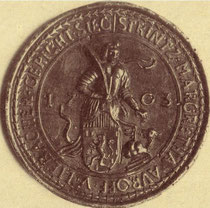

# Woher Strinz-Margarethä seinen Namen hat

Wie bereits erwähnt glauben viele es erst einmal gar nicht, wenn man ihnen sagt, dass man aus Strinz-Margarethä kommt. Zu eigentümlich klingt der Name, wenn man ihn zum ersten Mal hört. Hier erzähle ich E, wie Strinz zu seinem Namen gekommen ist“.

## 1184 erstmalig erwähnt

Strinz-Margarethä (StM) ist der älteste Ortsteil der Gemeinde Hohenstein im Taunus. Er wurde schon im Jahre 1184 erstmals urkundlich erwähnt und zwar mit dem Ortsnamen "Strentzge Minorem".

Im Nordwesten bildete die Grenze das von dem Bach Strinzcepha durchflossene Scheiderthal, wie sein Name angibt, die Scheide (Grenze) zwischen dem Königsgau und Niederlahnau. Die Strinzcepha entsteht aus 2 Bächen beim Dorf Hennethal von denen der eine von Strinz-Margarethä (heutiger Aubach), der andere aus Strinz-Trinitatis kommt.

(Quelle: Geschichte und historische Topografie der Stadt Wiesbaden im Mittelalter und der

Neuzeit / 1888)

## Bedeutung von Strinz

Die erste Silbe strintz, strinc, strinz - altdeutsch strine bedeutet: Öde, unbebaut, wüst (raues Klima, magerer Boden). Diese Bezeichnung ist aus der damaligen Zeit heraus zu verstehen, besonders im Vergleich zur furchtbareren Wiesbadener und Frankfurter Gegend, von der aus die Rodungen im Taunus erfolgten (Panrod, Steckenrodt, Naurod usw.)

Übrigens heißt heute noch ein Acker bei Strinz-Margarethä "Zehntfrei" - wohl wegen seiner geringen Bodengüte.

Die zweite Silbe epha = afa ist das keltische Wort für Bach. Danach bedeutet Strinzepha: eine durch eine Einöde fließender Bach.

> Quelle: Ansiedlungen und Wanderungen deutscher Stämme / 1875

## Bedeutung von Margarethä

Der Beiname Margarethä ist kirchlichen Ursprungs. Die heilige Margaretha war eine der 14 Nothelfer. Jedenfalls war die erste Kirche unseres Dorfes der heiligen Margaretha gewidmet.

Demnach hat unser Dorf seinen Namen nach dem Gelände, das der Quellbach der Strinzepha durchfloss und der heiligen Margaretha erhalten.

Die heilige Margareta

in einer historischen

Darstellung

## Weitere Ortsnamensformen

Wohl kaum ein Ortsname hat sich im Laufe der Jahrhunderte so verändert wie der von Strinz-Margarethä. Dies liegt wohl hauptsächlich daran, dass eine Unterscheidung zwischen dem gleichnamigen Strinz (später Trinitatis) hermusste.

*Ortseingang 1972*

Die Entwicklung des Dorfnamens zeigt folgende (nicht abschließende) Aufzählung auf:

- 1184 - Strentzge minorem*
- 1300 - Strinzcepha, Strinziche, Strinzeche oder Strinzege*
- 1400 - in minore Strinziphi***
- 1442 - Knyppe Strintzige (nach dem damaligen Schultheiß Knyp) ***
- 1444 - in Knippen Strincze***
- 1446 - senten Margarethen Strincze***
- 1449 - in Strincz Knyp***
- 1459 - Strincz da Knipp***
- 1462 – Hinder Strinzczge (HStAW 121 Nr. U von Stockstein)
- 1465 - sant Margarethen Strinz
- 1479 - Stryntz sancte margred ******
- 1483 - Furderstryntz ***
- 1500 - Margarethenstrenz
- 1521 - Strintz Margarethe
- 1559 - Margreten Strincz
- 1609 - Strintz San Margarete****
- 1653 - Strinz Margaretha
- 1658 - Strenß
- 1669 - Strensensis Nassoico*****
- 1703 - Strintz - Margretha****
- 18. Jahrh. Strentsmargreta****
- 1898 - Strinzmargarethae
- 1972 - Strinzmargarethä
- Aktuell - Strinz-Margarethä
- Quellen:
- * Die Siedlungsnamen im Taunusgebiet
- ** Weisthümer gesammelt von Jacob Grimm, Vierter Theil / 1863
- *** Nassauische Analen
- **** Siegel-Stempel
- ***** Album Academiae Vitebergensis / 1660-1710 / Band 2
****** Quellen zur Geschichte der Klöster und Stifte im Gebiet der mittleren Lahn bis zum Ausgang des Mittelalters

## Hinter- oder Vorderstrinz?

Ehe im 15. Jahrhundert die Kirchenpatrone zur Kennzeichnung herangezogen wurden, unterscheiden sich beide Dörfer, gemeint sind Strinz-Margarethä und Strinz-Trinitatis, als major-, minor-, Hinter-, Vorder-, Ober-, Groß-, Klein- und Holenstrinz.

Zwischen den Gemeinden Strinz-Margarethä und Strinz-Trinitatis kommt es gelegenlich zu Meinungsverschiedenheiten, welcher der beiden Ortsteile denn nun Vorderstrinz und welcher Hinterstrinz wäre.

Eine These, die StM als Vorderstrinz sieht begründet dies damit, dass vom Kloster Bleidenstadt, aus gesehen der Ort vor Strinz-Trinitatis liegt und dieser deshalb als Vorderstrinz anzusehen ist.

Dem Wiedersprich allerdings eine Urkunde aus dem Hessischen Staatsarchiv aus dem Jahre 1462. Dort wird StM als „Hinder Strinczge“ angesprochen.

## Margareta von Antiochia

Wer war die Frau, die 305 nach Christus hingerichtet werden musste, damit man hunderte Jahre später, unserem Ort seinen markanten Beinamen geben konnte?

Lest hier ihre Geschichte.

Margareta in einem Siegel von 1703

Margareta von Antiochia wurde in Pisidien (in der heutigen Türkei) um 305 als Jungfrau und Märtyrin hingerichtet.

Die hl. Margareta ist die Schutzpatronin der Bauern, bei Schwangerschaft und Geburt, der Jungfrauen, Ammen und der Gebärenden. Sie wird gegen Unfruchtbarkeit, bei Wunden und Gesichtskrankheiten und zum Schutz „gegen Unholde aus der Tiefe des Wassers“ angerufen.

Auslöser für die Verfolgung scheint weniger ihr Glaube als ihre Schönheit gewesen zu sein, unabhängig von der zugrunde gelegten Überlieferung:

Es gibt zwei Überlieferung:

- Margareta war die Tochter eines heidnischen Priesters und wurde von einer christlichen Amme erzogen. Als der Vater die Hinwendung der Tochter zum christlichen Glauben bemerkte, denunzierte er sie beim Stadtpräfekten. Vor Gericht gestellt, weckte sie das Begehren des Richters, der sie umso härter bestrafte, als sie ihn zurückwies: sie sollte mit Fackeln versengt und in Öl gebraten werden. Als sie bei dieser Prozedur unverletzt blieb, führte dies zu Massentaufen in ihrer Umgebung und zu ihrer Hinrichtung durch Enthaupten.

- Die zweite Überlieferung sieht sie als Schäferin und den Stadtpräfekten (mit Namen Olybrius) als denjenigen, der sie begehrte und den sie zurückwies. Margareta wurde im Gefängnis mit eisernen Kämmen und Fackeln gefoltert. Ihre Wunden heilten immer wieder, so kam es auch hier zu außerordentlich vielen Bekehrungen. Schließlich wurde Margareta durch Enthaupten hingerichtet.

Diese zweite Überlieferung weist Erweiterungen auf, die für die heutige Verehrung Margaretas bedeutsam sind.

Im Gefängnis erschien ihr ein riesiger Drache (oft der verwandelte Stadtpräfekt), um sie zu verschlingen. Das Kreuzzeichen, das sie schlug, rettete sie jedoch.

Im Strinzer Wappen wird deshalb ein Drachen gezeigt.

Auf dem Weg zur Hinrichtung betete sie für ihre Verfolger, diejenigen, die sich in Zukunft an sie wenden würden, vor allem aber für Schwangere und Gebärende.

Gedenktag

Ihr Gedenktag ist in der katholischen Kirche, in der evangelischen und in der anglikanischen der 20. Juli, in der orthodoxen der 17. Juli. In alten Kalendern findet sich auch der 13. Juli. Es ist der Tag, an dem früher die Bauern mit der Ernte begannen.

> Quelle: Wikipedia

Fazit:

Wäre Margareta 305 nach Christus - hunderte von Kilometer von hier - nicht als Märtyrin gestorben, würde unser Ort heute anders heißen.

## Strinzer Heckeflämmser

In früheren Zeiten bezeichnete man die Strinzer Bürger auch als "Strinzer Heckeflämmser".

In der Strinzer Gemarkung gab es viele Hecken, die in regelmäßigen Abständen abgebrannt (abgeflämmt) wurden. Daher rührt die Bezeichnung "Strinzer Heckeflämmser".

(Alte Strinzer Chronik, Teil 1, Seite 171)

## Strinzer Wachhecke

Ein anderer Spitz- oder Uzname aus alter Zeit ist der Begriff "Strinzer Wachhecke".

Dieser Begriff kommt daher, dass jene verbrannten Hecken, Wachholderhecken waren. Die Nachbardörfer hatten nur sehr wenige Wachholderhecken. Darüber haben sie sich geärgert und unserem Dorf einen solchen Namen gegeben.

(Alte Strinzer Chronik, Teil 1, Seite 171)
