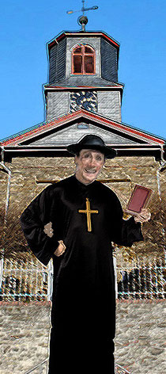
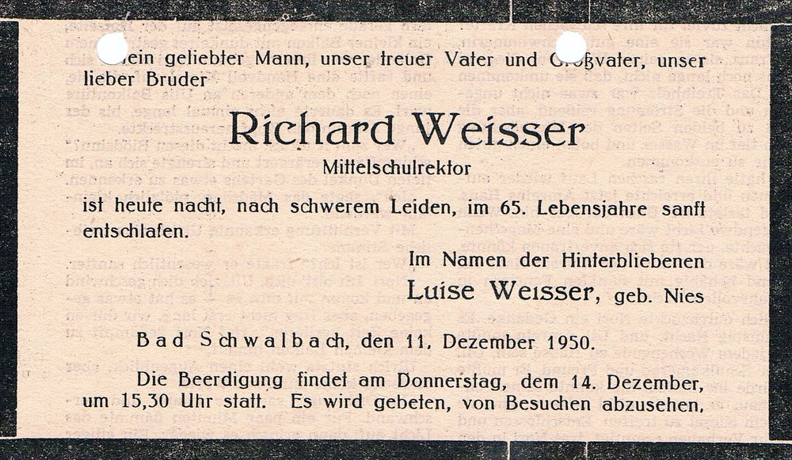

# Strinzer Chronisten

In den nächsten Kapiteln könnt Ihr Euch über die Strinzer Chronisten informieren.

## Pfarrer Ludwig Schmidtborn

Pfarrer Ludwig Schmidtborn kann man getrost auch als einen DER Strinzer Chronisten bezeichnen. Er war sehr fleißig in Bezug auf das Führen der Kirchenchronik, wodurch wir viel aus der Zeit des 19. Jahrhunderts erfahren können.

55 Jahre war er der Seelsorger hier in Strinz-Margarethä und hatte es nicht immer leicht mit den Strinzer, aber lest doch selbst seine Geschichte."

Es sind 34 Pfarrer bekannt, die seit dem Jahre 1565 in unserem Kirchensprengel wirkten. Pfarrer Ludwig Schmidtborn, der hier von 1815 - 1870 als Seelsorger 55 Jahre tätig war hat von Allen den größten Eindruck hinterlassen

Pfarrer Ludwig Schmidtborn wurde am 11.02.1792 in Assenheim bei Worms geboren. Sein Vater war dort seit 1786 Pfarrer. Durch die Franzosen im Jahre 1794 vertrieben, flüchtete er mit Frau und Kind in das elterliche Haus nach Altenkirchen bei Weilburg.

Der Fürst zu Weilburg berief ihn 1795 als Pfarrer nach Wismar bei Gießen. Hier wuchs Ludwig heran und studierte später in Gießen und Marburg.

Am 07.05.1812, also mit 20 Jahren, wurde Schmidborn ordiniert und zu Rettert bei Nastätten angestellt. Im Jahre 1815 trat er seine Pfarrstelle in Strinz-Margarethä an.

Bis auf den heutigen Tag ist in unserem Dorf das Andenken an den "alten" Pfarrer Schmidtborn lebendig geblieben, der in der Seelsorge ebenso tüchtig war wie in der Landwirtschaft.

Schmidtborn hielt streng auf Kirchenzucht und schickte eine junge Mutter mit drohend erhobenem Stock nach Hause, weil sie den ersten Gang nach ihrer Entbindung ins Dorf machen wollte, statt, wie es sich gehörte, in die Kirche zu gehen.

Im Freien trug er stets einen Zylinder, sogar beim Heumachen. Vor lauter Arbeit fand er keine Zeit zum Heiraten. An kalten Wintertagen zitieren heute noch die Bauern die Worte Schmidtborns:

"Das ist Wetter für meine Knechte! Arbeiten sie nicht, dann frieren sie".

Wie streng die damaligen Sitten waren, sieht man aus den Aufzeichnungen des Bürgermeisters Enders aus dem Jahre 1817. Darin erfahren wir, dass einmal von Pfarrer Schmidtborn 7 Burschen angezeigt wurden, weil sie die Katechismuslehre geschwänzt hatten. Die jungen Sünder weigerten sich zunächst die auferlegte Polizeistrafe zu zahlen, aber als die "Auspfändung" drohte, konnte der Schultheiß dem Justizrat Forst in Wehen berichten, "dass sie die Strafe bezahlen wollten, welches wie mir der Kirchen Senior Kandler sagte, auch geschehen ist".

Bis zum Jahre 1829 musste jeder bis zum 25. Lebensjahr am Katechismus Unterricht teilnehmen. Erst seit dieser Zeit setzte man das Alter auf 16. bzw. 18. Lebensjahr fest. Der Katechismus Unterricht fand meistens im Anschluß an den Gottesdienst statt. Es beteiligten sich daran oft Verheiratete und alte Leute.

Während seiner langen Amtstätigkeit in StM hatte Schmidtborn mancherlei Auseinandersetzungen mit der "Dorfaristokratie" zu bestehen, wie Schmidtborn seine Prozessgegner bezeichnete. Das begann bereits im Jahre 1832, als er einen Antrag auf Erbauung eines neuen Stalles stellte. Die zuständigen Gremien lehnten ab und empfahlen später dem Pfarrer, die Ländereien zu verpachten. 13 Jahre danach wird der Bau endlich genehmigt und 1846 errichtet.

In den Jahren von 1847 - 1852 führten die Ortsvorsteher und Kirchenvorstände mehrere Prozesse mit dem Pfarrer wegen der Besoldungsfrucht, dem Streulaub und dem Besoldungsholz. Schmidtborn nahm jeden Prozess an und gewann sie alle. Der letzte Prozess um das Pfarrbesoldungsholz begann 1850 und endete 1852. Er wurde in 3 Instanzen durchgeführt (1. Justizamt Wehen / 2. Herzogliches Hofgericht / 3. Oberappelationsgericht).

Während der Revolutionswirren (1847 - 1848) versuchten seine Prozessgegner zweimal, seine Versetzung zu betreiben. Dabei geben seine Gegner beim Bischöflichen Herzoglichen Commissarius in Wiesbaden zu Protokoll, er sei feindselig gegen die Gemeindemitglieder gesinnt und keineswegs ein Pfarrer, sondern ein Bauer.

Mit dem Jahre 1852 endeten die Auseinandersetzungen. Die Aufregungen der Revolutionsstimmung waren verklungen. In den Dörfern kehrte mit der Zeit wieder Ruhe und Frieden ein.

Im Jahr 1862 feierte Schmidtborn sein 50jähriges Amtsjubiläum. Darüber berichtet Lehrer Conrad aus Niederlibbach in der Schulchronik: "Am 7.5.1862 waren es 50 Jahre, dass Pfarrer Schmidborn in seinem Amt wirkt. Herr Dekan Spieß zu Bechtheim hatte zur Feier des Tages, Mittwoch, den 7.5., die Herren Geistlichen des Dekanats zu einer Konferenz in das Pfarrhaus zu Strinz-Margarethä eingeladen. Eine öffentliche kirchliche Feier und Festlichkeiten und damit zusammenhängende äußere Ehrenbezeichnung seiner Person hatte Herr Pfarrer entschieden abgelehnt. Auch die Annahme der goldenen Verdienst-Medaille, welche in Nassau den höheren Ständen nach 50jähriger Dienstzeit zu Teil wird, hatte er aus großer Bescheidenheit verweigert. Seine Hoheit unser Herzog und Landesvater hatte jedoch durch die vorgesetzte Behörde von dieser 50jährigen treuen Dienstführung Kenntnis erhalten und den Herrn Pfarrer Schmidtborn dadurch geehrt, dass er ihm den Titel eines Kirchenrats erteilt hat, worüber ihm das Diplom an dem genannten 50jährigen Gedenktage aus der Hand des Herrn Dekan Spieß ausgehändigt worden ist.

Bis zum Jahr 1870 konnte Schmidtborn noch seine Amtstätigkeit ausüben. Am 23.01.1870 erlitt er einen Schlaganfall, der ihm die Sprache fast völlig raubte. Er konnte seinen Dienst nicht mehr versehen und mußte schweren Herzens am 1.4.1870 in den Ruhestand treten. Ihm waren noch 5 Lebensjahre beschieden.

Am 27.2.1875 starb Kirchenrat Schmidtborn nach einem sehr kurzen Unwohlsein. Bei der Beerdigung folgten dem Sarg nur drei der nächsten Verwandten, fast alle Geistlichen des Dekanats Kirberg und die meisten Bewohner des hiesigen Kirchspiels.

Sein Nachfolger, Pfarrer Grünschlag, bezeichnete den verstorbenen Kirchenrat Schmidtborn als einen reichbegabten, höchst originellen Mann.

### Schmidtborns Thesen unter der Lupe

Im Jahre 1886 verfasste Pfarrer Schmidtborn 2 Thesen, die 1827 in der „Jenaische allgemeine Literatur-Zeitung“ unter der Rubrik „Vermischte Schriften“ kommentiert wurden.

Hier die Originalkommentierung aus 1827

Pfarrer Schmidtborn, zu Strinz Margarethä im Nassauischen, theilt S. 29 ff. eine geschichtliche Erörterung der Fragen mit: Zu welcher Hoffnung berechtigt das Strebe der deutschprotestantischen Kirche unserer Tage, sich apostolisch neu zu gestalten und: Was muß zur Beförderung des beabsichtigten Zweckes von unserer Seite geschehen?

Die Abhandlung wurde in einer Predigerconferenz des Decanats Wehen vorgelesen. Nach einer zusammengedrängten Darstellung der 5 Hauptformen worin sich die christliche Kirche nach und nach gestaltet hat, nämlich der Presbyterial- und Episcopal-Verfassung, des hierarchischen, Collegial- und Territoral-Systems, würdigt der Verfasser kurz die Beschaffenheit einer jeden dieser Formen, und erklärt sich zuletzt für das Collegialsystem. Da eine geschichtliche Erörterung der aufgeworfenen Fragen versprochen worden, so wundert es den Rec., S. 52 nur die Bildung der lutherischen Kirche in Schweden, und nirgends die der reformierten Kirche in Holland, der Schweiz, zum Theil selbst in England (die presbyterianische nämlich), selbst die einzelnen Gemeinden dieser Kirche in den deutschen Handelsstädten, in Kopenhagen, Stockholm u. f. w erwähnt zu finden. Was S. 44 vom Calvin gefragt wird, ist, um eine Vergleichung anzustellen, nicht hinlänglich. Zwingli`s ist gar nicht gedacht, da diesem doch eben, die „Mäßigung des Verfahrens“ zuzuschreiben ist, woraus sich die Verträglichkeit der reform. Kirche in Deutschland mit dem Staate, ihres presbyterianischen Kirchenrechtes ungeachtet, erklären läßt.

Nach v. Schubert wird hier, wie fast allenthalben, die schwedische Kirchenverfassung in Absicht des Verhältnisses zum Staate, nebst der Stellung und Wirksamkeit des geistlichen Standes, musterhaft genannt; anders würde Mancher urtheilen, wenn es eben so bekannt, wie v. Schuberts übrigens sehr schätzbare Schrift, in Deutschland wäre, was Beehen, Molbech u. a. reisenden Dänen von dem schwedischen Kirchenwesen halten, und in ihren Reisebeschreibungen beybringen. Von dem Colegialsysteme sagt unser Verfasser S. 53: „Selbst mit der unumschränkten und souveränen Staatsgewalt kann eine evang. Kirchenverfassung (nach jenem Systeme) sich vertragen, wenn nur der Regent den Beruf und die Würde des christlichen Königthums“ (was ist das?) „zu üben versteht“ (adde: und zu üben den Willen und die Lust hat!).

Muß Herr Pfarrer Schmidtborn im Verfolge selbst einräumen: „Allerdings haben die Consistorien ihre ursprüngliche Einrichtung und ihren Einfluß in wesentlichen Theilen verloren: „so kann er ja nicht in Abrede stellen, dass auch das Collegialsystem nicht gegen Uebel schützt; und es ist kaum erklärbar, warum er einem gehörig modiheirten (?) Presbyterialsysteme nicht mehr Gerechtigkeit widerfahren läßt

Vollen Beyfall giebt im Uebrigen Rec. allem dem, was der Verfasser S. 59 f. von den gegründeten Hoffnungen sagt, wozu die Begründung und das Ziel der Bestrebungen berechtig, in welchem die deutschprotestantische Kirche (hauptsächlich auch mittels der Vereinigung der getrennten Parteyen) sich apostolisch neu zu gestalten trachtet.

> Quelle: Janaische Allgemeine Literatur-Zeitung, Nummer 71, Seite 85/86, 1827

## Rektor Richard Weißer

Richard Weißer wird am 6.7.1886 in Karlsruhe geboren und wuchs in Rüdesheim auf. Im Jahre 1914 wurde er Rektor in Brotterode/Thüringen. 1921 wechselt er beruflich nach Bad Wildungen und ist ab 1927 als Schulleiter in Frankfurt/M tätig. 1933 wird Weißer von den Nazis aus seinem Amt als Rektor der Frankfurter Glauburgschule gejagt, u. a. deshalb, weil er Hitlers Geburtstag nicht offiziell gegangen hatte. Im Schreiben des Regierungspräsidenten in Wiesbaden vom August 1933 hieß es. "... Nach Ihrer bisherigen politischen Einstellung erscheinen Sie nicht weiter geeignet, dem neuen Staate in leitender Stelle zu dienen.

Als einfacher Volksschullehrer wurde er in die Altstadtschule strafversetzt. Die Frankfurter Altstadt galt damals vor allem wegen der beengten und unhygienischen Wohnverhältnisse als Brennpunkt.

Als die Bombenangriffe auf Frankfurt zunahmen ließ er sich Anfang 44 als Schullehrer nach StM versetzen. Er suchte sich unter mehreren Orten Strinz-Margarethä aus wegen des interessanten Namens – wie er später erzählte.

Er drängte seine drei Töchter in Frankfurt dazu, ihm zu folgen und die durch Bombenangriffe gefährdete Großstadt zu verlassen.

In StM beginnt er damit eine umfangreiche Chronik zu schreiben und schreibt das Strinzer Lied.

Im Jahre 1946 wechselt er dann von StM als Mittelschulrektor nach Bad Schwalbach.

Weißer ist leidenschaftlicher Autor diverser Bücher, Verfasser von historischen Bühnenstücken und Lyriker.

Schriften:

- Der Wall im Westen. Kriegsgedichte / 1916

- Ich kann bruchrechnen. Ein naturgemäßer Lehrgang zur gründlichen Erlernung des Bruchrechnens auf dem Boden der Anschauung. Zum Gebrauch in Schulen und zur häuslichen Nachhilfe / 1921

- Des Kindes Festtag. Ratschläge und Stoffe für Schulunterhaltungsabende / 1921

- Der Einmaleinsstudent. Ein Lehrgang zur anschaulichen, selbsttätigen Erlernung und sicheren Einprägung des Einmaleins und des Enthaltenseins / verm. 1921

- Bilder und Bausteine aus der Praxis des staatsbürgerkundlichen Unterrichts / 1921

- Haxthausen. Ein Schauspiel aus der Geschichte Wildungens (mit C. Fleischhauer) / 1922

- Die Rarität. Ein lustiges Heimatspiel in einem Aufzug / 1923

- Die geöffnete Zahlenpforte. Beiträge zur Methodik des Volks- und Hilfsschulrechnens / 1923

- Junker Otto. Historische Schauspiel in vier Aufzügen / verm. 1923

- Ekkebrecht von Grifte. Historisches Schauspiel in vier Aufzügen / 1924

- In Acht und Bann. Die Tragödie eines Volkserziehers in vier Aufzügen / verm. 1924

- Ein Jünger Diesterwegs. Pädagogisches Lustspiel in drei Aufzügen / verm. 1924

- Die Patronatsstelle. Das verhexte Protokoll. Zwei ernst-heitere Erzählungen / 1930

- Der grüne Tisch. Roman aus dem Beamtenleben / verm. 1930

- Feuer und Schwert über Dante, Roman / 1940

- Das Strinzer Lied / 1944

- Die Johannea / 1948

- Nieder mit Ibell! Schauspiel in fünf Aufzügen / verm. 1949

- Geschichte des Untertaunuskreises / verm. 1950

- Geschichtsstoffe für das 5. Schuljahr unter Hervorhebung der Geschichte des Untertaunuskreises /1950

Weißer stirbt im Jahre 1950 in Bad Schwalbach.

## Lehrer Horst Witt

Horst Witt wurde im Jahre 1914 in Stolp/Pommern geboren. Dort besuchter er die Oberrealschule.

Sein Lehrerstudium absolvierte er an der Hochschule für Lehrerbildung in Lauenburg/Pommern.

Seine erste Lehrerstelle trat er im Jahre 1937 in seinem Geburtsort Stolp an.

Die Kriegsereignisse führten ihn dann nach StM, wo er im Jahre 1945 eine Lehrerstelle annahm.

Horst Witt übernimmt am 3. Januar 1948 die Weiterführung der Strinzer Chronik von Rektor Richard Weißer und schreibt diesbezüglich in die Dorfchronik:

"Im Namen des Herrn Bürgermeister August Gräter und der gesamten Einwohnerschaft von StM danke ich Herrn Rektor Richard Weißer für die Ausfertigung dieser umfangreichen Dorfchronik.

Mit dem heutigen Tage übernehme ich als Lehrer des hiesigen Dorfes die Weiterführung dieser Chronik."

Horst Witt im Jahre 1955

Als dann im Jahre 1970 die Strinzer Schule aufgelöst wurde, wechselte er zur Hahner Gesamtschule. Dort feierte er im Jahre 1977 sein 40. Dienstjubiläum.

Von seinem Enkel wird berichtet, dass die Strinzer Chronik für Horst Witt eine Herzensangelegenheit war und er, solange er noch konnte, die Strinzer Chronik weiterführte.

Witt starb im Jahre 1995 im Alter von 81 Jahren.

(Quellen: Wiesbadener Kurier 1977 / Thomas Daiber / Alte Strinzer Chronik)
