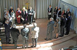
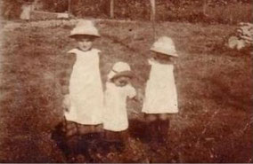
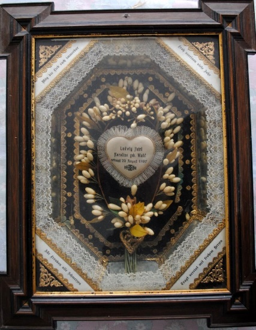
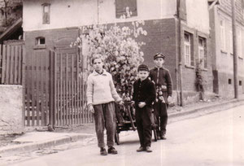
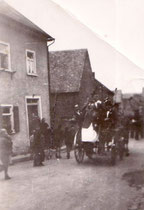

# Strinzer Brauchtum

In Strinz-Margarethä gab es früher viele Bräuche von denen die meisten leider in Vergessenheit geraten sind. Damit sie aber nicht ganz vergessen werden, habe ich sie für Euch hier aufgeschrieben.

## Geburt

Wenn sich die Kinder früher nach ihrer Herkunft erkundigten, so erzählte man ihnen, dass sie aus dem Brunnenhäuschen kämen, und der Klapperstorch, der Glücksbringer, hätte sie nach Hause gebracht. Deshalb legten die kleinen Kinder, die sich einen Bruder oder ein Schwesterchen wünschten, abends ein Stück Zucker auf die Fensterbank, um den Storch anzulocken.

## Taufe

Die Taufe der Kleinen fand in der Kirche statt. Die "Pettern und Gothen", wie man hier die Taufpaten nennt, spielten bei den Kindern eine große Rolle. Bei ihnen konnte sich das Kind zu den Festen ein Geschenk abholen. Man besuchte sich gegenseitig und fragte den Paten gern um Rat, besonders bei der Schulentlassung.

## Schulentlassung und Konfirmation

Die Schulentlassung und die Konfirmation trafen früher zusammen. Deshalb wurde dieser Lebensabschnitt mit vielen Gästen besonders ausgiebig gefeiert. Am Nachmittag trafen sich alle Konfirmanden und besuchten sich reihum; diese Sitte zeigte die Verbundenheit der Leute im Dorf.

Zudem wird in der Strinzer Kirche die diamantene und goldene Konfirmation gefeiert.

## Der Wandertag

Jede Familie hatte früher eine zahlreiche Kinderzahl. Es gab Familien, bei denen am Mittagstisch 10 bis 12 Personen saßen. Wenn die Buben und Mädchen die Schulpflicht hinter sich hatten, konnten nicht alle auf dem elterlichen Hof bleiben. Die Buben suchten sich eine Lehrstelle oder Arbeitsstelle bei den Bauern. Die Mädchen verdingten sich meistens in einem landwirtschaftlichen Betrieb oder nahmen eine Stellung in einem städtischen Haushalt an. Damals gab es kaum Lehrstellen für junge Mädchen.

Wenn diese Jungen und Mädchen ihre Arbeitsplätze wechselten und sich als Dienstboten bei einer neuen Herrschaft - wie man früher zu sagen pflegte - verdingten, begleitete die Jugend des Dorfes die Dienstboten. Mit einem Pferdefuhrwerk brachte man das Gepäck zur neuen Arbeitsstelle. Abends traf sich dann die Jugend in der Wirtschaft, wo der Umzug gefeiert wurde. Dieser Umzug fand immer am 3. Weihnachtsfeiertag statt und bekam den Namen "Wandertag".

## Kindererziehung und Freizeit

Da es keine Kindergärten gab, hielten sich die noch nicht schulpflichtigen Kinder überwiegend im Bauerngehöft der Eltern auf. Hier beaufsichtigte die Oma oder ein älteres Mädchen die Kleinen. Im Laufe der Jahre hatte jedes Kind in der Familie die Verantwortung für die jüngeren Geschwisterchen zu übernehmen.

*Strinzer Kinder 1917*

## Singen im Alltag

Wer in jener Zeit durch das Dorf ging, konnte sich an Wiegen-, Kinder- oder Volksliedern erfreuen, deren Melodien jedem Bewohner vertraut waren. Die Mütter sangen mit den Kleinkindern; diese wiederum lernten neues Liedgut von den Geschwistern, die die Schule besuchten, wo damals im Musikunterricht das Lernen und Singen von Volksliedern im Mittelpunkt stand. Liederbücher gab es nicht; der Text wurde in der Schule abgeschrieben und gelernt. Ein neues Lied verbreitete sich schnell im ganzen Dorf.

(Siehe auch unter: Liedgut)

## Spielzeug war Handarbeit

Gekauftes Spielzeug war den meisten Kindern unbekannt. Im Bäuerngehöft gab es viele Dinge, mit denen sich die Kinder stundenlang beschäftigen konnten. Die älteren Buben bastelten für ihre jüngere Schwester eine Wiege; die Mutter, Oma oder auch ein älteres Mädchen nähte eine Puppe mit Kleidern. Solche ein Spielzeug vererbte man dann noch an jüngere Geschwister weiter.
Zum Spielen verwendeten die Kinder Holzscheite, Steine, Bohnen, Stöckchen, Nüsse, Bucheckern, Knöpfe oder Tannenzapfen. Wer einen hölzernen Baukasten mit Klötzen sein Eigen nannte, wurde bewundert und beneidet.

## Die Arbeit ruft

Nach der Schulzeit wuchsen die Jugendlichen allmählich in die Arbeitswelt der Erwachsenen hinein und waren stolz, wenn der Vater den Söhnen das Pferdegespann überließ.

Daß ein Arbeitstag in alter Zeit aber keine Zuckerschlecken war, können Sie unter Tagesablauf und Landarbeit nachlesen

Beim Dreschen 1936

Nach getaner Arbeit

Nach der Tagesarbeit und dem Abendessen saß die Familie am Küchentisch oder dem Wohnzimmer (in der guten Stub). Im trauten Schein der Petroleumlampe erzählte die Mutter oder Oma ein Märchen. Die älteren Geschwister spielten Mühle oder Dame (auch selbst hergestellt) oder erledigten noch schnell die Schularbeiten.

Die schulentlassenen Mädchen trafen sich an bestimmten Tagen nach dem Abendbrot in einer Bauernstube. Im Winter nahmen sie ihr Spinnrad mit oder handarbeiteten. Damals wurden Strümpfe, Handschuhe, Jacken, Schals, Mützen in jedem Haus selbst angefertigt. Oft gesellten sich auch junge Burschen dazu. Dann wurde erzählt und gesungen.

## Gesang und Turnverein bringen Leben in die Gemeinde

Nach Gründung des Gesangvereins (1891) und des Turnvereineins (1904) entstand ein reges Vereinsleben. Jetzt konnten sich die jungen Leute körperlich ertüchtigen, ihre Leistungen mit anderen Turnvereinen messen und an Sängerwettstreiten teilnehmen.

*Turnverein 1922*

## Zu Fuß zum Fest

Wenn an den Sonntagen in den Nachbardörfern Vergnügungen oder Vereinsfeste stattfanden, zog die Jugend gemeinsam zu Fuß dort hin. Nach Beendigung des Festes gingen sie wieder gemeinsam nach Haus. Der Schlaf kam in dieser Nacht dann zu kurz, und oft wollte der nächste lange Arbeitstag kein Ende nehmen.

*Strinzer Halbstarke 1936*

## Die Hochzeit

Aus der Borner Kirchenordnung

Aus dem Jahre 1609 finden sich in der Borner Kirchenordnung Regelungen des Grafen Ludwig zu Nassau, die die Hochzeiten regelten:

Der Graf fordert darin:

Wenn Hochzeiten sind, mag man ziemlich tanzen, doch nicht unter der Predigt. Verboten ist das Nackttanzen, das Herumwerfen und alles unzüchtige Wort und Gebarde, und ein Ortsvorsteher soll beim Tanzen sein, dass zu rechter Zeit anzufangen und aufgehört werde.

Die Grade der Blutsverwandtschaft, die zur Eheschließung hinderlich sind, sollen genau beobachtet werden.

Heiraten im Jahre 1935

Aus dem Jahre 1935 ist eine Statistik bekannt, die auch auf die Hochzeiten in StM eingeht:

Auszug:

Durchschnittliches Heiratsalter: a) Männer: 27 Jahre / b) Frauen: 23 Jahre

Ehepartner von außen oder aus dem Dorf

In 85 Ehen: 5 beide Partner von außen / 33 beide Partner aus dem Dorf / 47 ein Partner von ausserhalb.

Das Aufgebot

Hatte man sich verlobt, also das Eheversprechen gegeben, wurde das Aufgebot bestellt. Bis zur Eingemeindung in die Gesamtgemeinde Hohenstein, hatte StM sein eigenenes Standesamt.

Das Aufgebot selbst wurde in einem Schaukasten an der Kirchenmauer zur Scheidertalstraße ausgehängt.

Sollte bekannt gewesen sein, dass die Braut schon vor der Hochzeit schwanger war, so wurde der Brauch ausgeübt, den Schaukasten zu stützen. Es wurden in der Regel schwere Hölzer unter den Kasten gestützt, manchmal bis zu einem Raummeter Brennholz, das man bei Nacht vom Grundstück der Brautleute geholt hat. Brautvater und Bräutigam mussten es dann wieder wegräumen.

Man kann über diesen Brauch z.B. in einem Kerbebrief von 1970 nachlesen.

- Dort heißt es:
- Dem ane hats Jungesellelewe nit me gefalle,
- drem horre die Hochzeit des Jahres gehallte.
- Doch ebbes harre mer feschwitzt,
- mer harrem jo gor nit de Kaste gestitzt.
## Der Polterabend

Vor der Hochzeit wurde der Polterabend gehalten. Dabei wurde dem Brautpaar Glas und Porzellan vor die Tür geworfen. Streng nach dem Motto: Scherben bringen Glück.

Die Hochzeit

Bei der Hochzeit wurde am Polterabend Glas und Porzellan vor die Tür geworfen. Scherben bringen Glück. Kam das Paar am Hochzeitstag aus dem Haus und wollte zur Kirche gehen, so sah es den Weg durch Seile versperrt. Wenn dann die Hochzeitsgesellschaft Bonbons und Geldstücke auswarf, gaben die Kinder den Weg frei; das wiederholte sich mehrmals.

Die Hochzeitsfeier spielte sich im Haus der Braut ab oder im Dorfgemeinschaftshaus. Am Hochzeitsabend kamen die Burschen und Mädchen aus dem Dorf vor das Haus, sangen Lieder und gratulierten. Neben Volksliedern hörte man Ehestandslieder. Die jugendlichen Sänger bekamen für ihr Ständchen Kuchen, Wein und oft ein Fässchen Bier gespendet.

(Die Texte zu den gesungenen Liedern findet Sie unter: Liedgut)

Der Hochzeitskranz

Schon im Jahre 1609 hieß es:

Wer sich heimlich verlobt und unzüchtig lebt, darf nicht mit dem Kranz zur Kirche gehen.

Es existieren zwei Erklärungen zum Kranz:

1. Eine nicht mehr jungfräuliche Braut, die Strohjungfer, musste nach altem Brauch bei der Hochzeit einen Strohkranz tragen. Die unbescholtene Braut durfte sich dagegen im Myrtenkranz präsentieren.

2. Die andere Version ist, dass die jungfräuliche Braut einen geschlossenen Kranz trug und die nicht mehr jungfräuliche Braut oder Witwe einen offenen.

> Quelle: Wikipedia

Die Hochzeitkränze wurden früher gerne eingerahmt und ins Wohnzimmer gehängt.

*Hochzeitskranz aus 1865 Hochzeitskranz aus 1897*

## Tod

Wenn sich der Lebenskreis durch Tod für einen Dorfbewohner schloss, nahmen alle Anwohner Anteil, mindestens einer aus jedem Hause folgte dem Sarg. Die Beerdigungsteilnehmer aus den Nachbardörfchen wurden mit Kaffee und Kuchen bewirtet. Nach der Kaffeetafel verteilte man die übrig gebliebenen Reihweck an die befreundeten Familien im Ort.

## Fastnacht

Einige Tage vor Aschermittwoch suchten die Mütter Kleidungsstücke zusammen, um ihre Kinder zur Fastnacht originell zu kostümieren. Am Nachmittag herrschte im Dorf reges Leben. Die Kinder zogen zu dritt oder viert von Haus zu Haus und sangen das Fastnachtslied: "Hohoho, die Fassenacht ist do".

Dafür erhielten sie meistens kleine Geldstücke oder Süßigkeiten.

Hohoho, die Fassenacht ist do  
Hohoho, die Fassenacht ist do,  
ich hun gehört, ihr hätt geschlacht,  
hät so lange Würscht gemacht,  
Hohoho, die Fassenacht ist do.  
Hohoho, die Fassenacht ist do,  
gebt mir von den langen,  
laßt die kurzen hangen,  
Hohoho, die Fassenacht ist do  
Hohoho, die Fassenacht ist do,  
geht emol ins Hinkelhaus,  
holt en Korb voll Eier raus.  
Hohoho, die Fassenacht ist do.  
Hohoho, die Fassenacht ist do,  
lasst mich nicht so lange stehn,  
will noch e Häusche weitergehn,  
Hohoho, die Fassenacht ist do.

Auch heute noch wird der Brauch vereinzelt durch Dorfkinder durchgeführt, allerdings kommen diese beim Singen meist nicht über die erste Strophe hinaus.

*Fasching 1950*

## Ostern

Das erste kirchliche Fest im Kalenderjahr ist Ostern. Bevor die Kinder zum Gottesdienst gingen, sah man sie mit Körben von Haus zu Haus eilen. Bei ihren Paten und Verwandten suchten sie die buntgefärbten Eier, die in Haus, Scheune oder Garten versteckt waren. Mit ihren gefüllten Körbchen liefen sie strahlend nach Hause. Am Nachmittag trafen sich mehrere Kinder an einem Wiesenhang, wo das "Eierschibbeln" (Eierrollen) begann. Derjenige, dessen Ei am weitesten rollte wurde Sieger und erhielt das gewonnene Ei. Um die Osterzeit bekam auch der Schornsteinfeger von jeder Familie frische Eier.

## 1. Mai

Am 1. Mai zog die Schuljugend mit einem Handwagen von Haus zu Haus. Auf diesem stand das Maimännchen; es war früher ein von Laub vollkommen umhüllter Junge. Später wurde nur noch eine aus Buchenlaub bestehende Garbe dazu benutzt. Die Kinder sangen vor jedem Haus "Der Mai ist gekommen" und sammelten Geld.

*Strinzer Maimännchen*

## Pfingsten

Zu Pfingsten traf sich die Dorfjugend und zog singend durch die Straßen, um in einen Nachbarort zu wandern. Bei der Rückkehr wurde am Dorfeingang das Lied "Strinzmargarethä" angestimmt, das der frühere Lehrer Richard Weisser gedichtet hatte. Mit schlichten Worten wird in diesem Lied das Taunusdorf besungen.
(Siehe auch unter: Strinzer Lied)

## Kerb

Ende Oktober, Anfang November feiert unser Dorf die Kerb.

Die erste Nennung einer Strinzer Kirmes (Kerb) gibt es schon aus dem Jahre 1477. Es ist überliefert, dass in diesem Jahr der Amtskeller in Wiesbaden eine größere Zahl von Wiesbadener Doppen (Tonbecher) für die Kirmes von StM kauft. Diese waren wahrscheinlich für den dortigen Ausschank des Bannweines bestimmt.

Den Begriff Bannwein kennt man seit dem 12. Jahrhundert. Dabei handelte es sich um (herrschaftlichen) Wein, der alleinig ausgeschenkt werden durfte und den die Verpflichteten kaufen mussten. Es war nicht erlaubt einen anderen Wein auszuschenken.

Auch aus dem Jahre 1521 ist überliefert, dass die gräfliche Rentei in Idstein 600 Wiesbadener „Doppen" für die Strinzer Kirmes vom 21. Mai zum Gesamtpreis von anderthalb Gulden ersteht.

Im Jahre 1609 wurde seitens der Regierung in Idstein die Kirmessen mit nachfolgendem Wortlaut verboten:

"Die Kirmessen sollen abgeschafft werden und jeder Pfarrer der sie zulässt bestraft werden, weil "übermäßiges Fressen, Saufen, Spielen, Schlägern und sonstige geschieht. Der Pfarrer, der es duldet, soll mit 20 Gulden bestraft und seines Amtes entsetzt werden."

Zur Strinzer Kerb gehört heutzutage auch ein Kerbeumzug. Die meisten Bewohner kennen heute nicht mehr den Ursprung dieses Brauches.

Am 2. November 1834 wurde unsere heutige Kirche vom Pfarrer Schmidtborn eingeweiht, der hier von 1815 bis 1870 als Seelsorger wirkte. Dieses Kirchweihfest wird durch einen Umzug eingeleitet. Dieser Umzug wurde fortan jedes Jahr zur Kerb wiederholt.

Früher, wenn Kerb war, gingen die Musikanten des Dorfes vor das Haus des Bürgermeisters, um ihm ein Ständchen zu bringen. Natürlich begleitete die Jugend die Musikanten. Nach dem Ständchen erholten sich die Musikanten beim Freibier von den Anstrengungen.

Wenn der Umzug hält, liest der Kerbevater den Kerbespruch vor. An der Ecke Pfalzstraße/Schulstraße löst sich dann der Zug auf; jetzt beginnt für Jung und Alt die Feier mit Musik und Tanz.

Der Kerbespruch, der vom Kerbevater vorgelesen wird, sagt viel aus über die Geschehnisse im Ort des entsprechenden Jahres. Insbesondere lustige Begebenheiten wurden hier Kund getan.

*Kerbebilder aus unterschiedlichen Epochen*

In der Nachkriegszeit fand die Kerb noch in der Pfalzstraße statt.

## Weihnachten

## Bürgermeisterehrung in alter Zeit

Der letzte Bürgermeister von StM, Wilhelm Guckes.

Von jeher galt es als besondere Ehre und Auszeichnung, zum Bürgermeister (früher Schultheiß oder Scholles genannt) gewählt zu werden. Bis zu Eingemeindung 1972 war es in unserem Dörfchen ein Ehrenamt. Es brachte dem Bürgermeister zwar viel Arbeit ein; dagegen keinen materiellen Vorteil für seine verantwortungsvolle Tätigkeit.

Wenn früher ein neuer Bürgermeister gewählt worden war, wurde ihm ein mit Kranz und Bändern geschmückter Tannenbaum vor das Haus gestellt. Der Gesangsverein brachte ihm ein Ständchen und der Bürgermeister hielt eine Ansprache an die Dorfbevölkerung. Dann ging es in die Wirtschaft und man trank Freibier auf Kosten des Bürgermeisters.

Das letzte Mal ist dieser Brauch bei der Wahl des Bürgermeisters Kadesch im Jahr 1919 ausgeübt worden.
