# Strinzer Geschichten

Ist der Ort auch noch so klein, so gibt es doch sehr viel zu erzählen. Über die Jahrhunderte hinweg hat sich hier so einiges ereignet.

Die Geschichten habe ich aufbereitet und sie den einzelnen Jahrhunderten zugeordnet.

## Geschichten aus frühester Zeit

Hier könnt Ihr euch Strinzer Geschichten anschauen, die zeitlich nicht genau zuordnet werden konnten. Vom Glaube unserer Vorfahren, bis hin zum wichtigen Feuerschutz in alter Zeit.

### Woran unsere Vorfahren glaubten

Unsere ältesten Vorfahren glaubten an Wodan (Odin), Ziu und die Göttin Freya. Den heiligen Hain auf einem Hügel hielten sie für die Wohnung der Götter. Hier trafen sich die Bewohner aus der näheren Umgebung und brachten den Göttern Opfer dar. Für viele Jahrhunderte blieb Donar (Thor) - der Gott der Kraft und des Gewitters - die volkstümliche Gestalt.

Die Mönche vom Kloster Bleidenstadt hatten einen schweren Stand, um unsere Vorfahren von ihrem Götterglauben abzubringen. Deshalb sagten sie: "Die Götter, an die Ihr glaubt sind falsche Götter. Ihr seid auf dem falschen Weg. Der Berg, auf dem Ihr dem Donargott opfert ist in Wirklichkeit ein Höllenberg, und der Pfad der dorthin führt ist ein Teufelspfad. Wenn Ihr weiter diesen Weg geht und den falschen Gott anbetet, kommt Ihr direkt in die Hölle. Geht lieber zu der Stelle, wo wir das Kreuz des Heilands aufgestellt haben, dort ist der Engelsgarten".

### Aberglaube in alter Zeit

Das Hexenhaus

Wenn man von StM nach Wingsbach läuft, dann sieht man in einem Felsen eine Höhle. Die Leute sagen, es wäre ein Hexenhaus. Als wir noch kleine Kinder waren hatten wir immer Angst in diese Höhle zu gehen.

Wenn man den Weg nach Wingsbach weitergeht, dann sieht man noch eine Höhle. Früher hatten die Leute immer Angst, hier vorbeizugehen. Denn hier wäre eine Schlappenfrau auf einem Besenstiel herumgeritten.

> Quelle: Überlieferung von Walter Schneider in der Strinzer Chronik

Spuk am Steckenröther Wald

Man erzählt sich, dass da, wo jetzt der Steckenröther Wald steht, es gespukt hätte. Die Leute hätten Angst gehabt, da vorbei zu gehen, da dort oben einer mit dem Eisenstiefel geklopft hat.

> Quelle: Überlieferung von Hannelore Steinmetz in der Strinzer Chronik

Als Eisenstiefel bezeichnete man Kürassierstiefel; Lederstiefel die mit Metall beschlagen waren.

> Quelle: Wikipedia

### Woher die „Klusterbeeren“ ihren Namen Haben

Nach der Gründung des Klosters Bleidenstadt kamen die Benediktiner in unsere Gegend und sagten den Leuten, wie man das Feld besser anbauen konnte. Von den Mönchen lernten die Bewohner bessere Obstsorten und Beerensträucher kennen. Ältere Dorfbewohner sprechen noch heute von den Kloster- oder Klusterbeeren und meinen damit die Stachelbeeren. Der Volksmund hat demnach die Bezeichnung jahrhundertelang bewahrt.

### Der Zehnte ging ans Kloster

In frühen Jahren mussten die Strinzer Ihre Steuern, den sogenannten Zehnten,

an das Kloster Bleidenstadt leisten. Sie hatten den Großen, den Kleinen und den

Blutzehnten zu leisten.

Die Zehntpflicht unserer Vorfahren

Der Zehnte soll unter Karl dem Großen eingeführt worden sein. Die Bauern mussten dem Kloster Bleidenstadt den "Großen Zehnten" (Roggen, Weizen, Gerste, Hafer und Heu), den "kleinen Zehnten" (den 10. Krautkopf und ebenso vom übrigen Gemüse, von Rüben, Obst, Erbsen, Wicken und Flachs den 10. Teil) und den "Blutzehnten" liefern, der sich auf lebende Haustiere und ihre Erzeugnisse wie Milch, Eier, Butter, Honig erstreckte.

Lange Zeit hatten die Bauern die Eier stückweise abzuliefern. Oft suchten sie die kleinsten von den jüngsten Legehennen aus. Die Mönche konnten gegen diesen Ablieferungszoll natürlich nichts einwenden, ärgerten sich aber über die kleinen Eier. Endlich fanden die Mönche einen Ausweg, wie die Rentenverzeichnisse des 11. Jahrhunderts bestätigen. Von jetzt an durften die Eier nur noch pfundweise abgeliefert werden. Das war wohl die gerechteste Lösung für beide Seiten.

Außerdem hatten die Bewohner als Leibeigene für das Kloster Hand- und Spanndienste zu leisten, die Frauen mussten Hemden und Tischtücher nähen und waschen.

Die Ablösung von Frondiensten

Der Ausdruck "Arbeiten in der Fron" ist heute noch in unserem Dorf gebräuchlich, doch kommt sicher nicht vielen zum Bewusstsein, wie groß der Unterschied ist zwischen der heutigen Gemeinschaftsarbeit für das Dorf wohl und den Frondiensten, die von den Vorfahren zuerst für das Kloster und dann für die weltliche Obrigkeit geleistet werden mussten.

In Nassau - Idstein allerdings wurde schon frühzeitig der Versuch gemacht, die Last der Untertanen zu erleichtern. Von alters her hatten auch diese unter der Pflicht geseufzt, nicht allein die zahlreichen, im Lande verstreuten Höfe mit ihrem Fleiß und Schweiß zu bestellen, sondern auch als Rhein- und Weinfahrten, so oft es verlangt wurde, auszuführen.

Nach dem 1568 erfolgten Ableben des Grafen Balthasar hielt es die vormundschaftliche Regierung für seinen unmündigen Sohn Johann Ludwig im Jahre 1570 für zweckmäßig, die sämtlichen Domänen Hofleuten in Pacht zu geben, die auf eigene Kosten die Bebauung der Ländereien besorgte.

So wurden die Frondienste der Bauern hierfür nicht mehr benötigt. Aber die Regierung wollte das alte Herrenrecht den armen Leuten nicht ohne weiteres zum Geschenk machen, sondern suchte die fällige Arbeit in klingende Münze umzusetzen. Demgemäß verhandelten sie und vereinbarten mit den Bewohnern der Ortschaften, dass ein jeder Pferdebauer auf das Jahr von einem Gaul 2 Taler und ein "Heppenbauer" der keine Pferde hielt, einen Taler für den schuldigen Dienst auf 2 Ziele, auf Johannis (24. Juni) und Martinstag (11. November) zu erlegen schuldig sein sollte.

Die Herrschaft behielt sich aber den Dienst zu hohen und kleinen Jagden und Weidwerk, ebenso zum Fischen und ferner die schuldige Nachfolge der Untertanen (Leibeigenschaft) ausdrücklich vor. Auch blieb die Pflicht bestehen, den Kirbenwein für jeden Ort, wie von alters her, auf eigene Kosten zu stellen.

Die Steuerliste des Jahres 1573 nennt uns die Höhe der Ablösungsgelder. Jährlich entfielen demnach auf Strinz-Margarethä 61 Taler. Dass dabei unser Dorf nach Breithardt (62 Taler) die 3. Stelle einnimmt, ist sicher ein Beweis dafür, dass es im Vergleich zu anderen Dörfern wirtschaftlich gut gestellt war.

Die Bauern hatten jedoch keine reine Freude an dem gemachten Geschenk, das ihren immerhin schon mageren Geldbeutel unangenehm berührte. Sie suchten darum einen Weg, um diese neue Belastung nach Möglichkeit abzuschwächen. Das konnten sie am einfachsten durch Verringerung des Zugviehs erreichen, was sich auch ohne Schädigung des Betriebes machen ließ, da dieser nicht mehr so stark für herrschaftliche Zwecke in Anspruch genommen wurde.

Zehnturkunde Ritterstift St. Ferrutius Bleidenstadt

Die Zehntverpflichtungen der einzelnen Ortschaften wurden mittels Urkunden dokumentiert.

Hier ein erhalten gebliebenes Exemplar aus dem Jahre 1800 über die Zehntverpflichtung von StM.

Der Acker "Zehntfrei"

In StM gibt es einen Acker mit der Bezeichnung "Zehntfrei". Der Name bedeutet, dass die ursprünglichen Besitzer in alter Zeit keinen Zehnten für diesen Acker zu zahlen hatten. Zur Geschichte des Ackers gibt es folgende Überlieferung:

Früher ritt hier einmal eine Gräfin vorbei, die diesen Acker betrachtete. Auf dem Acker stand der Hafer sehr dünn und die Gräfin soll voller Geringschätzung gesagt haben: "Von einem solchen Acker will ich keinen Zehnten haben". Der Eigentümer freute sich natürlich, da er jetzt vom Zehnten befreit war.

> Quelle: Überlieferung von Liesel Petri in der alten Strinzer Chronik

Die Abschaffung der Leibeigenschaft

Im Jahre 1818 wir im Herzogthum Nassau die Leibeigenschaft abgeschafft. Die hat zur Folge, das die alten Abgaben abgeschafft werden und ein neues Steuersystem geschaffen wird.

Friedrich August, Herzog von Nassau und Friedrich Wilhelm, Fürst zu Nassau teilen 1808 in der Sammlung der "Landesherrlichen Edicten und anderen Verordnungen" die Aufhebung der älteren und direkten Abgaben (Zehnten) nach Einführung eines neuen direkten Steuersystems, beginnend am 01. Januar 1808, mit.

Für die einzelnen Ämter und Ortschaften werden die einzelnen Abgaben aufgeführt, die nicht mehr zu entrichten sind.

- Für das Oberamt Idstein (zu dem auch StM gehört):
- - die ordinäre Schatzung
- - die Extrasteuern
- - die Additionalsteuer der ehemaligen Freigüter
- - die Servicegelder
- die zur Landesunkostenkasse sowie die zur alten Constributionscasse erhobenen

Schätzungsimpeln

- die nach dem Schatzungsfuß bisher erhobenen Beiträge des Oberamtsphvficus in Idstein

- - das Dienstgeld, die Diensthafer und das Dienstheu
- - das Hofdienstgesindegeld
- - die mit dem Dienstgeld bisher erhobene Leibbeet
- - Fastnachtshübner und Sommerhahnen.
- Speziell für StM:
- - das Bereiter-Jossengeld
- - das Herrengeld
- - das Weidhammelgeld
- die Frohnd-Rodemtisensgelder wegen Befreiung von den Natural-Erndtefrohnden auf

- dem Georgenthaler Hof
- - die Frohnden auf der Brühlwiese
- - die Rauchhafer
- - das Kirmesweingeld
- - die ständigen Abgaben von den Krämereien
- - das Landwachtgeld
> Quelle: Sammlung der landeherrlichen Edicte und anderer Verordnungen / Seite 311 und 312

### Diebstahlschutz in alter Zeit

In frühen Jahren fürchtete man sich oft vor Räuberbanden. Wenn auch der Schinderhannes selbst nicht hier war, wie sich das Volk erzählt, so hatte man doch unter seiner Bande zu leiden.

Namentlich einer der Katzuff (Metzger) (1) genannt wurde, hat Angst und Schrecken verursacht. Er knebelte Knechte, schnitt von außen die Fensterscheiben heraus, stieg ein und versperrte nachher das Zimmer mit einem großen Riegel. Dann stöberte er im ganzen Haus herum und stahl wie eine Elster. Er hat auch unser Dorf heimgesucht.

Den Räubern wurde ihr Handwerk erleichtert durch die damalige Kleinstaaterei. Sie brauchten z. B. nur von hier nach Holzhausen über Aar ins Hessische zu flüchten und konnten dann nicht mehr von den nassauischen Gendarmen verfolgt werden. Erst als die Franzosen nach Deutschland kamen und sowohl Nassau und auch Hessen beherrschten, konnten die Räuber gefasst werden.

Nach den Befreiungskriegen war immer noch starker Selbstschutz der Gemeinden notwendig, wie das Bürgermeisterbuch aus dem Jahre 1818 beweist. Damals bestellte unsere Gemeinde beim Schlossermeister Kahn in Idstein drei neue Spieße, auf die der Dorfname eingeschlagen werden musste. Daraus ersieht man, dass das Dorf seinerzeit durch drei Spießträger geschützt wurde: Den Tagwächter, den Nachtwächter und den Flurschütz.

In späterer Zeit hat man den Tagwächter abgeschafft und dafür den Nachtwächter durch sogenannte Beiwachen unterstützt.

Im Jahre 1838 stellt der Amtmann Gieße aus Wehen fest, dass "der Teil des Amtes, welcher zwischen der Landstrasse und dem Amte Idstein gelegen ist, dem Diebsgesindel zum Schauplatz und den Landstreichern zum ungestörten Aufenthalte dient". Deshalb sollen die Herren Schultheißen die Nacht- und Beiwachen gehörig beaufsichtigen. "Es ist nicht, wie an verschiedenen Orten bisher der Fall war, dem Ortsdiener bloß die Bestellung der Beiwache zu überlassen, sondern die Herren Schultheißen müssen stets Kenntnis davon haben, an welchem Ortseinwohner die Reihe ist. Keine Weibsperson und Kinder unter 17 Jahren, noch weniger Blödsinnige, wie es schon der Fall war, dürfen zum Dienste als Beiwache zugelassen werden. Die Dauer des Dienstes muss bis zum Anbruch des Tages währen".

Der letztgenannte Zeitpunkt wurde später geändert; die Nachtwache dauerte von Martini (11.11.) bis Ostern von 9 Uhr abends bis 5 Uhr morgens, von Ostern bis Martini von 10 Uhr bis 2 Uhr. Während dieser Zeit hatte der Nachtwächter stündlich zu blasen und die Beiwachen mussten abwechselnd auf der Straße sein.

Vermögende Witwen waren verpflichtet, einen Wachmann zu stellen, für arme Witwen galt die Vorschrift nicht.

Der letzte Flurschütz oder Feldhüter war der Landwirt Willi Egert, der seine Tätigkeit 1961 beendete.

> Quelle: Festschrift 800 Jahre StM / Horst Witt

(1) Der Räuber Katzuff oder Katzoff wurde gefasst und zu 15 Jahren Zuchthaus verurteilt.

> Quelle: Verhandlungen der Ständeversammlung des Herzogthums Nassau / Seite 40 / Erwähnung im Zusammenhang mit dem Bau der Aarstraße / 1859

### Feuerschutz in alter Zeit

Die Feuergefahr in unserem Dörfchen war früher sehr groß, zumal fast alle Häuser und Scheunen mit Stroh gedeckt waren. Die "Abgebrannten" wurden bettelarm, denn in jener Zeit gab es noch keine Brandversicherung.

Deshalb besaß jede Gemeinde eine bestimmte Anzahl von Feuereimern, Leitern und großen Haken zur Brandbekämpfung. Jeder Hauseigentümer musste ein großes, mit Wasser gefülltes Gefäß Tag und Nacht auf seinem Grundstück bereitstellen.

Schon im Jahre 1629 bestimmt die von Graf Johannes von Nassau-Idstein erlassene Heftricher Verordnung, die auch für Strinz-Margarethä galt, dass jeder Einwohner, der wegzog, der Gemeinde 2 Gulden zu geben hatte. Wer zuzog musste zwei lederne Eimer kaufen, einen für die Gemeinde, einen fürs eigene Wohnhaus, ferner eine tannene Leiter mit mindestens 30 Sprüssel (Sprossen).

Wer sich nach auswärts verheiratete und nach dem Tode der Eltern zurückkehrte, musste 2 Eimer kaufen und 6 junge Eichenbäume in den gemeinen Wald setzen.

Wer also Dorfbewohner wurde und durch den Schutz der Dorfgemeinde profitierte, hatte Gegenleistungen zu erbringen.

Beitritt zum Spritzenverein

StM tritt dem Spritzenverein Strinz-Trinitatis bei . Dieser Gemeinschaft gehören noch Niederlibbach, Oberlibbach und Hambach an.

> Quelle: Chronik der Freiwilligen Feuerwehr / 2009

*Spritzenrechnung von 1925*

Handdruckspritze von 1891

Die hier gezeigte pferdebespannte Handdruckspritze wurde im Jahre 1891 angeschafft.

Sie stammt von der Spritzenfabrik Carl Metz aus Heidelberg.

Sie hatte einen Saugeingang und 2 Druckabgänge.

Um Wasser saugen zu können, musste zuerst der Wasserbehälter mit Eimern befüllt werden.

Die Bedienung der Pumpen verlangte viel Kraft und so wurden bei längerem Einsatz die Bedienungsmannschaft gewechselt.

*Der Zinkeimer von 1900*

Der hier gezeigte Zinkeimer ist der letzte von 25 "Eimer mit Anstrich und Beschriftung", die im Jahre 1900 angeschafft wurden.

Die Gemeinde Strinz-Margarethä erhielt am 28. August 1899 von der Nassauischen Brandversicherungsanstalt, wegen guter Löschhilfe" 25 Mark, die als Zuschuss für die Eimer genutzt wurden.

Die Eimer wurden im Zuchthaus von Diez herstellt und kosteten insgesamt 33 Mark und 75 Pfennig.

Der hier gezeigte Eimer stand 109 Jahre im Dienst der Strinzer Feuerwehr und war noch bis 2009 auf dem Tanklöschfahrzeug als Kaminkehrerwerkzeug verladen.

Der Schriftzug "Gemeinde Strinzmargaretha" ist noch schwach zu erkennen.

Bild Zinkeimer einfügen

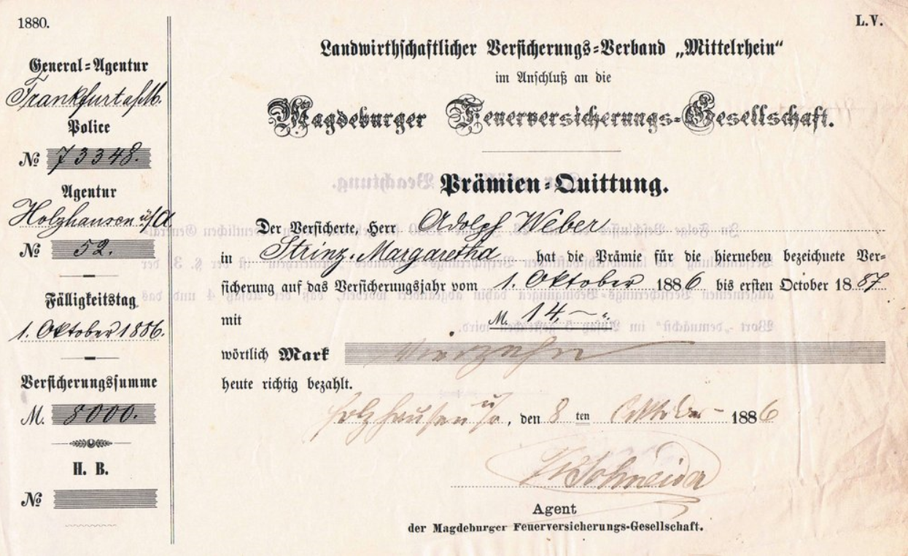

*Prämienquittung Feuerversicherung von 1886*

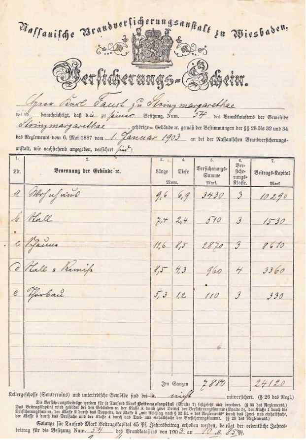

*Brandschutzpolice von 1903*

Hydrantenwagen von 1908

Nachdem im Jahre 1907 in Strinz-Margarethä Wasserleitungen verlegt wurden, wurde der hier gezeigte Hydrantenwagen, als Ergänzung zur Feuerspritze von 1891 angeschafft.

Bestückt war er mit 2 Schlauchhaspeln mit je 5 C-Schläuchen, einem Standrohr, einem Hydrantenschlüssel und einem Werkzeugkasten.

## Aus dem 10. Jahrhundert

### Die Bleidenstädter Grenzbeschreibung

Im Jahre 812 wird Bleidenstadt zum ersten Mal in einer Urkunde zur Weihe des Benediktinerklosters durch Erzbischof Richulf erwähnt. Kaiser Karl der Große übertrug darin dem Erzbistum Mainz das Gebiet ungefähr zwischen dem Taunushauptkamm, der Lahn, der Hohen Straße (der heutigen Bäderstraße) und der Hühnerstraße zur Verwaltung.

Die Bleidenstädter Grenzbeschreibung die vom 6. Juni 812 stammen soll, nimmt somit den Strinzergrund in den Klosterbezirk hinein.

Diese Urkunde (eine der ältesten in Nassau), trägt zur Namensdeutung von Strinz-Margarethä bei.

"Terminatio eccleasiae sancti Ferrutii in Blidenstadt" (Abgrenzung der Kirche des heiligen Ferrutius in Bleidenstadt).

In dieser Grenzbeschreibung wird zum ersten Mal der Bach Strinzepha genannt und an einer anderen Stelle derselben Urkunde begegnet uns die Wendung "ad Strincephan flumen" (bis an den Strinzer Bach); gemeint ist wahrscheinlich der Aubach von der Michelbacher Hütte bis zur Fischbachmündung in Hennethal.

In dieser wohl gefälschten Bleidenstädter Grenzbeschreibung von 812 kommt der Strinzerbach vor, der aber sonst nirgends erscheint.

Diese Grenzbeschreibung ist umstritten. Wenn sie auch keine Fälschung der Neuzeit zu sein braucht, so muss doch ihr Alter bestritten werden.

Sie kann im 14. Jahrhundert, nach dem Brand des Klosters durch die Mönche aus deren Erinnerung heraus niedergeschrieben sein, um die altüberkommenen Recht zu wahren. Dafür spricht auch, dass kein Original von ihr vorhanden ist. Fest steht aber auf jeden Fall, dass das Kloster die Grundherrschaft und die dazugehörige Gerichtsbarkeit schon vor 1184 inne hatte.

> Quelle: u.a. Evangelischer Heimatbote für das Dekanat Bad Schwalbach, Nummer 11, Dezember 1954 / Horst Neumann, stud. theol.

## Aus dem 12. Jahrhundert

### 1184 – Erste urkundliche Erwähnung

Die erste urkundliche Erwähnung fällt in das Jahr 1184. Papst Lucius III. bestätigt in dieser Urkunde dem Abt. Jofredus von dem Benedektiner-Kloster zu Bleidenstadt unter anderem den Besitz von Strinz-Trinitatis, Strinz-Margarethä und Libbach.

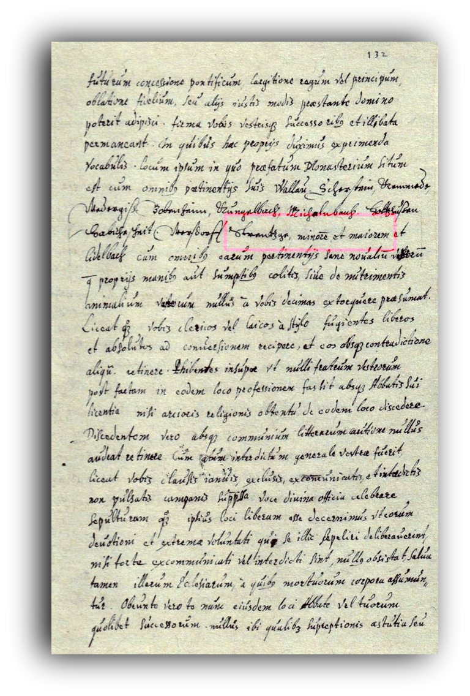

*Hier ein Auszug aus der Urkunde (deutsche Übersetzung aus dem lateinischen):*

Papst Lucius III. nimmt das Kloster St. Ferrutius in Bleidenstadt in den apostolischen Schutz und gewährt genannte Rechte ...

... ferner setzen wir fest, dass alle Besitzungen jeglicher Art und alle Güter, die das Kloster gegenwärtig rechtmäßig und nach kanonischem Recht besitzt oder künftig durch Zugeständnisse der Päpste, durch Schenkungen der Könige und Fürsten, durch Stiftungen der Gläubigen oder auf andere rechtmäßige Weise für Gott erwerben könnte, euch und euren Nachfolgern fest und ohne Beeinträchtigung gehören sollen. Unter diesen Eigengütern nennen wir namentlich: den Ort selbst, an dem das Kloster gelegen ist, mit all seinem Zubehör ferner ... Strentzge (StM), das größere und das kleine ...

Etwas ungewöhnlich scheint, dass das Kloster die päpstliche Kanzlei bemühte, seinen Besitz zu bestätigen. Wir kennen den Anlass nicht. Man könnte vermuten. Man könnte vermuten, dass es geschah, um den Ansprüchen weltlicher "Großer" zu begegnen.

Die Grafen zu Nassau waren die Klostervögte. Jedes Kloster hatte einen weltlichen Großen als Vogt, da ein geistliches Gericht keine Bluturteile (Todesurteile) fällen durfte. Auch für militärische Zwecke war der Vogt zuständig. Meist nahmen die Großen einen mächtigen als Vogt, um auch wirkliche geschützt zu sein.

Die Vögte bekamen für ihr Amt Einkünfte aus Klosterbesitz oder auch Land geliehen. Bald hatten die Klöster sehr zu leiden unter den Ansprüchen der Vögte. Es gab immer Streitigkeiten. So ist sicher auch die Urkunde von 1184 als Abwehrwaffe gegen die Klostervögte zu verstehen. Denn die Absicht der Nassauer Grafen ging dahin, sich immer mehr Einkünfte und Land zu verschaffen, um so das Gebiet der Vogtei ganz zu ihrem Hausbesitz zählen und in ihm ihre Landeshoheit ausbilden zu können.

Die Urkunde aus dem Jahre 1184, in der StM erstmalig genannt wird, zeigt, dass das Kloster Bleidenstadt, das um 780 gegründet worden war, der Grundherr des Strinzer Grundes war, der wohl früher fränkisches Königsgut war, dann aber wie viel Reichs- und Krongut, das damals noch nicht unterschieden wurde, durch Schenkung in kirchlichen Besitz überging. Auf Königsgut kann die noch heute in Oberlibbach existierende Flurbezeichnung "Königshof" hindeuten.

Ein dem König gehörender Hof verwaltet einen Teil des Königsgutes selbst, das andere Land war ausgegeben an Hintersassen in freien Höfen oder zinspflichtigen Höfen, sogenannte Zinser; die Hintersassen konnten persönlich frei sein.

> Quelle: Evangelischer Heimatbote für das Dekanat Bad Schwalbach / Dezember 1954 /
Nummer 11 / Horst Neumann, stud. theol.

## Aus dem 15. Jahrhundert

### Schultheiß „Knippon“

Der Bürger mit Nachnamen Knippon ist der am älteste bekannte Schultheiß von Strinz-Margarethä. Ein Schultheiß hatte die gleichen Aufgaben wie ein Bürgermeister. Nachweißlich kümmerte ich mich von 1442 - 1464 um das Wohl der Strinzer Landbevölkerung, ca. 100 an der Zahl.

Bekannt wurde er dadurch, dass im Jahre 1446 der Amtmann des Grafen Nassau-Idstein ein Weisthum über die Rechte seines Herrn in unserem Kirchspiel von Strinz-Margarethä, Ober- und Niederlibbach erfragt. Es ging darum, wer denn der Herr über Strinz sei. Das Kloster Bleidenstadt oder die Herrschaft in Idstein.

Folgende seiner Worte sind überliefert:

Vnser altern hant isz vff vns bracht, so han wir isz auch also biszher gehalten vnd wiszen auch nit anders, dan dasz vnszer gn. junher Johann graue zu Nassawe, herre zu Idtstein, desz vater, vnser here seliger, vnd sin altern vff in bracht vnd geerbet han, eine here sij zu Strincze, Liedebach vnd Liedebach, vnd wasz in das Kirspel gehoret, vnd habe macht zu gebieden, zu seczen und zu entseczen, vnd desz gerichts ein here, das zu hoen vnd niddern, zu lengen vnd korczen, vnd ein herre vber wasszer, weyde, welde, felde, vnd ober alles, das in das kirspel gehorig ist, nicht vszgescheiden, vnd wuszten sy auch nymandts anders, der einiche gebot, verbot ader herlichkeit in dem egen. kirspel habe in eniche wise, dan der obgen., vnser gn. jungher Hohan vnd syn erben, vnd das vff die eyde, wir alle vnd unszer iglicher sinem heren gethan hait, vnd solten wir icht moen im recht ... zut thun, wolten wir auch thun.

Erstmalig die heilige Margaretha im Ortsnamen

Sein Name ist nicht zu 100 % überliefert. So findet man ihn auch als Knippe, Knipp oder auch Knyp in den Analen wieder. Das letzte Mal wo sein Name auftauchte ist in einem Reichssteuerregister der Herrschaft Idstein von 1499, wo ein Claß Knippon Niederschlag findet.

Teilweise trug auch der Ort selbst seinen Namen. Zu Zeiten, als Strinz noch nicht den Beinamen Margarethä trug, wurde zur Unterscheidung der beiden Strinze aein Name dem Ortsnamen hinzugefügt, so sprach man zeitweise von Knyppe Strintzige, in Knippen Strincze, in Strincz Knyp oder Strincz da Knipp.

Noch während seiner Amtszeit tauch erstmals die Heilige Margaretha im Ortsnamen als "Senten Margrethin Strincze" auf und zwar in der Niederschrift des Weißthum, von dem bereits berichtete wurde.

Leistung Befehlender

Schultheiß bedeutet ‚Leistung Befehlender‘ und bezeichnete in vielen westgermanischen Rechtsordnungen einen Beamten, der Schuld heischt: Er hatte also im Auftrag seines Herren in Idstein die Strinzer zur Leistung ihrer Schuldigkeit anzuhalten, also Abgaben einzuziehen oder für das Beachten anderer Verpflichtungen Sorge zu tragen.

Außerdem war er auch Richter der niederen Gerichtsbarkeit. D.h. er befasste sich in der Regel mit geringeren Delikten des Alltags, die mit Geldbußen oder leichteren Leibstrafen sühnbar waren. Dazu gehörten der Pranger, das Tragen des Lästersteins sowie der Schandpfahl.

### Strinzer Zinser

In einem Buch fand sich über StM folgenden Hinweis:

"Die Zuordnung ergibt sich aus dem Vorkommen einiger hier genannter Zinser bei Strinz-Margarethä im Herbstbederegister von 1459."

Demnach lebten im Mittelalter in StM Zinser. Doch was sind Zinser?

Hier die Erläuterung:

Zinser werden auch als Zensuale oder auch Wachszinser bezeichnet.

Im Mittelalter gab es zunächst kaum öffentliche Sicherheitsbehörden oder eine allgemein zuständige Polizei, die verstreut angesiedelten Höfe mussten sich daher selbst um Schutz und Beistand bemühen. Dazu konnten sie sich unter Aufgabe ihres Eigentums und Freiheit freiwillig einer befestigten Stadt, einem Oberhof oder einer Klostergemeinschaft anschließen und standen so als Wachszinsige oder Klosterhörige unter meist kirchlichem Schutz. Im Fall von StM standen diese Menschen wohl unter dem Schutz des Kloster Bleidenstadt.

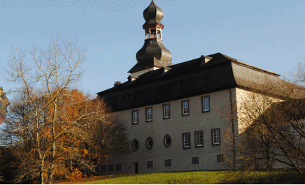

*Als Zinser Schutz durch das Kloster Bleidenstadt*

Sie blieben rechtlich Leibeigene, doch waren sie gegen Zinszahlung von den Auswirkungen der Leibeigenschaft (unangemessener Knechtsdienst, Schollengebundenheit) befreit. Die Rechtsqualität eines Zensualen war auch für arme Freie und entlaufene Leibeigene interessant, übernahm doch der neue Leibherr (Kirche bzw. Bischof) die Garantie und den Schutz für den neuen Status.

Als Gegenleistung für Schutz wurde als Abgabe alljährlich nur ein Zins z.B. in Form von Wachs oder Wachskerzen gefordert, der sogenannte Wachszins. Das Wachs diente im frühen Mittelalter für Schreibtafeln, das Bienenprodukt wurde hoch gehandelt. Die Wachszinsigkeit war die mildeste Art der Hörigkeit. In anderen Fällen mussten die Zinser einen Zinspfennig auf den Altar des Ortsheiligen an dessen Heiligenfest legen und ihm testamentarisch ihr bestes Stück Vieh oder ihr bestes Kleid im Todesfall vermachen.

Mit der Hörigkeit entgingen die Hofesleute auch der Dienstpflicht gegenüber den Territorialherren, die unter anderem im Kriegsdienst bestanden. Die Aufgabe der Freiheit schien für viele die bessere Alternative zu einem möglichen Tod in einer Fehde oder Schlacht.

Die Wachszinsigen oder Zensualen besaßen einen besseren Stand als die sonstigen Hofhörigen. Ihre Zahlungsverpflichtungen waren geringer und ihr sozialer Status höher, da das ganze Institut auf einem anderen Ursprung als die Hofhörigkeit basierte.

Das von den Zensualen erlangte freie Verfügungsrecht über die eigene Arbeitskraft war ein starkes Motiv für persönliches Streben und eine wesentliche Voraussetzung für den im 12./13. Jahrhundert entstehenden Bürgerstand.

Zinser überlebten das Mittelalter und die Reformation nicht. Die weltlichen Obrigkeiten fanden Mittel und Wege sie zu ihren Leibeigenen zu machen.

(Quellen: Wikipedia / Augsburger Stadtlexicon / Das Alte Europa: Vom Hochmittelalter bis zur Moderne / Peter Blickle)

### Wert ist Herr über Strinz?

Einigungen

Am 7. Dezember 1445 werden Irrungen und Spannungen zwischen dem Abt Johan zu Bleidenstadt und seinem Konvent auf der einen und Männer zu Hohenstrinz (Margarethä) und Hinderstrintze (Trinitatis), die dort Güter und Zehnten innehaben, auf der anderen Seite beigelegt in Anwesenheit der gräflichen Brüder, der Junker Johann und Adolf von Nassau Idstein. Diese haben wohl vermittelt. Es war für sie eine günstige Gelegenheit ihren Einfluss in den betreffenden Dörfern zu vergrößern. Es wurde beschlossen und besiegelt, dass die Männer noch acht Jahre die Güter und Zehnten behalten sollten. Die Hohensteiner sollten wie bisher als Pacht und Gülte davon geben: dem Abt. 15 Malter Weizen, 15 Malter Korn, 1 Malter Erbsen nach Limburger und 12 Malter Hafer nach Bleidenstadt Maß und dem Kastenmeister seine Rechte. Nach Ablauf der 8 Jahre sollten der Abt und seine Nachfolger nach eigenem Willen damit umgehen können. Wenn Hagel in den Zehnten fiele, sollte der Abt benachrichtigt werden, der solle den Schaden abschätzen lassen. Bei Entstehung irgendwelcher Streitfragen, die vor Abt und dem Grafen kämen, sollte man sich vergleichen.

Erneute Bestätigung

Ein Jahr später 1446 kommt der Amtmann des Grafen Johann von Nassau-Idstein Friedrich Hilgin von Lorch nach Strinz-Margarethä. Im Schultheißenhof sind alle Strinzer, Ober- und Niederlibbacher Nachbarn (Einwohner), Alte und Junge versammelt. Der Amtmann fragt sie dort Dienstag nach Matthäustag nach den Rechten, die sein Herr in dem Kirchspiel hat. Hier wird zum ersten Male ein Strinzer Kirchspiel erwähnt. Der Amtmann appelliert an den Eid, den sie ihrem rechtmäßigen Herrn getan haben und ermahnt sie, die Wahrheit zu sagen, so wie es ihre Eltern auf sie gebracht und sie das bisher gehalten haben. Die Nachbarn zogen sich daraufhin zur Beratung zurück. Als sie wiedergekommen sind baten sie den nassauischen Schultheißen Knippen, für sie alle zu reden, wie sie ihm aufgetragen: "Unsere Eltern haben es auf uns gebracht, so haben wir es auch also bisher gehalten und wissen auch nichts anders, denn dass unser Herr Johann, Graf zu Nassau-Idstein des Vater, unser seliger Herr und seine Eltern es auf Ihn gebracht haben, dass er ein Herr sei zu Strinz, Libbach und Libbach und dass er hat Macht zu gebieten und verbieten, dass er der einzige Gerichtsherr ist über alles, was in das Kirspel gehörig ist, dass niemand anders darinnen Gebot oder Verbot oder Herrlichkeit in dem Kirchspiel hat.

Niederschrift

Zeitgenössische Niederschrift der Ereignisse:

Anno dm. MCCCC, quadragesimo sexto vff den dinstag nach sent Matheutag hait gestanden der veste Friedrich Higin von Lorch, amptmann zur zijt junghern Johans grafen zu Nassawe, in des scholtheissen höff zu Strincze, genannt senten Margrethin Strincze, vnd hait den nachgeburen zu Strincze, Liedebach vnd Liedebach alt vnd jung vffgegeben vff die eyde, die ir iglicher sinen rechten hern gethan habe, vnd uff die truwe, die sie wiben vnd kindern schuldig sint, vnd vff die fart, die ire sele faren musse vnd sal, wan sich sele vnd lip van ein scheydet, dass sie die warheit sagen vmbe myns junghern von Nassawe herlichkeit zu Str., wie isz ir aldern vff sie bracht vnd sie das bizher gehalten haben, vnd desz nit laissen ader auch nit anders darinne sagen, reden, ader thun, dan sich geboirt, vmbe kheine hande sachen willen, die menschen hercze erdengken mag. Also hant die nachgebur obgen. vmbe gewant vnd sich besprochen vnd beraden vnd sint wider komen ynd gebeten Knippen den scholtheiszen, dasz er von ir allerwegen rede, vnd sie in bescheyden haben, sage. Also hait Knippe geredt von ir aller wegen also. Vnser altern hant isz vff vns bracht, so han wir isz auch also biszher gehalten vnd wiszen auch nit anders, dan dasz vnszer gn. junher Johann graue zu Nassawe, herre zu Idtstein, desz vater, vnser here seliger, vnd sin altern vff in bracht vnd geerbet han, eine here sij zu Strincze, Liedebach vnd Liedebach, vnd wasz in das Kirspel gehoret, vnd habe macht zu gebieden, zu seczen und zu entseczen, vnd desz gerichts ein here, das zu hoen vnd niddern, zu lengen vnd korczen, vnd ein herre vber wasszer, weyde, welde, felde, vnd ober alles, das in das kirspel gehorig ist, nicht vszgescheiden, vnd wuszten sy auch nymandts anders, der einiche gebot, verbot ader herlichkeit in dem egen. kirspel habe in eniche wise, dan der obgen., vnser gn. jungher Hohan vnd syn erben, vnd das vff die eyde, wir alle vnd unszer iglicher sinem heren gethan hait, vnd solten wir icht moen im recht ... zut thun, wolten wir auch thun. Vnd als sprach Knipp, hait ir mich als heysen sagen. Also hant sie die obgemelten mit einander das verwilliget vnd "jo" zu der rede sage gesaget, vnd da disze rede also gescheen waren, da hiesz Friedrich Hilgin hern Jorgen ein vffbar schreiber vber soliche rede vnd wisunge ein ander mee uffin instrument zu machen in der besten form etc.

> Quelle: Weisthümer gesammelt von Jacob Grimm, Vierter Theil / 1863

Darauf wurden diese Aussagen von allen beeidet. Auffällig an der Urkunde ist, dass Hambach nicht als zum Kirchspiel gehörig aufgezählt worden ist. Nassau hatte dort wohl noch nicht Fuß fassen können. Die Urkunde war geschrieben am Dienstag nach Matthäus 1446.

Bleidenstädter Reaktion

Fünf Tage später am 25. September erfolgte schon die Bleidenstädter Reaktion auf dieses Schriftstück. Sie bringen ein Gegenstück dazu.

Vier Männer: Henne Haembecher, Contze Kunnemannssohn, Henne vom Ende und ein sogenannter Metzen-Menn dienen als Zeugen. Sie sagen auf Bitten und Ermahnung des Abtes Johann von Schönborn von Bleidenstadt aus.

Henne Haembecher sagt, er sei Schultheiß des Klosters zu Strinz Trinitatis schon seit über 40 Jahren und seine Eltern seien auch schon 100 Jahre Schultheißen dort gewesen. Nach weiteren Aussagen Haembechers erklärte Contze Kunnemannssohn, er sei klösterlicher Schultheiß an dem Gericht zu Lyddelbach (Libbach) seit 12 Jahren, wohin auch noch das andere Libbach und Hambach gehören.

Daraufhin kam Henne vom Ende zu Wort: Er sei seit über 15 Jahren, und vor ihm sein Vater des Klosters Schultheiß zu Walrabenstein. Als letzter sagte Metzenmann, er sei in Hohenstrinze (Margarethä) Schultheiß. Darauf beeiden die vier Personen ihre Aussagen.

Schriftstückvergleich

Was können wir nun aus dem Vergleich der beiden Schriftstücke ersehen? Kloster und Graf behaupten sie seien seit langer Zeit die Gerichtsbarkeit in dem Gebiet. Das Recht ist bei Bleidenstadt, dass mit seiner Grundherrschaft auch die Gerichtsbarkeit dort gehabt hatte. Aber die Bleidenstädter haben nicht die Macht, den Nassauern wirklich entgegenzutreten. So sehr das Mittelalter den Rechtsgedanken verwirklichte, so wenig wurde in den Machtkämpfen darauf geachtet.

Einigung erst nach 20 Jahren

Für eine Einigung zwischen den beiden Gegner sorgte 20 Jahre später am 24. Januar 1465 der Bruder des Grafen Johann von Nassau, der seit 1461 Erzbischof und Kurfürst von Mainz war, dem folglich das Kloster unterstand.

Der Abt gibt die vier Dörfer StM, die beiden Libbach und Hambach dem Nassauer zu Lehen. Der Abt soll aus den Dörfern den Zehnten einziehen. Graf Johann und seine Nachkommen sollen dem Abt in den Dörfern zu seinem Recht verhelfen.

Neben anderen Vereinbarungen ward so der Streit beigelegt. Man darf sich jedoch nicht darüber hinwegtäuschen, dass die tatsächliche Macht bei den Grafen lag und der Abt trotz des Vergleichs vor Übergriffen in seine Rechte nicht bewahrt blieb. Ein grundsätzlicher Wandel in den Ansprüchen des Klosters Bleidenstadt gegenüber des Kirchspiels Strinz-Margarethä einerseits und den Grafen von Nassau-Idstein bahnte sich erst nach der Einführung der Reformation an.

> Quelle: Weisthümer gesammelt von Jacob Grimm, Vierter Theil / 1863, Evangelischer Heimatbote für das Dekanat Bad Schwalbach, Dezember 1954, Nummer 11, Horst Neumann, stud. theol.

### Strinzer Bürger des Jahres 1499

"Im Reichssteuerregister der Herrschaft Idstein von 1496/97 werden die Strinzer Bürger aus dem entsprechendem Jahr namentlich festgehalten."

Es sind:

Die Struderßen / Foln Cleßg(e) und Gerdrut sin hußfr(au)e / Moldner Gred(e) und Ka(theri)na ir dochter / Greden Cleßge und Eua syn hußfrauwe / Contzg(e) Synder und Greda sin hußfr(au) / die alde Wyntersen, Katheryn ir dochter und Greda ir dochter / Hans / Greta / Contzg(e) / die Wenerßen / Wenerß Cleßg(e) und greta syn husfr(au)e / Folck / Greda Uxor / Pfaff Hen / Gute Uxor Sua / Stifft und Eyle syn hußfrauwe / Snyder Hen und Ka(theri)na syn hußfr(au)e / Gerdrucen Kathryn / Heyntz Schoman und Greda syn Hyßfraue / Philips / Anna Uxor / Matis Hen und Guta syn hußfr(au)e / Koniges Peter und Greta syn hußfr(au)e / Petergen von Hanbach und Anna syn hußfrawe / der Grobbe / Hilman Smyt und Anna syn hußfrauwe / Gredg(e) / Cleßgen / Knyppon Claß und Elles syn hußfrauwe / Adam / Holn Tyll / Wigand und Eylgen syn hußfrauwe / Greden Heyntz und Fyhee syn frawe / Helbick Scholteiß und Anna syn frawe / Heyntz / Werner / Lotzen Claß / Katherin Uxor / Wameysterß Clao und Greta syn son / Henne /Hylman / der Koewehyrt (der Kuhhirt???) / Katheryn Uxor / Schoman Hen und Greta syn frawe / Eben Heyntz und Greta syn maydt / Adam / Emmerich / Demgen / Dyne / Greda / Emmerich / Logen Heyntz und Anna syn hußfrawe / Meckeln Hans und Eua syn hußfr(au)e / Lotzen Hen und Greta syn hußfr(au)e / Arnoldt und Eylchen syn frauwe / Philips / Adam / Drescheren und Gerda syn hußfr(au)e / Hans Tyll / Lysee / Koe Cleßgen / Molnerß Peter und Grede syn hußfr(aue) / Malden Grede / Hen / Eylchen / Philips / Greden Glaß.

Alle Erstgenannten wurden mit einer Steuerschuld von 1 ß (Solidus) belegt.

> Quelle: Hessisches Jahrbuch der Landesgeschichte / Band 4 / 1990

## Aus dem 16. Jahrhundert

### 1536 – Strinz wird protestantisch

Wie in den umliegenden Gemeinden auch, gehören die meisten Strinzer Bürger dem evangelischen Glauben an. Doch wann wurde StM evangelisch, nachdem Martin Luther im Jahre 1517 seine 95 Thesen an die Tür der Wittenberger Kirche hämmerte?

StM war seinerzeit noch stark an den katholischen Glauben, unter der Herrschaft des Kloster Bleidenstadt, gebunden. Im Jahr 1495 wird das Kloster Bleidenstadt aufgelöst und in ein adliges Ritterstift umgewandelt. Der Ort Bleidenstadt hatte danach seinen eigenen Pfarrer mit der über dem Ort gelegenen St. Peterskirche. Zu deren Kirchspiel gehörte auch StM, welches aber, im Gegensatz zu vielen anderen Orten, schon eine eigene Kirche, einen Pfarrer und einen Glöckner besaß. Alle Kirchen waren, wie das Ritterstift auch, dem Mainzer Kirchensprengel unterworfen. Das Ritterstift Bleidenstadt hatte einen eigenen Dekan, welcher stets als Oberpfarrer der Region angesehen wurde.

Die St. Peterskirche wurde seit 1536 den Lutheranern eingeräumt, wahrscheinlich in einer Zeit, in der Erzbischof Albrecht minder streng gegen die Ausbreitung der Reformation vorging. Alle Orte, die unter Nassau-Weilburger Hoheit standen, nahmen die Reformation ebenfalls an, der Ort Bleidenstadt aber nur zur Hälfte. Die Aar trennte sodann die beiden Religionen des Ortes.

StM das dem Kirchspiel der St. Peterskirche in Bleidenstadt angehörte, nahm somit ebenfalls im Jahre 1536 den evangelischen Glauben an.

> Quelle: Geschichte Nassaus von der Reformation bis zur Neuzeit / E. F. Keller / 1864

## Aus dem 17. Jahrhundert

### Bäuerliches Leben im 17. Jahrhundert

Der Bauer in der Zeit des 30jährigen Krieges stand früh morgens von seinem Strohlager in dem langen Hemd auf, das er auch tagsüber trug. Er - und auch der Bürger in der Stadt - hatten kein eigentliches Nachthemd. Das Hemd, das man am Leibe trug, trugt man auch tagsüber - tagein, tagaus...

*Die Beine wurden in eine Bauernhose gesteckt. Die Bauernhose*

bestand eigentlich aus zwei langen Strümpfen, sogenannten Beinlingen, die die Beine von den Zehen bis zu den Hüften bedeckten.

Die Beinlinge wurden durch ein Band oder ein Strick um die Hüften gehalten.

An den Strümpfen blieb vorn und hinten natürlich ein großes "V" offen, in welches das lange Tag- und Nachthemd gesteckt wurde. Das Hemd diente gewissermaßen als Unterhose.

Darüber hing ein weiter Rock (eigentlich ein zweites grobes Hemd), der bei der Arbeit durch einen Gürtel oder Strick geschürzt war.

Der herabfallende Rock versteckte alle "offenen Stellen".

In einigen Regionen kam später das kurze Wams in Mode, der knapp bis zum Gürtel reichte.

Nun wurden aus den Strümpfen eine Art Strumpfhose. Vorn wurde ein Hosenlatz und hinten ein Dreieck auf die Stellen genäht, die vorher "frei" waren.

Die Hose wurde mit sogenannten "Nesteln" - kleinen Schnüren - an dem Wams befestigt.

Im Sommer ging der Bauer barfuß, im Winter in Pantoffeln oder Schlappen, wie man sie auch heute noch kennt.

Bei Arbeiten im Schlamm trug der Bauer "Tripklompen". Das waren stabile Pantoffeln, die auf ein starkes Brett genagelt waren, unter dem zwei Querleisten das Abrutschen verhindern sollten.

Auf dem Kopf trug man eine Mütze oder eine Kappe mit Ohrenklappen. Bei den Bauern hatte sie lediglich die Aufgabe, gegen die Witterung zu schützen; entsprechend vielfältig war die Form, die nur von der Funktion und nicht von der Mode beeinflusst war.

Wenn man die Umstände berücksichtigt, unter denen die Bauern und ihre Familien leben und knechten mussten, wenn man sich die hygienischen Verhältnisse vor Augen hält und wenn man weiß, dass Anfang des 17. Jahrhunderts eine "kleine Eiszeit" ausgebrochen war, die nicht nur zu Missernten führte, sondern die Bauern auch zwang, ihre Kleidung ständig anzubehalten um nicht zu frieren, dann ahnt man, dass es in den Bauernkaten und Schankhäusern nach Armut und Kuhmist gerochen hat.

Dass unter diesen Bedingungen Rheuma, Gicht, Tuberkulose und später auch die Pest ein leichtes Spiel hatten, braucht nicht noch begründet zu werden.

Als lebende Plage für die Bauern trieb seinerzeit, aufgrund der schlechten hygienischen Verhältnisse, Flöhe und Läuse ihr Unwesen. Nicht zuletzt verbreitet durch Ratten und Mäuse, die wie fast selbstverständlich mit den Bauersleuten in deren Häusern wohnten und von den unachtsam weggeworfenen Abfällen lebten. Natürlich kann das sogenannte gesunde Volksempfinden auch aus einer Plage, der man nicht entkommen konnte, noch etwas Gutes abgewinnen: bei den Bauern galten Läuse - vor allem bei Kindern - als Zeichen bester Gesundheit. Niemand konnte damals ahnen, welche hinterhältige Rolle zum Beispiel die Kleiderläuse bei einer Seuche spielten, die später als Fleckfieber bekannt wurde.

Man hatte zwar in den folgenden Jahrhunderten immer wieder versucht, mit diversen Rezepten der Läuse Herr zu werden, doch meist mit mäßigem Erfolg.

Hohe Kindersterblichkeit

Seinerzeit war die Kindersterblichkeit in unserem Gebiet sehr hoch. Dies lag wohl auch überwiegend an fehlender Hygiene. Schuld daran war sicherlich auch der damals gebräuchliche "Schnuller". Dieser bestand aus einer Art Ball der aus einem Stück Stoff gerollt wurde und an dessem Ende eine Schnur hing. Den Stoff trängte man mit etwas Süßem, z.B. Honig und steckte es den Kindern in den Mund, die daran nuckelten. Dieser wurde natürlich des öfteren ausgespuckt, landete auf dem verdreckten Boden und wurde, wenn es ganz schlimm kam, von den Haustieren abgeleckt. Desinfektion kannte man damals nicht und so wurde der verdreckte "Schnuller" den Kindern wieder in den Mund gesteckt, was zu Krankheiten und schließlich zum Tod führte.

(Quellen: Dr. Klaus Koniarek / Bad Sooden-Allendorf / Wehen und sein Grund Dr. Eduard Wilhelmi / 1957)

### Graf Ludwig räumt auf

Aus dem Jahre 1609 finden sich in der Borner Kirchenordnung Anweisungen des Grafen Ludwig zu Nassau, die auch für StM galten.

Der Graf fordert darin:

... Abschaffung allerhand Aberglaubens, Rotten und ärgerlichen Lebens, auf Befürderung christlicher Zucht und Erbarkeit und Erhaltung guter polizeydienlichen Stücken als mit Kristallsehern, Zauberern, Widertäufern, Kirmessen, Sonntagstänzen, Gotteslästern und Vollsäufern und mit straft der Unzucht und Ehebruchs.

An Leib und Leben soll bestraft werden, wer zu einem Wahrsager oder Kristallenseher läuft; 12 Meilen Weges weit sollen die Wiedertäufer außer Landes verwiesen werden und ihr Gut von den Beamten eingezogen werden.

Die Kirmessen sollen abgeschafft werden und jeder Pfarrer, der sie duldet, bestraft werden, weil auf ihnen viel "übermäßiges Fressen, Saufens, Spielen, Schlägerung und sonst viel geschieht. Der Pfarrer, der es duldet, soll mit 20 Gulden bestraft und seines Amtes entsetzt werden.

Wenn aber Hochzeiten sind, mag man ziemlich tanzen, doch nicht unter der Predigt. Verboten ist das Nackttanzen, das Herumwerfen und alles unzüchtige Wort und Gebarde, und ein Ortsvorsteher soll beim Tanzen sein, dass zu rechter Zeit anzufangen und aufgehört werde.

Ein Gotteslästerer und Vollsäufer soll bei Wasser und Brot in den Turm (Hexenturm in Idstein) gesetzt und wenn dies nicht hilft, außer Landes verwiesen werden, nach dem Tode soll er nicht wie anderen in geweihter Erde ruhen.

Wer sich heimlich verlobt und unzüchtig lebt, darf nicht mit dem Kranz zur Kirche gehen.

(Es existieren zwei Erklärungen zum Kranz: Eine nicht mehr jungfräuliche Braut, die Strohjungfer, musste nach altem Brauch bei der Hochzeit einen Strohkranz tragen. Die unbescholtene Braut durfte sich dagegen im Myrtenkranz präsentieren. Die andere Version ist, dass die jungfräuliche Braut einen geschlossenen Kranz trug und die nicht mehr jungfräuliche Braut oder Witwe einen offenen

> Quelle: Wikipedia.

Wer sich nicht bessert, kommt in den Turm, an den Pranger oder kann aus dem Land oder Amt verwiesen werden. Ein Ehebrecher oder eine Ehebrecherin sollen gefoltert und nach Überführung mit dem Schwert hingerichtet werden. Die Grade der Blutsverwandtschaft, die zur Eheschließung hinderlich sind, sollen genau beobachtet werden.

Weihnachten, Ostern und Pfingsten werden an je drei Tagen gefeiert. Länger als eine halbe Stunde soll nicht gepredigt werden, damit das Volk nicht aufgehalten und kein Überdruss verursacht würde."

### Strinzer eilen Breithardt zur Hilfe

Die Schweden bedrohen Breithardt

Als sich am Sonntag den 25. Januar 1635 die Bürger von Breithardt eben in die Kirche begeben wollen, kommt ein schwedischer Oberst mit Dragonern zu Pferd vor dem Schlage des Ortes an. Derselbe verlangt, dass der Schlag geöffnet wird und fordert Brot für die Soldaten und Futter für die Pferde. Schultheis und Gericht bitten inständig nichts Feindliches gegen sie zu unternehmen, indem sie sich zur Herbeischaffung alles Gewünschten ganz bereitwillig erklären. Mittlerweile haben die jungen Leute ein Signal mit den Glocken gegeben, um den benachbarten Ortschaften die drohende Gefahr, worin sie schweben, anzuzeigen. Zugleich treten sie selbst unter das Gewehr, um sich wenigstens gegen einen möglichen Angriff zu schützen.

Schießt drauf, gebt Feuer auf die Bauern

Diese Vorsicht bekommt der Gemeinde sehr übel. Der Oberst, der als ein Mann mit einem langen, weißen Bart und dem Regimentsstab beschrieben wird, schreit mit lauter Stimme den Soldaten zu: "Schießt drauf, gebt Feuer auf die Bauern." Zugleich stürzen mehrere tod zur Erde nieder und andere krümmen sich in ihrem Blut. Ein Ortsbewohner eilt, um die Aufgeregten zu besänftigen, mit einem Leibbrod in der Hand herbei, aber derselbe wird sogleich Tod da niedergestreckt. Nun wird Breithardt ganz ausgeplündert, zwölf schöne Pferde und 120 Stück Schafe aus den Ställen weggetrieben. Unterdessen sind Bürger aus den Nachbargemeinden, u.a. aus Strinz-Margarethä, mit Schießgewehr hinlänglich versehen, herbeigeeilt, um den bedrängten Nachbarn beizustehen. Aber leider kommen sie zu spät, indem schon alles ausgeleert ist. Kaum aber hat die räuberische Horde die herannahenden Mannschaften zu Gesicht bekommen, machen sie sich eilends auf und davon.

> Quelle: Die Drangsale des Nassauischen Volkes und die angrenzenden Nachbarländer in den Zeiten des dreißigjährigen Krieges, seine Helden, Staatsmänner und andere berühmte Zeitgenossen

### Strinzer Pfarrer der Letzte der Region

Der 30jähirge Krieg hat unsere Region fast leergefegt. Diejenigen, die bis dahin den 30jährigen Krieg überlebt haben, sind den steten feindlichen Angriffen, Raufen, Schlagen, Plündern und Hungern ausgewichen und halten sich im Rheingau, Langenschwalbach, Diez, Hohenstein (heute Burg Hohenstein) und auch in Idstein auf. Viele Zurückgebliebene sind dem Hungertod geweiht. Auch Pfarrer gibt es in der Region nicht mehr, sodass der einzig verbliebene Pfarrer "Georg Pistorius" etlichemal bis nach Wehen seinen Dienst verrichten muss. Doch auch diesen hat der Druck der Zeit hinweggerafft und der Verstorbene wird am 21. Oktober 1636 vom einzig verbleiben Geistlichen der Region Pfarrer Plebanus aus Wehen begraben. Dieser berichtete vom Begräbnis:

"Bei diesem Leichenbegräbnis ist es fast erbärmlich zugegangen; denn auch so viele Mannspersonen aus dem Grund zusammenzubringen waren, dass sie das Grab machen und ihren toten Pfarrer zu seinem Grabe, nur etlichen Schritt aus dem Pfarrhaus in die Kirche tragen konnten. Mussten auch die armen Leute bei dem Ausgang aus der Kirche wegen einer ankommenden hungrigen Partei auf dem Kirchhof entlaufen. Kam ich kaum ohngeplündert und das durch Hilf einer schriftlichen Salven Quartier davon. Ist nun auf diesem ganzen Strich kein einziger Pfarrer mehr"

> Quelle: Die Drangsale des Nassauischen Volkes und der angrenzenden Nachbarländer in den Zeiten des dreißigjährigen Krieges, seine Helden, Staatsmänner und andere berühmte Zeitgenossen / 1854

### Der Schuss

Nachfolgend ein Gedicht aus der Zeit des 30jährigen Krieges. Es stamm aus dem Buch:

Der Monstranzenbaum - Hessen Nassauische Legenden, Lieder und Baladen

von Hans Linck, erschienen im Falken Verlag Darmstadt im Jahre 1917.

Wann und von wem das Gedicht seinerzeit geschrieben wurde, ließ sich bislang nicht mehr recherchieren.

Der Schuß  
Aufhorcht erstaunt das Marienbild  
Am Kreuzweg von Strinz-Margareth,  
Es ist wohl eigen, wenn rot der Komet  
Vom Himmel zur Erde sich brückt,  
Wenn Würfelklang röchelnder Seufzer erstickt,  
Und ein Lachen übers versengte Land  
Wie das heulen hungriger Wölfe weht,  
Daß dann noch einer am Straßenrand  
Spricht ein Gebet.  
Klaus Bürger schlug das Kreuz mit der Hand:  
"Maria, sei gegrüßt!" -  
Wohl selten nur den Weg ich fand  
Zu dir und hab es gebüßt!  
Die Reiter unter des Kaisers Sold,  
Sie schlugen die Türen mir ein,  
Sie nahmen mein letztes Silber und Gold,  
Keinen Albus nenn ' ich mehr mein.  
Die Äcker verwüstet, die Scheuer leer,  
Und im Haus von Brot kein Laib,  
Es windet seit Wochen in Hungerqual schwer  
Sich mein armes, unschuldiges Weib. -  
Zehn Gulden vergrub ich einst, flüchtend vorm Zug  
Der Schweden bei Bleidenstadt,  
Das gibt zwei Brote - das ist genug,  
ein Brot macht heut wochenlang satt.  
Und blühen wie einst soll wieder mein Weib,  
Das jetzt so blass wie nie,  
Um ihretwillen schirm meinen Leib,  
"Ave - Mutter Marie!"  
Klaus Bürger rücke den Hut gerad  
Und durchschritt die Heide quer,  
Ihm huschte der Wald durch bis Bleidenstadt  
Leuchtend ein Strahl hinterher.  
Ein Tannenhäher als Weggenoß  
Flog voran ihm mit warnendem Schrei,  
So schlich er an dem schwedischen Troß  
und den kaiserlichen vorbei.  
Und er suchte die Stelle, und fand den Platz,  
und grub in der Erde nach,  
Und hob den armseligen Guldenschatz,  
Als die Nacht in die Täler brach.  
Das Dunkel verschlief er im Busche dicht,  
Heim schritt er im dämmernden Tag,  
Und sah den zerlumpten Kroaten nicht,  
Der lauernd im Graben lag.  
Was ein Bauer heut an Geld noch hat,  
Das trägt er am Leibe mit,  
Wer weiß, ob wir Söldner morgen noch satt,  
Und so nah steht das Wild: Drei Schritt!"  
Und langsam erhob sich das schwere Pistol,  
Bis das Korn auf Klaus Bürger fiel,  
Es pfiff wie ein Schwert die Kugel wohl,  
Doch fand sie nie das Ziel.  
Wie Donner dröhnte der Knall hinterdrein,  
Weiß ward Klaus Bürgers Gesicht,  
Wohl sah er um sich den blendenden Schein,  
Aber Pulverdampf war es nicht!  
Ein Sprung, und er schob sich durch das Gebück  
Und schlich mit gebeugtem Knie,  
Mit geducktem Haupte den Weg zurück  
Bis zum Sternbild der Jungfrau Marie.  
Und als er vor der geheiligten stand,  
Ihm sprang aus dem Munde ein Schrei:  
Da lag in der Muttergottes Hand - Ein blankes Pistolenblei.  
Wie auch vom Froste klirrt die Luft,  
wie auch der Herbststurm weht,  
Die Madonna umwallt stets Rosenduft  
Am Kreuzweg von Strinz-Margareth.  
Ein warmer Glanz geht von ihr aus,  
Wie das Leuchten vom Hochaltar,  
Und immer beut ihr den blühenden Strauß  
Dasselbe Menschenpaar.  
Den gleichen Ring um die Finger gepresst,  
Tragen die seltsamen Zwei,  
Der schließt an den Himmel wie Ketten sie fest,  
Und ist doch nur von Blei.

Es gab einst Gemarkungsnamen aus der frühen Zeit, die auf den im Gedicht genannten Kreuzweg hinweisen könnten.

Es sind:

1571-1552 / beim helgen Creutz (HStA, Abteilung 36, Rechnungen (=III) Nr. 5.)

### Kreuz

1741 \Acker/ Aufm Creutz (HStA, Abt. 360, StM Nr. 1., pag.82)

### Die letzten Strinzer

Nach dem dreißigjährigen Krieg war unsere Region fast leergefegt. Sind die Bauern dem Tod entkommen, flüchteten dieses meist in sicherere Gebiete.

Viele Dörfer hatten kaum noch Einwohner, so auch geschehen in StM.

Im Jahre 1658 wurde von Pfarrer Steinbach, der hier in diesem Jahr seinen Dienst antrat, eine kleine Volkszählung durchgeführt, die die Nachbarn (Einwohner) der einzelnen Orte aufführt.

Demnach lebten in StM nur noch 70 Personen. Namen die heute hier noch vorkommen sind Klein, Heiler, Rückert und Enders.

Es ist wohl auch noch der Name Puff dazu zu zählen, denn 1684 ist Wilhelm Puff im Alter von 81 Jahren gestorben. Margaretha Pfuin folgte ihrem Ehemann bald nach. Da das Ehepaar im Verzeichnis der "Nachbarn" von 1658 nicht genannt wird, muss man annehmen, dass es entweder von auswärts zuzog, oder dass es eine Zeitlang, noch infolge des Krieges, einen anderen Wohnsitz hatte.

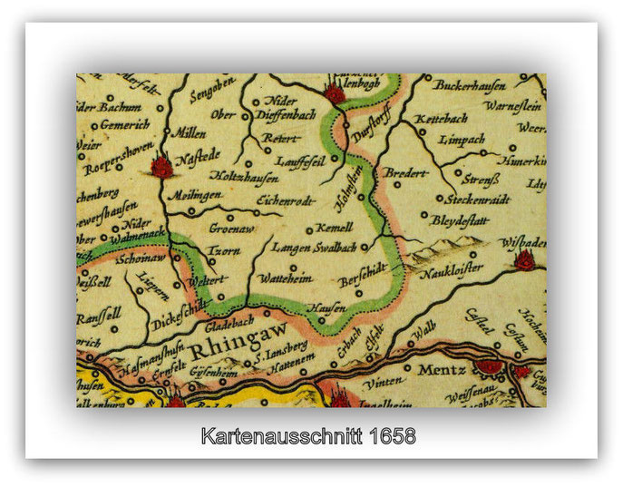

*Kartenausschnitt von 1658*

Nachfolgend die Aufzählung der Nachbarn von StM. Es fällt auf, dass es damals noch keine Namensvielfalt für Vornamen gab. Viele Vornamen wiederholen sich dauerhaft.

Eheleute

Johann Albrecht Steinbach * 1630 (Eltern Johann Steinbach (Pfarrer zu Idstein) / Elisabeth Hummel)

- Catharina Steinbach
- Eheleute
- Philipp Klein (Kirchenmeister)
- Emma Ottenallering (Nachname schlecht lesbar)
- Kinder
- Georg, Michael, Catharina, Johann, Appolonia, Jacob, Philipp, Heinrich
- Anna Rückerin
- Eheleute
- Wilhelm Lause
- Anna Maria Lotz
- Kinder
- Anna Maria, Catharina, Dorothea, Barbara
- Eheleute (sind aus Niederlibbach nach StM gezogen)
- Adam Lotz (* 1593 oder 1595)
- Maria Pomgen (Nachname schlecht lesbar) * 1611 oder 1616
- Kinder
- Johann Philipp, Anna Maria, Johann Peter, Anna Elisabetha
- Johann Emmerich Heyler
- Eheleute
- Philipp Lotz
- Margaretha Anna Maria Lotzin
- Kinder
Maria Margaretha, Johann Philipp, Johann Laurenz, Maria Catharina, Anna Margaretha

Andreaß Fuchs (*1619)

Kinder

Philipp Nikolaus, Anna Margaretha (* 1656), Anna Maria, Johann Albertus

- Eheleute
- Andreaß Himmel (Nachname schwer lesbar)
- Ester Crämmerin
- Kinder
Johann Philipp, Anna Margaretha, Anna Elisabeth, Elisabeth, Johann Conrad, Philipp Conrad, Johann Mattheus

- Eheleute
- Jacob Klein
- Maria Rückerin
- Kind
- Maria Lote (Zweitname schwer lesbar)
- Eheleute
- Johann Enders
- Annamaria Lotzin
- Kinder
- Johann Philipp, Johann Albert, Johann Jacob
- Eheleute
- Philipp Michael Endres
- Annamaragaretha Lotzin
- Kinder
Johann Wilhelm, Catharina, Anna Margret (Zweitname schwer lesbar), Erna

- Eheleute
- Johann Philipp Lotz
- Anna Catharina Hütigen
- Kind
- Maria ? (Zweitname nicht lesbar)
- Eheleute
- Johann Conrad Rückert
- Maria Catharina
### Die Strinzer von 1681

Im hessischen Staatsarchiv Wiesbaden ist eine Urkunde erhalten geblieben, die die männlichen Bürger von StM aufgelistet hat.

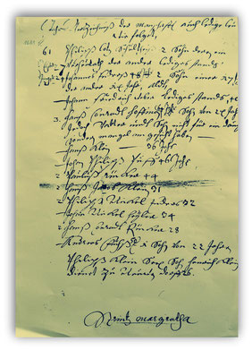

- Jahr Verzeichnisß der Mannschaft auch lediger Leut wie folget
- 1681
- Philipp Lotz Schultheiß 2 Söhn der ein 27
- verheiratet der andere lediger Stand 24
- Johannes Enders 48 Jahr 2 Söhn einer 17 Jahr
- der andere 14 Jahr aldt
- Johann Friedrich Weber lediger Stand 40 Jahr
- Hanß Conradt Hasting(?) 64 Jahr ein Sohn von 24 Jahren
jedoch Vatter und Sohn nicht für ein Tauge (taugen nichts) sonders mangel am gesicht haben

- Hanß Klein 36 Jahr
- Johann Philipp Puff 46 Jahr
- Hanß Jakob Klein 31
- Philipp Nickel Enders 32
- Johann Nickel Heyler 34
- Hanß Conradt Rücker 28
- Andreas Puff 50 1 Sohn von 22 Jahren
Philipp Klein sein Sohn Henrich Klein dienet zu (unbekannter Wohnort) 26

### Gerädert und geköpft

Wir schreiben das Jahr 1678.

Die in der Geschichte 'Die letzten Strinzer' als Tochter von Andreas Fuchs aufgeführte Anna Margaretha (*1656) ist mit einem Schultheißen (Bürgermeister) Jon (Johann?) B (Nachname nicht vollständig erwähnt) verheiratet. Sie hat mit Ihrem Ehemann zwei Jungen.

In den Aufzeichnungen von Pfarrer Johannes Neumann wird berichtet, dass sie wohl mit einem ledigen Kerl ein Verhältnis hatte und mit dessen Hilfe ihren Mann nachts im Bett umgebracht und verscharrt hat.

Beide sind aber überführt worden und wurden in Bärstadt hingerichtet. Anna Margarethä wurde mit dem Schwert geköpft und der Kerl "aufs Rad gelegt".

> Quelle: Alte Strinzer Chronik, Teil 1, Seite 83 / Kirchenchronik

Was bedeutet "aufs Rad gelegt"?

Mit dem Begriff "aufs Rad gelegt" ist das seinerzeit übliche Rädern gemeint. Es handelt sich dabei um eine grausame Hinrichtungsform des Mittelalters und der Frühen Neuzeit.

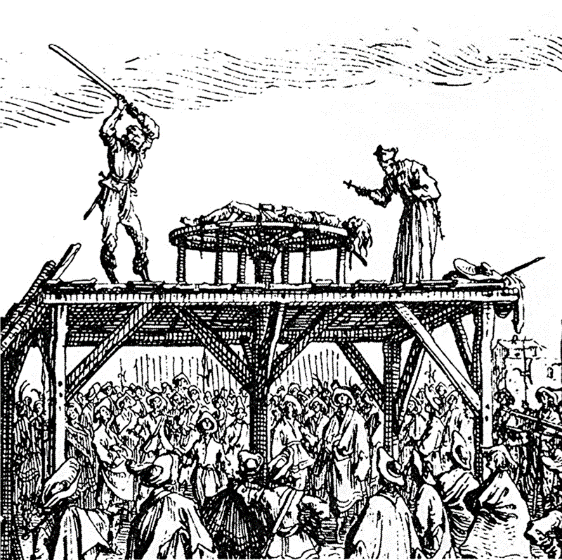

Die als Mörder und/oder Räuber Verurteilten wurden auf ein Schafott gebracht und auf dem Boden festgebunden. Vorrangiges Ziel des ersten Aktes war das qualvolle Verstümmeln des Leibes, nicht der Tod. Deshalb sah die gebräuchlichste Variante vor, das Knochenbrechen mit den Beinen zu beginnen. Dazu ließ der Scharfrichter das Richtrad (oft mit eiserner Kante) auf den Unterschenkel des Verurteilten fallen und arbeitete sich dann bis zu dessen Armen hinauf. Dabei waren Rhythmus und Anzahl der Schläge jeweils vorgeschrieben, manchmal auch die Speichenzahl des Richtrades. Um dessen Wirkung zu erhöhen, legte man scharfkantige Hölzer unter die Gelenke, sogenannte Krammen, Krippen oder Brecheln. Später gab es Vorrichtungen, in die der Verurteilte „eingespannt“ werden konnte. Obwohl nicht üblich, konnte der Scharfrichter angewiesen werden, den Verurteilten am Ende des ersten Aktes zu exekutieren, indem er beim Gnadenstoß auf Hals oder Herz zielte. Noch seltener geschah dies sofort zu Beginn (vom Kopf herab).

Im zweiten Akt wurde der Leib in ein anderes Rad geflochten, was durch die gebrochenen Glieder möglich war, oder daran festgebunden. Nun wurde das Rad an einem Stock oder Pfahl aufgerichtet. Danach durfte der Scharfrichter den Verurteilten gegebenenfalls enthaupten oder erdrosseln. Es wurde auch Feuer unter dem Rad entfacht, oder man warf den Geräderten einfach hinein. Gelegentlich errichtete man einen kleinen Galgen auf dem Rad, etwa wenn der Schuldspruch zusätzlich zu Mord auf Diebstahl lautete.

Da der Leib nach der Hinrichtung auf dem Rad verblieb und Tierfraß und Verfall überlassen wurde, hatte diese Form der Bestrafung, ähnlich der antiken Kreuzigung, eine sakrale Funktion über den Tod hinaus: Nach damaligem Glauben stand die unterbliebene Bestattung einer Auferstehung entgegen.

> Quelle: Wikipedia

Hinrichtungen in Bärstadt

Wie die Kirchenchronik berichtet wurden die Mörder in Bärstadt hingerichtet. Am Dorfrand von Bärstadt gibt es eine alte Verbindungsstraße zwischen Rheingau und Untertaunus. Sie heißt umgangssprachlich die „Hohe Straße“. An ihr liegt der Galgenkopf, eine Erhöhung im Wald. Hier wurde hingerichtet und damit auch eventuell die vorbeifahrenden Reisenden abgeschreckt.

> Quelle: Jürgen Münzer / Chronist von Bärstadt

Der letzte Delinquent, der dort 1727 gehängt wurde, war ein Dieb.

> Quelle: Wikipedia

### Das Leid des Pfarrer Neumann

Ende des 17., Anfang des 18. Jahrhundert war Pfarrer Johannes Neumann für die Seelsorge in StM zuständig. Dieser Pfarrer hatte sehr viele persönliche Schicksalsschläge zu ertragen, von denen nachfolgend berichtet wird.

Tod der Ehefrau

Im Jahre 1696 stirbt die Ehefrau von Pfarrer Neumann, Anna Elisabetha, geb. Hießin, Tochter eines Schultheißen (Bürgermeisters). Sie wird im Kirchenchor der damaligen Strinzer Kirche begraben.

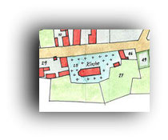

*Die alte Kirche in der die*

Ehefrau von Pfarrer Neumann

begraben wurde.

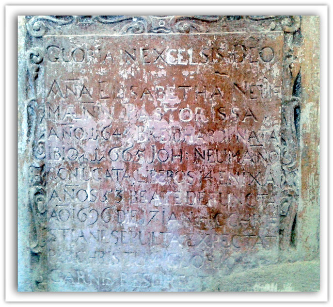

*Grabstein von Anna Elisabetha Neumann von 1696*

Tod eines Sohnes in 1699

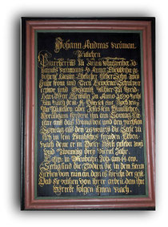

Ein Sohn des Pfarrers, Johann Andreas (Schulmeister und Organist in Breithardt), verstarb im Jahre 1699 mit 20 Jahren, kurz vor seiner geplanten Hochzeit. Zum Gedenken an seinen Sohn lies Pfarrer Neumann die neben abgebildete Gedenktafel erstellen, die noch heute in der Kirche zu Breithardt hängt.

Gedenktafel in der Kirche zu Breithardt

Ermordung des jüngsten Sohnes 1704

Der jüngste Sohn von Pfarrer Neumann, Johann Philipp, studierte in Wittenberg Rechtswissenschaften. Am 23. April 1704 zur Abendzeit wird dieser von 6 - 8 Besoffenen, teils von Hamburger teils von Holsteinischen Studenten attackiert. Ein Messerstich eines Wittenbergers verletzt ihn so sehr, dass er nach 4 Tagen an den Verletzungen stirbt. Die Aufzeichnungen in den Kirchenunterlagen enden mit den Worten:

GOTT verzeihe den Mördern und verleihe diesem,

meinem lieben filio (Sohn) eine fröhliche Auferstehung.

Tod des ältesten Sohnes in 1704

Sein älterer Sohn, Johann Peter, hatte seinen Bruder in Wittenberg besucht und wohlbehalten zurückgelassen. Als er die Post von der Ermordung seines Bruders erhielt, verfällt dieser in Melancholie. Er, der bis dahin frisch und schön geraten, nahm immer mehr ab, bekam Fleckfieber und verstarb schließlich bei seinem alten Vater. Er wurde 22 Jahre alt.

Bei der Leichenpredigt wählt Pfarrer Stein folgende Worte:

"Ich habe Lust abzuscheiden und bei Christus zu sein, welches auch nicht besser wäre."

Pfarrer Neumann selbst verstarb im Jahre 1712 im Alter von 76 Jahren.

Aus der Strinzer Chronik geht hervor, dass der Pfarrer auch noch Töchter mit namens Anna Catharina und Anna Elisabetha hatte.

(Quellen: Alte Strinzer Chronik, Teil 1, Seite 52 u. Seite 111 / Kirche Breithardt)

Im Jahre 1831 wird die alte Strinzer Kirche, die bereits seit 10 Jahren wegen Baufälligkeit geschlossen war, abgerissen.

Dabei wird das Grab (Abbildung Grabstein siehe oben) im Kirchenchor, in dem die Ehefrau von Pfarrer Neumann beerdigt wurde, geöffnet.

Bei der Öffnung stellt man fest, dass auch der Pfarrer Neumann im Jahre 1712 in diesem Grab beigesetzt wurde. Außerdem noch andere Personen, die dort mit wollenen Kleidern begraben lagen.

Der damalige Pfarrer Schmidtborn berichtet, dass die Kopfbedeckung und das blonde Haar der Pfarrersfrau noch vollkommen kenntlich waren.

Der alte Grabstein wurde in der heutigen Kirche im Chor, an dem Familienstuhl des Pfarrers, aufgestellt und eingemauert.

> Quelle: Alte Strinzer Chronik, Band 1, Seite 73

### Wahr oder Unwahr?

"Nachfolgend eine Geschichte, deren Wahrheitsgehalt nicht nachgewiesen werden kann."

Ein Kind namens "Misere"

Im Untertaunuskreis gibt es die Sage, dass in der "Franzosenzeit" ein fremdes, verlassenes Kind gefunden wurde und der Pfarrer von Strinz-Margarethä das einsame Kind "Misere" genannt und getauft habe, was übersetzt so viel wie "Elend" bedeutet.

Unter der "Franzosenzeit" versteht man den Zeitraum, in dem unser Gebiet von den Franzosen besetzt war. Das war um 1804 - 1815.

Ein Schriftstück beweist aber, dass es sich nicht um die "Franzosenzeit" gehandelt haben kann, denn bereits im Jahre 1651 wird im Niederlibbacher "Nachbarschaftsverzeichnis ein Bürger namens Melchior Meßere erwähnt.

Wahrscheinlicher ist es deshalb, dass mit der "Franzosenzeit" eher die Zeit des 30jährigen Krieges gemeint ist.

Im Jahre 1818 gab es noch einen Schultheißen (Bürgermeister) in Oberlibbach mit dem Nachname Misere, der ein Nachfahre dieses Kindes gewesen sein könnte.

Der Wahrheitsgehalt dieser Geschichte kann aber wohl nicht mehr ergründet werden.

> Quelle: Alte Strinzer Chronik

Das Leid uneheliche Kinder

In der damaligen Zeit galt es als Schande uneheliche Kinder zu haben. Der Makel, der der unverheirateten Mutter anhing, wurde auch auf das uneheliche Kind übertragen. Man gestand ihm nicht, wie dem ehelichen Kinde, die gleichen Rechte und die gleiche Achtung zu. Es war ein "Bankert", der sich überall verachtet fühlte und dem man seine uneheliche Geburt, an der er schuldlos war, bei jeder passenden und unpassenden Gelegenheit vorhielt. Dieser Makel hing ihm sein ganzes Leben an. Um dieser Verachtung zu entgehen, kam manches Mädchen und manche Frau dazu, ihr heimliche geborenes uneheliches Kind zu töten oder auszusetzen.

## Aus dem 18. Jahrhundert

### Das Backhaus

Früher kamen immer wieder Bettler und Obdachlose durch den Ort. Die Gemeinden

waren seinerzeit verpflichtet diesen armen Menschen ein Obdach zu geben. Für diesen Zweck gab es Räume, die dafür vorgesehen waren.

In Strinz-Margarethä stand dafür das Obergeschoss des Backhauses zur Verfügung.

Das Backhaus gibt es leider nicht mehr, aber dafür noch Hinweise in den Kirchenbüchern, wer damals im Backhaus aufgenommen wurde.

Das Backhaus bestand schon 1707, wie Eintragungen aus dem Kirchenbuch belegen. Leider wurde es in den 50ern, nachdem es nicht mehr genutzt wurde, abgerissen. Noch heute nennt man das Grundstück auf dem das Backhaus stand "Backeswiese". Vom Backes existieren nur noch wenige Aufnahmen.

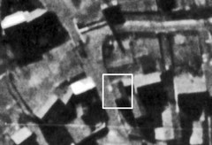

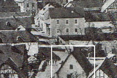

*Das Backhaus in alten Ansichten*

Das Backhaus war ein einfacher Zweckbau. In der Mitte stand der gemauerte Backofen, rechts davon gab es eine Arbeitsstube mit einer Durchreiche zum Ofen und linker Hand befand sich der Eingang mit Treppe zum Obergeschoß, wo sich eine Notwohnung befand. Das Innere des Backofens war mit Backofenstein ausgebaut.

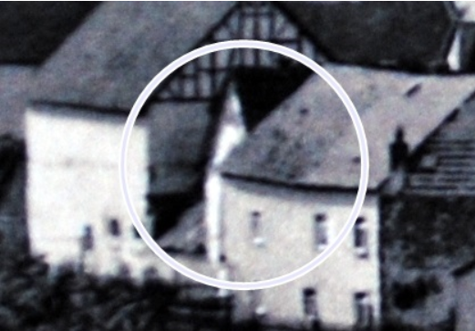

*Zeichnung von Helmut Hartwig*

Speziell in dörflichen Bereichen waren Backhäuser bis in die 1960er Jahre verbreitet. Regelmäßige Backtage der Gemeindemitglieder sparten den Bäcker, den eigenen Ofen und Energie. Zudem stellte der Backtag ein willkommenes Zusammentreffen zum Austausch von Informationen dar. Es wurden Neuigkeiten beim Warten auf das Brot und den Kuchen ausgetauscht.

Ein weiterer Grund für die Errichtung von Backhäusern bestand darin, die Feuergefahr durch Backen in Einzelhaushalten zu vermindern. Der Ofen wurde mit lokal verfügbarem Heizmaterial, meist Reisig und Holz, beheizt. Vor dem Einbringen der Backware musste vorgeheizt werden. Die entstandene Glut wurde vor dem Beschicken entfernt.

Die Reihenfolge des Backens wurde beim Bürgermeister ausgelost, so wurde das aufwändige Anheizen dem Zufall überlassen. Die nachfolgenden Benutzer profitierten davon und mussten nur nachheizen. Es kam des Öfteren vor, dass das Los zum Anheizen auf eine Familie fiel, die damit große Probleme hatte. Besonders an Festtagen wurden viele und große Kuchen gebacken.

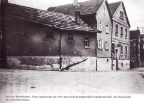

*Das Backhaus als Notunterkunft*

Die Gemeinden waren früher gesetzlich verpflichtet, für in Not geratene Bürger und Asylsuchende eine Notwohnung bereit zu stellen. Dazu waren die Räume über dem Backofen, im Dachgeschoss des Backes, bestens geeignet. Besonders im Winter war diese Wohnung schön warm. Auch fiel für die Bewohner das eine oder andere Brot, oder sogar Kuchen, ab.

Die Strinzer Kirchenchronik gibt noch heute Zeugnis über einige vorübergehende Bewohner des Backhaus.

Eintrag vom 24. Martii (März) 1703

Einen armen, uff der Bettelfahrt krank hingebrachten und 2 Tag im Backhaus gelegenen Mann, des jetzigen Kuhhirten zu Hambach Vatter, Pantificium (katholisch) christlich begraben aetatis (seines Alters) 70 Jahre.

Gott verleihe ihm die gnädige Auferstehung.

Eintrag von 1707

1707 uff S(ankt) Marie Lichtmeß zu Abends ein fremdes Ehepaar ins Backhaus kommen und das Weib sogleich die erste Nacht ein Töchterlein genesen, sobaldigst zur heiligen Tauff befördert worden, wozu als Gothen (Patentante) gedienet Annamaria Bestin. Der Kindes Vather konnte sehr wenig Teutsch (Deutsch) ließ die Kindesbetterin mir sagen: Sie wolle so bald sie könnte ausgehen zu mir kommen, ihrer beyde Namen und patrium (Vaterland, Heimat) deutlich aussagen - ist aber insalutato hospite (als ungegrüßter Gast) mit Mann und Kindern stillschweigend fortgegangen. Und weil Sie wenig Pathen (Paten) angegeben hatten - erwählte ich selber dem Kind den Namen, mit dem Zusatz eines männlichen Namens, jedoch uffs weibliche getragen. Damit ward das Kind Johanna Maria oder wann man wollte Johanete Maria getaufft. Ist bayder einerlay. GGG (Gott gebe Gnade)

Randbemerkung: Er (bzw.es) ist uns gestorben, offenbar von „anderer Hand“ (Mord?).

Weiterer Eintrag von 1707

Anno 1707. Einen fremden Mann, Hans Georg Meyer, gebürtig aus Frankfurt, ein blassierter, abgedankter Soldat, so mit seinem Waib Catharina gebürtig zu Bernburg Sachsen Land, sein logiment im hiesigen Backhaus genommen, aber das Waib den 1. Martii (März) nachts zwischen 11 und 12 Uhr eines Söhnlein geneßen, so den 4. Martii (März) Johann Philipp getauft worden. Pathen (Paten) sind Johann Philipp Enders, Jakob Klein. Den 90. Psalm gelesen und darüber einen kurzen Sermon (Predigt) gehalten.

Gäste im ersten Weltkrieg

Während des ersten Weltkrieges wurde das Backhaus öfters von Zigeunern aufgesucht.

Gäste 1945

Am Ende des 2. Weltkrieges (Mai 1945) hausten etwa 20 Personen aus Biebrich darin und kochten ab. Es waren Kesselflicker (Spengler). Polizeiliche Anfrage oder Anmeldung hatten sie sich erspart.

*Das Bild links zeigt das Backhaus während der Strinzer Kerb im Jahre 1948*

Das zweite Bild zeigt das Backhaus aus einer anderen Perspektive. Der Ausschnitt stammt

aus einer Ortsansicht aus den 30er Jahren.

Auf der alten Brücke. Hinten links das Backhaus.

(Quellen: Kirchenchronik / Alte Strinzer Chronik / Wikipedia / Helmut Hartwig)

### Strinz im Jahre 1782

Im Archiv der Gemeinde Hohenstein habe ich eine Karte von StM gefunden, in die die einzelnen Gebäude des Jahres 1782 eingezeichnet sind.

Mittels eines speziellen Architekturprogramms wurde das Strinz von 1782 wiederaufleben lassen.

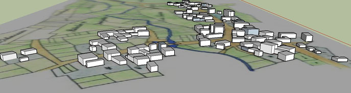

Hier die alte Karte, auf die die damaligen Gebäude eingezeichnet wurden. Die Gebäudehöhen sind nicht maßstabsgerecht, da die meisten Gebäude heute nicht mehr existieren.

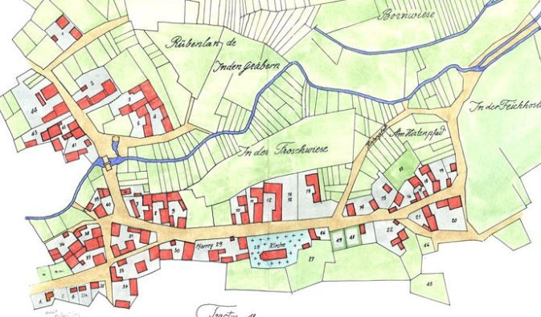

*Die Karte von 1782*

### Brücke über den Aubach

Am 25. August 2015 zeugt Baustellenlärm aus der Pfalzstraße davon, dass dort eine größere Baumaßnahme von statten geht. In der Tat, denn ein Bagger hat damit begonnen, die Brücke in der Pfalzstraße, die den Aubach überspannt, zu pulverisieren. Doch wieso muss diese Ortsbrücke, die erst im Jahre 1949 gebaut wurde, schon nach etwas über 60 Jahren wieder abgerissen werden?

Bevor wir uns mit dieser Frage beschäftigen, sollten wir uns die Geschichte aller bisherigen (bekannten)Brücken über die Aubach einmal näher betrachten:

Aus dem Jahre 1782

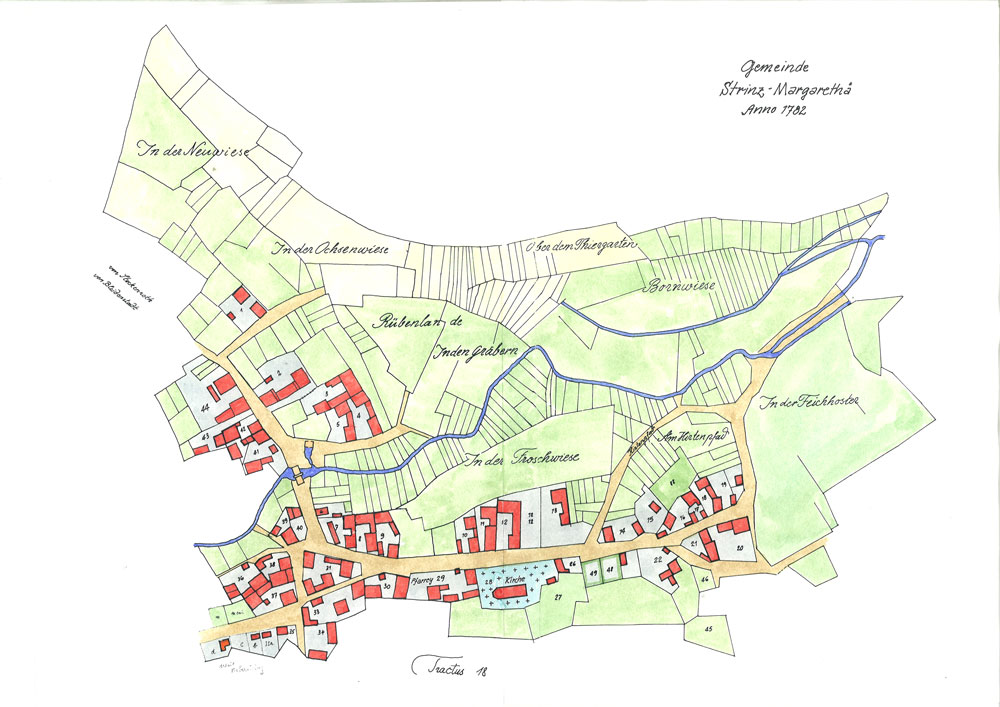

Eine Dorfkarte aus dem Jahre 1782 zeigt, dass es auch schon im 18. Jahrhundert eine Brücke über den Aubach gab. Woraus die Brücke bestand ist allerdings nicht bekannt.

Brückenbau 1841

Die wohl erste Brücke über die Aubach wurde im Jahre 1841 erbaut. Sie war, wie für diese Zeit üblich, aus Stein gebaut, leicht gebogen und rechts und links mit einer festen Mauer bewehrt.

Heute existieren nicht mehr viele Bilder von dieser alten Brücke. Die noch vorhandenen Bilder habe ich nachfolgend aufgeführt:

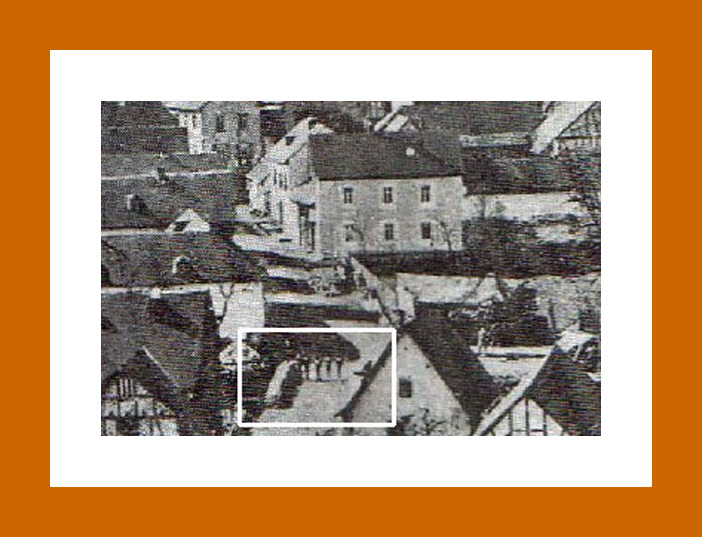

*Auf der alten Brücke (links das alte Backhaus – Backes)*

Die Brücke von 1949

Die Gemeindevertretung fasst 1949 den Beschluß, die Dorfstraße der Pfalz und die Brücke neu zu bauen. Maurermeister Gräter aus StM übernimmt den Bau der neuen Brücke. Zuvor wurde die alte Brücke abgetragen.

Um den Verkehr nicht zu sperren, baut Herr Zimmermeister Kreusel aus Hennethal eine Notbrücke und legt sie unterhalb der alten Brücke über den Bach.

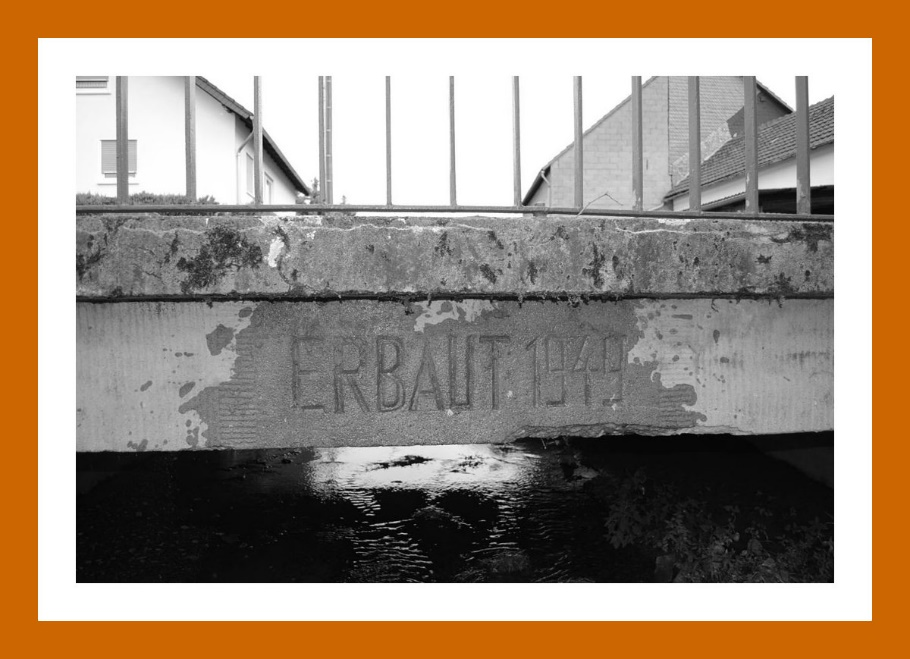

*Brückenneubau 2015*

Bereits im Jahre 2012, musste die Tragfähigkeit der 1949 gebauten Brücke von 30 auf 16 Tonnen herabgesetzt werden, denn eine Untersuchung ergab, dass der Zustandswert der Brücke bei 3,9 liegt, was für größere Fahrzeuge nicht mehr ausreichend ist. Ab einem Zustandswert von 4,0 hätte die Brücke sogar komplett gesperrt werden müssen. 16 Tonnen Belastbarkeit ist ausreichend für Busse und Müllautos, nicht jedoch für voll beladene landwirtschaftliche Gespanne. D.h. diese dürfen die Brücke nicht mehr befahren und müssen den längeren Weg über die Brücke am Ortsausgang Richtung Breithardt einschlagen.

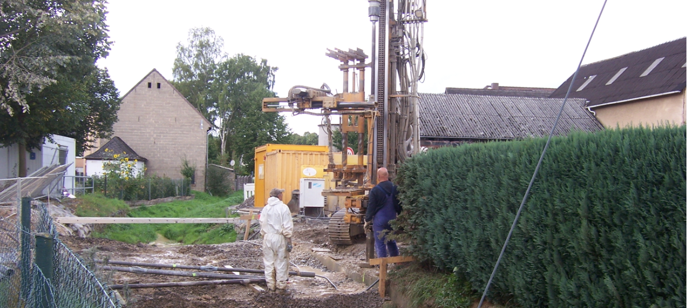

### Eine Gretchentragödie in Strinz

Im Jahre 1704 hatte sich im Strinzer Pfarrhaus eine Gretchentragödie abgespielt.

Die Gretchentragödie ist ein offenes Drama, das Johann Wolfgang Goethe in den Urfaust von 1772 einfügte und überarbeitet in sein Hauptwerk Faust I übernahm. Sie beschreibt das Auseinanderbrechen des Liebesverhältnisses zwischen Faust und Margarete (Grete).

> Quelle: Wikipedia

Nachfolgend die Erzählung, wie sie in der Kirchenchronik niedergeschrieben ist:

Die aus der Pfalz (es könnte die Pfalzstraße gemeint sein) kommende Magdt des Strinzer Pfarrers Neumann hatte ein Töchterlein geboren und sogleich nach dem nächsten Sonntag nachdem sie schon vorher Fürstlich Consitorio den leichtfertigen Vatter zum Kind, nämlich des Pfarrers Knecht namens Eidlich beständig benannt und bekannt hat zur heiligen Tauff befördert und den Nahmen Anna Elisabetha erteilt. Wozu Gevatterschaftlich gediehnt Anna Margaretha Heyler und Elisabetha Pfäffin, beide hier in StM. Und Franz Klein, hiesigen Müllers Stieff Sohn.

Der gemeldete untreue Knecht hat sich, sobald seine böße Sach begonnen Kund zu werden, bey nacht aus dem Staub gemacht. Zu seinen Brüdern hatte die Magd gesagt, er wolle sie heiraten. Undt sie damit zu Fall bracht und betrogen.

> Quelle: Alte Strinzer Chronik, Band 1, Seite 52 / Kirchenchronik

Nachfolgend eine Übersetzung in das heutige Deutsch:

Die aus der Pfalz kommende Magd des Strinzer Pfarrers Neumann hatte ein Töchterlein geboren, welches, nachdem der Knecht des Pfarrers als Vater ausgemacht wurde, am darauffolgenden Sonntag auf den Namen Anna Elisabetha getauft wurde.

Als Taufpaten dienten Anna Margaretha Heyler und Elisabetha Pfäffin, beide aus StM und der Stiefsohn des hiesigen Müllers Franz Klein.

Der Knecht, welcher der Magd die Ehe versprochen hatte, hat sich, sobald er als Vater ausgemacht wurde, nachts aus dem Staub gemacht und Margarethe damit zu Fall gebracht und betrogen.

### Der streitsame Pfarrer Stritter

Im Jahre 1768 bekam StM einen neuen Pfarrer. Sein Name: Ernst Gottlob Stritter. Dieser ging als durchaus streitbarer Geselle in die Geschichte des Herzogthums Nassau ein.

Stritter war Rektor am Gymnasium in Idstein. Laut Überlieferung brach er mit mancher hergebrachten Einrichtung. So schaffte er die frühen Morgenstunden und die späten Abendstunden des Unterrichtes ab. Als dagegen die Regierung im Jahre 1778 in den Schulen neue, einheitliche Regelungen für deutsche und lateinische Schrift einführen wollte, wusste er es durchzusetzen, dass die im Jahre 1735 von ihm eingeführten hallischen (= deutschen) Vorschriften in Idstein beibehalten werden durften.

Stritter machte sich durch sein herrschsüchtiges und rechthaberisches Wesen viele Gegner, namentlich scheint er sich mit dem Superintendenten Droosten überworfen zu haben.

Als sich ein auffälliger Rückgang in der Frequenz der Schule zeigte, schrieb man dies dem Alter und der Kränklichkeit Stritters zu.
Die Regierung, die den Gegnern glaubte, entließ Stritter im Jahre 1766 aus dem Amte und betraute den Konrektor J. G. Schellenberg mit der Leitung der Schule.

Der an Tätigkeit gewöhnte Stritter hielt es aber nur zwei Jahre im Ruhestand aus. Im Jahre 1768 zog er mit seinem Sohn als Pfarrer nach StM und verbrachte seine Zeit mit Predigen und Unterweisung der Schullehrer der ganzen Umgebung.

Er verstand es aber, sich bei der Regierung in Idstein wieder so in Szene zu setzen, dass er im Jahre 1771 nicht nur wieder als Rektor nach Idstein berufen wurde, sondern auch, um allen Streitigkeiten mit der Geistlichkeit vorzubeugen, die Stelle des Scholarchen (= Schuloberhaupt) erhielt, von welcher der Superindendent Drossten entbunden wurde.

Aber er scheint unterdessen nicht ruhiger und friedfertiger geworden zu sein. Schon nach zwei Jahren wurde er wieder, diesmal für immer, entlassen.
Den Rest seines Lebens verbrachte er in Idstein, wo er am 30. Januar 1781 starb.

> Quelle: Geschichte von Nasssau von den ältestens Zeiten bis auf die Gegenwart, Band 7,
Dr. Schliephake / 1889

## Aus dem 19. Jahrhundert

Die Sage vom hartherzigen Pfarrer

Von einem Pfarrer erwartet man ein offenes Herz und eine offene Hand für die Armen.

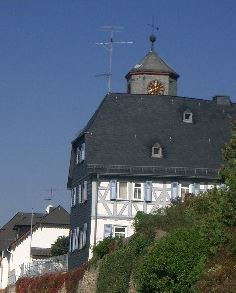

Zu StM lebte jedoch der Sage nach zu Beginn des 19. Jahrhunderts ein Geistlicher, der war geizig und hartherzig.
Wie viele Pfarrer jener Zeit betrieb er nebenher eine Landwirtschaft und wurde wohlhabend dabei.

Kam aber in den damaligen Hungerjahren ein Armer an seine Tür und bat um ein Stück Brot, dann schnitt er zwar ein dicke Scheibe vom Laib, reichte sie ihm aber nicht, sondern warf sie in den Trog zum Schweinefutter und jagte den Bettler weg. Das tat er unter lautem Lachen.
Daher war man im Dorfe froh, als er starb und ein neuer Geistlicher ins Pfarrhaus zog. Doch darin war es, wie er bald erfuhr, nicht mehr geheuer.

Spukte es einst im Strinzer Pfarrhaus?

Am 1. Advent begann um Mitternacht ein unheimliches Treiben, und das setzte sich die gesamte Adventszeit hindurch fort. Türen wurden von unsichtbarer Hand zugeschlagen und öffneten sich von selbst wieder. Ein ohrenbetäubender Lärm, wie von schleifenden Ketten erfüllte das Haus. Jeden Morgen standen die beiden Pferde des Pfarrers schweißnass im Stall, als ob man sie ausgeritten und überanstrengt hätte.
Kein Gesinde wollte mehr im Pfarrhaus bleiben. Der Pfarrer scheute sich, seine Gemeinde zu verlassen, doch wusste er keinen Rat. War es sein Vorgänger, der umging, umgehen musste, um das Böse zu sühnen, das er begangen hatte?
Schließlich versammelten sich mehrere Pfarrer aus der Umgebung und beteten so lange und kräftig, bis das Unwesen aufhörte.

> Quelle: Taunus-Sagenschatz, 190 Sagen erzählt von Helmut Bode, Verlag Walter Kramer oHG, Frankfurt am Main, ISBN 3-7829-0325-0, 1986

Anfang des 19. Jahrhundert taten zwei Pfarrer in StM Dienst.
Zum einen Johann Gottfried Kolb von 1793 bis 1809 und Ludwig Imanuel Snell von 1810 bis 1814.

Von Beiden ist nicht überliefert, dass sie in StM starben. Kolb wurde 1809 nach Usingen versetzt und Snell 1814 wegen seiner Trunksucht aus dem Amt entlassen.
Der darauffolgende Pfarrer Schmidtborn (Pfarrer von 1815 bis 1870) beschrieb das von ihm übernommene Pfarrgut wie folgt: Schwierigkeit der Verwaltung des Guts wegen dessen geringer Qualität u. Unzulänglichkeit der Wiesen.

Es erscheint deshalb als sehr unwahrscheinlich, dass sein Vorgänger, wie in der Sage beschrieben, durch seine Landwirtschaft wohlhabend wurde.

Insofern handelt es sich wohl tatsächlich nur um eine Sage, um die Kinder des Ortes zu erschrecken.

### Pfarrerssohn verschwindet spurlos

Auszug aus der Frankfurter Ober-Postamts-Zeitung vom18. Juli 1834

Gottfried Eberhard Freyberger, Sohn des längst verstorbenen Pfarrers Freyberger zu Strinz-Margaretha bei Idstein und der nachher verehelichten Pfarrerin Kaiser zu Niederramstadt, geboren am 21. April 1764, entfernte sich bereits im Jahre 1790 von seiner Heimat, ohne seitdem von seinem Leben oder von seinem Aufenthalte irgend eine Nachricht gegeben zu haben.

Da dieser nunmehr das siebenzigste Lebensjahr zurückgelegt hat, so wird derselbe hiermit aufgefordert, binnen drei Monaten, von unten stehendem Datum an gerechnet, sich dahier zu melden, widrigenfalls er für todt erklärt, und sein, dahier verwaltet werdendes Vermögen an dessen sich legitimiert habenden nächste Verwandte wird ausgeliefert werden.

Binnen derselben Frist werden seine Leibes- oder sonstigen Erben hiermit ebenfalls vorgeladen, um ihre etwaige rechtliche Ansprüche an die genannte Vermögensmasse zu bescheinigen, widrigenfalls und wenn Gottfried Eberhard Freyberger wird für todt erklärt worden sein, diese Vermögensmasse an die, bereits sich als Erbin legitimiert habende, Auguste Heberer, Tochter des Pfarrers Heberer zu Leeheim, gegen für das Capital zu stellende Caution, wird übergeben werden. Darmstadt den 3. Juli 1834.

### Der gemeinschädliche Umtreiber

- Aus dem
- Allgemeiner Polizei-Anzeiger / Gotha, den 11. März 1845
- Personen und Lebensbeschreibungen gefährlicher Individuen.
- Rubrik: Gemeinschädliche Umtreiber.
K i l b, Philipp Emmerich, Metzger, aus Limbach geboren und in Strinz-Margarethä, herzoglich nassauisches Amt Wehen wohnhaft.

Alter: 37 Jahre; Statur: untersetzt, 5 ' 1 ' ' rhein. M.: Haare: braun, gelockt; Stirn: gefurcht; Augenbrauen: blond; Augen: grau; Nase: breit; Mund: mittel; Zähne: gesund; Kinn: rund; Bart: blond; Gesichtsform: breit; Farbe: gesund; besonderes Kennzeichen: trägt Ohrringe.

Er ist dem Streunen sehr ergeben und deshalb bereits mehrfach bestraft worden. Namentlich wurde er im Mai 1841 wegen Bettelns und längeren müssigen Umherziehens dahier zur Strafe gezogen und aus demselben Grunde, sowie wegen Führung eines holländischen Passes, d. d. 6. Dec. 1843 abermals dahier zur Haft gebracht und am 12 desselben Monats in seine Heimat abgeschoben.

Nach einer Mittheilung des herzoglich nassauischen Amt Wehen ist er in den letzten Jahren öfters von Floßherren von Mainz, Koblenz und Köln mit nach Holland genommen und am 27. April 1843 wegen Streunens in Neuendorf bei Koblenz arrestiert und von dort nach Hause transportiert worden. Bei dem herzoglichen Amte Runkel mußte er im März 1843 wegen Bettelns eine 14tägige Gefängnisstrafe verbüßen.

Polizeiamt Frankfurt a/M, 28/2, 1845

Ohrringe im 19. Jahrhundert?

Laut Beschreibung trug Kilb seinerzeit Ohringe. Dies ist gar nicht so ungewöhnlich wie es anfangs scheint.

Ein Wikipedia-Artikel beschreibt die damalige Lebensart:

Auf das französische Vorbild ist zurückzuführen, dass auch in Deutschland, bezeichnenderweise aber häufiger in süddeutschen Regionen, etwa zwischen 1810 und 1850 in allen Ständen Ohrringe getragen wurden. Auf dem Lande, vor allem in Süddeutschland, galten Ohrring und Ohrschraube als wirksame Abwehr gegen Krankheiten besonders der Augen. Von Seeleuten, Fischern, Flößern, Gauklern und Schaustellern wurde der Ohrring auch dann noch gern getragen, als er selbst beim Kleinbürger nach der Mitte des Jahrhunderts aus der Mode gekommen war.

### Das Strinzer Strafbuch

Es dürfte jedermann bekannt sein, dass in den Schulen früher Prügelstrafen an der Tagesordnung waren. Weniger bekannt ist wohl, dass die Lehrer und Lehrerinnern verpflichtet waren, ihre Züchtigungen in ein Strafbuch einzutragen. So ein Strafbuch der Strinzer Schule existiert heute noch.

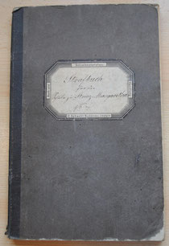

*In diesem musste folgendes eingetragen werden:*

- Datum

- Name und Alter des Schülers

- Name und Stand der Eltern resp. der Vormünder

- Art der Vergehen

- Art der Züchtigung

Die Aufzeichnungen in dem vorliegenden Buch beginnen am 08. März 1888 und enden am 20. Dezember 1917.

In diesem Zeitraum wurden über 1000! Strafmaßnahmen durchgeführt. Dabei waren die Gründe für die bestraft wurde höchst unterschiedlich.

Strafgründe waren:

- Faulheit

- Lügen

- Störung des Unterrichtes

- Ungehorsamkeit

- Plaudern

- zu spät kommen

- fehlende Hausausgaben

- schlechter Aufsatz

- Unartigkeit aber auch Vergehen wie

- "tobt und schlägt auf dem Spielplatz".

In der Regel wurden die Schüler mit Riemenschlägen auf Hand, Rücken und Gesäß bestraft. Die Anzahl der Schläge für das gleiche Vergehen variierten aber. So konnte man für Faulheit mit 2 aber auch mit 4 Schlägen bestraft werden. Neben den Riemenschlägen wurde gelegentlich mit Ohrfeigen gezüchtigt.

Den einsamen Rekord hält der 12jährige Schüler Carl, der am 03. November 1891 mit 10 Schlägen auf die Hand bestraft wurde. Sein Vergehen: lügt in frecher Weise.

Hier ein Auszug aus dem Strafbuch:

### Prozess um das Ochsengut

Am 23. März 1844 unterzeichneten vor dem Herzoglich Nassauischen Amt in Wehen zwei Usinger Anwälte ("Hof- und Appelationsgerichtsprokuratoren") namens Cramer und Wilhelmy ein Schriftstück, das unter einen jahreslangen Rechtsstreit den Schlussstrich zog.

Die Ursache dieses Streites bestand in dem frühen Abhängigkeitsverhältnis der Gemeinde StM von dem Kloster Bleidenstadt, das neben anderen Abgaben auch den Blutzehnten, d. h. den zehnten Teil der lebenden Haustiere, einforderte und deshalb um eine gute Nachzucht besorgt war.

Auf einem Grundstück in der Gemarkung StM, dem Ochsengut oder Pfaffengut, ruhte die Verpflichtung, das Faselvieh oder Mannvieh für die Gemeinde zu stellen und zu unterhalten.

Das Ochsengut bestand aus 10 Morgen 35 Ruten Acker und 2 Morgen 29 Ruthen Wiese.

Die Bindung bestand natürlich fort, als 1495 das Kloster in ein adliges Ritterstift umgewandelt wurde, was ein 1789 abgeschlossener Leihvertrag mit Johann Philipp Faust beweist.

Das Ochsen-/Pfaffengut

1808 kaufte Joh. Emmerich Enders das Ochsengut von der Herzoglich Nassauischen Hofkammer, der Rechtsnachfolgerin des inzwischen aufgelösten Ritterstiftes.

In dem neuen Vertrag war aber statt der allgemeinen Verpflichtung festgelegt, der Käufer sei "schuldig, für die Gemeinde das Faselvieh, nämlich e i n e n tüchtigen Faselochsen und e i n e n guten Eber auf seine Kosten anzuschaffen".

Zunächst hatte die Änderung nichts zu bedeuten.

Als aber der Schultheiß Joh. Adam Enders als Erbe im Besitz des Ochsengutes war und die Gemeinde im Jahre 1832 128 Kühe und 60 Mutterschafe besaß, war die Anschaffung eines zweiten Bullen und eines zweiten Ebers notwendig geworden.

Da sich der Schultheiß auf den Kaufvertrag berief und die Mehrleistung ablehnte, kam es zum Prozess.

*Ungefähre Lage des Pfaffengutes/Ochsengutes wo der neue Totenhof angelegt wurde*

Zeitgenössische Inschrift

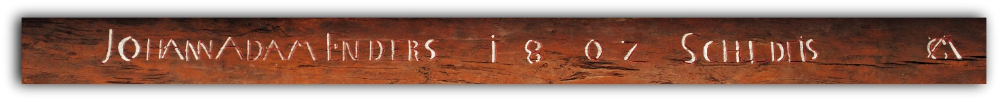

Die Beweisaufnahme ergab, dass "seit unvordenklichen Zeiten" das Faselvieh "unbestimmt vom Ochsengutpächter habe gehalten werden müssen".

Der Prozess ging nur langsam vorwärts, die Gemeinde hoffte umsonst auf einen günstigen Vergleich.

Schulheiß Enders starb 1833, und seine Witwe, die sich mit einem Bauern Conradi verheiratet hatte, wurde 1837 verurteilt, "alles erforderliche Faselvieh, wie Faselochsen, Eber und Widder zu stellen und zu unterhalten und der klagenden Gemeinde alle verursachten Prozesskosten zu ersetzen". Gegen dieses Urteil des herzoglichen Amtes zu Wehen erhob die Beklagte Appellation und erzielte einen Teilerfolg: sie brauchte den Widder nicht zu stellen, und die Prozesskosten wurden geteilt.

Seit dem Tode des Schultheißen Enders erhob die Herzogliche Generaldomänendirektion von dem Ochsengut den Zehnten gegen den Willen der Besitzer, bis diese 1842 die Zahlung des Zehnten "förmlich verweigerten". Außerdem verlangte Frau Conradi durch Prozeß vor dem Appellationsgericht in Usingen namens ihrer zwei minderjährigen Kinder von der Herzoglichen Domänendirektion erstens Entschädigung dafür, dass das Gut stärker belastet war, als beim Kauf festgestellt wurde, zweitens Entschädigung wegen des widerrechtlich erhobenen Zehnten.

Ehe es zum Prozeß kam zwischen dem nassauischen Staat und der energischen für ihr Recht kämpfenden Bauersfrau, kam es zu dem oben erwähnten Vergleich. Darin verzichtete die Klägerin auf Ersatzansprüche und die Rückzahlung des geleisteten Zehnten; die Generaldomänendirektion verzichtete auf die Zehntberechtigung und zahlte an die Erben 3000 Gulden. Die Streitaxt war begraben.

1832 war ein neuer Friedhof eingeweiht worden. Schon hatte man 12 Tote beerdigt, da brachte der schwebende Prozeß zum Bewusstsein: Der Friedhof kann und darf auf diesem Acker nicht bleiben, denn der gehört ja zum Pfaffengut, worauf das Faselvieh lastet. Also wurde auf dem benachbarten Acker ein neuer Friedhof angelegt. Aber der Ortsgeistliche, Pfarrer Schmidtborn, lehnte es ab, ihn einzuweihen.

Der Prozeß zeitigte eine eigenartige Nebenwirkung:

### Weilburger Kadettenmord

Im Jahr 1827 stiftet Mathias Trapp, Sergeant im 1. Infanterieregiment der Herzoglich Nassauer Armee, mehrere Soldaten - darunter auch der Strinzer Georg Adam Enders - zum Mord an dem 18 Jahre alten Kadetten (Offiziersanwärter) Adolph Vigelius an. Das Komplott umfasst zuletzt 48 einfache Soldaten und Unteroffiziere, die das Verbrechen am 7. Dezember 1827 außerhalb der Weilburger Kaserne gemeinschaftlich begehen wollen.

Trapp lockt seine Kameraden mit der Aussicht auf eine angebliche große Geldsumme, die das Opfer bei sich tragen soll. Die Beute bleibt, nach der Aufteilung unter den zahlreichen Komplizen, indes bescheiden.

Trapps wahres Motiv ist denn auch nicht Geldgier, sondern gekränkter Stolz und frustrierter Ehrgeiz. Der aus einfachen Verhältnissen stammende Sergeant ist erbost darüber, dass ein neuer herzoglicher Erlass ihm und anderen bewährten Unteroffizieren den bisher möglichen Aufstieg zum Offizier verwehrt. Um das Offizierskorps zu professionalisieren und zu modernisieren, soll es sich in Zukunft allein durch die Angehörigen der „gebildeten Stände“ ergänzen. Im Militär Karriere machen können demnach nur noch die Söhne des Adels und des reichen Bürgertums, wie es bereits vor den Napoleonischen Kriegen der Fall war.

Trapp fühlt sich damit als eine Art „Modernisierungsverlierer“, Vigelius hingegen ist ein „Modernisierungsgewinner“ – und für Trapp ein typischer Repräsentant der von ihm gehassten privilegierten Oberschicht. Da sich der Unzufriedene durch Vigelius’ vermeintlich arrogantes Verhalten zusätzlich gedemütigt fühlt, plant er mit dessen Tötung ein Exempel zu statuieren. In dessen Ausführung bleibt Trapp jedoch inkonsequent: Indem er das Verbrechen später als Raubmord tarnt, verliert die Tat ihren vordem gedachten Charakter als politisches Fanal und sinkt zum persönlichen Racheakt herab.

Trapp sticht als erster auf den arglosen Vigelius ein. Dem überraschten Opfer bleibt gegen die Überzahl der Angreifer keine Chance zur Gegenwehr. Die grässlich verstümmelte, ausgeplünderte Leiche wird am nächsten Tag gefunden. Die Justiz vermutet zunächst, wie von den Tätern erhofft, einen schlichten Raubmord, mit dem Kadetten als Zufallsopfer.

Bald jedoch fällt der Verdacht auf Trapp und seine Mitverschworenen. Weil ihnen aber nichts zu beweisen und kein Geständnis zu entlocken ist, werden sie im Zuchthaus Diez inhaftiert und schwer misshandelt. Einige der Untersuchungshäftlinge gehen daran zugrunde oder begehen Selbstmord. Aus einigen wenigen Aussagen können die Ermittler schließlich die Tat rekonstruieren.

> Quelle: Wikipedia

Im Jahre 1931 beschweren sich Eltern aus Ketternschwalbach, Hennethal und Strinz-Margarethä bei der Landesständigen Deputiertenversammlung über die Haftbedingungen im Zuchthaus von Diez und darüber, dass die Untersuchungen schon so lange andauern und kein Urteil gefällt wird. Außerdem sei man der festen Überzeugung, dass die Anschuldigungen jeder rechtlichen Grundlage entbehren.

Ihre Söhne müssten die schlimmsten Drangsale der Einkerkerung erdulden. Selbst der Besuch eines Geistlichen würde den Inhaftieren verweigert werden.

Mit dem Hinweis der Deputiertenversammlung, dass man der Regierung vertraue, dass sie alles erdenklich Mögliche in der Sache tun würde, ging man, ohne weitere Schritte einzuleiten wieder zur Tagesordnung über.

> Quelle: Sitzungs-Protocolle der Landesständigen Deputiertenversammlung / 28.03.1831

Die Urteile des Kriegsgerichts gegen die überlebenden 37 Beteiligten ergehen im Frühjahr 1832, fünf Jahre nach der Tat. Als Rädelsführer werden Trapp und drei weitere, inzwischen degradierte, Unteroffiziere (Heuser, Lemp, Leidung) „durch das Schwert“ enthauptet. Die übrigen Ex-Unteroffiziere und Soldaten erhalten Zuchthausstrafen, zwischen zwei und 15 Jahren.

Der Strinzer Enders erhält eine Zuchthausstrafe von 9 Jahren. Auch er muss auf das Opfer eingestochen haben, da alle Beteiligten dazu verdonnert wurden, nach und nach auf das Opfer einzustechen.

Film "Der Weilburger Kadettenmord"

Der Weilburger Kadettenmord ist ein für das Fernsehen produzierter Autorenfilm von 1977, nach einer Idee von Wolfgang Lohmeyer. Regie führte Eberhard Itzenplitz. Die Erstausstrahlung war am 4. Februar 1977 im ZDF. Der Film basiert auf den oben dargestellten wahren Ereignissen.

Das Diezer Zuchthaus

Seit 1785 bestand in Diez - im Grafenschloss - ein Zuchthaus. In diesem wurde eine Zuchthaus-Marmor-Verarbeitungsstätte eingerichtet. Unter Anleitung und Aufsicht fertigten die Zuchthäusler, auch noch zu der Zeit, in der der Strinzer Bürger einsaß, z.B. die Säulen für den Saal des Gasthauses „Adler" in Wiesbaden.

Dass ein reibungsloser Ablauf anstehender Steinbearbeitungen durch die meist ungelernten Häftlinge nicht immer leicht war, ist verständlich. Diese waren übrigens an einem Fuß mit einer 1.65 Meter langen Kette gefesselt, an der eine 20 Pfund schwere Eisenkugel befestigt war.

> Quelle: villmar.business.t-online.de / Ortsverband Diez

Das Zuchthaus Diez im Jahre 1837.

Im Vordergrund Gefangene die Marmor bearbeiten.

### Die alte Strinzer Kirche

Im Jahre 1824 wird die ehemalige Strinzer Kirche wegen Baufälligkeit geschlossen. Diese ehemals katholische Kirche hatte keinen Turm und ihr Kirchenchor zeigte, im Gegensatz zur heutigen Kirche, nicht nach Norden, sondern nach Osten.

Trotzdem scheint diese Kirche aber eine Glocke besessen haben, denn diese ist in dem Buch "Inschriften des Rheingau-Taunus-Kreises" von 1997

Kartenausschnitt 1782 erwähnt. Dort heißt es:

Ende des 16., Anfang des 17. Jahrhundert wurde von einem Vigand Kalwort die Strinzer Glocke gebaut. Sie wog ca. 200 kg und hatte einen Durchmesser von 70 cm. Auf der Schulter der Glocke war eine umlaufende Inschrift, wahrscheinlich in frühromanistischer Kapitalis eingeschlagen. Sie lautet:

IN DER EIR GOTTES LUDEN ICH VIGAND KALWORT GOS

Der Friedhof dieser Kirche befand sich im direkten Umfeld der Kirche.

In einer Karte aus dem Jahre 1782 ist der Grundriss der alten Kirche noch zu sehen. Diese Kirche war 70 Schuh lang und 30 Schuh tief.

Im Kirchenchor waren mehrere Personen begraben, unter anderem der ehemalige Pfarrer, seine Frau Neumann und weitere Personen, die wollene Kleidung trugen und nicht näher zugeordnet werden konnte.

Nun müssen die Strinzer Bürger nach Niederlibbach zum Gottesdienst gehen. Es wird 10 Jahre dauern, bis sie wieder in StM einem Gottesdienst beiwohnen können.

Im Sommer des Jahres 1830 reißt ein mächtiger Sturm einen Teil des Daches der alten Kirche ab. Dieser Sturm hat zur Folge, dass nun die ganze Kirche abgerissen werden muss. Dieses Ereignis führte dazu, dass man sich nun Gedanken über einen Kirchenneubau macht.

### Kirchenneubau

Der Strinzer Lehrer Friederich berichtete - in der mittlerweile verschollenen Schulchronik - von den Kirchenbauarbeiten und überliefert uns ein gutes Bild von den damaligen Aktivitäten. In der Kirchenchronik, die seinerzeit von dem amtierenden Pfarrer Schmidtborn geführt wurde, wird der Kirchenneubau nur am Rande erwähnt.

### 1830

Im Sommer des Jahres 1830 reißt ein mächtiger Sturm einen Teil des Daches der alten Kirche, die schon seit Jahren wegen Baufälligkeit nicht mehr genutzt wird, ab. Dieser Sturm hat zur Folge, dass nun die ganze Kirche abgerissen werden muss. Dieses Ereignis führte dazu, dass man sich nun Gedanken über einen Kirchenneubau macht.

### 1831

Da der komplette Kirchplatz zum Kirchenneubau planiert werden muss, müssen die Toten, die um die Kirche herum begraben liegen, ausgegraben werden. Unter diesen sind noch 15 "ganze Leichen" die im oberen Teil des Schulgartens wieder beerdigt werden.

Den Abriss der Kirche übernimmt ein Mann namens Trog aus Laufenselden mit seinen Söhnen.

Dabei wird ein Grab im Kirchenchor, in dem die Ehefrau des damaligen Pfarrers Neumann 1696 beerdigt wurde, geöffnet. Bei der Öffnung stellt man fest, dass auch der damalige Pfarrer Neumann im Jahre 1712 in diesem Grab beigesetzt wurde. Außerdem noch andere Personen, die dort mit wollenen Kleidern begraben liegen.

Der damalige Pfarrer Schmidtborn berichtet, dass die Kopfbedeckung und das blonde Haar der Pfarrersfrau noch vollkommen kenntlich sind.

Der alte Grabstein wird in der neuen Kirche im Chor, an dem Familienstuhl des Pfarrers, aufgestellt und eingemauert.

(Siehe auch unter: Das Leid des Pfarrer Neumann)

Im selben Jahr wird der Plan einer neuen Kirche und der erforderliche Etat dafür von einem Herrn Bauinspektor Faber aus Wiesbaden erstellt und am 15. Juni 1831 bei einer Versteigerung (wahrscheinlich Versteigerung der Gewerke) zu Grunde gelegt. Die Versteigerung findet im Haus des Schultheißen Enders, in Gegenwart des Bauinspektors Faber und eines Amtmanns aus Wehen statt.

Am 6. September beginnen die Maurer Wirtz und Nauheim aus Niederfelden mit dem Mauerbau.

Am 31. Oktober 1931 wird der Grundstein mit großer Feierlichkeit von Strinzer Pfarrer Schmidtborn, Pfarrer Christ von Breithardt, Pfarrer Bleichenbach aus Stinz-Trinitatis, Pfarrer Ilgen aus Panrod und Pfarrer Bauder aus Kettenbach, gelegt.

Darüber hinaus sind bis zu 1.000 Menschen anwesend.

Der Zug auf den Bauplatz mit Gesang, wird von einem Blasorchester begleitet.

Der Grundstein liegt, wenn man durch die Haupttüre geht, zwischen der Flügeltür nach der Kirche und der Tür rechts nach der Empore, in der Ecke, ein Schuh unter dem Sockel. Darin befindet sich eine Messingplatte mit dem eingravierten Namen des Bauinspektors, des Kirchenvorstandes und Namen des Lehrers.

Aus der Kirchenchronik:

Beginn des neuen Kirchenbaues. Provisorische Verlegung des Begräbnisplatzes auf den Schulgarten. Feierliche Legung des Grundsteines zur neuen Kirche am 31. October.

### 1832

Am 19. Juli 1832 wird von den Mauern der Strauß (Richtkranz) aufgestarkt und der alte Zimmermannsspruch zum Besten gegeben.

Am 4. August und an den folgenden Tagen wird die Kirche vom Zimmermann Rock von Holzhausen ü. A. aufgeschlagen. Am 6. August fällt ein Zimmergeselle namens Tammeritz aus Wörsdorf, vom Eck auf der links des Chores und staucht sich dabei den Rücken. Er liegt 6 Wochen lang krank bei dem Strinzer Wirth Hies, wird dann noch nach Wiesbaden ins Hospitz gefahren, wo er nach einigen Tagen starb.

Am 09. August 1832 wir von Zimmermann Rock der Strauß (Richtkranz) aufgestarkt und der Zimmermannsspruch gehalten.

Aus der Kirchenchronik:

Anstände während des Kirchenbaues.

Aus der Strinzer Chronik:

Anlage eines neuen Totenhofes auf dem Acker des Herren Schultheiß Enders zwischen Strinz und der Zinkenmühle (Ochsengut/Pfaffenhof) unter dem Hennethaler Weg. Absteckung von 60 Ruthen.

*Ungefähre Lage des Pfaffengutes/Ochsengutes wo der neue Totenhof angelegt wurde*

### 1833

Im Frühling 1833 wird die Kirche von dem Weisbinder Winkler aus Idstein getüncht und geweißt.

Am 20. September werden von der hiesigen Gemeinde, die Glocken in den Turm gehängt. Ob es sich dabei um die oben genannte Glocke gehandelt hat, ist nicht überliefert.

Am 25. Oktober wird von den Schieferdeckern (Dachdecker) Roos u. Rübfarm aus Idstein und mehreren "Consorten" das Dach gedeckt und der Strauß (Richtkranz) aufgestarkt.

Die Schlosser Klein und Eunl (Name schwer zu lesen) aus Idstein haben die Schlosserarbeiten durchgeführt und "das sehr schlecht".

Kanzel und Altar werden von Schreiner Enders aus Breithardt hergestellt.

Die Aufsicht über den ganzen Kirchenbau führte Herr Amtswerkmeister Laux aus Wehen.

Aus der Strinzer Chronik:

Verlegung des neuen Totenhofes neben diesen und zwar nach dem Ort zu, da das Ochsengut/Pfaffengut auf dem der neue Totenhof angelegt wurde, wegen der Verpflichtung zur Haltung des Faselviehts, nicht bebaut werden durfte. Es waren schon 12 Leute dahin beerdigt worden die umgebettet wurden. Der Ortsgeistliche, Pfarrer Schmidtborn, lehnte es ab, den neuen Totenhof einzuweihen.

Aus der Kirchenchronik:

Commission wegen Anlage des neuen Kirchhofs (Begräbnisplatzes); mein vergeblicher Protest gegen den Platz wegen der Entfernung von der Kirche. Widerspenstigkeit des Schullehrers Friedrich und Weigerung desselben bei den Leichen zu singen. Meine Collision mit den Behörden wegen dieses Falles.

### 1834

Die Einweihung der Kirche wird am 2. November 1834 von Pfarrer Schmidtborn im Zuge einer Predigt vorgenommen. Der Segen für den Neubau wird von Pfarrer Bleichenbach aus Strinz-Tinitatis gesprochen. Der Kirchengesang wird von Blasinstrumenten (9 Musikanten aus Idstein) begleitet, eine Orgel fehlt bei der Einweihung noch.

8 Lehrer aus den Nachbardörfern sind zugegen, insgesamt wohnen über 1.000 Menschen der Veranstaltung bei. Und nicht nur zum eigentlichen Kirchenweihfest sondern auch zum bürgerlichen Kirchenweihfest, welches von Sonntag bis Freitag währt. Das Fest selbst wird - so schätzt Lehrer Friederich - die Gemeinde mehr als

Strinzer Kirche im Jahre 2012 1.000 fl (Gulden) gekostet haben.

Aus der Strinzer Chronik

Einfriedung des neuen Totenhofes mit einer Mauer und einem Tor.

#### Aus der Kirchenchronik

Fortsetzung des Kirchenbaues, der langsam voranschritt.

Einweihung der neuen Kirche am 23. Sonntage nach Trinit., d. 2. November, bei welcher die benachbarten Pfarrer, Bleicherbach von Strinz Trinitatis, Ilgen von Panrod, u. Reiz von Oberauroff, fungierten. Meine Festpredigt über Jerem. 31, 23, 24, 25.

(Quellen: Lehrer Friedrich Jakob Friederich in der Schulchronik / Übertragen in die Strinzer Chronik von Rektor Richard Weißer / Strinzer Chronik, Teil 1, Seite 72 - 76 / Kirchenchronik)

Renovierungsarbeiten in der Kirche (man beachte den Holzofen)

### Die Strinzer Orgel

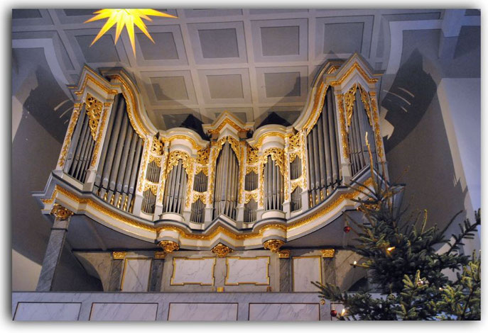

Die Einweihung der heutigen Strinzer Kirche wurde am 2. November 1834 von Pfarrer Schmidtborn im Zuge einer Predigt vorgenommen. Der Kirchengesang wird von Blasinstrumenten (9 Musikanten aus Idstein) begleitet, da eine Orgel bei der Einweihung noch fehlte. Die Orgel der alten Kirche sollte keine Verwendung mehr finden, denn:

"Die Orgel ist als Instrument im Allgemeinen betrachtet mangelhaft, klein, unbedeutend, schreiend, geschmacklos."

Es sollte noch zehn Jahre dauern, bis die Strinzer Kirchengemeinde wieder eine eigene Orgel zur Verfügung hat.

Aus dem Jahr 1853 berichtet die Kirchenchronik: „Ankauf einer Orgel von der Gemeinde Nieder-Ingelheim in die hiesige Kirche, die seit der Erbauung 1834 ohne Orgel war.

Der Überlieferungen nach hatte das Werk in einem Nonnenkloster zu Mainz gestanden, ging aber dann an die französische Regierung über und wurde von dieser an die Gemeinde Nieder-Ingelheim geschenkt, die es jetzt durch ein neues großes Werk ersetzte. Die Orgel wurde durch Orgelbauer Voigt aus Igstadt in der hiesigen Kirche aufgestellt und am 19.6., am 4. Sonntag post Trinitatem zum ersten Mal durch Schullehrer Kolschenbach von Strinz-Trinitatis gespielt, der dazu bestellt war, das Werk zu prüfen."

Offenbar konnte sich die kleine arme Gemeinde im Untertaunus nach dem Kirchenbau keinen Orgelneubau leisten, sondern musste mit einem gebrauchten Instrument vorlieb nehmen. Die Nieder-Ingelheimer Kirchengemeinde stellte jedoch die Bedingung, dass „alle Verzierungen, namentlich auch die Figuren, welche nicht unbedingt zur Orgel gehören, hergestellt in Gold und Ölfarbe und in die neu zu erbauende Orgel verwendet werden." So verblieb der Schmuck, der ursprünglich zu der Orgel Strinz-Margarethä gehörte - sechs barocke Engelfiguren sowie geschnitzte Verzierungen - in der Saalkirche Nieder-Ingelheim, wo sie bis heute den Prospekt der klassizistischen Dreymann-Orgel zieren.

Die Frage nach dem Alter der Orgel ist nicht eindeutig zu beantworten. Als gesichert gilt, dass sie vor der Auflösung der Mainzer Stifte und Klöster im Weißfrauenkloster dem liturgischen Gesang der Nonnen diente. Es ist wahrscheinlich, dass sie um das Jahr 1710 erbaut wurde. Damit ist es wohl gesichert, dass die Orgel von Strinz-Margarethä zu den ältesten Orgeln im Bereich der Evangelischen Kirche in Hessen und Nassau gehört.
Nachdem über viele Jahre unklar war, wer dieses Werk schuf, kann nach mehreren Untersuchungen mittlerweile aufgrund der Pfeifensignaturen Johann Jakob Dahm (1658-1727) als Erbauer benannt werden.

Die Orgel der Kirchengemeinde Strinz-Margarethä hat eine bewegte Geschichte hinter sich. Dadurch waren viele verschiedene Handwerker mit unterschiedlichem Können tätig, die an ihr gearbeitet, gebaut und umgebaut haben. Auch das Stilempfinden der jeweiligen Epochen hat bei deren Tätigkeit Niederschlag im Klang des Instruments gefunden.
Glücklicherweise blieb - bei allen teilweise schwerwiegenden willkürlichen Eingriffen im 20. Jahrhundert - die Grundsubstanz des Werkes erhalten und macht diese Orgel in musikalischer Hinsicht zu einem wertvollen Denkmal des mittelrheinischen Orgelbaus.
Das Orgelgehäuse besitzt nur eine geringe Tiefe von einem Meter und eine Breite von 3,50 Metern und enthält das gesamte Pfeifenwerk von Manual und Pedal. Der ursprünglich vorne sitzende Spieltisch wurde (wohl bereits in Ingelheim) zur Seite verlegt. Seit der Renovierung im Jahr 1964 befindet sich der Spieltisch wieder vorne.
„Charakteristisch ist die halbkreisförmige Anlage des Prospektes; die Türme springen bis zu zwei Metern nach vorne und werden durch Säulchen, die auf der Emporenbrüstung aufsitzen, getragen." (H.C.Weinberger)

Orgeldisposition (nach 1853 bis zur Restaurierung 1964 nicht mehr verändert):
Manual: Groß Gedackt 8‘; Salicional 8‘; Prinncipal (Prospekt) 4‘ (fehlt); Klein Gedackt 4‘; Quinta 3‘ Oktava 2‘ Waldflöte 2‘ Mixtur 1‘3fach; Cornett 4fach disc.4‘ (Zungenregister fehlt)
Pedal: Subbass 16‘; Oktavbass 8‘; Principalbass (Prospekt) 4‘ (fehlt).
Bei der Restaurierung im Jahr 1964 wurde die Traktur erneuert und die fehlenden Register eingefügt. Hinzu kam eine Trompete 8‘. Dabei wurden gravierende willkürliche Eingriffe auch in die Konstruktion vorgenommen, die die Funktionssicherheit dauerhaft gefährdet. Glücklicherweise sind mehrere alte Register sowie ein Großteil des alten Pfeifenbestandes erhalten geblieben.

Auch um die Funktion der Orgel zu erhalten, ist eine Rückführung in den ursprünglichen Zustand notwendig.
Restaurierungsziel ist der von Johann Jakob Dahm im frühen 18. Jahrhundert für die Weißfrauenklosterkirche in Mainz geschaffene Erstzustand.
Konkret bedeutet dies

- Die vollständige technisch-bauliche Rekonstruktion der Dahm-Orgel
- Die Wiederherstellung der Dahm‘schen Disposition

Unter denkmalpflegerischer und musikalischer Hinsicht käme der Wiedergewinnung eines aussagestarken Werkes des Mainzer Orgelbaus eine weit über die Region hinausstrahlende Bedeutung zu.
Für eine Restaurierung sind Kosten von etwa 200.000 € zu erwarten. Zur Finanzierung ist die Kirchengemeinde auf jede Spende angewiesen.

Heutige Disposition

Manual
Principal 4′
Großgedackt 8′
Salicional 8′
Kleingedackt 4′
Cornett 4′ D
Quinte 3′
Octav 2′
Waldflöte 2′
Mixtur 1′ 3f.

Pedal
Subbaß 16′
Octavbaß 8′
Principalbaß 4′

Mechanische Schleifladen, Koppel I/Pedal

> Quelle: Internetseite der ev. Kirchengemeinde Strinz-Margarethä und Niederlibbach

In den Jahren 2018/2019 wurde die Orgel aufwändig restauriert und in ihren Urzustand zurückversetzt.

### Keine „Aarstraße“ für StM

- Früher waren die Straßen bekanntlich nicht so gut ausgebaut wie heute. Gerade in und um kleinere Ortschaften glichen die Straßen eher den heute bekannten Feldwegen. Klar, dass es im Interesse dieser Ortschaften lag, an das Hauptstraßennetz angebunden zu werden. Versprach dies doch einen gewissen Wohlstand, weil die eigenen Waren besser transportiert werden konnten, bzw. der Durchgangsverkehr einen besseren Verdienst versprach.

- Die heute bekannte Aarstraße, die durch das gleichnamige Aartal führt, war im Jahre 1858 noch nicht gänzlich fertiggestellt. Sie führte zum einen von Diez bis Hahnstätten und von Hahn bis Langenschwalbach, dem heutigen Bad Schwalbach. Für den Streckenausbau von Hahnstätten bis an das Zollhaus in der damaligen Mudershausener Gemarkung war der Budget schon beantragt, sodass nur noch der Ausbau von Langenschwalbach bis zur Hahnstätter Grenze fehlte. Verständlich, dass beabsichtigt wurde, den fehlenden Teil auch durch das Aartal zu führen.

- Dass sahen die angrenzenden Höhengemeinden, zu denen auch StM gehörte, anders. Auch diese wollten an die Aarstraße angebunden sein. Die betroffenen Gemeinden hielten die Richtung von Hahn aus, über die Berge nach Michelbach für besser, weil dieser Weg kürzer sei und die betreffenden Gemeinden dadurch eine entsprechende Verbindung erhielten.

- Ein Teil der Gemeinden wollte, dass die Straße nun über

- Hahn, Wingsbach, Strinz-Margarethä, Hennethal, Daisbach, Kettenbach

- gebaut werden, der andere Verlauf sollte von

- Hahn, Wingsbach, Steckenroth, Breithardt, Holzhausen und Michelbach

- führen.

- Um ihre Forderungen durchzusetzen, haben die entsprechenden Gemeinden versucht, im Jahre 1858 eine für sie positive Entscheidung über die Ständeversammlung des Herzogthums Nassau zu erwirken.

Im Vergleich zur geplanten Aartalstrecke haben, so wurde festgestellt, beide Vorschläge sehr ungünstige Steigungsverhältnisse vorzuweisen.

Nach den aufgestellten Etats berechneten sich die Kosten:

- der Linie Hahn, Wingsbach, Strinz, Hennethal auf 143076 Gulden, 30 Franken

- der Aarlinie auf 140268 Gulden, 40 Franken

- der Linie Hahn, Steckenroth, Breithardt, Holzhausen	136292 Gulden, 50 Franken

Mit Entscheidung vom 15. Oktober 1858 hatte sich das Herzogliche Staatsministerium bereits dafür entschieden, die Aarlinie beizubehalten.

Diese Entscheidung wurde von der Ständeversammlung des Herzogthums Nassau mitgetragen.

Zur Begründung:

Für die von den betreffenden Gemeinden angeregten beiden Richtungen, könnte man nur positiv bemerken, dass diese etwas kürzer seien. Außerdem die eigennützigen Interessen der einzelnen Gemeinden.

Die betreffenden Gemeinden seien bloß ackerbautreibende, ohne Gewerbe oder Fabriktätigkeit.

Gut ausgebaute Gemeindewege würden deren Ansprüchen vollends genügen.

Die Kürze des Weges sei bei Straßenanlagen nicht der maßgebende Gesichtspunkt, sondern in erster Linie die Frage nach den Steigungsverhältnissen.

Außerdem sei es künftig geplant auf bedeutenden Straßenzügen Pferdebahnen einzurichten. Für diese Pferdebahnen kämen aber, wenn sie den vollen Nutzen gewähren sollen, die Steigungsverhältnisse besonders in Betracht. Es sei deshalb schon bei allen Neuanlagen von Hauptstraßen dringend geboten, auf die Einrichtung von Pferdebahnen Rücksicht zu nehmen, also die Talwege einzuhalten.

> Quelle: Verhandlungen der Ständeversammlun des Herzogthums Nassau, 1858

Damit war die Anbindung von StM an eine Hauptstraße fürs erste Passé.

Doch das sollte die Höhengemeinden nicht aufgeben lassen. Denn ca. 50 Jahre später versuchten es die Höhengemeinden wieder. Statt mit einer Landstraße, diesmal mit dem Bau einer Eisenbahnlinie.

Siehe auch unter: Die Strinzer Eisenbahn

### Hagelunwetter 1886

Von einem schrecklichen Hagelunwetter im Jahre 1886 berichten die Schulchroniken von StM und Niederlibbach.

Dort heißt es:

Das Jahr 1886 war für die hiesige Gegend und besonders für diesen Ort ein sehr verhängnisvolles. Am 22. Juli gegen Abend zog ein schweres Gewitter mit furchtbarem Hagelwetter über unsere Fluren und vernichtete in wenigen Minuten unsere ganze Ernte; auch nicht ein Teil der Gemarkung blieb verschont. Der Schaden, der an Feldfrüchten, Bäumen und Gebäuden verursacht wurde, ist unberechenbar. Obgleich von mancher Seite Hülf geleistet wurde, so ist diese doch sehr gering im Vergleich zu den ungeheuren Schäden und wird derselbe noch nach mehreren Jahren schmerzhaft empfunden werden.

Die Hagelkörner und Eisstücke in allen Formen und Gestalten fielen vom Sturm gepeitscht bis zur Dicke von Taubeneiern und 40 - 50 Gramm schwer in solchen Massen, das man des anderen Morgens noch ganze Ladungen hätte wegfahren können. Die zerschlagenen Ziegel konnte man nach vielen Tausenden zählen und auf der Wasserseite blieb keine Fensterscheibe.

Doch war dies nur der geringere Schaden. Der Jammer der Landleute war herzzerreißend. Fast alle reifen Körner lagen auf dem Boden, diejenigen der Weizen und Hafers waren noch kaum entwickelt, die Halme wirr und fast alle zerknickt, als ob die Kriegsfurie darin gewütet hätte. Ebenso trostlos sahen die Kartoffeln und Gemüse aus.

Dazu kam noch der sehr ungünstige Umstand, dass wir von dem Tage des Hagelschlags bis in den Spätherbst fast gar keinen Regen mehr hatten.

Dem entsprach auch die traurige Ernte. Das dreschen lohnte sich für die Mühe nicht und manche Leute droschen gar nicht. Der Sähsamen musste deshalb größtenteils von auswärts, von unbeschädigten Gemeinden bezogen werden.

Bei den Körnerfrüchten ist der Verlust auf 80 - 90%, bei den Kartoffeln auf 50% und bei den Wurzelgewächsen, Kürbis, Bohnen auf 75% angegeben. Obst blieb fast nichts, obwohl manche Bäume schön beladen gewesen waren.

In StM. waren nur 5 Personen versichert. Angeblich fanden in StM 3 Personen bei dem Hagelunwetter den Tod, was aber nicht bestätigt ist.

### Die neue Schule

Nachdem man endlich zu der Einsicht gekommen ist, dass das alte Schulgebäude seinem Zweck immer weniger entspricht und ein Neubau nicht länger mehr zu umgehen sei, auch die Genehmigung der Königlichen Regierung erteilt worden ist, eine neue Schule aus Holz bauen zu dürfen, entschließt sich endlich der Gemeindevorstand, das alte Schulhaus abzulegen und an dieser Stelle ein neues Schulhaus zu erbauen.

Dies geschieht im Laufe des Jahres 1871 und zwar nach einem von Herrn Baudirektor Musset zu Langenschwalbach entworfenen Plan.

Das Ganze ist ein Winkelbau, einstöckig im Schweizerstil. Der Eingang ist auf der Nord- und Giebelseite; die ganze innere Einrichtung zweckentsprechend. Im Dachraum befinden sich noch drei schöne Mansarden, sodass das Ganze auch für eine zahlreiche Familie hinlänglich Räume zum Wohnen enthält. An dieses ist, zu der Kirche zu, der Lehrsaal angebaut.

Die ganzen Arbeiten übernimmt Zimmermeister Puff von Strinz-Trinitatis und die Aufsicht wird Herrn Bauaufseher Schuber von Langenschwalbach übertragen.

Obwohl die Arbeiten an diesem Bau im Laufe des Jahres wegen Kürze der Zeit nicht alle ausgeführt werden können, so ist derselbe doch so weit fortgeschritten, dass er am 05. November 1871 eingeweiht werden kann.

Die Feierlichkeiten finden an diesem Tage im Beisein des Herrn Landrat Schreiber von Langenschwalbach, Amtmann Oppermann und Schulinspektor Schneider von Wehen, Pfarrer Vicensius (?) Dörr von hier unter Beteiligung der meisten Lehrer, der Inspektion der Gemeinde, Schul- und Kirchenvorstandes und vieler Einwohner hiesigen Ortes statt.

Die Lehrer haben durch Ihren Gesang das schöne Fest verherrlicht. Die Versammlung geschieht in der Kirche, wo der Schulinspektor eine Rede hält. Die Einweihungsrede hält Dr. Pfarr-Vicar Doerr im neuen Schulsaal.

Der Lehrer selbst ist wahrscheinlich bei der Einweihung seiner Schule gar nicht zu Wort gekommen!

Erhaltenes Schulbuch aus dem Jahre 1866. Es gehörte Adolf Kadesch.

*Unterricht im Schulgarten*

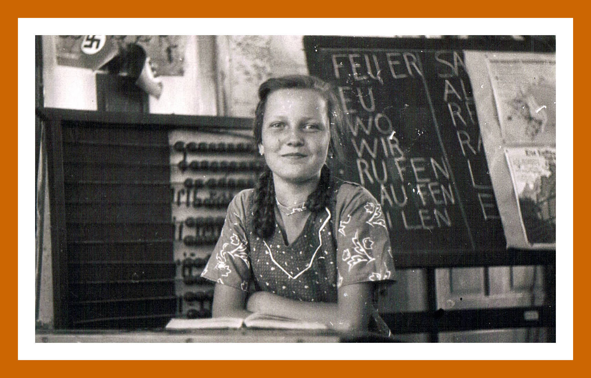

*Im Klassenzimmer zu NS-Zeiten*

### Die Feuerbuche

Nachfolgend eine Geschichte, die in der alten Strinzer Chronik festgehalten ist und über deren Wahrheitsgehalt Sie sich selbst Gedanken machen sollten.

Die Feuerbuche wurde nach 1813 gepflanzt, da, wo unsere Gemarkung mit der Niederlibbacher zusammenstößt. Einmal ging ein Trompeter durch den Wald. Er wurde von Räubern überfallen und ausgeplündert. Als sie ihn töten wollten, bat er, noch einmal ein Lied spielen zu dürfen. Die Bitte wurde gewährt.

Er kletterte auf einen Baum und blies den Choral: Wenn wir in höchsten Nöten sein.

Dann gaben die Räuber Feuer (deshalb der Name Feuerbuche) und der Trompeter fiel tot herunter.

Aber das Blasen hatte Polizei aus Idstein herbeigelockt, die Räuber wurden gefangen und hingerichtet.

Dieselbe Sage wird von dem Taunusberg-Trompeter erzählt.

### Bockschuss

Ein Geometer namens Bock war durch Trunk in Schulden geraten und beschloss, seinem Leben ein Ende zu setzen.

Er ging in den "Angerts" im "Hohen Wald", wo ein Pfad nach Wingsbach führt und erhängte sich an einem Baum. Für die Bevölkerung war er spurlos verschwunden.

Aber als im Herbst Treibjagd war, fanden ein paar Treiber die Leiche, erkannten sie und riefen:

"Der Bock, der Bock".

Die anderen glaubten es handele sich um einen Rehbock.

Der Strick, an dem sich der Geometer aufgehängt hatte, war bereits verfault.

Als Jäger und Treiber nach Hause kamen, erzählten Sie vom Erfolg Ihrer "Bockjagd".

Überliefert vom Schmiedemeister Christmann

> Quelle: Alte Strinzer Chronik, Teil 1, Seite 179

### Halsdurchschuss im Deutsch-Französischen Krieg

Am 19. Juli 1870 erklärt Frankreich dem Norddeutschen Bund den Krieg, was zum Deutsch-Französischen Krieg von 1870–1871 führt. An dem Krieg, der am 10. Mai 1871 mit dem Friedensvertrag von Frankfurt endet, nehmen auch Strinzer Bürger teil.

Bisher sind 7 Soldaten aus StM bekannt, die an dem Krieg teilnahmen.

Es sind: August Weidnau (dieser hat als Kavallerist einmal die Seine durchschwommen), Karl Schneider, Karl Rücker, Friedrich Hankammer und die 3 Brüder Heinrich, Adolf und August Christmann. Allerdings ging Heinrich Christmann, der, wie Karl Schneider auch schon 1866 eingezogen war, wohl über die Grenze, nahm aber nicht an Kriegshandlungen teil. Dagegen wurde sein Bruder Adolf bei Wörth verwundet. August Christmann hat nach Ausweis des Militärpasses in einem Dutzend Schlachten (darunter Weißenburg, Wörth, Sedan, Orleans) mitgekämpft.

In dem Buch "Geschichte des Fuesilier-Regiments von Gersdorff Nr. 80", wird von einem weiteren Strinzer Bürger berichtet, der am ersten Gefecht des Kriegs, um Weißenburg, teilnimmt und dort verwundet wird.

Es handelt sich um den Füsilier August Schaus. Er gehörte zum 1. Bataillon des Füsilier-

Regimentes von Gersdorf Nr. 80.

In dem vorgenannten Buch wird die Schlacht seines Regimentes beschrieben, sodass man dadurch einen Eindruck seiner Erlebnisse bekommen kann.

Nachfolgend sind die Kämpfe des 1. Bataillons, in dem Schaus diente, zusammengefasst.

Die Schlacht bei Weißenburg am 4. August 1870

Die Lage von Weißenburg

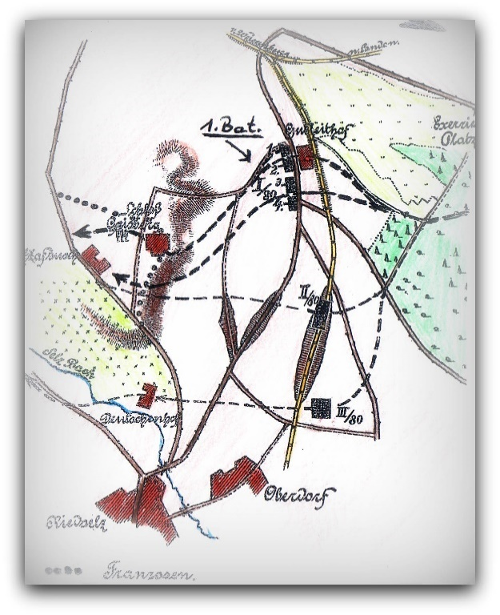

*Schlachtplan*

Um 8:45 Uhr biegt die neue Spitze nach Westen ab. Ihm folgt das I. Bataillon unter Oberst von Colomb welches seinen Aufmarsch gegen den Gutleithof vollzieht. Schon längst hat sich der Gefechtslärm bei Weißenburg immer heftiger und lauter vernehmen lassen. Bei Weißenburg muss der Kampf schon sehr heftig sein, zu sehen ist aber nichts. Schon erreichen die ersten, vom französisch besetzten Gutleithof abgeschossenen Granaten sowie Infanterie- und Maschinengewehrfeuer die aufmarschierende Brigade. Als Oberst von Colomb die Fahnen ausrollen lässt, ruft er mit dem Säbel auf den Feind zeigend "Da sind die Franzosen! Nun zeigt, dass Ihr hessische Füsiliere seid!" und vorwärts stürmen die Truppen über die freie Fläche bis zum Bahndamm, der am Gutleithof vorbeiführt.

Die Franzosen erwarten die deutschen Truppen

Jetzt stürzt bald der eine, bald der andere, vom feindlichen Feuer getroffen. Ohne einen Schuss abzugeben erreichen sie den Eisenbahndamm. Mittlerweile ist es 11 Uhr am Vormittag. Die Franzosen ziehen sich vom Gutleithof zurück. Dennoch bleibt die Lage der Bataillone wenig erfreulich, denn nun schießen die Franzosen vom hochgelegenen Gaisberg auf die Truppen. Granaten schlagen rechts und links von ihnen ein. Dann wird weiter vorgerückt und der Gutleithof eingenommen. Die Verluste werden immer größer.

Als die Franzosen das vor den deutschen Truppen liegende Hopfenfeld am Schloss Gaisberg räumen, rückt das 1. Bataillon nach, wird aber durch eigene Artilleriegranaten gehindert in das Schloss einzudringen und müssen sich zurückziehen. Doch die Besatzung des Schlosses ergibt sich schließlich der deutschen Übermacht. 5 Offiziere und 104 Mann werden gefangen genommen.

Gemälde der Schlacht bei Weißenburg

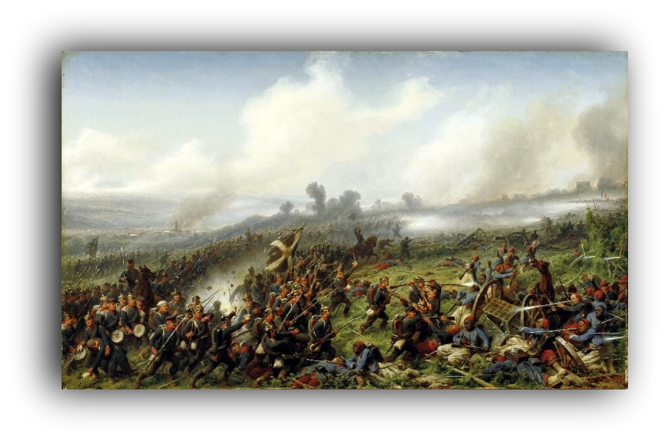

*Die Franzosen sind chancenlos*

Oberst von Colomb sprengt mit seinen noch verbliebenen Soldaten den Franzosen hinterher, die sich im Schafbuschhof verschanzen. Doch auch diesen müssen die Franzosen aufgrund des hohen deutschen Drucks alsbald räumen.

Gegen 3 Uhr mittags ist dieses erste Gefecht des Deutsch-Französischen Kriegs gewonnen. Die Freude der Truppen über den errungenen Sieg ist gewaltig, jedoch wird die Freude getrübt durch die vielen gefallenen und verwundeten Soldaten.

Auch August Schaus wird während der Kämpfe verwundet. Er erhielt einen Halsdurchschuss, der in der Statistik des Bataillons als "leichte Verwundung !!!" geführt wird.

Insgesamt sterben in seinem Bataillon 19 Soldaten, 4 Offiziere und 68 Soldaten werden verwundet und 4 Soldaten vermisst.

Am 08.03.1871 erhält ein Gefreiter Schaus aus der 2. Kompanie des 1. Bataillons das Eiserne Kreuz 2. Klasse verliehen. Ob es sich dabei um den Strinzer August Schaus handelt ist nicht abschließend geklärt, aber anzunehmen.

### Patriotische Feiern 1871

Feier zum 75ten Geburtstag von Kaiser Wilhelm I.

Am Mittwoch den 22. März 1871 wurde der 75. Geburtstag von Kaiser Wilhelm I. gefeiert. Hierzu berichtet die Niederlibbacher Schulchronik.

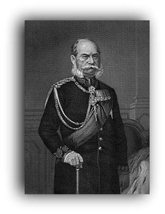

Nach einem feierlichen Vormittagsgottesdienst versammelten sich des Nachmittags die Schüler wieder in der Schule, denn das Wetter war außerordentlich günstig. 14 Grad Wärme im Schatten - so sollte auf Anordnung des Pfarrers Osterloh mit den Schülern zu StM ein gemeinschaftlicher Spaziergang vorgenommen werden. Da sich aber auch die Eltern der Schüler beim Schulhaus einfanden, um den Spaziergang mitzumachen, so hielt der Lehrer im Schulhof eine Anrede über die Bedeutung des Tages und brachte im Hof auf unseren siegreichen Heldenkaiser, dann auf

seinen Sohn den tapferen siegreichen Kronprinzen und zuletzt auf das siegreiche deutsche Heer. Alle Anwesenden, Kinder, Kaiser Wilhelm I. um 1871 Männer und Frauen stimmten freudig ein in dieses dreimalige Hoch und ohne vorherige Verabredung hatten die sämtlichen Burschen des Kirchspiels zu jedem Hoch ihre Pistolen hochgeschossen.

Nachdem jeder Schüler ein Bretzel empfangen und mit einer Schnur an die Seite gehängt hatte, zogen wir mit unseren Fuhren nach StM, holten die dortigen Schüler mit Ihren Lehrern und Herrn Pfarrer ab und machten dann unseren gemeinschaftlichen Zug in das schöne Waldwiesenthal, genannt "Weltersbach" am Wege von hier nach StM.

Die Wirte von StM brachten Tische, Bänke und Getränke dafür, die Schüler erhielten auf Gemeindekosten Erfrischungen. Das ganze Kirchspiel versammelte sich daselbst und so ist unter Festgesängen und patriotischen Ansprachen ein Tag gefeiert worden, der den Kindern und der Gemeinde noch lange in freudigem Andenken fortleben wird.

Friedensfeier

In Folge des am 10. Mai 1871 zu Frankfurt am Main definitiv abgeschlossenen Friedens zwischen Frankreich und Deutschland ist auf Befehl des Kaisers im ganzen deutschen Reich ein Friedens- und Dankfest auf Sonntag den 18. Juni angeordnet worden. In unserer Gemeinde ist dasselbe fast ganz in derselben Art und Weise gefeiert worden, wie der oben beschriebene Geburtstag des Kaisers, nur mit dem Unterschied, dass zu den Festgesängen auch die erwachsene Jugend herangezogen und der Festgottesdienst durch stimmigen Gesang verherrlicht worden ist. Des nachmittags wurde wieder ein gemeinschaftliches Waldfest mit der Strinzer Schule und Gemeinde gefeiert.

### Kampf der Gesangvereine

Im Jahre 1883 kam es zu einer Gerichtsverhandlung in Wiesbaden wegen einer blutigen Auseinandersetzung beider Strinzer Gesangvereine.

Hierüber berichtete der Aarbote in seine Ausgabe vom 15. Januar 1883

Hier der originale Bericht:

Wiesbaden, 18. Jan. (Strafkammer)

In Strinz-Margarethä besteht ein Gesangsverein mit dem schönen Namen "Eintracht" und es wurde noch ein weiterer gegründet mit dem schönen Namen "Cäcilia".

Als die "Cäcilia" gegründet wurde, war es mit der Eintracht in Strinz aus und es gab täglich Neckereien und Spöttereien unter den Strinzern, ja es sollen noch heute Zivilklagen vor dem hiesigen Landgericht schweben, die auf die uneinträchtige "Eintracht" der Strinzer zurückzuführen sind.

Als am 13. Juli 1892 nach einem in Hennethal ausgebrochenen Brande die Strinzer in der Nacht glücklich in das Heimatdorf zurückgekommen waren, fiel die Spitzmannschaft übereinander her, denn der Groll der "Cecilia" über die "Eintracht" kam zum Durchbruch.

Hierbei soll nun der W. P. den Fr. H. und W. H. mit einem Lattenstück schwer misshandelt haben und ist deshalb von dem Schöffengericht in Wehen zu 24 Mark Geldstrafe oder 12 Tagen Gefängnis verurteilt worden.

Gegen dieses Urteil legte der Angeklagte Berufung ein, und zwar mit Erfolg, denn der Gerichtshof erachtete es nicht als erwiesen, dass der Angeklagte sich der Körperverletzung schuldig gemacht hat.

> Quelle: Aarbote vom 15. Januar 1893

Dank an Rudolf Wuschek vom Gemeindearchiv Hünstetten, der mir diesen Artikel hat zukommen lassen.

### Kriegervereine

In StM wurde im 19. Jahrhundert ein sogenannter Kriegerverein gegründet. Dieser bestand aus mehreren männlichen Bürgern, die in diversen Kriegen zum Einsatz kamen.

Im Feld gefundenes Eiserne Kreuz des Kriegervereins Strinz-Margarethä

Kriegervereine wurden vereinzelt bereits nach den Koalitionskriegen gegründet. Seit 1842 bildeten sich besonders in Preußen zahlreiche so genannte Militär-Begräbnisvereine, nachdem König Friedrich Wilhelm IV. ihrer Gründung eine gesetzliche Grundlage gegeben und ihnen besondere Rechte verliehen hatte.

Die Kämpfe der Revolutionsjahre von 1848, insbesondere der Krieg in Schleswig-Holstein gab weiteren Anlass für die Bildung von Kriegervereinen. Doch nahmen derartige Bestrebungen erst nach den Kriegen von 1864, 1866 und 1870/71 (siehe auch unter: Halsdurchschuss) in allen Teilen des Deutschen Reiches einen besonderen Aufschwung. Im Frühjahr 1873 bildete sich der Deutsche Kriegerbund, dem 1884 der Reichskriegerverband folgte.

Kriegervereine waren ursprünglich aus Gründen der Geselligkeit gegründet worden. Sie waren weitestgehend neutral und parteipolitisch unabhängig.

Kriegervereine fördern die Kameradschaft (z. B. zwischen ehemaligen Soldaten, Kriegsteilnehmern), die Erhaltung des Brauchtums und die Bewahrung des Andenkens an die gefallenen und vermissten Soldaten.

Die Förderung des Brauchtums beinhaltet unter anderem:

- Pflege der Vereinsfahnen

- Teilnahme der Kameradschaft mit Fahnenabordnung bei:

  - Beerdigungen von Vereinskameraden

  - Kirchlichen Festen

  - örtlichen Gemeinde- und Vereinsveranstaltungen, z. B. Totenehrung am Kriegerdenkmal usw.

Die Vereine setzten sich für die Versöhnung der Völker und die Bewahrung des Friedens ein.

Vom Strinzer Kriegerverein ist wenig überliefert, jedoch tauchte vor kurzem bei der Kartoffelernte ein in eine Kartoffel eingewachsenes Eisernes Kreuz des Kriegervereines auf.

Auch in anderen Hohensteiner Gemeinden gab es Kriegervereine. So existiert im Hohensteiner Archiv noch die Fahne des Kriegervereines Hohenstein (heute Burg Hohenstein) und es wurde auf einem Strinzer Acker nahe der Eisenstraße eine Medaille des Kriegervereines Breithardt aufgefunden.

Diese Relikte habe ich nachfolgend aufgeführt:

*Im Feld gefundene Erinnerungsmedaille des Kriegervereins Breithardt*

*Fahne des Kriegervereins Hohenstein (Burg Hohenstein) von 1908*

Im Adressbuch für den Untertaunus aus dem Jahre 1929 wird als Vorsitzender des Kriegervereins StM August Christmann aufgeführt.

(Quellen: Red., Wikipedia, Hohensteiner Archiv)

### Typhustod

Typhus bedeutet im übertragenen Sinne, "Schwindel" oder "benebelter Geisteszustand". Dies bezieht sich auf die neurologischen Symptome der Krankheit, insbesondere die Benommenheit als "umnebeltes Bewusstsein."

In Deutschland ist die Krankheit auch unter Fleckfieber bekannt.

> Quelle: Wikipedia

Aus dem Jahre 1825 sind 16 Erkrankungsfälle in Strinz bekannt, von denen 4 zum Tode führten.

Aus dem Jahre 1842 sind im Amtsgebiet Wehen insgesamt 55 Fälle bekannt, von denen 9 zum Tode führten.

Es wurde insbesondere dokumentiert das während des Jahres 1842 der gastrische Krankheitscharakter vorherrschend und der Abdominaltyphus sich in allen Monaten sporadisch, am häufigsten vom September an, besonders in den Orten Panrod und Strinz-Margarethä zeigte.

> Quelle: Medicinische Jahrbücher für das Herzogthum Nassau, 12. und 13. Heft, 1854

Das Medicinische Jahrbuch für das Herzogthum Nassau berichtet im Band 21 von Entzündungen

bei Kindern, die bei zwei Kindern zum Tode führten. Ein Zeichen dafür, dass zu damaliger

Zeit auch Entzündungen zum Tod führen konnten. Das Antibiotikum war noch lange nicht erfunden. Das Ganze geschah im Jahre 1858.

### Kindertod durch Entzündungen

Im September 1858 erkrankten in Strinz in einer Familie 3 Kinder unter anginösen Erscheinungen. Bein einem Kind von 1,5 Jahren zeigte sich gleich der Charakter von Laryngitis crouposa descendens. Die Mandeln, die Gaumenbogen, die Rachenhaut hochgeröted, geschwollen stark serös getrübt; dazu Laryngeal- und Trachealerscheinungen, die als ich am 3ten Tage hinzukam, so hochgradig waren, dass der Tod am Ende des 4ten Tages eintrat.

Die zwei anderen Kinder genasen, da nur anginöse Erscheinungen mit erythematösem Charakter vorhanden waren.

In einer anderen Familie in demselben Orte erkrankten 3 Kinder an Angina, 2 an Angina erythematosa nur leicht. Das älteste Kind ein Knabe von 8 Jahren, hatte dagegen Angina crouposa in hohem Grade. Die Schleimhaut der Mandeln, des Rachens war mit kleineren und größeren, inselartigen, kroupösen Exsudaten von schmutzig gelblichweißer Farbe besetzt, die abgestoßen und ausgeworfen, sich bald wieder ersetzten; an den durch Abstoßung von dem Exsudat befreiten Stellen zeigte sich die Schleimhaut ulzeriert. Die übrige Schleimhaut sehr gerötet, geschwollen und das Schlingen sehr erschwert. Durch Vermehrung des kroupösen Exsudats und dessen Ausdehnung auf Larynx erfolgte unter den Erscheinungen von Oedema glottidis der Tod. Gurgeln, Bepinselung und Decoct. chinae blieben erfolglos.

> Quelle: Medizinisches Jahrbuch für das Herzogthum Nassau, Band 21, 1858

## Geschichten aus dem 20. Jahrhundert

### Die Strinzer Eisenbahn

In der alten Strinzer Chronik stieß ich auf folgenden Eintrag aus dem Jahre 1907:

Am 08. Dezember findet eine Versammlung der Gemeindevorstände von Breithardt und StM im Pfarrhause, wegen weiterer Maßnahmen in Sachen der zu erstrebenden Eisenbahn, statt.

Eine Eisenbahn durch Strinz-Margarethä? Kaum vorzustellen. Aber es bestand tatsächlich einmal der Plan, eine Eisenbahn von Idstein über StM nach dem damaligen Langenschwalbach zu bauen.

Hier berichte ich Euch, über den heute kaum noch vorstellbaren Plan.

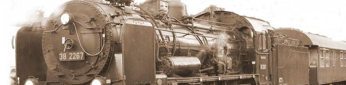

*Foto: Wikipedia/Bernd Untiedt*

Ende des 19. Jahrhunderts kam es zum Neubau vieler Eisenbahnstrecken im Taunus. Dazu gehörten:

- die Main-Weser-Bahn Frankfurt - Gießen (1852)

- die Strecke Frankfurt - Limburg (1877)

- die Aartalbahn (1894) und

- die Linie Homburg - Usingen (1895)

Die meisten dieser Bahnen überquerten den Taunus von Nord nach Süd. Schon bald nach Fertigstellung kam der Plan auf, diese Strecken mit einer längs durch die Taunus verlaufende Eisenbahn zu verbinden. Mit der "Taunuslängsbahn" auch fälschlicher Weise Taunusquerbahn genannt.

Im Jahre 1899 wurde im "Idsteiner Anzeiger" von ersten Vermessungsarbeiten an der Strecke Butzbach-Idstein berichtet.

1900 - erster Plan mit Anbindung von StM

Aus dem Jahre 1900 stammt eine Karte, aus der die damals vorhandenen Eisenbahnlinien hervorgehen. Diese Karte wurde handschriftlich um eine Eisenbahnlinie ergänzt, die einen Streckenverlauf von Langenschwalbach bis Strinz-Margarethä zeigt. Bei StM endet der Streckenverlauf, es ist aber davon auszugehen, dass dieser weiter bis Idstein führen sollte. Bei StM verzweigt die Bahnlinie und führt über Breithardt nach Laufenselden und weiter. Es ist wahrscheinlich, dass es sich hierbei um einen ersten Entwurf aus der Planungsphase der Taunuslängsbahn handelt.

*Kartenausschnitt von 1900 mit Eisenbahnlinie von Langenschwalbach nach StM*

Parole: "Seid einig, einig, einig!"

Offizielle Planungen für eine Strecke von Idstein bis Lorch am Rhein wurden im Jahre 1902 aufgenommen.

Im Laufe der Jahre wurden immer mehr Orte aktiv und diverse Initiativen wollten eine eigene Bahnlinie durchsetzen, die am eigenen Ort vorbeiführt. Kaum ein Stammtisch, an dem nicht über mögliche Varianten diskutiert wurde. So bildete sich auch eine Initiative, die eine Strecke von Idstein über Ehrenbach, Ober- und Niederlibbach, Strinz-Margarethä nach Breithardt und von dort über Adolfseck nach Langenschwalbach favorisierte. Es wurde viel geplant und getagt. So auch am besagten 08. Dezember 1907 im Pfarrhaus von StM.

Hart wurde auch darüber gestritten, ob die Linie über Bad Camberg, Idstein oder Niedernhausen führen sollte, was natürlich den Verlauf durch unsere Region stark beeinflusst hätte.

Eine erste Verdichtung der Vorschläge gab es in den Jahren vor dem 1. Weltkrieg.

Aus der Strinzer Chronik:

Anfang 1911 gibt es wieder Bemühungen wegen der zukünftigen Eisenbahn. Entsprechende Eingaben werden an den zuständigen Minister und Abgeordneten Bartling abgesandt auf die im Mai günstige Nachrichten eingehen. Am 18.05. hat der Kommunallandtag das sogenannte Taunusquerbahnprojekt einstimmig angenommen, jedoch noch ohne Angaben einer Linienführung. Daraufhin findet am 29.10. eine von Wehen aus betriebene Eisenbahnversammlung in Langenschwalbach statt, welche den Ausbau von Langenschwalbach über Wehen nach Niedernhausen wünscht, während die Strinzer den Ausbau von Langenschwalbach, Adolfseck, Breithardt, StM, Nieder- und Oberlibbach und Ehrenbach nach Idstein unterstützen.

Am 24. November versammelten sich 60 Vertrauensleute von 38 Gemeinden, die für die Linie über Idstein plädierten. Eine ergänzende Versammlung gab es am 16. Dezember 1911, in StM. Hier war man sich einig, dass der Weg über StM der einzig richtige sei. Darum gelte die Parole:

"Seid einig, einig einig!"

Am 07.07. 1912 findet in StM wieder eine Versammlung statt, in der über den aktuellen Status des Taunusquerbahnprojektes gesprochen wird.
(Quellen: Strinzer Chronik, Teil 2, Seite 12, Kirchenchronik)

*Von der Strinzer Bevölkerung favorisierter Bahnverlauf*

Die Konkurrenz schläft nicht

Verfechter der Linie über Niedernhausen - Wehen - Hahn nach Langenschwalbach organisierten eine Gegenveranstaltung in der Gaststätte "Trompeter" in Niedernhausen.
Auch in Bad Camberg gründete sich eine Initiative, die die Strecke Bad Camberg - Nastätten - St. Goarshausen bevorzugte.

In der Folge kam es zu erbitterten Wort- und Schriftwechsel zwischen den einzelnen Initiativen.

Das letzte Wort aber hatte die Königliche Eisenbahndirektion Frankfurt, die sich nach sorgfältiger Prüfung der Konzepte für eine Strecke über Niedernhausen entschied.

Der beginnende Erste Weltkrieg führte aber dazu, dass das ganze Projekt auf Eis gelegt wurde.

Neue Initiativen nach dem 1. Weltkrieg

Auch wenn es eigentlich nach dem 1. Weltkrieg dringendere Probleme gab, wurde der Kampf um die Taunuslängsbahn wiederaufgenommen. In den ersten Jahren ging es im Streit hauptsächlich um die Streckenführung im Hochtaunus, östlich von Idstein.

Als begeisterter Verfechter für die Idstein-Linie erwies sich der Breithardter Pfarrer Rohr, der den Landrat mit Eingaben und Vorschlägen bedrängte, um ihn zu Aktivitäten zugunsten der Linie Idstein-Breithardt-Langenschwalbach zu bewegen. Aufgrund der Tatsache, dass andere, dringendere Investitionen in der Region anstanden, lies Landrat Dr. Werner Pollack den Breithardter Pfarrer immer wieder abblitzen.

Im Jahre 1928 gewinnen die Befürworter der Idstein-Linie wieder an Boden als diese in einer mit 300 Personen einstimmig verabschiedeten Resolution die Reichsbahn aufforderten, die früheren Pläne für eine Strecke Bad Nauheim - Idstein - Bad Schwalbach wieder aufzunehmen, was aber von der Reichsbahn abgelehnt wurde.

Bis zum Beginn der Weltwirtschaftskrise gab es immer wieder Initiativen für die ein oder andere Variante. Die Weltwirtschaftskrise letztendlich führte dazu, dass die Taunuslängsbahn nicht mehr finanzierbar war und in Vergessenheit geriet.

Das Längsbahnlied

Die Querelen über eine mögliche Streckenführung führten dazu, dass in den 20er Jahren, wahrscheinlich von Franz Vietor aus Idstein, ein Lied darüber geschrieben wurde, in dem auch StM vorkommt. Es wurde vermutlich auf die Melodie "Wien bleibt Wien" gesungen:

Hier nun der Text dazu:  
Was heute - die Leute  
von nah und fern bringt her,  
des weiß mer - des heißt mer  
en richtige Verkehr;  
drum schaffe - nit gaffe,  
und fass kräftig an,  
dass balde - erhalte  
mir die neu Eisebahn!  
Ui, was is e Eisebahn doch so viel wert!  
Ui, drum is se iwwerall ach so begeht,  
ui, wann se doch werklich amal laafe deht,  
die Züg dann fahrn von morgens früh  
bis abends spät!  
Ach wer des ne Freude  
für die hies 'gen Leute,  
mit der neue Eisebahn  
würd man - gleich alsdann  
fahren froh und munter,  
nur hinauf, hinunter,  
bis man an des Rheines Strand  
oder auf dem Feldberg land 't.  
Die Orte - die Worte  
von den Stationen all,  
es saust eim - es braust eim  
im Kopp en ganze Schwall;  
die alle - behalle  
des fällt eim wirklich schwer,  
wo komme - vernomme  
nur all die Name her.  
Ui, wohl über 40 Orte geht die Bahn,  
Riedelbach und Finsterthal und Seitzenhahn,  
Reichebach und Breithardt und noch viele sinds,  
wie Esch und Rod und Hambach, Libbach, Orlen, Strinz.  
Über all die Orte,  
fährt se, hast du Worte,  
rund erum, wie e Karusell,  
wirklich ganz - or 'ginell,  
dass se kei verkrumpelt,  
wird vorbei gehumpelt;  
jedem vor die Haustür kimmt,  
en Bahnhof, der en gleich mitnimmt.  
Der Dalles - und alles  
verschwinde tut im Nu,  
es macht dann - der Kaufmann  
sein Lade nit mehr zu.  
Die Bauern - die lauern  
un kaafe alles ein,  
die Litze - die Spitze,  
vom Merze Fritz de Wein.  
Ziegenmeyer und Gebrüder Schmidt und Strauß,  
Simon Goldschmidt, der verkauft gleich alles aus,  
Münster, Bäckerfritz und auch das Café Ruß,  
ein jeder bald en Neubau sicher haben muss.  
Für die Geschäftsleut hiesig,  
wird der Verkehr ganz riesig.  
Drunne von der Loreley  
geht 's vorbei - nach der Reih,  
schnell und ohne Pause  
tut durch 's Land mer sause,  
bis nach hinner die Buchfinkei  
mit dem D-Zug, eins, zwei, drei.

### Die Qual der Wahl(s)

In StM lebte einmal eine Familie Wahl. Diese hatte ein schweres Schicksal zu erleiden.

Familie Wahl hatte drei Söhne und eine Tochter.

Zuerst ist die Mutter gestorben (Todesursache und - Zeitpunkt nicht bekannt).

Am 7.8.1913 erhängte sich einer der Söhne, Heinrich Wahl, von Beruf Wagenwärter, "wegen häuslicher Verhältnisse", morgens im Steckenröther Wald in Richtung Hofgut Georgenthal.

Der zweite Sohn, Reinhard Wahl, fiel 1916 im ersten Weltkrieg bei Roy.

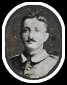

Der dritte Sohn, Karl Wahl starb am 16. Mai 1917 - auch durch Selbstmord. Aufgrund einer schweren Erkältung in seiner Kindheit, hatte er eine sehr krumme Körperhaltung. Er war unverheiratet und berufslos. Er hat sich mit einer Rasierklinge den Hals aufgeschnitten und ist gegen 5 Uhr in seiner Wohnung tot aufgefunden worden. Infolge des Todes des Vaters (Zeitpunkt

Reinhard Wahl

und Ursache unbekannt), den Verlust seiner Brüder und der Tatsache, dass seine Schwester in Görsroth lebte, war Karl vereinsamt, was ihn wohl dazu bewegte, diesen Schritt zu gehen.

Somit war die ganze Familie Wahl in StM ausgestorben. Das Eckhaus der Familie wurde verkauft. Man sprach noch lange vom "Wahleck".

(Quellen: Alte Strinzer Chronik Teil 1, Seite 13 und 19 / Überlieferung von Adolf Hahn in der alten Strinzer Chronik Teil 2, Seite 176)

Nachfolgend zwei Bilder vom Wahleck. Das Gebäude stand in der Kurve der Scheidertalstraße

Fahrrichtung Breithardt. Zur Entschärfung der Kurve wurde das Haus später abgerissen.

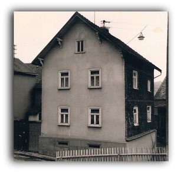

### Der Kettenbrief

Sie sind uns allen bekannt - Kettenbriefe. Aber sicher werden Sie sich fragen wie ich dazu komme, hier auf der Seite etwas über Kettenbriefe zu schreiben.

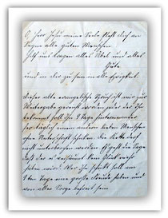

*Hier erst einmal die Wikipedia-Definition für Kettenbrief:*

Ein Kettenbrief ist ein Brief oder eine E-Mail, in dem die Aufforderung enthalten ist, den Brief zu kopieren und an mehrere weitere Empfänger zu versenden. Teilweise wird mit obskuren oder dramatischen Folgen gedroht, wenn man einen Weiterversand nicht vornimmt und damit die Kette unterbricht. Wer hingegen derartige Briefe weiterschickt, dem werden oft große Belohnungen versprochen. Mitunter werden Empfänger auch subtil unter moralischen Druck gesetzt, die Nachricht weiterzuleiten.

Wir alle kennen Kettenbriefe aus der heutigen Zeit. Dass es aber auch vor 100 Jahren schon Kettenbriefe gab, musste ich kürzlich feststellen, als ich eine Kiste mit Feldpostbriefen aus dem 1. Weltkrieg sichtete. In dieser Kiste befand sich auch der abgebildete Kettenbrief.

- Nachfolgend der Inhalt des Kettenbriefes:
- Oh Herr Jesu
- meine Seele fleht Dich an
- segne alle guten Menschen
- hilf uns tragen alles Übel
- und alles Gute
- und in Dir zu sein
- in alle Ewigkeit.
- Dieser alte evangelische Spruch ist mir zu Weitergabe gereicht worden.
- Jeder der ihn bekommt soll ihn 9 Tage hintereinander her täglich einem
- anderen lieben Menschen ohne Unterschrift schicken. Die Kette darf
- nicht unterbrochen werden. Es geht die Sage, dass der es versäumt kein
Glück mehr haben wird. Wer ihn schickt soll am 9. Tage eine große Freude

haben und von aller Sorgen befreit sein.

Auf der Rückseite sind bereits 6 Strinzer Bürger vermerkt, an die wohl der Spruch weitergeleitet wurde. Es sind: Wilhelmine Christ, Luise Wittlich, Christian Wittlich, Lina Enders, Auguste Bücher

Johannette Conradi.

### Schulpatenschaften in den 30er Jahren

Patenschaft mit Japan

In den 1930ern Jahren bestand eine Schulpatenschaft mit einer Schule in Japan. Gefördert wurde diese Patenschaft durch das Junge Rote Kreuz. Der Patenort liegt in der Nähe von Hiroshima und nennt sich IKEGUWA.

Diesen Ort gibt es auch heute noch, er ist aber ähnlich wie StM in eine Ortsgemeinschaft eingegliedert und deshalb schwer zu finden. 1956 wurde Ikeguwa mit anderen Dörfern zusammengelegt zu Midori-chô (Midori-Stadt). 2004 wurde Midori-chô wiederum mit anderen Gemeinden zusammengelegt zur Verwaltungseinheit: Aki Takata-shi (Stadt Akitakata) in der Präfektur Hiroshima. Ikekuwa ist heute nur noch ein Gemeindeteil von Akitakata.

Seinerzeit schickten sich die Schulen gegenseitig Photoalben aus Ihrem Land. Diese sind heute noch im Hohensteiner Gemeindearchiv vorhanden.

Hier die Bilder aus dem Album:

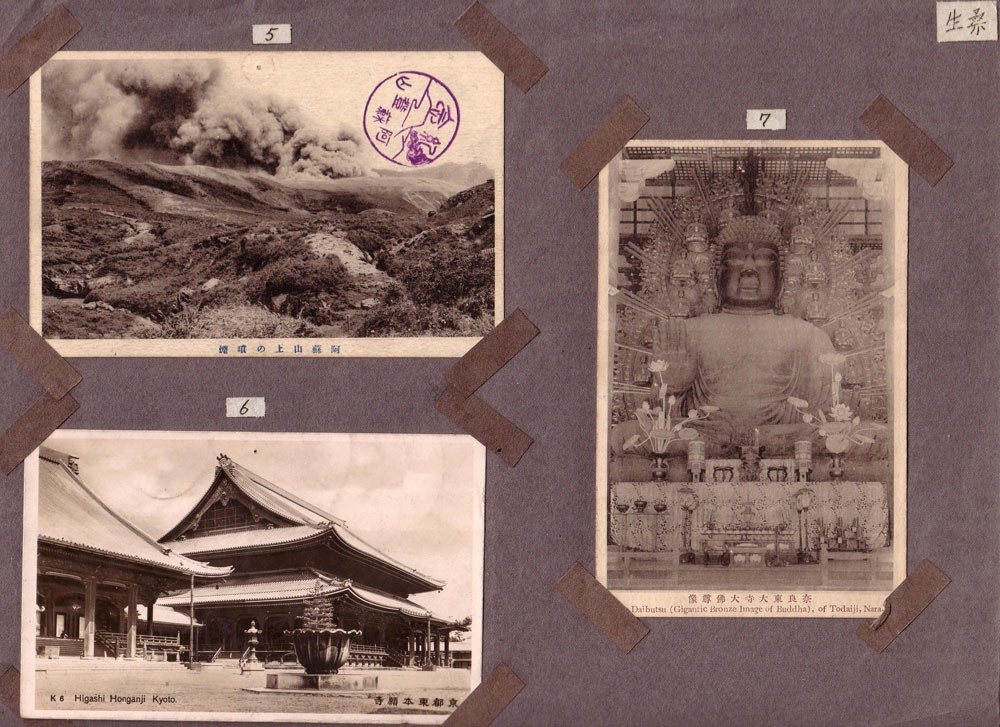

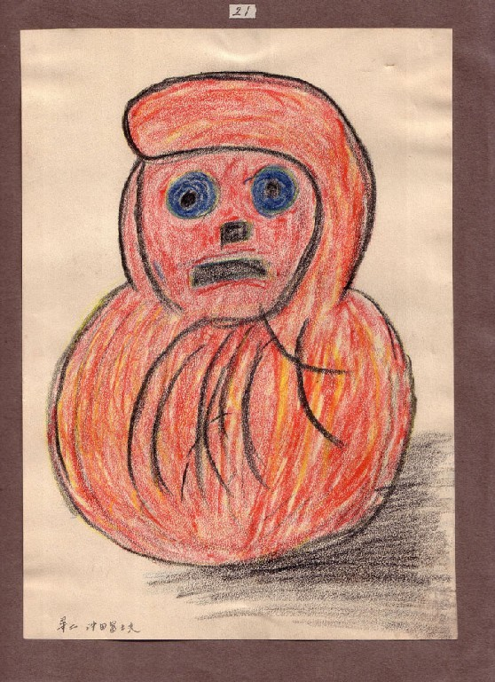

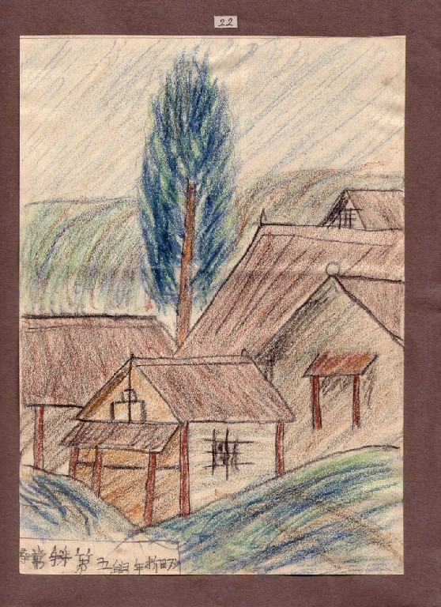

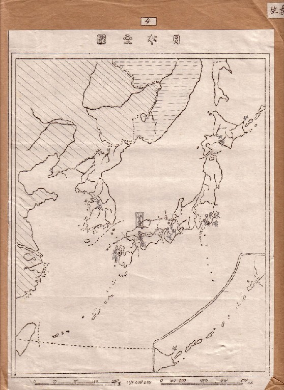

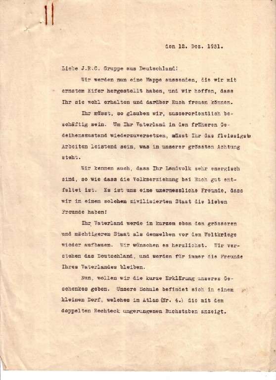

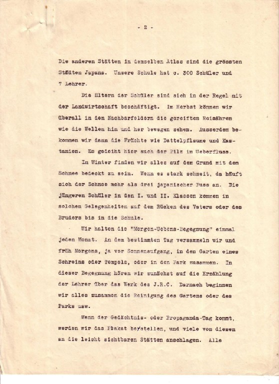

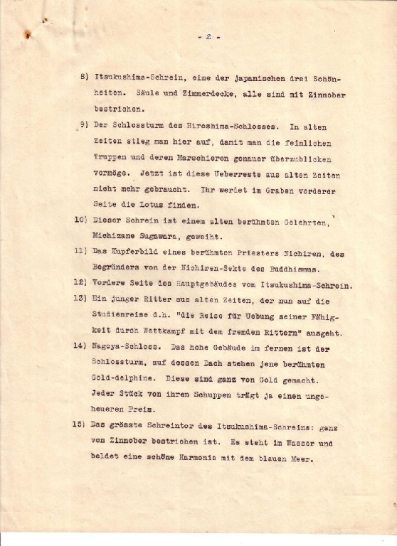

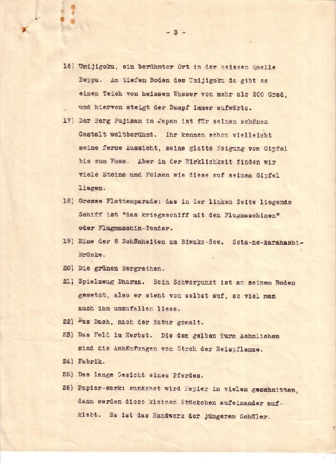

*Patenschaft mit Italien*

Auch mit einer italienischen Schule gab es eine Patenschaft. Der genaue Ort nicht bekannt, aus dem zugesandten Album könnte man aber schließen, dass es sich um eine Schule in oder um Rom handelte.

Hier die Bilder aus dem italienischen Album:

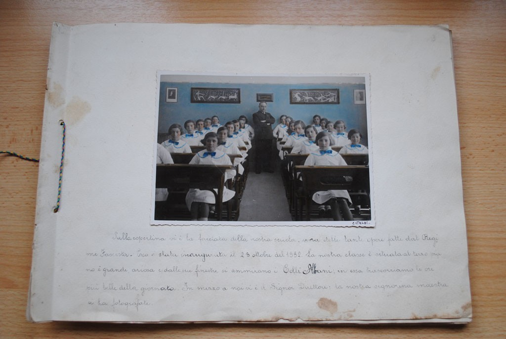

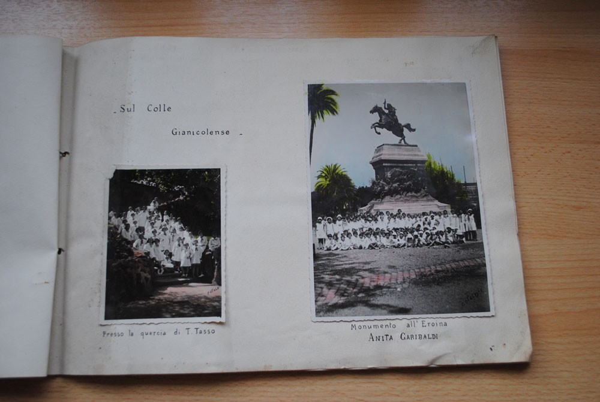

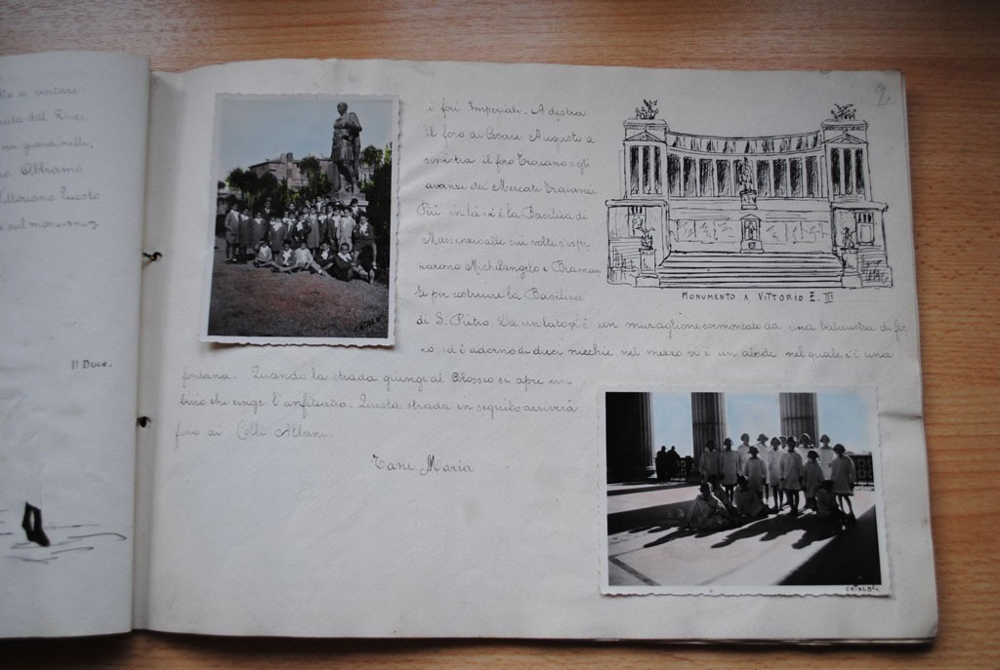

### Mienchen und Rudolf

Nachfolgend erzähle ich Euch eine überlieferte Geschichte aus der Zeit vor dem zweiten Weltkrieg:

Mienchen war unsere Nachbarin, die im Winter jeden Abend zu uns kam. Um 8 Uhr lief Roland, unser Hund, an die Tür - er hörte sie schon kommen, bevor wir es gehört hatten - und begrüßte seine Freundin mit freudigem Gebell. Mienchen suchte sich einen Stuhl in unserer Runde. Wir saßen alle in der Küche mit Handarbeiten beschäftigt und sie fing ebenfalls an zu stricken. Dabei stand ihr Mund nicht still, Mienchen hatte immer etwas zu erzählen, wußte alle Neuigkeiten aus dem Dorf, war dabei aber niemals unangenehm. Man mußte nur aufpassen, dass man nicht zuviel Privates preisgabe, denn Mienchen war auch zu anderen Leuten sehr mitteilsam. Nun, wir wußten sie zu nehmen, und wenn sie einmal nicht kam, fehlte uns etwas.

Heute war Mienchen schweigsamer als sonst. Sie sagte, dass sie sich Sorgen mache um ihren Mann Rudolf, der jetzt nach einer ganzen Woche immer noch brumme, das heißt, er schmollte. Er kam nicht zu den Mahlzeiten, ließ sich den ganzen Tag nicht sehen, arbeitete nichts, man hörte ihn nur im Schlafzimmer rumoren.

Mienchen mußte dann alle Arbeit alleine machen. Nachts stand Rudolf dann auf doch seine Frau war so müde von der harten Arbeit, daß sie das nicht einmal merkte. Dabei wußte Mienchen meißtens nie, warum er brummte.

Wir hielten uns aus der Sache heraus, hatten auch schon unsere Erfahrungen mit Rudolf gemacht. Wir wußten, wie schlimmdas Leben für sie war mit diesem Mann, dem sie auf Gedeih und Verderb ausgeliefert war. Die Frauen hatten damals keine Möglichkeit zur Trennung, ohne eigenes Geld und Einkommen. Besonders in der Landwirtschaft war man aufeinander angewiesen und konnte froh sein, wenn das Zusammenleben gut war. Damit, daß sie sich bei uns aussprechen konnte, habe wir ihr sicher geholfen.

An besagtem Abend ging sie früher als sonst nach Hause, ihre Unruhe war deutlich zu spüren. Wir gingen auch zu Bett.

Ich weiß nicht mehr, wie lange wir geschlafen hatten, als wir verhaltenes Rufen hörten. Mutter wurde als erste wach und ging ans Fenster. Sie stieß einen entsetzten Schrei aus. Sie glaubte, ein Gespenst zu sehen. Vor unserem Haus stand Mienchen, das lange graue Haar hing ihr wirr um den Kopf, ihr helles Nachthemd hing unter dem grauen Kittel hervor, den sie sich in der Eile übergezogen hatte. Dann war auch Vater am Fenster und bekam ebenfalls einen gewaltigen Schreck:

"Komm bitte schnell mal rüber, Rudolf ist nicht im Bett er ist in der Küche und schärft Messer, der Hund heult, ich glaube, er tut sich etwas an. Die Küche ist von innen verschlossen, ich traue mich nicht, den Sohn zu wecken, ich habe solche Angst. Helft mir bitte".

So sprudelte es aus ihr heraus, sie schlotterte am ganzen Körper. Was blieb Vater anderes übrig, als sich anzuziehen und mitzugehen. Er nahm eine lange Bohnenstange und klopfte damit an das Fenster im ersten Stock ihres Hauses, um den Sohn zu wecken, der dann auch herunterkam. Gemeinsam brachen sie die Küchentür auf und mußten alle drei laut lachen.

Am Küchentisch saß Rudolf mit Hund Nobby und schlug sich mit Brot und Schinken den Magen voll. Alle Ängste, die Mienchen ausgestanden hatte, waren umsonst gewesen. Rudolf hatte nur Hunger bekommen, hatte das lange Brummen und Fasten nicht mehr ausgehalten. Für den dicken Schinken, den er angeschnitten hatte, mußte er das Messer schärfen. Mit vollen Magen schien er auch friedlich zu sein, und Vater kam nach Hause zurück.

Mutter konnte einige Nächte lang nicht schlafen, so sehr saß ihr der Schreck in den Knochen. Rudolf stellte für ein paar Tage das Brummen ein, aber das dauerte nicht lange. Für Mienchen war die Sache doch etwas peinlich gewesen, aber was tut man nicht alles, wenn man Angst hat.

Rudolf ist eines natürlichen Todes gestorben und Mienchen hat sich danach noch einmal richtig erholt und mit Sohn und Schwiegertochter noch ein paar ruhige Tage verbracht.

### Der erste Strinzer Millionär

Der erste Strinzer Millionär

Die deutsche Inflation von 1914 bis November 1923 war eine der radikalsten Geldentwertungen, die eine der großen Industrienationen erlebt hat. Die Vorgeschichte dieser Hyperinflation findet sich in der Finanzierung des Ersten Weltkrieges. Mit dem Ende des Krieges 1918 hatte die Mark bereits offiziell mehr als die Hälfte ihres Wertes verloren. Eigentliche Ursache der ab 1919 schon beginnenden Hyperinflation war die massive Ausweitung der Geldmenge durch den Staat in den Anfangsjahren der Weimarer Republik, um die Staatsschulden zu beseitigen.

(Quellw: Wikipedia)

Auch vor StM machte diese Inflation natürlich keinen Halt.

Am 10.02.1923 kostete ein Ei in StM 300,- Mark und ein Pfund Butter zwischen 6.000,- und 8.000,- Mark.

Der Landmann Heinrich Hankammer hat zu diesem Zeitpunkt eine Kuh für 1,8 Millionen Mark verkauft und wurde damit plötzlich zum 1. Millionär in StM. Eine Menge Geld für einen Landmann, der bisher immer in bescheidenen Geldverhältnissen lebte.

Alle im Ort amüsierten sich darüber, denn schon am nächsten Morgen hatte der Betrag noch kaum einen Wert.

> Quelle: Alte Strinzer Chronik / Kirchenchronik, Pfarrer Schilp

### Strinzer Jesus zu Geld gemacht

Boden 3 / Regal 87 / Inventar-Nr. 37/36

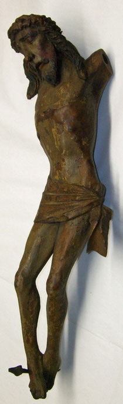

Nüchterner kann der Aufenthaltsort einer Christus-Statur wohl nicht beschrieben werden. Doch was hat es damit auf sich?

Bei meinen Recherchen zur Geschichte von Strinz-Margarethä im Hess. Staatsarchiv in Wiesbaden, fiel mir ein Schriftwechsel über das Verkaufsangebot einer defekten Christusfigur an das Nass. Landesmuseum in die Hände. Mein Interesse war geweckt.

Die hier gezeigte Christusfigur wurde demnach 1936 bei Aufräumarbeiten auf dem Speicher der Kirche von Strinz-Margarethä gefunden. Ihr fehlten beide Arme. Dadurch war sie für kultische Zwecke nicht mehr zu gebrauchen.

Da die Figur schon älteren Datums war, bot man diese dem damaligen Nassauischen Landesmuseum zum Verkauf an, nicht ohne zuvor die ev. Landeskirche um Erlaubnis zu bitten.

Nach Ansicht der evangelischen Landeskirche war die Plastik nicht besonders wertvoll. Sie sei mehr eine handwerksmäßige Arbeit und nur noch für ein Museum interessant. Sie gab daraufhin der Gemeinde die Erlaubnis, diese Plastik an das Nass. Landesmuseum für 100 RM (Museumsgebot) zu verkaufen.

Die Genehmigung stammt von Ende Dezember 1936, die Plastik wurde aber erst im September 1937 in den Bestand des Museums aufgenommen.

Anfang des Jahres hielt ich eine Anfrage beim Landesmuseum in Wiesbaden, ob sich diese Statur in deren Besitz befände und erhielt die obigen "Koordinaten" als Bestätigung dafür.

Allerdings nicht, um diese selbst aus den Beständen des Museums herauszusuchen.

Der wissenschaftliche Mitarbeiter und Leiter der Museumssammlung, Herr Dr. Bernd Blisch war so freundlich, mir ein Foto der Plastik zuzusenden, damit ich diese hier vorstellen kann.

Es ist gut vorstellbar, dass diese Christusfigur schon in der alten Strinzer Kirche verwendet wurde und nach dem Neubau der Kirche 1834 auf dem Dachboden derselben landete. Ich meine, ein interessanter Fund, der wohl als einer der älteren Artefakte aus der Geschichte von StM angesehen werden kann.

### Maulwurfjagd

Im Maulwurf (Dialekt Molldruff) hatte man seinerzeit einen Schädling gesehen, der das Mähen der Wiesen mit der Sense erschwerte, weil er die Erdhügel die er auswirft oft auch mit kleinen Steinchen durchsetzte.

Die gut gedengelten und gewetzten Sensen der Bauern stumpften dadurch schnell wieder ab. Das war für die Bauern, die mangels einer Mähmaschine noch mit der Sense zur Heuernte gehen mussten ein arges Ärgernis.

Gerade im Mai/Juni war der Maulwurf besonders aktiv und warf hunderte Hügel auf einer Wiese heraus, die man zwar einebnete, aber wenn das Mähen bevorstand war die Wiese oft wieder voller Maulwurfshügel.

Das war der Grund dafür, dass man ihm nachstellte, um ihn zu fangen und zu vernichten. Viele Bauern konnten das hervorragend mit der Hacke tun, denn der Maulwurf stößt sowohl morgens als auch abends, etwa um 6.oo Uhr die Erde aus seinen Höhlen und Gängen heraus.

Wer diese Zeiten kannte und sich zu diesem Zeitpunkt auf die Lauer legte, konnte so mit der Hacke den Maulwurf heraushauen und töten. Allerdings war die allgemein übliche Methode das Fangen mit der Lege- oder Stellfalle. Dazu hatte man den Hügel zur Seite geschoben und die Höhle/Gang freigelegt, in die man dann die Falle legte oder stellt. Damit der

Maulwurf nichts davon merkte, wurde die Stelle wieder gut mit Erde abgedeckt. Beim nächsten Rundlauf durch sein Höhlensystem schob er das Sicherungsplättchen der Falle zur Seite und sie schnappte zu.

Die Fallensteller waren oft Buben im Alter von 10 – 14 Jahren. Diese haben in den Fangmonaten April bis August täglich die Fallen geleert und die Beute bei einem von der Gemeinde beauftragten Bauern abgeliefert, der die jeweilige Anzahl in eine Liste eintragen musste.

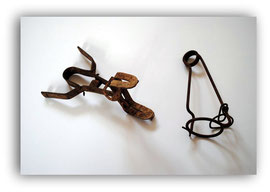

*Maulwurffallen (Foto: Schwarzer)*

Der Lohn für das Fangen eines Maulwurfs lag 1937 bei 20 Pfennigen, in den Jahren nach 1948 waren das 50 Pfennige. Die Auszahlung durch die Gemeinde erfolgte meistens kurz vor der Kerb, damit hatten die Buben “Kerbegeld”. Es wurde jedoch nicht alles “auf der Kerb” ausgegeben, denn dafür war es zu mühsam erworben.

Es war damals die Aufgabe der Gemeinde Feld, Wald und Flur in Ordnung und funktionsfähig zu erhalten, dazu gehörte das ordentliche Unterhalten der Feld- und Waldwege, der Grenzmarkierungen, der Bachläufe, der Entwässerungsgräben der Wiesen, die Einstellung eines “Feldschütz” und vieles mehr, so auch die Bekämpfung der Maulwurfsplage.

Heute existiert noch eine Maulwurf-Fangliste aus dem Jahre 1937. Diese belegt, dass in diesem Jahr 1.402 Maulwürfe hier in StM gefangen wurden. Rekordhalter war die Familie Egert mit 206 gefangenen Maulwürfen was zu einer Fangprämie von 41 RM und 20 Pfennig führte.

> Quelle: Überlieferung durch Helmut Hartwig

### Die Strinzer Holzmaschine

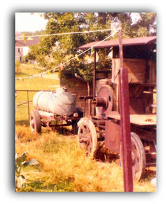

Bei der Strinzer Holzmaschine handelte es sich um eine große fahrbare Bandsäge, angetrieben von einem Einzylinder Deutz Dieselmotor, mit Verdampfungskühlung und einer Leistung von 8 PS. Sie hatte ein einfaches Getriebe mit Vor- und Rückwärtsgang und Riemenkupplung und war damit manövrierfähig.

Der Betreiber war Lohnunternehmer und seine Dienstleistung, das Brennholz von einem Meter Länge auf ofenfertige Länge zu schneiden (25 cm) war sehr begehrt.

Nur wenige hatten einen Elektromotor und eine Kreissäge, die Alternative war das Schneiden auf dem Sägebock mit der Bügelsäge. Das war für zwei Personen sehr anstrengend und mühsam.

So nahmen fast alle Familien im Dorf diese Dienstleistung gerne in Anspruch und in der Saison ging die “Holzmaschin” von Haus zu Haus.

Sie war für die Bürger des Dorfes ein sehr nützliches Gerät, denn man konnte mit dieser Maschine sein gesamtes Brennholz, das man für den Winter brauchte, gegen Lohn schneiden lassen. In der Regel waren das je Haushalt etwa 15 bis 30 Raummeter, die nicht nur zum Heizen der Wohnung nötig waren, sondern auch für den Küchenherd und für den Kessel, in dem das Viehfutter gekocht wurde, wie z.B. Kartoffeln für die Schweinemast.

Am Waschtag, das war in der Regel der Montag, wurde im holzbefeuerten Kessel auch die Wäsche gekocht und im Spätherbst auch die Ladwerg (Lekweije) sowie bei den Jährlich zweimaligen Hausschlachtungen auch die Wurst.

Das Brennholz war so notwendig wie das tägliche Brot, es kam ausschließlich aus dem Gemeindewald. Die Gemeinde hatte so eine zuverlässige Einnahme und die Bürger konnten verlässlich mit Brennholz versorgt werden

> Quelle: Überlieferung von Helmut Hartwig

Die Räder dieses "Ungetüms" stammen von einem Halbkettenfahrzeug aus dem 2. Weltkrieg. Diese wurden von den Ortsbewohnern - nach dem Krieg - von dem zurückgebliebenen Fahrzeug abmontiert.

(Siehe hierzu unter: Das Sd.Kfz 6)

Im Freilichtmuseum Hessenpark existiert heute noch eine baugleiche Maschine, die ich fotografiert habe:

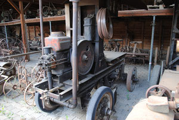

*Die Holzmaschine aus dem Hessenpark*

### Schulneubau

Am 27. Mai 1951 wurde die neue Schule in StM feierlich eingeweiht.

Abschied von der alten Schule

Dies war Anlass genug, dass die ganze Bevölkerung des Ortes auf den Beinen war, aber auch viele Gäste aus den Nachbarorten nahmen an diesem feierlichen Akt teil.

Zunächst nahmen die Einwohner von der alten Schule, wo die meisten von ihnen die Schulbank gedrückt haben, Abschied. In feierlichem Zug begaben sich die zahlreichen Anwesenden, an der Spitze der Spielmannszug des Turnvereins, zur neuen Schule. Als Einleitung der offiziellen Feier sangen alle gemeinsam das Heimatlied "Strinz-Margarethä".

Viele Gäste vor Ort

Bürgermeister Guckes konnte als Gäste Landrat Dr. Vitense, Schulrat Conrad, Kreisbaumeister Linker, Forstmeister Bungeroth und die Geistlichen beider Konfessionen, Pfarrer Röhrich und Heften begrüßen. In seiner Ansprache betonte er, dass diesem Tag eine besondere Bedeutung zukomme; der nicht in jedem Jahrhundert werde in einem kleinen Ort eine neue Schule errichtet. Die Zeitumstände haben aber zu diesem Schritt veranlasst, nachdem durch die Nachkriegsfolgen etwa 200 Heimatvertriebene in das Dorf eingewiesen wurden. Für die 92 Schulkinder war die alte Schule zu klein.

Schulneubau trotz Skepsis einiger Dorfbewohner

Die Gemeindevertretung fasste also den Entschluss, eine neue Schule zu erbauen, trotz Skepsis, die bei manchen Dorfbewohnern vorhanden war. Diesen Zweiflern konnte der Bürgermeister nun mitteilen, dass der Bau nun restlos finanziert ist. Die Gemeinde habe nicht Mühen und Sorgen gescheut, das Werk zu vollenden, das in der Zukunft ein Zeugnis davon abgeben werde, dass das Dorf trotz aller Schwierigkeiten nichts versäumt habe, seinen Kindern eine schöne Bildungsstätte zu geben. Der Bürgermeister dankte allen, die zum Gelingen des Baues beigetragen haben.

Visitenkarte für das Dorf

Landrat Dr. Vitense hob hervor, dass die Gemeinde auf das neue Schulgebäude stolz sein kann, das eine schöne Visitenkarte für die Lebenskraft und Arbeitsfreudigkeit des Dorfes abgibt. Mit diesem schönen Bau hat das Dorf aber große Aufgaben übernommen. Die Gemeinde muss jetzt dafür sorgen, dass die Schule in ihrem Wert erhalten bleibt. Die Schüler müssen sich mit Ihrem Fleiß der neuen Schule würdig erweisen und auch die Lehrerschaft müsse sich dieses Geschenks bewusst sein und ihr bestes zur Ausbildung des Nachwuchses beitragen. In dieser Schule möge eine gesunde und frohe Jugend heranwachsen zu Wohle des Dorfes und des ganzen Volkes.

Ansprachen des Schulrates und des Kreisbaumeisters

Schulrat Conrad überbrachte die Grüße der Schulabteilung beim Regierungspräsidenten. Mit besonderer Freude stellte er fest, dass der Schulneubau nach einem freien Entschluss der Gemeindevertretung erfolgt ist. Es sei aber auch der Initiative des Bürgermeisters und der Gemeindevertretung zu verdanken, dass der Bau schon eingeweiht werden kann.

Kreisbaumeister Linker sprach die Hoffnung aus, dass die Jugend die Leistung und die Opfer der Gemeinde anzuerkennen vermag. Er dankte als Bauleiter allen Handwerkern für ihre unermüdliche Einsatzbereitschaft. Mit der Überreichung der Schlüssel an den Bürgermeister übergab er das Gebäude seiner Bestimmung.

Umfangreiche Feierlichkeiten

Schulleiter Witt dankte im Namen der Lehrerschaft und der Kinder der Gemeinde und dem ganzen Dorf für die neue Schule.

Die Feierstunde wurde würdig umrahmt von Liedervorträgen des örtlichen Gesangsvereines und des Schülerchors, sowie durch Sprechchöre und eine Volkstanzeinlage der Schülerinnengruppe.

Schulneubau nach modernen Gesichtspunkten

Strinz-Margarethä kann wirklich auf seine neue Schule mit Stolz blicken, die nun nach 13monatiger Bauzeit vollendet ist. Nach modernen Gesichtspunkten wurde Sie erstellt. Es sind in ihr zwei helle freundliche Lehrsäle und damit verbunden je ein Gruppenraum sowie ein Bastelraum im Kellergeschoß. Das Schulgebäude ist mit Zentralheizung versehen. Fast 95.000,- DM kostete der Bau und etwa die Hälfte der Kosten trägt die Gemeinde. Auch die Innenausstattung besteht nach den neuesten Erfahrungen aus kleinen, beweglichen Tischen und Stühlen. Dafür gab die Gemeinde weitere 5.000,- DM aus.

> Quelle: Zeitgenössische Zeitungsausschnitt / Verlag unbekannt

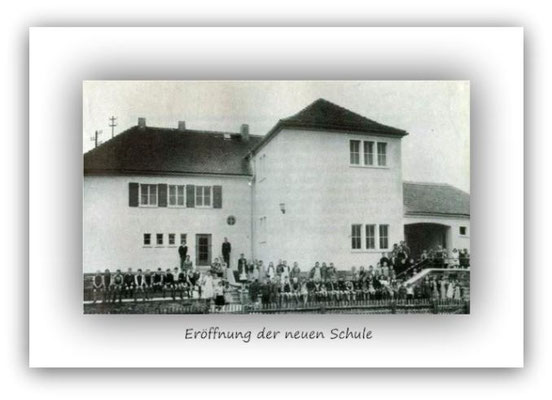

*Einweihung der neuen Schule*

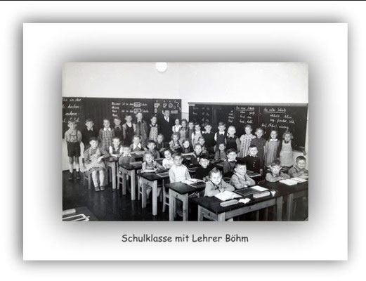

*Schulklasse mit Leher Böhm Schulklasse mit Lehrer Witt*

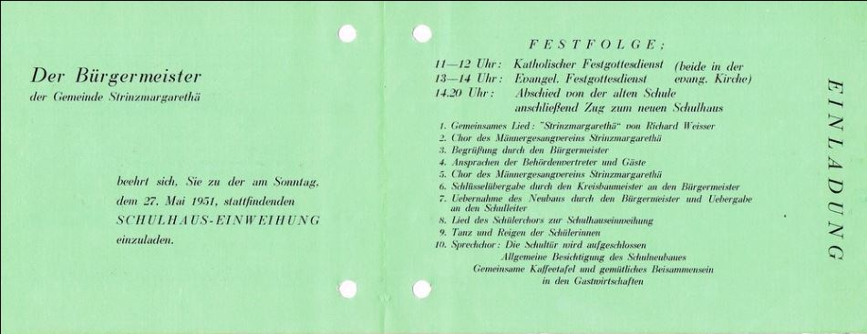

*Wie ging es weiter?*

1970 wird die Strinzer Grundschule geschlossen. Die Schüler müssen nun die Mittelschule in Hahn besuchen. Der letzte Lehrer der Strinzer Grundschule, Horst Witt, wird ebenfalls nach Hahn versetzt.

Damit schließt der Grundschulbetrieb in StM seine Pforten. Er bestand von 1685 bis 1970. Es unterrichteten insgesamt 27 Lehrer an der Schule, davon 6 als Vertreter.

Das Schulgebäude wird anschließend als Sonderschule für praktisch bildbare Kinder genutzt.

1975 räumt der letzte Lehrer von StM, Horst Witt, die Lehrerwohnung und zieht in ein Eigenheim in der Gartenstraße.

Im Jahre 1982 zieht die Sonderschule nach Breithardt um.

1983 wird die Schule an einen privaten Bieter verkauft und ab sofort als Wohnhaus genutzt.

### Kirchenrenovierung

Da die im 19. Jahrhundert erbaute Strinzer Kirche in die Jahre gekommen war, musste diese in den 60er Jahren des 20. Jahrhunderts umfangreich renoviert werden. Die Kirche wurde seinerzeit auf einem alten Friedhof errichtet. Sie war seinerzeit ohne jegliche Isolierung direkt "auf den Boden" gesetzt worden.

In 3 Bauabschnitten wurde die Kirche renoviert.

Erster Bauabschnitt

Der erste Bauabschnitt beinhaltete die Reparatur des Kirchendaches, die Trockenlegung der Mauern und das Isolieren der Fundamente.

Gerade diese Arbeit war besonders wichtig, da die Feuchtigkeit im Laufe der Zeit die Steine angegriffen hatte, dass sie zu zerfallen drohten. Es wurden Entlüftungsrohe eingebaut, die das Steingefüge austrocknen sollen.

Zweiter Bauabschnitt

Im 2. Bauabschnitt wurde der Fußboden neu gelegt und Sandsteingänge angebracht. Etwa 160 Personen können fortan im neuen Gestühl im Kirchenschiff Platz nehmen, nicht viel weniger haben auf der Empore Platz.

Ein zwölfkerziger Leuchter hängt nun von der mit neuem Schmuck verzierter und durch Kassettenmalerei plastisch wirkenden Decke herab. Der Raum atmet nun klassische Strenge.
Auch die Wände wurden neu verputzt, Säulen und Brüstung der Empore "marmoriert" in Barockfarben.

Auch Altar und Kanzel wurden mit diesen Farben versehen.

Dritter Bauabschnitt

Der 3. Bauabschnitt galt der Orgel und war der schwierigste Teil der Renovierung. Die Renovierung

wurde durch die Fa. Oberlinger aus Windesheim durchgeführt.

In den Kriegen verschwanden einige Orgelpfeifen, die Lücken wurden bisher mit Tüchern verdeckt. Die fehlenden Pfeifen wurden durch neue ersetzt und das Schnitzwerk an der Orgel wurde mit hauchdünnem Blattgold belegt.

Kircheneinweihung

Die Kirchen(neu)einweihung erfolgte im Jahre 1964, durch Dekan Dr. May, nach dreijähriger Bauzeit. Während des Umbaus hielt der Pfarrer den Gottesdienst im Pfarrsaal.

> Quelle: zeitgenössischer Zeitungsartikel (Verlag unbekannt)

### Scheunenbrand

Eine menschliche Tragödie

Am 07. November 1959 brannte die mit Heu und Stroh gefüllte Scheune, sowie ein Teil des Wirtschaftsgebäudes des Bauernhofes von Wilhelm August Petri nieder. Ein Geschehen, das zugleich ein bedauernswerter Fall menschlicher Tragik ist. Schreck und Grauen noch in den Augen sagte darüber Bauer Petri einem Reporter des Wiesbadener Kuriers: seine 54jährige Ehefrau, seit längerer Zeit an einer Gemütskrankheit leidend, fehlte, als sich die Familie zum Abendessen setzte. Als sie auch in Ihrem Zimmer nicht zu finden war, schwante dem Mann schlimmes. Mehrmals an diesem Tage hatte die kranke Frau davon gesprochen, dass sie wohl den Abend nicht mehr erleben werde. Petri hastete hinaus auf den Hof, riss die Scheunentür auf. Ein furchtbarer Anblick: Seine Frau eine lebende Fackel. Er riss sie heraus, Nachbarn stürzten herbei, löschten die brennenden Kleider.

Das Licht erlosch im Dorf

Der Bauer selbst versuchte, in der Scheune das drohende Unheil noch zu verhüten, trampelte ein loderndes Strohbündel aus - ab da züngelte das Feuer bereits oben auf der Tenne, fand reichlich Nahrung und dann stand auch schon der Scheunendachstuhl in hellen Flammen. Menschen liefen zusammen, die freiwillige Feuerwehr wurde alarmiert, das Licht erlosch im ganzen Dorf - Kurzschluss in der Leitung des Dachträgers. Das Vieh in den Ställen! Beherzte Männer und Frauen holten es heraus.

Mehrere Wehren im Einsatz

Keuchend legten die Feuerwehrmänner die Schläuche - aber da fehlte es an Wasserdruck im Ortsnetz. Schnelle eine Bachstauung - endlich zischte es aus den Strahlrohren in die hochlodernde Glut. Die Funken gefährdeten das Wohnhaus - ausräumen, schnell! Männer, Frauen schleppten Hausrat, Möbel, Betten heraus.
Als erste Nachbarwehr traf die aus Niederlibbach ein, die Wiesbadener Berufsfeuerwehr kam mit einem Löschzug, ebenso die Motorlöschautos von Bad Schwalbach und Idstein, die Wehren aus Hambach, Steckenroth, Hennethal, Breithardt, die Werkswehr der Michelbacher Hütte mit Bezirksbrandmeister Schramm, der dann das Kommando übernahm.

*Schlepper beleuchten den Unglücksort*

Scheinwerfer der Löschautos auch die Lampen von Schleppern, halfen den Wehren bei Ihrer Arbeit. Nach einer Stunde war das Feuer lokalisiert, das Wohnhaus gerettet. Riesige Qualmwolken aber und immer wieder aufflackernde Flammen machten immer noch Arbeit. Die Scheunenmauern wurden niedergelegt, um besser an die glühenden Strohmassen heranzukommen. Die schon heiß gewordenen Heuvorräte auf den Speicherräumen über den Ställen mussten herausgeschafft und weggefahren werden. Dank der tüchtigen Wehren, zu denen immer wieder welche aus den Nachbarorten hinzukamen - es mögen schließlich 15 Feuerwehren gewesen sein - konnte das Feuer in der engen Ortsstraße nicht noch auf andere Häuser und Gehöfte übergreifen. Der Schaden wurde auf 25.000,- DM geschätzt.

Bäuerin erliegt ihren Verletzungen

Die kranke Bäuerin war mit schweren Brandverletzungen, nach erster ärztlicher Hilfeleistung, ins Städtische Krankenhaus nach Wiesbaden gefahren worden.

Leider erlag sie wenig später ihren schweren Verbrennungen.

> Quelle: Wiesbadener Kurier/ 9.9.1959

### Wettbewerb „Unser Dorf soll schöner werden“

Im Jahr 1959 wird vom Hessischen Minister für Landwirtschaft und Forsten erstmalig zum Wettbewerb "Unser Dorf soll schöner werden" aufgerufen.

Ziel dieser Aktion war es, den für das Landleben notwendige Gemeinschaftssinn und das Zusammengehörigkeitsgefühl zu festigen. Denn, so meinten die Ausrichter des Wettbewerbes, durch des Tages Lasten und Mühen werden Heimatgefühl und Dorfverbundenheit vergraben, die Freude an der Arbeit schwindet, Arbeit und Pflicht werden zur Last.

Diesen Gefahren soll durch den Wettbewerb "Unser Dorf soll schöner werden" entgegengewirkt werden.

Die Naturverbundenheit des ländlichen Menschen - auch in einer veränderten Zeit - soll erhalten werden.

So, die für heutige Verhältnisse recht hölzern wirkende Beschreibung des Wettbewerbes.

Strinz-Margarethä ab 1960 dabei

Während im Jahre 1959 nur unsere Nachbargemeinden Steckenroth und Breithardt an dem Wettbewerb teilnehmen, beteiligt sich Strinz-Margarethä schon im darauffolgenden Jahr sehr erfolgreich daran.

Im Wettbewerbsbezirk Bad Schwalbach nehmen die Gemeinden Strinz-Margarethä, Nauroth, Mappershain, Breithardt, Steckenroth, Michelbach und Kemel teil, wobei die Gemeinde Strinz-Margarethä als Bezirkssieger hervorgeht. Auf Landesebene reichte die Platzierung für einen sehr guten 3. Platz (gemeinsam mit der Gemeinde Lauerbach/Odenwald).

Verdienter 3. Platz

Um sich den 3. Platz im Landeswettbewerb zu erstreiten haben sich die Strinzer Bürger einiges einfallen lassen. Laut Juroren hatten die Gemeindemitglieder den Gedanken der Gemeinschaftsarbeit in vorbildlicher Weise umgesetzt und dadurch die Schaffung von mustergültigen Anlagen ermöglicht. Der in Strinz stark ausgeprägte Gemeinschaftssinn fand seinen schönsten Ausdruck darin, dass die Jugendlichen den alten und gebrechlichen Leuten die Verschönungsarbeiten an ihren Häusern ausführten. Alle Vereine einschließlich der Frauenhilfe, Jung und Alt, haben in Tausenden von geleisteten freiwilligen Arbeitsstunden das Dorfbild so verändert, dass man wirklich von einem Gelingen der Aktion sprechen konnte.

In StM verschönert insbesondere die Jugend alle in Frage kommenden Stellen. So werden Ruhebänke aufgestellt und die Ortseingänge besser hergerichtet. Besonders der Platz am Spritzenhaus, wo früher das Behelfsheim für Flüchtlinge stand, wurde schön gestaltet.

Ehrung durch den Landrat

Aufgrund des Erfolges beim Dorfverschönerungswettbewerbes veranlasst der Kreisbauernverband seine alljährliche Erntedankfeier in StM. Nach einem Festzug der Untertaunusjugend durch die Dorfstraßen halten der Landrat, der Bürgermeister und Vertreter des Bauernverbandes Ansprachen. Ein gemütliches Beisammensein schließt sich an.

1961 auf Bundesebene dabei

Im Jahre 1961 wurde erstmals zur Teilnahme an dem Wettbewerb "Unser Dorf soll schöner werden - Unser Dorf in Grün und Blumen" auf Bundesebene aufgerufen. Teilnahmeberechtigt sind die Landessieger aus den bisherigen Wettbewerben. Damit nimmt StM an diesem Bundeswettbewerb teil. Bürgermeister Guckes als Initiator in der Gemeinde hatte es wieder verstanden, alle Dorfbewohner für diese neue Aktion zu gewinnen. Der Lohn der Arbeit war ein 28. Platz auf Bundesebene und eine Ehrenurkunde.

> Quelle: Heimatjahrbuch - Der Untertaunus, 1962

### Das alte Spritzenhaus muss weg

Im Jahre 1968 wird das alte Spritzenhaus, welches bis dahin der Strinzer Feuerwehr gute Dienste geleistet hatte abgerissen.

Es befand sich bis dahin an der Brücke Schulstraße/Pfalzstraße

Das Spritzenhaus hatte eine Fläche von 15 qm (6 m lang, 2,50 m breit, 3m hoch). Der Schlauchtrockenturm mit Seilaufzug hatte eine Höhe von 10 m und war 1 m breit.

Impressionen:

- Bild 1: Das Spritzenhaus im Jahre 1965
- Bild 2: Gewitter am Spritzenhaus
- Bild 3: Das Spritzenhaus im Jahre 1967
- Bild 4: Fertig für den Abriss
- Bild 5: Das Ende des Spritzenhauses
### Das Willimobil

Schmiedemeister Willi Klein, geb. 15.02.1926, baute für den historischen Festzug zur 800-Jahr-Feier von StM ein fahrendes Karussell, das von den vielen Zuschauern bewundert und bestaunt wurde.

Dieses Karussell nahm auch am Hessentag in Lampertheim, am Fastnachtsumzug in Wiesbaden und am Fastnachtsumzug in Kiedrich teil. Überall wurde es mit großem Applaus begrüßt.

Am 18.02.1985 berichtete der Wiesbadener Kurier:

"So blieb es mal wieder einmal den kleinen Vereinen und Gruppierungen überlassen, Glanzpunkte zu setzen. Ganz vorneweg dabei die Leut` aus StM. Ihr Karussell blieb konkurrenzlos."

*Das "Willimobil" bei der 800-Jahr-Feier 1984*

### Wohin mit Strinz?

Wir schreiben das Jahr 1969. Die Zusammenlegung selbständiger, kleiner Gemeinden im Untertaunuskreis zu einer Großgemeinde wird im November 1969 vom Hess. Minister des Innern vorgeschlagen. Mehrere Gemeinden von Oberlibbach, bis hin nach Aarbergen stehen zur Debatte. Dabei ist von Anfang an nicht klar, welche Gemeinde wohin eingemeindet werden soll. Geplant ist u.a. eine "Gemeindegruppe Breithardt" mit den Ortschaften Breithardt, Hambach, Hohenstein (jetzt Burg-Hohenstein), Born, Holzhausen über Aar, Niederlibbach, Oberlibbach, Steckenroth und Strinz-Margarethä.

Auch eine Zusammenlegung mit dem oberen Aartal ist in der Diskussion. Hennethal, das heute zu Hohenstein gehört wird der "Gemeindegruppe Michelbach-Kettenbach" zugedacht.

Die Gemeinde Adolfseck zeigt starkes Interesse an der Zuordnung zur "Gemeindegruppe Breithardt", ist aber Bad Schwalbach zugeordnet.

Nach Bekanntgabe des Innenministervorschlags, setzen lebhafte Diskussionen in den Gemeinden ein. Als Ergebnis dieser Diskussionen kommt es in der Gemeindevertretung StM zu folgender Beschlussfassung:

a: Es wird einstimmig beschlossen, die Selbständigkeit unserer Gemeinde so lange zu erhalten,
wie es der Gesetzgeber zulässt.

b: Beschließt der Gesetzgeber eine Zusammenschließung wird mit 8 Stimmen und 1
Gegenstimme beschlossen, sich der "Gemeindegruppe Breithardt" zuzuordnen.

c: Falls die "Gemeindegruppe Breithardt" nicht zustande kommt, will man sich nicht - wie in
der Studie vorgeschlagen der "Gemeindegruppe Michelbach" anschließen, sondern mit allen
Mitteln versuchen sich der "Gemeindegruppe Hahn" anzuschließen.

Im Jahre 1971 steht die "Gemeindegruppe Breithardt" in der heutigen Ausprägung fest. StM wird wunschgemäß dieser Gemeindegruppe zugeordnet.

Aufregung um die Namensfindung der "Gemeindegruppe Breithardt"

Die Gemeindegruppe steht, nun muss nur noch ein passender Name her. Die Namensfindung selbst wir für viel Aufregung sorgen.

Favorisiert wird ein neutraler Gemeindename. Die Bevölkerung wird aufgerufen, geeignete Namensvorschläge abzugeben. Über 100 Vorschläge gehen ein. Am 29.11.1971 findet eine gemeinsame Sitzung aller Gemeindevertreter statt, bei der folgende Gemeindenamen zur Auswahl gestellt werden:

Waldnassau, Höhenau, Breithardt, Hohenstein, Burgtal, Eisenfeld, Birkenau

- Nach dem 1. Wahlgang (jeder Vertreter hat 3 Stimmen) bleiben noch
- Höhenau, Breithardt, Hohenstein, Waldnassau
- Nach dem 2. Wahlgang verbleiben noch:
- Höhenau, Breithardt, Waldnassau
Gegen 22:10 wird dann der Gemeindename "Höhenau" für die neue Großgemeinde gefunden.

Stolz präsentiert man den gefundenen Namen der Landesregierung.

Die Antwort der Landesregierung ist leider sehr ernüchternd, sie empfindet den Namen "Höhenau" als Missgriff.

Hier die gekürzte Wiedergabe der Erklärung der Landesregierung:

Die Landesregierung folgt nicht dem Vorschlag der Gemeindevertretung, sondern bestimmt den Namen "Hohenstein". Die Gemeinden seien mehrfach darauf hingewiesen worden, dass nach Möglichkeit charakteristische alte Ortsnamen erhalten bleiben sollen oder neue Namen mit überzeugender Aussagekraft gefunden werden sollen. Dies lässt sich von der widersprüchlichen Wortverbindung "Höhenau" (Höhe und Au) nicht sagen. Eine gemeinsame, für den Namen verwertbare Landschaftsbezeichnung fehlt in diesem Raum.

Da der geschichtlich bedeutungsvollste Ort der Gemeinden der Ort Hohenstein war, entschied sich die Landesregierung für diesen Namen als neuen Gemeindenamen. Gemäß der hess. Gemeindeverordnung bestimmt die Landesregierung den Namen einer neu gebildeten Gemeinde. Der Beschluß der Gemeindevertretung konnte daher nur empfehlenden Charakter haben. Das eigentliche Hohenstein wurde in Burg-Hohenstein umbenannt.

Die Empörung über die Entscheidung der Landesregierung ebbte schnell ab. Der Gemeindename wurde schließlich akzeptiert.

> Quelle: Hessisches Staatsarchiv / Wiesbaden

### Die neue Glocke

Wie schon im ersten Weltkrieg geschehen, mussten auch im zweiten Weltkrieg, nach

dem das Material für Waffen knapp wurde, die Glocken abgebaut und abgeliefert werden.

Wann die Glocken im 2. Weltkrieg gehen mussten ist nicht überliefert. Dafür aber die

die Feier zur neuen Glocke im Jahre 1955.

Feierlichkeiten

Zu einem Festtag für die ganze Gemeinde gestaltete sich die feierliche Einholung der neuen Kirchenglocke in StM. Im festlichen Zuge, an dem sich fast die ganze Einwohnerschaft beteiligte, wurde die in der Glockengießerei Rinker in Sinn gegossene, 14 Zentner schwere Glocke, zur Kirche gebracht, wo sie, bei einem Festgottesdienst im Kirchhof, von Bürgermeister Guckes dem Pfarrer Roth als Geschenk der Gemeinde übergeben wurde.

Es gab in der Gemeinde wohl kaum einen Einwohner, der nicht der feierlichen Einholung der neuen Kirchenglocke beiwohnte. In langem Zuge holte man die Glocke unter dem Vorantritt der Schulkinder mit Lehrer Witt, den Fahnen der beiden Ortsvereine, dem Bürgermeister und der Gemeindevertretung, sowie eines Großteils der Einwohnerschaft in den Ort ein. Auf einem Lastkraftwagen wurde die festlich dekorierte Glocke durch den Ort gefahren, beiderseits flankiert von den ganz in Weiß gekleideten Ehrenjungfrauen. Mit dankbarem Herzen säumten die Einwohner der Gemeinde den Straßenrand, als die neue Glocke, die im Verein mit der aus dem Jahre 1450 stammenden alten Glocke, das frühere Geläut wiederherstellen soll, durch den Ort gefahren wurde.

*Einzug der Glocke*

*Feierlichkeiten*

Im Rahmen eines würdigen Festgottesdienstes im geschmückten Kirchenhof wurde die Glocke, die die Aufschrift trägt

"Christus spricht, ich bin die Auferstehung und das Leben"

in die Obhut der Kirchengemeinde übernommen. Eingeleitet wurde die Feier mit einem gemeinsam gesungenen Lied "Großer Gott wir loben Dich" dem Kanon "Lobet und preiset ihr Völker den Herrn", dargeboten von einer Flötengruppe und dem Chor der Volksschule unter Leitung von Pfarrer Roth. Es schloß sich das von einigen Schulkindern vorgetragene Gedicht unseres Heimatdichters Ludwig Hanson "Der neuen Glocke" an.

Bürgermeister Guckes betonte, dass dieser Sonntag ein Festtag für die ganze Gemeinde sei, mit dem ein langgehegter Wunsch der gesamten Einwohnerschaft in Erfüllungen gehe. Er betonte, dass der Klang der Heimatglocke besonders für die Menschen, die noch fern der Heimat weilen, viel bedeute, wie überhaupt Kirche und Schule das Symbol einer jeden Landgemeinde sei. Bereits zweimal sei es in der Geschichte der Gemeinde geschehen, dass die Glocke in Kriegszeiten abgegeben werden musste und man könne nunmehr nur hoffen, dass diese neue Glocke nicht auch den Weg ihrer Vorgänger gehen müsse. Bürgermeister Guckes betonte sodann, dass die bürgerliche Gemeinde sich entschlossen habe, die Finanzierung der Glocke zu übernehmen und dankte gleichzeitig den Jagdpächtern, die noch am Sonntagvormittag rund 1000 Mark zur Anschaffung der Glocke gestiftet hätten.

Der Sprecher der Heimatvertriebenen Einwohnerschaft, Trolsch, wies darauf hin, dass die Menschen zweifelnd geworden seien an dem Schiller-Spruch "Frieden sei dein erst ' Geläute". Der friedliche Klang der Glocken sei zu Kriegszwecken missbraucht worden, und das Symbol der Glocke "Einheit, Friede und Zufriedenheit" mit Füßen getreten worden. Er gab der Hoffnung Ausdruck, dass die neue Glocke in den kommenden Jahren Künderin und Mahnerin, aber zugleich auch Warnerin vor allen Gefahren sein möge. Pfarrer Roth dankte mit herzlichen Worten all den Männern, die mit dazu beigetragen haben, dieses neue Geläut erklingen zu lassen und wünschte ihnen den Segen des Allmächtigen. Die einzelnen Ansprachen waren mit Vorträgen der Flötengruppe, des Singkreises, des Chors der Volksschule sowie mit Gedichtvorträgen umrahmt worden.

> Quelle: Aarbote, 14. Juni 1955

### Toter Bankräuber im Wald

Am 10. Juni 1980 findet gegen 8:00 Uhr ein Förster im Wald nach Niederlibbach zu die in einen Wagen liegende Leiche eines jungen Mannes der offensichtliche Freitod begangen hat. Es handelt sich um Gernot Bauerhorst aus Taunusstein. Dem Förster war der Wagen schon morgens gegen 4:00 Uhr aufgefallen. Er glaubte aber, dass sich in dem Wagen, einem Chevrolet Coupé, ein Liebespaar vergnügen würde. Als der Wagen bei seiner Rückkehr aber immer noch dort stand, ging er zu dem Wagen und entdeckte auf dem Fahrersitz den Toten.

Die kurz darauf erschienenen Kriminalbeamten glaubten zuerst an Freitod. Der Tote lag mit zurückgefallenem Kopf auf dem Fahrersitz. Seine linke Hand lag auf dem Lenkrad. Die rechte Hand, in der sich noch die Waffe befand, baumelte herab. In der Schläfe klaffte ein Loch.

Die Beamten finden aber keinen Abschiedsbrief, dafür aber eine Tasche mit 132.000 DM.

Der wenig später herbeigerufene Notarzt erleidet am Ort des Geschehens einen Schock, handelte es sich bei dem Toten doch um seinen eigenen Sohn.

Es stellte sich heraus, dass das Geld aus einem Raub stammte, der zuvor in Mannheim geschehen ist. Dort haben zwei Männer im Alter von 25 bis 30 Jahren einen bewaffneten Überfall auf einen Geldtransport in der Mannheimer City durchgeführt und dabei 234.400 DM erbeutet.

Die Selbstmordtheorie wird schnell beiseitegelegt. Tatsachen die daran zweifeln lassen sind z.B. fehlende Schmauchspuren an der Hand des Ofers. Auch, so ein Gerichtsmediziner, ist die Sitzhaltung für einen Selbstmörder ungewöhnlich und man geht davon aus, dass sich nach einem Selbstmord die Waffe nicht mehr in der Hand des Opfers befindet. Auch passt die gefundene Patronenhülse nicht zur Waffe des Opfers.

Doch was hat sich tatsächlich ereignet?

Man geht davon aus, dass es zwischen den Bankräubern zum Streit gekommen ist und der Komplize des Opfers dieses aus nächster Nähe erschossen hat. Danach wurde dem Opfer die Waffe in die Hand gesteckt. Es könnte aber auch sein, dass das Opfer selbst nicht mehr in der Lage war zu schießen und deshalb noch die Waffe in der Hand hielt.

Fraglich ist, warum sich, falls es sich hier um Mord handelte, im Wagen noch das Geld aus dem Bankraub befand. Möglicherweise geriet der Täter in Panik oder wurde gestört, sodass er unverrichteter Dinge die Flucht ergriff.

Eine Woche später sind die Umstände des Todes noch nicht geklärt. Inwieweit es zu einer Aufklärung des Falles gekommen ist, ist derzeit nicht bekannt.

> Quelle: Wiesbadener Kurier, 1980, mehrere Ausgaben

### Manövergebiet

Artikel über das amerikanische Manöver in den 80ern

Muss noch recherchiert werden.

### Starfighter stürzt ins Strinzer Feld

Am 08.10.1977 stürzt ein Starfighter der Bundesluftwaffe ins Strinzer Feld. Hier der Bericht aus dem Wiesbadener Kurier:

*Starfighter" explodiert - Piloten unverletzt*

Bei Übungs-Tiefflug mit Schleudersitz rechtzeitig aus dem Düsenjäger katapultiert

Zwei kurz aufeinanderfolgende Explosionen erschütterten gestern Vormittag, wenige Minuten nach 9 Uhr, die Untertaunusgemeinden Hohenstein-Hennethal und Hohenstein-Strinz-Margarethä, als dort ein "Starfighter" der Bundeswehr in der Luft explodierte und anschließend auf ein Feld stürzte. Die beiden Piloten des Jagdbombers konnten sich rechtzeitig mit ihren Schleudersitzen aus der Maschine katapultieren und landete an ihren Fallschirmen sicher in der unmittelbaren Nähe der Unglücksstelle.

Wie ein Augenzeuge des Unfalls erzählte, hatte die Maschine vermutlich einen Triebwerkschaden. Der Augenzeuge hatte das Unglück vom Balkon seines Hauses in Hennethal beobachtet. Da ständig Jäger des Typs "Starfighter" im Tiefflug dieses Gebiet überfliegen, hörte er bei der Unglücksmaschine für ihn ungewohnte Geräusche. Kurz darauf hätten sich die Piloten mit ihren Schleudersitzen aus dem Flugzeug geschossen.

Wie aus dem Bundesverteidigungsministerium in Bonn bekannt wurde, handelte es sich bei diesem "Starfighter" um eine zweisitzige Trainingsversion des Flugzeuges mit der Kennung 28+18, die sich auf einem Übungstiefflug befand und beim Jagdgeschwader 33 in Büchel bei Cochem stationiert war.

Die Absturzstelle, etwa 800 Meter westlich von StM, glich nach dem Absturz einem Schrottplatz. Flugzeugteile wurden nach dem Aufschlag auf dem Acker mehrere hundert Meter von dem Wrack weggeschleudert und übersäten das Feld. Das Kabinendach der Maschine - die Piloten hatten es vor ihrem Ausstieg aus dem "Starfighter" abgesprengt - fiel 400 Meter von der Aufschlagstelle entfernt vom Himmel auf die Straße von Strinz nach Hennethal.

Einer der beiden Piloten landete mit seinem Fallschirm in unmittelbarer Nähe der abgestürzten Unglücksmaschine. Der Fallschirm des zweiten Soldaten verfing sich in den Ästen eines Baumes. Ein Bauer, der nur wenige Schritte von der Unfallstelle auf seinem Feld arbeitete, half diesem Piloten aus dem Schleudersitz.

Wie die Piloten den zuerst erschienen Schaulustigen erzählten, hatten sie ihr Flugzeug in 180 bis 200 Meter Höhe verlassen. Später erklärten sie jedoch, dass sie sich in 300 Meter Höhe aus dem "Starfighter" geschossen hätten.

Bereits einige Minuten nach dem Unglück war die Freiwillige Feuerwehr aus StM alarmiert und am Absturzort. Die herbeigeeilten Rettungsfahrzeuge wurden nicht benötigt.

Etwa eine Stunde nach dem Absturz landeten Hubschrauber der Bundeswehr auf dem Feld; das ganze Gelände wurde von Soldaten hermetisch abgeriegelt. Weder von der Bundeswehr noch von der ebenfalls anwesenden Polizei wurden auch Stunden nach dem Absturz Informationen über das Unglück bekanntgegeben.

Die Anweisungen der Bundeswehrsoldaten, die die Ermittlungen leiteten, wurden offenbar so strikt eingehalten, dass selbst Soldaten, die zur Sicherung der Unfallstelle eingeflogen wurden, nicht wussten, wo sie sich eigentlich befanden.

Mit diesem Absturz verlor die Bundeswehr ihren 191. "Starfighter" vom Typ F 104. Bei den vorangegangenen Abstürzen kamen insgesamt 89 Soldaten um Leben.

> Quelle: Wiesbadener Kurier / Autor Jochen Hauff

Seinerzeit wurden die vielen Starfighterabstürze zum Politikum. Deshalb sollten nur wenige Informationen an die Öffentlichkeit dringen. Dies führte dazu, dass die Absturzstellen erst wieder freigegeben wurden, wenn die Unfallstelle penibel geräumt war. Trotzdem schafften es die Behörden nicht, diese "Besenrein" zu säubern. Deshalb ist es möglich noch Kleinstteile zu finden. Das hier abgebildete Bruchstück, was seinerzeit direkt nach der Geländefreigabe von Helmut Hartwig gefunden wurde, misst gerade einmal 2 cm. Es ist ein Zeugnis dafür, wie stark die Explosion gewesen sein muss, die den Starfighter beim Aufprall zerstörte.

*Ein Stückchen Starfighter*

Fund der Blackbox nach 40 Jahren.

Im Jahre 2019 wurde dieses Aufzeichnungsgerät bei Aufräumarbeiten auf einem Strinzer Speicher wiederentdeckt. Dieses wurde einige Jahre nach dem Absturz von einem Strinzer Jungen entdeckt, mit nach Hause genommen und dann vergessen.

Das Gerät wurde mir nach erneutem Fund geschenkt. Da ich bei näherem Hinsehen noch Tonbänder in dem Gerät gefunden habe, habe ich dieses der Bundesluftwaffe gemeldet.

Diese zeigte Interesse an dem Gerät und berichtete darüber auf deren Internetseite.

Nachfolgend der Bericht der Bundesluftwaffe.:

Ein langer Weg für 28+18

Strinz-Margarethä, 22.02.2019.

Ein Stück „Starfighter“ taucht nach über 40 Jahren im Untertaunus auf. Und damit auch ein Stück Fluggeschichte der Bundeswehr. Angefangen hat es aber mit einer kleinen gelben Metallkiste...

Der Starfighter mit der Kennung 28 18, der 1977 abgestürzt ist.

> Quelle: Spotting Group Volkel/Frans van den Berk

Da staunte Frank Schwarzer, als ein Nachbar vor der Tür seines Hauses in Strinz-Margarethä stand. Dieser hatte ein Stück eines F-104 „Starfighters“ in der Hand. Das Flugzeug war vor über 40 Jahren über dem kleinen Ort im südhessischen Taunus abgestürzt. Auf den ersten Blick eine unscheinbare gelbe Metallkiste, die allerdings den Flugdatenschreiber der abgestürzten F-104 enthält. Und damit ein Stück Geschichte der Luftwaffe.

*Der Flugdatenschreiber des Starfighter 28 18. (Quelle: Luftwaffe/Frank Schwarzer)*

„Der Nachbar hat sie als Kind im Bach in der Nähe der Unglücksstelle gefunden“, berichtet Schwarzer, der die Geschichte des kleinen Ortes aufarbeitet. „Da ich ein kleines Heimatmuseum habe“, so Frank Schwarzer weiter, „war ich wohl nach all den Jahren der richtige Ansprechpartner für diesen Fund.“ Offenbar wurde damals bei den Aufräumarbeiten etwas übersehen. Oder der Nachbar war einfach schneller. „Ich hab‘ ihn besser nicht gefragt“, sagt Schwarzer und lacht.

*Die Unfallstelle im Jahr 1977. (Quelle: Bundeswehr/GenFlSichhBw)*

Viele im Ort können sich an den 7. Oktober 1977, den Tag des Absturzes, noch gut erinnern. Tiefflüge waren damals alltäglich für die kleine Gemeinde im Untertaunus. Erst die ungewöhnlichen Geräusche des Jets mit der Bundeswehr-Kennung 28+18 schreckten die Einwohner auf. Sie hörten laute Explosionen. Der folgende Absturz dann eine Sache von Sekunden. Die Piloten konnten sich mit dem Schleudersitz retten. Und landeten per Fallschirm. „Auch, wenn ich alt genug bin“, sagt der 54-jährige Schwarzer, „kenne ich den Tag nur aus Erzählungen und Zeitungsberichten.“ Und jetzt hält der Heimathistoriker ein Stück dieser Geschichte in Form einer Metallkiste in der Hand.

*Robert Doniat Ende der 70-er Jahre im Starfighter. (Quelle: Robert Doniat/Archiv)*

Auch andere werden den Tag nicht vergessen

Ebenfalls gut an den Tag erinnern kann sich Robert Doniat, Oberstleutnant der Reserve. Er war einer der beiden Piloten, die an diesem Tag „aussteigen“ mussten. „Es war ein Freitag,“ beginnt der heute 70-Jährige. „Wir waren auf einem Übungstiefflug und eigentlich fast zu Hause. Nur fünf Minuten trennten uns vom Flugplatz in Büchel“, berichtet der damalige Hauptmann und Jetpilot. „Wir flogen durch einen Vogelschwarm. Keine Chance auszuweichen. Einige der Vögel trafen das Flugzeug und dann unser Triebwerk. Das kann gut ausgehen, muss es aber nicht.“ So wie an diesem Tag.

Der Starfighter, mit nur einem Triebwerk konstruiert, war nicht dafür gebaut, ohne Schub in der Luft zu bleiben. Die Stummelflügel brachten wenig Auftrieb. Selbst zur Landung musste das Triebwerk die nötige Geschwindigkeit liefern. Diese Form brachte dem Flugzeug jene markante Raketenform, die fast jeder schon einmal gesehen hat. Aber sie machte es auch zum Gegenteil eines Segelfliegers. Und ließen die F-104 binnen Sekunden auf ein Feld stürzen.

*Die Unfallstelle in Strinz-Margarethä. (Quelle: Bundeswehr/GenFlSichhBw)*

Explosionen am Himmel

Viele Anwohner glaubten an eine Explosion des Flugzeugs. „Der doppelte Knall waren jedoch unsere beiden Schleudersitze, mit denen wir uns aus dem Flugzeug schossen“, erzählt Doniat. Der Raketenantrieb der Sitze garantierte einen Sicherheitsabstand zum abstürzenden Flieger. Nicht alle Piloten des Starfighters hatten so viel Glück wie Robert Doniat und Hauptmann Gerhard Lohde, der vor ihm saß und das Flugzeug steuerte: Die Mehrheit der Abstürze endete damals tödlich. Von 916 Maschinen stürzten 269 ab und 116 Piloten kamen dabei ums Leben. Dies brachte dem Flugzeug in den 60-er Jahren den unschönen Namen „Witwenmacher“ ein. Eine Unglücksrate, die heute in der Luftwaffe völlig undenkbar ist.

*Trümmerteile auf dem Feld. (Quelle: Bundeswehr/GenFlSichhBw)*

Die Berichte in den Zeitungen zum Absturz waren geprägt von der Zeit und den Diskussionen um die F-104. So ist etwa von den „glücklichsten Menschen der Welt die Rede“, wenn es um die beiden Piloten geht. Robert Doniat ist auch heute noch sehr professionell und wirkt fast gelassen, wenn er zurückdenkt: „Natürlich waren wir glücklich, dass alles recht glimpflich abgelaufen ist. Aber es war auch beruhigend zu wissen, dass alles funktioniert. Man konnte sich auf die Technik verlassen.“ Nur sehr wenige Piloten mussten mehr als einmal aus dem Starfighter „aussteigen“. „Kein angenehmes Gefühl, wenn das komplette Rückgrat zusammengestaucht wird“, erinnert er sich. „Aber es blieb bei dem einen Mal - und eine Erfahrung, aus der wir gelernt haben.“

*Robert Doniat heute. (Quelle: Robert Doniat/Archiv)*

Liebe und Privileg

Der Zuneigung der Piloten zu „ihrem“ Starfighter konnten die Abstürze nichts anhaben. Sie liebten das Flugzeug, wie auch Doniat ohne Zögern zugibt. Schließlich war die F-104 „das Höchste, was man in der Bundeswehr fliegen konnte“, wie er berichtet. Verständlich, gab es doch zu dieser Zeit kein Flugzeug, das schneller oder höher flog. Der Starfighter brach alle Rekorde. Noch heute, so erzählt Doniat, der sich auch als Reservist engagiert, treffen sich bei der ILA (Internationale Luft- und Raumfahrtausstellung Berlin) die ehemaligen Starfighter-Piloten. „Ein Zusammenhalt“, sagt Doniat mit Stolz, „den man bei keinem anderen Flugzeug hat.“ Offensichtlich empfanden es viele als Privileg, diesen Jet fliegen zu dürfen. Trotz, oder gerade wegen, der Schwierigkeiten und der Gefahr. Die F-104, so hieß es, verzeihe keine Fehler.

*Das Innenleben des Flugschreibers. (Quelle: Luftwaffe/Frank Schwarzer)*

Die kleine gelbe Metallkiste, das letzte „überlebende“ Bauteil der 28+18, hat Frank Schwarzer jetzt der Luftwaffe übergeben. Eine Auswertung ist nicht mehr notwendig, der Unfall ist längst geklärt. Aber der Flugschreiber wird – jetzt Teil der Geschichte der Luftwaffe – im Militärhistorischen Museum Flugplatz Berlin-Gatow ausgestellt. Kaum 100 Meter von einem Starfighter entfernt, der dort als Ausstellungsstück steht. Die schlanke Spitze Richtung Himmel. So als wäre er eigentlich gar nicht auf dem Boden. Sondern würde einfach weiterfliegen.

Frank Schwarzer übergibt Oberstabsfeldwebel Karl-Heinz Reinberg die „gelbe Kiste“.

> Quelle: Luftwaffe/Frank Schwarzer

(Quelle des Berichtes: www.luftwaffe.de / Autor: Ralf Krüger / 22.02.2019)

## Geschichten aus dem ersten Weltkrieg

### Reserve tut Not

Nach dem 4wöchigen Bruderkrieg - im Jahre 1866 - verliert Herzog Adolph von Nassau als Bundesgenosse Österreichs sein Land an die siegreichen Preußen.

In der Folge gehört StM zur preußischen Provinz Hessen-Nassau. Laut Strinzer Chronik fällt es den Nassauern anfänglich nicht leicht ihre Selbständigkeit aufzugeben und preußisch zu werden, aber die Umwandlung geht dann doch recht schnell von statten, zumal die Steuerlast in Preußen geringer war.

Da die Strinzer nun "echte Preußen" sind, werden die männlichen Bürger fortan zum preußischen Militärdienst herangezogen und zwar in die sogenannte Reserve. Dies, nachdem sie sich einer Musterung unterzogen haben.

In der preußischen Armee wurden Reserveeinheiten aufgebaut, um in einem möglichen Krieg die Berufssoldaten zu unterstützen.

Ausscheidende Soldaten erhielten eine Beorderung mit genauen Anweisungen für den Kriegsfall. Sie wurden weiterhin zu regelmäßigen Wehrübungen eingezogen.

Mit dem Ausscheiden aus dem Wehrdienst wurden zur Erinnerung sogenannte Reservistenbilder angefertigt, auf denen die Wehrpflichtigen in großen Gruppen abgebildet waren. Außerdem konnten sich die Soldanten weitere Erinnerungsstücke anschaffen. Dazu gehörten z. B. Reservistenkrüge, Reservistenpfeifen oder Reservistenflaschen.

Von den Strinzer Bürgern Reinhard Kugelstadt und August Fuhr sind Reservistenbilder aus dem Jahre 1904 erhalten geblieben, von August Fuhr zudem noch eine Reservistenflasche.

Reservistenflasche

Reservistenflasche von August Fuhr (Vorder- und Rückseite)

*Reservistenbilder*

Bild 1 zeigt den Strinzer Reinhard Kugelstadt auf seinem Abschiedsfoto (Reservistenbild) von der 10. Companie Königin Augusta/Berlin, Garde-Grenadier-Regiment Nr. 4, bei dem er von 1902 - 1904 diente.

Bild 2 zeigt den Strinzer Bürger August Fuhr auf dem Reservistenbild der Versuchskompanie der Artillerie / Prüfungskommission, Schießplatz Cummersdorf-Berlin. Dieser Einheit gehörte Fuhr von 1902 bis 1904 an.

Ein in der Gemarkung gefundener Reservisten-Pfeifenkopf aus der Zeit um 1900.

### Heimatfront

Berichterstattungen aus dem 1. Weltkrieg beschäftigen sich meistens mit den Geschichten von Soldaten, die Ihre traurige Pflicht in den Schützengräben fern der Heimat erfüllen mussten. Aber was hatten die Angehörigen der Soldaten an der sogenannten Heimatfront durchzumachen? Auch dort war das Leben nicht einfach. Wir werfen einen Blick auf Ereignisse in Strinz-Margarethä und verfolgen die Auswirkungen des Krieges in dem Ort. Die Ereignisse während vier Jahren Krieg sind dort sehr gut dokumentiert, in der Kirchenchronik, einer geheimen Mobilmachungsmappe und in authentischen Feldpostbriefen.

Vorahnung

Am 14. Juni 1914 feiern die ca. 350 Einwohner des kleinen Taunusdörfchen Strinz-Margarethä ausgelassen das 10. Stiftungsfest des Turnvereins. Die Lage zwischen Deutschland und seiner Nachbarstaaten ist angespannt. In der Festrede werden deshalb die aktuellen Völkerverhältnisse zum Anlass genommen, um auf die deshalb erforderliche Ertüchtigung der jungen Leute zu verweisen, fast so, als würde man mit einem baldigen Krieg rechnen. Wie schnell die Vorhersehungen des Redners eintreffen werden, konnte zu diesem Zeitpunkt niemand ahnen.

Nur zwei Wochen später wird der Thronfolger Österreich-Ungarns, Erzherzog Franz Ferdinand, und seine Gemahlin Sophie Chotek, bei einem Staatsbesuch in Sarajevo ermordet. Dieser Mord führt zur Kriegserklärung Österreichs-Ungarns an Serbien und somit zum Beginn des 1. Weltkrieges. Als Verbündeter der Österreicher greift Deutschland am 1. August in den Krieg ein. Das beschauliche Leben der Strinzer Bürger wird sich von nun an rapide verändern.

Kriegshysterie

Mit Kriegsbeginn wird der Ort mit Anweisungen vom königlichen Landrat in Langeschwalbach überhäuft, welche eine Kriegshysterie im Ort auslösen. Jeder Militärpflichtige wird aufgefordert, sich bei der Ortspolizei zur Stammrolle anzumelden. Eventuell in der Gemarkung landende Luftfahrzeuge sind wegen Spionageverdacht zu überprüfen und die Dorfbrunnen müssen wegen Vergiftungsgefahr bewacht werden. Eine Anweisung, unbekannte Fahrzeuge zu kontrollieren führt dazu, das sich schon vier Tage nach Kriegsausbruch die Leute aus StM und den umliegenden Ortschaften auf die Suche nach einem Fahrzeug machen, das nachts durch Strinz gefahren sein soll – wie sich später herausstellte, das Fahrzeug des Kreistierarztes.

Doch damit nicht genug. Bereits kurz nach Kriegsbeginn muss die Bevölkerung ihre Pferde und Kutschen zur Musterung nach Langenschwalbach bringen. Pferde und Kutschen die eigentlich dringend in der Landwirtschaft gebraucht werden. Viele Pferde werden zum Militärdienst eingezogen, die Landleute dafür immerhin entlohnt.

Die ersten Männer werden eingezogen

Die ersten militärpflichtigen Männer verlassen den Ort, um an die Front nach Frankreich verladen zu werden.

Ein Maurer, der mit dem Bau einer Scheune in der heutigen Schulstraße begonnen hatte, musste seine Arbeit, nachdem er bereits die Grundmauern erstellt und mit dem Datum 1914 und den Initialen des Hauseigentümers versehen hatte, unterbrechen, da auch er eingezogen wurde. Er selbst wird den Bau nicht mehr zu Ende bringen.

Insgesamt werden es 78 Strinzer Männer sein, die im Krieg eingesetzt werden. Einige werden nicht mehr zurückkehren.

Von nun an beginnt für die Angehörigen das bange Warten auf Überlebensnachrichten per Feldpost. Der Postbote wird in den nächsten Jahren viel zu tun bekommen.

Erste Kriegsweihnachten

Das Vereinsleben, welches noch wenige Wochen zuvor beim Jubiläumsfest des TV 1904 so ausgelassen gefeiert wurde wird eingestellt, da viele Vereinsmitglieder an die Front berufen werden.

Schon am 09. August beruhigt sich die Lage im Ort etwas, die Menschen gehen wieder ihrem Tagesgeschäft nach. Gegen Ende August werden dann aber die Benzin- und Benzolmengen für die Privathaushalte gesperrt und Hafervorräte dürfen nicht mehr frei verkauft werden.

Mit dem Einfall Russlands in Ostreußen werden Sammlungen im Ort organisiert. So gehen im Oktober 1914 zwei schwere Wagen voll Kartoffeln, Gemüse, Butter, Eier und zwei Kisten Wäsche und Kleidungsstücke an das Rote Kreuz in Langenschwalbach, für Soldaten und die Bevölkerung in Ostpreußen. Noch sind hierfür ausreichend Vorräte vorhanden.

Weihnachten 1914 wird für viele Bewohner doppelt schön, denn viele Soldaten kommen auf Heimaturlaub nach Hause.

Doch schon nach Weihnachten beginnt das verwalten der Mangelwirtschaft. Da die Bauern nicht mehr frei über ihre Erzeugnisse verfügen dürfen, fehlt es plötzlich an allen Ecken und Enden.

Erster gefallener Strinzer

Im Februar 1915 werden z.B. sämtliche Getreidevorräte und Mehl beschlagnahmt. Es folgen Schweine und sogar Wallnussbäume (!) werden konfisziert.

In diesem Monat wird den Einwohnern der Schrecken des Krieges besonders vergegenwärtigt, als die Meldung vom ersten gefallenen Strinzer, Adolf Christmann, die Runde macht, der bei der Erstürmung des Mont-Tetu in Frankreich zu Tode kommt.

*(Siehe auch unter: Tod am Mont Tetu)*

Kriegsgefangene ersetzen die fehlenden Männer

Im März wird die Bevölkerungen von Lehrer Helwig aus Hambach auf einen knapp gedeckten Tisch vorbereitet. Dieser hält zu diesem Zweck in der Gastwirtschaft „Zum goldenen Löwen“ einen Vortrag über die Kriegsernährung.

Mit Beginn der Feldarbeit fehlen die Soldaten in der Landwirtschaft. Sie müssen durch Kriegsgefangene ersetzt werden. Im Mai 1915 kommen die ersten 18 französischen Kriegsgefangene ins Dorf und werden auf die bedürftigen Familien aufgeteilt.

Den Rest des Jahres arrangiert man sich mit den schlechten Verhältnissen. Doch das Dorf muss noch mit 4 weiteren Gefallen auskommen.

Während der Ort bis 1916 bislang nur Lebensmittel und Pferde abzugeben hatte, wird erstmals Anfang 1916 Kupfer und Messing, zur Kanonen- und Munitionsproduktion abgegeben und ab Mai erhält man Nahrungsmittel und Seife nur noch über Bezugskarten.

Zu allem Überfluss grassiert im Frühjahr 1916 noch Typhus im Ort, an dem mehrere Menschen erkranken.

Mehrmals finden im Ort sogenannte Granatennagelungen statt bei denen für kriegsbeschädigte Soldaten gesammelt wird. Dabei können sich die Bewohner für 10 Pfennig einen Nagel kaufen, den sie dann mit einem Hammer in ein aus Holz gefertigtes Modell einer Granate einschlagen dürfen.

(Siehe auch unter: Granatennagelung)

Im Februar 1916 wird der Gefallene Reinhard Walter unter großer Anteilnahme der Bevölkerung auf dem Strinzer Friedhof beerdigt. Er wird der einzige Gefallene sein, der den Weg zurück nach Strinz findet. Sein Grab befindet sich heute noch an Ort und Stelle. Seine gefallen Strinzer Kameraden müssen sich dagegen mit einem nassen Grab auf dem sogenannten "Feld der Ehre" begnügen.

1917 - Die Glocken müssen gehen

Nachdem die letzten verfügbaren Metallvorräte abgegeben sind, werden im Januar 1917 die Zinnprospektpfeifen der Orgel beschlagnahmt.

Auch wenn im Februar noch Schweine zum Schlachten im Ort vorhanden sind ist das Schlachtergebnis doch sehr dürftig. So berichtet der Pfarrer in die Kirchenchronik:

„Wir schlachten beide Schweine, von denen das eine bloß 75 Pfd. und das andere nur 96 Pfd. wiegt, da die armen Tiere nicht besser gefüttert werden konnten, weil es an Futter fehlt und Kartoffel nicht gefüttert werden dürfen.“

Im Juni 1917 wird dann noch die große Glocke der Kirche beschlagnahmt. Das Friedenssymbol soll zur Kanone umgeschmolzen werden. Eine Beschwerde der Gemeinde beim Landratsamt in Langenschwalbach bleibt ungehört.

Weihnachten 1917 gehen die Kohlen für die Kirche aus und auch Petroleum ist kaum noch zu bekommen. Die Gemeinde sitzt im Dunkel. Dies hat zur Folge, dass ab Januar 1918 der Gottesdienst in der Schule gehalten wird, die noch beheizt werden kann und immer noch werden Pferde zur Musterung nach Langenschwalbach einberufen.

Letztes Kriegsjahr 1918

Ende Januar 1918 wird der Kaisergeburtstag gefeiert. Man kann sich denken, dass in der kriegsmüden und ausgeplünderten Gemeinde keine große Freude aufkommt.

Noch im März 1918 versucht die Regierung den Bewohnern den letzten Groschen für Kriegsanleihen zu entlocken.

Am 31. Juli 1918 kommt der Krieg auch in unsere Region, als nämlich morgens, ca. 09:30 Uhr feindliche Flieger bei Steckenroth Bomben abwerfen, die aber keinen Schaden anrichten.

Im August taucht plötzlich August Ziß, der sich eigentlich in russischer Kriegsgefangenschaft befinden sollte, im Ort auf. Bei den aufgelösten Verhältnissen in Russland hat er sich einfach auf und davon gemacht und sich auf eigene Faust nach Strinz durchgeschlagen. Soweit ihn seine Füße trugen.

Bis 11. November 1918 müssen die Bewohner noch aushalten. Dann endet der erste Weltkrieg. Doch damit wird das Leben im Ort nicht sicherer. Nur 6 Tage nach Kriegsende wird eine Gemeindesitzung gehalten. Ziel ist die Gründung einer Bürgerwehr zum Schutz vor marodierenden Banden.

Nach dem ersten Weltkrieg gehört Strinz-Margarethä zur französischen Besatzungszone, Brückenkopf Mainz. Von den ca. 350 Einwohner kamen 14 Bürger ums Leben, natürlich alles Männer, die dringend auf dem Feld gebraucht wurden. Statistisch gesehn 4 % der Ortsbewohner.

Neuanfang

Am 25. November 1918 verlassen die kriegsgefangenen Franzosen den Ort, am darauffolgenden Tag ziehen die geschlagenen deutschen Soldaten hindurch. Am 1. Dezember dann kommen die ersten Strinzer Soldaten nach Hause – „still und leise“, wie es der damalige Pfarrer in der Kirchenchronik beschreibt. Die patriotischen Parolen sind verklungen.

Am 14. Dezember wird StM mit französischen Besatzungstruppen belegt. Es kommen 14 Soldaten in den Ort, die in den Häusern der Bürger untergebracht werden.

Dadurch wird das Leben für die Strinzer aber auch nicht leichter, doch das ist eine andere Geschichte.

(Lesen Sie weiter in der Geschichte: Unter französischer Besatzung)

### Die Orgelpfeifen haben ausgepfiffen

Der 1. Weltkrieg wurde einer der Kriege, in dem die Technologie eine bisher noch nicht dagewesene Rolle spielen sollte. Noch nie wurden für einen Krieg so viele Geschütze gebaut. Noch nie so viele Granaten verschossen. Je länger der Krieg dauert, desto wertvoller wird die Ressource Metall. Irgendwann werden dann die Glocken und Orgelpfeifen der Kirchen zu einem begehrten Gut und müssen abgebaut werden, egal wie alt und wertvoll sie sind.

Aus der Chronik

- 10 Januar 1917
  Die Zinnprospektpfeifen an den Orgeln werden beschlagnahmt.

> Quelle: Alte Strinzer Chronik, Teil 2, Seite 17, Kirchenchronik

- 26. Juni 1917
  Abends habe ich mit Schmied Wilhelm Klein die Prospektpfeifen aus der Orgel herausgenommen.

> Quelle: Alte Strinzer Chronik, Teil 2, Seite 18, Kirchenchronik

- 30. Juni 1917
  Die Orgelpfeiffen gehen morgens durch Gastwirt August Schneider ans Landratsamt in Langenschwalbach

> Quelle: Alte Strinzer Chronik, Teil 2, Seite 18, Kirchenchronik

Artikel aus dem evangelischen Kirchenboten

Strinz Margarethae.

Der behördlichen Anordnung gemäß wurden die Prospekt-Zinn-Pfeifen der beiden Orgeln (Red.: StM und Niederlibbach) in der letzten Juni-Woche ausgebaut und an das königliche Landratsamt Langenschwalbach abgeliefert. Die Prospekte sind dadurch wohl entstellt; aber wenn die Hohlstellen mit Tuch oder entsprechender Tapete verhängt sind, wird die Sache nicht mehr weiter auffallen. Erfreulicherweise ist das Spielen der Orgeln dadurch nur wenig beeinträchtigt.

> Quelle: Evangelischer Kirchenbote für den Synodalkreis Kirberg, Nr. 1, August 1917

Strinz Margarethae.

Am 14. August 1917 ging das Geld für die Orgelzinnpfeifen von StM ein im Betrag von 372,05 Mk. Auch dieses Geld wird für die neue Kriegsanleihe verwendet.

> Quelle: Evangelischer Kirchenbote für den Synodalkreis Kirberg, Nr. 4, November 1917

### Die Glocke muss gehen

In der Strinzer Kirche gab es zwei Glocken.

Die große Glocke

Die im Jahre 1609 von Johann Klapperbach/Mainz gegossene Glocke wog 653 Kilogramm; nach früherer Berechnungen waren nur 600 kg angenommen. Sie war von den Gemeindemitgliedern wegen ihres vollen, weitreichenden Klanges sehr ins Herz geschlossen und wäre gerne zurückgehalten worden; aber diesbezügliche Bemühungen bleiben ohne Erfolg. Das Wohl des Vaterlandes überwog die Wünsche der Gemeindemitglieder.

> Quelle: Evangelischer Kirchenbote für den Synodalkreis Kirberg, Nr. 2, September 1917

Die kleine Glocke

Die Glocke wurde wohl Ende des 16., Anfang des 17. Jahrhundert (andere Quelle berichten auch vom 14. Jahrhundert) von einem Vigand Kalwort gebaut. Sie wog ca. 200 kg und hatte einen Durchmesser von 70 cm. Auf der Schulter der Glocke war eine umlaufende Inschrift, wahrscheinlich in frühromanistischer Kapitalis eingeschlagen. Sie lautet:

IN DER EIR GOTTES LUDEN ICH VIGAND KALWORT GOS

> Quelle: Inschriften des Rheingau-Taunus-Kreises / 1997

Diese kleine Glocke war bei den Gemeindemitgliedern nicht sehr beliebt. Ihr Ton sei schwach und spricht nicht an. Diese wäre von den Gemeindemitgliedern viel lieber geopfert worden, aber sie soll besonderen Denkmalswert besitzen.

> Quelle: Evangelischer Kirchenbote für den Synodalkreis Kirberg, Nr. 2, September 1917

Was mit dieser Glocke geschah, ist bis dato nicht überliefert. Wahrscheinlich wurde Sie später - im 2. Weltkrieg - geopfert.

Die Ereignisse in chronologischer Reihenfolge

08. Juli 1917

18:00, Sitzung wegen der großen Glocken (Red.: StM und Niederlibbach), die an die Heeresverwaltung abgegeben werden müssen.

> Quelle: Alte Strinzer Chronik, Teil 2, Seite 18, Kirchenchronik

13. Juli 1917

Nachmittags Gang zum Landratsamt Langeschwalbach wegen der großen Glocken. Die Gemeindemitglieder wollen dieselben nicht fortlassen. Abschlägiger Bescheid.

> Quelle: Alte Strinzer Chronik, Teil 2, Seite 18, Kirchenchronik

14. Juli 1917
Herr Bürgermeister August Schmidt geht auch noch einmal wegen der großen Glocken nach Langenschwalbach: Wieder abschlägiger Bescheid.

> Quelle: Alte Strinzer Chronik, Teil 2, Seite 18, Kirchenchronik

15. Juli 1917
Die beiden großen Glocken heute zum letzten Mal zum Gottesdienst geläutet.
Abends 20:00 Uhr Geläut mit beiden Glocken zum Abschied für 15 min.

(Evangelischer Kirchenbote für den Synodalkreis Kirberg, Nr. 2, September 1917)

> Quelle: Alte Strinzer Chronik, Teil 2, Seite 18, Kirchenchronik

16. Juli 1917
Schmied Wilhelm Klein mit Geselle und Zimmermann Karl Schäfer bauen Morgens die großen Glocken aus.

> Quelle: Alte Strinzer Chronik, Teil 2, Seite 18, Kirchenchronik

17. Juli 1917
Die beschlagnahmte Glocken des Kirchspiels gelangen am 17. Juli 1917 zur Ablieferung; die Strinzer Glocke in zertrümmerten Zustand.

Von einem Ersatz der Glocken soll nach Beschluß der kirchlichen Gemeindeorgane vorläufig abgesehen werden, bis der Friede wieder Einkehr gehalten hat und dann die Verhältnisse besser überschaut werden können.

> Quelle: Evangelischer Kirchenbote für den Synodalkreis Kirberg, Nr. 2, September 1917

28. Juli 1917

Unter dem 28. Juli 1917 übersandte das königliche Landratsamt zu Langenschwalbach den Scheck für die Strinzer Glocke. Es waren 2.938,50 Mk. notiert. Der Betrag wurde der Direktion der Landesbank zu Wiesbaden für die neue (7.) Kriegsanleihe überwiesen. Bis zur Anlage auf Kriegsanleihe wird das Kapital mit 4 1/2 Prozent verzinst.

(Evangelischer Kirchenbote für den Synodalkreis Kirberg, Nr. 4, November 1917)

Die neue Glocke

Die Strinzer Glocke wurde im Jahre 1921 durch eine neue Glocke ersetzt. Aber auch Sie muss in einigen Jahren wieder - einem neuen Krieg - weichen.

15. Mai 1921

Weihe der neuen Glocke am 15. Mai, 1. Pfingstfeiertag.

> Quelle: Programm zur Glockenweihe / Archiv der Gemeinde Hohenstein

### Granatennagelungen in Strinz

Eine Kriegsnagelunge bezeichnete eine der zahlreichen Sammelaktionen im Ersten Weltkrieg, mit denen Geld für die Unterstützung von Kriegshinterbliebenen und -verwundeten von der Bevölkerung erbeten wurde, da die staatlichen Sozialfonds nicht über ausreichende Finanzmittel zu ihrer Versorgung verfügten.

Beschlossen wurde solch eine Aktion in den örtlichen Gremien, die Trägerschaft übernahm aber meist ein karitativer Verein (z.B. das Rote Kreuz), das den Verkauf der Nägel, die Organisation der Nagelaktionen selbst und die Verwaltung der Gelder übernahm.

Das Nageln von Kriegswahrzeichen begann im März 1915; in diesem Jahr ist die Errichtung der meisten Nagelobjekte nachweisbar. Sie endeten ziemlich abrupt im dritten Kriegsjahr, als die materielle Not auch die Bevölkerung erreichte und in Angesicht der großen Materialschlachten 1916 um Verdun und an der Somme mit den riesigen Verlusten an Menschen auch die Siegesgewissheit schwand.

Benagelt wurde in der Regel eine hölzerne Figur. Durch die Benagelung erhielt diese Figur ihr endgültiges Aussehen.

Es gab eine große Vielfalt in der Gestaltung der Nagelobjekte; für Strinz-Margarethä wurde die Form einer Granate gewählt. Der Preis für einen Nagel betrug in StM. 10 Pfennig. Die erste Sammlung fand am 02.04.1916 statt, die letzte am 21.09.1916. Insgesamt wurden dabei 12 Reichsmark und 60 Pfennig für den guten Zweck gesammelt.

Im Gemeindearchiv Hohenstein existiert noch das Sammelbuch aus dieser Zeit, in das die Spender eingetragen wurden.

Hier ein Auszug aus dem Sammelbuch

### Tod am Mont Tetu

Höhe 191, eine schnöde Bezeichnung für einen Berg in Frankreich, der zur Todesfalle für den Strinzer Soldaten Adolf Christmann werden soll.

03. Februar 1915, irgendwo in Frankreich, genauer gesagt, irgendwo bei Massiges. Die 5. Kompanie des Reserve-Infanterie-Regiment Nr. 80 steht bereit, um einen Hügel zu erstürmen, der die höchste Erhebung der „Hand von Massiges“ darstellt, den, wie die Deutschen ihn nennen „Kanonenberg“. Die Franzosen nennen ihn "Mont Tetu". Dieser Hügel gilt als strategisch wichtig, da man von ihm aus das nähere Umland bestens einsehen kann.

*Lage von Massiges*

Der Mont Tetu

Noch wird die Höhe 191 von französischen Truppen besetzt. Doch man will die Höhe nicht einfach so erstürmen. Die militärische Führung hat sich vorgenommen, vor dem Sturm, die Franzosen im wahrsten Sinne des Wortes in die Luft zu jagen. Dazu werden 6 Stollen in den Berg - bis unter die gegnerischen Linien - getrieben. Es sollten aber später nur 4 Stollen zur Sprengung gebracht werden. Die Franzosen wissen von den Grabungen und können einen Stollen durch innere Sprengung vorzeitig zerstören. Ein anderer Stollen wird durch die Deutschen gesprengt, um einen darunterliegenden französischen Stollen abzuquetschen. Nach Fertigstellung der Stollen werden diese in mehreren Nächten mit insgesamt 300 Zentner Schwarzpulver und Dynamit gefüllt. Am 01. Februar 1915 sind die Stollen sprengfertig.

Um 06:00 Uhr in der Früh beginnt die deutschen Artillerie die französische Befestigungslinie konzentriert mit Haubitzen, Feldkanonen und schweren Mienenwerfern zu beschießen.

Ab 11:50 wird das Feuer noch einmal verstärkt.

*Foto einer Tunnelsprengung*

Genau um 12:00 Uhr werden die Sprengladungen in den Stollen gezündet und jagen eine Staubwolke aus Kreide, Sand und Ton in eine Höhe von bis zu 100 m. Die Erde wird erschüttert wie bei einem Vulkanausbruch oder einem Erdbeben. Der Himmel beginnt sich zu verdunkeln. Zurück bleiben Trichter von einer Tiefe bis zu 30 m.

Unmittelbar nach der Explosion, steigen die Deutschen aus ihren Schützengräben und beginnen mit der Erstürmung, unter Umgehung der tiefen Trichter. Die 5. Kompanie von Adolf Christmann, unter Führung von Leutnant d. L. Kilburg, hat die Aufgabe, auf dem rechten Flügel bis zu den äußeren Gräben auf dem Südhang der Höhe vorzurücken.

Viele überlebende Franzosen sind so geschockt von den Detonationen, dass sie sich ohne Gegenwehr gefangen nehmen lassen. Andere kämpfen erbittert gegen die heranstürmenden Deutschen. Am Ende erringen die Deutschen die Überhand. Um 16:00 ist die Höhe 191 fest in deutscher Hand. Von den Franzosen werden 4 Offiziere und 150 Mann gefangen genommen und viele Waffen erbeutet.

Das Vorgehen bleibt aber nicht ohne Verluste auf deutscher Seite. 3 Offiziere und 68 Mann werden getötet, darunter auch Adolf Christmann als erster gefallener Soldat des 1. Weltkrieges aus Strinz-Margarethä. Verwundet werden 7 Offiziere und 269 Mann, vermisst werden 1 Offizier und 25 Mann.

Das Schlachtfeld selbst bietet einen schrecklichen Anblick. Die meisten Schützengräben brechen unter den Druckwellen, die die Explosionen verursachen, in sich zusammen. Überall liegen Hunderte von Toten, Massen von Waffen, Ausrüstung und Munition.

Gräber deutscher Soldaten unmittelbar am Krater Vernehmung eines französischen Capitain nach der Schlacht

Wie sich bei einer späteren Gefangenenbefragung herausstellt, konnte aus deutscher Sicht die Zündung nicht rechtzeitiger erfolgen. Auch die Franzosen hatten ihre eigenen Sprengtunnel gegraben und fertiggestellt, die Zündung war für den Nachmittag des gleichen Tages vorgesehen.

In Strinz-Margarethä erfährt man erst 5 Tage später vom Tod von Adolf Christmann. Am 8. Februar 1915 vermerkt der damalige Pfarrer Schilp in der Kirchenchronik:

„Adolf Christmann, unser Nachbar, ist in Frankreich gefallen. Großer Jammer.“

(Quellen: Regimentstagebuch des Reserve-Infanterie Regiments 88 / Das Reserve-Infanterie-Regiment Nr. 80 im Weltkriege, 1914/18 / lamaindemassiges.com / Kirchenchronik StM / Bundesarchiv Bild 146-1974-132-26A / CC-BY-SA / Wikipedia)

Die Höhe 191 war während des folgenden Kriegsverlaufes noch des Öfteren Schauplatz blutiger Schlachten. Noch heute kann man den Krater von 1915 erkennen und durch die ehemaligen Schützengräben gehen.

### Strinzer Kriegsteilnehmer im 1. Weltkrieg

Nachfolgend die bekannten Kriegsteilnehmer und Ihre Schicksale

H I N W E I S:

Die nachfolgende Auflistung stammt zum Teil aus Gemeindeunterlagen aber auch aus den Verlustlisten des 1. Weltkrieges. Diese Verlustlisten führen den Geburtsort und nicht den Wohnort der Gefallenen oder Verletzten auf. Der ein oder andere Soldat, der hier aufgeführt ist, muss zurzeit seines Kriegseinsatzes dementsprechend nicht mehr in StM gewohnt haben.

Bender, Karl
Karl Bender hat den Krieg überlebt
Quelle: Gemeinde

Bender, Wilhelm
Wilhelm Bender wurde im Jahre 1918 als vermisst gemeldet.
Quelle: Deutsche Verlustlisten / Nr. 1160 / 11.06.18

Blum, Adolf
Der Gefreite Adolf Blum wurde im Jahre 1918 als vermisst gemeldet.
Quelle: Deutsche Verlustlisten / Nr. 1280 / 20.10.18

Blum, Wilhelm
Wilhelm Blum diente in der 2. Kompanie des Reserve Infanterie Regiment Nr. 82 im Range eines Musketiers. Im Jahre 1915 wurde er zuerst als verwundet gemeldet*, 2 Monate später noch einmal leicht verletzt **
Quelle: * Deutsche Verlustlisten / Nr. 245 / 10.06.15 *** Deutsche Verlustlisten / Pr 806 / 14.08.15

Bodenheimer, Hermann
Der Bäcker Hermann Bodenheimer hat den Krieg überlebt. Aus der Kirchenchronik vom 23.2.15:
Von StM wird alles gezogen nur der Bäcker Hermann Bodenheimer wird seines Berufes wegen freigegeben.

Da er in Gemeindeunterlagen als Kriegsheimkehrer geführt wird ist davon auszugehen, dass er später doch noch eingezogen wurde.
Quelle: Gemeinde / Kirchenchronik

Brech, Julius
Julius Brech diente im Kaiser Alexander Garde Infanterie Regiment und wurde bereits im 1. Kriegsjahr verwundet. Er erlag im Reserve Lazarett Göttingen seinen Verletzungen.
Quelle: Armee-Verordnungsblatt / Ausgabe 867 / Verlustliste vom 28. Januar 1916)

Christmann, Adolf
Adolf Christmann diente in der 5. Kompanie des Reserve-Infanterie-Regiment Nr. 80 im Range eines Musketiers.

Er fiel am 03.02.2015 beim Sturm auf die französischen Stellungen am Mont Tetu in Frankreich. Er war der erste Strinzer, der im 1. Weltkrieg gefallen ist.

(siehe auch unter: Tod am am Mont Tetu)

> Quelle: Deutsche Verlustlisten / Pr 154 / 19.04.15 /Gemeinde/ Regimentstagebuch des Reserve-Infanterie Regiments 88 / Das Reserve-Infanterie-Regiment Nr. 80 im Weltkriege, 1914/18/ Kirchenchronik StM

Christmann, August
August Christmann hat den Krieg überlebt
Quelle: Gemeinde

Corelius, Adolf
Adolf Corelius hat den Krieg überlebt.
Quelle: Gemeinde

Deuser, Adolf
Adolf Deuser wurde durch einen Unfall schwer verletzt und starb am 25.06.2017. Quelle: Deutsche Verlustlisten / B 380 / 16.04.1918

Der von hier gebürtige Schlosser Adolf Deuser z. Zt. wohnhaft gewesen mit seiner Familie in Wiesbaden, ist in der letzten Woche leider durch einen Unfall beim Heere um sein Leben gekommen. Er war von der Stadt aus reklamiert und wäre also in nächster Zeit zurückgekommen.

Quelle: Evangelischer Kirchenbote für den Synodalkreis Kirberg, Nr. 1, August 1917

Deuser, K.
K. Deuser überlebte den Krieg
Quelle: Gemeinde

Deuser, Richard
Richard Deuser wurde am 15.06.18 als schwer verwundet gemeldet.
Quelle: Deutsche Verlustlisten / 1165 / 15.06.18

Diefenbach, Adolf
Adolf Diefenbach überlebte den Krieg.
Quelle: Gemeinde

Diefenbach, Emil
Der am 24.12.1894 geborene Unteroffizier Emil Diefenbach wurde * leicht verletzt / **leicht verwundet / ***schwer verletzt,
Quelle:

* Deutsche Verlustlisten / Nr. 569 / 01.06.16
** Deutsche Verlustlisten / Nr. 807 / 13.04.17
*** Deutsche Verlustlisten / Nr. 1251 / 25.09.18

Egert, August
August Egert überlebte den Krieg.
Quelle: Gemeinde

Egert, Karl
Karl Egert wurde am 30.10.1917 leicht verwundet gemeldet.
Quelle: Deutsche Verlustlisten / Nr. 976 / 30.10.17

Egert, Wilhelm
Wilhelm Egert überlebte den Krieg.
Quelle: Gemeinde

Enders, Adolf I
Adolf Enders I hat den Krieg überlebt.
Quelle: Gemeinde

Enders, Adolf II
Adolf Enders II hat den Krieg überlebt.
Quelle: Gemeinde

Enders, Philipp
Phillip Enders überlebte den Krieg.
Quelle: Gemeinde

Enders, Wilhelm
Wilhelm Enders hat den Krieg überlebt.
Quelle: Gemeinde

Faust, Emil
Emil Faust starb am 06.09.17 nach Krankheit.
Quelle: Deutsche Verlustlisten / Nr. 995 / 22.11.17 + Gemeinde

Fey, Ludwig
Ludwig Fey überlebte den Krieg
Quelle: Gemeinde

Fuhr, Adolf
Adolf Fuhr diente in der 8. Kompanie (Regiment unbekannt)
Er wurde einmal leicht verwundet und kehrte nach dem Krieg nach StM zurück. Quelle: Deutsche Verlustlisten / Pr 482 / 17.03.16 + Gemeinde

Fuhr, August
August Fuhr überlebte den Krieg.
Quelle: Gemeinde

Fuhr, Wilhelm

*Wilhelm Fuhr fiel am 30.11.1917*

Quelle: Deutsche Verlustlisten / Pr 1059 / 08.02.18 + Gemeinde

Funk, H.
H. Funk überlebte den Krieg.
Quelle: Gemeinde

Grulke, Max
Der Landsturmmann Max Grulke wurde am 11.05.1915 als schwer verwundet gemeldet.
Quelle: Deutsche Verlustlisten / Pr 221 / 11.05.15

Gräter, August
August Gräter diente als Seesoldat der Seewehr I der Kaiserliche Marine und wurde am 16.07.1915 als schwer verwundet gemeldet. Er starb aber schon am 16.07.1915. Quelle: Deutsche Verlustlisten / Pr 308 - M 44 / 28.08.15 + Gemeinde

Gräter, Gustav
Gustav Gräter überlebt den Krieg.
Quelle: Gemeinde

Gruber, Karl
Karl Gruber überlebte den Krieg.
Quelle: Gemeinde

Guckes, Wilhelm
Wilhelm Guckes überlebte den Krieg.
Quelle: Gemeinde

Guckes, Adolf
Adolf Guckes überlebte den Krieg.
Quelle: Gemeinde

Hankammer, Adolf
Adolf Hankammer überlebte den Krieg.
Quelle: Gemeinde

Hankammer, August I
August Hankammer überlebte den Krieg.
Er wurde nach dem Krieg mit dem "Ehrenkreuz des Weltkrieges" ausgezeichnet. Quelle: Gemeinde / Privat

Hankammer, August II
August Hankammer überlebte den Krieg.
Quelle: Gemeinde

Hankammer, Reinhardt I
Reinhardt Hankammer überlebte den Krieg.
Quelle: Gemeinde

Hankammer, Reinhardt II
Reinhardt Hankammer überlebte den Krieg.
Quelle: Gemeinde

Hankammer, Wilhelm
Wilhelm Hankammer fiel am 21.10.1915
Quelle: Gemeinde

Hankammer, Wilhelm
Der am 23.05.1893 geborene Wilhelm Hankammer diente in der 3. Kompanie des Füsilier-Regiment Nr. 38 im Range eines Unteroffiziers.
Er wurde im Jahre 1915 erst als vermisst gemeldet, tauchte dann aber verwundet wieder auf*. Später wurde er wieder leicht verwundet** und fiel*** schließlich am 16.10.1918 oder 10.10.1917

Quelle:
*Deutsche Verlustlisten / Pr 799 / 02.04.17
** Deutsche Verlustlisten / Pr 1311 / 07.12.18
***Deutsche Verlustlisten / Pr 1345 / 21.01.19
Gemeinde

Hankammer, Wilhelm Ludwig
Wilhelm Ludwig Hankammer überlebte den Krieg.
Quelle: Gemeinde

Hanappa, Gustav
Der Ersatz-Reservist Gustav Hanappa wurde am 13.04.15 als verwundet gemeldet.
Quelle: Deutsche Verlustlisten / Pr 199 / 13.04.15

Hanson, Adolf
Adolf Hanson überlebte den Krieg.
Quelle: Gemeinde

Hanson, August
August Hanson überlebte den Krieg.
Quelle: Gemeinde

Hanson, Ludwig
Ludwig Hanson überlebte den Krieg.
Quelle: Gemeinde

Hanson, Reinhardt
Der Sergeant Reinhardt Hanson wurde am 04.11.18 als gefallen gemeldet.
Quelle: Deutsche Verlustlisten / Pr 1285 / 04.11.18 + Gemeinde

Hartwig, A.

A. Hartwig hat den Krieg überlebt
Quelle: Gemeinde

Hartwig, K.
K. Hartwig hat den Krieg überlebt.
Quelle: Gemeinde

Heiler, Karl
Karl Heiler überlebte den Krieg.
Quelle: Gemeinde

Heinzmann, Rudolf
Rudolf Heinzmann wurde am 18.09.17 als verwundet gemeldet.
Quelle: Deutsche Verlustlisten / Pr 935 / 18.09.17
Rudolf Heinzmann ist in Rumänien (Foesani-Gegend) durch ein Fliegergeschoss verwundet worden (Unterkiefer zerschmettert)

> Quelle: Evangelischer Kirchenbote für den Synodalkreis Kirberg / Nr. 6, Januar 1918

Heinzemann, Moritz
Moritz Heinzemann diente in der 11. Kompanie einer unbekannten Einheit und fiel am 16.05.1915.
Quelle: Deutsche Verlustlisten / Pr 451 / 10.02.16 + Gemeinde

Herdling, Reinhardt
Reinhardt Herdling hat den Krieg überlebt.
Quelle: Gemeinde

Herdling, Wilhelm
Wilhelm Herdling fiel schon im ersten Kriegsjahr.
Quelle: Deutsche Verlustlisten / Pr 266 / 05.07.15

Hies, Karl
Karl Hies überlebte den Krieg.
Quelle: Gemeinde

Hieß, Ludwig
Der am 22.10.1871 geborene Ludwig Hieß wurde im Jahre 1917 zuerst * vermisst und später ** bisher vermisst /in Gefangenschaft gemeldet.
Quelle: * Deutsche Verlustlisten Pr 822 / 01.05.17 **Deutsche Verlustlisten / Pr 927 / 03.09.17

Kadesch, Adolf
Adolf Kadesch überlebte den Krieg.
Quelle: Gemeinde

Der Gefreite Adolf Kadesch von hier, z. Zt. in Rumänien, ist mit dem Eisernen Kreuz ausgezeichnet worden.
Quelle: Evangelischer Kirchenbote für den Synodalkreis Kirberg, Nr. 1, August 1917

Kadesch, Emil
Emil Kadesch überlebte den Krieg.
Quelle: Gemeinde

Kadesch, Karl
Karl Kadesch diente in der 6. Batterie der Leichten Munitionskolonne des Feldartillerieregiments Nr. 27 und wurde durch einen Unfall tödlich verletzt.
Quelle: Deutsche Verlustlisten / Pr 5277 / 11.05.16

Klein, August
August Klein überlebte den Krieg.
Quelle: Gemeinde

Kugelstadt, Reinhard
Reinhardt Kugelstadt überlebte den Krieg.
Quelle: Gemeinde

May, Heinrich
Der früher bei Heinrich Fuhr dahier in Erziehung und Pflege gewesene Heinrich May aus Frankfurt ist bei Verdun gefallen.
(Evangelischer Gemeindebote für den Synodalkreis Kirberg, Nr. 4, November 1917)

Müller II, Adolf
Adolf Müller diente in der 8. Kompanie einer unbekannten Einheit als Musketier und überlebte den Krieg leicht verwundet.
Quelle: Deutsche Verlustlisten / Pr 606 / 14.08.16

Müller IX, Wilhelm
Wilhelm Müller diente in der 11. Kompanie einer unbekannten Einheit. Er fiel am 05.06.1916.
Quelle: Deutsche Verlustlisten / Pr 606 / 14.08.16 + Gemeinde

Paulsen, Julius
Der am 19.08.1889 geborene Julius Paulsen diente in der 10. Kompanie des Infanterie Regiment Nr. 159. Er wurde zuerst als vermisst gemeldet, bis sich herausstellte, dass er in Gefangenschaft geraten ist.
Quelle: Deutsche Verlustlisten / Pr 1345 / 21.01.1919

Petri, August
August Petri überlebte den Krieg.
Quelle: Gemeinde

Petri, Karl
Karl Petri überlebte den Krieg.
Quelle: Gemeinde

Petri, Karl-Wilhelm
Karl Wilhelm Petri überlebte den Krieg.
Quelle: Gemeinde

Petri, Ludwig
Ludwig Petri überlebte den Krieg.
Quelle: Gemeinde

Petri, Wilhelm

Der am 16.01.1898 geborene Wilhelm Petri wurde im Krieg leicht verwundet.

Den Krieg selbst hat er überlebt.

Quelle: Deutsche Verlustlisten / Pr 907 / 10.08.17 + Gemeinde

Plank (Plant), Adolf
Adolf Plank diente in der 12. Kompanie des Infanterieregiments Nr. 171. Er wurde zuerst als vermisst* gemeldet, später als bisher vermisst, in Gefangenschaft** (A. N.).
Quelle: *Deutsche Verlustlisten / Pr 376 / 10.11.15 **Deutsche Verlustlisten / Pr 522 / 05.05.16

Poths, Karl
Karl Poths überlebte den Krieg.
Quelle: Gemeinde

Rochillon, Matthias
Matthias Rochillon diente in der 11. Kompanie des Infanterieregiments Nr. 148. Er wurde im
2. Kriegsjahr schwer verwundet.
Quelle: Deutsche Verlustlisten / Pr 298 / 11.08.15

Rücker, Hermann
Hermann Rücker überlebte den Krieg
Quelle: Gemeinde

Sänger, August
August Sänger überlebte den Krieg.
Quelle: Gemeinde

Schäfer Wilhelm
Wilhelm Schäfer überlebte den Krieg.
Quelle: Gemeinde

Schauss, Karl
Karl Schauss wurde im Jahre 1918 als vermisst gemeldet. Ob er den Krieg
überlebte ist nicht überliefert.
Quelle: Deutsche Verlustlisten / 2204 / 09.11.18

Schilp, Ernst
Bei Ernst Schilp handelte es sich um den Sohn des Ortspfarrers.
Er diente in der 10. Kompanie des 3. Bataillons des Reserve Infanterie Regiment Nr. 257 im Range eines Leutnants.
Er wurde zuerst im Jahre 1915 als vermisst gemeldet*, später stellte sich heraus, dass er sich in russischer Gefangenschaft** befindet.

Am 04. November 1915 schreibt sein Vater in die Kirchenchronik:

Wir erhalten heute die erste Karte unseres Sohnes Ernst (Leutnant) aus seiner Gefangenschaft in Russland. ***

Offensichtlich hat er den Krieg überlebt.

Quelle:
*Deutsche Verlustlisten / Pr 320 / 06.09.15
**Deutsche Verlustlisten / Pr 546 / 03.6.16
***Kirchenchronik

Schilp, Paul
Paul Schilp überlebte den Krieg.
Quelle: Gemeinde

Schleif, Kurt
Kurt Schleif überlebte den Krieg.
Quelle: Gemeinde

Schmidt, Wilhelm
Wilhelm Schmidt diente in der 6. Kompanie des Reserve Infanterie Regiment Nr. 81. Er wurde im Krieg leicht verletzt.
Quelle: Deutsche Verlustlisten / Pr 334 / 22.09.15

Schneider, A.
A. Schneider überlebte den Krieg.
Quelle: Gemeinde

Schneider, A.

A. Schneider überlebte den Krieg.

Quelle: Gemeinde

Schneider, Christ. August
August Christ. Schneider überlebte den Krieg.
Quelle: Gemeinde

Schneider, Ferdinand August
August Ferdinand Schneider überlebte den Krieg.
Quelle: Gemeinde

Schneider, Karl Rudolf
Karl Rudolf Schneider wurde im Jahre 1916 leicht verwundet gemeldet.*
Er überlebte den Krieg nicht.
Quelle: Deutsche Verlustlisten / Pr 654 / 09.10.16 + Gemeinde

Schneider, Moritz
Moritz Schneider dient in der 1. Kompanie des Reserve Infanterie Regiment Nr. 67. Er fiel am 03.08.1916.
Quelle: Deutsche Verlustlisten / Pr 634 / 15.09.16 + Gemeinde

Seel, Adolf
Adolf Seel überlebte den Krieg.
Quelle: Gemeinde

Severin, Wilhelm
Der Vizewachtmeister Wilhelm Severin wurde 1917 als schwer verwundet gemeldet.
Quelle: Deutsche Verlustlisten / Pr 999 / 27.11.17

Stösinger, August
August Stösinger überlebte den Krieg.
Quelle: Gemeinde

Stösinger, Wilhelm
Wilhelm Stösinger wurde laut den "Deutsche Verlustlisten" am 29.04.1916 durch einen Unfall verletzt.
Offensichtlich überlebte er den Krieg.
Quelle: Deutsche Verlustlisten / Pr 1111 / 12.04.18 /Gemeinde

Thiele, August
August Thiele diente in der 10. Kompanie des Infanterieregiments Nr. 78.
Er wurde am 29.09.1915 als durch Unfall verletzt gemeldet.
Quelle: Deutsche Verlustlisten / Pr 340 / 29.09.15

Wagner, August
August Wagner überlebte den Krieg.
Quelle: Gemeinde

Wahl, August
August Wahl wurde am 09.11.1918 als leicht verletzt gemeldet.
Quelle: Deutsche Verlustlisten / Pr 1290 / 09.11.18

Wahl, Hermann
Hermann Wahl überlebte den Krieg.
Quelle: Deutsche Verlustlisten / Pr 1290 / 09.11.18

Wahl, Reinhard
Reinhard Wahl fiel am 08.09.1916.
Quelle: Deutsche Verlustlisten / Pr 511 / 20.04.16 + Gemeinde

Wahl, Reinhard
Der Gefreite Reinhard Wahl wurde am 04.11.1916 als gefallen gemeldet.
Quelle: Deutsche Verlustlisten / Pr 677 / 04.11.16

Walter, Adolf
Adolf Walter hat den Krieg überlebt.
Quelle: Gemeinde

Walter, Reinhard

Reinhard Walter fiel am 08.02.1916.

Quelle: Gemeinde

Weber, Adolf
Der am 21.01.1880 geborene Adolf Weber wurde am 28.09.14 verwundet.
Er überlebte den Krieg und war von 1919 - 1945 Bürgermeister von Strinz.
Quelle: Deutsche Verlustlisten / Pr 816 / 24.04.17 + Gemeinde

Weber, August
August Weber überlebte den Krieg.
Quelle: Gemeinde

Weber, Karl
Karl Weber überlebte den Krieg.
Quelle: Gemeinde

*Weber, Ludwig*

Ludwig Weber befand sich von 1914 - 1918 im Krieg. Zuerst bei der Artillerie in Frankreich. Nach einer Unfallverletzung wurde er Futtermeister im Ostfeldzug. Es ist überliefert, dass er sich zum Kriegsende wieder in Frankreich aufhielt. Seine Kriegsgeschichte ist hinreichend dokumentiert, da 233 Feldpostbriefe von ihm erhalten geblieben sind.

(Siehe auch unter: Die Zeitkapsel)

Quelle: Gemeinde / Feldpostbriefe

Wittlich, Karl
Karl Wittlich überlebte den Krieg.
Quelle: Gemeinde

Ziß, August
Der Wehrmann August Ziß diente in der 10. Kompanie des Reserve Infanterie Regiment 218 in Minden.
Er wurde als * bisher vermisst, in Gefangenschaft / ** aus Gefangenschaft zurück / als *** gefallen gemeldet.

Quelle:
* Armeeverordnungsblatt Nr. 336 / 22.01.15
**Deutsche Verlustenlisten / Pr 183 / 25.03.15
***Deutsche Verlustenlisten / Pr 1237 / 09.09.18

Ziß, August
August Ziß diente in der 6. Kompanie einer nicht weiter bekannten Einheit. Er wurde am 27.11.2016 als gefallen gemeldet.
Quelle: Deutsche Verlustenlisten / Pr 695 / 27.11.16

Ziß, Karl
Karl Ziß überlebte den Krieg.
Quelle: Gemeinde

### Die Zeitkapsel

Von Strinzer Bürgern bekam ich einmal eine Blechkiste, in der Feldpostbriefe eines Strinzer Soldaten aus dem ersten Weltkrieg gesammelt wurden. Dies Briefe schlummerten 100 Jahre vor sich hin. Das Interessante daran ist, dass nicht nur Briefe vorhanden sind die von der Front nach StM geschickt wurden, sondern auch Briefe, die von hier aus an die Front gesendet wurden. Gerade diese Briefe geben einen Einblick in die schwierige Zeit des 1. WK hier in StM.

In dieser Box ist quasi die Zeit von 1914 bis 1918 eingefroren worden. Deshalb habe ich die Box "Zeitkapsel" getauft.

Ich habe die Geschichte des Briefeschreibers ausgewertet und dessen Kriegserlebnisse in einer separaten Ausarbeitung „Briefe von Ludwig“ aufbereitet.

### Fahrräderverzeichnis

Im Jahre 1921 wird die Gemeinde von der besetzenden Französischen Rhein-Armee aufgefordert, ein Verzeichnis der zur Requisition geeigneter Fahrräder gemäß Verordnung Nr. 64 der Hohen Interalliierten Kommission zu erstellen. Die Eintragungen haben in alphabetischer Ordnung zu erfolgen. Der Zählung unterliegen nur Herrenfahrräder.

Diese Aufzählung gibt einen guten Überblick, welche Fahrradmarken in StM vertreten waren.

Karl Heiler mit seinem Fahrrad im Jahre 1910

Nachfolgen die Fahrräder im Einzelnen:

| Eigentümer | Beruf | Bereifung | Marke | Baujahr |
| --- | --- | --- | --- | --- |
| Hermann Bodenheimer | Bäcker | Luft |   |   |
| Karl Bender | Landmann | Ohne | Brennabor |   |
| August Egert | Landmann | Luft | Seidel Neumann | 1908 |
| Adolf Fuhr | Landmann | Ohne | NSU |   |
| Karl Gruber | Landmann | Luft | Aria | 1914 |
| Reinhardt Hankammer | Schneider | Luft | Deutschland | 1902 |
| Karl Heiler | Landmann | Luft | Opel | 1912 |
| Emil Heiler | Landmann | Luft |   |   |
| Gustav Gräter | Landmann | Luft | Brennabor | 1910 |
| August Gräter | Maurer | Luft | NSU | 1913 |
| Adolf Hanson | Landmann | Luft | Deutschland |   |
| Rudolf Heinzemann | Landmann | Luft | Deutschland | 1913 |
| Karl Wilhelm Hankammer | Landmann | Luft | Deutschland | 1911 |
| August Klein | Landmann | Luft | Torpedo |   |
| Emil Kadesch | Landmann | ohne |   |   |
| Reinhardt Kugelstadt | Landmann | Luft | Suberior | 1906 |
| Karl Poths | Landmann | Luft | NSU | 1910 |
| Ludwig Petri | Landmann | Luft | Saalburg | 1914 |
| August Schneider | Landmann | Luft | Naumann/Germania | 1908 |
| Hermann Schneider | Tüncher | Luft | NSU |   |

## Geschichten aus der Zeit des Nationalsozialismus

*Nazionalsozialistischer Aufmarsch in der Scheidertalstraße (Zeitstellung und Anlass unbekannt)*

### Die Gemeinde im Jahre 1935

Der Kontrollwahn der Nationalsozialisten führte dazu, dass die Gemeinden genaueste statistische Erhebungen zu ihrem Ort und der Gemarkung abzuliefern hatten. Solch eine Auswertung aus dem Jahre 1935 ist im Hohensteiner Archiv erhalten geblieben und gibt uns nun genaueste Auskunft über die Zusammensetzung des Ortes im Jahr 1935.

*Statistische Erhebung zur Standorterforschung von Strinzmargarethä*

- Gruppe I -

Grösse der Gemarkung:
888 ha = 3552 Morgen

Aufteilung:

Ackerland: 341 ha (38,5%) / Gartenland: 5 ha (0,5%) / Wiesen 105 ha (12%) / Forsten 387 ha (43,5 % )/ Ödland: 20 ha (2,2%)/ Gebäude- und Hoffläche: 4 ha (0,4%)/ Wege: 19 ha (2,1%)
Gewässer: 7 ha(0,8%)

Aufteilung der Anbauflächen:

Roggen: 85 ha (25%) / Weizen: 28 ha (8,3%) / Wi.-Gerste: 2 ha (0,7%) / So.-Gerste: 2 ha (1,5%) / Klee: 31 ha (9,2%) / Hafer: 98 ha (28,8%) / Kartoffeln: 53 ha (15,5 %) / Futterrüben: 26 ha (7,6%) / Kohlrüben: 10 ha (2,7%) / Gemüse: 2 ha (0,7%)

Höhe wichtiger Punkte:

a) in der Gemarkung

Römersberg (468 m) / Hermannsweg (410 m) / Hohewald (400 m) / Pfarrzehnte (394 m) / Eisenstraße-Steckenröther Weg (373 m) / Gebrüder Stein (368 m) / Höllberg (365 m) / Aubach, Schafsbrücke (295 m) / Aubach, Dorfausgang (280 m) / Aubach, Hirschstruth (270 m)

b) in nächster Umgebung

Pohl (480 m) / Hohe Hölzer (462 m) / Gottschedshöhe (420 m) / Georgenthaler Hof (400m)

- Gruppe II -

Zahl der Erbhöfe: 10

Zahl der landwirtschaftlichen Betriebe: 54

Viehbestand des Dorfes: Pferde (40), Rindvieh (385), Schafe (3), Schweine (469), Ziegen (52), Hühner (1529), Truthühner (8), Bienenstöcke (47)

Großvieh je Wirtschaft im Durchschnitt:

a) Erbhöfe: Rinder (0,6), Kühe (5), Ochsen (0,3), Pferde (1,3)

b) landwirtschaftliche Betriebe: Rinder (0,13), Kühe (2,5), Ochsen (0,05), Pferde (0,45)

- Großvieh je Morgen Nutzland
- 1784 Morgen Nutzland = 262 Stück Großvieh
- 1 Morgen Nutzland = 0,14 Stück Großvieh
- 1 Stück Vieh auf 6,8 Morgen Nutzland
- Zahl der ertragsfähigen Obstbäume: 2000 Stück
- Stück je Wohnhaus: 27 Stück
- - Gruppe III -
- Zahl der Wohnhäuser: 74
- Neubauten von 1900 bis 1935: 7
- Neubauten von 1918 bis 1935: 5
- Durschnittszahl der Zimmer je Familie: 4
- - Gruppe IV -
- Bevölkerungsstand
- nach der letzten Volkszählung: 353 Einwohner / 1935: 342 Einwohner
- Bevölkerungsabwanderung: 1925 - 1935: 36 Einwohner (6 Familien)
- Bevölkerungszuwanderung: 1925 - 1935: 6 Einwohner (2 Familien)
- - Gruppe V –

*Durchschnittliches Heiratsalter: a) Männer: 27 Jahre / b) Frauen: 23 Jahre*

Ehepartner von außen oder aus dem Dorf

In 85 Ehen: 5 beide Partner von außen / 33 beide Partner aus dem Dorf / 47 ein Partner von außerhalb

- Geburtenverlust bzw. Überschuss auf 1000 der Bevölkerung
- 1930: Überschuss - 14,25
- 1931: Überschuss - 5,7
- 1932: Überschuss - 14,25
- 1933: Verlust - 11,4
- 1934: Überschuss - 8,55
- 1935: Überschuss - 11,4
- - Gruppe VI -
- Kinderzahl je Familie im Schnitt: 2,3
- Schüleranzahl auf die Gesamtbevölkerung gerechnet
- 1935: 350 Einwohner / 46 Schüler = 13,1 %
- Geburten je 1000 Einwohner
- 1933 = 20 / 1934 = 17 / 1935 = 14
- Durchschnittsalter der Verstorbenen: 59,66 Jahre (1925 - 1935)
- - Gruppe VII -
- Berufsgliederung
- Nur Bauern bezw. Landwirte: 54,7%
- Nur Bauern bezw. Landwirte mit Nebenberuf: 22,7%
- Handwerker: 12%
- Arbeiter: 8%
- Beamte und Angestellte: 2,6 %
- Alle Berufsgruppen
Bauern: 59 / Fabrikarbeiter: 4 / Maurer: 3 / Hausmetzger: 3 / Schneider: 2 / Gelegenheitsarbeiter: 2 / Gärtner: 1 / Bäcker: 1 / Zimmermann: 1 / Lehrer:1 / Schuster: 3 / Schmied: 3 / Gastwirt: 3 / Wagner: 2 / Krämer: 3 / Schreiner: 1 / Brenner: 1 / Weißbinder: 1 / Wegewärter: 1

- Verdienst aus Waldarbeit:
- Holzfällen: 3.786,92 RM (je Festmeter 1,30 RM)
- Kulturarbeit: 598,35 RM (30 - 40 Pf die Stunde)
- 600,00 RM (durch Fronen.)
- Holzschälen: 260,00 RM (durchschn. 65 Pf der m3)
- - Gruppe VIII -
- Gemeindeetat 1935: 39.140,- RM
- Gemeindesteuer: 100% der staatl. Grundvermögenssteuer
- Gemeindesteuer: 1.803,- RM = 4,6 % der Gesamteinnahme (GE)
- Bürgersteuer: 244,- RM = 0,6 % der GE
- Biersteuer: 403,- RM = 1,3 % der GE
- Umsatz- u. Einko.St: 904,- RM = 2,3% der GE
- Einnahmen aus Waldungen: 19.500,- RM = 50% der GE
- - Gruppe IX -
Zahl der Tageszeitungen im Dorf: 60 Stück = 17,5 Stück je 100 der Bevölkerung

- Zahl der Rundfunkanlagen: 8 Anlagen
- Jährliches Anwachsen der Rundfunkanlagen
- 1926: 1 = 0,3 auf je 100 der Bevölkerung
- 1928: 2 = 0,6 "
- 1930: 3 = 0,9 "
- 1933: 4 = 1,2 "
- 1934: 5 = 1,5 "
- 1935: 8 = 2,4 "
- - Gruppe X -
- Bahn-, Kraft-, Postlinie
Im Jahre 1925 wurde eine Kraftpostlinie von Idstein-Hühnerkirche-Hennethal-StM-Breithardt-Bad Schwalbach eingerichtet, die der Personenbeförderung diente. Wegen mangelnder Rentabilität ging die Linie aber wieder ein.

Seit mehreren Jahren besteht eine Autoverbindung nach Wiesbaden durch ein Milchauto von Steckenroth. Fahrzeit täglich um 7:00 Uhr ab Strinz, ab Wiesbaden um 1 Uhr.

- Zahl der Kraftfahrzeuge im Dorf
- 2 Personenwagen / 1 Lastwagen / 5 Motorräder
- Auf je Hundert der Bevölkerung: 2,4 Kraftfahrzeuge
- Zahl der Fahrräder im Dorf
- 125 Räder. Auf je Hundert der Bevölkerung: 37 Räder
- Zahl der Mähmaschinen im Dorf
- 48 Maschinen. Von 64 Betrieben haben 48 Betriebe Mähmaschinen
- Zahl der Motoren im Dorf
7 kleine Motoren und 22 große Motoren (Elektromotor) und 2 Rohölmotoren. Insgesamt 31 Motoren. Von 74 Betrieben haben 27 Betriebe Motoren.

### Lückenlose Kontrolle

Was schon im Jahre 1 9 3 5 mit einer genauen Analyse des Ortes durch die Nationalsozialisten begann, wurde ab dem Jahre 1936 mit den einzelnen Höfen in StM fortgesetzt.

Die Hofbesitzer wurden verpflichtet Ihre jährlichen Erträge an den Reichsnährstand zu melden.

Der Reichsnährstand (RNST) war eine ständische Organisation der Agrarpolitik im Deutschen Reich in den Jahren 1933 bis 1945.

Die Arbeit des RNST konzentrierte sich vor allem auf die Lenkung der Produktion, des Vertriebs und der Preise von landwirtschaftlichen Erzeugnissen. Zudem gehörten die sozialen und kulturellen Belange seiner Mitglieder zu seinen Aufgaben. Organisatorisch wurde dies erreicht durch eine Untergliederung des RNST in Landes-, Kreis- und Ortsbauernschaften, die jeweils von einem Bauernführer kontrolliert wurden.

> Quelle: Wikipedia

Alle Angaben der Bauern wurden in eigenen Karteikarten geführt.

### Pfarrer flieht in die Wehrmacht

Pfarrer hatten es zu Zeiten des Nationalsozialismus nicht einfach. Sie wurden sehr oft angefeindet. So erging es auch dem Strinzer Pfarrer Walter Maus der seit 1936 Pfarrer in Strinz war. Als er 1936 seine Pfarrstelle antrat, über nahm er den Religionsunterricht in der Strinzer Schule. Dies wurde ihm aus politischen Gründen aber untersagt, sodass der Schullehrer wieder den Religionsunterricht übernehmen musste.

Pfarrer Maus flüchtete sich in die Wehrmacht, wo man als Kritiker der Nazis einigermaßen sicher aufgehoben war.

Pfarrer Maus wurde aber auch ein Opfer des Krieges. Er starb 12. Mai 1945 in Kriegsgefangenschaft an einer Lungenentzündung.

### Der Strinzer Luftschutzbunker

Der kaum erkennbare Bunkereingang

Beim Einmarsch der Amerikaner, saßen die Strinzer Bürger in Luftschutzbunkern und ausgebauten Kellern.

In StM wurde seinerzeit eigens ein Luftschutzbunker in der Scheidertalstraße 44 in den Berg getrieben. Dieser fasste 550 Personen und war mit Notausstiegen versehen. Baumeister waren der Bauunternehmer Gräter aus StM und Herr Hankammer.

Der Eingang wurde so erbaut, dass nicht sofort erkennbar war, dass es sich um einen Luftschutzbunker handelte. Man erzählt, dass beim Einmarsch der Amerikaner sogar eine behinderte Frau samt Bett in den Bunker geschoben wurde.

Nach dem Krieg war die Gemeinde für den Bunker verantwortlich. Später übernahm der Bund die Zuständigkeit.

Nachdem in den 90ern Luftschutzbunker in der Eifel einstürzten, wurde beschlossen sämtliche Bunker zuzuschütten, so auch den Strinzer Bunker. Durch die Fluchtausgänge wurde der Bunker mit Beton verfüllt. Die Zuschüttung erfolgte aber nicht bis zur Bunkerdecke, damit Fledermäuse das Relikt aus dunkler Zeit als Zufluchtsort nutzen können.

So hat der Bunker noch heute eine friedliche Funktion. Der Bunkereingang besteht heute noch.

*Zeitgenössiche Bilder vom Bau des Bunkers*

### Kindergartenbau

Der Strinzer Kindergarten wurde während des 2. Weltkrieges als sogenannter Musterkindergarten gebaut. Die Bauzeit betrug 2 Jahre von 1939 bis 1941.

In der Zeit von 1933 bis 1945 stand der Kindergarten im Fokus der nationalsozialistischen Ideologie. Dabei war von besonderer Bedeutung die Erziehung zum typischen deutschen Jungen und Mädchen:

„Wir wollen ein hartes Geschlecht heranziehen,
das stark ist, zuverlässig, treu, gehorsam und anständig...
Der kleine Junge wird einmal ein deutscher Soldat werden,
das kleine Mädchen eine deutsche Mutter“.

Während der nationalsozialistischen Diktatur wurde die Zahl der Kindergartenplätze in Deutschland mehr als verdoppelt (Versorgungsquote 1941: 31 %).

Bei dem Gebäude handelt es sich um einen eingeschossigen, traufständigen Putzbau mit geschiefertem Satteldach und übergiebelter Eingangsvorhalle auf profilierten Holzstützen.

Das nach 1945 leicht veränderte Holzrelief (Entfernung des Hakenkreuzes im Wimpel) im Giebelfeld wurde von dem bekannten Idsteiner Bildhauer und Stadtbaurat von Frankfurt am Main, Ferdinand Abt (1877 – 1962), geschaffen. Es zeigt eine Frau mit drei spielenden Kindern. Das unter Denkmalschutz stehende Gebäude zeichnet sich durch, für die damalige Zeit moderne Elemente, wie z. B. asymmetrisch in die Wand eingeschnittene Fensteröffnungen, aus.

Wehrerziehung im Strinzer Kindergarten

### Auf Distanz

Die Aufzeichnungen aus der Schulchronik zeigen, dass es nach dem 1. Weltkrieg auch in StM viele Leute gab, die mit den Zuständen in der Weimarer Republik unzufrieden waren und deshalb von dem neu auftretenden, selbst ernannten Heilsbringer, Adolf Hitler, die Rettung erwarteten. Dies erklärt auch die Wahlergebnisse von 1933 hier in StM, bei der nahezu alle Wahlberechtigten der NSDAP ihre Stimmen gaben.

Die Wirklichkeit in der Nazizeit spiegelt in StM aber ein andres Bild wieder.

Dies im Vergleich zu Ober- und Niederlibbach, wo der fanatische Gastwirt Christ als Ortsgruppenführer die Fuchtel schwang. Dort drohten Schilder an den Ortseingängen mit der Aufschrift "Unser Gruß ist Heil Hilter" mit Konsequenzen, wenn dies nicht eingehalten wurde.

Im Gegensatz dazu war in StM kein Druck der ohnehin kleinen Zahl von überzeugten Nationalsozialisten zu spüren. In den Wirtschaften und auf den Straßen wurde meistens - selbst vom Bürgermeister Weber - dem Vater des Ortsgruppenleiters Richard Weber mit "Guten Morgen! Guten Tag! Guten Abend! gegrüßt.

Auch der Widerstand der Eltern zur Hitlerjugend zeugt von dieser Distanz. Dies zeigt auch ein Eintrag aus der Schulchronik. Dort heißt es:

"Leider war es im Schuljahr 1935/1936 nicht möglich, eine größere Schülerzahl der HJ zuzuführen, da die Eltern zu sehr die Kosten scheuen. Von dem 19 Schülern der oberen Jahrgänge gehörten an: dem Jungvolk 7 Jungen und dem BdM (Bund deutscher Mädchen / Red.) keine Schülerin.

Als der Ortsgruppenleiter Richard Weber im 5. Kriegsjahr zur Wehrmacht eingezogen wird, übernimmt Wilhelm Enders sein Amt. Dies auch um zu verhindern, dass der gefürchtete Gastwirt Christ seine Macht über StM ausüben kann.

Dass der neue Parteileiter von StM alles andere ein Nationalist war, zeigte sich z.B. in nachfolgender Geschichte:

Enders hatte von Kreisleiter den Auftrag erhalten, die Verpflichtung, der die Schule verlassenden Jungend, auf die Partei vorzunehmen. Es war dies eine Art Ersatz für die verpönte Konfirmation. Enders wollte diesem entgehen, indem er Rektor Weißer bat, diese Verpflichtung vorzunehmen. Rektor Weißer lehnte mehrmals ab. Als aber der Ortsgruppenleiter seine Bitte noch dringender wiederholte und Weißer den Eindruck bekam, dass hier ein Mensch innere Not litt, durch den Zwiespalt zwischen seinem Amt und seiner wahren Überzeugung, gibt Weißer nach und verpflichtet am nächsten Tag die abgehenden Schüler nach seiner Entlassungsrede auf den Nationalsozialismus. Einige der aufgeweckten Jungen und Mädchen, die diese Vorgehensweise durchschauten konnten, so wie Rektor Weißer selbst, konnten bei dieser Zeremonie ein Lächeln nicht unterdrücken. Der Ortsgruppenleiter meldete nun, dass die abgegangenen Schüler befehlsmäßig verpflichtet worden waren und die Sache war in Ordnung.

Die größte Erbitterung gegen die Partei hatte ein Plan hervorgerufen, die kleinen Bauern nach dem Krieg zu enteignen und zur Neusiedlung in den Osten zu schicken. Ihre Höfe sollten danach den Nazi-Großbauern übereignet werden.

Bezeichnet diesbezüglich ist folgende Geschichte:

Der Bauer August Christmann fragte auf dem Amtsgericht in Wehen nach, ob er seine Äcker auf den Sohn übertragen könne. Amtsgerichtsrat Hemskerg erwiderte: "Haben Sie einen Erbhof? Ihnen wird man nichts abnehmen, solange sie leben, aber auf Ihren Sohn wird man nichts überschreiben, denn die jungen Leute müssen im Osten siedeln".

### Das Behelfsheim-Notunterkunft für Evakuierte

Als in den Jahren 1943/44 die Kriegsfolgen auch unsere Region heimsuchten, und in unvorstellbarem Ausmaß die größeren Städte bombardiert wurden, kam es zu einer enormen Flucht der Menschen aus den Städten auf das Land, in die kleinen Dörfer, die kein Angriffsziel darstellten. Die Zahl der Obdachlosen war allerdings so groß, dass die Unterbringung von der örtlichen Verwaltung nicht organisiert werden konnte, sie wäre damit überfordert gewesen. Da bereits alle Lebensbereiche des Volkes bewirtschaftet und reglementiert waren, war auch diese Sache in der Zuständigkeit des Kreiswohnungsamtes geregelt. Alle Wohnhäuser, meist Bauernhäuser, die von Großfamilien -Großeltern, Eltern und deren Kindern- bewohnt waren, wurden vom Wohnungsamt begutachtet. In der Regel wurde für die Unterbringung der Ausgebombten ein größeres Zimmer beschlagnahmt und Familien mit fünf und auch in Einzelfällen mehr Personen eingewiesen. Die Eigentümer mussten sich nun, so gut es ging, mit „Fremden“ in der Wohnung arrangieren, alles mit ihnen teilen und meist auch mit Lebensmitteln versorgen. Alles zu teilen bedeutete: Wasser, Strom, Heizmaterial für Herd und Ofen sowie das „Plumpsklo“ und vieles mehr. Die Versorgung mit Lebensmitteln war für Alle mit der „Lebensmittelkarte“ geregelt. Selbst für die Bauern, sogenannte Selbstversorger, war die Lebensmittelkarte von Bedeutung, denn sie mussten ihre Erzeugnisse „abliefern“, die über den geregelten Eigenbedarf hinausgingen. Das „Abliefern“ wurde streng kontrolliert, man hatte durch Viehzählungen und über den Anbau der Feldfrüchte genaue Zahlen, auf die die Kontrolleure aufbauen konnten. Mit der Versorgung von Evakuierten, die ihre Lebensmittelmarken entsprechend abgeben mussten, konnte das Ablieferungssoll gemindert werden. Es konnte jedoch oft nicht Alles, was jemand nach der Lebensmittelkarte zustand, geliefert werden, weil es einfach nicht vorhanden war.

*Das Behelfsheim Schulstraße Ecke Pfalzstraße*

Dieser ungeheure Notstand führte 1943/44 dazu, dass in vielen kleinen Dörfern „Behelfsheime“ durch die Gemeinde errichtet wurden - kleine Notwohnungen mit einer Grundfläche von rd. 21 qm (6,00x3,50 m), das entspricht einer Wohnfläche von ca. 18 qm.

Das kleine Häuschen hatte zumindest einen eigenen Strom- und Wasseranschluss, einen

Abwasseranschluss und einen Schornstein zum Anschluss eines Ofens und des sogenannten

„Einheitsherdchens“ -ein Miniaturherd einfachster Bauart- zum Befeuern mit Holz oder Kohlen. Bis auf das Fehlen einer Toilette waren die Bewohner einigermaßen autark.

Das „Einheitsherdchen“ – es würde den heutigen Brandschutznormen nicht standhalten- gehörte auch zur Ausstattung der in den Bauernhäusern einquartierten Familien.

Das abgebildete Behelfsheim stand am Lindenborn, Ecke Schulstraße-Pfalzstraße von 1943 bis etwa 1960. Es wurde bewohnt von einer evakuierten fünfköpfigen Familie aus Wiesbaden bis 1953, danach von einem heimatvertriebenen älteren Ehepaar bis 1959. Ein weiteres Behelfsheim stand am Welchbach., etwa in gleiche Weise bewohnt, zuerst mit evakuierten- und danach mit heimatvertriebenen Familien.

Die Bewirtschaftung des Wohnraums hatte in der Nachkriegszeit noch sehr lange Bestand.

Erst durch die wirtschaftliche Entwicklung nach der Währungsreform vom 20.6.1948 mit dem in den fünfziger Jahren beginnenden Bauboom und der Wohnungsbauförderung durch öffentliche Finanzierung und Förderung hat sich die Wohnungsnot entspannt. Mit dem neuen Baugebiet, der heutigen Schulstraße, wurden Mitte der fünfziger Jahre neue Häuser gebaut, Heimat-
vertriebene wurden hier sesshaft.

Ein Beitrag von Helmut Hartwig

*Das Neubaugebiet in der Schulstraße*

### Bomben auf Strinz?

Auch wenn Strinz kein adäquates Ziel für Bombenangriffe darstellte, musste man die alliierten Bomben doch fürchten. Die Bomber überflogen in der Regel StM von Norden kommend in Richtung Frankfurt. Dabei wurden Sie von einer Flakbatterie bei Wehen unter Beschuss genommen. Wurde ein Bomber getroffen, mussten schnellstmöglich die Bomben zum eigenen Schutz der Besatzung abgeworfen werden.

Diesem Umstand ist es zu schulden, dass nahe Strinz mehrere Bomben einschlugen, das Dorf aber nicht getroffen wurde.

Eine B17 beim Bombenabwurf

Der hier abgebildete Splitter wurde mit einem Metallsuchgerät in der Strinzer Gemarkung gefunden. Er stammt sehr wahrscheinlich von einer Flugabwehrgranate. Diese Flakgranaten explodierten in vorgegebener Höhe in viele Einzelteile, mit dem Ziel, Bomber zu zerstören. Die meisten Einzelteile fielen dann wieder auf die Erde zurück.

Dass solche herabstürzenden Splitter auch für die Bevölkerung darstellen konnte, beweisen die nachstehend abgebildeten Plakate, die ausdrücklich vor der Splittergefahr warnten.

Bombeneinschläge gab es nahe der Zinkenmühle, am Kirchberg, und östlich von Strinz in Richtung Niederlibbach. Noch heute zeugen im Wald verstreute Bombentrichter von diesen Abwürfen.

Bei der Bombe die nahe der Zinkenmühle explodierte, handelte es sich um eine Luftmine. Luftminen haben eine sehr große Sprengkraft und explodieren schon in der Luft. Dabei sollen sie die Dächer von Häusern abdecken. Nachfolgend kommen dann Bomber mit Brandbomben, die dann in die abgedeckten Häuser fallen und diese entzünden. Insofern wurde dort, wo die Luftmiene explodierte auch eine große Anzahl von Brandbomben abgeworfen.

*Bombentrichter am Kirchberg*

Durch den Einschlag am Kirchberg wurden mehrere Fenster in der Strinzer Schule zerstört.

In den Trichtern östlich von StM hat man zum Teil - nach dem Einmarsch der Amerikaner - tote Pferde verscharrt.

Von einer der dort explodierten Bomben müsste der hier gezeigte Splitter stammen, denn er wurde in unmittelbarer Nähe gefunden.

Aus der Chronik

1943: Am 26. November fallen Fliegerbomben in der Ortsgemarkung.

1944: Am 4. Dezember fallen beiderseits der Straße nach Niederlibbach Fliegerbomben

1945: Am 3. Februar fallen hinter dem Schulhaus Bomben auf den Kirchberg. Durch die
Detonation werden acht Fensterscheiben im Schulhaus zertrümmert

*Lancaster Bomber beim Abwurf einer Luftmine und Brandbomben*

Ein bei Wingsbach notgelandeter Lancaster Bomber. Hat er zuvor die Bomben bei Strinz abgeworfen?

Hierbei handelt es sich um ein Fragment eines englischen Kopfzünder 846 für eine Flüssigkeitsbrandbombe 30 lb den ich in der Gemarkung gefunden habe.

Produziert wurde dieser Zünder im Januar 1942.

### Feldpostbriefe

Zurzeit liegen mir ca. 300 Feldpostbriefe der Brüder Adolf und Willi Fuhr aus StM vor, die ich aufarbeite.

Die Brüder wurden beide im Jahr 1940 zum Kriegsdienst herangezogen und fielen beide im Jahre 1942.

### Als Kriegsgefangener in Strinz

600.000 französische Soldaten gerieten im 2. Weltkrieg in Kriegsgefangenschaft. Die meisten von ihnen kamen in die Landwirtschaft, wo die Bauern fehlten, die ihrerseits im Kriegseinsatz waren. So auch Raoul Labonne, der spätere Bürgermeister unserer Partnergemeinde Aube in der Normandie.

In Strinz-Margarethä befand sich seinerzeit eine Außenstelle des Kriegsgefangen-Stammlager 12 A Limburg. In diesem Stammlager war Raoul Labonne, bevor er nach Strinz kam, interniert.

Labonne als Soldat

In Strinz befanden sich viele Kriegsgefangene, die u.a. im Tanzsaal eines Gasthofes untergebracht waren. Hierzu gehörten nicht nur Franzosen, sondern z.B. auch polnische und russische Kriegsgefangene. Auch in Strinz mussten die Gefangenen in der Landwirtschaft arbeiten.

Die Gefangenen wurden unterschiedlich behandelt, je nachdem, bei wem sie untergebracht waren. Die einen liefen in zerlumpten Kleidungsstücken herum, andere wiederum bekamen ihre Kleidung von den Bürgern bei denen sie untergebracht waren, wieder geflickt. Innerhalb des Hauses bestand strikte Trennung. So aßen die Bewohner an dem einen, die Kriegsgefangenen an einem anderen Tisch. Von ortsansässigen Leuten wurde diese Trennung streng kontrolliert. Diese kamen oft unverhofft in die Höfe und sahen nach, ob die strikte Trennung auch eingehalten wurde. Wenn nicht, dann musste man mit einem Verweis rechnen.

Das Schicksal der einzelnen Gefangenen lag auch immer in den Händen der Familien, für die sie arbeiten mussten. Das Leben auf dem Hof konnte zur Hölle werden, wenn sich Parteigenossen als Herrenmenschen aufführten. War die deutschen Familien ihren Gefangenen wohl gesonnen, wurde der Aufenthalt erträglich, man wartete gemeinsam auf das Ende des Krieges.

Eine im Strinzer Feld mit dem Metalldetektor gefundene Erkennungsmarke eines französischen Kriegsgefangenen.

*Interview mit Raoule Labonne*

Im Jahre 1980 gab es im ZDF eine Sendung mit dem Titel: "Unser Franzos". Hier gab der Strinzer Kriegsgefangene und spätere Bürgermeister von Aube/Normandie ein Interview zu seiner Gefangenenzeit in StM.

*Labonne beim Interview*

Nachfolgend das komplette Interview:

"Herr Labonne, erzählen Sie uns von Ihrer Ankunft in StM"

Bei der Ankunft in Strinz-Margarethä sind wir zuerst dem Bürgermeister vorgestellt worden und da mein Kamerad gut deutsch sprach, hat er ihn gleich bei sich behalten. Zu mir hat er dann gesagt: Du Raoul, Du gehst zu Petri`s. Daraufhin hat man mich zu den Petri`s gebracht. Da war es ungefähr elf Uhr in der Nacht, es schneite. Ich hatte Hunger und Durst. Ich kam in eine große Stube, die Stubb, da saß ein alter Mann mit einem langen Bart und seiner großen Pfeife. Er schaute mich sehr genau an. Er stellte lauter Fragen, aber ich verstand kein Wort Deutsch. Er sagte: Nix schlimm, nix schlimm Raoul. Ich hatte natürlich nichts verstanden. Da kam seine Gattin Nina. Sie brachte einen großen Teller mit Kartoffeln und zwei Schalen mit Dickmilch und ein großes Stück Schinken. Das war wie eine große Hochzeit für mich, denn ich hatte ja praktisch seit einem Jahr nichts mehr Richtiges gegessen.

Also gleich nach dem Essen habe ich mich dann auf der Kommandantur gemeldet, dort hatte man mir ein Bett gegeben. Das war eine Art Strohmatratze mit einer kurzen Decke. Die war viel zu kurz für mich, weil ich so groß bin. Ich musste sie diagonal legen. Es war furchtbar kalt, ich lag direkt unter einem Wellblechdach. Es waren ungefähr minus elf Grad.

Morgens gegen fünf Uhr bin ich aufgestanden; bin zum Hof gegangen. Herr Petri sagte mit: Raoul, gugge mol, gugge mol. Das heißt, ich habe das gar nicht richtig verstanden. Also, wie man z.B. die Kühe putzt. Unangenehm war es die Kühe zu striegeln; es stank, deshalb habe ich ein Taschentuch

herausgezogen und mir vor die Nase gehalten. Ich stand da mit

Kriegsgefangenwächter in StM

meinem Striegel und striegelte die Kühe und war das überhaupt nicht gewohnt und dass morgens um 5:30 Uhr. Ich stand mitten in den Exkrementen.

Dann kam die Bäuerin die Kühe melken. Es waren vier Kühe. Danach gingen wir frühstücken. Es hieß "Ham, Ham". Ich habe dann Milch und Brot und etwas Butter bekommen. Es war außer mir noch ein russischer Kriegsgefangener da.

Wir haben dann das Pferd eingespannt und sind aufs Feld gefahren; auf den Hügel hinauf, die Futterrüben holen, die dort in einem Silo lagen. Das waren meine ersten Erfahrungen als Bauer.

Im Prinzip hatten Sie sich wohlgefühlt in Strinz. Ist Ihnen aber nie der Gedanke gekommen abzuhauen, zurück nach Frankreich?

Nein. Am Anfang mit meinem Kameraden, der so gut deutsch sprach, da hatten wir schon von Flucht gesprochen. Aber da es schon eine ganze Menge gab die ausgerissen waren und nicht weit gekommen sind und dann wieder in ein anderes Lager kamen, wo es viel schlimmer zugegangen ist, haben wir den Gedanken verworfen. Wir haben uns gesagt, das ist eine Zeit, die man überstehen muss. Mein Gott, es war kein Luxus aber wir wurden ernährt und nicht schlecht behandelt. Es war halt Kriegsgefangenschaft. So haben wir halt beschlossen zu bleiben. Als dann die Wachleute an die russische Front abgezogen wurden durften wir uns frei bewegen und das letzte Jahr habe ich dann auf dem Hof geschlafen. Dort hatte ich dann mein eigenes Zimmer und ein Bett.

Erzählen Sie uns doch etwas über das Radio

In dem kleinen Zimmer in dem ich wohnte gab es ein kleines Radio. Es war nicht besonders gut; es funktioniert nicht besonders gut. Aber abends ließ ich es laufen und stieß dabei auf das Schweizer Radio. So hatte ich sämtliche Informationen über die Bewegungen der deutschen Truppen. Ich hatte eine große Europakarte und Informationen über die Truppenbewegungen.

Jeden Abend kamen die Nachbarn, man traf sich bei mir. Sie kamen mich besuchen und fragten: Raoul, wo befindet sich jenes oder jenes Regiment? Wenn die Nachrichten zu Ende waren habe ich das Radio abgeschaltet.

Und eines Tages ging es dann schon darum, wann die Landung sein würde. Also stellen Sie sich vor, wir waren auf dem Feld und ich wusste, die Landung stand kurz bevor. An einem Nachmittag habe ich es dann nicht mehr ausgehalten. Ich habe der Bäuerin gesagt, ich habe ein Werkzeug vergessen und bin dann zurück auf den Hof in mein Zimmer und habe dort gleich das Radio angemacht.

Unglücklicherweise war da der Nachbar, Herr E., Chef des Volkssturmes. Er hatte gehört, dass ich nach Hause gekommen war. Er kam also und klopfte an die Tür. Ich habe sofort das Radio ausgemacht und bin ins Bett gesprungen. Als er reinkam fragte er: Was machst Du da? Da sagte ich: Ich habe so schreckliche Zahnschmerzen, ich habe ja so schreckliche Zahnschmerzen. Ja, das war 's dann.

Ich hatte gehört, dass die Landung stattgefunden hatte.

Rückkehr nach 22 Jahren

Es dauerte dann noch fast ein Jahr, bis die Amerikaner Strinz erreichten. Am 28. März 1945 war es dann soweit. Raoule Labonne nahm die Verhandlungen mit den einrückenden Amerikanern auf. Kurz darauf verließ er Strinz-Margarethä mit den Worten: Ich komme wieder!

Dieses Versprechen hielt er ein, auch wenn es dafür 22 Jahre brauchte. Als Bürgermeister der Gemeinde Aube in der Normandie wurde er Mitbegründer der "Deutsch/Französischen Freundschaft" beider Gemeinden.

Raoul Labonne bei seiner Rückkehr

### Gedicht

Das nachfolgend aufgeführte Gedicht hat der Strinzer Wilhelm Petri für seinen gefallen Freund geschrieben und an Weihnachten in der Kirche vorgesungen:

Weihnacht ist 's in allen Landen,
beten Eltern, Weib und Kind,
möge Gott auch sie bewahren,
unsere tapferen Kriegerscharen,
die fern auf dem Schlachtfeld sind.

Weihnacht ist am Waldessaume,
lag im Blut ein deutscher Held,
und er spricht zum Kameraden,
hörst du sausen die Granaten,
Lebe wohl du schöne Welt.

Weihnacht ist’s und ich muss sterben,
reich mir noch einmal die Hand,
grüß mein Mütterl, laß ihr sagen,
soll nicht weinen, soll nicht klagen,
denn ich fiel für’s Vaterland.

Weihnacht ist in fremder Erde,
ruht im Grab ein deutscher Held,
Gott bewahre seine Lieben,
vor dem Feind ist er geblieben,
schlummre sanft du deutscher Held.

Weihnacht ist’s ein heilger Friede,
lag auf Erden weit so weit,
Weihnacht ist’s in allen Herzen,
Weihnacht ist’s für alle Schmerzen,
ruhe sanft auf Wiedersehn,
ruhe sanft auf Wiedersehn.

### Die letzten Tage im Dritten Reich

Nachfolgender Bericht wurde aufgrund zeitgenössischer Zeugenaussagen erstellt, die direkt nach dem Einmarsch vom damaligen Rektor Weißer schriftlich festgehalten wurden. Die Aussagen der einzelnen Personen habe ich zeitlich geordnet und nachfolgend zusammengefasst.

Die Abbildungen stammen überwiegend nicht aus StM und sollen lediglich zur Veranschaulichung der dargestellten Ereignisse dienen.

03. Februar 1945

Hinter dem Schulhaus fallen Bomben auf den Kirchberg. Durch die Detonation werden acht Fensterscheiben im Schulhaus zertrümmert

22. Februar 1945

Ein amerikanisches Aufklärungsflugzeug überfliegt StM und

macht ein Foto.

Das Luftbild, das vom Aufklärungsflugzeug geschossen wurde

Mittwoch, 7. März 1945

Amerikanische Truppen unterbrechen die Sprengkabel zur Ludendorfbrücke in Remagen und vereiteln damit deren Sprengung. Damit hatten die US-Truppen ab dem 7. März 1945 einen Rheinübergang. Einem weiteren Vormarsch der Alliierten auch in unser Gebiet hinein steht somit nichts mehr im Wege.

Die erstürmte Brücke von Remagen
(Bildquelle: Bundesarchiv, Bild 173-0422/CC-BY-SA)

Sonntag, 11. März 1945

Der Lehrer des Dorfes, Richard Weißer, wird wegen Krankheit aus dem Militärdienst entlassen und kehrt zu Fuß aus Hattenheim nach StM zurück.

Montag, 12. März 1945

In StM werden die ersten deutschen Soldaten einquartiert. Berichtet wird u.a. von drei Unteroffizieren aus der Freudenberg-Kaserne bei Wiesbaden. Es handelt sich um die Unteroffiziere Scherer, Schogt und Feda. Sie lagern in einem Gehöft auf Strohsäcken auf dem Boden. Sie sollen als Offiziere an die Front befördert werden, was ihnen „gegen die Natur geht“. Der eine, ein Austauschgefangener mit nur einem Auge, war in Afrika in Gefangenschaft gewesen und hatte allerlei erlebt in Die Freudenbergkaserne dieser Zeit.

Nach der Rückkehr von Lehrer Richard Weißer wird der Unterricht wiederaufgenommen. Dieser wird oft durch Fliegeralarm unterbrochen.

Mittwoch, 14. März 1945

In der Nacht vom 14. auf den 15. März müssen die Unteroffiziere wieder zurück nach Freudenberg in ihre Kaserne marschieren.

Donnerstag, 15. März 1945

Gegen Abend kommen die Unteroffiziere mit Blasen an den Füßen wieder zurück, ohne Essen empfangen zu haben. Noch war es nicht Mitternacht, als sie schon wieder geweckt werden und ihren Rückmarsch antreten müssen.

Freitag, 16. März 1945

An diesem Tag kommen verschiedene Truppengattungen nach StM und beziehen Quartier. In dem besagten Gehöft werden drei Mann von einem Infanterie-Trupp einquartiert. Sie machen tagsüber Holz und schneiden es auf der Kreissäge zum Fahren der Autos, die mittels Holzvergaser angetrieben werden. An diesem Tag wird noch eine Evakuierte aus Eschenhahn in das Gehöft geholt - zum Nähen. In der Stube wird sehr lebhaft.

*Panzer mit Holzvergaser*

Sonntag, 18. März 1945

Wachmannschaften mit Gefangen kommen nach StM. In dem benannten Gehöft werden 30 Gefangene und 3 Wachleute einquartiert. Bei den Wachleuten handelt es sich um Bauern aus der Gegend von Bad Kreuznach. Zur Verpflegung der Menschen wird am laufenden Band auf beiden zur Verfügung stehenden Herden gekocht. Kartoffeln, Dörrobst, Kaffee, Suppen – alles kommt aufs „Brett“.

*Gefangene Franzosen*

Da es kalt ist, nisteten sich die Wachleute in die Stube ein und die 30 Gefangenen suchen die Ställe auf. In dem Hof herrscht ein Treiben wie auf dem Jahrmarkt. Kinderwagen aller Modelle, die zum Transport der Habseligkeiten genutzt werden, stehen zur Schau.

Montag, 19. März 1945

Das Wetter ist herrlich und die Gefangenen machen es sich gemütlich. Sie gesellen sich in Gruppen zusammen und eine Partie spielt Karten, die anderen machen Musik. Alle möglichen Instrumente sind bei ihnen zu sehen. Die Dorfkinder kommen noch hinzu und lauschen der Musik. Sogar viele deutsche Lieder bringen sie zu Gehör. Die Schule wird durch die Wehrmacht belegt. Der Schulunterricht wird in der Lehrerwohnung oder im Luftschutzbunker weitergeführt.

Dienstag, 20. März bis Samstag, 24. März 1945

Immer mehr Tiefflieger tauchen über unserer Gemarkung auf. Sie gehen so tief herunter, dass in der Bevölkerung die Angst besteht sie würden die Menschenmassen in den einzelnen Gehöften entdecken und diese beschießen. Denn, die Flugzeuge schießen auf alles was sich bewegt. So sind die Bauern auf dem Felde gezwungen öfters in Deckung zu gehen. In dieser Woche werden viele Pferde und Kühe Opfer der Flieger, z.B. in Breithardt und Hennethal, denn die Hafersaat kommt in Gang und so ist man gezwungen die Felder zu bestellen.

*Tieffliegerangriff*

Die toten Pferde werden an die Gefangenen abgegeben und so riechen und dampfen die Kessel von früh bis spät nach Pferdefleisch.

In Breithardt wird noch ein toter Gaul organisiert und so steht in dieser Zeit ausreichend Fleisch zur Verfügung.

Sonntag, 25. März 1945

Die Wachmänner und ihre Gefangenen müssen weiter - auf der Flucht vor den herannahenden Truppen. Ein französischer Gefangener verschenkt sein Akkordeon an die Bevölkerung, da er davon ausgeht, dass er dieses eh bald abgenommen bekommt.

Montag, 26. März 1945

Die amerikanischen Truppen überqueren den Rhein bei Kaub, unter dem Kommando von General George J. Patton.

An diesem Montagmorgen herrscht trügerische Ruhe in StM. Es folgt noch eine Schulentlassung des ältesten Jahrgangs von 3 Jungen und 4 Mädchen.

Überquerung des Rheins bei Kaub

Die Ortsschelle verkündet, dass alle Männer zwischen 14 und 60 Jahren in der Schule zu erscheinen haben. Der Volksturm "bringt sich in Erinnerung". Ortsgruppenleiter Dittmar verließt den Befehl, "dass es die Pflicht eines jeden Volkssturmmannes sei, sich zu verteidigen bis zum letzten Atemzug und jedem Befehl Folge zu leisten. Falls das einer nicht wolle, stünde dem Vorgesetzten das Recht zu, ihn zu erschießen. Die Stunde des Abmarsches werde rechtzeitig bekannt gegeben. Die Leiter verschiedener Ortsverbände werden die Volkssturmmänner fremder Dörfer übernehmen. Er selbst können leider nicht teilnehmen, da die Ortgruppenleiter den ausdrücklichen Befehl erhalten haben, sich zurückzuziehen." Dittmar verlangt äußerste Verschwiegenheit und schließt mit einem Sieg Heil auf den Führer. Die letzte Führerehrung in StM.

Auch die bislang in StM lebenden Kriegsgefangenen sollen weiter ins Hinterland verbracht werden. Um dies zu vermeiden, verstecken sich diese in bereits in den Tagen zuvor im Wald angelegten Verstecken, ausgestattet mit Brot, Wurst und Zigaretten.

Auch das deutsche Militär macht sich vereinzelt auf den Weg. Alle wollen möglichst in Richtung Autobahn, die bei Idstein noch nicht von amerikanischen Truppen besetzt ist.

Am Abend wird SS in der Schule untergebracht. SS-Soldaten zerstören die Führerbilder im Schulzimmer.

Dienstag, 27. März 1945

Der Dienstag wird noch lebhafter. Von morgens bis abends kommen deutsche Truppen vorbei. Deren Fahrzeuge sagen viel über den Zustand der Truppe aus. Zwei oder drei Wagen sind aneinandergehängt und kommen nur schwerlich voran.

Sogenannte „Fußer“, die als Panzersperrarbeiter in der Rheingegend eingesetzt waren, marschieren schwer bepackt und von den Strapazen gezeichnet vorbei. Das geht den ganzen Tag so.

Es findet eine Doppeltaufe der 2 Enkelkinder von Rektor Weißer in der Lehrerwohnung statt. Trotz der Gefahr durch Tiefflieger ist Pfarrer Gottwald mit dem Rad hierfür aus Kettenbach gekommen.

Ursprünglich wollte man mit der Taufe warten, bis wenigsten ein Kindsvater auf Heimaturlaub ist, um der Taufe beiwohnen können. Die herannahenden amerikanischen Truppen verlangen jetzt aber nach einem schnellen Handeln. Der Obergefreite Dr. jur. Frank aus Berlin, der bei der Familie Weißer einquartiert ist, übernimmt die Rolle des Taufpaten für ein Kind. Das zweite Kind wird von der Kindergartenleiterin Fräulein Gudrun Daeke aus der Taufe gehoben.

Dr. Frank nimmt am Abend Abschied von der Familie Weißer. Er will versuchen über Idstein der Gefangenschaft zu entkommen.

Des Abends gegen 22 Uhr kommt ein Verband der SS in ziemlich betrunkenen Zustand angezogen. Die amerikanische Artillerie feuert bereits ins Breithardter Feld.

In der Nacht hält noch ein Trupp Gefangener Einzug in StM. Die Wachleute haben die Schreibstubenpapiere mit Bauernfuhrwerken bis hierhergebracht. In StM beginnen sie die Unterlagen in Herden und Öfen zu verbrennen. Dann entledigen sich die Wachleute noch ihren Uniformen und versuchen sich in ihre Heimat durchzuschlagen.

Gegen Mitternacht sprengen die letzten Männer einer Instantsetzungskompanie ihre Lastwagen.

Mittwoch, 28. März 1945

00:00 Uhr

Nach Mitternacht kommt ein 8,8 Flak-Bataillon mit Autos, Geschützen, Maschinengewehren und einer Feldküche ins Dorf. Zuerst halten sie lange auf der Straße.

01:00 Uhr

Die deutschen Soldaten erreicht die Meldung, dass die Truppenspitze der Amerikaner in Breithardt sei.

02:00 Uhr

Die Soldaten stellen die Geschütze zum Feuern bereit auf, das eine in der Nähe vom Spritzenhaus, das andere am Hirtenpfad, das dritte in dem Weg der zur Mühle führt und zwar direkt hinter der Scheune von Christmanns. Die Geschütze werden auf die Kreuzung Breithardt/Hennethal ausgerichtet, um die ankommenden Panzer zu beschießen.

Mancher Dorfbewohner nimmt Abschied von seinem Heim und begibt sich in den Luftschutzbunker.

3:30 Uhr

Der Batterieführer befiehlt dem Unteroffizier Horstmann und dem Soldaten Knechtsberger, auf die Höhe (Eisenstraße) zu gehen und zu melden, wenn die Panzer im Anrollen wären. Als Beide aus der Küche Ihrer Unterkunft in den Hof gehen, versucht ein Bürger den Unteroffizier mit den Worten aufzuhalten: „Junger Mann, gehen Sie in den Steinbruch und wenn der Ami kommt, heben Sie die Hände hoch, etwas Anderes können Sie nicht machen“. Der Unteroffizier antwortete: „Befehl ist Befehl“ und geht mit seinem jungen Kameraden in den Tod.

Inzwischen befindet sich das Dorf schon im Blickfeld von amerikanischen Beobachtern, die von der Höhe (heutige Waldstraße) einen sehr guten Blick auf die Geschehnisse in StM haben.

Zeitgenössischer Blick von der heutigen Waldstraße auf Strinz

*Panzer auf dem Vormarsch*

5:30 Uhr

Ein Unteroffizier kommt herbeigeeilt und meldete:“ Die Panzerspitze ist in Bewegung“. Der Batterieführer spring auf und ruft: “Schnell Stellungswechsel“. Er fällt auf seinen Leutnant zu, „kommen Sie nach“ und fährt mit einem Auto davon.

7:00 Uhr - 10:00 Uhr

Die Soldaten erhalten den Befehl, nicht zuletzt aufgrund des Drucks aus der Bevölkerung, sofort abzurücken und die Batterie tritt schnell den Rückzug an, doch bleiben ein Geschütz und ein Munitionswagen an der Wirtschaft Schneider liegen. Um das Geschütz unbrauchbar zu machen, wird das Kanonenrohr von deutschen Soldaten im Oberdorf bei Schneiders gesprengt und von dem ein großer Splitter in das Wohnhaus von Diefenbachs einschlägt. Durch die Explosion fängt der in der Nähe stehende Munitionswagen Feuer und explodiert mit lautem Getöse. Die ganze Hofreite von Gastwirt Schneider, die Scheune von Bürgermeister Weber und Wilhelm Diefenbach sowie das Wohnhaus von Petris wird das Opfer dieser unüberlegten Handlung. 20 Schafe, ein Hund und das Vieh verbrennen beim Gasthaus Schneider.

Bürger, die sich bis dahin noch nicht im Luftschutzbunker befinden, suchen ihr Heil in den Kellern ihrer Häuser.

In der Pfalzstraße befindet sich ein zum Luftschutzbunker ausgebauter Keller. Die Insassen verlassen diesen aber beim Einmarsch der Amerikaner, da zu befürchten ist, dass diese Handgranaten hineinwerfen.

Mittlerweile wurden von der Dorfbevölkerung weiße Bettlaken aus den Fenstern gehängt, um friedfertige Absichten zu signalisieren.

SS-Leute versuchen noch die Bevölkerung daran zu hindern mit den Worten: "Sofort die weißen Fahnen hinein, sonst könnt ihr was erleben." Daraufhin brausen sie mit einem Motorrad in Richtung Niederlibbach.

Ein Vorauskommando der Amerikaner fährt von Breithardt kommend, schießend in den Ort ein. Dem Fahrzeug folgen einige Panzer und so sieht man dann bald eine Menge Amerikaner im Ort.

Gleichzeitig fährt ein Jeep aus Richtung Pfalzstraße in den Ort ein. Die Besatzung nimmt keine Notiz von den aus dem Luftschutzbunker in der Pfalzstraße kommenden Personen. Vielmehr interessieren sie sich für den Grund der Explosionen bei Schneiders.

Viele deutsche Soldaten haben sich in den Scheunen versteckt und wollen sich von den Amerikanern überrollen lassen. Es wird nicht damit gerechnet, dass die Amerikaner im Dorf haltmachen.

Auf der Suche nach Zuflucht versucht sich ein deutscher Soldat über die Kirchentreppe in Sicherheit bringen. Dabei wird er angeschossen. Im Dorf ist sein herzzerreißendes Wehklagen zu hören. Er ruft nach seiner Frau und seinen Kindern.

Plötzlich fangen die Kirchenglocken zu läuten. Frau Maus, die Frau des Ortsgeistlichen, der in Griechenland kämpft, läutet die Glocken.

Rektor Weißer eilt zum Spritzenhaus und hilft, die Feuerspritze herauszuschieben. Alsdann beginnt man mit dem Löschen der Brandstätte bei Schneiders.

Die Tochter von Rektor Weißer, Frau Fauser eilt indessen zu dem verwundeten und schreienden Wehrmachtsoldaten und holt einen amerikanischen Militärarzt herbei, der sich um ihn kümmern soll. Kurz darauf erliegt er aber seinen Verletzungen und stirbt.

Noch im Ort befindliche deutsche Soldaten versuchen Richtung Herrmannsweg zu fliehen. Unterwegs werden sie von Amerikanern beschossen.

Die Kinder die auch zur Brandstelle in der Ortsmitte geeilt waren, werden aufgefordert, sich um das herumlaufende Vieh zu kümmern.

Die noch im Ort verbliebenen Kriegsgefangen sind voller Freude, da ihre Gefangenschaft nun ein Ende hat. Sie streckten drei Finger, ja einige beide Hände gefaltet gegen den Himmel, aus Freude über ihre Befreiung.

Nun werden die Häuser sofort von den Amerikanern nach deutschen Soldaten abgesucht, das Gewehr und Pistolen nach vorn immer schussbereit gehalten, suchen sie alles ab.

Dabei werden einige deutsche Soldaten aufgebracht die sich in den Hinterhöfen verstecken.

Ein Lastwagen der SS kommt von Hennethal her und stößt fast mit den Panzern zusammen.

Kurzerhand wird er in Brand geschossen. Die Soldaten flüchten in Richtung Zinkenmühle, über das Feld, nach dem Wald zu.

Brennender LKW

ab 10:00 Uhr

Amerikanische Panzer kommen in den Ort eingefahren. Die deutschen Soldaten fühlen sich in den Scheunen vor den Blicken der Amerikaner sicher, doch rechnen Sie nicht damit, dass diese von der erhöhten Position der Panzer auch in die Scheunen hineinsehen können. Ein amerikanischer Panzersoldat entdeckt so in einer Scheune mehrere deutsche Soldaten und schießt vom Panzer aus eine Salve in das Gehöft. Dabei wurde offensichtlich niemand verletzt.

Trotz allem verspürt man bei den Menschen, die aus den Luftschutzbunkern kommen eine wohltuende Entspannung, denn die Freude, der Todesgefahr entkommen zu sein ist groß.

Amerikanische Soldaten kommen in das Schulhaus, um dieses zu durchsuchen. Einer der Soldaten findet den Stahlhelm von Dr. jur. Frank, den er vor seiner Flucht hat liegen lassen und wirft ihn auf die Straße. Da lag es nun, das Symbol deutscher Wehrhaftigkeit.

Die Uniform, die Rektor Weißer noch vor Tagen getragen hatte, hängt in einem toten Winkel der Schule. Da Rektor Weißer die Soldaten in fließendem Englisch ansprechen kann, sind diese gleich entspannter und nicht mehr so feindselig gesinnt. Ein amerikanischer Soldat schenkt dem Enkel von Rektor Weißer sogar deutsches Inflationsgeld.

Rektor Weißer wird zum militärischen Befehlshaber gerufen. Dieser teilt ihm mit, dass im Ort bekanntgemacht werden soll, dass niemand die Häuser verlassen darf, außer eine Stunde am Vormittag und eine Stunde am Nachmittag, zum Wasser holen. Auch müsse die Pfalz geräumt werden.

Amerikanischer Vormarsch

Damit endet für das kleine Dorf der 2. Weltkrieg und die Naziherrschaft.

Wie es weiterging können Sie unter "Neuanfang" lesen.

### Gefallene Soldaten in StM

In und um Strinz sind vier deutsche Soldaten bei Kampfhandlungen ums Leben gekommen. Die Umstände Ihres Todes sind mir noch nicht gänzliche bekannt. Drei von Ihnen wurden direkt auf dem Strinzer Friedhof beerdigt, bis sie dann 1956 umgebettet wurden.

Bei den Soldaten handelte es sich um:

Günter Bräsching

Dienstgrad : Gefreiter / Nationalität : deutsch
Geburtsdatum : 31.8.1926
Geburtsort : Wutschdorf/Züllichau-Schwiebus (heute Bucze/ Sulechów –Świebodzin / PL)
Todesdatum : 28.3.1945 / Todesort : Strinz-Margarethä / Todesursache : gefallen
Letzte Einheit : 3. (FU) SS Geb. Nachr.Abt.6 – Nürnberg
Umgebettet am 18.4.1956 aus Strinz-Margarethä

Günter Bräsching (laut Kirchenbuch und Sterberegister „Brösching“) wurde evangelisch beerdigt. Er war scheinbar nicht verheiratet, da als Angehörige überall seine Eltern erwähnt werden.
Im Umbettungsprotokoll wird als Verwundung „re. Schulterblatt und re. Jochbein zertr., Becken zertr“ erwähnt. Günter Bräsching war 1,78m groß.

- Letzte Ruhestätte von Günter Bräsching in Idstein
- Paul Horstmann
- Gerhard Knechtsberg
- Unbekannter Soldat
Dieser (noch) unbekannte Soldat ist beim Einmarsch in StM ums Leben gekommen. Laut Augenzeugenbericht soll dieser Zuflucht in einem Haus in der Scheidertalstraße gesucht haben, um den Amerikanern zu entkommen. Dies wurde ihm aber verwehrt. Schutzlos den Amerikanern ausgeliefert versuchte er über die Kirchentreppe zu fliehen und wurde dabei von einem amerikanischen Soldaten angeschossen. Der Wehrmachtssoldat soll aus einem Dorf bei Camberg stammen.

### Gefallene Strinzer

Diese Tafel zeigt nur die gefallenen Mitglieder des Turnvereins auf.

### Das Sonder Kfz 6

Am Ende des zweiten Weltkrieges standen viele zurückgelassene Fahrzeug in unserer Gemarkung herum, die nicht sofort entfernt wurden. Dazu gehörte ein Halbkettenfahrzeug welches wehrmachtsintern als Sd.Kfz 6 bezeichnet wurde. Von den Fahrzeugen wurde abgeschraubt, was noch brauchbar schien. Ein begehrtes Gut bei Kettenfahrzeugen waren die Laufräder über die die einzelnen Ketten gelaufen sind. Diese konnten, da sie mit Vollgummi bereift waren, sehr gut für Karren verwendet werden. Dabei mussten zuerst mühsam die Ketten zerlegt und entfernt werden, um an die Räder zu kommen. Kleinteile wurden dabei achtlos zu Boden geworfen.

Solch eine Stelle habe ich in unserer Gemarkung ausfindig gemacht und konnte noch einige dieser Kleinteile bergen. Durch eine umfangreiche Recherche im Internet konnten die gefundenen Teil einem Sd.Kfz 6 zugeordnet werden.

*Räderverwendung*

Vier demontierte Räder des Halbkettenfahrzeuges fanden eine neue Verwendung an der Strinzer Holzmaschine, wie hier auf dem Bild zu sehen. Erst dieses Foto gab den endgültigen Hinweis darauf, um welchen Fahrzeugtyp es sich genau handelte.

Mehr Informationen zur Strinzer Holzmaschine finden Sie unter "Die Strinzer Holzmaschine"

Auch an Kutschen fanden die Räder Verwendung, wie hier an einer Kutsche der Kerb von 1949 zu sehen ist.

*Fahrzeuggeschichte*

Das Sd.Kfz. 6 (Sonder-Kraftfahrzeug 6 − Mittlerer Zugkraftwagen 5 t) war ein Halbkettenfahrzeug der deutschen Wehrmacht. Es wurde während des Zweiten Weltkriegs hauptsächlich als Artilleriezugmaschine für die 10,5-cm-leichte Feldhaubitze 18 eingesetzt. Die ursprüngliche Einführung beim Heer erfolgte 1934. Ab 1943 wurde die Produktion zugunsten der Wehrmachtschlepper und des Raupenschlepper Ost eingestellt. Der Grund lag darin, dass die Fahrzeuge gegenüber den wesentlich primitiveren Wehrmachtsschleppern sehr komplizierte aufwendige Friedenskonstruktionen waren. Das implizierte damit auch höhere Produktions- und Wartungskosten, die so reduziert werden konnten. Es wurden etwa 3.000 Stück produziert.

> Quelle: Wikipedia

### Erinnerungen

Über das Internet ist die Enkelin des ehemaligen Strinzer Lehrers Rektor Richard Weißer, der u. a. das Strinzer Lied gedichtet hatte, auf diese Homepage aufmerksam geworden.
Auch Sie verbrachte einen Teil des 2. Weltkrieges in Strinz-Margarethä. Über diese Homepage wurden bei Ihr Erinnerungen an diese Zeit geweckt, die Sie gerne mit allen Strinzern teilen möchte.

Hier ihre Erinnerungen an die Zeit in Strinz:

*Marei (mit Zöpfen) mit ihren Geschwistern im Strinzer Feld*

Ich bin die älteste der überlebenden Enkel und Enkelinnen von Rektor Richard Weißer, die noch Kindheitserinnerungen an die Zeit von 1943 bis 1946 in Strinz hat. Und an viele der auf dieser Homepage berichteten Ereignisse kann ich mich gut erinnern. Freilich aus der Sicht einer Fünf-bis Sechsjährigen.

Wie wir nach Strinz kamen

Nachdem Richard Weißer 1943 in Frankfurt ausgebombt war, bewarb er sich auf eine freie Lehrerstelle auf dem Land und suchte sich unter mehreren Orten Strinz-Margarethä aus wegen des interessanten Namens – wie er uns später erzählte.

Er drängte seine drei Töchter in Frankfurt dazu, ihm zu folgen und die durch Bombenangriffe gefährdete Großstadt zu verlassen. Meine Tanten Maria Fauser mit ihrem Sohn Michael und dem 1944 in Bad Schwalbach geborenen Jörg Fauser und die unverheiratete Irmgard Weißer wohnten mit meinen Großeltern im Schulhaus. Meine Mutter Gertrud Richter, die älteste der drei Töchter, fand mit ihren 4 Kindern dort keinen Platz mehr. Sie mieteten sich im November 1943 im letzten Haus der Straße nach Libbach bei der Familie Fay ein. In meiner Erinnerung war das ein kleiner Anbau, in dem wir in zwei Zimmern hausten.

Einschulung 1944

Ich wurde 1944 in Strinz eingeschult bei einem Hilfslehrer, dessen Namen ich vergessen habe. Leider war mein Opa Richard Weißer zu dieser Zeit wieder Soldat. Unsinnigerweise war er zur Verteidigung der Rheinbrücken vor den anrückenden Amerikanern noch einmal als fast Fünfzigjähriger eingezogen worden, konnte aber dank des Attestes eines Arztes nach einigen Monaten wieder nach Strinz zurückkehren. Er soll dann sofort seine Uniform ausgezogen haben und wütend und erleichtert auf ihr herum getrampelt sein.

Das Strinzer Lied

Die Hymne auf Strinz-Margarethä ,die mein Opa geschrieben hatte, kann ich heute noch singen.

Was vor dem Einmarsch der Amerikaner geschah

In den Tagen vor dem 28. März, dem Tag als die ersten Amerikaner als Sieger ins Dorf einmarschierten, bekamen wir Kinder aufregende Ereignisse mit, ohne sie zu verstehen. Erst waren es tagsüber viele Militärautos voller Soldaten, die durchs Dorf fuhren auf der Flucht vor den Siegern. Meine Mutter hatte uns verboten, auf die Straße zu gehen. Wir entwischten so oft wie es ging, weil wir ja spürten, dass da Ungeheuerliches passierte, bei dem wir dabei sein wollten. Es lag eine wahnsinnige Spannung in der Luft. Die Aufregung der Erwachsenen, ihr Getuschel, ihre Andeutungen und ihr in meinen Augen hysterisches Gejammer versprachen für uns Kinder Abwechslung und Abenteuer.

Am Abend, wenn wir offiziell schon schliefen, tauchten im Dunkeln geheimnisvolle Gestalten auf, junge Männer, die mit meiner Mutter in der Küche flüsterten und etwas zu Essen und Kleider zugesteckt bekamen. Sie schmissen (wie ich erst später kapierte) ihre Uniformen weg, weil sie sich von den anrückenden Alliierten nicht gefangen nehmen lassen wollten. Sie hatten mehr Angst vor der Rache der Sieger als vor der Todesstrafe für Deserteure. Niemand durfte Wissen, dass sie in die Wälder desertierten. Meine Mutter und meine Tanten verbrannten heimlich die Uniformen.

Am 27. März, dem Tag als meine jüngste Schwester Sabine und mein Vetter Jörg getauft wurden, ließen die deutschen Soldaten auf der Flucht einen Munitionswagen mitten im Dorf, direkt neben dem Großen Bauernhof zurück.

Die Amerikaner kommen

Schon am nächsten Morgen kamen die amerikanischen Sieger auf Panzern, in Jeeps und Lastwagen.

Ich kann mich auch noch gut an das durch den explodierten Munitionswagen ausgelöste Feuer erinnern, bei dem der große Hof in der Mitte des Ortes niederbrannte. Uns Kindern wurde zwar verboten, in die Nähe des Feuers zu gehen, aber meinem 3 Jahre älteren Cousin Michael und mir gelang es, uns dort zu treffen und fasziniert in die Flammen zu schauen. Hand in Hand standen wir fasziniert vor diesem Schauspiel, halb begeistert, halb ängstlich. Das Bild dieses brennenden Hofes ist bis heute in meiner Erinnerung lebendig.

Tagebucheinträge meiner Tante

Im Tagebuch meiner Tante Maria Fauser steht: "Am nächsten Tag, um halb sieben, ich war gerade am Waschen, knatterten MG Schüsse im Dorf. Wir stürzten in den Keller, und schon schrie eine Stimme - ein verwundeter Soldat. Die ganze Nacht waren deutsche Truppe zu Fuß, auf Leiterwagen, auf alle nur möglichen Arten durch das Dorf gezogen, eine traurige, geschlagene Armee.

Und nun der andere Morgen! Nach den MG-Schüssen und dem fürchterlichen Stöhnen des Verwundeten, der direkt auf der Straße vor unserem Haus liegen musste, folgte noch eine Detonation auf die andere. Wir konnten uns nicht recht erklären, woher es kam. Ich wäre gerne einmal vors Haus gegangen, um nach den Soldaten zu sehen, aber ich musste ja das Kind halten.

Auf einmal läutete die Kirchenglocke, da ging ich hinaus: mitten im Dorf brannte es lichterloh, Frau Pfarrer läutete, kein Mann war da, um die Spritze zu holen. Nach einer Weile ging ich auf die Straße, da kam singend der erste Amerikaner, dahinter standen die Panzer, den ganzen Weg nach Breithardt hinauf.

Die nächsten Tage

Danach zogen in endlosen Panzerkarawanen die amerikanischen Sieger tagelang durch das Dorf. Obwohl es verboten war, standen wir am Straßenrand und ließen uns mit amerikanischer Hershey-Schokolade und mit Kaugummi beschenken.

Siehe auch unter Die letzten Tage

Unterstützung für die Dorfbewohner

Später war ein amerikanischer Offizier bei uns in der kleinen Wohnung einquartiert und ich erinnere mich, dass meine Mutter sehr ängstlich in seiner Gegenwart war und immer eines der Kinder bei sich hatte. Zum Glück konnte sie etwas Englisch, genauso wie meine Tante Maria Fauser, so dass die beiden Schwestern häufig zum Dolmetschen zu Hilfe gerufen wurden, wenn den Bauern z.B. ein wertvoller Gegenstand von den Besatzern weggenommen wurde.

Siehe auch unter Nachkriegszeit

Ein weiteres Bild von Marei mit Ihren Geschwistern Peter, Gudula und Sabine

*Wiedersehen nach 71 Jahren*

Am Rande des Brunnen- und Brücken-Einweihungsfest in Strinz-Margarethä gab es ein Wiedersehen, welches man in dieser Form wohl kaum noch erleben wird.

An diesem Tag trafen sich Frau Marei Hartlaub und Irma Kugelstadt, geb. Hartwig nach 71 Jahren wieder. Irma Kugelstadt war seinerzeit das Kindermädchen von Frau Hartlaub.

Im Vorfeld des Festes trafen sich die beiden Damen, um sich bei Kaffee und Kuchen rege über das Erlebte auszutauschen.

Eine Rundfahrt durch das Dorf verdeutlichte, dass sich dieser in den letzten 70 Jahren doch sehr stark verändert hat. Einige markante Orte, wie zum Beispiel die alte Schule, in der auch Frau Hartlaub zum Unterricht ging, weckten jedoch wieder Erinnerungen.

Das Treffen fand seinen Abschluss bei einem Besuch des Brunnen- und Brücken-Einweihungsfestes.

Bevor es für Frau Hartlaub wieder nach Frankfurt ging, wurde vereinbart, dass nun der Kontakt weiter aufrechterhalten werden soll und auch einem erneuten Wiedersehen nichts im Wege stehen sollte.

Nachfolgendes Bild zeigt die Damen beim Brunnen- und Brücken-Einweihungsfest.

*Marei Hartlaub / Irma Kugelstadt*

### Kriegserlebnisse der Heimkehrer

"Nach dem Ende des zweiten Weltkrieges wurden alle Heimkehrer nach Ihren Kriegserlebnissen befragt. Nachfolgend könnt Ihr lesen, was die einzelnen Strinzer in schwierigen Zeiten durchgemacht haben."

- Karl Baum
- Geboren: 1920, Landwirt
- Eingezogen am: 15.01.1940
- Letzter Dienstgrad: Unteroffizier
- Einheiten: Luftwaffenbaukompanie Wiesbaden, 3. Fallschirmregiment
- Einsatzgebiete: Westfront, Ostfront, Deutsches Reich
Erlebnisse: Kam mit der Luftwaffenbaukompanie an die Westfront, erhielt in Magdeburg Infanterieausbildung, auf Rügen als Kampfbeobachter ausgebildet. 1942 als Sturmartillerist im Osten, schließlich zur Fallschirmausbildung. Begleitete beim 3. Fallschirmregiment die Luftoffensive bei Wesel-Bochold. Kam am 12. April 1945 in englische Gefangenschaft., flüchtete mit einem Hauptmann, einem Stabsarzt und einem Feldwebel bis Magdeburg. Als der Aufruf der Amerikaner erschien, nachdem sich Flüchtlinge stellen müssten, meldete sie sich nach 14 Tagen. Karl wurde am 14. Juni 1945 aus dem Kriegsgefangenenlager Bingen-Büdesheim und kehrte am 17. Juni nach StM zurück.

- Auszeichnung: Eisernes Kreuz 2. Klasse
- Alfred Seel
- Geboren: 11.08.1922
- Eingezogen am: 1.10.1941
- Letzter Dienstgrad: Obergefreiter
Einheiten: Leichte Artillerie Ers.-Abt. (mot.) 33 Homburg (Saar) / 11. Panzerdivision

Einsatzgebiete: Russland und Frankreich

Erlebnisse: Nahm an vielen Kämpfen in Frankreich und Russland teil. Wegen Munitions- und Spritmangel ergab sich seine Division den Amerikanern die sämtliche Angehörigen der Division in ihre Heimat schickten.

Alfred Seel wurde nach ärztlicher Untersuchung und den üblichen Formalitäten am 23.05.1945 ordentliche entlassen und kehrte am 26. 05. nach StM zurück

Auszeichnungen: Eisernes Kreuz 2. Klasse / Verwundetenabzeichen / Allgemeines Sturmabzeichen

- Richard Hankammer
- Geboren: 28.02.1923
- Eingezogen am: 17.04.1942
- Letzter Dienstgrad: Obergefreiter
Einheiten: Infanterie Ers. Bat. 321 bei Verdun / Sonderstab des Stabes Model (Sonderstreife)

Einsatzgebiete: Frankreich / Russland

Erlebnisse: Nahm an Kämpfen in Russland teil. Kam im Harz in amerikanische Gefangenschaft. Aus dem Lager Heidesheim bei Mainz entlassen. Kehrte am 30. Mai 1945 nach StM zurück.

- Auszeichnungen: Eisernes Kreuz 2. Klasse
- Edmund Egert
- Geboren: 19.08.1924
- Eingezogen am: 07.07.1942
- Letzter Dienstgrad: Obergefreiter
- Einheiten: Landschützenbat. 775, Boppard
- Einsatzgebiet: Russland
Erlebnisse: Wurde bei Kampfeinsätzen verwundet. Geriet am 28.3.1945 in Kriegsgefangenschaft. Im Lazarett in Idstein. Kehrte am 01.06.1945 nach StM. zurück.

- Albert Ohlemacher
- Geboren: 17.09.1906
- Letzter Dienstgrad: Obergefreiter
- Einheiten: Pionier-Brückenbat. 552
- Einsatzgebiete: Russland (Südukraine) / Ungarn / Österreich
Erlebnisse: Geriet mit der 6. Armee am 08. Mai 1945 in Kriegsgefangenschaft. Kehrte am 3. Juni 1945 nach StM zurück.

- Auszeichnungen: Eisernes Kreuz 2. Klasse
- Karl Steinmetz
- Geboren: 1903, Betonformer, durch Heirat Strinzer geworden.
- Eingezogen am: 15.04.1940
- Letzter Dienstgrad: Obergefreiter
- Einheit: Infanteriegeschützbatterie bei der Kampfgruppe Vogelsang
- Einsatzgebiete: Ungarn / Deutsches Reich
Erlebnisse: Kämpfte hauptsächlich bei Stuhlweißenburg in Ungarn, bei Bayreuth und Nürnberg. Im Erzgebirge von Russen gefangen genommen. Von Diez aus dem amerikanischen Lager entlassen. Rückkehr nach StM am 02.06.1945.

Auszeichnung: Eisernes Kreuz 2. Klasse.

Alfred Hankammer

Geboren: 1917

- Beruf: Landwirt und Schuhmacher
- Eingezogen am: 14.11.1938
- Letzter Dienstgrad: Stabsgefreiter
- Einheit: Infanterieregiment 87 Wiesbaden
- Einsatzgebiete: Frankreich / Rußland
Erlebnisse: Bei Nürnberg in Kriegsgefangenschaft geraten. Rückkehr nach StM am 5.06.1945.

Auszeichnungen: Eisernes Kreuz 2. Klasse, Infanteriesturmabzeichen, Kriegsverdienstkreuz mit Schwertern, Ostmedaille

- Emil Faust
- Geboren: 1910
- Beruf: Landwirt
- Eingezogen am: 25.08.1944
- Einsatzgebiet: Deutsches Reich
Erlebnisse: Nach der Ausbildung am 02.02.1945 von Heidelberg in die Gegend von Görlitz verlegt. Kämpfte gegen die Russen und bei Nürnberg gegen die Amerikaner. 8 Wochen in Gefangenschaft bei guter Behandlung und Verpflegung. Rückkehr nach StM am 06.06.1945.

- Wilhelm Diefenbach
- Geboren: 1903
- Beruf: Landwirt
- Eingezogen am: 18.07.1943
- Einheit: Truppenersatz-Transportabteilung 36, Trier
Erlebnisse: Diente als Kraftfahrer für Verpflegung, Munition, Truppen. Kam am 04.05.1945 in amerikanische Gefangenschaft. Beim Einmarsch der Amerikaner am 28.03.1945 in StM brannte sein Hof ab.

- Willi Wahl
- Geboren: 1906
- Beruf: Landwirt
- Eingezogen am: 15.10.1940
- Einheit: Infanterie-Ersatz-Batl. 313, Trier
- Letzter Dienstgrad: Obergefreiter
- Einsatzgebiete: Frankreich, Elsass, Deutsches Reich
Erlebnisse: Kämpfte 1944 in Mittelfrankreich, im Einsatz im Oberelsass 1944/45 und 1945 in Bayern. Aus amerikanischer Kriegsgefangenschaft am 14.06.1945 entlassen. Rückkehr nach StM am 16.06.1945.

- Wilhelm Klein
- Geboren: 1926
- Beruf: Schmied
- Eingezogen am: 27.07.1944
- Einheit: Luft Art. Reg. 34, Trier
- Einsatzgebiet: Deutsches Reich
Erlebnisse: In Pommern ausgebildet. Im Einsatz als Kanonier. 1945 bis Krefeld und im Ruhrkessel, dort bei Solingen am 16.04.1945 in amerikanische Gefangenschaft geraten. Entlassung aus der Gefangenschaft am 14.06.1945. Rückkehr nach StM am 18.06.1945.

- Albrecht Ufer
- Geboren: 1907, Schwager des Strinzer Pfarrer Maus.
- Beruf: Pfarrer in Essen
- Eingezogen am: 01.05.1941, Essen
- Einheit: Sanitäts-Ausbildungsabteilung der Luftwaffe, Norwegen
- Letzter Dienstgrad: Sanitäts-Obergefreiter
- Einsatzgebiet: Norwegen
Erlebnisse: Austritt aus der Wehrmacht am 02.05.1945 in Mölln, Kreis Lauenburg. Kam nicht in Kriegsgefangenschaft sondern wurde auf Veranlassung des englischen Oberst Kaulbach, eines Enkel des berühmten deutschen Malers Wilhelm von Kaulbach, nach Hause geschickt. Am 22. Juni 1945 kommt er nach StM.

- Adolf Guckes
- Geboren: 1907
- Beruf: Landwirt
- Eingezogen am: 22.06.1940
- Einheiten: Inf. Reg. 87, Wiesbaden, Inf. Reg. 80 (34. Division)
- Letzter Dienstgrad: Stabsgefreiter
- Einsatzgebiete: Russland, Italien
Erlebnisse: Als Fahrer drei Jahre in Russland, danach in Italien im Einsatz. Kam am 02.05.1945 in amerikanische Gefangenschaft. Behandlung gut, Verpflegung ausreichend. Aus dem Lager Bad Albing bei Rosenheim am 05.07.1945 entlassen. Rückkehr nach StM am 07.07.1945.

Auszeichnung: Kriegsverdienstkreuz 2. Klasse mit Schwerter / Ostmedaille

Karlheinz Ernst

Geboren: 1927

Eingezogen am: 11.07.1944

Letzter Dienstgrad: Keiner - gelernter Koch beim Arbeitsdienst und Hilfsausbilder.

Einheiten: Keine - Eingezogen zum Arbeitsdienst in Luxemburg

Erlebnisse: Musste vor den Amerikanern nach Saarburg, dann nach St. Wendel und schließlich nach Aalen (Württemberg) flüchten. Kam zum Einsatz und wurde am 18.06.1945 bei Luckenwalde, in der Nähe von Treuenbietzen verwundet (Splitter im Oberschenkel). Lazarett in Magdeburg wo die Bevölkerung in der Mittagstunde den Soldaten viele Lebensmittel brachten. Flucht über die Elbe, um nicht den Russen in die Hände zu fallen.

- Albert Hankammer
- Geboren: 1919
- Beruf: Kaufmännischer Angestellter
- Eingezogen am: 15.01.1940
- Einheiten: 15. Inf. Division
- Einsatzgebiete: Russland, Frankreich,
Erlebnisse: Kämpfte in Frankreich bei Kehl, in Russland (Minsk bis vor Moskau) bei der 5. Inf. Division. Ab Mai 1942 Küstenschutz bei Bordeaux, später bei La Rochelle bis Januar 1943. Danach 2-mal nach Russland. Am 2. Mai bei Havelberg-Perleberg Stellungskrieg. Es kamen amerikanische Panzer. Ihr Kompanieführer sagte, dass die gesamte 12. Armee kapitulierte. Die Einheiten waren auseinandergerissen, der Rest der Kompanie sollte sich bei Hamburg zum Überfahren über die Elbe und zur Weiterleitung in das Gefangenenlager melden. Nach der Überfahrt über die Elbe (Pontonbrücke) mit einem Kameraden zu Fuß abgen... Englische Truppen nahmen beide mit bis Bad Oeynhausen. Bei einem Bauern zwei Wochen lang gearbeitet. Er sollte einen Koffer aus der Lüneburger Heide abholen (durch eine Flüchtlingsfamilie dorthin gebracht). Am Tag vor Pfingsten in einem Gehöft übernachtet. Der Bauer bat, bei ihm einige Wochen zu arbeiten. Albert blieb dort bis zum 30.06.1945. In dem Dorf (Mellendorf bei Hannover) waren Engländer. Auf Anraten des Bürgermeisters schließlich bei den Engländern gemeldet, die ihm einen vorläufigen Ausweis ausstellten. Am 30 Juni 1945 von Mellendorf bis Bielefeld mit einem gekauften Fahrrad, von dort aus mit dem Zug in die Heimat. Rückkehr in Strinz am 09. Juli 1945.

- Auszeichnungen: Ostmedaille, Verwundetenabzeichen
- Albert Schneider
- Geboren: 1908
- Beruf: Landwirt
- Eingezogen am: 18.05.1942
- Letzter Dienstgrad: Unteroffizier
- Einheiten: Krankenkraftwagen-Zug der 65. Inf. Division
Erlebnisse: Kämpfte in Italien bei Nettuno und bei Pescara (Sancro-Gebirge). Am 13.04.1945 in amerikanische Kriegsgefangenschaft geraten. Im Lager bei Florenz waren Essen und Behandlung gut. Am 09.07.1945 entlassen. Rückkehr nach StM am 11. Juli 1945. Sah die elterliche Wohnung bei der Heimkehr als Trümmerhaufen (siehe "Die letzten Tage im Dritten Reich").

- Auszeichnungen: Kriegsverdienstkreuz 2. Klasse mit Schwertern
- Paul May
- Geboren: 12.07.1924
- Eingezogen am: 14.10.42
- Letzter Dienstgrad: Gefreiter
- Einheiten: Inf. Regt. 697 / 79. Inf. Div.
Erlebnisse: Ausbildung beim Inf. Reg. 697 in Verdun. Nach der Ausbildung kam May im Frühjahr 1943 zur 79. Inf. Div. und damit an die Ostfront (Kubanbrückenkopf). Im Juli 1943 verwundet (Oberarmschuss und linker Unterschenkel verwundet). Daraufhin war er bis 17. Dezember 1943 im Lazarett in Tirol. Am 17. Dezember 1943 kehrte er zur 79. Inf. Div. nach Russland zurück. Wurde im Brückenkopf von Mikopol und im Kessel von Tscherkassy eingeschlossen. Bei Huni (Rumänien) wurde der größte Teil der Division von Russen gefangen genommen (7. Dezember 1944). May war hinter Moskau in einem Gefangenenlager interniert und arbeitete in einem Sägewerk und einer Flugzeugfabrik. Dort bekam er eine Lungen- und Rippenfellentzündung. Er wurde am 3. August 1946 über Frankfurt an der Oder entlassen.

- Adolf Deuser
- Geboren: 1909
- Eingezogen am: 03.12.1942
- Letzter Dienstgrad: Gefreiter
- Einheiten: Infanterie-Geschütz-Kompanie 342
Erlebnisse: Eingezogen zur Inf.-Geschütz-Komp. nach Verdun. Erhielt eine Kopfverletzung. Daraufhin am 11.071945 aus der Wehrmacht entlassen. Rückkehr nach StM am 19.07.1945.

- Auszeichnungen: Verwundetenabzeichen
- Wilhelm Schneider
- Geboren: 1907
- Eingezogen am: 05.05.1941
- Letzter Dienstgrad: Obergefreiter
- Einheiten: unbekannt
Erlebnisse: Eingezogen zur Flugabwehr nach Gotha. Erster Einsatz in Norwegen. Danach an Kämpfen in Frankreich teilgenommen. Am 15.07.1945 bei Melldorf (Schleswig-Holstein) entlassen. Rückkehr nach StM am 20.07.1945.

- Richard Christmann
- Geboren:1922, Sohn des Schmiedemeisters Adolf Christmann
- Beruf: Schmied
- Eingezogen am: 03.10.1941
- Letzter Dienstgrad: Obergefreiter
Einheiten: Ersatz-Kompanie für Infanterie-Reiterzüge 112 / Volksgrenadierdivision 326

Erlebnisse: Kämpfte beim Rückzug von Cherbourg bis Belgien. Juni bis September 44 bei der engl. Fallschirmjägerlandung bei Arnheim in Holland, in der Bastogne, in der unteren Eifel, in der oberen Eifel, bis zur Verschüttung. Lazarett im April 1945, dort als Patient zur Kampftruppe eingeteilt. Nach 10 Tagen zum 2. Mal verschüttet. Am 2. Mai von Russen gefangen, nach 3 Tagen geflohen, im amerikanischem Lager bei Hegenow gestellt. Verladen in das engl. Internierungslager bei Neustadt. Von dort aus entlassen. Rückkehr nach StM am 02. August 1945.

Auszeichnungen: Kriegsverdienstkreuz mit Schwertern II, Eisernes Kreuz II, Verwundetenabzeichen.

- Alfred Egert
- Geboren: 1907
- Beruf: Landwirt
- Eingezogen am: 10.01.1940
- Letzter Dienstgrad: Unbekannt
- Einheiten: Unbekannt
Erlebnisse: Am 10.01.1940 nach Hohensatza in Polen eingezogen. Im Mai 1941 entlassen. Am 26.11.1943 erneut nach Koblenz zur 34. Inf. Div. eingezogen. Munitionsfahrer im Kampf gegen Partisanen. 8 Wochen in amerikanischer Gefangenschaft bei guter Behandlung, Verpflegung, Theater und Kino.

Traf am 06. August 1945 zum Geburtstag seine Mutter wieder in seinem Elternhaus in StM ein.

- Karl Hankammer
- Geboren: 1927, Sohn des Landwirtes Reinhard Hankammer.
- Beruf: Landwirt
- Eingezogen am: 23. August 1944
- Letzter Dienstgrad: unbekannt
- Einheiten: Inf. Pionier-Ersatz-u. Ausbildungskomp. 34
Erlebnisse: Hat am 17. 03.1945 mit der Panzerfaust auf amerikanische Panzer geschossen, aber nicht getroffen. Gleich darauf wurde der gesamte Panzervernichtungstrupp (30 Mann) ohne Verluste von den Amerikanern bei Weißenturm gefangen genommen. Hankammer wurde am 7.06.1945 aus amerikanischer Gefangenschaft entlassen und gleich den Franzosen übergeben. Die Franzosen nahmen ihm die Uhr weg und auch 500 Mark, die er sich bei den Amerikanern verdient hatte. Am 08. August aus französischer Gefangenschaft entlassen. Zwei Tage vor seiner Rückkehr nach StM am 08.10.1945 verstarb seine Großmutter.

- Oskar Egert
- Geboren: 1923
- Beruf: Landwirt
- Eingezogen am: 3.10.41
- Letzter Dienstgrad: Gefreiter
- Einheiten: 2. Kraftfahrer-Ersatz-Abtlg 36 / 3. Panzer-Pionier Batl. 87
Erlebnisse: Im Winter 42/43 in Norwegen, dann Frankreich, im Sommer 43 nach Russland, Südabschnitt, in den Karpaten am 10.08.44 im Nahkampf verwundet. 5 Rippen zertrümmert, die linke Lunge lahmgelegt, Geschoss durch den linken Arm in die Rippen. Wog 175 Pfund, 6 Wochen nach der Verwundung 96 Pfund. Im Lazarett in der Slowakei, über Dresden (Bombenangriff miterlebt) nach Bad Schwalbach. Dort 4 Wochen im Lazarett (im März 45). Am 29. März in Steinfischbach bei Idstein gefangen genommen, nach Cherbourg gebracht, dort vom 13.04.45 bis 6.8.45 interniert. Französische Wachmannschaft unter amerikanischer Kontrolle. Kehrte am 17. August 1945 nach StM zurück.

- Auszeichnungen: Keine (auch kein Verwundetenabzeichen)
- Arthur Heinzemann
- Geboren: 13.11.22
- Beruf: Landwirt
- Eingezogen am: 3.10.41
- Letzter Dienstgrad: Obergefreiter
Einheiten: 1 leichte Artillerie Ersatz. Abt. 33 / Heeresküstenabteilung

Erlebnisse: Nach seine Ausbildung kommt Heinzemann zur Heeresküstenabteilung auf der Insel Kreta/Griechenland. Dort erhält er das Eiserne Kreuz 2. Klasse. Danach ist er nach Deutschland gekommen und macht dort den Rückzug mit. Am 07.5.45 bei Gardeleben in Gefangenschaft geraten, dann in englischer Gefangenschaft. Kehrte am 18. August nach StM zurück und trifft dort unerwartet seine junge, aus Sachsen stammende Frau, die er am letzten Weihnachtsfest geheiratet hatte.

- Auszeichnungen: Eisernes Kreuz 2. Klasse
- Ernst Richter
- Geboren: 19.04.10 / Schwiegersohn von Rektor Weißer
- Beruf: ?
- Eingezogen am: 3.10.41
- Letzter Dienstgrad: Stabsgefreiter
Einheiten: Infanterie-Nachrichten-Ersatz-Kompanie 52 / Festungs-Nachrichtenstab 6 Kassel /Feldschalt-Abteilung zur bes. Verwendung / Marine-Artillerie-Arsenal, Kiel

Erlebnisse: Vom Marine-Artillerie-Arsenal in Kiel am 28.08.1945 aus englischer Gefangenschaft entlassen. Seine Familie wohnt seit November 1943 in StM.

- Auszeichnungen: keine
- Arthur Fauser
- Geboren: 26.5.11 / Schwiegersohn von Rektor Weißer
- Beruf: Schriftsteller
- Eingezogen am: 7.4.40
- Letzter Dienstgrad: Stabsgefreiter
Einheiten: 4. MG Ersatz-Kompanie, Frankfurt / Abt.-Stab eines Artillerieregiments

Erlebnisse: In Finnland verwundet. Am 29 8.1945 aus kanadischer Kriegsgefangenschaft entlassen. Kehrt am 2. September nach StM zurück. Sieht dort zum ersten Mal seinen inzwischen 13 Monate alten Sohn.

- Auszeichnungen: keine
- Günther Puff
- Geboren: 30.10.1907
- Beruf: Wagner
- Eingezogen am: 1.10.40
- Letzter Dienstgrad: Obergefreiter
- Einheiten: Luftwaffen Baukompanie, Gießen / Fliegerhorstkompanie 210
Erlebnisse: Kämpfte in Lappland, Rückzug nach Norwegen, später zur Artillerie, kämpfte in Norddeutschland. Zuletzt in englischer dann in amerikanischer Gefangenschaft.

Kehrt am 2. September 1945 nach StM zurück.

Auszeichnungen: Ostmedaille

Otto Kögel

Geboren: 1907 in Dernbach/Pfalz, seit dem 1.5.44 mit Hetwig Kugelstadt aus StM verheiratet.

- Beruf: unbekannt
- Eingezogen am: 31.08.40
- Letzter Dienstgrad: unbekannt
- Einheiten: unbekannt
Erlebnisse: Wurde in Frankreich bei einem Fliegerangriff leicht verletzt. Aus russischer Gefangenschaft am 24.08.1945 entlassen. Kehrt am 1. September 1945 nach StM zurück.

- Auszeichnungen: Ostmedaille
- Willi Egert
- Geboren: 06.03.1909
- Beruf: Landwirt
- Eingezogen am: 4.9.1941
- Letzter Dienstgrad: unbekannt
- Einheiten: 7. Marineabteilung
Erlebnisse: Kam am 04.09.1941 nach Kassel. Dort in einem 4wöchigen Kursus Ausbildung in langwirtschaftlichen Dingen. 2 Jahre Führungsposition in der Landwirtschaft in Russland, dann zurück zur Truppe. Am 30.08.1945 aus dem Gefangenenlager Den Helder in Holland entlassen. Kehrt am 8. September nach StM zurück.

- Auszeichnungen: keine
- Otto Bender
- Geboren: 11.06.1913 in Oberlibbach
- Beruf: Landwirt
- Eingezogen am: 21.02.40
- Letzter Dienstgrad: Obergefreiter
Einheiten: Infanterie Regiment 105 / Infanterie Regiment 87 / Infanterie Regiment 732 / Infanterie Regiment 114

Erlebnisse: Kämpfte im Westen bei Verdun. An der rechten Hand verwundet. am 23.10.1940 als unabkömmlich in die Heimat entlassen. Am 29.04.1941 erneut eingezogen zum Infanterieregiment 732 nach Frankreich und Belgien. Mit dem Infanterie Regiment 114 im Osten eingesetzt. Dort an Malaria erkrankt und bei Charlow (?) am rechten Fuß verwundet. 1943 im Westen bei Caen durch Granatsplitter am Fuß und an der Schulter verwundet. Vom 22.7.1944 bis 10.09.45 im Lazarett. Aus englischer Gefangenschaft in die amerikanische übergeführt. Kehrte am 12. September nach StM zurück.

- Auszeichnungen: Silbernes Verwundetenabzeichen
- Ernst Schneider
- Geboren: 24.08.06
- Beruf: Landwirt
- Eingezogen am: 25.03.43
- Letzter Dienstgrad: Gefreiter
- Einheiten: 2. Artillerie-Regiment (der Infanterie zugeteilt)
Erlebnisse: In Russland am 13.03.1945 schwer verwundet (linker Fuß amputiert). Kam nach Dänemark, am 2.8.45 ins Münsterlager. Rückkehr nach Strinz am 12.09.1945.

- Auszeichnungen: Silbernes Verwundetenabzeichen
- Wilhelm Guckes
- Geboren: 15.06.1910
- Beruf: Landwirt
- Eingezogen am: 29.08.1944
- Letzter Dienstgrad: unbekannt
- Einheiten: Res.Infanterie Reg. 116
Erlebnisse: Kam am 1.12.44 zur Unteroffizierschule in Schwerin (Mecklenburg). bis 23.1.45. Dann wurde die Unteroffiziersschule aufgelöst und geschlossen. Als Kampftruppe eingesetzt bei Schneidemühl gegen die Russen. Am 08.02.1945 in russische Gefangenschaft südlich Frankfurt an der Oder. Bei der Gefangennahme fiel er in die Oder und wurde von russischen Soldaten gerettet. Lager bei Landsberg an der Warthe. Fieberkrank. Haare ausgefallen. Gute Behandlung im Lazarett. Am 20.08.1945 entlassen. In Eisenach war die Grenze gesperrt. Traf dort seinen Landsmann August Diefenbach. Beide in einem Stück über das Niemandsland von russischen Soldaten über die Grenze in das von Amerikanern besetzte Gebiet geschmuggelt. Rückkehr nach StM am 03.10.1945 gemeinsam mit August Diefenbach.

- Auszeichnungen: keine
- August Diefenbach
- Geboren: 05.11.08
- Beruf: Beifahrer beim Kraftfahrbetrieb Schneider
- Eingezogen am: 21.6.1940
- Letzter Dienstgrad: Obergefreiter
- Einheiten: Res.Infanterie Reg. 87
Erlebnisse: Wurde in Wiesbaden, Kaiserslautern und Polen ausgebildet. Von 1942 bis 1943 bei der Kampftruppe in Russland. Dort die Füße erfroren. Kämpfe bei Charkow. Lazarett in Kiew, dann nach Frankreich verlegt. Bei einer Panzerdivision Kämpfe in der Nähe von Lyon. Von Mühlhausen aus, wegen Krankheit, ins Lazarett nach Ulm. Danach bei Ratibor eingesetzt. Bei Neiße am 21.3.45 durch Pak schwer verwundet (linkes Bein amputiert). Traf seinen Landsmann Wilhelm Guckes in Eisennach und kehrte mit ihm am 03.10.1945 nach StM zurück.

- Auszeichnungen: Eisernes Kreuz 2. Klasse
- Emil Bodenheimer
- Geboren: 19.04.1918
- Beruf: Bäcker
- Eingezogen am: 28.08.1939
- Letzter Dienstgrad: Stabsgefreiter
- Einheiten: Grenz-Inf. Ers. Batl. 123
Erlebnisse: Kam zu einer Veterinärkompanie im Hunsrück / Nachschubeinheit. Nach dem Frankreichfeldzug 1 Jahr bei der Besatzung von Frankreich. 4 Wochen nach dem Russenfeldzug nach Polen verlegt. In Russland bis 25.4.1944. Dann Truppenübungsplatz Neuhammer (Quartier in Görlitz). Im Juni 44 nach Italien verlegt. Im September von der Veterinärkompanie zur Infanterie versetzt. Im Kampf gegen die Engländer am 04.11.1944 verwundet (Splitter am rechten Oberschenkel). Zu Hause als vermisst gemeldet. Am 12.12.1944 in englische Kriegsgefangenschaft. Gefangenenlager in Boreo, Arezzo, Neapel, Tarent. Am 10.10. nach München verlegt. Kam am 21.10.1945 nach StM zurück.

Auszeichnungen: Ostmedaille, Verwundeten Abz., Verdienstkreuz 2. Klasse mit Schwertern.

- August Christmann
- Geboren: 27.12.12
- Beruf: Landwirt
- Eingezogen am: 28.08.1939
- Letzter Dienstgrad: Feldwebel
- Einheiten: Inf. Reg. 87 / I. Batl. Inf. Reg. 516 / 245. Division
Erlebnisse: Kam am 27.08.39 zum Einsatz an die Westfront (Westwall). Nach dem Frankreichfeldzug beim I. Batl. Inf. Reg. 516 bis April 41 als Besatzungstruppe. Am 22. April 42 nach Polen verlegt und den Russenfeldzug bis Stalingrad mitgemacht. Wegen Urlaub (4 Tage vor der Einkesselung Stalingrades) nicht mehr zur alten Kompanie zurück. Kam im Juli 43 mit der neu aufgestellten 245. Division zur Besatzung nach Norwegen. Geriet dort am 09. Mai 1945 in engl. Gefangenschaft. Dort bis 20. August interniert. Kam dann nach Kreuznach in französische Gefangenschaft; dann nach Österreich und Württemberg. Wurde am 22. 10 1945 aus dem Gefangenenlager Tuttlingen entlassen. Kam am 25. Oktober 1945 nach StM zurück.

Auszeichnungen: Verwundeten Abz., Kriegsverdienstkreuz 2. Klasse, Kraftfahrbewährabzeichen in Silber, Ostmedaille

- Willi Hankammer
- Geboren: 13.02.1922
- Beruf: Tüncher
- Eingezogen am: 06.02.41
- Letzter Dienstgrad: Obergefreiter
- Einheiten: Flak-Abt. 278
Erlebnisse: Eingezogen am 6.2.1941 zum Arbeitsdienst. Kam am 10.12.1941 zur Heeres-Flak Abt. 278 nach Ludwigshafen, vom 22.12.1941 bis 16.04.1942 nach Mannheim, dann zur Division Großdeutschland nach Freising bei München. Pfingsten 42 nach Russland, Mittelabschnitt. Rückzüge über Rumänien mitgemacht. Die Division kam dann nach Lettland, Memel, Königsberg und Pillau. In Pillau am 25. April 1945 am linken Arm verwundet (Armamputation). Mit Schiff nach Kopenhagen ins Lazarett. Am 8. Mai von Engländern interniert. Kam Ende Juni 45 nach Itzehoe und wurde am 22. Oktober 45 entlassen. Kehrte am 25. Oktober 1945 nach StM zurück.

Auszeichnungen: Ostmedaille, Heeresflak-Sturmabzeichen, Eisernes Kreuz 1 und 2, Kraftfahrabzeichen

- Moritz Feix
- Geboren: 12.09.1906
- Beruf: Landwirt
- Eingezogen am: 15.01.42
- Letzter Dienstgrad: Obergefreiter
- Einheiten: Flak-Ersatz-Abt. 45, Flak-Ersatz-Abt. 524
Erlebnisse: Am 15.01.42 zur Flak-Ersatz-Abt. 45 in Rottweil am Neckar eingezogen. Am 17. April 1942 zur Flak-Ersatz-Abt. 524 nach Dortmund versetzt. April 44 nach Brix im Sudetengau. Im Januar 45 bei Frankfurt an der Oder gegen Russen eingesetzt. Kam dort am 29. April 45 in russische Gefangenschaft. Wurde mit einem großen Transport nach Charkow (Russland) gebracht und kam am 20. September 45 nach Frankfurt zurück. Am 12.10.45 aus der Kriegsgefangenschaft entlassen. Rückkehr nach StM am 31. Oktober 45.

- Auszeichnungen: keine
- Adolf Christmann
- Geboren: 1.11.1910
- Beruf: Landwirt
- Eingezogen am: 1.12.40
- Letzter Dienstgrad: Obergefreiter
Einheiten: Flak-Ersatz-Abt. 66, 1. Komp. Inf. Reg. 352, 4. Komp. Inf. Reg. 516.

Erlebnisse: Eingezogen in Waggernheim zur Flak. Kam Ende 41 nach Luxemburg. Mit dem Inf. Reg. 516 im Mai 42 zur Besatzung nach Norwegen. Am 8. Mai 45 von Engländern gefangen genommen. Am 20. Oktober 1945 nach Bremerhaven, Darmstadt in amerikanische Gefangenschaft. Am 20. Dezember 45 entlassen. Rückkehr nach StM am 20. Dezember 1945.

- Auszeichnungen: keine
- Otto Baum
- Geboren: 16.06.1927
- Beruf: Landwirt
- Eingezogen am: 9.12.44
- Letzter Dienstgrad: Kanonier
- Einheiten: Luftnachrichten
Erlebnisse: Kam in Rottweil zu Luftnachrichten, dann nach Freiburg im Breisgau. Im Februar 1945 ins Lazarett und im Juni in das Allgäu. Dort von Amerikanern am 12. April 45 gefangen genommen. Kam nach Ludwigshafen und dann nach Frankreich in die Nähe von Paris. Als Kranker am Heiligen Abend nach Heilbronn und dort entlassen. Rückkehr nach StM am 7. Januar 1946.

- Auszeichnungen: Keine
- Albert Mager
- Geboren: 21.10.1909
- Beruf: Lederzurichter
- Eingezogen am: 1.9.40
- Letzter Dienstgrad: Obergefreiter
Einheiten: Inf. Ers. Batl. 313, Oberquartiermeister West - Nachschubeinheit, Inf. Reg. 919 Div. 709

Erlebnisse: In Trier in 8 Wochen ausgebildet und dann nach Nordfrankreich an die Kanalküste. Dezember 40 nach Paris zum Oberquartiermeister West. 1944 in die Normandie. Bei der Landung der Alliierten eingesetzt und am 1. Juli 44 von Amerikanern gefangen genommen. Im Schiffstransport, Geleitzug mit 68 Schiffen nach London und weiter nach Amerika (Virginia). Vom 27. Juli 44 - 8.12.45 in Gefangenschaft auf einer Farm gearbeitet. Essen, Trinken und Behandlung gut. Zwecks Entlassung mit dem Schiff nach Le Havre, dann nach Bad Eibling und dort am 23.1.45 entlassen. Rückkehr nach StM am 25.1.1945.

- Auszeichnungen: Keine
- Adolf Klein
- Geboren: 08.03.1923
- Beruf: Landwirt
- Eingezogen am: 14.04.42
- Letzter Dienstgrad: unbekannt
- Einheiten: Flak Ers. Abt. 278, Heeres Flak Abt. 302
Erlebnisse: Am 14.04.42 eingezogen in Mannheim, dann im Juni nach Nordfrankreich versetzt. November 1942 nach Marseille. 8 Tage später nach Italien und dann nach Afrika. Afrikafeldzug bis nach Libyen mitgemacht. Beim Rückzug bei Tunis von Engländern am 12. Mai 1943 gefangen genommen. Über Bone, Oran nach Nordamerika (Norfolk) verschifft. Dann nach Kentucky und im März 44 nach Indiana. Am 14. November 45 nach Frankreich Le Havre zur Entlassung verschifft. Dann nach Heilbronn und Gießen verlegt. Am 02. Februar 1945 krank und arbeitsunfähig entlassen. Rückkehr nach StM am 2. Februar 1946.

- Auszeichnungen: Keine
- Willi Fuhr
- Geboren: 21.11.1912
- Beruf: Wagnermeister
- Eingezogen am: 29.08.1939
- Letzter Dienstgrad: Feldwebel
Einheiten: Pionier Ers. Batl. 12, Pionier Batl. 73, Pionier Batl. 1, Div. Na Fü 254 I D

Erlebnisse: Eingezogen am 29.08.1939 in Bad Schwalbach. Kam dann an den Westwall. Mit dem Pionier Batl. 73 am Westfeldzug teilgenommen. Nach dem Feldzug mit einem Lehrbatl. an die holländische Küste versetzt, um Verladeübungen durchzuführen. Am 5. März 1941 nach Polen verlegt und dann den Ostfeldzug im Südabschnitt bis zum Truez mitgemacht. Januar 42 nach Straßburg zum Pionier Batl. 1 versetzt (Herausnahme aus der kämpfenden Truppe, da 2 Brüder gefallen). März 42 zum Nordabschnitt Div. Na Fü 254 I D. April 43 zur Pionierschule nach Pirna. Sollte im März 45 die Elbebrücke bei Pirna zur Sprengung vorbereiten und am 8. Mai sprengen. Sprengte sie aber nicht, da sonst die Stadt beschädigt worden wäre. Fuhr versuchte zum Amerikaner zu kommen, wurde aber in der Tschechei am 14.05. von den Tschechen geschnappt und misshandelt. Wurde vom Russen übernommen und nach Pirna in die Kaserne zurückgebracht. Am 10 Juli Fluchtversuch unternommen. 200 Meter hinter dem Stacheldraht von Posten festgehalten. Firma Meder versuchte über Oberbürgermeister, Stadtkommandanten und Lagerkommandanten eine Beschleunigung der Entlassung durchzuführen mit der Begründung, dass Fuhr damals die Brücke nicht gesprengt hatte. Eine vorzeitige Entlassung war wegen dem Fluchtversuch und der Gesundheitsgruppe 1 leider nicht möglich. Mit Hilfe eines Arztes zur Gesundheitsgruppe 3 geschrieben. Wegen Fluchtversuchs hatte er noch ein halbes Jahr Aufbauarbeit zu leisten und sich wöchentlich bei der GPU zu melden. Am 28. Februar 46 war das halbe Jahr abgelaufen und dann wurde er endlich entlassen. Rückkehr nach StM am 11. März 1946.

Auszeichnungen: Ostmedaille, Kriegsverdienstkreuz 2. Klasse, Eisernes Kreuz 1 und 2.

- Karls Hanson
- Geboren: 30.07.07
- Beruf: Landwirt
- Eingezogen am: 06.01.1945
- Letzter Dienstgrad: Schütze
Einheiten: SS Rekrutendepot Kurmark in Dobernburg bei Frankfurt an der Oder

Erlebnisse: Nach einer vierwöchigen Ausbildung am 05.02.1945 zu einer kroatischen Division verlegt. Am 3.3.1945 nach Ungarn verlegt. Dort Einsatz und Rückzug bis in die Steiermark mitgemacht. Am 12. Mai in amerikanische Gefangenschaft bei Salzburg geraten. War in der Gefangenschaft als Sanitätssoldat tätig. Am 05. November Verlegung nach Tarent in Italien. Dort am 23. April 1945 entlassen. Rückkehr nach StM am 26. April 1945.

- Auszeichnungen: Keine
- Georg Edinger
- Geboren: 10.03.1910 / Schwiegersohn des Landwirtes Hies
- Beruf: Arbeiter
- Eingezogen am: 02.02.42
- Letzter Dienstgrad: Gefreiter
- Einheiten: Infanterie Ersatz Batl. 107
Erlebnisse: Eingezogen zum Inf. Ers. Batl. 107 nach Orlon in Belgien. Am 2.8.43 nach Lothringen verlegt. Von dort in einem Transport durch Ungarn, Rumänien und endlich nach Italien. Der Transport dauerte 3 Monate, da man über den Einsatz nicht im Klaren war. Nahm an vier Nahkämpfen teil. Am 28.04.1945 kapitulierte die Truppe und war dann 4 Monate in Gedy (Italien) in amerikanischer Gefangenschaft. Kam Ende August nach Frankreich als Gefangener, wo die Verpflegung und Behandlung äußerst schlecht war. Musste beim Bauern arbeiten und unternahm 3 Fluchtversuche. Bei Ergreifung wurde er jedes Mal mit 30 Tagen Arrest bestraft. Rückkehr nach StM am 10.12.1946.

- Auszeichnungen: Keine
- Richard Weber
- Geboren: 02.12.07
- Beruf: Landwirt
- Eingezogen am: 17.12.43
- Letzter Dienstgrad: Gefreiter
- Einheiten: Pz Rgt 115
Erlebnisse: Wurde im August 1944 nach Russland in den Raum Witebsk verlegt. Dort im Oktober 1944 verwundet und ins Kriegslazarett nach Thorn gebracht. Am 5. Dezember 1944 zur alten Truppe zurückgekehrt, die 5 Tage später nach Ungarn verladen wurde. Kämpfte in Ungarn und zum Schluss in der Tschechoslowakei. In der Nähe von Brünn am 9. Mai 1945 in russische Gefangenschaft geraten. Wurde nach Stalino in Russland verladen. Die Fahrt dauerte 39 Tage. Arbeitete zuerst als Handlanger beim Aufbau eines Kohlenschachtes und später als Kohlenbauer im Bergwerk. Die Behandlung war im Allgemeinen gut, nur Essen schlecht. Im Juni 1947 arbeitsunfähig und unterernährt entlassen. Rückkehr nach StM am 7.6.1947.

- Auszeichnungen: Keine
- Adolf Wahl
- Geboren: 11.04.1914
- Beruf: Kraftfahrer
- Eingezogen am: 28.08.39
- Letzter Dienstgrad: Uffz
Einheiten: Pz Jg Abt. 36 / Pz Jg Abt. 263 / Kraftfahr Ers. Abt. 36 /Inf. Reg. 115 / Sturmgeschützabt. Pe 2

Erlebnisse: Diente von 1936 bis 1938 aktiv bei der Pz Jg Abt. 36 in Hanau und Neustadt. Wurde am 28.08.1939 wieder eingezogen zur Pz Jg Abt. 263 nach Diez. Teilnahme am Frankreichfeldzug und am 20. Sept. 1940 entlassen. Im Dezember 1942 wieder einberufen zur Kraftfahr Ers. Abt. 36 nach Trier. Im August 1943 zum Inf. Reg. 115 nach Darmstadt verlegt und dann mit der Sturmgeschützabt. Pe 2 zur Besatzung nach Frankreich verladen. Mitte März 1944 nach Russland in den Mittelabschnitt verlegt. Machte den Rückzug mit und kam am 9. Mai 1945 in der Nähe von Prag in russische Gefangenschaft. War bis 28. Juni 1945 im Sammellager in Tabor und kam dann nach Russland (Stalino). Arbeitete dort beim Schachtaufbau. Verpflegung mangelhaft, Behandlung schlecht. Im Herbst 1946 wurden die Zustände in der Gefangenschaft noch schlechter. Vom 01.02.1947 bis 11.02.1947 gab es überhaupt kein Brot. Als arbeitsunfähig entlassen. Rückkehr nach StM am 08.06.1947.

- Auszeichnungen: Eisernes Kreuz 2. Klasse / Kriegsverdienstkreuz
- Erich Egert
- Geboren: 22.07.1922
- Beruf: kaufm. Angestellter
- Eingezogen am: 15.12.1941
- Letzter Dienstgrad: Soldat
- Einheiten: Inf. Ers. Batl. Wiesbaden
Erlebnisse: Kam nach der Ausbildung nach Kaiserslautern und sollte nach Russland verlegt werden. Das wurde aber aufgeschoben und er wurde wieder nach Wiesbaden versetzt. Meldete sich freiwillig nach Afrika. Dafür wurde er 6 Wochen in Lothringen ausgebildet. Kam dann nach Prindisi und Neapel zum Wachkommando und dann von Prindisi aus mit dem Flugzeug über Athen nach Kreta. Von dort aus mit dem Flugzeug nach Tobruk. Machte vom 14. Juli 42 die Kämpfe in Afrika mit und kam am 1. September 1942 bis Kairo. Wurde auf dem Rückzug verwundet und kam ins Lazarett nach Ingolstadt. Am 01. April zurück nach Tunis in Afrika. Mit der Kapitulation in Afrika am 13. Mai 1943 kam er in französische Gefangenschaft. Nach 3 Tagen den Engländern übergeben. Als Kriegsgefangener über Marokko und England nach Texas/USA verladen. Hat dort ständig gearbeitet (Gärtnerei, Farmer und Militärdepot). Hat Amerika im Februar 1946 über den Panamakanal verlassen und kam nach Schottland in Gefangenschaft. Arbeitet dort bei einem Großbauern und wurde am 10.09.1947 entlassen. Danach Rückkehr nach StM.

- Auszeichnungen: Keine
- Wilhelm Moritz Enders
- Geboren: 25.10.1904
- Beruf: Landwirt
- Eingezogen am: 18.12.1943
- Letzter Dienstgrad: unbekannt
- Einheiten: Infanterie
Erlebnisse: Kam am 18.12.1943 zur Infanterie nach Diedenhofen und Nantes in Frankreich. Dort wurde er ausgebildet und hat später an den Kämpfen bei der Invasion der Alliierten in der Normandie teilgenommen. Wurde am 21. August 1943 von den Kanadiern gefangen genommen. Kam dann über England nach Kanada und arbeitete dort in der Landwirtschaft. Im März 1946 wurde das Lager in Kanada aufgelöst. Nun ging es zurück nach England, wo Enders auf einem Flugplatz und später wieder in der Landwirtschaft tätig war. Anfang 1948 Heimreise zwecks Entlassung nach Deutschland. Rückkehr nach StM am 29. Januar 1948.

- Auszeichnungen: Keine
- Otto Ax
- Geboren: 11.03.1910
- Beruf: Landwirt
- Eingezogen am: 02.12.1940
- Letzter Dienstgrad: Obergefreiter
- Einheiten: Heeres-Flak
Erlebnisse: Kam zur Heeres-Flak nach Wackernheim, wurde dort ausgebildet und nach der Ausbildung zur Besatzung von Polen abkommandiert. Lag vier Wochen im Lazarett in Warschau, kam danach zur Ersatzeinheit nach Bremen und im August an die belgische Küste. Bei der Invasion der Alliierten am 12. September 1944 bei Niewport in Belgien gefangen genommen. Kam in die Gefangenschaft nach England, wo er im ersten Jahr nicht gearbeitet hatte. Dann war er in der Landwirtschaft, bis zu seiner Entlassung aus der Kriegsgefangenschaft, tätig. Traf in England in der Kriegsgefangenschaft eine frühere Bekannte aus Wiesbaden-Dotzheim, die 15 Minuten vom Lager entfernt wohnte und die ihm vieles Gutes getan hat. Rückkehr nach StM am 17.02.1948.

- Auszeichnungen: Keine
- Edwin Kraft
- Geboren: 25.06.1920
- Beruf: Arbeiter
- Eingezogen am: 4.12.1940
- Letzter Dienstgrad: unbekannt
- Einheiten: Artillerie / 12. Infanteriedivision
Erlebnisse: Eingezogen mit 20 Jahren zur Artillerie nach Hannover. Als Ersatz nach Russland verlegt. Im Juli 1941 dort zur 12. Infanteriedivision versetzt. Von dort ins Wolgaquellgebiet bei Demjansk. 72 Tage eingeschlossen. Im Januar 1943 an den Ilmensee verlegt. Am 4.-5.01.1943 an der Schlacht am Ilmensee teilgenommen. Dann Rückmarsch nach Nebel, anschließend Flucht nach Westpreußen. Dort neu aufgestellt und von dort in die Eifel verlegt. In der Eifel an der Schlacht im Hürtgenwald teilgenommen. Danach nach Belgien versetzt. Wurde am 5.1.1945 in Belgien verwundet und kam ins Feldlazarett, danach ins Lazarett nach Münster. Am 2. Ostertag 1945 in amerikanische Gefangenschaft geraten. Wurde Anfang Juli nach Steinau, später nach Rheinberg ins Entlassungslager verlegt. Wurde in Idstein am 25.08.1945 entlassen und kehrte am selben Tag nach StM zurück.

Auszeichnungen: Eisernes Kreuz 2. Klasse, Ostmedaille, Demjanskschild, Verwundetenabzeichen in Schwarz

- Adolf Hanson
- Geboren: 28.05.1921
- Beruf: Landwirt
- Eingezogen am: 5.2.1941
- Letzter Dienstgrad: unbekannt
- Einheiten: unbekannt
Erlebnisse: Kam 1941 zur Infanterie nach Koblenz. Wurde zuerst nach Frankreich verlegt, dann nach Russland in den Mittelabschnitt. Dort war er bei der Infanterie MG-Schütze 1. Am 7.1.1943 verwundet (Armdurchschuss) ins Reservelazarett nach Marienburg (Westpreußen) gebracht. Im April 1943 wieder nach Russland verlegt, wo er am 20. August 1943 schwer verwundet wurde. Daraufhin bis 1944 im Lazarett in Bad Schwalbach gelegen. Danach wieder zurück nach Russland. Am 15.01.1945 nochmals schwer verwundet und wieder nach Bad Schwalbach ins Lazarett verbracht. Von dort kehrte er am 28.03.1945 (Tag des Einmarsches der Amerikaner in Strinz) nach Hause zurück.

Auszeichnungen: Eisernes Kreuz 2. Klasse, Infanterie-Sturmabzeichen, Wintermedaille, Verwundetenabzeichen, Nahkampfspange in Bronze

- Karl Ernst
- Geboren: 09.01.1903
- Beruf: unbekannt
- Eingezogen am: unbekannt
- Letzter Dienstgrad: Obergefreiter
- Einheiten: unbekannt
Erlebnisse: Kam mit 37 Jahren nach Kirchheimbolanden zur Luftwaffe. Von dort nach Kassel, Wetzlar und später nach Frankreich. 1944 kehrte er wieder nach Deutschland zurück. Vom Oktober 1944 bis 1945 in Eschhofen bei Limburg. Am 23. März bei Kämpfen um Aschaffenburg von den Amerikanern gefangen genommen. War vom 23.03.1945 bis 28.11.1947 in der Gefangenschaft. Wurde am 28.11.1947 entlassen und kehrte nach StM zurück.

- Auszeichnungen: keine
- Karl Rücker
- Geboren: 25.03.1921
- Beruf: Schmied
- Eingezogen am: 04.02.1941
- Letzter Dienstgrad: Unteroffizier
- Einheiten: Ersatztruppe der Nachrichtenabteilung
Erlebnisse: Eingezogen 1941 nach Koblenz. Von dort nach Verdun in Frankreich verlegt. Von Frankreich nach Russlands verlegt. Erkrankte im Sommer 1942 an Typhus, kam im Herbst nach Elbing ins Lazarett, später nach Königsberg zur Ersatztruppe der Nachrichtenabteilung. 1943 zurückverlegt nach Frankreich in die Normandie. 1944 nach Belgien und Holland verlegt. Von Holland in die Tschechoslowakei verlegt. Später in eine Unteroffiziersschule nach Österreich gekommen. Weihnachten 1944 nach Luxemburg verlegt. Rückmarsch über die Eifel, den Westerwald und Mitteldeutschland mitgemacht. Am 17.04.1945 in amerikanische Gefangenschaft geraten und nach Wernigerode im Harz verbracht. Von dort Abtransport nach Rheinberg am Niederrhein. Im Spätsommer Abtransport nach Amiens ins französische Gefangenenlager. Dort zum Arbeitseinsatz abkommandiert. Behandlung bei den Amerikanern schlecht, bei den Franzosen gut. Nach dreijähriger Gefangenschaft am 26.02.1948 in die Heimat zurückgekehrt.

- Auszeichnungen: Kriegsverdienstorden
- Ernst Meyer
- Geboren: unbekannt
- Beruf: unbekannt
- Eingezogen am: 02.09.1943
- Letzter Dienstgrad: unbekannt
- Einheiten: unbekannt
Erlebnisse: Meyer wurde 1943 nach Trier eingezogen. Kam dann nach Rumänien und Ungarn. Nach dem Krieg kam er in französische Gefangenschaft. Die Behandlung von der Zivilbevölkerung war gut, aber die des Bewachungspersonals sehr schlecht. Am 17.04.1948 wurde er entlassen.

- Auszeichnungen: keine
- Willi Petri
- Geboren: unbekannt
- Beruf: Landwirt und Metzger
- Eingezogen am: 27.08.1939
- Letzter Dienstgrad: Unteroffizier
- Einheiten: unbekannt
Erlebnisse: Petri wurde 1939 nach Koblenz eingezogen. Von dort kam er nach Frankreich, Belgien, Luxemburg und dann nach Russland. Nach Kriegsschluss kam er in russische Gefangenschaft. Dort war die Verpflegung sehr schlecht. Am 10. August 1948 wurde er entlassen und kam nach Hause zurück.

- Auszeichnungen: Winterorden / Kriegsverdienstkreuz 2. Klasse
- Ottmar Christmann
- Geboren: 12.04.1924
- Beruf: unbekannt
- Eingezogen am: 01.10.1942
- Letzter Dienstgrad: unbekannt
- Einheiten: unbekannt
Erlebnisse: Christmann wurde mit 18 Jahren 1942 nach Schneidemühl in Pommern eingezogen. Von dort kam er nach Kolberg und besuchte die Torpedoschule. Nach Abschluss der Ausbildung kam er nach Gotenhafen und von dort nach Berlin. Später war er zur Ausbildung bei den "Einmannbooten" in Eckernförde. 1945 kam er nach Italien und später nach Jugoslawien, wo er in Kriegsgefangenschaft geriet. Die Behandlung in Gefangenschaft war schlecht. Gefangenschaft vom 03.05.1945 bis 04.01.1949.

Auszeichnungen: Winterorden / Kriegsverdienstkreuz 2. Klasse

## Nachkriegszeit

Mit Ende des 2. Weltkrieges wurde es für die Strinzer Bevölkerung nicht automatisch leichter.

Strinz-Margarethä wurde, wie schon so oft in seiner Geschichte, erneut besetzt, diesmal von amerikanischen Truppen und gehörte damit zur amerikanischen Besatzungszone.

### Macht der Gewohnheit

In der Strinzer Chronik berichtet der Rektor Richard Weißer von einer Begebenheit im Informationsbüro in Bad Schwalbach.

"Am 24. Mai war ich nach Bad Schwalbach gegangen, um selbst auf dem Informationsbüro mich zu informieren über die dortigen Absichten bzgl. Bürgermeister-Ernennung.

Als ich im Vorzimmer mit einem anderen Besucher wartete, und der Gewerkschaftler Jakob Österreicher mit mir sprach, kam eine gutgekleidete Frau herein, hob die Hand zum "deutschen Gruß" und sagte, "Heil Hitler". Wir drei anderen grüßten mit "Guten Tag" und gingen stillschweigend über den Anachronismus hinweg. Es war ja offensichtlich, dass hier keine politische Demonstration vorlag, sondern die Macht der Gewohnheit wirkte auf diese Frau, die unbewusst von der Tatsache beeindruckt war, dass sie sich bei einer Behörde befand, bei der man natürlich den Hitlergruß gebrauchen muss. In der Aufregung konnte man natürlich vergessen, dass es keinen Hitler und kein Hitlerreich mehr gibt.

Ich hatte übrigens öfters Schulkinder, namentlich jüngere zurechtweisen müssen, wenn sie mich auf der Straße mit "Heil Hitler" grüßten, obwohl schon Tage und Wochen seit dem Einzug der Amerikaner vergangen waren, - die Macht der Gewohnheit war allzu stark."

> Quelle: Strinzer Chronik, Teil 2, Seite 379

### Kriegsschrott

Am 21. Mai 1945 erhält die Gemeinde die Anordnung, Beutesachen abzuliefern. Dass einige Beutesachen nicht abgegeben werden konnten, da diese zu groß und zu schwer waren, bezeugt eine Meldung, die am 30. September an das Landratsamt ging.

Demnach waren zu diesem Zeitpunkt noch vorhanden:

- 1 Lichtmaschine am alten Sportplatz, ohne Bereifung und zu schwer

- 1 Raupenschlepper am alten Sportplatz und zu schwer

- 1 Werkstattwagen am alten Sportplatz und zu schwer

- 1 Raupenschlepper am Hambacher Weg

- 3 LKW am Hermannsweg

- 4 ausgebrannte PKW am Libbacher Weg, ohne Hebevorrichtung nicht zu verladen.

- 2 ausgebrannte LKW am Libbacher Weg, ohne Hebevorrichtung nicht zu verladen.

- 1 Feldküche ohne Bereifung im Hof von Bodenheimers

- 1 Holzhackmaschine ohne Motor, bei Ferdinand August Schneider

Zugewiesen wurden:

- 2 LKW an Adolf Klein

- 1 Traktor an die Dorfgesellschaft

- 3 Pferde an August Klein, Willi Petri und Emil Heiler

> Quelle: Alte Strinzer Chronik, Band 2, Seite 69

## Neuanfang

Wenn auch nach dem Einzug der Amerikaner die Bevölkerung froh war, dass der Krieg ein Ende hatte, so bewirkten doch die Ausschreitungen einzelner Soldaten, die auf eigene Faust Apfelwein und andere Sachen aus den Häusern holten, dass manche Bürger äußerten:

"Lieber die Bomben als die Amerikaner"

> Quelle: Rektor Weißer in der alten Strinzer Chronik.

Nachfolgend habe ich die Ereignisse der ersten Besatzungsmonate zusammengefügt und chronologisch aufbereitet.

29. März 1945

Am frühen Morgen zieht amerikanische Infanterie nach StM ein. Im Gänsemarsch zu beiden Seiten der Straße kommen sie schleichend, das Gewehr schussbereit haltend, an.

Gegen 09:00 Uhr müssen sämtliche Häuser der Pfalz geräumt werden. Die Bewohner der Pfalz müssen Zuflucht bei Bürgern im alten Dorfkern suchen. Mit ein paar Habseligkeiten verlassen sie ihre Häuser. Sie sind noch nicht richtig fertig, da kommen schon die Amerikaner in Massen eingerückt, um Quartier zu nehmen. Auf den Straßen herrscht viel Verkehr. Es ist kaum ein Durchkommen möglich.

Die Eigentümer der Pfalz dürften nur morgens und abends zurück in die Häuser, um ihr Vieh zu füttern.

Die Amerikaner graben Löcher in die Wiesen, in die sie ihre Geschütze zur Verteidigung gegen mögliche deutsche Angriffe hineinstellen.

Gegen 15:00 Uhr kommen die Kriegsgefangenen aus ihren Verstecken in den Waldungen wieder zurück in den Ort.

Nach dem Einzug der Amerikaner verpflichtet sich Bürgermeister Weber durch Eid, alle Verbindungen mit der Nazipartei abzubrechen und den Anordnungen der Besatzungstruppen zu gehorchen.

Mittels der Ortsglocke wird verkündet: „Laut amerikanischer Verordnung müssen sämtliche Gewehre, Munition und Fotoapparate sofort abgegeben werden“.

Maurermeister August Gräter und Lehrer Richard Weißer mit Tochter (Frau Fauser) werden zum amerikanischen Kommandanten nach Hennethal bestellt. Nachtwache durch August Gräter und Richard Weißer.

Gegen Abend werden die amerikanischen Verteidigungsstellungen in den Wiesen wieder abgebaut.

30. März 1945

Es finden wieder Hausdurchsuchungen statt, bei denen noch ein deutscher Soldat in einer Scheune aufgebracht wird.

31. März 1945

Die Kriegsgefangenen, die bis jetzt in den Scheunen lagerten, verlassen StM.

Im Gasthaus Weber plündern die amerikanischen Soldaten den Wein und betrinken sich. Sie forderten den Eigentümer auf ihnen zu erklären, welcher Spruch sich an seiner Hauswand befand, den er nunmehr überstrichen habe. Mit Flaschen werfen sie ihm die Fensterscheiben ein.

Gegen Abend gehen sie in die Häuser, lassen sich Eier backen und sind zum Teil ganz anständig. In verschiedenen Häusern aber ist großer Lärm wahrzunehmen. Die Frauen und Mädchen suchen zu ihrer Sicherheit bei Nacht das Freie auf.

1. April 1945

So einen ersten Ostertag hatte man in StM noch nicht erlebt. Die Kinder können nicht auf Ostereiersuche gehen und Ostern kann nicht wie gewohnt gefeiert werden.

2. April 1945

Am 2. Ostertag können die Bewohner der Pfalz wieder in ihre Häuser einziehen. Dies wird durch die Ortsschelle mitgeteilt. Die Häuser werden Ihnen in schlechtem Zustand zurückgegeben. Vieles wurde entwendet. Ganz besonders hatten es die Besatzer auf Uhren, Schmucksachen, Essbestecke u.v.a. mehr abgesehen.

Die Ausgangzeit wird von 8:00 - 10:00 Uhr vormittags und 4:00 - 6:00 Uhr am Nachmittag verlängert. Die Benutzung von Fahrzeugen und Motorrädern wird verboten, auch darf das Dorf nicht verlassen werden. Außerdem muss den Anordnungen der örtlichen Hilfspolizisten (erkennbar durch weiße Binden) Folge geleistet werden.

3. April 1945

Am Tag nach Ostern dürfen die Leute ihre Arbeit im Feld wiederaufnehmen, von morgens 6 bis abends 18 Uhr.

An einem der nächsten Mittage wird die Munition in der Gemarkung zusammengetragen und vergraben. Die drei jungen deutschen Soldaten die den Tod in der Gemarkung gefunden haben, werden in Särge gebettet und auf dem hiesigen Friedhof finden sie vorerst ihre letzte Ruhestätte.

Zahlreiche tote Pferde aus der Gemarkung werden in einem Bombentrichter an der Straße nach Niederlibbach, in den Wiesen von Wäldersbach vergraben.

18. April 1945

"Mir wurde unheimlich, als ich abends zum Fenster hinaussehend lautes Schreien hörte - ein Mädchen wehrte sich erfolglos gegen die Gier eines Soldaten"

> Quelle: Rektor Weißer in der alten Strinzer Chonik

19. April 1945

Am Nachmittag zwingen fünf Russen die Einwohner eines Jagdhauses, ihnen zu öffnen. Sie holen sich aus dem Keller zwei Flaschen Wein. Eine Frau aus dem Jagdhaus klettert über das Geländer und holt Hilfe im Dorf. Mehrere Einwohner eilen herbei und nehmen die Russen fest, von denen aber ein Russe fliehen kann. Auch nehmen sie ihnen 5 Schafe ab, die sie angeblich für 300 Mark gekauft haben.

Ein Radfahrer wird nach Michelbach geschickt, um den amerikanischen Kommandanten um Hilfe zu bitten. Aber in Michelbach war keine Kommandantur mehr und die Russen werden freigelassen. Die Schafe behält man im Ort und verspricht, diese freizugeben, wenn die Russen die Rechtmäßigkeit des Kaufes nachweisen.

In der Nacht wird heftig an die Tür des Schulhauses geschlagen und Öffnung verlangt. Rektor Weißer kleidet sich an und als das Pochen und Rufen immer dringender wird, öffnet er. Zwei leicht angetrunkene amerikanische Unteroffiziere überschütten Ihn mit einer Flut von Vorwürfen und dringen gleich in das Schlafzimmer ein, in das sich seine beiden Töchter geflüchtet haben. "I will sleep with you" schreit der eine, mit der Pistole herumfuchtelnd, seine jüngste Tochter an. Rektor Weißer sagt ihnen auf Englisch, dass er immer der größte Gegner von Hitler gewesen sei und jetzt würden amerikanische Soldaten in solch einer Weise auftreten. "I hope you are gentlemen!" ergänzt Tochter Elfriede in einer Haltung, die ihrem Beruf als Schauspielerin alle Ehre macht. "We are gentlemen" lautet die Antwort und die Gefahr ist beseitigt. Schließlich dauert es noch eine halbe Stunde, bis die ungeladenen Gäste gehen. Sie verlangen in das "bathroom" geführt zu werden, holen die letzten beiden Flaschen Wein des Lehrers und versuchen ihn politisch aufzuklären. Jeden Satz beenden sie mit einem "compris?". Schließlich verabschieden sie sich mit einem Händedruck.

20. April 1945

Am Morgen kommen die Russen wieder. Sie erhalten die Schafe zurück, obwohl sie nicht nachweisen können, dass sie diese rechtmäßig erworben haben. Die Russen sagen, dass, wenn bis 12 Uhr der flüchtige Mann nicht da sei, werden sie alles kurz und klein schlagen.

Rektor Weißer geht mit Mauermeister Gräter und seiner Tochter Elfriede nach Hennethal, um den dortigen Kommandanten zu sprechen und ihn um Schutz zu bitten gegen die Soldaten, die Wein und Frauen haben wollen.

Der Kommandant ist sehr freundlich und sagt, dass solche Ausschreitungen nicht geduldet werden; in Koblenz seien wegen derartiger Vorkommnisse ein paar Soldaten erschossen worden.

Es sollen einigen angesehenen Männern der Gemeinde weiße Armbinden mit der Aufschrift "Police" anlegen und nachts Wache halten. Dann fährt er sie mit seinem Auto nach StM zurück.

Da die Unterhaltung in Gegenwart von Soldaten stattgefunden hatte, bekommen diese sofort Kenntnis von der Beschwerde.

Die erste Wache wird von Maurermeister Gräter und Rektor Weißer durchgeführt, natürlich ohne Waffen. Später von anderen Dorfbewohnern. In Gegensatz zu anderen Dörfern werden die Bewohner von StM danach nicht weiter belästigt.

21. April 1945

Um 7 Uhr erscheinen 8 - 10 Russen vor dem Schulhaus und verlangen Rektor Weißer zu sprechen. Er ist darauf vorbereitet, denn er hatte ja veranlasst die 6 Russen zwei Tage zuvor festzusetzen. Den drohend Auftretenden sagt er, dass er den Kommandanten angerufen hat und dass dieser StM gegen Gewalttätigkeiten schützen werde.

Die Russen verlangen die Herausgabe des einen Russen, den Rektor Weißer angeblich am Vortag hat einsperren lassen. Rektor Weißer gelingt es einige Russen davon zu überzeugen, dass er den Russen nicht hat einsperren lassen. Der Russe, der am besten deutsch kann sagt zu seinen Kameraden: "Er ist anständig gewesen, aber einer hat mich geschlagen, wenn ich den erwische, geht es ihm schlecht."

Danach entfernen sich die Russen und kommen nicht wieder.

3. Mai 1945

Säuberung der Brandstätte beim Gasthaus Schneider auf Anordnung der Amerikaner.

Rektor Weißer führt die befohlene Milchzählung durch und malt die Aufschriften für die Kränze der in der Strinzer Gemarkung gefallenen deutschen Soldaten.

Flugzeuge überfliegen StM noch täglich in Massen, auf ihrem Weg nach Berlin.

Es werden Fingerabdrücke von den Personen von über 12 Jahren genommen, die als Ausweis in einer Entfernung von 6 km dienen. Für einen weitergehenden Ausgang schreibt Rektor Weißer Passierscheine. Eigentlich die Aufgabe eines Kommandanten.

6. Mai 1945

Es findet eine Trauerfeier - durch Pfarrer Gottwald aus Kettenbach - zugunsten der im Strinzer Feld gefallenen Soldaten statt.

Lehrer Weiser legte für die Gemeinde Kränze nieder.

7. Mai 1945

Die Dorfbewohner erfahren, dass der Rest des deutschen Heeres kapituliert hat, nachdem Hitler und Göbbels tot sind. So sehr man sich nach dem Frieden sehnte, kann man sich im Ort nicht richtig freuen. Denn es geht keine Post, keine Eisenbahn und niemand weiß etwas von seinen Angehörigen. Es ist nur mit Tod oder Gefangenschaft zu rechnen.

Städter kommen auf der Suche nach Lebensmittel nach StM und so kommt es vor, dass täglich 15 - 20 Mann an die Tür der Einwohner kommen. Viele bringen was zum Tauschen mit. Seife, Seifenpulver, Salz, Bürsten, Handtücher, Schuhe, Stoffe und vieles mehr. Doch die Strinzer Bürger sind selbst in Not und können nicht viel tauschen.

21. Mai 1945

Beutesachen der Wehrmacht müssen abgeben werden. Vieles davon kann nicht abgeliefert werden, da zu schwer und demnach nicht transportabel.

Siehe hierzu auch unter Kriegsschrott.

23. Mai 1945

Ein Auto, in dem neben Amerikanern auch ein Deutscher namens Ferse sitzen kommt aus Idstein anfahren. Als Vorsitzender des Informationsbüros der Besatzungsbehörde enthebt dieser Bürgermeister Weber seines Amtes. Rektor Weißer soll das Amt des Bürgermeisters übernehmen. Rektor Weißer ist nicht zu Hause uns so sagt ihm seine Tochter, es wäre davon gesprochen worden Maurermeister Gräter zum Bürgermeister zu machen. So geschieht es dann auch.

- 25. Mai 1945
- Emil Diefenbach wird zum Ortsbauernführer ernannt.
- 26. Mai 1945
- Als erster Frontsoldat kehrt Alfred Seel zurück.
- 27. Mai 1945
Der neue Bürgermeister Gräter hält im Hof des Kindergartens die erste Gemeindeversammlung ab. Er weist in seiner Antrittsrede darauf hin, dass die Nazis bei ihrer Machtübernahme gesagt hätten, sie hätten einen Trümmerhaufen übernommen. Das sei eine Unwahrheit gewesen, aber jetzt kann man Trümmer in Deutschland sehen, die Hinterlassenschaften des Hitlerregimentes.

Rektor Weißer wird der Gemeinde als stellvertretender Bürgermeister vorgestellt.

02. Juni 1945

Als Ausgangszeit wird von den Besatzern morgens 4:30 Uhr bis abends 23 Uhr festgelegt.

3. Juni 1945

Es findet die erste Sitzung der "Vertrauensleute der Gemeinde" unter Vorsitz von Bürgermeister Gräter statt.

Themen:

- Die Notwendigkeit der Beschaffung eines 3. Bullen infolge vermehrter Milchviehschaft (265 Kühe)

- Holz, das unberechtigter Weise aus dem Wald geholt wurde, muss bezahlt werden. In Zukunft wird erstrebt, Holzdiebstähle von vornherein vorzubeugen und etwaige Verletzungen rücksichtslos zur Anzeige zu bringen.

- Da von dem Landratsamt eine Hofbegehungskommission gebildet werden soll, um die Milchkontrolle durchzuführen, werden folgende Personen zu dieser Kommission bestimmt: Frau Frieda Ernst, Frl. Berta Petri, Frl. Erika May.

5. Juni 1945

Eine Kommission nimmt die Milchkontrolle vor. Tabakpflanzen müssen angemeldet werden.

11. Juni 1945

Eröffnung des Kindergartens
3 Amerikaner auf dem Bürgermeisteramt, das im Kindergarten eingerichtet wurde.
Meldung wegen Wildschadens und Bitte Wildschweine und Füchse abschießen zu dürfen.

13. Juni 1945

Eine Dame aus Düsseldorf ist bei Emil Diefenbach zu Besuch. Sie gibt sich als Kartenlegerin aus. Viele Leute aus dem Dorf lassen sich die Karten legen. Die Kartenlegerin verspricht viel, insbesondere die schnelle Rückkehr der Soldaten, was sich aber nicht bewahrheitet.

24. Juni 1945

Wieder einer Kartenlegerin im Ort bei Frau Ziegler. Sie erzählt, dass die Strinzer Soldaten alle noch am Leben seien und bald nach Hause kommen.

28. Juni 1945

Der ehemalige Bürgermeister Adolf Weber wird von den Alliierten in Haft genommen und kommt ins Internierungslager nach Darmstadt. Neuer Bürgermeister wird August Gräter.

30. Juni 1945

Wilhelm Endes wird in Haft genommen und am selben Tag wieder freigelassen.

xx.xx.1945

Auf Anordnung der Besatzungsmacht müssen alle Vereine aufgelöst werden.

Die vorläufige Leitung der ev. Kirche in Nassau beschwert sich beim Landrat darüber, dass die vom Bürgermeister Adolf Weber angeordnete Belegung des Konfirmantensaals mit einer evakuierten Familie noch immer Bestand hat. Der jetzige Bürgermeister würde keine Möglichkeit sehen die Leute anderweitig unterzubringen. Auch würde die Familie keine Anstalten machen, freiwillig gehen zu wollen. Mit Hinweis auf das aktuelle Flüchtlingsproblem wurde der Antrag auf Räumung des Konfirmantensaals abgelehnt.

> Quelle: Hess. Staatsarchiv, Wiesbaden

11. Juli 1945

Wildschaden in den Waldungen.

20. Juli 1945

2 amerikanische Soldaten (Polizei aus Wiesbaden) erschießen 4 Tauben von R. Heinzmann, da das Halten von Tauben verboten ist.

21. Juli 1945

Verschärfte Verkehrskontrolle
Haussuchungen
In der Schule mehrere Gruppen, zusammen 10 Mann.
Nazibücher, die bereits sichergestellt wurden, werden auf dem Hof verbrannt. Als ein Soldat in einem Buch mit dem Titel "Friede und Brot" liest, sagt er: Friede habt ihr, aber kein Brot.

1. August 1945

Rudolf Heinzemann wird vor dem Militärgericht in Wiesbaden wegen Ungehorsam (Nichttötung seiner Brieftauben) angeklagt und freigesprochen.

5. August 1945

Pfarrer Gottwald predigt nach 5jähriger Amtstätigkeit zum letzten Mal in StM.

9. August 1945

Die erste Post nach dem Krieg. Sie kommt jetzt zweimal wöchentlich.

10. August 1945

Erste Lehrerversammlung nach dem Kriege. Diese findet in Idstein unter Lehrer Conrad statt, dessen jüngste Tochter in StM als Evakuierte wohnt (sie heiratet 1947 einen Amerikaner).

13./14. August 1945

Nachts wird bei Frau Elise Petri unberechtigt ein Schwein geschlachtet. Die Eingeweide nebst Ohren liegen noch im Hof.

9. September 1945

Erste Hochzeit nach dem Krieg. Das Brautpaar sind Albert Schneider und Wittlich. Es wurde wieder wie früher das Ehestandslied gesungen.

- 10. September 1945
- Die Post kommt ab sofort dreimal pro Woche.
- 17. September 1945
- Das Landratsamt wird von Idstein nach Bad Schwalbach zurückverlegt.
- 27. September 1945
Zur Lösung wichtiger Gemeindeangelegenheiten werden dem Landrat des UTK folgende Personen genannt:
August Hanson (Landwirt und Gemeinderechner) / Adolf Klein (Gastwirt und Kraftwagenfahrer) / August Klein (Schmiedemeister und Landwirt) / Hermann Schneider / Adolf Hankammer / Hermann Schneider / Richard Weißer (Rektor).

> Quelle: Hess. Staatsarchiv, Wiesbaden

01. Oktober 1945

Wiederbeginn des Schulunterrichts in StM.

25.Oktober1945

Rektor Richard Weißer übernimmt die Leitung der Mittelschule in Bad Schwalbach. Sein Nachfolger wird Lehrer Witt.

16. November 1945

Wilhelm Enders wird verhaftet und ins Zuchthaus nach Butzbach gebracht, dann ins Internierungslager in Darmstadt.

### Schellen-Info

In Zeiten, in denen es kaum Radios, Fernseher oder Zeitung im Ort gab, war eine Person sehr wichtig zur Verbreitung von Nachrichten:

Die/Der Ausscheller(in)

Ein Ausscheller war ein Gemeindediener, der regelmäßig durch den Ort ging, mit einer Glocke auf sich aufmerksam machte und mündlich die neuesten Mitteilungen und sonstigen Angelegenheiten der Gemeinde verlas.

Da diese Gemeindediener häufig eine Glocke mit sich führten, um auf sich aufmerksam zu machen, wurden sie in manchen Gegenden – so auch in StM – Ausrufer oder Ausscheller genannt.

Der Ausscheller war in StM der wichtigste Überbringer der neuesten Mitteilungen aus der Gemeinde. Der Ausscheller war in der Gemeinde eine feste Institution, die eine wichtige Funktion ausübte und ein hohes Ansehen genoss.

Das Schellenbuch

*Auszug aus dem Schellenbuch*

Die auszuschellenden Nachrichten wurden im Schellenbuch festgehalten. Im Hohensteiner Archiv ist das Strinzer Schellenbuch erhalten geblieben. Es dokumentiert die auszuschellenden Information des Zeitraumes 16.11.1947 bis 14.01.1949.

Nachfolgend ein paar Auszüge aus dem Schellenbuch, doch zuvor bitte das Video anschauen. Denn bevor die Nachricht verkündet wurde, musste zuerst die Schelle läuten.

Schellen-Nachrichten

„Wer einen Grenzpass beantragt hat, kann selbigen heute Abend auf der Bürgermeisterei abholen."

- Siehe auch unter Kleiner Grenzverkehr
- „Heute Morgen um 10 Uhr ist Übung der Feuerwehr.“
- „Heute Mittag um 3 Uhr werden die Lebensmittelkarten ausgegeben“
- Siehe auch unter: Lebensmittel auf Karten
„Heute Mittag werden die Süßwaren und Weihnachtskränze bei August Wahl ausgegeben“

„Sonntagmorgen um 10 Uhr kommt ein Photograph beim Gastwirt August Schneider. Wer Passbilder oder sonstige Photographien benötigt, kann sich bei August Schneider anmelden.“

„Wer von den Neubürgern am Samstag mit nach Schwalbach auf die Versammlung will, soll sich auf der Bürgermeisterei anmelden.“

„Morgen früh um 1⁄2 10 Uhr sollen alle Altbürger von 18 bis 45 Jahre an die Bürgermeisterei kommen.“

„Alle Tabakpflanzer, welche mehr als 15 Pflanzen angebaut haben sind verpflichtet, selbige bis spätestens 20. Juli auf der Bürgermeisterei zu melden.

Die Tabaksteuer beträgt:
für 16 – 50 Pflanzen 12 DM
für 51 – 100 Pflanzen 24 DM
für 101 – 150 Pflanzen 36 DM
für 151 – 200 Pflanzen 48 DM

Es wird darauf hingewiesen, dass mit einer Kontrolle über die Richtigkeit der Angaben zu rechnen ist.“

„Heute Abend um 1⁄2 9 Uhr ist Gemeindevertretersitzung. Sitzgelegenheit, soweit es möglich, ist mitzubringen.“

„Die Eiersammelstelle bei Ad. Fuhr nimmt weiterhin Eier in Ankauf. Das Stück zu 20 Pf.“

„Heute Abend um 9 Uhr soll aus jedem Haushalt Altbürger sowie Neubürger eine erwachsene Person bei Gastwirt Adolf Klein kommen.“

„Wer für die Landwirtschaft Arbeitsschuhe beantragt hat, soll am Dienstagabend um 9 Uhr auf die Bürgermeisterei kommen.“

„Wer Wildschaden hat, soll ihn bis Sonntagmorgen auf der Bürgermeisterei anmelden.“

„Wer Fliegen gespritzt haben will, soll es heute Abend noch auf der Bürgermeisterei anmelden.“

„Von abends 9 Uhr bis morgens um 5 Uhr ist Sperrstunde fürs ganze Feld.“

„Die Rentenzahlungen werden laut Vorschrift ab sofort nicht mehr durch Schuhmacher ausbezahlt, sondern an jedem 2. Wochentag im Monat bei Gastwirt Karl Weber an jeden einzelnen Rentner.“

„Wer bei der letzten Lebensmittelkartenausgabe eine Karte für Jugendliche von 10 – 20 Jahren zu viel erhalten hat, wird gebeten, dieselbe wieder zurückzugeben.“

„Es wird hiermit bekannt gemacht, dass morgen, wegen Jagdausübung der Amerikaner, das gesamte Jagdgelände für Pilze suchen und Beeren sammeln gesperrt ist.“

„Morgen früh um 10 Uhr ist Gottesdienst“

„Es ist eine Bubenjacke gefunden worden. Kann beim Bürgermeister abgeholt werden.“

„Am Sonntag findet in Michelbach das Jahresfest der Frauenhilfe statt. Abfahrt im Auto von hier um 9 Uhr.“

„Alle entlassenen Kriegsgefangenen der Neubürger welche noch keinen Antrag auf Aussiedlung gestellt haben, sollen sich am Freitagabend auf der Bürgermeisterei melden.“

„Wer denkt, dass er mit seinem Brennholz nicht auskommt, soll heute Abend um 9 Uhr auf die Bürgermeisterei kommen.“

### Lebensmittel auf Karten

Gegen Ende des Krieges war die Nahrungsmittelversorgung im Dorf recht schwierig. Dies wurde mit Ende des Krieges nicht unbedingt besser. Auch nach dem Krieg herrschte weiter Nahrungsmittelmangel.

Die Zuwendung an Lebensmittel wurde über sogenannte Lebensmittelkarten geregelt. Diese Lebensmittelkarte bestand aus mehreren Lebensmittelmarken für verschiedene Produkte. Solch eine Marke konnte man gegen das darauf benannte Produkt eintauschen.

Erhalten gebliebene Lebensmittelkarte aus dem Archiv der Gemeinde Hohenstein

*Ausgabe durch die Besatzer*

Die Lebensmittelkarten (auch Nährmittelkarten genannt) wurden von den Alliierten Besatzungsmächte ab Mai 1945 in ihren jeweiligen Sektoren ausgegeben, die entsprechend der Schwere der Arbeit in Verbrauchergruppen (Kategorien) von I bis V eingestuft wurden. Die dafür ausgegebenen Rationen an Brot, Fleisch, Fett, Zucker, Kartoffeln, Salz, Bohnenkaffee, Kaffee-Ersatz und echtem Tee wurden entsprechend den Möglichkeiten festgelegt. Durch öffentliche Aushänge wurden an den Wochenenden die für die jeweils nächste Woche käufliche Ware „aufgerufen“. Schwerkranke, die einen höheren Kalorienbedarf hatten, bekamen auf ärztliche Anweisung eine „Schwerarbeiterzulage“, die ansonsten nur körperlich schwer arbeitenden Menschen zustand.

Tagesration entspricht 1550 Kilokalorien

Ende 1946 entsprach die vorgesehene Tagesration für erwachsene Normalverbrauche 1550 Kilokalorien. In den Jahren 1948 und 1949 wurden die Mengen schrittweise erhöht.

Man erhielt rationierte Lebensmittel in den Geschäften und Gaststätten nur, wenn man die entsprechenden Lebensmittelkartenabschnitte, die Marken, abgeben konnte (und zusätzlich natürlich die vom Händler geforderte Summe bezahlte). Die Marken waren nach einzelnen Lebensmitteln aufgeteilt; beispielsweise konnte man mit Brotmarken nur Brot erwerben, aber mit Fleischmarken auch Fisch.

Schwarzmarkthandel

Oft wurde mit Lebensmittelmarken daher auf dem Schwarzmarkt Tauschhandel betrieben. Gaststätten gaben auf der Speisekarte an, wie viel Marken welcher Art für das jeweilige Gericht vom Gast abzugeben waren.

In der Bundesrepublik Deutschland wurde die Ausgabe von Lebensmittelkarten im Jahre 1950 abgeschafft.

(Quellen: Archiv der Gemeinde Hohenstein / Wikipedia)

### Spinnstoffpunkte

In der Nachkriegszeit war nicht nur die Verteilung von Lebensmittel rationiert, sondern auch die Zuwendung an Kleidungsstücken, Stoffen, Schuhen etc.

Deren Verteilung an die Bevölkerung wurde durch sogenannte Spinnstoffpunkte geregelt. Diese wurden von der Regierung in Bad Schwalbach an die Gemeinden verteilt. Die Verteilung auf die Bevölkerung war genau geregelt.

Nachweis über den Erhalt von Arbeitsschuhen auf Spinnstoffpunkte (Nachname durch Red. entfernt)

*Verteilungsregeln*

- Ausgebombte erhielten (wie die Flüchtlinge) 10 Punkte je Person, außer Säuglinge.

- Ostheimkehrer erhielten 150 Punkte

- Die übrigen Punkte sollten nicht für kleinere Anschaffungen ausgegeben werden, sondern nur für größere Teile: Anzüge, Stutzer, Wintermäntel, Matratzengarnituren, Schlafdecken, (aus Wolle) Steppdecken

Halbe/Halbe

Antragsteller, die etwas kaufen wollten, hatten dafür die Hälfte der vorzulegenden Punkte vorzulegen. Die übrigen Punkte wurden aus dem Punktebestand der Gemeinde entnommen. Zu Anschaffung von Kindermäntel allerdings, durfte die Gemeinde nur 35 Punkte zusteuern.

Die verwendeten Spinnstoffpunkte wurden auf die Rückseite einer Bezugsanweisung geklebt und waren damit entwertet.

Nur in ganz dringenden Fällen durfte die Gemeinde Antragstellern, die keine Spinnstoffpunkte besaßen, die zur Anschaffung größerer Sachen notwendigen Punkte ausgeben.

Sonderregelung für Arbeiter

Arbeiter - insbesondere aus dem Baugewerbe - die Punkte für Arbeitskleidung beantragten, mussten die benötigten Punkte und Bezugsanweisungen ausgehändigt werden.

Landwirtschaftliche Arbeiter und Forstarbeiter wurden nicht durch die Gemeinde versorgt, sondern durch das Ernährungsamt "A" und die Forstämter.

Nachschub an Punkten

Wenn durch die vorbeschriebenen Ausgaben der Punktebestand erschöpft war, musste die Gemeinde bei der Regierung in Bad Schwalbach Meldung machen. Die Gemeinde wurde dann mit neuen Punkten versorgt.

*Auszug aus dem Ausgabebuch für Spinnstoffpunkte*

> Quelle: Archiv der Gemeinde Hohenstein

### Kleiner Grenzverkehr

*Grenzbereich bei Zollhaus (roter Punkt)*

Im März 1948 war es noch besonders schwierig eine längere Reise anzutreten, vor allem dann, wenn das Reiseziel (35 km) in einer anderen Besatzungszone lag. Anlass der Reise war die Konfirmation meiner Cousine Lieselotte in Welterod, zu der mein Vater als Petter (Onkel) und meine Mutter als Goth (Tante) und ich eingeladen waren. Eingeladen waren auch Petter Paul und die Linagoth aus Panrod.

Zunächst verständigte man sich darüber wie man das in dieser Zeit überhaupt bewerkstelligen könnte, denn Strinz Margarethä und Panrod lagen in der amerikanischen Zone und Welterod war in der französischen Zone. Welche Verkehrsmittel hatte man zur Verfügung, wenn man nicht laufen wollte.

Doch bevor man daran denken konnte, musste man sich erst einmal einen “Interzonenpass“ besorgen, der von der Militärverwaltung ausgestellt wurde. Er erlaubte den Grenzübertritt und den Aufenthalt in der französischen Zone vom 18.3. – 18.4.1948.

Mit dem Adler auf "großer Reise"

Wir hatten das Glück, dass wir mit einem Pkw (Adler) fahren konnten, denn alles war bewirtschaftet und wer privat mit einem der wenigen Autos fahren wollte, musste sich dazu auch eine Genehmigung und das Benzin besorgen. Das hat dankenswerterweise der Fahrer für uns erledigt.

Somit ging die Fahrt am Freitagnachmittag über Laufenselden, Zorn, die

Grenzstation und Strüht nach Welterod in der französischen Zone und wir sind heil bei unseren Verwandten angekommen.

Als Rückfahrtermin wurde Montag nach dem Mittagessen vereinbart. Inzwischen waren auch die Gäste aus Panrod eingetroffen. Sie waren mit der Schmalspurbahn von Zollhaus bis nach Nastätten gefahren und hatten den Rest des Weges zu Fuß gemacht, sie waren auch mit ihrem Passierschein in die französische Zone eingereist.

Alle Konfirmationsgäste, die von außerhalb kamen waren von Freitag bis Montag bei Nachbarn untergebracht (kostenlos). Die Gastfreundschaft war groß, die gegenseitige Hilfe war damals eine Selbstverständlichkeit und auch bitter nötig, da die Menschen viel an die französischen Besatzer abgeben mussten, so wie zuvor es auch die deutschen Besatzer in Frankreich gemacht hatten. Für eine Feier hat man alles zusammen „geschrottelt“ und getauscht. Alles was nötig war wurde mit Bezugsscheinen zugeteilt und war sehr knapp bemessen. Nur mit „schwarz Schlachten“ und mit „Schwarzhandel“ kam man einigermaßen über die Runden und konnte auch nur so mit den Verwandten aus der anderen Zone über drei Tage die Versorgung sichern. Mit Wein, Spirituosen und anderen „Genussmitteln“ wie Tabak, Zigaretten, Zigarren und Bohnenkaffee war es nicht gut bestellt. Wer diese Sachen hatte, der hatte sich beim „Schrotteln“ nicht erwischen lassen. Trotzdem haben es die Konfirmationsgäste drei Tage miteinander ausgehalten und das auch noch bei guter Laune und vielem was man sich zu erzählen hatte über die schlechten Zeiten und den Hindernissen, die den gegenseitigen Besuchen entgegenstanden.

Bei der Rückreise der Gäste aus der amerikanischen Zone kam es zu einer nicht vorgesehenen Änderung wegen des Regenwetters, das am Montagvormittag eingesetzt hatte. Die Gäste aus Panrod mussten an die Station der Kleinbahn nach Nastätten gehen, bei diesem Wetter. Aber unser guter Fahrer hatte ein Einsehen mit der Linagoth und hat ihr angeboten in dem kleinen „Adler“ noch mitfahren zu können, was sie natürlich auch gerne angenommen hat. Nun machte sich der Petter Paul alleine auf den Weg zur Station der Kleinbahn, um von Nastätten bis Zollhaus wieder mitfahren zu können.

*Ehemalige Streckenführung der Ein Zug der "Nassauischen Kleinbahn"*

"Nassauischen Kleinbahn"

Die Fahrt ging auch gut bis zur Grenzstation wo er von den Grenzern aufgefordert wurde seinen Passierschein vorzulegen. Aber wo war er denn? Natürlich in der Handtasche seiner Frau, die zu dieser Zeit schon daheim war. Aber da war auch der Personalausweis. Er war also "ein Niemand“, was dazu führte, dass er verhaftet und an der Grenzstation in der Baracke eingesperrt wurde.

Normalerweise wäre er am späten Abend zu Hause angekommen, doch die Goth und ihre zwei Buben warteten vergebens, der Paul kam nicht, auch nicht am nächsten Tag. Mal schnell telefonieren war damals nicht möglich, bestenfalls hatte die örtliche Poststelle einen Telefonapparat und evtl. der Bürgermeister. Aber wen hätte man auch anrufen wollen. Voller Sorgen verging auch der dritte Tag, ohne dass man wusste wo der Paul geblieben war. Erst am vierten Tag haben ihn die Grenzposten nach Laufenselden zum Bürgermeisteramt gebracht, um seine Identität zu klären, denn es war üblich das so Einer erst einmal „brummen“ musste. Natürlich hat man den Paul aus Panrod in Laufenselden gekannt und man hat sich für ihn verbürgt. Alsdann hat man ihn „laufen gelassen“. Nun musste er sich erst einmal satt essen und trinken, denn die Kost beim „Brummen“ war sehr mager gewesen.

Der Bürgermeister hat dann nach Panrod telefoniert und angekündigt, dass der Paul bald heimkommt.

Nachfolgende Ablichtungen zeigen das original Grenzübertrittspapiere zur obigen Geschichte.

*Ein Beitrag von Helmut Hartwig*

### Wahlerlaubnis

Bereits im Jahre 1946 konnten die Strinzer wieder frei wählen. In diesem Jahr stand

- eine Gemeindewahl

- die Wahl der verfassungsgebenden Landesversammlung

- eine Landtagswahl an.

Zu diesen Wahlen wurden allerdings nur unbescholtene Bürger zugelassen.

Jeder Bürger musste eine Eidesstattliche Versicherung abgeben mittels derer er bestätigte, dass er benannten NS-Gruppierung nicht angehört.

Nachfolgend das Formular zur Eidesstattlichen Versicherung:

> Quelle: Archiv der Gemeinde Hohenstein

### Not macht erfinderisch

Nach dem 2. Weltkrieg war die Not sehr groß. Vieles war nicht zu bekommen und so war Improvisationsgeist gefragt.

Bei dem hier gezeigten Behälter, den ich in der Nachbargemarkung gefunden habe, handelt es sich um eine Zünderbüchse 1. In dieser wurden Zünder für die 8,8 Flugabwehrgranaten transportiert. Die Zünder selbst wurden erst kurz vor deren Einsatz auf die Granaten geschraubt.

Die hier gezeigte Zünderbüchse wurde zu einem Wäschesprenger umgearbeitet. Dazu wurden in den Deckel kleine Löcher gebohrt. Dies war seinerzeit wohl eine verbreitete Vorgehensweise für diese Zünderbüchsen.

Nachdem die Büchse von mir gereinigt wurde, kann diese auch wieder als Wäschesprenger genutzt werden.

*Schwerter zu Pflugscharen*

oder besser

Zünderbüchsen zu Wäschesprenger
