# Bäuerliches Leben

## Im 17. Jahrhundert

Der Bauer in der Zeit des 30jährigen Krieges stand früh morgens von seinem Strohlager in dem langen Hemd auf, dass er auch tagsüber trug. Er und auch der Bürger der Stadt – hatten kein eigentliches Nachthemd. Das Hemd, das man am Leibe trug, trug man auch tagsüber – tagein, tagaus ...

Die Beine wurden in die Bauernhose gesteckt. Die Bauernhose bestand eigentlich aus zwei langen Strümpfen, sogenannte Beinlingen, die die Beine von den Zehen bis zu den Hüften bedeckten. Die Beinlinge wurden durch ein Band oder einen Strick um die Hüften gehalten.

An den Strümpfen blieb vorn und hinten natürlich ein großes „V“ offen, in welches das lange Tag- und Nachthemd gesteckt wurde. Das Hemd diente gewissermaßen als Unterhose.

Darüber hing ein weiter Rock (eigentlich ein zweites grobes Hemd), der bei der Arbeit durch einen Gürtel oder Strick geschürzt war. Der herabfallende Rock versteckte alle „offenen Stellen“.

In einigen Regionen kam später das kurze Wams in Mode, das knapp bis zum Gürtel reichte. Nun wurden aus den Strümpfen eine Art Strumpfhose. Vorne wurde ein Hosenlatz und hinten ein Dreieck auf die Stellen genäht, die vorher „frei“ waren.

Die Hose wurde mit sogenannten „Nesteln“ – kleinen Schnüren - an dem Wams befestigt.

Im Sommer ging der Bauer Barfuß, im Winter in Pantoffeln oder Schlappen, wie man sie auch heute noch kennt. Bei Arbeiten im Schlamm trug der Bauer „Tripklompen“. Das waren stabile Pantoffeln, die auf ein starkes Brett genagelt waren, unter dem zwei Querleisten das Abrutschen verhindern sollten.

Auf dem Kopf trug man eine Mütze oder Kappe mit Ohrenklappen. Bei den Bauern hatte sie lediglich die Aufgabe, gegen die Witterung zu schützen; entsprechend vielfältig wahr die Form, die nur von der Funktion und nicht von der Mode beeinflusst war.

Wenn man die Umstände berücksichtigt, unter denen die Bauern und ihre Familien leben und knechten mussten, wenn man sich die hygienischen Verhältnisse vor Augen hält und wenn man weiß, dass Anfang des 17. Jahrhunderts eine „kleine Eiszeit“ ausgebrochen war, die nicht nur zu Missernten führte, sondern die Bauern auch zwang, die Kleidung ständig anzubehalten, um nicht zu frieren, dann ahnt man, dass es in den Bauernkaten und Schankhäusern nach Armut und Kuhmist gerochen hat.

Dass unter diesen Bedingungen Rheuma, Gicht, Tuberkulose und später auch die Pest ein leichtes Spiel hatten, braucht nicht noch begründet zu werden.

Als lebende Plage für die Bauern trieb seinerzeit, aufgrund der schlechten hygienischen Verhältnisse, Flöhe und Läuse ihr Unwesen. Nicht zuletzt verbreitet durch Ratten und Mäuse, die wie fast selbstverständlich mit den Bauersleuten in deren Häusern wohnten und von den unachtsam weggeworfenen Abfällen lebten.

Natürlich kann das sogenannte gesunde Volksempfinden auch aus einer Plage, der man nicht entkommen konnte, noch etwas Gutes abgewinnen: Bei den Bauern galten Läuse – vor allen bei den Kindern – als Zeichen der Gesundheit. Niemand konnte damals ahnen, welche hinterhältige Rolle zum Beispiel die Kleiderläuse bei einer Seuche spielten, die später als Fleckfieber bekannt wurde. Man hatte zwar in den folgenden Jahrhunderten immer wieder versucht, mit diversen Rezepten der Läuse Herr zu werden, doch meist mit mäßigem Erfolg.

Hohe Kindersterblichkeit

Seinerzeit war die Kindersterblichkeit in unserem Gebiet sehr hoch (siehe auch unter Thypustod)

Dies lag wohl auch überwiegend an fehlender Hygiene. Schuld daran war sicherlich auch der damals gebräuchliche Schnuller. Dieser bestand aus einer Art Ball, der aus einem Stück Stoff gerollt wurde und an dem eine Schnur hing. Den Stoff drängte man mit etwas Süßem, z. B. Honig und stecke es den Kindern in den Mund, die daran nuckelten. Dieser wurde natürlich des Öfteren ausgespuckt, landete auf dem verdreckten Boden und wurde, wenn es ganz schlimm kam, von den Haustieren abgeleckt. Desinfektion kann man damals nicht und so wurde der verdreckte „Schnuller“ den Kindern wieder in den Mund gesteckt, was zu Krankheiten und schließlich zum Tod führte.

> Quelle: Dr. Klaus Koniarek / Bad Sooden-Allendorf, Wehen und sein Grund

*Strinzer Ehepaar in der Landwirtschaft*

## Tagesablauf in der Landwirtschaft

Über die Jahrhunderte hinweg hat sich der Tagesablauf der Strinzer Bauern nur unwesentlich geändert. Dieser war abhängig von den Jahreszeiten und vom Stand der Sonne. Ohne Sonne kein Tageslicht und ohne Tageslicht keine Arbeit auf den Feldern.

Nachfolgend wird der typische Tagesablauf einer Bauernfamilie der ersten Hälfte des 20. Jahrhunderts skizziert.

Vormittags

Früh am Morgen, wenn die Hähne des Ortes mit dem ersten Sonnenstrahl anfangen zu krähen, hieß es auch für die Bauern: Aufstehen.

Noch bevor das erste Frühstück eingenommen werden kann, müssen zuerst die Haustiere mit Futter versorgt werden, denn mit den ersten Sonnenstrahlen wird das Vieh unruhig.

In der Regel geht es auf einem Bauernhof um 6:00 direkt in den Stall. Im Vorbeigehen wird noch das Türchen zum Hühnerstall geöffnet. Schnell wird der Hof vom Hahn und seinem Gefolge bevölkert.

Als nächstes müssen alle Tiere versorgt werden. Füttern, Melken und Misten stehen auf der Tagesordnung. Überall klappern in den Gehöften Eimer und Milchkannen, rollen Schubkarren mit Mist. Die Zeit drängt, die Milch muss in die Milchküche, der Milchabgabestelle, abgegeben werden.

Um sieben Uhr, mit dem Morgengeläut, wird es lebendig auf den Strinzer Gassen. Alle bringen die Milch zur Milchabgabestelle. Im Vorbeigehen wird noch ein kleiner Plausch gehalten. Erst nach der Milchabgabe gibt es ein Frühstück.

In der Zwischenzeit hat die Zeitungsfrau schon die Tageszeitung verteilt.

Kurz nach sieben müssen die Kinder aus dem Haus, denn um 07:30 Uhr beginnt der Schulunterricht. Auch Schmied, Wagner, Schuhmacher und all die anderen Berufszweige beginnen ihr Tagwerk erst, nachdem das hauseigene Vieh versorgt wurde. Auch beim Bäcker und im Kolonialwarenladen werden schon die ersten Kinder bedient.

Die ersten Pferde und Kuhgespanne werden angeschirrt, verlassen die Höfe und rattern über die holprigen Dorfgassen hinaus ins Feld.

Schon bald fährt das Milchauto vor, um die Milch des letzten Abends und des Morgens abzuholen.

Gegen halb zehn ist große Pause in der Schule. Fast im ganze Dorf hört man das Schreien und Rufen der Kinder.

Gegen 10 Uhr wird im Bauernhaus das zweite Frühstück eingenommen. Wer draußen im Felde frühstückt, hat entsprechendes mitgekriegt.

Inzwischen war auch das Postauto da und hat die Post gebracht und geholt.

Um 11:00 Uhr wird in der Kirche geläutet, als Zeichen für die Bauern im Feld, sich langsam auf den Heimweg zu machen.

Um 12:00 Uhr verlassen die Kinder die Schule, um kurz nach 12:00 Uhr sitzt die ganze Familie beim Mittagsmahl.

Nachmittags

Gleich nach dem Mittagessen zieht der Ortsdiener mit der Ortsschelle (siehe auch unter Schelleninfo) durch die Gassen und gibt die neuersten Informationen bekannt.

Nach dem Mittagessen geht es dann mit den Fuhrwerken wieder auf das Feld. Kommt man am Born, dem Dorfbrunnen vorbei, lässt man dort die Tiere noch einmal trinken, bevor es weitergeht. Am Nachmittag sieht man die Kinder, nachdem sie ihre Hausaufgaben gemacht haben und ihren Eltern nicht helfen brauchen auf der Gass. Sie beschäftigen sich mit einfachen Spielen wie: Ball spielen, Hickelhäuschen, Stelzen laufen, oder Fußball spielen.

Nach fünf kehren alle, die ihrer Arbeit in der Gemarkung nachkommen mussten, wieder nach Hause zurück. Doch damit nicht genug der Arbeit. Im Bauernhof geht wie am Morgen das Füttern, das Melken, das Misten wieder los.

Um sieben Uhr abends ist wieder Milchabgabe. Die Milch wird wieder in die Milchküche gebracht, wo sie bis zum nächsten Morgen gekühlt gelagert wird.

Um sieben Uhr wird zu Abend geläutet. Die Kinder eilen schleunigst nach Hause. In den Höfen ist nun die Stallarbeit beendet und das Türchen zum Hühnerhaus wird wieder geschossen und im Hause wird zu Abend gegessen.

> Quelle: Das war ihr Leben / Helge Schmidt / 1985

*Bei der Getreideernte*

## Die Landarbeit

Alles andere als romantisch waren die schwere Feldarbeiten, sowohl für die Männer, als auch für die Frauen. Mit wenigen technischen Hilfsmitteln musste jeder sehen, wie er zurechtkam. Alle Transporte ins Feld und bei der Ernte und dem täglichen Futter holen für die Tierbestände wurden mit Pferdefuhrwerk, Kuhgespann oder Handwagen und Schorschkarren erledigt werden. Je nachdem, ob es ein Hasenbauer, Gasebauer, ein Kuhbauer oder ein dicker Bauer war.

Im Frühjahr, bei der Aussaat und im Herbst bei der Ernte musste alles mit ins Feld, was Beine hatte. Alle Hände wurden gebraucht, um die vielfältigen Arbeiten zu erledigen. Man hielt sich an den gängigen Spruch:

Wer im Frühjahr nicht zappelt, in der Ernte nicht gabbelt

und im Herbst nicht früh aufsteht,

der kann zusehen, wie es ihm im Winter ergeht.

Bei etwa 40 landwirtschaftlichen Betrieben, die ihre Felder bestellten und Viehhaltung hatten, konnte man im sogenannten „Brachfeld“, mit dem Anbau von Kartoffeln, Dickwurz, Kohlraben, Gemüse, Klee gerne bis zu 100 Leuten begegnen.

Die Männer hatten zu Pflügen, zu Eggen und zu Walzen, die modernen Bauern hatten schon Ringelwalzen, während die Frauen mit den Pflanz- und Pflegearbeiten zu tun hatten. Wer dabei eine große „Hauserling“ (Haushalt) hatte, der war natürlich im Vorteil mit vielen Helfern.

In der Nachkriegszeit tat man sich besonders schwer, denn es wurde vieles vernachlässigt, es konnte nichts repariert werden aus Mangel an fast allen Ackergeräten, Wagen, Handwerkszeug. Mangels Räder oder entsprechenden Wagen, wurde der Pflug mit einer Pfuggschlaaf transportiert. Die Feldwege waren ausgefahren und schwer befahrbar, was dazu führte, dass bei einem starken Gewitter im Sommer der Ackerboden über die ausgefahrenen Wege die Pfalzstraße herunter, bis an die Zeugwäsche geschwemmt wurde. Das war zusätzliche Arbeit, denn der angeschwemmte Boden musste mit dem Schneppkuve wieder hinausgefahren werden.

Bei all den schweren Arbeiten hat man nicht den Mut verloren, man ging in die Gesangsstunde des Männergesangvereins, in den Singkreis der Kirche und hat „gesunge“ was das Zeug hält. Der Gesangsverein hatte damals, bei rund 400 Einwohnern 54 Sänger, die mit großem Erfolg erste Preise geholt haben.

Durch die 1, Flurbereinigung, die 1923 beendet wurde, wurden viele Arbeiten erleichtert, es wurden neue Wege gebaut, neue Felder gerodet, wie z. B. die Strinzer Wachhecke (Wachholderhecke) auf Brüderstein, die eine zusammenhängende Wüstung von dem heutigen Grillplatz bis zur nächsten Hecke in Richtung Holzhausen war. Das die Wachhecken damit verschwunden waren hat man sehr bedauert, denn sie waren sehr begehrt zur reinigen und desinfizieren der Fleischbütt, vom Sauerkrautfass, dem Labbekrautfass und vom Bohnedibbe.

Mit der Flurbereinigung wurde auch die Dreifelderwirtschaft eingeführt, mit der Dreiteilung der Gemarkung in der jeweiligen Nutzung. Das jeweilige Drittel war mit Wintergetreide, dann mit Sommergetreide und danach mit Brachfeld (Kartoffeln, Dickwurz, Klee und Gemüse) bestellt. Die Hasen und Rebhühner haben ohne Probleme diesen jährlichen Wechsel mitgemacht. Sie mussten nicht umgesiedelt werden.

Die zweite Flurbereinigung war schon auf ein neues Zeitalter programmiert, für den verstärkten Einsatz von Maschinen. Der Traktor hielt Einzug mit vielen kleinen Einheiten und das alle hat wiederrum die Arbeit auf dem Feld erleichtert. Für viele Kleinbauern ging der rasante Fortschritt in der technischen Entwicklung schneller als gedacht vonstatten, sodass die kleinen Betriebe aufgeben mussten.

(Ein Beitrag von Helmut Hartwig)

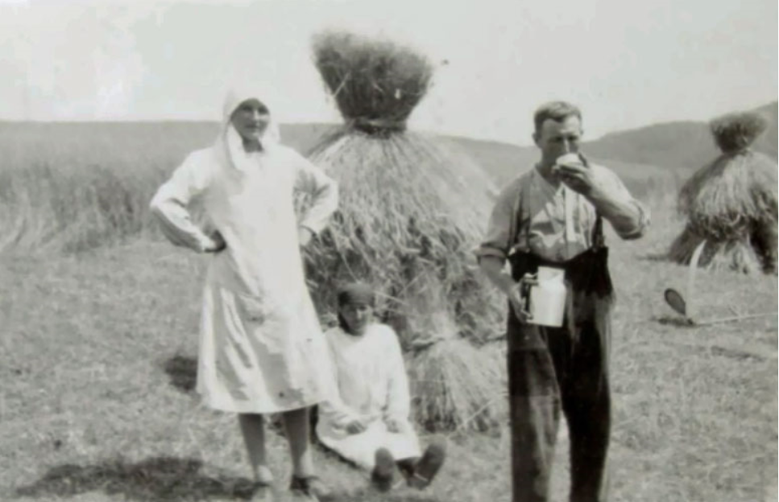

*Im Feld bei der Heuernte*

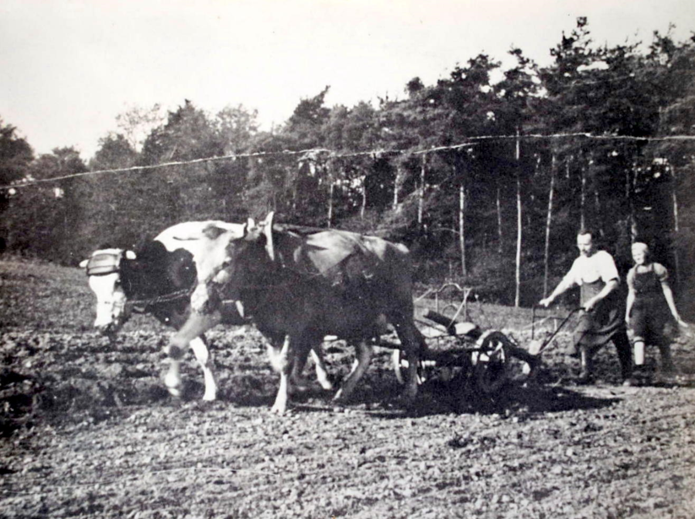

*Landarbeit mit Kühen und Pferd*

## Tischlein deck Dich

Nachfolgend die Tagesspeisen einer durchschnittlichen Strinzer Familie in der ersten Hälfte des 20. Jahrhunderts:

Frühstück

In den Bauernfamilien wurde in der Regel zweimal gefrühstückt. Zum einen nach sieben Uhr, nachdem die Milch zur Milchsammelstelle gebracht wurde. Zum anderen gab es gegen zehn Uhr noch ein zweites Frühstück.

- Erstes Frühstück:
- Kaffee, Brot, Butter, Marmelade oder Gelee
- Zweites Frühstück:
- Kaffee, Brot, Butter, Schinken, Hausmacher Wurst oder Speck und Eier.
- Mittagstisch
- Sonntag:
Suppe, besseres Fleisch (z. B. ein gutes Stück aus der Bütte, Schweine- oder Rinderbraten), Salzkartoffeln, Gemüse (Salat)

- Montag:
- Die Reste vom Sonntag werden gewärmt.
- Dienstag und Freitag:
- fleischlose Kost wie zum Beispiel:
  - Suppe, Mehlspeisen (Pfannkuchen, Apfelplätzchen, Spatzen, Schluckerter, Nudeln, Grießbrei, Waffeln), Obst (aus Gläsern) oder Apfelbrei

  - Suppe, Kartoffelbrei (Kartoffelgemüse), Apfelbrei oder gedämpfte Äpfelchen

  - Suppe, Karoffelklöse mit Specksoße, Apfelbrei oder gedämpfte Äpfelchen

  - Suppe, Kartoffelplätzchen

  - Suppe, gebackene Eier, Kartoffeln, Salat

Mittwoch und Donnerstag:

Gerichte mit gewöhnlichem Fleisch, z. B.:

  - Suppe, Kochfleisch aus der Bütte oder ein Stück vom Schinken gekocht, Kartoffeln, Gemüse oder Sauerkraut

- Samstag:
- Kartoffelbrühe (Dicke Suppe)
- Abendessen
- Werktags:
Dickmilch (Buttermilch), Pellkartoffeln (solange Kartoffeln noch einigermaßen frisch waren), später dann Salzkartoffeln (manchmal auch Röstkartoffeln), Brot und Butter und dazu immer nur einen der folgenden Brotbeläge: Handkäse, Schinken, Schnellkäse, Wurst, Schmierkäse (Quark).

Sonntags:

Kartoffelsalat, Wurst

> Quelle: Das war ihr Leben, Helge Schmidt, 1985

Was war der Schluckerter?

In der obigen Beschreibung des üblichen Mittagstisches der Strinzer Landleute wird auch das Gericht „Schluckerter“ aufgeführt. Beim Schluckerter handelte es sich um eine einfache Mehlspeise, man würde heute „Arme-Leute-Essen“ dazu sagen.

In dem Büchlein „Hünstetter Gericht`scher und Gedicht`scher“ kann man das Schuckerter-Rezept nachlesen.

- Schluckerter
- Zutaten:
- 2 Schobbe Milch, Mehl, 1 Prise Salz, Butter, Zucker, Zimt
- Zubereitung:
- Die gesalzene Milch wird auf dem Feuer zum Kochen gebracht,
Weißmehl wird hineingedrückt. Die Masse wird solange gekocht, bis sie steif ist.

Dann nimmt man sie vom Herd und schöpft sie mit einem in Butter getauchten Löffel

in eine irdene Schüssel. Bestreut wird der Schluckerter mit Zucker und Zimt.

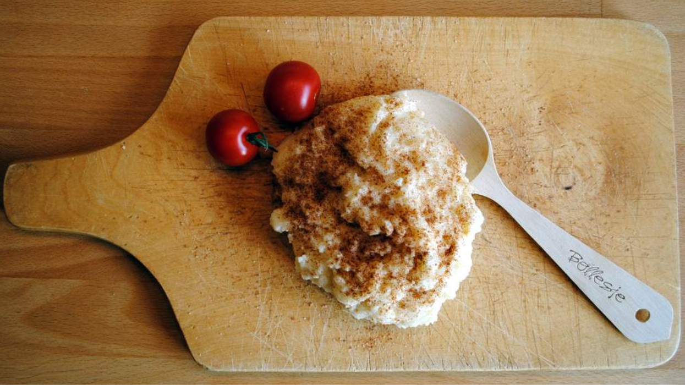

*Nachgekochter Schluckerter*

## Das liebe Vieh

Im Hessischen Staatsarchiv existieren noch Listen über den Tierbestand des Ortes aus dem Jahre 1947 bis 1971.

Im Jahre 1947 war der Ort noch sehr landwirtschaftliche geprägt.

Als Viehbestand wir angegeben:

- 252 Schweine

- 295 Rinder

- 214 Schafe

- 42 Pferde

- 55 Ziegen

- 478 Hühner

- 16 Gänse

- 2 Enten

- 10 Trut- und Perlhühner

- 19 Zwerghühner

- 31 zahme Kaninchen

- 70 Bienenstöcke

Die Tiere mussten natürlich täglich versorgt werden.

Nachfolgend das typische Futter einiger der genannten Haustiere:

Pferde: Heu, Hafer, Dickwurz, Klee

Kühe/Ziegen:	Grünfutter (Klee, Futtergras), Heu, Gesitt oder gehäckseltes Haferstroh, vermengt mit gemahlenen Kohlraben oder Dickwurz, Schrot (vor allem aus Hafer)

Schweine:	Getränk (bestehend aus Schrot, gedämpften Kartoffeln, Magermilch), Dickwurz, Grünfutter

Hühner:	Weichfutter (Schrot mit gedämpften Kartoffeln), Hafer, Weizen, Grünfutter

## Nichts zu meckern

Um die Fortpflanzung der Tiere im Dorf zu gewährleisten, wurde von jeder im Dorf vorhandenen Tierart ein männliches Exemplar gehalten. Früher auf dem sogenannten Ochsengut, später in Einzelhaltung durch benannte Personen.

Aus dem Jahre 1913 ist ein Vertrag der Gemeinde mit dem Halter des Orts-Ziegenbocks erhalten geblieben, der auf das genaueste beschreibt, wie der Ziegenbock zu halten ist.

Als Ziegenbock hatte man in StM nichts zu meckern

Nachfolgen die Anforderungen an den Ziegenhalter.

Anforderungen an den Bockhalter

- Der Bockhalter hat die Ziegenböcke gut zu behandeln und zu pflegen, täglich zu putzen und muss mindestens einmal täglich frisches Streu geben.

- Die Ziegenböcke sind täglich in freier Luft zu bewegen

- Der Bockhalter hat die Ziegenböcke täglich 3-mal und zwar morgens, mittags und abends ausreichend zu füttern und zu tränken. Zum Tränken muss gutes, frisches Wasser verwendet werden.

- Der Bockhalter ist verpflichtet, alle Maßnahmen anzuwenden, welche geeignet sind, den Bockgeruch zu vermeiden oder zu dämpfen, besonders auch durch Verwendung von Deodosierungsapparaten.

Anforderungen an den Stall

- Höhe des Stalles mindestens 2,50

- Genügend Lüftung durch Dunstschlote oder Rohre von 10 cm lichter Weite. Die Dunstrohre müssen unmittelbar unter der Stalldecke und an zwei verschiedenen Seiten des Stalles angebracht sein.

- Beleuchtung durch Fenster in einer Größe von mindesten 1/20tel der Grundfläche.

- Der Stall muss mit Backsteinen in Zementmörtel gepflastert sein mit einem Gefälle von 5% nach der Jaucherinne zu.

- Zur Abführung der Jauche muss eine Rinne mit genügendem Gefälle vorhanden sein.

- Die Wände müssen gut verputzt und geweißt sein. Sie müssen alljährlich mindestens einmal neu geweißt werden.

- Im Stalle ist eine genügend große Holzkiste aufzustellen oder ein entsprechendes Holzgerüst anzubringen – etwa 1m hoch – auf welches die Ziegenböcke klettern und sich trockenlegen können.

Geregeltes Liebesspiel

Es ist dem Bockhalter verboten:

- die Ziegenböcke früher zum Sprung zuzulassen, bevor sie als tauglich zur Nachzucht angekört und darüber schriftlicher Bescheid vom Landrat ergangen ist

- durch die Ziegenböcke Ziegen aus anderen Gemeinden decken zu lassen

- durch den Ziegenbock mehr als 6 Ziegen an einem Tag und nicht mehr als 100 Ziegen zusammen in einer Körperiode decken zu lassen. Zwischen den einzelnen Sprüngen muss jedes Mal ein Zwischenraum von mindestens 1 Stunde liegen.

## Hausschlachtung

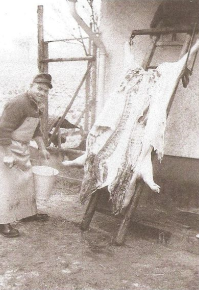

Hausschlachtungen waren in früherer Zeit fester Bestandteil des Dorflebens und der Daseinsvorsorge der im Dorf lebenden Familien. Wenn man die vergangenen 100 Jahre betrachtet, mit den verheerenden Notlagen, während und nach dem ersten und noch verstärkt während und nach dem 2. Weltkrieg, konnte man nur überleben, wenn man Tiere aufzog, die für den Eigenbedarf geschlachtet werden konnten.

Das war in der Regel Schweine, aber auch Kleintiere wie Ziegen, Schafe, Hühner und Hasen. Ein Rund zu schlachten war eher die Ausnahme, denn das konnten sich nur wenige leisten, weil Rinder vorwiegend als Milchlieferanten und als Zugtiere genutzt wurden. Mit der Schlachtung eines Schweines war die Versorgung der Familie mit Fleisch für ein halbes Jahr gesichert.

Geschlachtet wurde im Spätherbst und Frühjahr

Wegen der Haltbarmachung hat man als Schlachttermin die kältere Jahreszeit bevorzugt, das war der Spätherbst und das zeitige Frühjahr, d. h. das zweimal im Jahr geschlachtet wurde.

Zur Hausschlachtung gab es in StM drei Metzger, die dazu ihre Dienste anboten und alle drei hatten während der Schlachtsaison gut zu tun. Nachdem der Fleischbeschauer am Tag davor das zu schlachtende Schwein begutachtet hatte, kam der Metzger am nächsten Morgen ins Haus und dem Schwein ging es an den Kragen.

Die Tötung erfolgte zumeist im Hof mit dem Bolzenschussapparat, wo auch das Brühen, Schaben und das Ausnehmen erfolgte. Zum Ausnehmen wurde das Schwein auf die Leiter gehängt, wo wie es im Bild zu sehen ist. Mit diesen Arbeiten war der Vormittag ausgefüllt, vor der Weiterverarbeitung musste Fleischbeschauer Proben entnehmen, die er unter dem Mikroskop aus Trichinen untersucht hat. Wenn alles in Ordnung war, hat er an verschiedenen Stellen den Freistempel angebracht und nach Auskühlung des Schlachtkörpers erfolgte am Nachmittag die Zerlegung und Weiterverarbeitung.

Mittlerweile hatte die Hausfrau dafür alles Nötige vorbereitet. Das Holzfeuer durfte den ganzen Tag über im Herd und im Kessel nicht ausgehen. Schon am frühen Morgen wurde zum Brühen heißes Wasser gebraucht, am Nachmittag wurden auf dem Herd der „Schmelzer“ und Speck ausgelassen, denn Schweineschmalz wurde in irdene Töpfe gefüllt, als Vorrat für ein halbes Jahr zum Kochen und zum Backen.

Der Metzger nahm nun die weitere Zerlegung vor, in der Regel nach immer gleichem Muster, in zwei Hinter- und zwei Vorderschinken, zwei Seitenstücke, Koteletts und meist portionierte Stücke zum Einlegen in Salzlauge in der Fleischbütt, zur Haltbarmachung über mehrere Monate. Das Übrige, die Innereien und das aufgefangene Blut, verarbeitete der Metzger zu Blutwurst, Leberwurst, Bratwurst und Presskopf.

Ein Teil davon wurde mit dem Füllapparat in Därme, Blase und Magen verfüllt, der übrige Teil in Blechdosen, die nach dem Abschneiden mit neuen Deckeln versehen, mit der Dosenmaschine verschlossen wurden. Zunächst musste die Darmwurst im Kessel gekocht werden. Nach der Entnahme der Würste ließ man das Ganze noch etwas einkochen und so wurde daraus die „Metzelsupp“. Nach der Entnahme der „Metzelsupp“ mussten auch die Wurstdosen im Kessel zur Haltbarmachung gekocht werden.

Am Ende des Tages gab es die erste Mahlzeit aus der Schlachtung mit „Metzelsupp“, Wellfleisch, frischer Wurst und Kartoffelsalat. Auch der Schnaps, „Klarer Korn“ oder „Kümmel“ durften natürlich nicht fehlen, den man auch den Tag über nicht missen mochte.

Mit der Schlachtung war jedoch die Hausfrau noch einige Zeit beschäftigt, denn die sichere

Haltbarmachung durch das Räuchern, das Einlegen in der Fleischbütt und die Kennzeichnung und Lagerung der Dosen und der Würste beschäftigte sie noch über Wochen. Die Schinken

lagen meist sechs Wochen in der Salzlauge, das anschließende Räuchern ging über mehrere

Tage und musste gut beobachtet werden, nicht zu viel Rauch, aber auch nicht zu wenig. Sie

musste den Vorrat gut einteilen und sich sorgen, dass es bis zur nächsten Schlachtung reicht.

Ein Beitrag von Helmut Hartwig

Nachfolgend einige Utensilen für die Schlachtung:

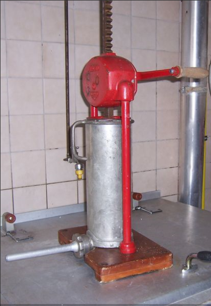

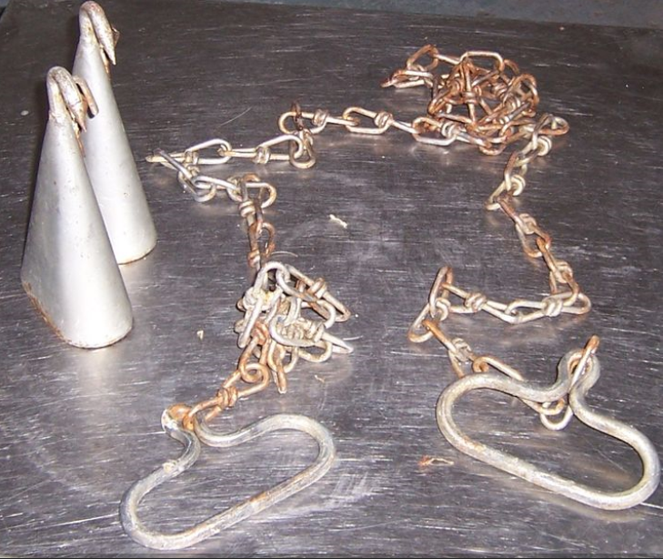

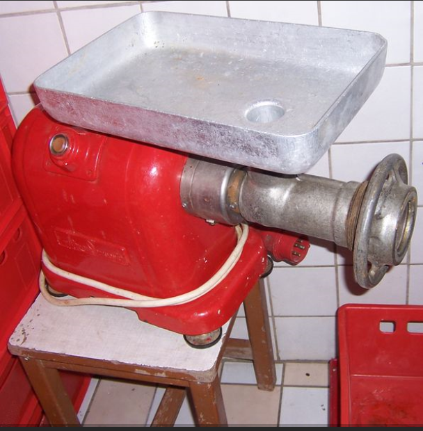

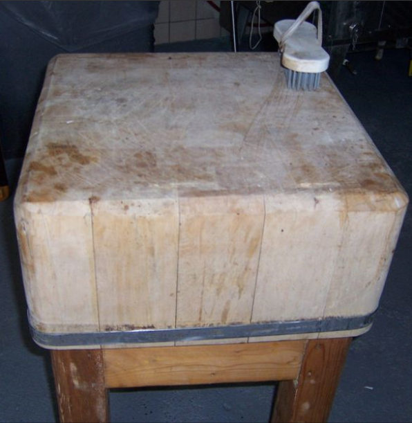

## Der Kartoffeldämpfer

Wozu braucht man wohl einen Kartoffeldämpfer, der pro Stunde 18 Zentner Kartoffeln garkocht?

Mit der landwirtschaftlichen / technischen Aufrüstung der Dörfer und der Förderung durch den Staat, kam Ende 1939 der Kartoffeldämpfer – zum Pries von 2.449,20 RM – auch nach StM.

In der damaligen Dreifelderwirtschaft spielte der Kartoffelanbau eine sehr große Rolle. Der Wechsel in der Fruchtfolge war entscheidend für eine gesunde Struktur der Ackerkrumme, so dass mit dem betriebseigenen Naturdünger, Stallmist und Jauche, gute Erträge zu erzielen waren. Nur in geringem Umfang wurden damals die damals sehr teuren Kunstdünger eingesetzt.

Durch die Dreifelderwirtschaft war die Gemarkung dreigeteilt, in den Teil der mit Wintergetreide bestellt war, das waren Roggen und Weizen und etwas Gerste. Der andere Teil war mit Sommergetreide bestellt, das waren Hafer, Gerste und etwas Sommerweizen. Der dritte Teil war das sogenannte Brachfeld, mit dem Anbau von Futterrüben, Klee und Kleegrasgemenge überwiegende zur Verwendung als Viehfutter sowie Kartoffeln für die Schweinemast, zum Verkauf als Speisekartoffel, sogenannte Einkellerungskartoffeln für den Wintervorrat, aber auch für den Eigenbedarf und etwas Gemüse.

Mit dem Anbau von Kartoffeln wurden zu der Zeit die doppelten Mengen an Nährstoffen pro Hektar erzielt als mit Getreide, jedoch mit einem entscheidenden Nachteil, denn die Kartoffeln mussten frostsicher gelagert werden. Das war in der Regel der Keller unter der Wohnstube des Bauernhauses. Die Menge, die man lagern konnte war daher sehr begrenzt. Was nicht direkt nach der Ernte als Speisekartoffeln, z.B. an Kunden in Wiesbaden verkauft werden konnte, diente dem Eigenbedarf der Familie und als Futter in der Schweinemast.

Hier kommt der Kartoffeldämpfer ins Spiel, mit dem die Kartoffeln in großen Mengen gargekocht werden konnten. Sie wurden dann in ein Silo eingestampft und luftdicht verschlossen. Mit der natürlich einsetzenden Milchsäuregärung waren sie zum Verfüttern über lange Zeit haltbar. Das tägliche Kochen zum Verfüttern, das sehr arbeits- und energieintensiv war, konnte entfallen.

Der Kartoffelausbau wurde dadurch stark ausgeweitet und so wurden bei guten Erträgen in der Strinzer Gemarkung, schätzungsweise, bis zu 10.000 Zentner geerntet. Die sichere Lagerung musste vor Beginn der Frostperiode erfolgen und so ging die Dämpfkolonne von Anfang November bis Mitte Dezember von Hof zu Hof. Es wurde oft von morgens 7:00 Uhr bis Mitternacht gedämpft, 18 Zentner pro Stunde, bis zu 250 Zentner am Tag.

Nachdem es für den Strinzer Kartoffeldämpfer keine Verwendung mehr gab, wurde dieser in der Nachkriegszeit an das Freilichtmuseum Hessenpark gespendet. Dort ist dieser Eingemottet und wird ab und zu vorgeführt.

So geschehen am 18.08.2013, wo das obige Bild entstanden ist.

Ein Beitrag von Helmut Hartwig

Nachfolgend noch zwei Bilder aus der original Betriebsanleitung, die Zubehörgeräte zur Kartoffelwäsche zeigen.

*Bild 1: Trommelwäsche aus Streckmetall mit Vorreinigungstrommel*

Bild 2: Quirlwäsche mit seitlichem Schlammabsatzraum

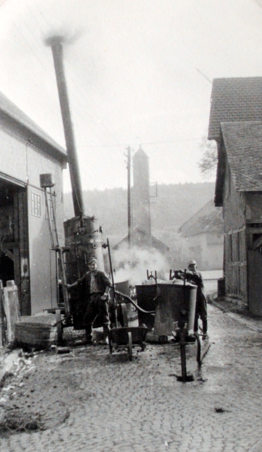

*Der Kartoffeldämpfer im Einsatz in der Schulstraße*

## Als die Kühe Schuhe trugen

Im Jahre 1935 gab es in StM 385 Rinder. 1966 gab es immer noch 426 an der Zahl. Danach nahm deren Anzahl stetig ab. Heute (Stand: 18.02.2020) gibt es leider keine Rinder mehr in StM. Die Pferde haben im Dorf die Hoheit übernommen.

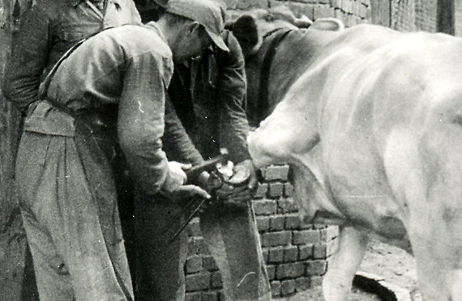

Ein Pferd konnten sich früher nur wenige leisten. Wenn anderswo Pferde vor Kutschen oder Pflüge gespannt wurden, nutzte man in den Dörfern Rinder für die Verrichtung dieser Tätigkeiten.

Beschlagen einer Kuh (nicht in StM)

Rinder haben auch Hufe und um diese vor allzu schneller Abnutzung zu schützen und zudem bei der Feldarbeit einen zusätzlichen Halt zu bieten, wurden deren Hufe auch mit Eisen beschlagen.

Da es sich bei Kühen allerdings um Paarhufer handelt, d.h. dass diese im Gegensatz zu Pferden zwei Zehen haben, konnte man hierfür nicht die üblichen Pferdehufeisen nutzen.

Es gab daher spezielle Hufeisen für Rinder, die man als

- Kuheisen

- Kuhschuh

- Kuhplatte oder

- Ochseneisen

bezeichnete.

Ähnlich wie Pferdehufeisen gingen diese natürlich auch des Öfteren verloren und sind auf den Strinzer Feldern immer wieder zu finden.

Bild einfügen

## Dreschhalle und Dreschmaschine

*Die Feldscheuer an der Kreuzung nach Hennethal und Breithardt*

*Die alte Dreschmaschine*

*Rechts die Dreschhalle*

## Die Zeugwäsche

Bis Mitte der 60iger Jahre waren die landwirtschaftlichen Betriebe in StM kleinbäuerliche strukturiert, die durchschnittliche Größe dürfte etwa bei 7 ha. gelegen haben.

Die Ackerflächen wurden bis dahin noch nach dem Prinzip der Dreifelderwirtschaft bestellt, die auch eine entsprechende Viehhaltung zum Ziel hatte. Ein Drittel der Gemarkung diente dem Anbau von Hackfrüchten und Klee (Deutscher Rotklee) in erster Linie als Futtergrundlage für die Rinderviehhaltung. Als Winterfutter waren die Futterrüben (Dickwurz), auch Runkelrüben genannt, neben dem Heuvorrat die Grundlage für die Winterfütterung in der Milchviehhaltung.

Auf leichten Böden, die für die Dickwurz nicht geeignet waren, wurden Erdkohlraben angebaut. Bein einer durchschnittlichen Anbaufläche von 1⁄2 bis 1⁄4 Hektar (2 bis 3 Morgen) konnte man mit einem Ernteertrag von 600 bis 900 Zentner rechnen, die man in der Rübenmiete (Dickwurzkaut) für den Winter frostsicher einschlug und nach Bedarf zur Fütterung heimholte. Die Dickwurz und auch besonders die Kohlraben waren im Wurzelbereich erheblich mit dem Ackerboden behaftet und voller Dreck, den man nach damaligem Verständnis, den Tieren als Futter keineswegs zumuten konnte. Also mussten sie geputzt oder gewaschen werden. Die rationellere Methode war natürlich das Waschen und dazu brauchte man viel Wasser und ein großes Becken. Das war die Zeugwaschanlage, die unterhalb der Pfalzstraßenbrücke im Aubach angelegt war.

Sie bestand aus zwei parallel verlaufenden Betonhalbrohrschalen mit einem Durchmesser von rd. 1 Meter und einer Länge von rd. 10 Meter, in der Mitte durch eine ca. 70 cm breite Betonmole getrennt, sodass man zwei Staubecken hatte, die man von jeder Seite benutzen konnte. So war es möglich, dass zwei Bauern gleichzeitig ihre Dickwurz waschen konnten. Wenn der Bach genügend Wasser führte, konnte man sogar jedes Staubecken noch einmal in der Mitte, durch das Einstellen der Horde trennen, um vier Parteien gleichzeitig zu waschen, was in Stoßzeiten auch nötig war. zum Waschen wurde je eine Wagenladung (Kastenwagen) in das aufgestaute Wasser geworfen, mit einem Karst (Korscht), der einen extra langen Stil hatte, gestumpt und die so gesäuberte Dickwurz mit der Gabel wieder herausgefischt.

Die Dickwurzfutterrationen wurden jeden Tag frisch auf der Rübenmühle (Dickworzmill) kleingeschnitzelt mit Spreu (Gesitt) gemischt, hergestellt. Diese arbeitsintensiven Methoden waren nicht länger aufrecht zu erhalten und so hat man dem Vieh ungewaschene und ungeschnitzelte Rüben in den Futtertrog geworfen, die die Tiere auch so gefressen haben. Ob sich das auf die Milchleistung ausgewirkt hat wurde nicht weiter betrachtet. denn mit dem größer werden er Betriebe und anderen Fütterungs- und Anbaumethoden wurde das „Saftfutter“ Dickwurz weitgehend verdrängt durch Mais- und Grassilage.

Von der Zeugwäsche ist heute nichts mehr zu sehen. Sie wurde im Jahre 1988 im Rahmen der Kanalerneuerung in der Pfalzstraße rückgebaut.

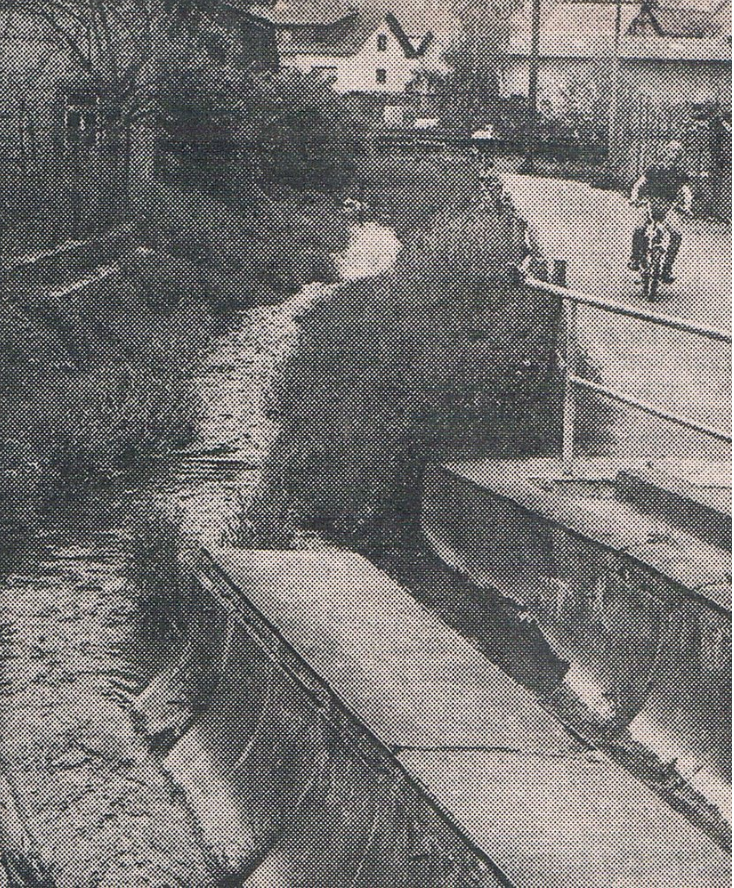

*Rüben waschen an der Zeugwäsche*

*Vorbeifahrt an der Zeugwäsche*

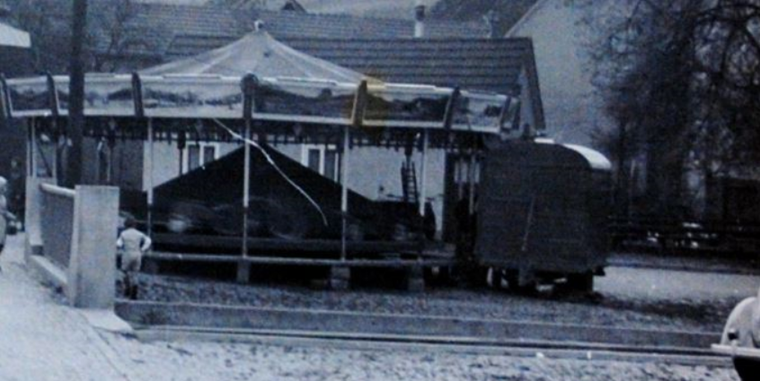

*Die Zeugwäsche*
