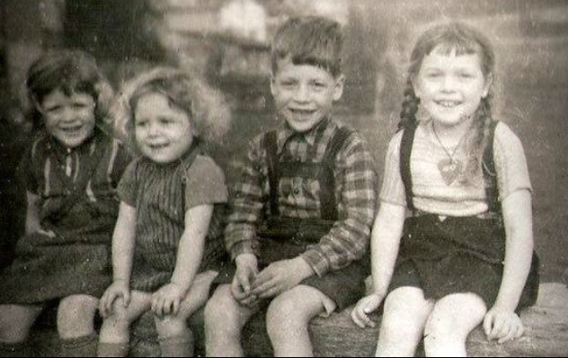
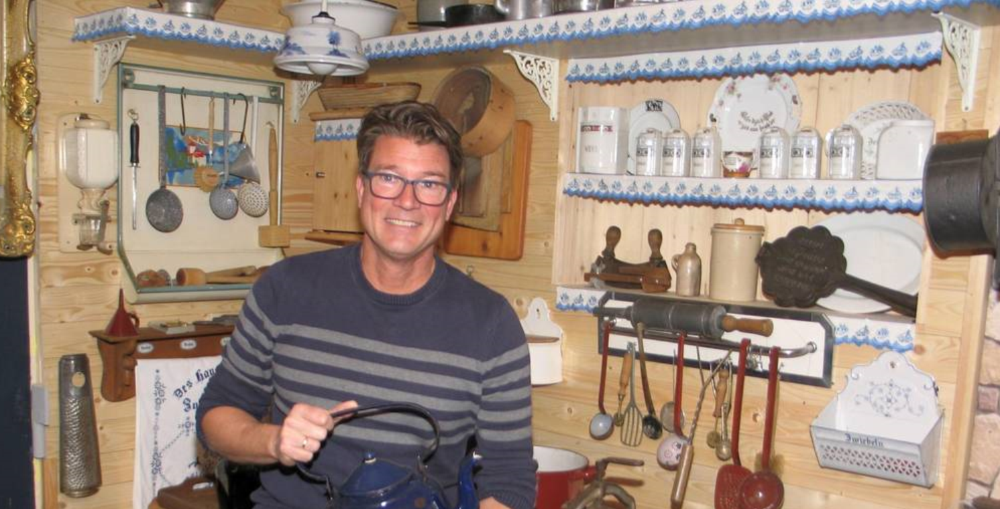

# Presseartikel

## Der Brunnen ist nicht nur ein Blickfang

Von Thorsten Stötzer 30.03.17

Derzeit umrahmen etliche Ostereier an den umliegenden Sträuchern den Brunnen. Fotos: Thorsten Stötzer

STRINZ-MARGARETHÄ - Zwischen Ostereiern und frisch bepflanzten Blumenkübeln plätschert das Wasser durch den alten Laufbrunnen an der Ecke Pfalzstraße/Schulstraße in Strinz-Margarethä. Nach einer aufwendigen Sanierung ist der Brunnen im Sommer in die Ortschaft zurückgekehrt, und es hat nicht lange gedauert, bis er als Mittelpunkt diente.

„Am nächsten Tag haben schon Kinder darin gebadet“, erzählt der stellvertretende Ortsvorsteher Frank Schwarzer. Wie er freut sich Ortsvorsteher Jürgen Dillmann, dass die Bevölkerung den gesamten Platz so gut annimmt. Die Brunnensanierung liegt zwar in Händen der Gemeinde, aber der Ortsbeirat kümmert sich um die Gestaltung des Umfeldes, auch gefördert mit Mitteln aus dem Kreisprogramm Zukunft Dorfmitte. Viele Spenden und Eigenleistungen stecken ebenso im Projekt.

Am Brunnen prangt die Jahreszahl 1888

Damals wurde das gusseiserne Stück vermutlich in der Michelbacher Hütte gebaut, und genau dort vollzog sich die jüngste Sanierung. Der Strinzer Michael Hahn hat die Restauration bei der heutigen ACO Passavant Guss GmbH in Aarbergen übernommen. „Die Ecken wurden neu gegossen, das sieht man an den Schweißnähten“, erklärt Schwarzer. Blau schimmert der Brunnen mit der achteckigen Säule. Am Edelstahlbecken, das kürzer und höher ist als üblich, fallen goldene Ornamente wie ein Löwenkopf auf. „Die habe ich eine volle Woche lang gestrichen“, schildert Schwarzer. Das macht deutlich, wie viele Eigenleistungen investiert wurden. Dillmann schätzt die Zahl der unentgeltlichen Arbeitsstunden von Ortsbeiratsmitgliedern auf über 200.

Der stellvertretende Ortsvorsteher Frank Schwarzer (links) und Ortsvorsteher Jürgen Dillmann freuen sich über den Brunnen.

Mit einem Fest sollen die Neurungen gefeiert werden

Es wurde weiterhin gesäubert und es wurden auch Sitzgruppen aufgestellt auf dem noch namenlosen Platz. Vom Freundeskreis Strinz-Aube stammt ein Schild, das auf die französische Partnergemeinde – Entfernung: 728,4 Kilometer – hinweist und das Material für eine kleine Überdachung darüber, die wiederum Schwarzer hergestellt hat. Der Verein „Auf Brüderstein“ hat zum Beispiel für die Sitzbänke gespendet.

Dazu fließen 1000 Euro aus der „Zukunft Dorfmitte“. Insgesamt werde der Platz wohl 3500 bis 4000 Euro kosten, meint Dillmann, der Ortsbeirat als Projektträger beteiligt sich ebenfalls finanziell. Die Spendenfreude ist groß, weshalb auch die Pflanzkübel beschafft wurden. Direkt hinter dem angrenzenden Geländer verläuft der Aubach an zentraler, aber verkehrsruhiger Stelle. Schilder könnten bald zudem auf die „Backeswies“ gegenüber und das frühere Feuerwehrgerätehaus hinweisen.

Im Frühjahr soll noch das Buswartehäuschen auf der anderen Straßenseite gestrichen und eventuell mit Bänken ausgestattet werden. Anschließend ist Zeit für ein Fest, um den neuen Platz und das Ende der vorangegangenen Bauarbeiten an Straße und Brücke zu feiern, sagt Dillmann. Gute Erfahrungen hat der Ortsbeirat bereits beim ersten „Lebendigen Adventskalender“ gemacht: Als der Brunnen und die Anlagen ringsum Station waren, trafen sich dort über 100 Menschen.

## Frankfurterin trifft nach 70 Jahren ihr ehemaliges Kindermädchen in Strinz-Margarethä wieder

Von Thorsten Stötzer 15.07.2017

Die alte Schule im Hintergrund ist ein Anlaufpunkt beim Wiedersehen von Marei Hartlaub (2.v.r.) und ihrem früheren Kindermädchen Irma Kugelstadt (Mitte). Auch für Helmut Hartwig (l.), Frank Schwarzer (2.v.l.) und Sohn Daniel Hartlaub sind die Erinnerungen an die Kriegstage interessant. Foto: Thorsten Stötzer

> Foto: Thorsten Stötzer

STRINZ-MARGARETHÄ - Alte Schwarz-Weiß-Fotos liegen auf dem Tisch mit Männern darauf, die Knickerbocker tragen. Und ein Kalenderblatt, auf dessen Rückseite Marei Hartlaub einst mit Kinderschrift das Strinzer Lied geschrieben hat, sorgt für Aufmerksamkeit. „Die Strinzer Hymne könnte ich immer noch singen“, ist sie sich sicher, als sie bei der Familie Hartwig zu Besuch ist.

Dabei ist es lange her, dass Marei Hartlaub, die damals noch als Mareile Richter bekannt war, in Strinz-Margarethä lebte. Von 1943 bis 1946 war das. Als Fünfjährige kam sie ins Dorf, weil in Frankfurt die Lage wegen der Luftangriffe immer gefährlicher wurde. Erstmals trifft sie nun ihr Kindermädchen wieder: Irma Kugelstadt, geborene Hartwig, Jahrgang 1931, war damals selbst noch schulpflichtig.

Die Schrecken des Krieges sind noch präsent

„Es hat sich so ergeben“, sagt Irma Kugelstadt über ihre Aufgabe. Schon früh hatte sie auf Kinder aus der Nachbarschaft aufgepasst, wenn deren Eltern auf dem Feld schafften. Kinder gab es seinerzeit viele im Dorf: Marei Richter war die Älteste in ihrer Familie, die Geschwister Peter, Gudula und Sabine waren mitgekommen, ebenso wie zwei Tanten – Schwestern der Mutter – mit ihrem Nachwuchs.

Die Geschwister Gudula, Sabine, Peter und Marei einst in Strinz-Margarethä.
Foto: Familie Hartlaub

„Die waren ja brav“, sagt Irma Kugelstadt über ihre Schützlinge. Erinnerungen werden wach an Spiele wie „Ochs am Berg“ oder „Blinde Kuh“. Zugleich sind die Schrecken des Krieges noch präsent. Kurz vor dem Einmarsch der Amerikaner sprengten deutsche Truppen ein Flak-Geschütz, das sie nicht um eine Hausecke brachten. Ein Munitionswagen stand in der Nähe, es brannten Häuser und Scheunen.

Klein und schief muss das Haus der Familie Fay gewesen sein, in dem Marei Hartlaubs Familie wohnte. „Ich habe keine Ahnung, wie wir uns da gewaschen haben“, die Toilette befand sich jedenfalls im Keller bei den Ziegen. 1946 verließen die Frankfurter Strinz, es folgten Vertriebene aus dem Osten, berichtet Helmut Hartwig, der Bruder Irma Kugelstadts und Unterstützer der Chronistenarbeit.

Den Kindern zeigte sie die Stätten ihrer Jugend

Später ist sie mit den eigenen Kindern manchmal durch Strinz-Margarethä gefahren und hat ihnen einige Stätten gezeigt. Direkter Kontakt kam aber erst jetzt wieder zustande durch die Internet-Chronikseite, die Frank Schwarzer betreibt. „Mein Opa hätte sich gefreut“, meint Marei Hartlaub. Ohne Richard Weißer (1886 bis 1950) wäre sie nämlich nie nach Strinz-Margarethä gelangt.

Der Großvater war Lehrer im Dorf, für das er sich wegen des schönen Namens interessierte. Sein Berufsleben verlief wechselhaft. Die Nazis hatten Weißer von seinem Rektor-Posten in Frankfurt abgesetzt, aufs Land zog er als Ausgebombter. Nach dem Krieg wurde Weißer Rektor der Mittelschule in Bad Schwalbach. Der Pädagoge war zugleich als Autor von Romanen und Dramen produktiv.

„Er war ein früher aufrechter Demokrat, ein richtiger Liberaler“, beschreiben seine Nachfahren das Mitglied der linksliberalen DDP und für kurze Zeit der SPD.

Als sein Enkel und Cousin Marei Hartlaubs wurde 1944 in Bad Schwalbach der Schriftsteller Jörg Fauser geboren (gestorben 1987), der ebenfalls frühe Kindheitstage in Strinz verbrachte. Seine Mutter Maria Fauser erlebten viele Hörer später als HR-Moderatorin.

## Strinz-Margarethä: Frank Schwarzer hat eine ungewöhnliche Flaschensammlung ergraben

Von Thorsten Stötzer 12.09.2017

Viele Stunden hat Frank Schwarzer im Freien verbracht, um seine Flaschensammlung auszubauen und zu erhalten. Foto: Thorsten Stötzer

> Foto: Thorsten Stötzer

STRINZ-MARGARETHÄ - An der eckigen Form und dem dünnen Hals erkennt noch heute jedes Kind eine Maggi-Flasche. Beim Exemplar, das Frank Schwarzer präsentiert, handelt es sich dennoch um eine Rarität, denn sie ist mindestens 80 Jahre alt und ungewöhnlich groß. Die Ein-Liter-Flasche war speziell für die Gastronomie im Handel, erläutert der Heimathistoriker aus Strinz-Margarethä.

Schwarzer sammelt alte Flaschen und zwar nicht, indem er sie im Internet erwirbt. Vielmehr durchstreift er die Gemarkung seines Wohnortes und gräbt vorsichtig aus, was an Glas aus der Erde lugt. Eine Sektflasche aus der Zeit um 1900 gehört zu seinen Schätzen. Sie ist mehr als ein Kilo schwer, und der Fachmann erkennt, dass sie mundgeblasen ist wegen der Lufteinschlüsse im Glas und der fehlenden Naht.

Fundus umfasst knapp 50 Exemplare

An die 50 Flaschen umfasst Schwarzers Fundus. „Ich gehe mit offenen Augen durch die Gemarkung“, schildert er. Die Flaschen stammen aus der Zeit, als in Landgemeinden noch keine Müllabfuhr existierte und manches in die Hecken geworfen wurde. Dabei braucht der Sammler einen wachen Blick, schließlich liegen die Flaschen nicht einfach herum, sondern sind eingewachsen und von Laub und Grund bedeckt.

Womöglich ist nur der Flaschenhals zu sehen. Am liebsten ist Frank Schwarzer daher im Frühjahr und im Herbst auf der Suche, wenn die Brennnesseln nicht zu hoch stehen: „Manchmal bin ich mit einer Machete unterwegs.“ Oft geht er mehrfach zu einer Stelle, denn im Sonnenlicht oder nach einem Regenguss leuchtet das Glas stärker. Mitgenommen wird nur, was noch keinen Schraubverschluss besitzt.

Die Reinigung ist aufwändig, besonders innen: „Oft hat sich da drin ein kleines Biotop entwickelt.“ An einer Bachböschung hat Schwarzer eine Steingut-Flasche für Mineralwasser aus dem 19. Jahrhundert gefunden. Die untergegangene Seltria-Quelle aus Niederselters ist der Abfüller einer anderen Flasche gewesen. Überwiegend sind die Stücke in der ersten Hälfte des 20. Jahrhunderts auf den Markt gelangt.

Schon damals nutzten Brauereien die Flaschen für Werbezwecke. „Felsenkeller Wiesbaden Hans Küffner GmbH“ ist auf einer Halbliter-Flasche aus der Zwischenkriegszeit zu lesen. Die Brauerei Merz aus Idstein hat sogar ein Wappen mit zwei Türmen, ähnlich dem der Stadt, in das Glas prägen lassen. Die Essigflaschen haben eine kleine Öffnung, weil ihr Inhalt seinerzeit 80 Prozent Säure aufwies, sagt Schwarzer.

Apothekenfläschchen und Glas aus der Nachkriegszeit

Limo von Bluna und Krystalla aus der Nachkriegszeit, Apothekenfläschchen und Cremetöpfe hat der Strinzer ebenfalls mit nach Hause gebracht. Einen besonderen Hintergrund verbindet er mit der Flasche der Firma Opekta, die Pektin zum Gelieren enthielt. Wie Schwarzer schildert, schrieb das jüdische Mädchen Anne Frank sein berühmtes Tagebuch im Hinterhof der niederländischen Niederlassung des Unternehmens.

So sieht Schwarzer in seiner Sammlung „Geschichte im Kleinen“. Er betreibt eine Internetseite zur Historie Strinz-Margarethäs, will sich aber nicht nur mit Schriftgut befassen. So sind für ihn die Flaschen gleichfalls Zeugnisse der Vergangenheit: „Das gehört für mich dazu, da haben inzwischen verstorbene Strinzer draus getrunken.“

## Vor 100 Jahren endeten auch in Strinz-Margarethä Krieg und Monarchie

Anfang Oktober ahnte der evangelische Seelsorger, dass Deutschland ein „schmachvoller Frieden“ bevorstehe, die Leute zeichneten schon keine Kriegsanleihen mehr.
Von Thorsten Stötzer 28.11.2018

Zeugnis aus Kriegsbesatzungstagen: Frank Schwarzer präsentiert die Erkennungsmarke von Francois Prunier.

> Foto: Thorsten Stötzer

STRINZ-MARGARETHÄ - Namen wie Friedrich Ebert, Wilhelm II., Paul von Hindenburg oder womöglich noch Kurt Eisner stehen im Mittelpunkt, wenn dieser Tage der deutschen Revolution und des Ende des Ersten Weltkriegs vor 100 Jahren gedacht wird. Abseits der Großstädte wirkten sich die „Haupt- und Staatsaktion“ auch auf ländliche Gegenden aus. In Strinz-Margarethä stand im November 1918 etwa fest, dass von 78 Kriegsteilnehmern aus dem Dorf 14 gefallen waren.

Geschichte der Ortschaft ist gut dokumentiert

Die Geschichte der Ortschaft ist gut dokumentiert, Frank Schwarzer hat sie für eine Internetpräsenz aufbereitet. Was den Weltkrieg und die unmittelbare Zeit danach inklusive französischer Besatzung anbelangt, so ist vor allem die vom damaligen Pfarrer Ernst Schilp geführte Kirchenchronik von hohem Wert. Anfang Oktober ahnte der evangelische Seelsorger, dass Deutschland ein „schmachvoller Frieden“ bevorstehe, die Leute zeichneten schon keine Kriegsanleihen mehr.

Nach dem Waffenstillstand vom 11. November organisierten sich die Einwohner von Strinz-Margarethä in neuen Formen. In einer Gemeindeversammlung forderten sie eine „Bürgerwehr“ an „zur Bewachung des Dorfes“. Wenige Tage darauf wurde ein „Arbeiter- und Bauernrat“ gegründet „in der Wirtschaft von Schneiders“. Solche Räte mussten nicht vom Sozialismus inspiriert sein. In Strinz ging es darum, sich auf durchmarschierende deutsche Truppen vorzubereiten, die von der Front heimkehrten. Kinder schmückten zu ihren Ehren die Schule, aber „die Mannschaften vom Heer kommen hier bei uns ganz still nach Hause“. Gegangen waren inzwischen die französischen Kriegsgefangenen.

Stattdessen rückten am 14. Dezember in Strinz-Margarethä 14 französische Besatzungssoldaten ein und verboten sogleich den Verkehr nach Hennethal und Strinz-Trinitatis. Der Pfarrer diente als Dolmetscher und erfuhr vom Kommandanten Bernhard de Lanquesaine: „Sie wollen nicht unsere Freunde sein, sondern vergelten und schrieben dem Kaiser die Schuld an dem Kriege zu.“ An Weihnachten war die Besatzung wieder abgezogen, stattdessen erfolgte die „Begrüßung heimkehrender Krieger“.

Noch mehrfach war der Ort von Einquartierungen betroffen in den nächsten Monaten. Im Februar 1919 handelte es sich laut Kirchenchronik gleich um „200 Mann und 200 Pferde... Das Dorf ist voll Kanonen und Fuhrpark“. Vor ihrem Abzug sollen die Franzosen dem Kaiser-Bild in der Schule „die Augen ausgekratzt und verschiedene Wunden gemalt“ haben. Später waren auch Marokkaner in Strinz.

Katholische Gottesdienste in französischer Sprache

Es wurden im evangelischen Dorf katholische Gottesdienste in französischer Sprache gehalten. „Franzosenmusik in Herdlings“ ist für den 31. August 1919 vermerkt, sie war ein Beitrag zur „friedlichen Durchdringung“, die die Besatzer verfolgten. Bis zu einer Partnerschaft, wie sie Strinz-Margarethä seit 44 Jahren mit Aube in der Normandie pflegt, war es aber noch lange hin. Ein Relikt aus der Zeit vor 100 Jahren bewahrt Frank Schwarzer auf. Es ist die Erkennungsmarke von Francois Prunier, der 1907 zum Militärdienst nach St. Malo eingezogen wurde. Die Marke fand sich am Hermannsweg.

## Von Millionären und Wolfsplagen in Strinz

Frank Schwarzer arbeitet in seinem privaten Museum die Geschichte Strinz-Margarethäs auf. Dort veranstaltet er Heimatabende mit Ratespielen, Geschichten und kuriosen Gegenständen.
Von Thorsten Stötzer 16.01.2019

Frank Schwarzer am Küchenherd, einem Schmuckstück seiner privaten, lokalgeschichtlichen Sammlung.

> Foto: Thorsten Stötzer

STRINZ-MARGARETHÄ - Der erste Millionär in Strinz-Margarethä hieß Heinrich Hankammer. Zu diesem Status verhalf ihm eine Kuh, die er im Inflationsjahr 1923 für 1,8 Millionen Mark verkaufte – bald waren auch alle Nachbarn nominell Millionäre. Das ist eine der Episoden, die Frank Schwarzer preisgibt, wenn er in sein rund 20 Quadratmeter großes, privates Heimatmuseum einlädt.

Hunderte Exponate sind dort versammelt, bislang sind sie ungezählt. Bügeleisen und ein Waschbrett, eine Gemarkungskarte von 1938 aus der ehemaligen Volksschule, ein Butterfass oder einen Hochzeitskranz von 1865 entdeckt das ruhige Auge. Ein alter Küchenherd hat das Interieur „im Prinzip perfekt gemacht“. Hergestellt wurde er von der Firma Wahl und Kircher aus Kettenbach, was noch ablesbar ist.

Die Küche stand früher im Mittelpunkt des Haushalts

Einen Haushalt aus früherer Zeit mit der Küche als Mittelpunkt darzustellen, ist das Leitmotiv im Museum. Frank Schwarzer arbeitet schon lange die Geschichte Strinz-Margarethäs auf, wobei ein Artikel im Aar-Boten über seine Flaschensammlung Folgen hatte. „Ich habe etwas für dich“, bekam er anschließend von Mitbürgern zu hören, die alten Hausrat nicht einfach wegwerfen wollten und zu ihm brachten.

„80 Prozent von dem, was hier steht, habe ich geschenkt gekriegt“, schätzt der gebürtige Rheingauer. Und dabei ist der Kellerraum nicht nur ein Ort für stille Betrachtungen. Auf einem Fernsehbildschirm, der in einen Bilderrahmen integriert ist, taucht ein Schriftzug auf: „Herzlich willkommen zum Heimatabend im kleinen Strinzer Heimatmuseum.“ Das deutet auf die Veranstaltungen vor Ort hin.

Im Februar 2018 ging es los mit einem Landfrauen-Abend. Dann trafen sich eine Volkslieder-Gruppe, der Ortsbeirat und Freundeskreise im Heimatmuseum. Für maximal zwölf Personen ist Platz, jeder bringt etwas zu essen und zu trinken mit, der Hausherr sorgt für ein historisch fundiertes und zugleich unterhaltsames Programm. So hält er einen Vortrag über die Wolfsplage 1604 oder alte Balken-Inschriften.

Doch es wird nicht nur zugehört, sondern auch geraten. Ein kleines Gerät von der Größe einer Streichholz-Schachtel führt Schwarzer vor: Wer kommt schon darauf, dass man Rasierklingen damit schärfen kann? Eine Vaginal-Dusche aus dem Jahr 1850 macht die Treffen ein wenig frivol. „Letztlich spielen wir Dings vom Dach“, sagt der Gastgeber. Wer am meisten weiß, wird zum „Klugscheißer des Abends“ gekürt.

„Man merkt nicht, wie die Stunden vergehen“, berichten Doris und Werner Schurr, die bereits an einem Heimatabend teilgenommen haben. Drei Stunden sind demnach rasch vorüber, und gerade „für uns als Zugereiste ist das hochinteressant“. Wer sich mit alten Schlagern von Peter Alexander oder Caterina Valente auskennt, kann übrigens ebenso Punkte sammeln, sie erschallen ebenso wie eine Grammophonplatte.

Während das 1928 hergestellte Grammophon mit der Handkurbel eiern darf, wurde das drei Jahrzehnte jüngere Radio mit Bluetooth-Technik modernisiert, ohne dass dies äußerlich erkennbar ist. So weit in die Gegenwart führt die Zeitreise allerdings nicht, der Vortrag endet mit einem Luftbild aus dem Jahr 1945.

## Briefe spiegeln Kriegsschicksale zweier Strinzer

Frank Schwarzer aus Strinz-Margarethä wertet Feldpost aus dem Zweiten Weltkrieg aus. Dabei kommen interessante Details ins Blickfeld.
Von Thorsten Stötzer 24.08.2019

## Essen gab es nur auf Bezugskarte

Auch nach dem Zweiten Weltkrieg waren die Zeiten für die Menschen im Untertaunus schwer. Heimatforscher Frank Schwarzer aus Strinz-Margarethä hat das Überlieferte zusammengetragen.
Von Hannelore Wiedemann 29.08.2020
